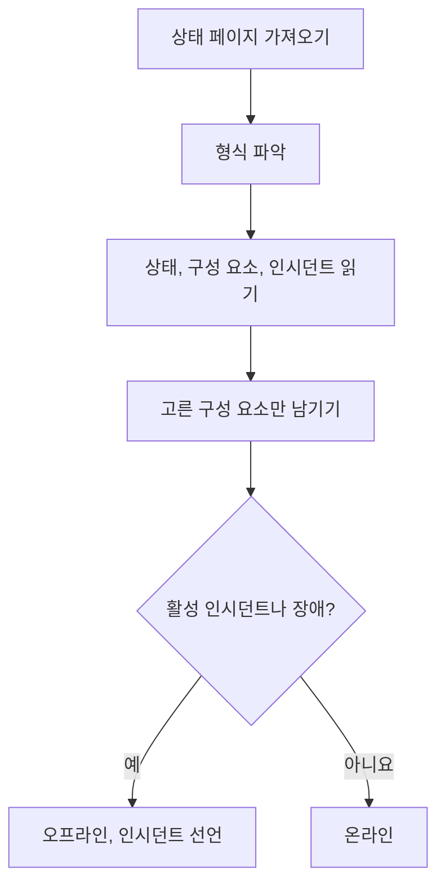

# 외부 상태 페이지 모니터

외부 상태 페이지 모니터는 여러분이 의존하는 서비스(AWS, GCP, Azure, GitHub, OpenAI, Anthropic 등 다수)의 공개 상태 페이지를 지켜보다가, 그 공급자가 장애나 성능 저하를 보고하면 알림을 보냅니다. 업스트림 문제를 공급자가 보고하는 즉시 알고, 여러분 자신의 문제와 구분하는 데 사용하세요.

OneUptime으로 만든 상태 페이지도 리소스별로 읽고, 계획된 유지 보수와 장애를 구분합니다. 다른 팀의 프로젝트나, 상태 페이지를 OneUptime에서 운영하는 공급업체를 지켜보세요.

:::cards
- [모니터 만들기](#외부-상태-페이지-모니터-만들기): 상태 페이지 URL을 붙여 넣고 지켜볼 대상을 고릅니다.
- [구성 요소 고르기](#구성-요소): 의존하는 구성 요소만 지켜봅니다.
- [기준](#모니터링-기준): 기본적으로 무엇을 다운으로 보는지 설명합니다.
- [OneUptime 상태 페이지](#oneuptime-상태-페이지): 다른 프로젝트의 리소스와 그 유지 보수를 지켜봅니다.
- [자주 쓰는 상태 페이지](#자주-쓰는-상태-페이지-url): 대부분의 팀이 의존하는 서비스의 URL입니다.
:::

## 작동 방식

검사할 때마다 프로브는 상태 페이지를 가져와 형식을 파악하고, 전체 상태, 구성 요소, 활성 인시던트를 읽습니다. 구성 요소나 구성 요소 그룹을 골랐다면 그것만 계산합니다. 그런 다음 기준이 모니터를 온라인으로 볼지 오프라인으로 볼지 결정합니다.

다음 용도로 사용할 수 있습니다.

- 애플리케이션이 의존하는 타사 서비스의 가용성 모니터링
- 업스트림 공급자에 장애가 생기면 알림 받기
- 개별 구성 요소의 상태 추적
- 의존하는 구성 요소만 지켜보기(예: GitHub의 Git Operations와 Pull Requests, 또는 OpenAI의 "APIs" 그룹). 페이지의 다른 곳에서 일어난 무관한 인시던트로 모니터가 발생하지 않습니다
- 사용자에게 영향을 주기 전에 성능 저하 감지
- 여러분의 인시던트와 업스트림 공급자의 문제를 연관 짓기

## 지원되는 공급자

| 공급자 | 설명 |
| ------------------------ | ---------------------------------------------------------------------- |
| **Auto**(기본값) | 상태 페이지 형식을 자동으로 감지합니다 |
| **Atlassian Statuspage** | Atlassian Statuspage 기반 상태 페이지(JSON API) |
| **incident.io** | incident.io 기반 상태 페이지(예: `https://status.openai.com`) |
| **OneUptime Status Page** | OneUptime으로 만든 상태 페이지: 각 리소스의 상태와 유지 보수 중인 항목 |
| **RSS** | RSS 피드를 제공하는 상태 페이지 |
| **Atom** | Atom 피드를 제공하는 상태 페이지 |

### 자동 감지

**Auto** 로 설정하면 OneUptime은 다음 순서로 상태 페이지 형식을 자동으로 감지합니다.

1. 먼저 incident.io 상태 페이지 API(`/proxy/<host>`)를 시도합니다.
2. 다음으로 Atlassian Statuspage JSON API(`/api/v2/status.json`, `/api/v2/components.json`, `/api/v2/incidents/unresolved.json`)를 시도합니다.
3. 그다음 OneUptime 상태 페이지의 요약(`/status-page-api/summary/<page>`)을 요청합니다.
4. 둘 다 실패하면 페이지를 RSS나 Atom 피드로 파싱해 봅니다.
5. 마지막 대안으로 기본적인 HTTP 도달 가능성 검사를 수행합니다.

> [!NOTE]
> incident.io를 먼저 검사하는 이유는, 일부 incident.io 상태 페이지(예: `https://status.openai.com`)가 구성 요소 그룹과 활성 인시던트를 빼먹은 제한적인 Atlassian 호환 엔드포인트도 함께 제공하기 때문입니다. incident.io를 먼저 검사하면 그룹 정보가 담긴 더 풍부한 데이터가 사용됩니다.

도달 가능성 검사는 직접 선택한 공급자가 실패할 때의 대안이기도 합니다. 이 검사는 페이지가 응답하는지만 알려 주며(`2xx` 또는 `3xx` 응답이면 온라인), 구성 요소나 인시던트는 보고하지 않습니다.

## 외부 상태 페이지 모니터 만들기

:::steps
### 새 모니터 시작

**모니터** 로 이동해 **모니터 생성** 을 클릭합니다. **모니터 유형** 에서 **더 많은 모니터 유형** 을 클릭하고 **Basic Monitoring** 아래의 **External Status Page** 를 선택하거나, 검색 상자에 `statuspage` 를 입력합니다. **이름** 을 입력한 다음 **다음** 을 클릭합니다.

### 상태 페이지 URL 입력

**상태 페이지 URL** 을 입력합니다. 형식을 알고 있는 경우가 아니면 **공급자** 는 **Auto** 로 둡니다.

### 필요하면 구성 요소 고르기

**구성 요소** 를 열고 페이지 자체의 목록에서 의존하는 구성 요소를 고르세요. 예를 들어 GitHub의 `Git Operations` 와 `Pull Requests` 입니다. 페이지 전체를 지켜보려면 비워 두세요. 대신 그룹 하나를 지켜보려면 **추가 필드** 를 열고 `APIs` 같은 **Component Group Filter** 를 입력하세요.

### 테스트

**모니터 테스트** 를 클릭해 페이지를 한 번 가져오고, 찾은 공급자, 구성 요소, 인시던트를 확인합니다.

### 기준 검토

기준 단계는 공급자가 범위 안의 활성 인시던트나 장애를 보고하면 모니터를 오프라인으로 표시하는 [기본 기준](#기본-기준)으로 시작합니다. 필요하면 바꾼 뒤 **다음** 을 클릭합니다.

### 프로브 선택 및 생성

**프로브** 와 **모니터링 간격**(처음에는 **5분마다**)을 선택하고 **모니터 생성** 을 클릭합니다.
:::

## 구성 옵션

| 옵션 | 입력할 내용 | 기본값 |
| --- | --- | --- |
| **상태 페이지 URL** | 상태 페이지의 URL. Atlassian Statuspage나 incident.io 기반 사이트는 보통 루트 URL입니다(예: `https://status.example.com`). RSS/Atom 피드는 피드 URL을 직접 입력합니다. | — |
| **공급자** | 형식을 감지하려면 **Auto**, 알고 있다면 **Atlassian Statuspage**, **incident.io**, **OneUptime Status Page**, **RSS**, **Atom** 중 하나. | **Auto** |
| **구성 요소** | 지켜볼 구성 요소. 페이지 자체의 목록에서 고르거나 입력합니다. | 페이지 전체 |
| **Component Group Filter** | 모니터의 범위를 좁힐 그룹. **추가 필드** 아래에 있습니다. | 모든 그룹 |
| **타임아웃 (ms)** | 상태 페이지를 기다리는 최대 시간. **추가 필드** 아래에 있습니다. | `10000`(10초) |
| **재시도** | 첫 시도가 실패한 뒤 1초 간격으로 다시 시도하는 횟수. `0` 은 한 번만 시도한다는 뜻입니다. **추가 필드** 아래에 있습니다. | `3`(최대 4번 시도) |

### 구성 요소

의존하는 구성 요소를 고르면 모니터는 그것만 지켜봅니다. **External Status Page Component Status** 는 그 상태만 비교하고, 전체 상태는 그중 가장 나쁜 상태가 되며, **External Status Page Active Incidents** 는 그중 하나 이상에 영향을 주는 인시던트만 셉니다. 몇 개를 고르든 페이지 검사는 한 번입니다.

**구성 요소** 를 열면 브라우저가 Atlassian Statuspage, incident.io 페이지 또는 OneUptime 상태 페이지에서 페이지 자체의 목록을 읽어 페이지의 그룹별로 보여 줍니다. 정상 작동 중이 아닌 구성 요소는 상태를 함께 알려 줍니다. 고른 이름은 대소문자 구분 없이 정확히 그 이름의 구성 요소를 지켜봅니다. GitHub 페이지의 `Copilot` 은 `Copilot AI Model Providers` 가 아닙니다.

목록을 읽을 수 없다면(내부 페이지, 브라우저와 목록을 공유하지 않는 페이지, RSS나 Atom 피드) 이름을 입력하고 Enter 키를 누르세요. `*` 는 임의의 텍스트를 뜻합니다. `*us-east-1*` 은 이름에 `us-east-1` 이 들어간 모든 구성 요소를 지켜봅니다. RSS나 Atom 피드에서는 제목에 이름 중 하나가 들어간 항목을 셉니다.

고른 구성 요소를 지켜보는 동안에는 구성 요소를 하나도 밝히지 않은 인시던트를 세지 않습니다. 그 구성 요소에 영향을 준다는 근거가 없기 때문입니다. 아무것도 고르지 않으면 모니터는 페이지 전체를 지켜보고 모든 인시던트를 셉니다.

예전의 구성 요소 이름 필터로 저장한 모니터는 지켜보던 것을 계속 지켜봅니다. 필터는 **구성 요소** 에 `*API*` 처럼 그 이름을 별표로 감싼 형태로 나타나며, 이름에 그것이 들어간 모든 구성 요소와 일치합니다.

> [!WARNING]
> 아무것과도 일치하지 않는 이름은 아무것도 지켜보지 않으며 정상처럼 보입니다. **구성 요소** 와 **모니터 테스트** 모두 페이지에 없는 고른 구성 요소를 알려 줍니다.

### Component Group Filter

상태 페이지가 구성 요소를 그룹으로 나눈다면, 모니터의 범위를 그룹 하나로 좁힐 수 있습니다. 예를 들어 `https://status.openai.com` 에서 `APIs` 를 입력하면 모니터의 범위가 OpenAI의 API 서비스로 좁혀집니다.

구성 요소 그룹을 설정하면 **활성 인시던트 수** 와 **전체 상태** 를 그 그룹의 구성 요소만으로 계산합니다. 무관한 그룹(예: ChatGPT)에 영향을 주는 인시던트는 "APIs" 그룹으로 범위를 좁힌 모니터를 발생시키지 않습니다. 구성 요소도 골랐다면 그 그룹에서 고른 구성 요소만 셉니다.

구성 요소 그룹 필터링은 **Atlassian Statuspage**, **incident.io**, **OneUptime Status Page** 공급자에서 지원됩니다. RSS와 Atom 피드는 구성 요소 그룹을 제공하지 않습니다.

## 모니터링 기준

다음을 바탕으로 외부 서비스를 언제 온라인 또는 오프라인으로 볼지 결정하는 기준을 설정할 수 있습니다.

| 필터 유형 | 검사 대상 | 필터 조건 |
| --- | --- | --- |
| **External Status Page Is Online** | 상태 페이지에 도달할 수 있고 상태 데이터를 반환하는지 여부 | 참 또는 거짓 |
| **External Status Page Overall Status** | 페이지가 보고하는 전체 상태 | 같음, 같지 않음, 포함, 포함하지 않음, 다음으로 시작, 다음으로 끝남 |
| **External Status Page Component Status** | 범위 안 각 구성 요소의 상태(설정했다면 고른 구성 요소, 또는 그룹의 구성 요소): 정상 작동, Under Maintenance, Degraded Performance, Partial Outage, Major Outage, Full Outage | 같음, 같지 않음, 포함, 포함하지 않음, 다음으로 시작, 다음으로 끝남 |
| **External Status Page Active Incidents** | 상태 페이지에 보고된 현재 활성 인시던트 수(구성 요소나 그룹을 골랐다면 범위 안 구성 요소에 영향을 주는 것만) | 같음, 같지 않음 및 숫자 비교 |
| **External Status Page Response Time (in ms)** | 상태 페이지 데이터를 가져오는 데 걸리는 시간 | 보다 큼, 보다 작음, 이상, 이하 |

전체 상태는 페이지에 쓰인 그대로이므로 값은 공급자마다 다릅니다. Atlassian Statuspage는 `All Systems Operational` 같은 자체 설명을, OneUptime 상태 페이지는 `under_maintenance` 같은 범위 내 구성 요소 중 가장 나쁜 상태를, 피드는 `operational` 이나 `degraded_performance` 를, 도달 가능성 검사는 `reachable` 이나 `unreachable` 을 보고합니다. 구성 요소나 그룹을 골랐다면 어느 페이지든 그중 가장 나쁜 상태가 됩니다. 이 비교는 대소문자를 구분합니다. 모니터 요약은 각 구성 요소의 상태처럼 전체 상태도 단어와 색으로 보여 주지만(`under_maintenance`는 **Under Maintenance** 로 표시됩니다), 기준은 페이지가 보고하는 값을 비교합니다. 장애에 대한 알림에는 보통 **External Status Page Active Incidents** 와 **External Status Page Component Status** 가 더 믿을 만합니다.

RSS나 Atom 피드에서는 최근 24시간의 항목을 활성 인시던트로 셉니다. RSS 항목은 게시 날짜로, Atom 항목은 업데이트 날짜로 판단합니다. 날짜가 미래인 항목은 그 날짜가 될 때까지 세지 않습니다.

### 기본 기준

OneUptime은 기본적으로 상태 페이지에서 정말 중요한 것, 즉 단순한 도달 가능성이 아니라 활성 인시던트와 구성 요소 상태를 바탕으로 기준을 만듭니다.

| 기준 | 필터 | 효과 |
| --- | --- | --- |
| Offline | 다음 중 **하나 이상**: 페이지가 온라인이 아님; 범위 안에 활성 인시던트가 하나 이상 있음; 범위 안의 구성 요소가 Degraded Performance, Partial Outage, Major Outage, Full Outage 중 하나를 보고함 | 모니터를 오프라인으로 표시하고 인시던트를 선언하며, 기준이 더 이상 일치하지 않으면 인시던트가 저절로 해결됩니다 |
| Online | 다음 **전체**: 페이지가 온라인임; 범위 안에 활성 인시던트가 없음 | 모니터를 온라인으로 표시합니다 |

활성 인시던트 수와 구성 요소 상태가 고른 구성 요소와 그룹을 반영하므로, 이 기본 기준은 자동으로 여러분이 관심 있는 구성 요소만 겨냥합니다.

## OneUptime 상태 페이지

OneUptime으로 만든 상태 페이지(다른 팀의 프로젝트, 또는 OneUptime Cloud나 셀프 호스팅 OneUptime에 있는 공급업체의 페이지)를 지켜보려면 공급자로 **OneUptime Status Page** 를 선택하거나 **Auto** 로 두세요. **상태 페이지 URL** 에는 페이지 자체의 주소를 입력합니다. 도메인이 있으면 `https://status.example.com` 같은 도메인을, 없으면 `https://oneuptime.com/status-page/<status-page-id>` 를 입력하세요.

모니터는 페이지의 요약 `/status-page-api/summary/<page>` 를 읽습니다([요약 읽기](/docs/status-pages/public-api#요약-읽기) 참고). 페이지가 방문자에게 보여 주는 것만 읽고, 다른 프로젝트의 그 밖의 내용은 읽지 않습니다. 페이지의 각 리소스(모니터 또는 모니터 그룹)는 페이지가 붙인 이름으로, 페이지의 그룹 안에 있는 구성 요소가 됩니다. 다른 그룹 안의 그룹은 `Core / Databases` 처럼 표시됩니다. 리소스는 **구성 요소** 에서 고르고, 그룹 하나를 지켜보려면 **Component Group Filter** 를 사용하세요.

구성 요소의 상태는 페이지에 표시된 상태가 뜻하는 값이므로, 구성 요소 상태 기준은 다른 상태 페이지에서와 똑같이 작동합니다.

| 페이지에서 | 구성 요소 상태 |
| --- | --- |
| 프로젝트의 운영 상태 | `operational` |
| 이름이 `Degraded` 인 상태 | `degraded_performance` |
| 이름이 `Offline`, `Down`, `Major Outage` 인 상태 | `major_outage` |
| 이름이 `Partial Outage` 인 상태 | `partial_outage` |
| 이름이 `Full Outage` 인 상태 | `full_outage` |
| 이름이 `Maintenance` 인 상태 | `under_maintenance` |
| 그 밖의 상태 | `degraded_performance` |
| **Show current status** 가 꺼져 있어 페이지가 숨기는 상태 | `unknown` |

진행 중인 예정된 유지 보수 이벤트가 리소스에 영향을 주는 동안(이벤트가 그 리소스의 모니터나 그 모니터 그룹의 모니터를 지정하는 동안) 구성 요소는 모니터의 상태와 관계없이 `under_maintenance` 입니다. 이벤트가 모니터를 붙잡고 있는 동안에는 그 모니터를 검사하지 않기 때문입니다. 아직 시작하지 않았거나 이미 끝난 이벤트는 아무것도 바꾸지 않습니다. 페이지의 활성 인시던트는 영향을 받는 리소스에 대해 셉니다.

[기본 기준](#기본-기준)은 유지 보수를 장애로 착각하지 않습니다. 다른 프로젝트의 계획된 작업 동안에도 모니터는 온라인 상태를 유지합니다.

### 다른 프로젝트의 유지 보수를 내 모니터에 표시하기

:::steps
### 기준 추가하기

모니터의 기준에서 **기준 추가** 를 클릭하세요. 필터로 **External Status Page Component Status**, **같음**, **Under Maintenance** 를 지정하고, **모니터 상태를 다음으로 변경** 에서 유지 보수용 상태를 고르세요.

### 맨 위로 옮기기

새 기준을 다른 기준들 위로 끌어다 놓으세요. 처음 일치하는 기준이 이깁니다.

### 모니터 테스트로 확인하기

다른 프로젝트에서 유지 보수가 진행 중일 때 **모니터 테스트** 를 클릭하세요. 영향을 받는 구성 요소는 **Under Maintenance** 로 표시됩니다.
:::

### OneUptime 상태 페이지가 모니터에 읽게 하는 것

누구나 열 수 있는 페이지는 방문자가 보는 그대로 읽힙니다. 로그인, SSO, 비밀번호 중 하나를 요구하는 비공개 페이지는 읽을 수 없습니다. **OneUptime Status Page** 를 선택했다면 검사는 실패하고 그 이유를 알려 줍니다. IP 허용 목록이 있는 페이지는 프로브의 주소를 허용해야 합니다. 그 네트워크 안의 프로브에서 지켜보세요.

## 템플릿 변수

외부 상태 페이지 모니터에서 인시던트나 알림을 만들 때 제목, 설명, 해결 메모에 다음 변수를 쓸 수 있습니다([인시던트 및 알림 템플릿](/docs/monitor/incident-alert-templating) 참고).

| 변수 | 설명 |
| ------------------------- | ------------------------------------------------------------------------------- |
| `{{isOnline}}`            | 상태 페이지가 온라인인지 여부(true/false) |
| `{{responseTimeInMs}}`    | 응답 시간(밀리초) |
| `{{failureCause}}`        | 실패 원인(있는 경우) |
| `{{overallStatus}}`       | 전체 상태 표시 값 |
| `{{activeIncidentCount}}` | 활성 인시던트 수(구성 요소를 골랐다면 지켜보는 구성 요소의 것) |
| `{{componentStatuses}}`   | 구성 요소 상태의 JSON 배열(`name`, `status`, `description`, `groupName`) |
| `{{provider}}`            | 감지된 공급자(Atlassian Statuspage, incident.io, OneUptime Status Page, RSS, Atom). 도달 가능성 검사 후에는 비어 있습니다 |
| `{{componentGroup}}`      | 모니터의 범위를 좁힌 구성 요소 그룹(있는 경우) |
| `{{componentName}}`       | 모니터가 지켜보는 구성 요소(고른 경우, 쉼표로 구분) |

## 자주 쓰는 상태 페이지 URL

자주 쓰는 서비스의 상태 페이지 목록입니다. 상당수가 Atlassian Statuspage나 incident.io를 사용하므로 **Auto** 공급자가 자동으로 감지합니다. 둘 다 기반이 아니고 피드도 아닌 페이지는 도달 가능성 검사만 받습니다. 그런 경우 공급자가 RSS나 Atom 피드를 게시한다면 대신 그 피드를 모니터링하세요.

| 서비스 | 상태 페이지 URL |
| ---------------------------- | --------------------------------------------- |
| AWS                          | `https://health.aws.amazon.com/health/status` |
| Google Cloud Platform        | `https://status.cloud.google.com`             |
| Microsoft Azure              | `https://status.azure.com`                    |
| GitHub                       | `https://www.githubstatus.com`                |
| OpenAI                       | `https://status.openai.com`                   |
| Anthropic                    | `https://status.anthropic.com`                |
| Cloudflare                   | `https://www.cloudflarestatus.com`            |
| Datadog                      | `https://status.datadoghq.com`                |
| PagerDuty                    | `https://status.pagerduty.com`                |
| Twilio                       | `https://status.twilio.com`                   |
| Stripe                       | `https://status.stripe.com`                   |
| Slack                        | `https://status.slack.com`                    |
| Atlassian (Jira, Confluence) | `https://status.atlassian.com`                |
| Vercel                       | `https://www.vercel-status.com`               |
| Netlify                      | `https://www.netlifystatus.com`               |
| DigitalOcean                 | `https://status.digitalocean.com`             |
| Heroku                       | `https://status.heroku.com`                   |
| MongoDB Atlas                | `https://status.cloud.mongodb.com`            |
| Fastly                       | `https://status.fastly.com`                   |
| New Relic                    | `https://status.newrelic.com`                 |
| Sentry                       | `https://status.sentry.io`                    |
| CircleCI                     | `https://status.circleci.com`                 |

## 모범 사례

- **Auto 공급자 사용** — 정확한 형식을 알고 있지 않다면, 자동 감지가 대부분의 상태 페이지에서 잘 동작합니다.
- **의존하는 구성 요소 고르기** — 예를 들어 GitHub의 Git Operations와 Pull Requests를 고르면 무관한 인시던트로 인한 소음을 막을 수 있습니다.
- **그룹 전체 지켜보기** — 그룹 전체에 의존한다면(예: OpenAI의 "APIs") 나중에 그룹에 추가되는 구성 요소도 지켜볼 수 있습니다.
- **자체 모니터와 함께 사용** — 외부 상태 페이지 모니터를 자체 API 및 웹사이트 모니터와 함께 쓰세요. 둘이 동시에 다운되면 업스트림 상태 페이지가 근본 원인을 더 빨리 알려 줍니다.

## 문제 해결

:::details 모니터는 오프라인인데 인시던트는 제가 쓰지 않는 부분에 관한 것입니다
**구성 요소** 에서 의존하는 구성 요소를, 또는 **Component Group Filter** 에서 그룹 하나를 고르세요. 그러면 활성 인시던트 수와 구성 요소 상태가 그것만 셉니다. 구성 요소를 하나도 밝히지 않은 인시던트는 세지 않습니다.
:::

:::details 장애 중에도 모니터가 오프라인이 되지 않습니다
고른 이름이 페이지에서 아무것과도 일치하지 않아 정상처럼 보이거나, 페이지가 도달 가능성 검사만 받고 있을 수 있습니다. **모니터 테스트** 를 실행하세요. 찾은 공급자와 구성 요소를 보여 주고, 페이지에 없는 고른 구성 요소를 알려 줍니다.
:::

:::details Auto가 잘못된 형식을 고르거나 구성 요소를 찾지 못합니다
**공급자** 를 그 페이지가 쓰는 것으로 알고 있는 공급자로 설정하세요. RSS나 Atom 피드라면 상태 페이지의 URL이 아니라 피드 자체의 URL을 입력하세요.
:::

:::details 구성 요소 목록이 로드되지 않습니다
목록은 브라우저가 상태 페이지에서 바로 읽습니다. 브라우저가 닿을 수 없는 내부 페이지, 다른 사이트와 목록을 공유하지 않는 페이지, RSS나 Atom 피드에는 고를 목록이 없습니다. 페이지에 보이는 그대로 각 구성 요소의 이름을 입력하고 Enter 키를 누르세요. 프로브는 전처럼 페이지를 읽습니다.
:::

:::details OneUptime 상태 페이지에 구성 요소가 보이지 않습니다
**공급자** 로 **OneUptime Status Page** 를 선택하고 **모니터 테스트** 를 클릭하세요. 페이지가 비공개인지, IP 허용 목록이 프로브를 막고 있는지 결과가 알려 줍니다. 한동안 업데이트하지 않은 셀프 호스팅 OneUptime은 아직 요약을 제공하지 않습니다. 업데이트될 때까지 그 페이지는 도달 가능성 검사를 받거나 피드로 읽힙니다.
:::

:::details 내부 상태 페이지에 도달할 수 없습니다
프로브는 허용되지 않는 한 사설 네트워크 주소를 거부합니다. 네트워크 내부의 프로브에 `PROBE_ALLOW_PRIVATE_NETWORK_MONITORS=true` 를 설정하세요. [프라이빗 네트워크 접근](/docs/self-hosted/private-network-access)을 참고하세요.
:::

## 다음 단계

:::cards
- [인시던트 및 알림 템플릿](/docs/monitor/incident-alert-templating): 공급자의 상태를 인시던트 제목에 넣습니다.
- [API 모니터](/docs/monitor/api-monitor): 공급자의 상태와 함께 자체 엔드포인트를 검사합니다.
- [모니터 만들기](/docs/monitor/create-monitor): 모든 모니터 유형에 공통인 단계입니다.
:::
