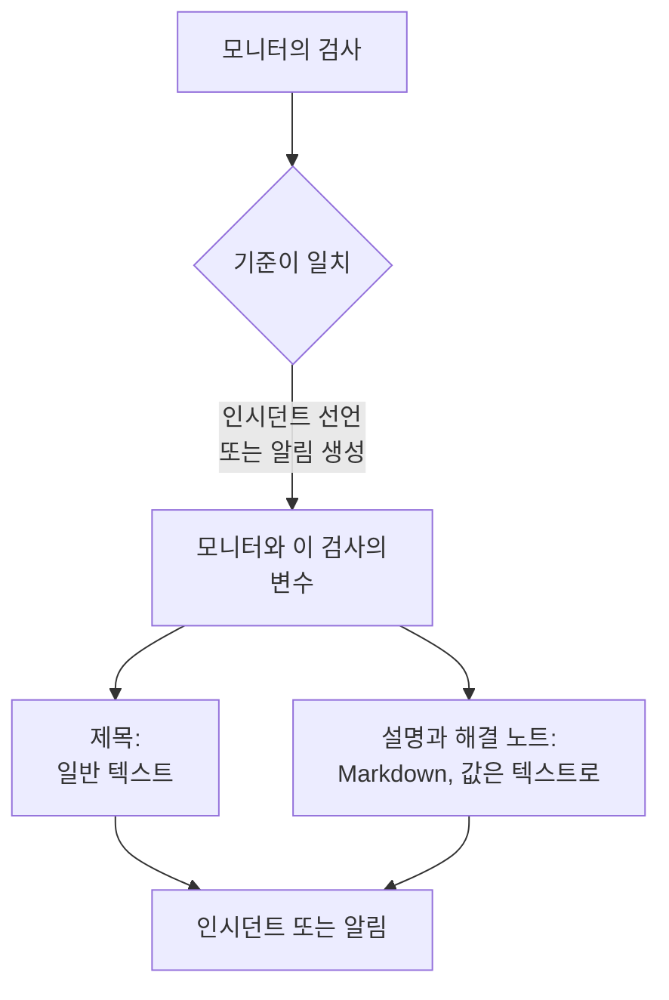

# 인시던트 및 알림 템플릿

모니터의 기준이 인시던트를 선언하거나 알림을 생성하면, 제목, 설명, 해결 노트를 직접 작성한 템플릿으로 채웁니다. 템플릿에 `{{variable}}` 자리표시자(예: `{{monitorName}}`, `{{responseStatusCode}}`)를 넣으면, 각 인시던트가 그것을 연 검사의 값으로 무엇이 잘못되었는지 알려 줍니다.

:::cards
- [템플릿을 작성하는 곳](#템플릿을-작성하는-곳): 기준이 만드는 인시던트나 알림의 제목, 설명, 해결 노트.
- [기본 사용법](#기본-사용법): 자리표시자, 객체 안의 경로, 목록.
- [모든 모니터의 변수](#모든-모니터의-변수): 모니터의 이름과 임계값을 넘은 리소스.
- [모니터 유형별 변수](#모니터-유형별-변수): 검사 종류마다 보고하는 내용.
:::

## 템플릿 작동 방식

템플릿은 기준이 인시던트나 알림을 생성할 때 한 번 채워집니다. OneUptime은 모니터와 일치한 검사에서 변수를 모아 각 값을 자리표시자 위치에 넣고 결과를 저장합니다. 나중에 템플릿을 바꾸면 그 뒤에 생성되는 인시던트와 알림이 바뀌고, 이미 열려 있는 것은 바뀌지 않습니다.



- **제목은 일반 텍스트입니다.** 어디에 표시되든 템플릿이 렌더링한 그대로 읽힙니다.
- **설명과 해결 노트는 Markdown입니다.** 직접 작성한 Markdown은 렌더링되고, 모니터링 대상 시스템이 보낸 모든 값은 텍스트로 들어가므로, 그 안의 어떤 것도 링크, 이미지, 멘션을 추가할 수 없습니다. [설명과 해결 노트의 값](#설명과-해결-노트의-값)을 참고하세요.
- **그룹화된 모니터는 각 인시던트를 자신의 시리즈로 채웁니다.** 호스트, 파드, 기기마다 인시던트를 하나씩 여는 모니터는 각 템플릿을 그 시리즈의 값으로 채우고, 템플릿에 시리즈 이름이 아직 없으면 제목에 시리즈 이름을 덧붙입니다.

## 템플릿을 작성하는 곳

:::steps
### 모니터의 기준 열기

**모니터** 로 이동해 모니터를 열고, 사이드 메뉴에서 **기준** 을 클릭합니다. **모니터링 기준 편집** 을 클릭합니다.

### 인시던트 또는 알림 켜기

기준의 **작업** 에서 **필터가 일치하면 인시던트를 선언합니다.** 또는 **필터가 일치하면 경고를 생성합니다.** 를 켭니다. 그 아래에 인시던트 또는 알림 양식이 열립니다.

### 제목 작성

**인시던트 제목** 또는 **경고 제목** 에 제목을 입력합니다. 예를 들면 `{{monitorName}} is down` 입니다. 옆에 있는 **Learn about dynamic templates** 를 열면 **Dynamic Template Variables** 가 표시됩니다. 이 모니터 유형의 모든 변수와 각 변수에 담긴 내용입니다. 변수를 클릭하면 복사됩니다.

### 설명과 해결 노트 작성

**인시던트 설명** 이나 **경고 설명** 은 **설명** 을 열고, **해결 노트** 는 **추가 필드** 를 엽니다. 이 편집기들은 변수를 직접 제안합니다. **템플릿 변수** 는 편집기 아래에 변수를 나열하고, 도구 모음의 **변수 삽입** 은 같은 목록을 열며, `{{` 를 입력하면 커서 위치에서 목록이 열립니다.

### 기준 저장

**변경 사항 저장** 을 클릭합니다. 이 기준이 다음에 생성하는 인시던트나 알림부터 새 템플릿을 사용합니다.
:::

## 기본 사용법

자리표시자는 이중 중괄호로 감싼 변수 이름입니다. 인시던트가 생성되면 OneUptime이 이를 변수의 값으로 바꾸고, 주변 텍스트는 작성한 그대로 둡니다.

```text title="Title template"
{{monitorName}} returned {{responseStatusCode}} in {{responseTimeInMs}} ms
```

모니터 이름이 `Checkout API`, 응답 상태 코드가 `502`, 응답 시간이 `842` 밀리초라면 인시던트 제목은 다음과 같습니다.

```text title="Title as created"
Checkout API returned 502 in 842 ms
```

### 객체와 목록 안의 경로

객체나 목록을 담은 변수는 [JavaScript 표현식](/docs/monitor/javascript-expression)과 같은 방식으로 경로를 써서 읽습니다.

| 작성 | 읽는 대상 | 예 |
| --- | --- | --- |
| `{{object.field}}` | 객체의 필드(깊이 제한 없음) | `{{responseBody.error.message}}` |
| `{{list[0]}}` 또는 `{{list.0}}` | 목록의 항목(0부터 셈) | `{{diskMetrics[0].usagePercent}}` |
| `{{list[last]}}` | 목록의 마지막 항목 | `{{processes[last].name}}` |
| `{{object}}` | 객체나 목록 전체(JSON으로) | `{{responseBody}}` |

필드 이름에는 `{{responseHeaders.content-type}}` 처럼 하이픈을 넣을 수 있습니다. `[-1]` 같은 음수 인덱스는 아무것도 읽지 않으니 `[last]` 를 사용하세요.

### 값이 없을 때

경로가 어디에도 닿지 않는 자리표시자는 중괄호까지 포함해 작성한 그대로 텍스트에 남습니다. 응답에 `error` 필드가 없으면 `{{responseBody.error.id}}` 가 제목에 그대로 표시됩니다. 이 검사가 보고하지 않은 변수도 마찬가지이며, 실패하지 않은 검사의 `failureCause` 가 그 예입니다. 검사가 빈 텍스트로 보고한 값은 아무것도 없는 것으로 바뀝니다.

모니터가 그룹화되었든 아니든 동작하는 템플릿 하나를 쓰려면 [영향받은 리소스](#영향받은-리소스) 변수를 사용하세요. 이 변수들은 항상 존재하며, 모니터가 그룹화되지 않았으면 비어 있습니다.

### 설명과 해결 노트의 값

설명과 해결 노트는 Markdown입니다. 인시던트나 알림의 페이지, 이메일, 그리고 해당 Slack 및 Microsoft Teams 채널에 표시됩니다. 템플릿이 여기에 넣는 값은 모니터링 대상 시스템이 보낸 것(응답 본문이나 헤더, 수신 요청이나 이메일, 기기나 시리즈의 레이블)이므로, 각 값은 텍스트로 들어갑니다. 템플릿이 어디에 두든 보낸 그대로 읽히며, 그 안의 링크, 이미지, HTML 태그, `<!channel>` 같은 Slack 멘션은 동작하지 않고 텍스트로 표시됩니다. 값 안의 맨 웹 주소는 그래도 링크가 되지만, 어디로 가는지 보이는 링크가 됩니다. 템플릿 자체에 작성한 Markdown은 작성한 그대로 렌더링됩니다.

값의 크기에는 제한이 없으며(응답 본문이나 수 메가바이트의 로그 등), 알림은 그 값을 담은 채로 발송됩니다. 각 채널은 받아들일 수 있는 만큼만 전달하며, 채널에 비해 너무 긴 설명은 줄바꿈이 있으면 그 위치에서 잘리고 "… (truncated — see OneUptime for the full text)" 로 끝납니다.

- **이메일**: 각 설명, 노트, 근본 원인은 이메일 본문 중 약 256 KB까지 전달하며, 더 긴 경우 끝의 안내가 인시던트나 알림으로 연결됩니다. 이메일 전체(본문과 스크린샷)는 모든 메일 서버와 Microsoft Graph가 받아들이는 3 MB 미만을 유지합니다. 본문과 함께 들어가지 않는 스크린샷은 빠지고, 그 자리에 안내가 들어갑니다.
- **인시던트나 알림의 페이지** 에는 전부 표시됩니다. 128 KB를 넘고 배치에 시간이 오래 걸리는 설명은 일반 텍스트로 한 줄씩 표시됩니다.
- **Slack** 은 Slack이 메시지에서 보여 주는 만큼(약 30,000자)까지 전달합니다. **Microsoft Teams** 는 OneUptime 앱에서 보낸 메시지로 약 40,000자, 수신 웹후크(상태 페이지 구독자, 워크플로)로 약 12,000자를 전달합니다. 메시지를 보낼 때 측정하므로, 표는 변환된 HTML 기준으로 셉니다.
- **SMS, 전화, 푸시 알림, WhatsApp, Telegram** 은 각 공급자가 받아들이는 만큼 전달합니다. [레벨이 사람을 호출하는 방식](/docs/on-call/escalation-rules#단계가-사람을-호출하는-방식)을 참고하세요.

모든 채널은 길이에 비례하는 시간 안에 텍스트를 렌더링합니다. 렌더러가 훨씬 오래 걸릴 부분(64 KB보다 긴 줄, 일반 줄로 된 긴 단락, 닫히지 않는 `*`, `_`, `[` 로 가득한 단락, 열여섯 단계보다 깊게 중첩된 인용이나 목록, 그리고 인시던트나 알림의 페이지에서는 천 줄이 넘는 표나 목록)은 그 자리에서 일반 텍스트로 표시되고, 설명의 나머지는 평소처럼 렌더링됩니다.

## 고급 사용법

### 목록 반복

`{{#each path}}` 는 `{{/each}}` 까지의 텍스트를 `path` 에 있는 목록의 항목마다 한 번씩 반복합니다.

```text title="Loop syntax"
{{#each arrayPath}}
  ...text with {{field}} placeholders for each item...
{{/each}}
```

반복 안에서는 다음과 같습니다.

- `{{field}}` 와 `{{field.nested}}` 는 현재 항목을 읽습니다. 항목에 없는 이름은 바깥 항목에서 찾고, 그다음 템플릿 전체의 변수에서 찾습니다.
- `{{@index}}` 는 0부터 세는 항목의 위치입니다.
- `{{this}}` 는 항목 자체로, 문자열 같은 일반 값의 목록에 씁니다.
- 목록이 아닌 경로나 빈 목록을 반복하면 아무것도 쓰지 않습니다.
- 반복은 중첩할 수 있습니다. 다른 반복 안의 `{{#each}}` 는 바깥 항목마다 안쪽 목록을 읽습니다.

예를 들어 다음 알림 통지를 받는 [수신 요청 모니터](/docs/monitor/incoming-request-monitor)가

```json title="Request body"
{
  "receiver": "payments",
  "alerts": [
    { "status": "firing", "labels": { "alertname": "HighLatency" } },
    { "status": "resolved", "labels": { "alertname": "DiskFull" } }
  ]
}
```

다음 설명 템플릿을 가지고 있으면

```text title="Description template"
Alerts for {{requestBody.receiver}}:
{{#each requestBody.alerts}}
- {{@index}}: {{labels.alertname}} ({{status}})
{{/each}}
```

생성되는 인시던트의 설명은 아래와 같습니다. 각 항목은 앞뒤 줄바꿈을 유지하므로 항목 사이에 빈 줄이 들어가지만, 설명은 여전히 하나의 목록으로 표시됩니다.

```text title="Description as created"
Alerts for payments:

- 0: HighLatency (firing)

- 1: DiskFull (resolved)
```

### 그룹화된 모니터의 값

**Group by** 속성을 쓰는 메트릭 기반 모니터는 시리즈마다 인시던트를 하나씩 열며, 각 속성의 값은 속성 이름으로 된 변수가 됩니다. `host.name` 으로 그룹화하면 `{{host.name}}` 이, `resource.k8s.pod.name` 으로 그룹화하면 `{{resource.k8s.pod.name}}` 이 생깁니다. `{{seriesLabels}}` 는 이 값들을 모두 객체로 담습니다.

그룹화된 [로그 모니터](/docs/monitor/logs-monitor)도 같은 방식으로 동작합니다. 각 그룹화 속성의 값은 그 키로 된 변수가 됩니다.

## 모든 모니터의 변수

### 모니터

| 변수 | 담긴 내용 | 예 |
| --- | --- | --- |
| `monitorName` | 모니터의 이름. | `Checkout API` |
| `monitorId` | 모니터의 ID. | `a0f78958-da0a-4775-9fd9-c9fc63d3456f` |
| `monitorType` | 모니터의 유형. | `Website`, `Synthetic Monitor` |

### 영향받은 리소스

이 변수들은 그룹화된 모니터가 인시던트를 연 대상 시리즈(파드, 컨테이너, 호스트, 디스크)를 설명합니다. 그룹화되지 않은 모니터에서는 비어 있으므로, 어떤 모니터의 템플릿에서든 쓸 수 있습니다.

| 변수 | 담긴 내용 |
| --- | --- |
| `seriesResourceSuffix` | 구분 기호로 시작하는 시리즈의 식별 정보로, 제목 끝에 붙이는 용도입니다. |
| `seriesResourceSummary` | 구분 기호가 없는 같은 식별 정보로, 문장 안에 넣는 용도입니다. |
| `seriesResourceBlock` | 시리즈의 모든 레이블을 담은 Markdown 목록. 설명에 가장 잘 맞습니다. |
| `seriesDebugCommands` | 바로 이 리소스를 위한 읽기 전용 명령(예: `kubectl`, `docker`)을 담은 Markdown 목록. |

## 모니터 유형별 변수

### 웹사이트 및 API 모니터

| 변수 | 담긴 내용 | 유형 |
| --- | --- | --- |
| `responseBody` | 응답 본문. JSON이면 객체, 아니면 텍스트. | `JSON` 또는 `string` |
| `responseHeaders` | 소문자 이름으로 된 응답 헤더. | `Dictionary<string>` |
| `responseStatusCode` | HTTP 상태 코드. | `number` |
| `responseTimeInMs` | 밀리초 단위의 응답 시간. | `number` |
| `isOnline` | 모니터가 응답을 온라인으로 판단했는지 여부. | `boolean` |

### 수신 요청 모니터

| 변수 | 담긴 내용 | 유형 |
| --- | --- | --- |
| `requestBody` | 요청 본문. JSON이면 객체. | `JSON` 또는 `string` |
| `requestHeaders` | 소문자 이름으로 된 요청 헤더. | `Dictionary<string>` |
| `requestMethod` | HTTP 메서드(예: `POST`). | `string` |
| `incomingRequestReceivedAt` | 요청을 받은 시각(ISO 8601 타임스탬프). | `string` |

기준에서 **Group incidents and alerts by a payload field** 를 켜면 그룹화 키도 변수가 되며, 그 이름은 그룹화 경로의 **마지막 세그먼트** 를 따릅니다. `requestBody.alerts[*].labels.alertname` 으로 그룹화하면 `{{alertname}}` 이, `requestBody.alerts[*].fingerprint` 로 그룹화하면 `{{fingerprint}}` 가 생깁니다. 그 옆에는 `requestBody` 전체도 그대로 있습니다.

> [!NOTE]
> `[*]` 는 그룹화 경로 필드에서만 동작합니다. 템플릿 안에서는 아무것도 읽지 않으므로 자리표시자가 작성한 그대로 남습니다. `{{requestBody.alerts[0].annotations.summary}}` 는 인시던트가 열린 대상 알림이 아니라 항상 페이로드의 첫 번째 알림을 읽습니다. 그룹화 변수와 `commonLabels`, `commonAnnotations` 같은 페이로드의 공통 필드를 사용하세요. [수신 요청 모니터](/docs/monitor/incoming-request-monitor)를 참고하세요.

### 수신 이메일 모니터

| 변수 | 담긴 내용 | 유형 |
| --- | --- | --- |
| `emailSubject` | 이메일의 제목. | `string` |
| `emailFrom` | 보낸 사람의 이메일 주소. | `string` |
| `emailTo` | 이메일을 받은 사람(모니터 자신의 주소는 가려짐). | `string` |
| `emailBody` | 이메일의 일반 텍스트 본문. | `string` |
| `emailReceivedAt` | 이메일을 받은 시각(UTC의 ISO 8601 타임스탬프). | `string` |

제목에서는 이 값들이 각각 최대 150자의 한 줄로 잘립니다. 설명과 해결 노트에는 전체 값이 들어갑니다. [수신 이메일 모니터](/docs/monitor/incoming-email-monitor#템플릿-변수)를 참고하세요.

### Ping, IP, 포트 모니터

| 변수 | 담긴 내용 | 유형 |
| --- | --- | --- |
| `isOnline` | 대상이 응답했는지 여부. | `boolean` |
| `responseTimeInMs` | 밀리초 단위의 응답 시간. 포트의 경우 DNS 조회와 TCP 연결을 합친 시간입니다. | `number` |
| `failureCause` | 검사가 실패했을 때 그 이유. | `string` |
| `isTimeout` | 검사가 시간 초과되었는지 여부. | `boolean` |

### NTP 모니터

| 변수 | 담긴 내용 | 유형 |
| --- | --- | --- |
| `isOnline` | 시간 서버가 프로브의 요청에 응답했는지 여부. | `boolean` |
| `isSynchronized` | 윤초 경보 없이 실제 타임스탬프와 함께 stratum 1에서 15로 응답했는지 여부. | `boolean` |
| `stratum` | 서버가 보고한 stratum: 기본 서버는 1, 동기화되지 않았으면 16, kiss-o'-death이면 0. | `number` |
| `clockOffsetInMs` | 서버 시계가 프로브 시계와 얼마나 차이 나는지(밀리초). 양수면 서버가 앞서 있습니다. | `number` |
| `referenceId` | 서버가 동기화하는 대상: stratum 1에서는 `GPS` 같은 소스, 그 밖에는 상위 서버의 주소. | `string` |
| `leapIndicator` | 정상이면 0에서 2, 서버가 시계가 동기화되지 않았다고 알리면 3. | `number` |
| `kissCode` | stratum 0일 때 서버가 시각 대신 보낸 네 글자 코드(예: `RATE`). | `string` |
| `responseTimeInMs` | 요청부터 응답까지의 시간(밀리초). | `number` |
| `roundTripDelayInMs` | 서버 자체의 처리 시간을 뺀, 주고받기의 네트워크 왕복 시간. | `number` |
| `rootDelayInMs` | 서버에서 기준 시계까지의 왕복 시간(밀리초). | `number` |
| `rootDispersionInMs` | 서버가 스스로 추정한 최대 오차(밀리초). | `number` |
| `serverTime` | 서버가 응답을 보낼 때의 서버 시계(ISO 8601 타임스탬프). | `string` |
| `referenceTime` | 서버 시계가 마지막으로 설정되거나 보정된 시각(ISO 8601 타임스탬프). | `string` |
| `serverAddress` | 요청을 보낸 주소. | `string` |
| `port` | 요청을 보낸 UDP 포트. | `number` |
| `failureCause` | 서버가 응답하지 않았거나 동기화되지 않은 이유. | `string` |
| `isTimeout` | 서버가 제시간에 응답하지 않았는지 여부. | `boolean` |

### SSL 인증서 모니터

| 변수 | 담긴 내용 | 유형 |
| --- | --- | --- |
| `isOnline` | 인증서 검사가 성공했는지 여부. | `boolean` |
| `isSelfSigned` | 인증서가 자체 서명되었는지 여부. | `boolean` |
| `createdAt` | 인증서가 발급된 시각(ISO 8601 타임스탬프). | `string` |
| `expiresAt` | 인증서가 만료되는 시각(ISO 8601 타임스탬프). | `string` |
| `commonName` | 인증서의 일반 이름(CN). | `string` |
| `organizationalUnit` | 조직 단위(OU). | `string` |
| `organization` | 조직(O). | `string` |
| `locality` | 지역(L). | `string` |
| `state` | 주 또는 도(ST). | `string` |
| `country` | 국가(C). | `string` |
| `serialNumber` | 일련번호. | `string` |
| `fingerprint` | SHA-1 지문. | `string` |
| `fingerprint256` | SHA-256 지문. | `string` |
| `failureCause` | 검사가 실패했을 때 그 이유. | `string` |

### DNS 모니터

| 변수 | 담긴 내용 | 유형 |
| --- | --- | --- |
| `isOnline` | 쿼리에 응답이 있었는지 여부. | `boolean` |
| `responseTimeInMs` | 밀리초 단위의 쿼리 시간. | `number` |
| `isTimeout` | 쿼리가 시간 초과되었는지 여부. | `boolean` |
| `isDnssecValid` | DNSSEC 검증 결과. | `boolean` |
| `records` | 반환된 레코드. 각각 `{type, value, ttl}` 형식입니다. | `Array<Object>` |
| `recordValues` | 레코드의 값만. | `Array<string>` |
| `failureCause` | 쿼리가 실패했을 때 그 이유. | `string` |

### DNSSEC 모니터

| 변수 | 담긴 내용 | 유형 |
| --- | --- | --- |
| `isOnline` | 검사가 완료되었는지 여부. | `boolean` |
| `domainName` | 검사한 영역. | `string` |
| `isZoneSigned` | 영역에 DNSKEY 레코드가 있는지 여부. | `boolean` |
| `isParentDsPresent` | 상위 영역에 이 영역의 DS 레코드가 있는지 여부. | `boolean` |
| `isChainValid` | 신뢰 체인이 검증되는지 여부. | `boolean` |
| `resolverConsensusAd` | 모든 리졸버가 AD 플래그를 반환했는지 여부. | `boolean` |
| `isNameserverConsistent` | 모든 권한 있는 네임서버가 같은 SOA 일련번호를 반환했는지 여부. | `boolean` |
| `earliestSignatureExpiration` | 첫 번째 RRSIG 서명이 만료되는 시각(ISO 8601 타임스탬프). | `string` |
| `daysUntilSignatureExpiry` | 그 서명이 만료될 때까지 남은 일수. | `number` |
| `dnskeyCount` | DNSKEY 레코드의 수. | `number` |
| `dsRecordCount` | 상위 영역에 있는 DS 레코드의 수. | `number` |
| `rrsigCount` | 확인된 RRSIG 레코드의 수. | `number` |
| `responseTimeInMs` | 검사에 걸린 시간(밀리초). | `number` |
| `failureCause` | 검사가 실패했을 때 그 이유. | `string` |

### 도메인 모니터

| 변수 | 담긴 내용 | 유형 |
| --- | --- | --- |
| `isOnline` | 등록 정보 조회가 성공했는지 여부. | `boolean` |
| `domainName` | 조회한 도메인. | `string` |
| `lookupMethod` | 응답한 프로토콜: RDAP 또는 WHOIS. | `string` |
| `registrar` | 등록 대행자. | `string` |
| `createdDate` | 도메인이 등록된 시각. | `string` |
| `updatedDate` | 등록 정보가 마지막으로 바뀐 시각. | `string` |
| `expiresDate` | 등록이 만료되는 시각. | `string` |
| `nameServers` | 도메인의 네임서버. | `Array<string>` |
| `domainStatus` | 레지스트리의 상태 코드(예: `clientTransferProhibited`). | `Array<string>` |
| `dnssec` | 레지스트리의 DNSSEC 상태. | `string` |
| `responseTimeInMs` | 조회에 걸린 시간(밀리초). | `number` |
| `failureCause` | 조회가 실패했을 때 그 이유. | `string` |

### 서버 / VM 모니터

| 변수 | 담긴 내용 | 유형 |
| --- | --- | --- |
| `hostname` | 서버의 호스트 이름. | `string` |
| `requestReceivedAt` | 서버의 보고를 받은 시각(ISO 8601 타임스탬프). | `string` |
| `cpuUsagePercent` | 사용 중인 CPU(0에서 100). | `number` |
| `cpuCores` | CPU 코어 수. | `number` |
| `memoryUsagePercent` | 사용 중인 메모리(0에서 100). | `number` |
| `memoryFreePercent` | 여유 메모리(0에서 100). | `number` |
| `memoryTotalBytes` | 전체 메모리(바이트). | `number` |
| `diskMetrics` | 마운트된 디스크마다 항목 하나. | `Array<Object>` |
| `diskMetrics[].diskPath` | 디스크의 마운트 지점. | `string` |
| `diskMetrics[].usagePercent` | 디스크에서 사용 중인 공간(0에서 100). | `number` |
| `diskMetrics[].freePercent` | 디스크의 여유 공간(0에서 100). | `number` |
| `diskMetrics[].totalBytes` | 디스크의 크기(바이트). | `number` |
| `processes` | 에이전트가 보고한 실행 중인 프로세스. | `Array<Object>` |
| `processes[].pid` | 프로세스 ID. | `number` |
| `processes[].name` | 프로세스 이름. | `string` |
| `processes[].command` | 프로세스를 시작한 명령. | `string` |
| `failureCause` | 검사가 실패했을 때 그 이유. | `string` |

### 합성 모니터

합성 모니터는 사용하도록 설정된 브라우저와 화면 크기마다 스크립트를 한 번씩 실행합니다. 예를 들어 데스크톱 화면의 Chromium과 모바일 화면의 Firefox입니다. `syntheticResponses` 는 실행마다 항목 하나를 담습니다. `{{syntheticResponses[0].browserType}}` 처럼 위치로 실행 하나를 읽거나, `{{#each syntheticResponses}}` 로 모든 실행을 읽습니다.

| 변수 | 담긴 내용 | 유형 |
| --- | --- | --- |
| `failureCause` | 검사가 실패했을 때 그 이유. | `string` |
| `syntheticResponses` | 스크립트를 실행한 브라우저와 화면 크기마다 항목 하나. | `Array<Object>` |
| `syntheticResponses[].executionTimeInMs` | 실행에 걸린 시간(밀리초). | `number` |
| `syntheticResponses[].result` | 스크립트가 반환한 값. | `string`, `number`, `boolean` 또는 `JSON` |
| `syntheticResponses[].scriptError` | 실행이 끝날 때의 오류(있는 경우). | `string` |
| `syntheticResponses[].logMessages` | 실행이 기록한 로그. | `Array<string>` |
| `syntheticResponses[].screenshots` | 실행이 찍은 스크린샷. 이름별로, 각각 base64 텍스트로 들어 있습니다. [스크린샷 표시](#스크린샷-표시)를 참고하세요. | `Object` |
| `syntheticResponses[].browserType` | 실행의 브라우저. | `string` |
| `syntheticResponses[].screenSizeType` | 실행의 화면 크기. | `string` |

#### 스크린샷 표시

`screenshots` 의 각 항목은 스크립트가 찍은 스크린샷으로, 스크립트가 붙인 이름(`screenshots["login-page"] = await page.screenshot()`) 아래에 base64 텍스트로 들어 있습니다. 인시던트나 알림의 설명 또는 해결 노트에 표시하려면 이미지로 감싸세요.

```text title="Description template"
{{syntheticResponses[0].scriptError}}


```

그러면 스크린샷이 인시던트나 알림의 페이지, 그 인시던트를 보여 주는 상태 페이지, 관련 이메일 알림, 관련 Slack 및 Microsoft Teams 메시지에 표시됩니다. 이메일에서는 첨부되어 본문에 표시되며, Gmail, Outlook, Apple Mail 모두 이를 보여 주므로 당직자는 OneUptime을 열지 않고도 페이지가 어떻게 보였는지 확인할 수 있습니다.

- PNG, JPEG, GIF, WebP 스크린샷이 표시됩니다. JPEG 스크린샷(`page.screenshot({ type: "jpeg" })`)에도 `image/png` 를 쓸 수 있습니다.
- 이메일 한 통에는 최대 2 MB의 이미지를 최대 20개까지 담습니다. 들어가지 않는 이미지는 대체 텍스트가 담긴 안내로 바뀌므로, 이미지마다 대체 텍스트를 넣으세요. JPEG 스크린샷은 PNG보다 훨씬 작으며, 실패한 실행의 스크린샷 한 장이 모든 실행의 모든 스크린샷보다 더 많은 것을 알려 주는 경우가 많습니다.
- Slack과 Microsoft Teams에서는 스크린샷이 설명 안에서 놓인 자리에 표시됩니다. 한 줄을 혼자 차지하는 이미지는 그 줄의 자리에 들어가고, 문장, 목록, 표 중간에 있는 이미지는 그 자리에 대체 텍스트를 남기고 그 뒤에 표시됩니다. Slack은 PNG, JPEG, GIF 스크린샷을 메시지당 최대 10개, 10 MB까지 표시합니다. OneUptime 앱은 각 이미지를 Slack 워크스페이스에 비공개로 업로드해 메시지에 표시합니다. Teams는 각각 최대 1 MB인 PNG, JPEG, GIF 스크린샷을 메시지의 카드 안에 메시지당 최대 10개, 2 MB까지 표시합니다.
- Slack에 업로드하려면 앱에 `files:write` 권한이 필요합니다. OneUptime이 이 권한을 요청하기 전에 워크스페이스가 Slack을 연결했다면 **프로젝트 설정 → 워크스페이스 → Slack** 에서 Slack을 다시 연결하세요(자체 호스팅 서버에서는 먼저 Slack 앱에 권한을 추가하세요. [Slack 통합](/docs/self-hosted/slack-integration#메시지의-이미지) 참고).
- 채팅에서 표시할 수 없는 스크린샷(WebP, 위 한도를 넘는 것, Slack이나 Teams가 거부한 것, 수신 웹후크로 보낸 메시지의 모든 스크린샷)은 대체 텍스트로, 대체 텍스트가 없으면 "[image]" 로 표시되므로 이미지마다 대체 텍스트를 넣으세요. 이미지의 base64는 채팅에 전달되지 않습니다.
- 템플릿에 작성한 이미지만 표시됩니다. 모니터링 대상 페이지나 스크립트가 보고한 값(오류 메시지, 로그 줄) 안의 이미지는 여전히 텍스트로 표시됩니다([설명과 해결 노트의 값](#설명과-해결-노트의-값) 참고).
- OneUptime AI는 스크린샷이 아니라 스크린샷 주변의 텍스트를 읽습니다. 조사, 초안 사후 분석이나 노트, 런북의 AI 단계, 워크플로의 AI 단계가 모델에 넘기는 내용에는 이미지 자리에 `[image omitted: PNG, 340 KB]` 같은 짧은 안내가 들어갑니다. 모델은 이미지가 아니라 텍스트를 읽으며, 스크린샷의 base64는 호출할 때마다 수십만 토큰이 되기 때문입니다. 조사의 활동 기록에 무엇이 빠졌는지 남습니다.

실패한 모든 실행의 스크린샷을 표시하려면 이미지를 반복 안에 넣으세요. 여기서 스크립트는 각 스크린샷을 `screenshots["failure"]` 로 저장합니다.

```text title="Description template"
### What the page looked like
{{#each syntheticResponses}}
**{{browserType}} / {{screenSizeType}}**: {{scriptError}}


{{/each}}
```

### 사용자 지정 JavaScript 코드 모니터

| 변수 | 담긴 내용 | 유형 |
| --- | --- | --- |
| `result` | 스크립트가 반환한 값. `{{result.status}}` 처럼 경로로 필드를 읽습니다. | `string`, `number`, `boolean` 또는 `JSON` |
| `executionTimeInMs` | 스크립트 실행 시간(밀리초). | `number` |
| `scriptError` | 스크립트가 끝날 때의 오류(있는 경우). | `string` |
| `logMessages` | 스크립트가 `console.log` 로 기록한 내용. | `Array<string>` |
| `failureCause` | 검사가 실패했을 때 그 이유. | `string` |

### 네트워크 장치 모니터

| 변수 | 담긴 내용 | 유형 |
| --- | --- | --- |
| `isOnline` | ping **또는** SNMP로 장치에 닿을 수 있는지 여부. 폴링할 때마다 설정됩니다. | `boolean` |
| `responseTimeInMs` | SNMP **워크** 의 응답 시간(밀리초). ping 왕복 시간이 아닙니다. | `number` |
| `failureCause` | SNMP 워크가 실패했을 때 그 이유. | `string` |
| `isTimeout` | SNMP 워크가 시간 초과되었는지 여부. | `boolean` |
| `oidResponses` | 조회한 OID. 각각 `{oid, name, value, type}` 형식입니다. | `Array<Object>` |
| `{{OID_NAME}}` | 이름이 있는 OID의 값을 이름으로(`{{sysUpTime}}` 처럼). | `string` 또는 `number` |
| `sysName` | SNMP 시스템 그룹에서 가져온 장치 이름. | `string` |
| `sysDescr` | SNMP 시스템 그룹에서 가져온 장치 설명. | `string` |
| `sysObjectId` | 공급업체가 등록한 엔터프라이즈 OID로, 장치의 지문입니다. | `string` |
| `sysLocation` | SNMP 시스템 그룹에서 가져온 장치 위치. | `string` |
| `downInterfaces` | 관리상으로는 켜져 있지만 동작상으로는 꺼진 인터페이스. 각각 `{name, alias, interfaceIndex}` 형식이며, 인터페이스 모니터링이 필요합니다. | `Array<Object>` |
| `interfacesTotal` | 워크한 인터페이스의 수. | `number` |
| `interfacesUp` | 관리상으로도 동작상으로도 켜진 인터페이스. | `number` |
| `interfacesDown` | 관리상으로는 켜져 있지만 동작상으로는 꺼진 인터페이스. | `number` |
| `interfaceWalkFailure` | 인터페이스 워크가 실패했을 때의 오류. | `string` |
| `tables` | 키별 장치의 SNMP 테이블. 각 테이블의 `rowCount`, `rows`, `unhealthyRowCount`, `unhealthyRows` 를 `{{tables.ipsec_tunnels.unhealthyRowCount}}` 처럼 읽습니다. | `Object` |
| `snmpTable` | 행별 알림이 다루는 SNMP 테이블. | `string` |
| `snmpTableRow` | 행별 알림이 다루는 행(터널, 무선, 이웃 등). | `string` |
| `trapOid` | 트랩의 OID. SNMP 트랩이 검사를 트리거했을 때만. | `string` |
| `trapSourceIp` | 트랩을 보낸 주소. SNMP 트랩이 검사를 트리거했을 때만. | `string` |
| `trapVarbinds` | 트랩의 varbind. 각각 `{oid, value}` 형식입니다. SNMP 트랩이 검사를 트리거했을 때만. | `Array<Object>` |

네트워크 장치는 폴링할 때마다 ping을 받고, 자격 증명이 있을 때만 SNMP로 워크됩니다. 그래서 **ping만 되는 장치가 채우는 위 변수는 `isOnline` 뿐입니다**. 나머지는 모두 SNMP 워크에서 오므로, 워크가 없으면 작성한 그대로 남습니다. 자격 증명이 없는 장치에도 쓰일 수 있는 템플릿에서는 `{{isOnline}}` 과 장치 이름을 앞에 두세요. 폴링 종류마다 무엇을 수집하는지는 [네트워크 장치 모니터](/docs/monitor/network-device-monitor#폴링이-실제로-하는-일)를 참고하세요.

### 데이터베이스 상태 모니터

| 변수 | 담긴 내용 | 유형 |
| --- | --- | --- |
| `isOnline` | 프로브가 연결해서 기준 쿼리를 실행할 수 있었는지 여부. 메트릭이 빠져도 false가 되지 않습니다. | `boolean` |
| `responseTimeInMs` | 연결해서 기준 쿼리를 실행하기까지 걸린 시간(밀리초). | `number` |
| `failureCause` | 검사가 실패했을 때 그 이유. | `string` |
| `connectionError` | 자격 증명이나 연결 문자열을 뺀 연결 오류. | `string` |
| `engineVersion` | 데이터베이스 서버가 보고한 버전. | `string` |
| `collectedGroups` | 이 검사에서 값을 낸 메트릭 그룹. | `Array<string>` |
| `unavailableGroups` | 수집하지 못한 그룹. 각각 `{group, reason, message, remediation}` 형식입니다. | `Array<Object>` |
| `collectionIssueSummary` | 사용할 수 없는 모든 그룹에 대한 한 줄로, 제목에 바로 쓸 수 있습니다. 모두 수집되면 비어 있습니다. | `string` |
| `metrics` | 시리즈 이름별로 수집된 값. | `Object` |

`metrics` 의 시리즈 이름에는 `oneuptime.monitor.database.connections.used.percent` 처럼 점이 들어 있고, 경로는 각 점을 객체 안으로 들어가는 한 단계로 읽으므로, 템플릿은 `metrics` 에서 값 하나를 골라낼 수 없습니다. `{{metrics}}` 를 JSON으로 통째로 넣거나 `{{collectionIssueSummary}}` 를 사용하세요. 수집되지 않은 메트릭은 `metrics` 에 없을 뿐 0이 아닙니다. 값 하나로 판단하려면 기준에서 [JavaScript 표현식](/docs/monitor/javascript-expression)으로 비교하세요.

### 외부 상태 페이지 모니터

| 변수 | 담긴 내용 | 유형 |
| --- | --- | --- |
| `overallStatus` | 상태 페이지의 전체 상태(예: `major_outage`). | `string` |
| `activeIncidentCount` | 상태 페이지에 열려 있는 인시던트 수. | `number` |
| `componentStatuses` | 구성 요소. 각각 `{name, status, description, groupName}` 형식입니다. | `Array<Object>` |
| `provider` | 상태 페이지의 종류: Atlassian Statuspage, incident.io, RSS 또는 Atom. | `string` |
| `componentGroup` | 모니터가 지켜보는 구성 요소 그룹(있는 경우). | `string` |
| `componentName` | 모니터가 지켜보는 구성 요소(있는 경우). | `string` |
| `isOnline` | 상태 페이지가 응답했는지 여부. | `boolean` |
| `responseTimeInMs` | 상태 페이지가 응답하는 데 걸린 시간(밀리초). | `number` |
| `failureCause` | 검사가 실패했을 때 그 이유. | `string` |

### 메트릭 및 인프라 모니터

Metrics, Kubernetes, Docker, Host, Podman, Docker Swarm, Proxmox, VMware, Ceph, Storage Array, IoT Device 모니터에는 고유한 변수가 하나 있습니다.

| 변수 | 담긴 내용 | 유형 |
| --- | --- | --- |
| `metricName` | 모니터의 첫 번째 쿼리가 읽는 메트릭의 이름(예: `container.cpu.time`). | `string` |

그룹화되면 각 **Group by** 속성의 값과 `seriesLabels` 도 있습니다. [그룹화된 모니터의 값](#그룹화된-모니터의-값)을 참고하세요. IoT Device 모니터 템플릿은 디바이스별로 그룹화하므로, 템플릿으로 만든 모니터에는 `{{device.id}}` 도 있습니다.

### 기타 모니터 유형

Logs, Traces, Exceptions, Security Events, AI / LLM, SQL Query 모니터에는 고유한 변수가 없습니다. [모든 모니터의 변수](#모든-모니터의-변수)를 사용하고, 그룹화된 Logs 모니터에서는 [그룹 값](#그룹화된-모니터의-값)을 사용하세요.

## 예시

### 느린 API

```text title="Title"
{{monitorName}} is slow: {{responseTimeInMs}} ms
```

```text title="Description"
### API error
Status: **{{responseStatusCode}}**
Latency: **{{responseTimeInMs}} ms**
Message: `{{responseBody.error.message}}`
```

### 곧 만료되는 인증서

```text title="Title"
Certificate for {{commonName}} expires {{expiresAt}}
```

### 공간이 부족해지는 서버

```text title="Description"
### {{hostname}}
CPU: **{{cpuUsagePercent}}%**
Memory: **{{memoryUsagePercent}}%**

**Disks:**
{{#each diskMetrics}}
- {{diskPath}}: {{usagePercent}}% used ({{freePercent}}% free)
{{/each}}

**Processes:**
{{#each processes}}
- [{{pid}}] {{name}}: {{command}}
{{/each}}
```

### 실패한 Ping, IP, 포트 검사

```text title="Description"
{{monitorName}} could not be reached: {{failureCause}}
Timed out: {{isTimeout}}
Response time: {{responseTimeInMs}} ms
```

### 합성 모니터의 모든 실행

```text title="Description"
### Synthetic monitor results
{{#each syntheticResponses}}
- **{{browserType}} / {{screenSizeType}}**: {{result}} in {{executionTimeInMs}} ms
  - Script error: {{scriptError}}
  - First log line: {{logMessages[0]}}
{{/each}}
```

### 사용자 지정 코드 검사

```text title="Description"
The script ran for {{executionTimeInMs}} ms and returned {{result}}.
Last log line: {{logMessages[last]}}
```

### 네트워크 장치

이 예시는 장치에 SNMP 자격 증명이 있다고 가정합니다. ping만 되는 장치에서는 `{{isOnline}}` 을 제외한 모든 것이 작성한 그대로 남습니다.

```text title="Title"
{{sysName}}: {{interfacesDown}} interfaces down
```

```text title="Description"
### {{sysName}} ({{sysLocation}})
Online: {{isOnline}}
SNMP walk: {{responseTimeInMs}} ms

{{#each downInterfaces}}
- {{name}} ({{alias}}) is down
{{/each}}
```

### Alertmanager 또는 Grafana 알림

```text title="Title"
[{{requestBody.status}}] {{requestBody.receiver}}
```

```text title="Description"
### Alerts from {{requestBody.receiver}}
{{#each requestBody.alerts}}
**Alert {{@index}}**: {{labels.alertname}}
- Status: {{status}}
- Summary: {{annotations.summary}}
- Source: {{generatorURL}}
{{/each}}
```

## 문제 해결

:::details 제목에 자리표시자가 중괄호까지 그대로 표시됨
이 검사에서는 경로가 값에 닿지 않습니다. 변수의 이름과 대소문자를 위 표와 비교하거나, 기준에서 **Learn about dynamic templates** 를 여세요. 이 모니터 유형의 변수가 나열됩니다. 응답이나 요청 본문 안의 경로는 보낸 그대로의 본문과 일치해야 하며, `[*]` 와 `[-1]` 같은 음수 인덱스는 아무것도 읽지 않습니다. `[0]` 또는 `[last]` 를 사용하세요.
:::

:::details 값이 JSON으로 표시됨
경로가 객체나 목록에서 멈추므로 그 전체가 JSON으로 들어갑니다. `{{responseBody.error.message}}` 처럼 원하는 필드를 경로에 더하거나, `{{#each}}` 로 목록을 반복하세요.
:::

:::details 반복이 아무것도 쓰지 않음
`#each` 뒤의 경로가 이 검사에서 목록이 아니거나, 목록이 비어 있습니다. 경로를 페이로드와 비교하고, 모든 `{{#each}}` 에 짝이 되는 `{{/each}}` 가 있는지 확인하세요.
:::

:::details 값 안의 Markdown이 텍스트로 표시됨
의도된 동작입니다. 모니터링 대상 시스템이 보낸 값은 텍스트로 들어가므로, 설명에 링크, 이미지, 멘션을 추가할 수 없습니다. 대신 값 주변의 템플릿에 서식을 작성하세요. [설명과 해결 노트의 값](#설명과-해결-노트의-값)을 참고하세요.
:::

:::details 스크린샷이 Slack, Microsoft Teams, 이메일에 표시되지 않음
이미지의 형식과 크기를 [스크린샷 표시](#스크린샷-표시)와 비교하세요. Slack에서는 OneUptime 앱에 `files:write` 권한이 필요합니다. OneUptime이 이 권한을 요청하기 전에 워크스페이스가 Slack을 연결했다면 **프로젝트 설정 → 워크스페이스 → Slack** 에서 Slack을 다시 연결하세요.
:::

## 다음 단계

:::cards
- [JavaScript 표현식](/docs/monitor/javascript-expression): 같은 자리표시자를 기준의 조건에서 사용합니다.
- [인시던트 선언](/docs/incidents/declaring-incidents): 기준이 인시던트를 선언한 뒤 일어나는 일.
- [합성 모니터](/docs/monitor/synthetic-monitor): 설명에 표시할 수 있는 스크린샷을 찍습니다.
- [수신 요청 모니터](/docs/monitor/incoming-request-monitor): 웹후크를 알림마다 이름이 붙은 인시던트로 바꿉니다.
:::
