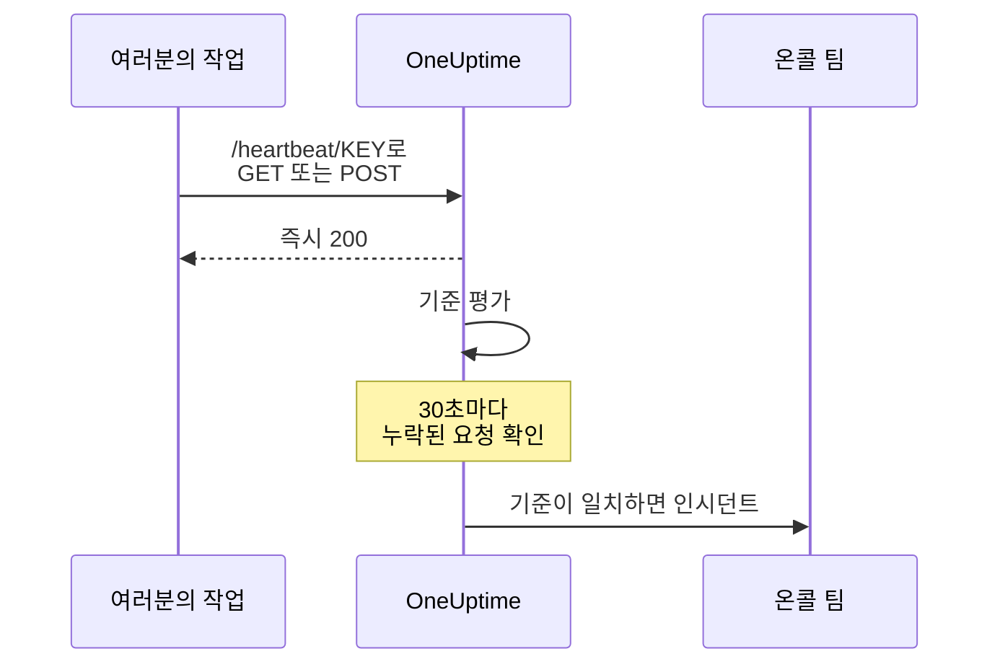
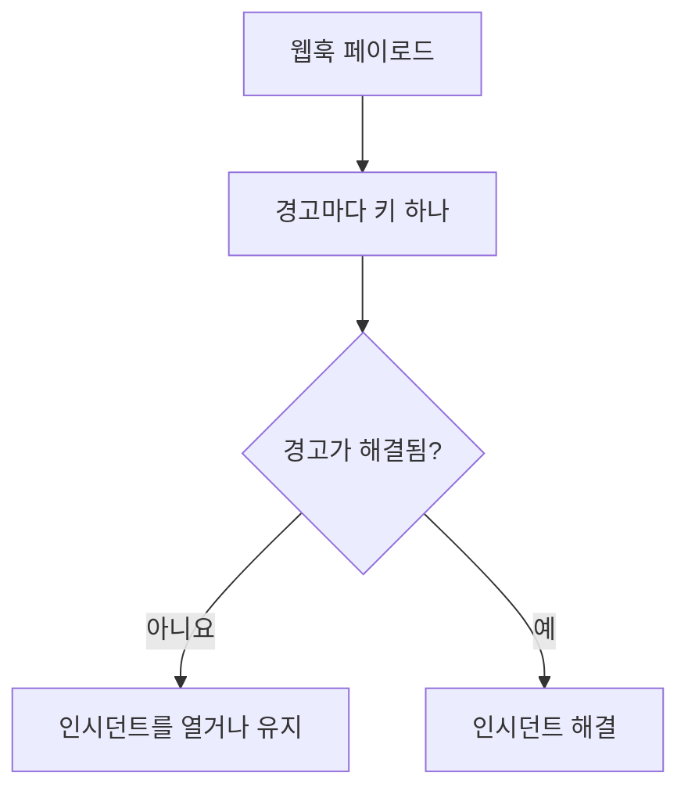

# 수신 요청 모니터

수신 요청 모니터는 다른 시스템이 HTTP 요청을 보낼 URL을 제공합니다. OneUptime은 모든 요청을 기준에 따라 평가하며, 모니터 상태를 바꾸고, 인시던트를 선언하고, 온콜 담당자를 호출할 수 있습니다.

이 모니터는 서로 다른 두 가지 역할을 합니다.

- **하트비트 모니터링** — cron 작업, 워커 또는 장치가 일정에 따라 URL을 호출하고, 호출이 끊기면 OneUptime이 인시던트를 엽니다.
- **다른 시스템의 알림 수신** — Prometheus Alertmanager, Grafana를 비롯해 JSON을 POST할 수 있는 무엇이든 알림을 보내면, OneUptime이 각 알림을 온콜 에스컬레이션과 복구 시 자동 해결이 붙은 인시던트로 만듭니다.

둘 다 같은 모니터 유형을 사용합니다. 둘을 가르는 것은 여러분이 설정하는 기준입니다.

:::cards
- [모니터 만들기](#수신-요청-모니터-만들기): 몇 단계만으로 하트비트 URL을 받습니다.
- [하트비트 보내기](#하트비트-보내기): curl, cron, Node.js, Python, Go에서 보냅니다.
- [호출이 끊기면 경고 받기](#10분-동안-하트비트가-없으면-오프라인으로-표시데드맨-스위치): 모니터를 데드맨 스위치로 만듭니다.
- [경고 받기](#다른-시스템의-경고-수신): Alertmanager나 Grafana의 경고마다 인시던트 하나를 엽니다.
- [SNS 또는 Event Grid 구독하기](#amazon-sns-또는-azure-event-grid-구독하기): 클릭 한 번으로 구독을 확인합니다.
:::

## 작동 방식

외부에서 시스템을 검사하는 것은 없습니다. 여러분의 시스템이 모니터의 URL을 호출하면 OneUptime이 즉시 응답한 뒤, 모니터의 기준에 따라 요청을 평가합니다. 들어오지 *않게 된* 요청을 살피는 기준은 백그라운드에서 30초마다 다시 검사되므로, 침묵도 인시던트를 열 수 있습니다.



다음 용도로 사용합니다.

- cron 작업과 예약된 태스크 모니터링
- 백그라운드 워커가 실행 중인지 확인
- 외부에서 도달할 수 없는 방화벽 뒤 서비스 모니터링
- Prometheus Alertmanager, Grafana 및 기타 경고 시스템으로부터 경고 수신
- HTTP를 지원하는 모든 시스템의 하트비트 신호 추적

## 수신 요청 모니터 만들기

:::steps
### 새 모니터 시작

**모니터** 로 이동해 **모니터 생성** 을 클릭합니다.

### 수신 요청 선택

**모니터 유형** 에서 **수신 요청** 을 선택합니다. 맨 위에 있는 일반적인 유형 중 하나입니다. **이름** 을 입력한 다음 **다음** 을 클릭합니다.

### 기준 검토

**기준** 단계는 [기본 기준](#기본으로-제공되는-것)으로 시작합니다. 하트비트용으로는 **기준 추가** 를 클릭하고, 새 기준에 상태를 오프라인으로 바꾸고 인시던트를 선언하는 **수신 요청** / **분 동안 미수신** 필터를 주고, **인시던트 자동 해결** 을 켭니다. 그런 다음 목록 맨 위로 끌어 올립니다. 이유는 [기준 예시](#기준-예시)를 참고하세요.

### 모니터 생성

**모니터 생성** 을 클릭합니다. 모니터가 **개요** 페이지로 열리며, **Send the first heartbeat** 카드에 복사 버튼이 있는 **Heartbeat URL** 과 `curl` 명령 예시가 표시됩니다.

### 첫 요청 보내기

서비스가 그 URL로 요청을 보내도록 설정합니다([하트비트 보내기](#하트비트-보내기) 참고). 첫 요청이 도착하면 카드가 모니터 기록으로 바뀌고, **Heartbeat URL** 카드에 URL과 마지막 요청이 도착한 시각이 표시됩니다.
:::

> [!NOTE]
> URL에는 모니터의 비밀 키가 들어 있으므로 모니터를 편집할 수 있는 사람만 볼 수 있습니다. 언제든 모니터의 **문서** 페이지, 사이드 메뉴의 **구성** 섹션에서 다시 찾을 수 있습니다.

## 요청 URL

모니터에는 다음 형식의 고유 URL이 있습니다.

```text
https://oneuptime.com/heartbeat/YOUR_SECRET_KEY
```

자체 호스팅하는 경우 `https://oneuptime.com` 을 OneUptime 인스턴스의 URL로 바꾸세요.

이 URL로 **GET** 또는 **POST** 요청을 보냅니다. HEAD는 받아들여져 GET으로 처리되며, PUT, PATCH, DELETE는 404를 반환합니다. 경로에 있는 비밀 키가 자격 증명이므로, 프로젝트가 [모든 요청에 시크릿을 요구](#모든-요청에-시크릿-요구하기)하지 않는 한 헤더나 토큰은 필요 없습니다. 쿼리 문자열은 무시되므로, 기준이 읽어야 할 내용은 본문이나 헤더로 보내세요.

> [!WARNING]
> 이 URL을 아는 사람은 누구나 모니터를 정상으로 표시할 수 있으므로 비밀로 다루세요. 유출되었다면 모니터의 **설정** 페이지를 열어 **수신 요청 비밀 키 재설정** 을 클릭한 다음, 모든 발신자를 업데이트하세요. 모니터 개요에는 최신 요청이 로그에 보관되는 그대로 표시됩니다. 비밀과 개인 데이터는 마스킹되고, **요청 내용 보관** 이 꺼져 있으면 헤더와 본문은 표시되지 않습니다. 마스킹은 알고 있는 이름과 패턴만 찾아내므로 이 엔드포인트로 API 키나 토큰을 보내지 마세요.

> [!IMPORTANT]
> OneUptime은 즉시 빈 JSON 객체(`{}`)와 함께 `200` 으로 응답하고, 요청은 큐에서 처리합니다. 이 응답은 어떤 검증보다도 먼저 기록되므로, `200` 은 요청이 받아들여졌다는 확인이 **아닙니다**. 잘못된 비밀 키, 삭제된 모니터, 비활성화된 모니터도 모두 `200` 을 반환합니다. 요청이 제대로 도착하는지는 모니터 자체의 타임라인에서 확인하세요. 모든 요청에 시크릿을 요구하는 프로젝트는 시크릿이 없는 요청에 `401`로 응답하고, 전송하기 전에 URL을 확인하는 서비스는 그 서비스가 기대하는 응답을 받습니다. [먼저 URL을 확인하는 서비스](#먼저-url을-확인하는-서비스)를 참고하세요.

### 요청 본문 보내기

본문 안의 필드를 참조하려면(인시던트 제목의 `{{requestBody.status}}`, 인시던트 그룹화의 JSON 경로, JavaScript 표현식 기준 등) `Content-Type: application/json` 을 보내세요. 이 문서는 전체적으로 이 형식을 전제로 합니다. 본문은 JSON 객체나 배열이어야 합니다. 잘못된 JSON이나 `"error"` 같은 단독 값은 `500` 으로 거부됩니다.

| 콘텐츠 유형 | 기준과 템플릿이 보는 것 |
| --- | --- |
| `application/json` | 파싱된 JSON. |
| `application/x-www-form-urlencoded` | 파싱된 양식. 대괄호가 있는 키는 중첩되며(`alerts[0][status]=firing`), 모든 값은 문자열입니다. |
| `text/plain` | 텍스트가 JSON 객체나 배열이면 파싱된 JSON. Amazon SNS가 메시지를 이렇게 보냅니다. 그 밖의 텍스트는 텍스트 그대로이므로, `backup failed: error 42` 를 보내면 기본 조건에서 모니터가 오프라인이 됩니다. |
| `application/cloudevents+json` 또는 다른 `+json` 유형 | 파싱된 JSON. Azure Event Grid가 CloudEvents를 이렇게 전송합니다. |
| 그 밖의 유형 또는 없음 | 빈 본문(`{}`). 따라서 어떤 `requestBody` 참조도 해석되지 않으며, 템플릿에서는 그대로 남습니다. |

본문은 최대 50 MB까지 받으며, 그보다 크면 `413` 으로 거부됩니다. 본문을 `Content-Encoding: gzip` 으로 압축하지 마세요. JSON으로 저장되지 않아 그 안의 경로가 해석되지 않습니다.

### 하트비트 보내기

각 예시는 요청 하나를 보냅니다. `YOUR_SECRET_KEY` 를 모니터 URL에 있는 키로 바꾸세요.

:::tabs
@tab curl
```bash
# Simple GET request
curl https://oneuptime.com/heartbeat/YOUR_SECRET_KEY

# POST request with a JSON body
curl -X POST https://oneuptime.com/heartbeat/YOUR_SECRET_KEY \
  -H "Content-Type: application/json" \
  -d '{"status": "healthy", "version": "1.2.3"}'
```
@tab Cron
```bash
# Send a heartbeat every 5 minutes
*/5 * * * * curl -fsS https://oneuptime.com/heartbeat/YOUR_SECRET_KEY > /dev/null

# Or ping only when the job succeeds, so a failed run counts as a missed heartbeat
0 2 * * * /usr/local/bin/backup.sh && curl -fsS https://oneuptime.com/heartbeat/YOUR_SECRET_KEY > /dev/null
```
@tab Node.js
```javascript title="heartbeat.mjs"
// Node.js 18 or later: fetch is built in. Run with `node heartbeat.mjs`.
const response = await fetch(
  "https://oneuptime.com/heartbeat/YOUR_SECRET_KEY",
  {
    method: "POST",
    headers: { "Content-Type": "application/json" },
    body: JSON.stringify({ status: "healthy", version: "1.2.3" }),
  },
);

console.log(response.status); // 200
```
@tab Python
```python title="heartbeat.py"
# Python 3, standard library only. Run with `python3 heartbeat.py`.
import json
import urllib.request

request = urllib.request.Request(
    "https://oneuptime.com/heartbeat/YOUR_SECRET_KEY",
    data=json.dumps({"status": "healthy", "version": "1.2.3"}).encode(),
    headers={"Content-Type": "application/json"},
    method="POST",
)

with urllib.request.urlopen(request, timeout=10) as response:
    print(response.status)  # 200
```
@tab Go
```go title="heartbeat.go"
// Run with `go run heartbeat.go`.
package main

import (
	"bytes"
	"fmt"
	"net/http"
)

func main() {
	body := []byte(`{"status": "healthy", "version": "1.2.3"}`)

	resp, err := http.Post(
		"https://oneuptime.com/heartbeat/YOUR_SECRET_KEY",
		"application/json",
		bytes.NewReader(body),
	)
	if err != nil {
		panic(err)
	}
	defer resp.Body.Close()

	fmt.Println(resp.StatusCode) // 200
}
```
@tab PowerShell
```powershell
# Windows PowerShell 5.1 or PowerShell 7
Invoke-RestMethod -Method Post `
  -Uri "https://oneuptime.com/heartbeat/YOUR_SECRET_KEY" `
  -ContentType "application/json" `
  -Body '{"status": "healthy", "version": "1.2.3"}'
```
:::

## 모든 요청에 시크릿 요구하기

모니터의 URL을 가진 사람은 누구나 요청을 보낼 수 있습니다. 프로젝트 소유자나 프로젝트 관리자는 누가 모니터를 설정했든, 프로젝트의 모든 수신 요청 모니터가 프로젝트 자체 시크릿 중 하나도 요구하게 할 수 있습니다. **모든 요청에 시크릿 필수**를 켜세요. 시크릿이 없는 요청은 하트비트로 집계되거나, 모니터의 최근 요청으로 저장되거나, 기준에 도달하기 전에 이유와 함께 `401`로 거부됩니다. 시크릿이 있는 요청은 이전처럼 모니터 자체 기준으로 넘어갑니다.

시크릿과 스위치는 프로젝트 소유자와 프로젝트 관리자, 그리고 Create, Read, Edit, Delete Incoming Request Secret 권한이 있는 사용자 지정 역할이 관리합니다. Read로는 시크릿 값을 볼 수 있고, Edit로는 스위치도 켜고 끌 수 있습니다.

:::steps
### 시크릿 만들기

**모니터 → 설정 → 수신 요청 시크릿**으로 이동해 시크릿을 만드세요. 이름을 지정하면 OneUptime이 값을 생성하며, 목록에서 복사할 수 있습니다.

### 모든 발신자에서 보내기

발신자가 설정할 수 있는 방식에 따라 시크릿을 `X-OneUptime-Secret` 헤더나 `Authorization` 헤더의 Bearer 토큰으로 보내세요. 자체 헤더를 설정할 수 없는 발신자는 대신 시크릿으로 각 요청에 서명할 수 있습니다. [시크릿으로 요청에 서명하기](#시크릿으로-요청에-서명하기)를 참고하세요.

### 놓친 발신자 찾기

프로젝트에 시크릿이 생기는 즉시 OneUptime은 아직 아무것도 거부하지 않은 채 모든 요청에 시크릿이 있는지 확인합니다. 같은 페이지의 **시크릿 없는 요청** 목록에는 지난 24시간 동안 유효한 시크릿 없이 요청을 받은 수신 요청 모니터가 그 이유와 함께 나열됩니다. 이유는 시크릿을 보내지 않았거나 잘못된 시크릿을 보낸 것입니다. 그 발신자들을 수정하세요. 발신자를 수정한 모니터는 **마지막 시크릿 있는 요청** 시각이 **마지막 시크릿 없는 요청** 시각보다 늦어지고, 24시간 이내에 목록에서 사라집니다.

### 요구 사항 켜기

**모든 요청에 시크릿 필수**를 켜세요. 프로젝트에 시크릿이 없는 동안에는 켤 수 없으므로 실수로 발신자가 거부되는 일은 없습니다. 켜기 전에, 지난 24시간 동안 유효한 시크릿 없이 요청을 받은 수신 요청 모니터가 있으면 그 수를 알려 줍니다. 그 발신자들은 그때부터 거부됩니다.
:::

```bash
curl -X POST https://oneuptime.com/heartbeat/YOUR_SECRET_KEY \
  -H "X-OneUptime-Secret: YOUR_PROJECT_SECRET"

# Or as a bearer token
curl -X POST https://oneuptime.com/heartbeat/YOUR_SECRET_KEY \
  -H "Authorization: Bearer YOUR_PROJECT_SECRET"
```

OneUptime은 시크릿을 저장하지 않습니다. 무엇이든 저장하기 전에 요청에서 헤더를 제거하고, 프로젝트 시크릿인 Bearer 토큰을 마스킹합니다.

한 모니터에 15분 동안 서로 다른 잘못된 시크릿을 10개 넘게 보낸 주소는 그 뒤로는 보낸 시크릿이 맞든 틀리든 `Retry-After` 헤더가 알려 주는 시각까지, 최대 15분 동안 `429`로 거부됩니다. 다른 주소의 발신자는 영향을 받지 않으며, 오래된 시크릿 하나를 계속 보내는 발신자는 무엇이 잘못됐는지 알려 주는 `401`을 계속 받습니다.

> [!TIP]
> 누구도 거부하지 않고 시크릿을 교체하려면 두 번째 시크릿을 만들고 발신자를 그것으로 옮긴 다음, 이전 시크릿의 **마지막 사용** 값이 더 이상 바뀌지 않으면 삭제하세요. 프로젝트의 시크릿은 다른 모니터로 제한되지 않은 한 어느 것이든 허용되며, 요구 사항이 켜져 있는 동안에는 모니터를 대상으로 하는 마지막 시크릿을 삭제할 수 없습니다.

### 시크릿으로 요청에 서명하기

발신자는 시크릿을 보내는 대신 시크릿으로 각 요청에 서명할 수 있으며, 이쪽이 더 안전합니다. 비밀 정보가 전송되지 않고, 누군가 가로챈 요청을 나중에 다시 보낼 수도 없습니다. 발신자가 서명할 수 있다면 서명을 선택하세요. OneUptime은 다음 서명을 확인하며, 각각 시크릿을 키로 하는 16진수 HMAC-SHA256입니다.

| 발신자 | 헤더 | 서명 대상 |
| --- | --- | --- |
| 직접 작성한 코드 | `X-OneUptime-Signature: t=<time>,v1=<signature>` | `<time>.<body>` |
| GitHub 웹훅 | `X-Hub-Signature-256` | 본문 |
| Slack | `X-Slack-Signature`와 `X-Slack-Request-Timestamp` | `v0:<time>:<body>` |
| Stripe | `Stripe-Signature` | `<time>.<body>` |

`<time>`은 요청에 서명한 시각이며, 1970년부터 흐른 초입니다. OneUptime 시계와 5분 넘게 차이 나는 서명은 거부되고, 같은 서명 요청을 두 번 보내도 거부됩니다. GitHub 서명에는 시각이 없으므로 OneUptime은 각 서명을 하루 동안 기억합니다. GitHub에서는 프로젝트 시크릿 중 하나를 웹훅의 시크릿으로 지정하세요. Slack과 Stripe는 자체 서명 시크릿을 만드므로, 그 값으로 **추가 필드**에서 프로젝트 시크릿을 만드세요.

```bash
body='{"status":"healthy"}'
t=$(date +%s)
sig=$(printf '%s.%s' "$t" "$body" | openssl dgst -sha256 -hmac "YOUR_PROJECT_SECRET" | sed 's/^.* //')

curl -X POST https://oneuptime.com/heartbeat/YOUR_SECRET_KEY \
  -H "Content-Type: application/json" \
  -H "X-OneUptime-Signature: t=$t,v1=$sig" \
  -d "$body"
```

URL 쿼리 문자열에 넣은 시크릿은 허용되지 않습니다. 프록시와 액세스 로그가 모니터 자체의 키와 함께 URL 전체를 저장하기 때문입니다. 프로브의 수신 요청 Ingress는 서명한 요청의 본문을 받은 그대로 전달하므로, 프로브를 거쳐도 서명이 유효합니다.

### 시크릿을 일부 모니터로 제한하기

시크릿은 제한하지 않는 한 프로젝트의 모든 수신 요청 모니터에서 허용됩니다. 테넌트마다 자체 시크릿을 보내는 프로젝트라면 제한하세요. **추가 필드**에서 **특정 모니터** 또는 **레이블이 있는 모니터**를 고르면 됩니다. 다른 모니터는 잘못된 시크릿처럼 `401`로 거부하며, **시크릿 없는 요청**에는 그 이유가 **이 모니터용이 아닌 시크릿**으로 표시됩니다. 요구 사항이 켜져 있는 동안 프로젝트는 모니터를 대상으로 하는 시크릿을 최소 하나 유지합니다.

## 모니터링 기준

서비스를 언제 온라인, 저하, 오프라인으로 볼지 결정하는 기준을 설정할 수 있습니다. 각 기준 필터에는 **필터 유형**(무엇을 볼지), **필터 조건**(어떻게 비교할지), **값** 이 있습니다.

### 기본으로 제공되는 것

새 수신 요청 모니터는 요청 본문을 읽는 두 가지 기준으로 만들어집니다.

| 기준 | 필터 유형 | 필터 조건 | 값 | 효과 |
| -------- | ------------ | ---------------- | ------- | -------------------------------------------- |
| Offline  | 요청 본문 | 포함 | `error` | 모니터를 오프라인으로 표시하고 인시던트를 엽니다 |
| Online   | 요청 본문 | 포함하지 않음 | `error` | 모니터를 온라인으로 표시합니다 |

이는 발신자가 페이로드에 자신의 상태를 보고하는 일반적인 경우에 맞습니다. 본문에 `error` 가 들어 있는 요청은 모니터를 다운시키고, 그 단어가 없는 다음 요청은 모니터를 되살리고 인시던트를 해결합니다. 본문이 전혀 없는 요청은 "`error` 를 포함하지 않음"으로 간주되므로, 단순한 하트비트 호출은 모니터를 온라인으로 유지합니다.

값을 발신자가 실제로 보내는 내용(`"status":"firing"`, `FAILED` 등)으로 바꾸세요. 비교는 키를 포함한 본문 전체에서 대소문자를 구분하는 부분 문자열 검색이므로, `{"error":null}` 도 `error` 와 일치합니다.

> [!NOTE]
> 이 기본값은 데드맨 스위치가 **아닙니다**. 요청이 더 이상 오지 않아도 여기서는 아무것도 발생하지 않습니다. 침묵에 대해 경고를 받으려면 아래에 설명한 대로 **수신 요청** / **분 동안 미수신** 기준을 추가하세요.

### 사용할 수 있는 필터 유형

| 필터 유형 | 검사 대상 | 참고 |
| --------------------- | ------------------------------------------------------ | -------------------------------------------------------------------------------------------- |
| 수신 요청 | 시간 범위 안에 요청을 받았는지 여부 | 아무것도 오지 않을 때 발생할 수 있는 유일한 검사 |
| 요청 본문 | 요청 본문 | 부분 문자열 일치. 객체 본문은 압축된 JSON으로 비교합니다 |
| 요청 헤더 | 요청 헤더의 이름 | 헤더 이름 전체와 정확히 일치, 대소문자 무시 |
| 요청 헤더 값 | 요청 헤더의 값 | 헤더 값 전체와 정확히 일치, 대소문자 무시 |
| JavaScript 표현식 | `requestBody` 와 `requestHeaders` 에 대한 모든 표현식 | 가장 유연한 선택지입니다. [JavaScript 표현식](/docs/monitor/javascript-expression)을 참고하세요 |

### 필터 조건

필터 유형마다 고유한 조건이 있습니다.

| 필터 유형 | 조건 |
| --- | --- |
| **수신 요청** | **분 이내 수신** — 지정한 분 안에 요청을 받았습니다. **분 동안 미수신** — 지정한 분 안에 요청을 받지 못했습니다. |
| **요청 본문**, **요청 헤더**, **요청 헤더 값** | **포함** 과 **포함하지 않음** |
| **JavaScript 표현식** | **참으로 평가됨** |

> [!NOTE]
> 헤더 이름과 값은 소문자로, 부분 문자열이 아니라 이름이나 값 전체와 비교됩니다. `application/json` 은 `application/json; charset=utf-8` 과 일치하지 않습니다. 부분 문자열로 비교하는 것은 **요청 본문** 뿐입니다. 프록시나 OneUptime 자체 로드 밸런서가 추가하는 헤더(`x-forwarded-for`, `x-real-ip`)도 저장됩니다.

객체 본문은 공백 없는 압축된 JSON으로 비교되므로, **요청 본문** / **포함** 필터는 `"status":"firing"` 으로 써야 합니다. 보기 좋게 정리된 페이로드에서 `"status": "firing"` 을 복사하면 절대 일치하지 않습니다.

### 기준 예시

#### 10분 동안 하트비트가 없으면 오프라인으로 표시(데드맨 스위치)

| 필드 | 값 |
| --- | --- |
| **필터 유형** | 수신 요청 |
| **필터 조건** | 분 동안 미수신 |
| **값** | `10` |

#### 요청 본문 내용에 따라 저하로 표시

| 필드 | 값 |
| --- | --- |
| **필터 유형** | 요청 본문 |
| **필터 조건** | 포함 |
| **값** | `"status":"degraded"` |

> [!IMPORTANT]
> 데드맨 스위치를 기본 기준 **위에** 두세요. 기준은 위에서부터 검사되고 처음 일치한 기준이 결정합니다. 백그라운드 검사는 마지막 요청을 다시 읽으므로, 기본 온라인 기준("요청 본문 포함하지 않음 `error`")이 계속 그 요청과 일치하고, 그 아래 기준에는 차례가 오지 않습니다. **기준 추가** 는 기준을 맨 아래에 추가하므로 위로 끌어 올리세요.

> [!WARNING]
> 모니터는 기준 중 적어도 하나가 **수신 요청** 을 검사할 때만 백그라운드에서 다시 평가됩니다. 기준이 요청 본문, 요청 헤더, JavaScript 표현식만 검사하는 모니터는 요청이 도착할 때만 평가되고 그 밖에는 평가되지 않으므로, 스스로 오프라인이 될 수 없습니다. 하트비트 누락 경보가 필요하면 **수신 요청** 기준이 있어야 합니다.

백그라운드 검사는 분 단위로 세며, 값을 *넘는* 시간이 지나면 발생합니다. "분 동안 미수신: 10"은 마지막 요청 후 약 11분 뒤에 발생합니다(검사는 30초마다 실행됩니다). 요청을 한 번도 받지 않은 모니터는 생성 시각을 마지막 요청으로 취급하므로, 새로 만든 모니터에 같은 기준을 두면 발신자를 연결하지 않았더라도 생성 후 약 11분 뒤에 발생합니다. 값에는 OneUptime이 데이터를 받고 있던 분만 계산됩니다. OneUptime 자체가 재시작하거나, 업그레이드되거나, 밀린 처리를 따라잡는 동안의 분은 계산되지 않습니다. 자세한 내용은 [OneUptime이 데이터를 받지 못할 때](/docs/monitor/when-oneuptime-is-not-receiving)를 참고하세요.

## 다른 시스템의 경고 수신

Alertmanager, Grafana 같은 도구는 하나 이상의 경고를 설명하는 JSON 문서를 POST합니다. 기본적으로 기준은 인시던트를 **하나** 만 열기 때문에, 경고 다섯 개가 담긴 페이로드도 인시던트 하나만 만듭니다. 인시던트 그룹화는 이를 바꿉니다. 페이로드에서 값을 뽑아 **서로 다른 값마다 별도의 인시던트** 를 열며, 이 인시던트들은 모두 동시에 열려 있을 수 있습니다.



### 인시던트 그룹화 켜기

:::steps
1. 기준을 열고 **설정** 을 펼칩니다.
2. **Group incidents and alerts by a payload field** 를 켭니다.
3. **Open a separate incident for each…** 를 입력합니다. 각 인시던트가 스스로 해결되게 하려면 **Auto-resolve each incident when…** 아래의 필드와 값도 입력합니다(아래 참고). 그런 다음 모니터를 저장합니다.
:::

| 필드 | 예시 | 하는 일 |
| ---------------------------------- | ---------------------------------------- | ---------------------------------------------------------------------- |
| Open a separate incident for each… | `requestBody.alerts[*].labels.alertname` | 서로 다른 값으로 인시던트를 나누는 경로 |
| Field that signals recovery | `requestBody.alerts[*].status` | 경고가 복구되었는지 판단하기 위해 검사하는 경로 |
| Value that means recovered | `resolved` | 복구를 나타내는 정확한 값 |
| Max incidents per request | `100`(기본값) | 값의 종류가 많은 필드가 인시던트를 무한정 열지 못하게 하는 안전 상한 |

그룹화는 그것을 켠 기준에만 속합니다. 모니터의 다른 기준은 그룹화하지 않습니다. 그중 하나가 요청과 일치하면, 어떤 기준도 그룹화하지 않는 모니터에서처럼 자기 인시던트와 경고를 엽니다.

### 경로 문법

경로는 리터럴 접두사 `requestBody.` 로 시작해야 합니다. 이 접두사가 없는 경로(`alerts[*].labels.alertname`)는 어떤 요청에서도 값을 찾지 못합니다. `{{ }}` 감싸기는 선택 사항이며, `requestBody.status` 와 `{{requestBody.status}}` 는 똑같이 동작합니다.

- `[*]` 는 배열 전체로 펼쳐지며, **서로 다른** 값마다 인시던트가 하나씩 생깁니다. 같은 값을 내는 두 요소는 인시던트 하나로 합쳐지고, 그 인시던트의 상태(발생 중/해결됨)는 **처음** 일치한 요소에서 가져옵니다. **경로에서 와일드카드는 첫 번째 `[*]` 뿐입니다.** `requestBody.groups[*].alerts[*].name` 은 아무것과도 일치하지 않습니다.
- `[0]` 과 `[last]` 는 요소 하나를 선택하며, `[*]` 뒤에 올 수 있습니다.
- 객체와 배열 값, 빈 문자열, null은 건너뜁니다. `0` 과 `false` 는 유효한 키입니다.
- 본문은 JSON 객체여야 합니다. 최상위가 배열인 페이로드는 그룹화되지 않습니다.

### 필드가 없는 요청

그룹화된 기준과 일치하지만 그 경로에 값이 없는 요청(필드가 없거나 비어 있거나, 객체나 목록을 담고 있거나, 본문이 JSON 객체가 아닌 경우)도 그 기준의 인시던트와 경고를 엽니다. 그룹화하지 않을 때처럼 모니터 전체에 하나입니다. 요청이 더 이상 오지 않아서 일치한 그룹화된 기준도 마찬가지입니다. `{{alertname}}` 처럼 그룹화 변수를 쓰는 제목은 넣을 값이 없으므로 쓴 그대로 표시됩니다.

**인시던트 자동 해결** 이 켜져 있으면, 그 인시던트는 필드가 없는 이후의 요청이 복구되었다고 알릴 때, 또는 이후의 요청이 다른 기준과 일치할 때 해결됩니다. 이런 복구는 새로 아무것도 열지 않습니다.

배열의 일부 요소에는 값이 있고 다른 요소에는 없으면, 값마다 각자의 인시던트를 열고, 값이 없는 요소는 스스로는 아무것도 열지 않습니다.

모니터 **개요** 의 **모니터 요약** 카드에 각 요청이 무엇을 했는지 표시되며, 기준이 그 요청을 모니터 전체로 처리했거나 새로 아무것도 열지 않은 경우도 포함됩니다.

### 해결은 이벤트 기반입니다

웹훅은 해당 페이로드에 있는 것만 설명하므로, OneUptime은 키가 더 이상 나타나지 않는다는 이유로 인시던트를 해결하지 않습니다. 인시던트는 페이로드가 그 키의 복구를 명시적으로 알릴 때만 해결됩니다. 다음 두 가지가 모두 참이어야 합니다.

1. **Field that signals recovery** 와 **Value that means recovered** 가 설정되어 있고 페이로드와 일치합니다. 비교는 대소문자를 구분하는 정확한 일치이므로 `Resolved` 는 `resolved` 와 일치하지 않습니다.
2. 기준의 인시던트에서, 인시던트 양식의 **추가 필드** 아래에 있는 **인시던트 자동 해결** 이 켜져 있습니다. 이것이 없으면 일치하는 복구 이벤트가 무시되고 인시던트는 열린 채로 남습니다. (경고와 **경고 자동 해결** 도 마찬가지입니다.) 기본 오프라인 기준은 이것이 켜진 상태로 시작하고, 기준에 직접 추가한 인시던트는 꺼진 상태로 시작합니다.

기준에 직접 추가한 경고도 **경고 자동 해결** 이 꺼진 상태로 시작하므로, 이를 켤 때까지 복구가 와도 경고는 열린 채로 남습니다. **Auto-resolve each incident when…** 은 복구가 해결하는 기준의 인시던트와 경고를 보여 주고, 열린 채로 남겨 둘 항목은 각각 그 설정을 켜는 버튼과 함께 알려 줍니다. 모니터 **개요** 의 **모니터 요약** 카드는 복구가 열린 채로 남긴 인시던트와 경고를 각각 그 이유와 함께 알려 줍니다.

**Max incidents per request** 는 생성뿐 아니라 추출도 제한합니다. 상한을 넘는 키는 복구 판단에서도 보이지 않으므로, 서로 다른 키가 상한보다 많은 페이로드에서는 상한 밖에서 `resolved` 를 보고하는 경고가 자기 인시던트를 닫지 못합니다.

> [!NOTE]
> 페이로드 필드로 그룹화하는 기준이 있는 모니터는 받은 모든 요청을 하나씩, 도착한 순서대로 평가합니다. 따라서 경고와 복구가 몰려도 값마다 인시던트와 경고가 열리고 해결됩니다. 평가를 기다릴 수 있는 요청은 최대 1,000개, 또는 16 MB입니다. 이를 넘으면 기다리는 요청 중 가장 오래된 것을 건너뛰고, **모니터 요약** 카드가 몇 개인지 알려 줍니다. 그룹화하지 않는 모니터는 기다리는 요청 중 가장 최근 요청만 평가합니다.

> [!NOTE]
> **Field that signals recovery** 에는 `[*]` 가 있는데 **Open a separate incident for each…** 에는 없으면, 요청은 그 배열의 모든 요소가 그렇다고 할 때만 복구된 것입니다. `requestBody.alerts[*].status` 와 `resolved` 를 쓰면, `requestBody.groupLabels.alertname` 으로 그룹화된 인시던트는 요청의 모든 경고가 해결되면 해결되고, 하나라도 아직 발생 중이면 열린 채로 남습니다.

> [!WARNING]
> `[*]` 가 없는 복구 경로는 페이로드 전체를 대상으로 평가되므로, 페이로드 수준의 `status: resolved` 는 그 페이로드의 모든 키를 해결합니다. 자기 상태가 아직 발생 중인 경고까지 포함됩니다.

### 인시던트 이름 짓기

그룹화 키는 **경로의 마지막 세그먼트** 를 딴 이름의 변수로 인시던트와 경고 템플릿에 제공됩니다.

| 경로 | 변수 |
| ---------------------------------------- | ----------------- |
| `requestBody.alerts[*].labels.alertname` | `{{alertname}}`   |
| `requestBody.alerts[*].fingerprint`      | `{{fingerprint}}` |
| `requestBody.commonLabels.severity`      | `{{severity}}`    |

전체 페이로드도 함께 사용할 수 있으므로, 인시던트 제목을 `{{alertname}}` 으로 하고 설명에서 `{{requestBody.commonAnnotations.summary}}` 를 참조하는 것도 가능합니다. [인시던트 및 경고 템플릿](/docs/monitor/incident-alert-templating)을 참고하세요.

> [!WARNING]
> 변수 이름은 OneUptime이 복구 이벤트를 열린 인시던트와 맞추는 데 쓰는 식별 정보의 일부입니다. 그룹화 경로를 마지막 세그먼트가 다른 경로로 바꾸면, 이전 경로로 현재 열려 있는 모든 인시던트가 고아가 됩니다. 더 이상 자동으로 해결할 수 없으므로 직접 닫아야 합니다.

`[*]` 는 그룹화 경로 필드 두 개에서**만** 동작합니다. 다른 곳에서는 해석되지 않으며, 해석되지 않은 자리 표시자는 비워지지 않고 **그대로** 출력됩니다. 제목을 `{{requestBody.alerts[*].labels.alertname}}` 로 하면 중괄호가 그대로 남은 채 표시됩니다. `{{requestBody.alerts[0].annotations.summary}}` 라는 제목은 해석되지만 항상 페이로드의 첫 번째 경고를 읽을 뿐, 이 인시던트를 연 경고를 읽지는 않습니다. 그룹화 변수와 페이로드의 공통 `commonAnnotations` 필드를 함께 쓰는 편이 좋습니다.

### 실전 예시

전체 Alertmanager 구성은 [Prometheus Alertmanager](/docs/integrations/prometheus-alertmanager)를 참고하세요. Grafana는 [Grafana](/docs/integrations/grafana)를 참고하세요.

## 먼저 URL을 확인하는 서비스

어떤 서비스는 새 엔드포인트에 무엇이든 전송하기 전에 그 엔드포인트를 확인합니다. 엔드포인트에 요청을 보내고, 기대한 대로 응답할 때에만 전송을 시작합니다. OneUptime이 이 확인에 직접 응답하므로, 서비스에 모니터의 **Heartbeat URL** 만 붙여 넣으면 됩니다.

| 서비스 | 확인 요청 | OneUptime의 응답 |
| --- | --- | --- |
| Azure Event Grid, Event Grid 스키마 | `SubscriptionValidationEvent` | 그 `validationCode` 를 `validationResponse` 로 |
| Azure Event Grid, CloudEvents 스키마 | 출처를 밝히는 `OPTIONS` 요청 | 그 출처를 담은 `WebHook-Allowed-Origin` |
| Slack Events API | `url_verification` 요청 | 그 `challenge` |
| Microsoft Graph 변경 알림 | `validationToken` 이 있는 `POST` | 토큰을 `text/plain` 으로 |
| Okta 이벤트 후크 | `X-Okta-Verification-Challenge` 가 있는 `GET` | 헤더 값을 `verification` 으로 |

확인에는 모니터 자체의 URL만 응답하며, 요청이 인정될 때에만 응답합니다. 모든 요청에 시크릿을 요구하는 프로젝트에서는 시크릿을 보내지 않는 확인이 다른 요청처럼 `401` 로 거부되므로, 서비스가 헤더로 시크릿을 보내야 합니다. 응답에는 서비스가 돌려받으려고 보낸 값만 담기고 요청의 다른 부분은 담기지 않으며, 그 값이 서비스가 보내는 형식일 때에만 담깁니다.

확인은 다른 요청처럼 모니터에 도착하므로 모니터의 조건이 확인을 평가하고, 모니터의 **개요** 에 표시됩니다. CloudEvents 확인에는 응답만 합니다. 프로브의 수신 요청 Ingress는 확인에도 다른 요청처럼 `{}` 로 응답하므로, 이런 서비스는 OneUptime 자체의 URL로 보내세요.

## Amazon SNS 또는 Azure Event Grid 구독하기

Amazon SNS는 SNS가 보내는 링크를 누군가 열어 구독을 확인할 때까지 새 엔드포인트에 아무것도 보내지 않습니다. Azure Event Grid도 확인에 응답하지 않는 엔드포인트에는 이런 링크를 보내는데, OneUptime은 그 확인에 응답합니다. 아직 열지 않은 링크가 도착하면 모니터 **개요** 의 **모니터 요약** 카드에 서비스가 무엇을 기다리는지, 토픽, 그리고 링크를 새 탭에서 여는 버튼 하나가 표시됩니다.

| 서비스 | 요청 | 버튼 | 링크 유효 기간 |
| --- | --- | --- | --- |
| Amazon SNS | 새 HTTPS 구독에 대한 `SubscriptionConfirmation` | **구독 확인** | 2일 |
| Amazon SNS | 구독이 삭제될 때의 `UnsubscribeConfirmation` | **구독 복원** | 2일 |
| Azure Event Grid | 새 웹훅 이벤트 구독에 대한 `SubscriptionValidationEvent` | **구독 검증** | 10분 |

링크를 연 뒤에도 버튼은 모니터에 다음 요청이 도착할 때까지 남아 있습니다. 링크의 유효 기간이 지나면 카드에는 대신 새 링크를 받는 방법이 표시됩니다. 그 사이에 더 새로운 요청이 도착했다면 **모니터링 로그** 를 열고 해당 요청의 행에서 **요약 보기** 를 클릭하세요.

링크와 그 안의 토큰은 요청이 보관되는 모든 곳, 즉 요청 세부 정보, 로그, 요청이 여는 인시던트와 경고에서 마스킹되지 않은 채 보관됩니다. 링크로 할 수 있는 일은 이 모니터로의 전송을 시작하는 것뿐입니다. 서비스 자체 주소로 가는 링크만 해당되며, 그 밖의 링크는 평소처럼 마스킹되고 버튼도 표시되지 않습니다.

### Amazon SNS

:::steps
1. Amazon SNS 콘솔에서 토픽을 열고 **Create subscription** 을 선택합니다. 프로토콜로 `HTTPS` 를 선택하고, 엔드포인트에 모니터의 **Heartbeat URL** 을 붙여 넣습니다.
2. 모니터의 **개요** 를 열고 **모니터 요약** 카드에서 **구독 확인** 을 클릭합니다. SNS 콘솔에서 구독 상태가 **Pending confirmation** 에서 확인됨으로 바뀝니다.
:::

SNS는 메시지를 `text/plain` 으로 표시된 JSON으로 보내고, 모니터는 이를 JSON으로 읽습니다. 따라서 기준, 템플릿, 인시던트 그룹화에서 `{{requestBody.Subject}}` 와 `{{requestBody.Message}}` 같은 필드를 쓸 수 있습니다. CloudWatch 경보의 JSON처럼 알림 자체의 JSON은 `Message` 안에 텍스트로 도착합니다.

카드에 링크를 더 이상 열 수 없다고 표시되면 SNS 콘솔에서 구독을 선택하고 **Request confirmation** 을 선택하세요. SNS는 48시간 안에 확인되지 않은 구독을 삭제합니다. 그렇게 되면 구독을 다시 만드세요.

### Azure Event Grid

:::steps
1. Azure portal에서 이벤트를 받으려는 리소스를 열고 이벤트 구독을 추가합니다. 이벤트 스키마로 **Event Grid Schema** 또는 **Cloud Event Schema v1.0** 를, 엔드포인트 유형으로 **Web Hook** 을, 엔드포인트로 모니터의 **Heartbeat URL** 을 선택합니다.
2. 이벤트 구독을 만듭니다. OneUptime이 Event Grid의 확인에 응답하므로, 구독은 만들어지면서 검증되고 이벤트가 도착하기 시작합니다.
:::

Event Grid는 코드를 그대로 돌려보내는 엔드포인트나, 소유자가 Event Grid가 보낸 링크를 여는 엔드포인트를 검증합니다. OneUptime이 코드를 돌려보내므로, **모니터 요약** 카드는 OneUptime이 응답하지 않은 검증에만 **구독 검증** 을 제공합니다. 그때는 10분 안에 여세요. 링크는 포트 553의 Event Grid를 가리키므로, 브라우저 앞단의 방화벽이 이 포트를 허용해야 합니다. 그 전에 10분이 지나면 이벤트 구독이 실패합니다. 이벤트 구독을 다시 만드세요.

## 모범 사례

1. **시간 범위를 알맞게 설정** — cron 작업이 5분마다 실행된다면 "분 동안 미수신" 임계값을 10~15분으로 잡아 가끔 생기는 지연을 허용하고, 그 기준을 맨 앞에 두세요.
2. **의미 있는 데이터 포함** — 요청 본문에 상태 정보를 보내 세밀한 기준을 설정할 수 있게 하세요.
3. **`Content-Type: application/json` 과 함께 POST 사용** — 본문 안을 읽는 모든 것이 이것에 의존합니다.
4. **한 모니터에서 두 역할을 섞지 않기** — 이벤트 기반 경고를 받는 모니터에는 일정한 주기가 없으므로, 그 모니터에 "분 동안 미수신" 기준을 두면 상태가 계속 오락가락합니다. 데드맨 스위치에는 별도의 모니터를 사용하세요.
5. **모니터 자체를 감시** — 요청을 보내는 서비스가 오류를 제대로 처리해, 실패한 요청이 눈에 띄지 않고 지나가지 않게 하세요.

## 문제 해결

:::details 발신자는 200을 받는데 모니터에 아무것도 표시되지 않습니다
`200` 은 요청을 검증하기 전에 보내지므로, 요청이 받아들여졌다는 증거가 아닙니다. URL의 비밀 키가 모니터의 **Heartbeat URL** 과 일치하는지, 모니터가 비활성화되지 않았는지 확인하세요. 그런 다음 모니터의 타임라인에서 요청이 도착하는지 살펴보세요.
:::

:::details 발신자가 401을 받습니다
프로젝트가 모든 요청에 시크릿을 요구하는데, 요청이 시크릿을 보내지 않았거나 프로젝트의 것이 아닌 시크릿을 보냈습니다. 어느 쪽인지는 응답에 나옵니다. [모든 요청에 시크릿 요구하기](#모든-요청에-시크릿-요구하기)에 나온 대로 프로젝트 시크릿 중 하나를 `X-OneUptime-Secret` 헤더나 Bearer 토큰으로 보내세요. 거부된 요청은 모니터에 도달하지 않습니다. 다른 모니터로 제한된 프로젝트 시크릿을 보냈거나, 서명 요청의 서명이 5분보다 오래됐거나 이미 보낸 것이거나 다른 시크릿 또는 도중에 바뀐 본문으로 만들어진 경우에도 `401`을 받습니다.
:::

:::details 발신자가 429를 받습니다
그 주소가 한 모니터에 15분 동안 서로 다른 잘못된 시크릿이나 서명을 10개 넘게 보냈기 때문에, 그 모니터로 보내는 시크릿 포함 요청은 `Retry-After` 헤더의 시각까지 모두 거부됩니다. 잘못된 시크릿으로 서명하는 발신자는 매번 새로운 잘못된 서명을 만들어 금방 여기에 이릅니다. [모든 요청에 시크릿 요구하기](#모든-요청에-시크릿-요구하기)에 나온 대로 모니터가 허용하는 시크릿을 주면, 시간이 지난 뒤 요청이 허용됩니다.
:::

:::details 시크릿을 필수로 한 뒤 모니터가 요청을 받지 못합니다
발신자가 시크릿을 보내지 않거나 잘못된 시크릿을 보내서, 보내는 요청이 모두 거부됩니다. 모니터의 **Heartbeat URL** 아래 줄에 가장 최근에 거부된 요청이 언제 왔는지 나오고, **시크릿 없는 요청** 목록에는 지난 24시간 동안 그런 요청을 받은 모든 모니터가 그 이유와 함께 나열됩니다. [모든 요청에 시크릿 요구하기](#모든-요청에-시크릿-요구하기)에 나온 대로 그 발신자들에서 프로젝트 시크릿 중 하나를 보내세요.
:::

:::details 하트비트가 멈춰도 모니터가 오프라인이 되지 않습니다
침묵을 알아챌 수 있는 것은 **수신 요청**(**분 동안 미수신**) 기준뿐입니다. 없다면 추가하고 기본 기준 위로 끌어 올리세요. 기본 온라인 기준은 백그라운드 검사 때마다 마지막 요청과 일치하며, 처음 일치한 기준이 결정합니다.
:::

:::details 요청 본문 필터가 일치하지 않습니다
`Content-Type: application/json` 을 보내고, 값을 압축된 JSON으로 쓰세요. `"status":"firing"` 처럼 콜론 뒤에 공백이 없어야 합니다. JSON, 양식, `text/plain` 콘텐츠 유형이 없으면 본문은 비어 있고, 본문 필터는 일치하지 않습니다.
:::

:::details 서비스가 URL이 확인에 응답하지 않았다고 알립니다
서비스에 프로브가 아니라 OneUptime 자체에 있는 모니터의 **Heartbeat URL** 을 주세요. 프로젝트가 모든 요청에 시크릿을 요구하면, 서비스가 시크릿을 보내지 않는 한 확인은 `401` 로 거부됩니다. 그런 다음 서비스가 URL을 다시 확인하게 하세요. 바로 응답합니다.
:::

:::details 요청 헤더 필터가 일치하지 않습니다
헤더 이름과 값은 전체로 비교됩니다. 일부가 아니라 `application/json; charset=utf-8` 같은 전체 값을 지정하세요.
:::

:::details Amazon SNS에 구독이 확인 대기 중으로 표시됩니다
모니터 **개요** 의 **모니터 요약** 카드에서 **구독 확인** 을 클릭하세요. 그 사이에 더 새로운 요청이 도착했다면 **모니터링 로그** 를 열고 확인 요청의 행에서 **요약 보기** 를 클릭하세요. **요청 내용 보관** 이 꺼져 있으면 모니터가 본문을 보관하지 않으므로 링크도 없습니다. 모니터의 **설정** 에서 켜면 최신 요청이 링크와 함께 다시 표시됩니다.
:::

:::details 발신자가 500을 받습니다
요청은 `Content-Type: application/json` 이라고 하지만 본문이 JSON 객체나 배열이 아닙니다. 올바른 JSON을 보내거나 다른 콘텐츠 유형을 사용하세요.
:::

## 다음 단계

:::cards
- [Prometheus Alertmanager](/docs/integrations/prometheus-alertmanager): 수신 경고를 위한 완전한 설정입니다.
- [Grafana](/docs/integrations/grafana): Grafana 경고에 대한 같은 설정입니다.
- [인시던트 및 경고 템플릿](/docs/monitor/incident-alert-templating): 제목과 설명에서 쓸 수 있는 모든 변수입니다.
- [JavaScript 표현식](/docs/monitor/javascript-expression): 표현식 문법과 따옴표 규칙입니다.
:::
