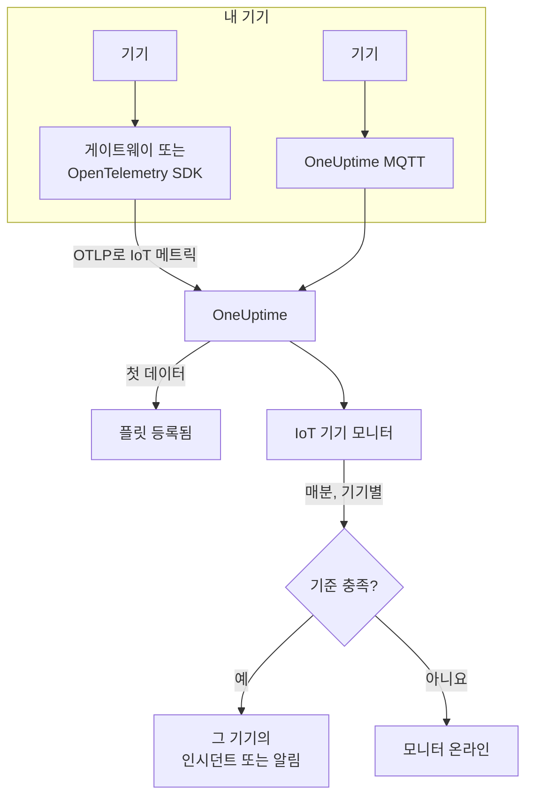

# IoT 기기 모니터

IoT 기기 모니터는 기기 플릿 하나를 지켜보며, 기기가 오프라인이 되거나, 배터리가 부족해지거나, 신호가 약해지거나, 과열되거나, CPU가 계속 바쁠 때 알려 줍니다. 기기가 OpenTelemetry나 MQTT로 OneUptime에 보내는 `iot_*` 메트릭을 읽으므로, 외부에서 검사하는 것은 없고 프로브도 관여하지 않습니다.

:::cards
- [모니터 만들기](#iot-기기-모니터-만들기): 대시보드에서 여섯 단계.
- [템플릿](#미리-만든-알림-템플릿): 미리 만든 알림 다섯 개. 기기마다 인시던트 하나.
- [오프라인 감지](#오프라인-감지): 죽거나 조용해진 기기를 알아차리는 방법.
- [메트릭](#수집되는-메트릭): 모니터가 읽는 `iot_*` 시리즈.
:::

## 작동 방식

기기, 또는 기기와 통신하는 게이트웨이가 측정값을 OneUptime에 보냅니다. OpenTelemetry를 쓰거나 OneUptime의 MQTT 엔드포인트로 바로 보냅니다. 모든 측정값에는 플릿 이름 `iot.fleet.name` 과 기기 자체의 ID `device.id` 가 붙습니다. 첫 데이터가 들어오면 플릿이 등록됩니다.

IoT 기기 모니터는 플릿 하나에 연결됩니다. 매분 그 플릿의 메트릭에 쿼리를 실행하고 결과를 기준과 비교합니다. 템플릿은 `device.id` 로 그룹화하므로, 센서 30개가 오프라인이 되면 인시던트 30개가 열리고, 각 인시던트는 해당 기기를 밝히며 기기가 복구되면 저절로 해결됩니다.



## 시작하기 전에

- **기기가 데이터를 보내게 하세요.** [IoT 기기 가이드](/docs/telemetry/iot-devices)에서 OpenTelemetry SDK나 Collector, 또는 MQTT로 메트릭을 보내는 방법을 설명합니다.
- **플릿이 등록되었는지 확인하세요.** 기기가 보내는 `iot.fleet.name` 이름으로 **제품 → 인프라 → IoT → All Fleets** 에 나타납니다.
- **예상하는 기기를 등록하세요**. 플릿의 **Device Registry** 에 등록하면 기기가 조용해질 때 알림을 받습니다. [오프라인 감지](#오프라인-감지)를 참고하세요.

## IoT 기기 모니터 만들기

:::steps
### 새 모니터 시작

**모니터** 로 이동해 **모니터 생성** 을 클릭합니다.

### IoT Device 선택

**모니터 유형** 에서 **더 많은 모니터 유형** 을 클릭하고 **인프라** 아래의 **IoT Device** 를 선택하거나, 검색 상자에 `iot` 를 입력합니다. **이름** 을 입력하고(인시던트와 알림 제목에 쓰입니다) **다음** 을 클릭합니다.

### 플릿 선택

**IoT Monitor Configuration** 에서 **IoT Fleet** 으로 플릿을 선택합니다. 데이터를 보낸 적이 있는 모든 플릿이 목록에 있습니다.

### 감시할 대상 선택

세 탭 중 하나를 선택합니다.

- **Quick Setup**: [템플릿](#미리-만든-알림-템플릿)을 클릭합니다. 템플릿은 메트릭, 집계, 시간 범위, `device.id` 그룹화, 임계값을 설정하고 아래의 기준을 자신의 기준으로 바꿉니다. **시간 범위** 는 나중에도 바꿀 수 있습니다.
- **Custom Metric**: **IoT Metric** 에서 메트릭 하나를 고른 다음 **집계** 와 **시간 범위** 를 설정합니다. [필터](#모니터-설정)로 기기 하나나 기기 유형 하나로 좁힙니다. 사용자 지정 메트릭은 그룹화되지 않으며 플릿 전체를 판단합니다.
- **고급**: **메트릭 선택** 에서 쿼리와 수식을 직접 만듭니다. 직접 정한 메트릭 이름도 쓸 수 있으며, 예를 들어 기기 메모리 크기 대비 사용 중인 메모리의 백분율이 있습니다. **Group by** 에 `device.id` 를 쓰면 각 기기를 따로 판단합니다.

### 기준 확인

**모니터 기준** 의 각 기준을 열고 **Select Metric Variable**, **집계**, **조건**, **Threshold** 를 확인합니다. 템플릿을 쓰면 이 값들이 채워집니다. **Custom Metric** 이나 **고급** 에서는 모니터가 [기본 기준](#기본-기준)으로 시작하는데, 이 기준은 메트릭이 0으로 떨어지는 것만 알아차리므로 직접 임계값을 설정하세요.

### 모니터 만들기

**모니터 생성** 을 클릭합니다. OneUptime이 모니터 페이지를 열고 매분 평가합니다. 모니터가 올린 인시던트와 알림은 다른 모니터와 마찬가지로 당직 정책, Slack, Microsoft Teams, 이메일, SMS, 웹후크로 전달됩니다.
:::

> [!TIP]
> 템플릿 여러 개를 한 번에 설정하려면 **제품 → 인프라 → IoT** 에서 플릿을 열고 **Recommendations** 로 이동하세요. 원하는 템플릿을 고르고 호출할 사람을 정하면, OneUptime이 템플릿마다 모니터를 하나씩 만듭니다.

## 모니터 설정

| 필드 | 탭 | 하는 일 |
| --- | --- | --- |
| **IoT Fleet** | 모두 | 필수. 모든 쿼리를 `resource.iot.fleet.name` 으로 한정합니다. |
| **리소스 범위** | Custom Metric, 고급 | 선택 사항. **디바이스** 또는 **Fleet**: `iot.scope` 속성과 정확히 일치. 메트릭을 고르면 **디바이스** 로 설정됩니다. |
| **Device ID** | Custom Metric, 고급 | 선택 사항. `device.id` 로 기기 하나(예: `sensor-001`). |
| **Device Type** | Custom Metric, 고급 | 선택 사항. 이 `iot.device.type` 을 보고하는 기기(예: `sensor`, `gateway`). |
| **IoT Metric** | Custom Metric | [카탈로그](#수집되는-메트릭)의 메트릭 하나. |
| **집계** | Custom Metric | 샘플을 합치는 방법: **평균**, **최대**, **최소**, **합계**, **개수**. 메트릭의 일반적인 집계로 시작합니다. |
| **시간 범위** | 모두 | 쿼리가 읽는 이동 기간으로, **Past 1 Minute** 부터 **Past 365 Days** 까지입니다. 새 모니터는 **Past 1 Minute** 로 시작하며, 템플릿은 자체 값을 설정합니다. |
| **메트릭 선택** | 고급 | 쿼리 빌더: **메트릭**, **Aggregate by**, **Filter by attributes**, **Group by**, 그리고 쿼리를 합치는 **메트릭 추가** 와 **수식 추가**. |

필터는 함께 동작합니다. **Device ID** 와 **Device Type** 을 모두 지정하면 다른 유형의 기기는 아무것과도 일치하지 않습니다.

## 미리 만든 알림 템플릿

**Quick Setup** 은 템플릿 5개를 제공합니다. 각 템플릿은 완전한 모니터를 만듭니다. 메트릭 쿼리, `device.id` 그룹화, 발생 기준과 복구 기준입니다. 임계값은 편집할 수 있는 출발점입니다.

기준은 기간의 모든 분에서 조건이 성립할 때만 발생합니다. 단, **Device Offline** 은 1보다 낮은 첫 측정값에서 발생합니다. 임계값 기준은 임계값에서 10% 벗어난 지점에서 복구되므로, 경계 근처를 오가는 값 때문에 상태가 흔들리지 않습니다.

| 템플릿 | 범주 | 심각도 | 감시 대상 | 발생 조건 | 복구 조건 |
| --- | --- | --- | --- | --- | --- |
| Device Offline | 가용성 | 심각 | `iot_device_up`, `device.id` 별 Min, 최근 30분 | 측정값 중 하나가 1보다 낮거나, 등록된 기기가 기간 내내 아무것도 보내지 않음 | 다시 1 |
| Low Battery | Power | Warning | `iot_battery_percent`, `device.id` 별 Avg, 최근 5분 | 20% 미만 | 22% 이상 |
| Weak Signal | Connectivity | Warning | `iot_signal_strength_dbm`, `device.id` 별 Avg, 최근 5분 | -100 dBm 미만 | -90 dBm 이상 |
| High Temperature | 환경 | 심각 | `iot_temperature_celsius`, `device.id` 별 Max, 최근 5분 | 70 °C 초과 | 63 °C 이하 |
| High CPU Usage | System | Warning | `iot_cpu_usage_ratio`, `device.id` 별 Avg, 최근 5분 | 0.9 초과(CPU의 90%) | 0.81 이하 |

**심각도** 는 선택기가 보여 주는 레이블입니다. 템플릿이 만드는 인시던트와 알림은 프로젝트에서 가장 심각한 인시던트 및 알림 심각도로 시작하며, 기준에서 바꿀 수 있습니다.

- **Device Offline은 30분을 읽습니다**. 몇 분마다 보고하는 기기가 두 보고 사이에 오프라인으로 판단되지 않게 하기 위해서입니다. 대략 15분에 한 번보다 드물게 보고하는 기기에는 더 긴 기간이 필요합니다.
- **High Temperature는 분마다 Max를 씁니다**. 같은 분의 더 낮은 측정값에 높은 측정값이 가려지지 않게 하기 위해서입니다. 그래도 기간의 모든 분에서 높은 온도가 이어져야 합니다.
- **High CPU Usage는 비율을 비교합니다:** `iot_cpu_usage_ratio` 는 0에서 1까지이므로 0.9는 90%입니다.

## 오프라인 감지

**Device Offline** 은 기기가 `iot_device_up = 0` 을 보고하면 발생합니다. 죽거나 조용해진 기기는 세 가지 방법으로 이를 발생시킵니다.

| 방법 | 일어나는 일 |
| --- | --- |
| **게이트웨이가 보고함** | 게이트웨이나 컬렉터가 더 이상 닿을 수 없는 기기에 대해 `iot_device_up = 0` 을 보냅니다. |
| **MQTT Last Will** | OneUptime의 MQTT 엔드포인트에 연결된 기기는 `status` 토픽에 Last Will을 등록합니다. 기기가 죽으면 세션이 끊기는 순간 브로커가 그 기기의 `iot_device_up = 0` 을 보냅니다. 폴링도, 빠진 보고를 기다릴 필요도 없습니다. [MQTT를 통한 메트릭 전송](/docs/telemetry/iot-devices#mqtt를-통한-메트릭-전송)을 참고하세요. |
| **기기가 등록되어 있음** | 플릿의 **Device Registry** 에 있는 기기는 데이터가 올 것으로 기대됩니다. 기간 내내 아무것도 보내지 않으면 모니터는 그 기기가 `0` 을 보고한 것처럼 처리하므로, 그 기기만의 인시던트가 열리고 기기가 다시 보고하면 저절로 해결됩니다. |

등록된 기기는 플릿 인벤토리에도 오프라인으로 남지만, 등록되지 않은 기기는 15분 동안 조용하면 제거됩니다. 침묵 감지에는 `iot_device_up` 기준에 **Treat As Zero** 데이터 없음 정책이 필요하며, 템플릿으로 만든 Device Offline 모니터에는 이 정책이 들어 있습니다. 기기 등록 기능이 생기기 전에 만든 Device Offline 모니터는 직접 설정하거나 템플릿으로 다시 만들어야 합니다.

> [!NOTE]
> Last Will이나 게이트웨이 보고 없이 조용해진 등록되지 않은 기기는 데이터를 보내지 않을 뿐이며, 기기별로 그룹화한 모니터는 그 기기를 골라낼 수 없습니다. 기기를 등록하거나, 중요한 기기에는 자체 모니터(그 **Device ID** 를 쓰는 **Custom Metric**)를 주고 **데이터가 없는 경우** 를 **트리거** 로 설정하세요. 침묵 감지에는 플릿의 다른 기기가 적어도 하나는 계속 보고해야 합니다. 예를 들어 게이트웨이 장애로 플릿 전체가 조용해지면, 기기마다가 아니라 모니터에 대해 인시던트 하나가 올라갑니다.

## 수집되는 메트릭

각 시리즈에는 기기의 `device.id` 레이블과 `iot.scope`, `iot.device.type`, `iot.device.kind` 속성이 붙습니다.

| 메트릭 | 단위 | 설명 |
| --- | --- | --- |
| `iot_device_up` | — | 기기가 동작 중이면 1, 다운되었거나 오프라인이면 0. |
| `iot_battery_percent` | `%` | 남은 배터리 충전량(0에서 100). 계속 떨어지면 기기가 곧 보고를 멈춥니다. |
| `iot_signal_strength_dbm` | `dBm` | 무선 신호 세기. 0에 가까울수록 강하며, 신호가 약해지면 연결이 끊기기 전 징후입니다. |
| `iot_temperature_celsius` | `°C` | 기기의 온도. 높은 값은 하드웨어 과열이나 주변의 문제를 뜻할 수 있습니다. |
| `iot_cpu_usage_ratio` | `ratio` | 사용 중인 CPU(0에서 1, 1이 완전 사용). |
| `iot_memory_usage_bytes` | `bytes` | 사용 중인 메모리. 기기의 메모리 크기와 비교하면 메모리 압박을 볼 수 있습니다. |
| `iot_uptime_seconds` | `s` | 기기가 실행된 시간. 다시 시작하면 0으로 떨어집니다. |

## 모니터링 기준

기준은 모니터의 쿼리나 수식 하나를 임계값과 비교합니다. IoT 기기 모니터의 기준이 제공하는 **필터 유형** 은 **Metric Value** 하나이며, 모든 규칙이 다음 필드로 메트릭 값을 확인합니다.

| 필드 | 하는 일 |
| --- | --- |
| **필터 유형** | 항상 **Metric Value**. 이 모니터가 제공하는 유일한 검사입니다. |
| **Select Metric Variable** | 확인할 쿼리나 수식(변수 이름으로). |
| **집계** | 기간 안의 값을 답 하나로 만드는 방법: **평균**, **합계**, **Maximum Value**, **Minimum Value**, **All Values**(모든 값이 일치해야 함), **Any Value**(하나면 충분). |
| **조건** | **Greater Than**, **Less Than**, **Greater Than Or Equal To**, **Less Than Or Equal To**, **Equal To**, 또는 이상 조건: **Anomalously High**, **Anomalously Low**, **Anomalous**. |
| **Threshold** | 비교할 값. 메트릭에 단위가 있으면 옆에 단위 목록이 있습니다. 이상 조건에서는 표시되지 않습니다. |
| **민감도** | 이상 조건만. **낮음**(4σ), **중간**(3σ, 기본값), **높음**(2σ). |
| **기준선 기간** | 이상 조건만. 14일(기본값), 28일, 60일, 90일의 기록. |
| **데이터가 없는 경우** | **추가 필드** 아래에 있습니다. 기간에 시리즈의 샘플이 없을 때의 동작: **Ignore**(기본값)는 건너뛰고, **Treat As Zero** 는 `0` 으로 읽으며, **트리거** 는 기준을 일치시킵니다. |

이상 조건은 각 값을 기준선에서 같은 요일의 같은 시간과 비교합니다. 기준선 기간에 기록이 충분히 쌓일 때까지 "Learning" 상태에 머물며 아무것도 올리지 않습니다.

### 기본 기준

템플릿으로 만들지 않은 모니터는 기준 두 개로 시작합니다.

| 순서 | 기준 | 일치하는 경우 | 결과 |
| --- | --- | --- | --- |
| 1 | Check if _monitor name_ is offline | 첫 번째 쿼리의 값 중 하나가 `0` | 모니터를 **오프라인** 으로 표시하고 인시던트 "_monitor name_ is offline" 을 선언하며, 모니터가 복구되면 저절로 해결됩니다. |
| 2 | Check if _monitor name_ is online | 값 중 하나가 `0` 보다 큼 | 모니터를 **정상 작동** 으로 표시합니다. |

> [!IMPORTANT]
> 침묵은 어느 기준과도 일치하지 않습니다. 데이터를 보내지 않게 된 플릿은 모니터를 그대로 둡니다. 데이터가 끊긴 것을 알려면 기준에서 **데이터가 없는 경우** 를 **트리거** 로 설정하세요. OneUptime 자체가 데이터를 받지 못한 시간은 데이터 없음으로 치지 않습니다. 그 시간이 들어간 기간의 검사는 [OneUptime이 데이터를 받지 못할 때](/docs/monitor/when-oneuptime-is-not-receiving)에서 설명하듯 대신 기다립니다.

## Terraform

[OneUptime Terraform 공급자](/docs/terraform/monitor-steps)는 IoT 기기 모니터 단계의 구성을 `iot_monitor` 속성으로 다룹니다. 이 속성은 `iotMonitor` 구성(`fleetIdentifier`, `resourceFilters`, `metricViewConfig`, `rollingTime`)의 원시 JSON이며, `jsonencode()` 로 작성합니다.

```hcl title="main.tf"
monitor_steps = [{
  iot_monitor = jsonencode({
    fleetIdentifier = "building-a-sensors"
    resourceFilters = {}
    rollingTime     = "Past 5 Minutes"
    metricViewConfig = {
      queryConfigs = [{
        metricAliasData = { metricVariable = "battery_percent", title = "Battery", description = "", legend = "" }
        metricQueryData = {
          filterData = {
            metricName     = "iot_battery_percent"
            attributes     = {}
            aggegationType = "Avg"
            aggregateBy    = {}
          }
          groupByAttributeKeys = ["device.id"]
        }
      }]
      formulaConfigs = []
    }
  })
  criteria = [ /* ... */ ]
}]
```

`fleetIdentifier` 는 플릿의 `iot.fleet.name` 이며, OneUptime ID가 아닙니다.

## 문제 해결

:::details 플릿이 IoT Fleet 목록에 없음
플릿은 기기의 데이터로 스스로 등록됩니다. 기기가 `iot.fleet.name` 을 보내는지 확인하고, [IoT 기기 가이드](/docs/telemetry/iot-devices)를 따라 데이터가 도착하는지 확인하세요.
:::

:::details 기기마다가 아니라 플릿 전체에 대해 인시던트 하나가 발생함
쿼리가 그룹화되지 않았습니다. **Custom Metric** 모니터는 플릿을 전체로 판단합니다. 템플릿을 쓰거나, **고급** 에서 **Group by** 에 `device.id` 를 쓰세요.
:::

:::details 기기가 죽었는데 Device Offline이 발생하지 않음
기기가 Last Will을 보내지 않았고 어떤 게이트웨이도 보고하지 않아, 그냥 조용해진 것입니다. 플릿의 **Device Registry** 에 등록하고, `iot_device_up` 기준의 **데이터가 없는 경우** 가 **Treat As Zero** 인지 확인하세요. [오프라인 감지](#오프라인-감지)를 참고하세요.
:::

:::details 정상인 기기에서 Device Offline이 발생함
기기가 30분 기간보다 드물게 보고하므로, 일부 기간에는 그 기기의 데이터가 없습니다. **시간 범위** 를 늘리거나 기기가 더 자주 보고하게 하세요. WebSocket MQTT 엔드포인트에서는 MQTT keepalive를 5분 미만으로 두세요. OneUptime은 유휴 WebSocket 연결을 300초 뒤에 닫으며, 이때 Last Will이 전송됩니다.
:::

:::details 템플릿에 데이터가 표시되지 않음
템플릿은 `iot_*` 메트릭 이름을 정확히 읽고 `device.id` 레이블로 그룹화합니다. 기기가 보내는 것을 플릿의 **메트릭** 페이지에서 [메트릭 규칙](/docs/telemetry/iot-devices#메트릭-규칙)과 비교하세요.
:::

## 다음 단계

:::cards
- [IoT 기기](/docs/telemetry/iot-devices): OpenTelemetry나 MQTT로 기기 메트릭을 보냅니다.
- [메트릭 모니터](/docs/monitor/metrics-monitor): IoT 메트릭뿐 아니라 어떤 메트릭으로든 알림을 보냅니다.
- [인시던트 및 알림 템플릿](/docs/monitor/incident-alert-templating): 인시던트 제목에 기기의 ID를 넣습니다.
:::
