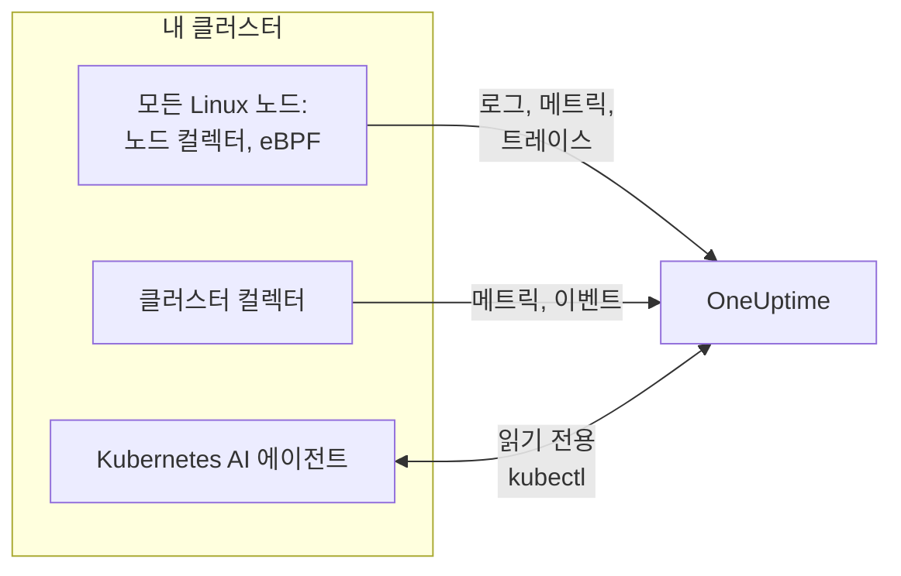

# Kubernetes 에이전트(Helm 설치)

OneUptime Kubernetes 에이전트는 클러스터의 메트릭, 이벤트, 파드 로그, eBPF로 수집한 애플리케이션 트레이스, 노드별 OS 메트릭을 수집해 OneUptime으로 보내는 Helm 차트입니다. `helm install` 한 번으로 배포되며 앱 코드를 바꿀 필요가 없습니다. [Kubernetes 모니터](/docs/monitor/kubernetes-monitor)는 에이전트가 보내는 데이터로 알림을 보냅니다.

:::cards
- [에이전트 설치](#에이전트-설치): Helm을 사용한 네 단계.
- [프리셋 선택](#프리셋-선택): 표준 클러스터, GKE Autopilot, EKS Fargate.
- [주요 옵션](#주요-옵션): 대부분의 클러스터에서 바꾸는 설정.
- [문제 해결](#문제-해결): 진단 스크립트와 흔한 문제.
:::

## 차트가 설치하는 것

차트는 자체 네임스페이스에서 몇 가지 워크로드를 실행합니다. 각 워크로드는 수집한 데이터를 전달받은 수집 키와 함께 OTLP로 OneUptime URL에 보냅니다.



| 워크로드 | 종류 | 하는 일 | 기본값으로 켜짐 |
| --- | --- | --- | --- |
| 클러스터 컬렉터 | Deployment | Kubernetes API에서 클러스터 메트릭, Kubernetes 이벤트, 파드·노드·워크로드의 전체 사양을 수집합니다. | 예 |
| 노드 컬렉터 | DaemonSet | `/var/log/pods` 의 파드 로그, kubelet 및 cAdvisor 메트릭, 노드의 OS 메트릭. | 예 |
| eBPF 계측(OBI) | DaemonSet | 모든 파드의 HTTP, gRPC, SQL, Redis 트레이스와 요청 메트릭, 그리고 서비스 맵. | 예 |
| Kubernetes AI 에이전트 | Deployment | OneUptime AI가 이 클러스터의 인시던트나 알림을 조사하는 동안 읽기 전용 `kubectl` 을 실행할 수 있게 합니다. | 예 |
| 로그 테일러 | Deployment | 노드 컬렉터가 읽을 수 없는 곳에서 Kubernetes API를 통해 파드 로그를 가져옵니다. | `gke-autopilot` 및 `eks-fargate` 프리셋에서 |
| eBPF 프로파일러 | DaemonSet | 모든 프로세스의 지속적인 CPU 플레임 그래프. | 아니요 |
| kube-state-metrics | Deployment | 파드 단계, 컨테이너 대기 사유, 리소스 쿼터. | 아니요 |

모든 에이전트 이미지는 Linux 전용이므로 모든 워크로드가 Linux 노드에 고정됩니다.

## 시작하기 전에

- **수집 키.** OneUptime의 **프로젝트 설정 → 텔레메트리 및 APM → 수집 키** 에서 만드세요. 에이전트는 이를 `x-oneuptime-token` 헤더로 보내므로 프로젝트 API 키는 여기서 쓸 수 없습니다.
- **Helm 3** 와 클러스터에 대한 `kubectl` 접근. 업그레이드에는 `--reset-then-reuse-values` 를 쓰므로 Helm 3.14 이상이 필요합니다.
- **클러스터 이름**. 프로젝트 안에서 고유해야 합니다. 이름이 없으면 차트가 설치를 거부합니다. 이름이 같은 두 클러스터는 하나로 표시되기 때문입니다.
- 클러스터에서 OneUptime URL로 나가는 **아웃바운드 HTTPS**.

## 에이전트 설치

:::steps
### Helm 저장소 추가

```bash
helm repo add oneuptime https://helm-chart.oneuptime.com
helm repo update
```

### 차트 설치

URL을 내 OneUptime URL로, 두 자리표시자를 수집 키와 클러스터 이름으로 바꾸세요.

```bash
helm install oneuptime-agent oneuptime/kubernetes-agent \
  --namespace oneuptime-kubernetes-agent \
  --create-namespace \
  --set oneuptime.url=https://oneuptime.com \
  --set oneuptime.apiKey=<YOUR_API_KEY> \
  --set clusterName=<A_UNIQUE_NAME_FOR_THIS_CLUSTER>
```

이 명령은 `standard` 프리셋을 사용합니다. GKE Autopilot이나 EKS Fargate에서는 대신 [해당 프리셋을 선택](#프리셋-선택)하세요.

### 파드 실행 확인

```bash
kubectl get pods -n oneuptime-kubernetes-agent
```

1~2분 안에 모든 파드가 `Running` 상태가 되어야 합니다.

### OneUptime에서 클러스터 찾기

**제품 → 인프라 → Kubernetes → 모든 클러스터** 를 여세요. 몇 분 안에 클러스터가 이름으로 표시되고, 노드, 파드, 워크로드가 채워집니다.
:::

## 프리셋 선택

일부 Kubernetes 플랫폼은 워크로드가 `hostPath` 볼륨을 마운트하거나 DaemonSet을 실행하는 것을 허용하지 않는데, 노드 컬렉터는 이 둘을 사용합니다. `preset` 설정으로 내 환경에서 동작하는 방식을 고릅니다.

| 프리셋 | 용도 | 파드 로그 | 모든 노드에서 |
| --- | --- | --- | --- |
| `standard`(기본값) | 자체 관리형, **EKS on EC2**, **GKE Standard**, **AKS**, minikube, kind, k3s | 노드 컬렉터가 `/var/log/pods` 를 읽음 | kubelet, cAdvisor, OS 메트릭 |
| `gke-autopilot` | **GKE Autopilot** | 로그 테일러가 Kubernetes API를 통해 읽음 | `hostPath` 없이 kubelet 및 cAdvisor 메트릭 |
| `eks-fargate` | **EKS Fargate** | 로그 테일러가 Kubernetes API를 통해 읽음 | 없음: Fargate는 DaemonSet을 실행하지 않음 |

잘 모르겠다면 `preset` 을 비워 두어 `standard` 를 쓰세요. 설치가 `hostPath` 를 언급하는 Pod Security 오류로 실패하면 `gke-autopilot` 으로, EKS Fargate에서는 `eks-fargate` 로 다시 설치하세요.

GKE Autopilot과 EKS Fargate는 eBPF 계측에 필요한 특권 파드도 거부하므로, 그곳에서는 `--set ebpf.enabled=false` 로 이를 끄세요.

:::tabs
@tab Standard
```bash
helm install oneuptime-agent oneuptime/kubernetes-agent \
  --namespace oneuptime-kubernetes-agent --create-namespace \
  --set oneuptime.url=https://oneuptime.com \
  --set oneuptime.apiKey=<YOUR_API_KEY> \
  --set clusterName=prod
```
@tab GKE Autopilot
```bash
helm install oneuptime-agent oneuptime/kubernetes-agent \
  --namespace oneuptime-kubernetes-agent --create-namespace \
  --set oneuptime.url=https://oneuptime.com \
  --set oneuptime.apiKey=<YOUR_API_KEY> \
  --set clusterName=prod-gke-autopilot \
  --set preset=gke-autopilot \
  --set ebpf.enabled=false
```
@tab EKS Fargate
```bash
helm install oneuptime-agent oneuptime/kubernetes-agent \
  --namespace oneuptime-kubernetes-agent --create-namespace \
  --set oneuptime.url=https://oneuptime.com \
  --set oneuptime.apiKey=<YOUR_API_KEY> \
  --set clusterName=prod-eks-fargate \
  --set preset=eks-fargate \
  --set ebpf.enabled=false
```
:::

## 클러스터에 레이블 붙이기

설치할 때 전달한 레이블은 클러스터와, 이 에이전트가 보고하는 서비스와 호스트에 붙습니다. `--set oneuptime.labels.<key>=<value>` 는 `<key>:<value>` 라는 이름의 프로젝트 레이블이 됩니다.

```bash
helm install oneuptime-agent oneuptime/kubernetes-agent \
  --namespace oneuptime-kubernetes-agent \
  --create-namespace \
  --set oneuptime.url=https://oneuptime.com \
  --set oneuptime.apiKey=<YOUR_API_KEY> \
  --set clusterName=prod \
  --set oneuptime.labels.team=payments \
  --set oneuptime.labels.env=production \
  --set oneuptime.labels.region=us-east-1
```

또는 values 파일에 넣어 둡니다.

```yaml title="values.yaml"
oneuptime:
  url: https://oneuptime.com
  apiKey: <YOUR_API_KEY>
  labels:
    team: payments
    env: production
    region: us-east-1
clusterName: prod
```

```bash
helm install oneuptime-agent oneuptime/kubernetes-agent \
  --namespace oneuptime-kubernetes-agent --create-namespace \
  -f values.yaml
```

그러면 이 에이전트가 보내는 모든 레코드(로그, 메트릭, 트레이스, 프로필)에 `team:payments`, `env:production`, `region:us-east-1` 이 붙습니다. 각 레이블은 `oneuptime.label.<key>=<value>` 리소스 속성이며, OneUptime은 `oneuptime.label.` 로 시작하는 모든 속성을 레이블로 바꿉니다. 레이블은 대소문자를 구분하지 않고 비교하므로 기존 `Production` 레이블은 중복되지 않고 다시 사용됩니다. 에이전트는 OneUptime에서 직접 추가한 레이블을 지우지 않습니다.

## 파드 로그

`preset` 은 `logs.mode` 를 설정하며, 이 값은 직접 설정할 수도 있습니다.

| `logs.mode` | 로그를 읽는 방법 | 장점 | 주의할 점 |
| --- | --- | --- | --- |
| `daemonset` | 노드마다 노드 컬렉터 하나가 `/var/log/pods` 아래의 파일을 따라 읽습니다. | 오버헤드가 가장 적고, 노드에 맞춰 확장되며, Kubernetes API 서버에 부하를 주지 않고, 로그 로테이션을 따라갑니다. | `hostPath` 와 DaemonSet이 필요합니다. |
| `api` | 로그 테일러 하나가 `kubectl logs -f` 처럼 Kubernetes API에서 모든 컨테이너의 로그를 스트리밍합니다. | `hostPath` 가 막혀 있거나 `restricted` Pod Security Standard가 적용되는 곳에서도 동작합니다. | 컨테이너 스트림마다 API 서버와의 장기 연결입니다. 복제본 하나가 수천 개의 컨테이너를 처리합니다. |
| `disabled` | 아무것도 하지 않습니다. | 이미 다른 방법으로 로그를 보내는 앱용. | |

로그 수집을 끄려면 `--set logs.enabled=false` 를 설정하고, 대신 [OpenTelemetry](/docs/telemetry/open-telemetry) SDK로 애플리케이션 로그를 보내세요. 메트릭은 영향을 받지 않으며, 노드 컬렉터는 계속 실행됩니다.

### 혼합 OS 클러스터(Windows 노드 풀)

Windows 노드에서는 에이전트 파드가 실행되지 않습니다. 그래도 Windows 노드와 그 파드에 대한 클러스터 수준 데이터는 Kubernetes API에서 오기 때문에 계속 들어옵니다. 노드 상태, 파드 단계, Kubernetes 이벤트, kube-state-metrics가 그렇습니다. Windows 노드에 없는 것은 노드에서 수집되는 데이터입니다. OS 메트릭, kubelet 및 cAdvisor 메트릭, eBPF 트레이스, 프로필, 그리고 `daemonset` 로그 모드에서의 파드 로그입니다.

Windows 노드의 파드 로그도 수집하려면 하이브리드 모드를 켜세요.

```bash
helm upgrade oneuptime-agent oneuptime/kubernetes-agent \
  --namespace oneuptime-kubernetes-agent --reset-then-reuse-values \
  --set logs.windowsPods.enabled=true
```

그러면 로그 테일러가 Windows 노드의 파드만을 대상으로 노드 컬렉터 옆에서 실행됩니다. Linux 파드는 계속 더 저렴한 파일 읽기를 쓰고, 둘은 노드 OS에 따라 파드를 나누므로 어떤 로그 줄도 두 번 전송되지 않습니다.

- **테일러 이미지 버전.** Windows 전용 분할은 `kubernetes-log-tailer` 이미지에 들어 있습니다. 이전 이미지는 이를 무시하고 *모든* 파드를 읽어 Linux 파드의 로그를 두 번 보냅니다. `logs.api.image.tag` 를 차트 릴리스보다 오래된 버전으로 고정하지 마세요. 노드에 이전 `release` 이미지가 캐시되어 있을 수 있다면 업그레이드에 `--set logs.api.image.pullPolicy=Always` 를 추가하세요.
- **심각도 필터링.** `filters.logs.minSeverity` 가 설정되어 있으면, 알아볼 수 있는 심각도가 없는 줄은 노드 컬렉터 경로에서는 버려지지만 로그 테일러 경로에서는 유지됩니다. [로그 심각도로 필터링](/docs/telemetry/kubernetes-agent#로그-심각도로-필터링)을 참고하세요. 그래서 Windows 파드는 Linux 파드보다 수준 없는 줄을 더 많이 보낼 수 있습니다.

## eBPF로 수집하는 애플리케이션 트레이스

차트는 모든 노드에서 [OpenTelemetry eBPF Instrumentation (OBI)](https://opentelemetry.io/docs/zero-code/obi/)를 실행합니다. OBI는 eBPF 프로그램을 Linux 커널에 로드하고 각 파드의 네트워크 트래픽을 지켜보므로, 앱을 전혀 바꾸지 않고도(SDK도 사이드카도 없이) HTTP와 HTTPS, gRPC, SQL과 Redis 호출을 재구성할 수 있습니다. 이를 트레이스와 요청 메트릭으로 OneUptime에 보냅니다.

1~2분 안에 서비스가 **제품 → 트레이스** 와 서비스 맵에 나타나며, `k8s.cluster.name` 이 클러스터 이름으로 설정되어 클러스터별로 필터링할 수 있습니다.

### eBPF를 꺼야 할 때

eBPF는 기본적으로 켜져 있습니다. 다음 경우에는 `--set ebpf.enabled=false` 로 끄세요.

- 클러스터가 **GKE Autopilot** 또는 **EKS Fargate** 인 경우. 이들은 특권 파드를 거부하는데, OBI는 프로그램을 로드하려면 특권이 필요합니다.
- 노드가 BTF 없이 **Linux 5.8** 보다 오래된 커널을 실행하는 경우. Debian 11, Ubuntu 20.10, Fedora 34, RHEL 9 이상은 괜찮습니다.
- 앱이 이미 OpenTelemetry SDK로 트레이스를 보내고 있어 중복을 원하지 않는 경우.

### eBPF가 보내는 것

OBI는 여러 종류의 신호를 보냅니다. 각각 `--set ebpf.features.<key>=false` 로 끌 수 있습니다.

| 설정 | 기본값 | 추가하는 것 |
| --- | --- | --- |
| `ebpf.features.httpMetrics` | 켜짐 | 서비스별 HTTP 및 gRPC 요청 메트릭: 요청 속도, 지연 시간 히스토그램, 오류. |
| `ebpf.features.spanMetrics` | 켜짐 | 스팬 메트릭: 서비스, 경로 또는 작업, 스팬 종류, 상태별 호출 수와 소요 시간. `traces.span.metrics.calls` 와 `traces.span.metrics.duration`(초)입니다. |
| `ebpf.features.serviceGraph` | 켜짐 | 한 서비스에서 다른 서비스로 가는 각 호출의 속도와 지연 시간으로, 서비스 맵을 그립니다. |
| `ebpf.features.networkMetrics` | 켜짐 | 모든 파드 쌍 사이에 TCP와 UDP로 오간 바이트와 패킷(Kubernetes 이름 포함). OBI가 읽을 수 없는 프로토콜로 통신하더라도 서로 통신하는 모든 파드 쌍을 보여 줍니다. |
| `ebpf.features.networkInterZoneMetrics` | 꺼짐 | 같은 것을 영역 사이에서. 시리즈 수가 두 배가 되므로 영역별로 스케줄링할 때만 켜세요. |
| `ebpf.features.tcpStats` | 켜짐 | 노드별 TCP 통계: 왕복 시간, 실패한 연결, 재전송. |

### 서비스 간 트레이스 연결

OBI는 호출을 넘어 트레이스를 이어 갈 수도 있습니다. 파드 A가 HTTP나 gRPC로 파드 B를 호출하면, 어느 앱에도 SDK 없이 B 쪽 스팬이 A의 트레이스에 합류합니다. **이 기능은 기본적으로 꺼져 있습니다.** 아래 경고를 읽은 뒤 `--set ebpf.contextPropagation=true` 로 켜세요.

| 옵션 | 기본값 | 하는 일 |
| --- | --- | --- |
| `ebpf.contextPropagation` | 꺼짐 | 나가는 트래픽에 W3C `traceparent` 를 써서 스팬이 서비스 사이에서 연결되게 합니다. |
| `ebpf.contextPropagationMode` | `headers` | 방식: `headers`(HTTP/1.1 요청 헤더, 가장 좁은 범위), `tcp`(Linux Traffic Control을 통한 TCP 옵션), `all`(둘 다). `contextPropagation` 이 켜져 있을 때만 읽습니다. |
| `ebpf.trackRequestHeaders` | 켜짐 | 커널에서 요청 헤더를 추적해, 받는 쪽이 일반 HTTP 서버에서도 `traceparent` 를 찾게 합니다. `contextPropagation` 이 켜져 있을 때만 효과가 있습니다. |

> [!WARNING]
> 모든 전파 모드는 이미 전송 중인 트래픽을 바꿉니다. 일반 HTTP에서는 OBI가 헤더가 들어가도록 커널에서 나가는 요청을 넓히고, TLS와 원시 TCP에서는 Traffic Control 훅에서 TCP 옵션을 추가하며 패킷과 체크섬을 다시 씁니다. 그다음 연결의 바이트 계산이 정확히 보정되지 않으면 스트림이 **비동기화됩니다**. nginx 같은 프록시를 거치는 전송은 응답이 약 64 KB를 넘는 순간 중간에 멈추고, 연결이 시간 초과될 때까지 그대로 있습니다. 작은 요청은 계속 동작하므로 애플리케이션이나 프록시의 버그처럼 보입니다. 이 다시 쓰기를 없애 주는 커널 버전은 없습니다. 트레이스, 요청 메트릭, 서비스 맵은 이 기능 없이도 모두 동작하며, 서비스에 넣은 OpenTelemetry SDK는 커널의 다시 쓰기 없이 트레이스를 연결합니다. 켜려면 먼저 운영 환경이 아닌 클러스터에서 시험하고, 프록시를 거치는 대용량 전송을 확인하세요.

### 로그와 트레이스 연결

**기본적으로 꺼져 있습니다.** 켜면 OBI가 계측하는 모든 프로세스의 `write()` 시스템 호출에 프로브를 붙이고 다음과 같이 동작합니다.

- **JSON 로그 줄** 에는 `trace_id` 와 `span_id` 필드가 추가됩니다(줄에 이미 있는 필드는 유지됩니다). 노드 컬렉터가 이를 로그 레코드의 트레이스 필드로 옮기므로, OneUptime에서 스팬의 로그는 클릭 한 번 거리에 있고 로그 줄의 트레이스도 마찬가지입니다.
- **그 밖의 로그 줄** 은 연결 없이 그대로 수집됩니다.

```bash
helm upgrade oneuptime-agent oneuptime/kubernetes-agent \
  --namespace oneuptime-kubernetes-agent --reset-then-reuse-values \
  --set ebpf.logToTraceCorrelation=true
```

| 옵션 | 기본값 | 하는 일 |
| --- | --- | --- |
| `ebpf.logToTraceCorrelation` | `false` | OBI의 로그 보강기와 노드 컬렉터의 `trace_id` 옮기기를 켭니다. |
| `ebpf.logEnricher.services` | `[{service: [{exe_path: "*"}]}]` | 보강기가 건드리는 프로세스. 각 항목은 OBI [GlobAttributes](https://opentelemetry.io/docs/zero-code/obi/configure/options/#service-discovery) 선택기이며, `exe_path`, `languages`, `k8s_pod_labels`, `k8s_pod_annotations`, `open_ports`, `cmd_args` 같은 필드를 씁니다. |

#### 함께 쓰면 충돌하는 APM 에이전트

보강기는 앱의 출력 버퍼를 **프로세스 안에서** 다시 씁니다. 일치하는 프로세스가 `write()` 를 호출하면, OBI는 원래 바이트를 지우고 보강된 사본을 씁니다. `LD_PRELOAD` 로 로드되어 스스로도 `write()` 를 감싸는 APM 에이전트는 이를 견디지 못합니다.

| APM 에이전트 | 라이브러리 | 일어나는 일 |
| --- | --- | --- |
| Dynatrace OneAgent | `liboneagentproc.so` | 앱이 SIGSEGV(종료 코드 139)로 충돌합니다. Dynatrace 감시 프로세스 자체의 `write()` 가 10초 제한을 넘겨 멈추고, OneAgent가 계속 다시 시작합니다. |
| New Relic | `libnewrelic*.so` | 같은 종류의 충돌. |
| AppDynamics | `libappdynamics*.so` | 같은 종류의 충돌. |
| Datadog | `libdd*.so` | 같은 종류의 충돌. |
| Instana | `libinstana*.so` | 같은 종류의 충돌. |

**.NET 앱이 가장 영향을 받기 쉽습니다.** Dynatrace의 .NET 에이전트는 항상 `LD_PRELOAD` 로 로드되고, Microsoft.Extensions.Logging의 콘솔 로그는 버퍼링되지 않으므로 모든 줄이 이 경로를 지납니다. Python과 Go 앱은 대개 영향을 받지 않습니다.

이 에이전트 중 하나와 함께 쓰려면 `logEnricher.services` 가 그 에이전트가 없는 파드만 가리키게 하세요. 보강기에는 제외 기능이 없으므로 보강할 파드를 나열합니다.

```yaml title="values.yaml"
ebpf:
  logToTraceCorrelation: true
  logEnricher:
    services:
      # Enrich only pods with the apm-agent=none label
      - service:
          - k8s_pod_labels:
              apm-agent: "none"
```

또는 런타임으로 고르세요. Dynatrace의 `LD_PRELOAD` 로드는 .NET을 대상으로 하므로, Python, Go, Ruby, Node.js만 보강하면 이를 피할 수 있습니다.

```yaml title="values.yaml"
ebpf:
  logToTraceCorrelation: true
  logEnricher:
    services:
      - service:
          - languages: "python,go,ruby,nodejs"
```

#### 로그는 JSON이고 버퍼링되지 않아야 함

- **`trace_id` 는 JSON 줄에만 붙습니다.** 로거를 JSON 형식으로 바꾸세요. `structlog`, `pino`, `winston`, `serilog`, `logback-json`, klog `--logging-format=json` 등이 있습니다.
- **버퍼링된 출력은 연결을 끊습니다**. 이 경우 `write()` 가 요청과 다른 스레드에서 일어나기 때문입니다. **Python** 에서는 `PYTHONUNBUFFERED=1` 을 설정하세요. **.NET** 에서는 시작할 때 `Console.SetOut(new StreamWriter(Console.OpenStandardOutput()) { AutoFlush = true })` 를 호출하세요. Microsoft.Extensions.Logging의 `AddConsole()` 과 Serilog의 비동기 싱크는 동작하지 않고, Serilog의 일반 `WriteTo.Console()` 은 동작합니다.
- Greenlet, gevent, Tornado 및 기타 사용자 지정 비동기 런타임은 지원되지 않습니다.

### eBPF 조정

| 옵션 | 기본값 | 하는 일 |
| --- | --- | --- |
| `ebpf.enabled` | `true` | eBPF DaemonSet을 실행합니다. `false` 면 제외합니다. |
| `ebpf.image.tag` | `v0.14.0` | OBI 이미지. OBI는 아직 1.0 이전이므로, 시험한 버전으로 고정하고 바꾸기 전에 다시 시험하세요. |
| `ebpf.autoTargetExe` | `*` | 계측할 실행 파일의 글롭(쉼표로 구분). `*/python,*/java` 처럼 좁히면 계측할 런타임을 줄일 수 있습니다. |
| `ebpf.excludeExePaths` | 셸, 클러스터 기반 구성 요소, 서비스 메시 사이드카, CNI 에이전트, 브라우저, ClickHouse, 컬렉터, OBI 자신 | 건너뛸 실행 파일의 글롭(쉼표로 구분). 너무 넓은 글롭은 내 바이너리도 건너뜁니다. |
| `ebpf.logLevel` | `info` | `debug`, `info`, `warn`, `error` 중 하나. |
| `ebpf.printTraces` | `false` | 스팬을 OBI 자체 로그에도 출력해, 무엇을 수집하는지 확인할 수 있게 합니다. |
| `ebpf.resources.*` | 요청 `100m` CPU 및 `512Mi` 메모리, 제한 `2000m` 및 `2Gi` | 트래픽이 많거나 짧게 사는 프로세스가 많은 노드에서는 올리세요. |

OBI가 실행 중이고 트래픽을 보고 있는지 확인하려면 다음을 실행합니다.

```bash
kubectl get pods -n oneuptime-kubernetes-agent -l component=ebpf-instrument
kubectl logs -n oneuptime-kubernetes-agent -l component=ebpf-instrument --tail=200
```

## 지속적인 CPU 프로파일링

[OpenTelemetry eBPF Profiler](https://github.com/open-telemetry/opentelemetry-ebpf-profiler)도 `otel/opentelemetry-collector-ebpf-profiler` 이미지로 모든 노드에서 실행할 수 있습니다. Go, Java, .NET, Python, Ruby, Node.js, PHP, Perl, C, C++, Rust로 된 모든 프로세스가 실행 중인 내용을 초당 19번 샘플링하고, 프로필을 OneUptime에 보냅니다. 프로필은 **제품 → 성능 프로필** 과 트레이스의 각 스팬에 플레임 그래프로 표시됩니다.

**프로파일링은 기본적으로 꺼져 있습니다.** 노드당 CPU와 메모리 비용이 eBPF 계측보다 크기 때문입니다. `--set profiling.enabled=true` 로 켜세요.

eBPF 계측도 켜져 있으면(기본값), 각 샘플이 속한 트레이스를 함께 담으므로 스팬마다 자체 플레임 그래프가 생깁니다. 이를 위해 차트는 OBI가 실행 중인 트레이스 컨텍스트를 사용할 수 있게 유지하도록 요청하며(`OTEL_EBPF_BPF_POPULATE_TRACE_CONTEXT=true`), 이 때문에 계측된 앱은 비동기 컨텍스트 전환마다 약간의 비용을 치릅니다. 스팬과 연결되지 않은 플레임 그래프를 원하면 `profiling.obiProcessContext=false` 를 설정하세요.

프로파일링에는 **Linux 5.10** 이상과, 노드의 프로세스 ID를 가진 특권 파드가 필요합니다. 그래서 GKE Autopilot이나 EKS Fargate에서는 실행할 수 없습니다. kind나 k3d처럼 노드 자체가 컨테이너인 환경에서는 프로세스를 구분하지 못해, 스팬에 연결되는 샘플이 거의 없습니다.

| 옵션 | 기본값 | 하는 일 |
| --- | --- | --- |
| `profiling.enabled` | `false` | 프로파일러 DaemonSet을 실행합니다. |
| `profiling.image.tag` | `0.152.0` | 프로파일러 이미지. 아직 1.0 이전이므로 시험한 버전으로 고정하세요. |
| `profiling.samplesPerSecond` | `19` | 초당 샘플 수. 19는 흔한 타이머 주파수와 겹치지 않게 합니다. |
| `profiling.offCpuThreshold` | `0` | 0보다 크고 1 이하인 값이면 CPU 밖에서 보낸 시간도 프로파일링해 잠금 경합과 블로킹 I/O를 보여 주며, 추가 비용이 듭니다. |
| `profiling.tracers` | `""`(모든 런타임) | 로드할 언어 트레이서(쉼표로 구분, 예: `go,python`). |
| `profiling.obiProcessContext` | `true` | 샘플을 OBI의 트레이스에 연결하고, 이를 위해 OBI가 트레이스 컨텍스트를 사용할 수 있게 유지하도록 합니다. |

## 기타 데이터 수집

| 옵션 | 기본값 | 추가하는 것 |
| --- | --- | --- |
| `hostMetrics.enabled` | 켜짐 | `/proc` 와 `/sys` 에서 가져오는 각 노드의 OS 메트릭: 디스크 I/O 큐, 파일 시스템 inode, 네트워크 인터페이스 오류, 페이징, 로드 평균. 노드 컬렉터 안에서 실행되며 추가 파드가 없습니다. |
| `kubeletstats.utilizationMetrics.enabled` | 켜짐 | 컨테이너와 파드의 CPU 및 메모리를 request와 limit 대비 백분율로. CPU 및 메모리 포화 모니터가 이를 읽습니다. request나 limit이 없는 파드에서는 항상 0입니다. |
| `kubeletstats.volumeMetrics.enabled` | 켜짐 | 각 PVC의 여유 공간과 전체 공간(`k8s.volume.available`, `k8s.volume.capacity`). PVC Low Disk Space 모니터가 이를 읽습니다. 파드당 PVC당 시리즈 하나입니다. |
| `cadvisor.enabled` | 켜짐 | 각 kubelet의 `/metrics/cadvisor` 에서 가져오는 CPU 스로틀링과 OOM 종료: `container_cpu_cfs_throttled_seconds_total`, `container_cpu_cfs_periods_total`, `container_oom_events_total` 만 수집합니다. |
| `kubeStateMetrics.enabled` | 꺼짐 | kube-state-metrics에서 가져오는 파드 단계(Pending, Terminating), 스케줄할 수 없는 파드, 컨테이너 대기 사유(CrashLoopBackOff, ImagePullBackOff), 리소스 쿼터 사용량. `kubeStateMetrics.mode: bundled`(기본값)는 작은 kube-state-metrics를 대신 실행하고, `external` 은 이미 실행 중인 것을 `kubeStateMetrics.endpoint` 에서 읽습니다. |
| `auditLogs.enabled` | 꺼짐 | Kubernetes 감사 로그 `/var/log/kubernetes/audit.log`: API에 대한 모든 요청과 누가 무엇에 요청했는지. 자체 관리형 클러스터만 해당합니다. 관리형 클러스터(EKS, GKE, AKS, DOKS)는 이를 클라우드 공급자에게 보냅니다. |
| `csi.enabled` | 꺼짐 | `app=csi-driver` 또는 `app.kubernetes.io/component=csi-driver` 레이블이 붙은 파드에서 가져오는 CSI 스토리지 드라이버 메트릭: 볼륨 연결 및 분리 시간, 프로비저닝 실패, IOPS. |
| `coreDns.enabled` | 꺼짐 | `:9153/metrics` 의 CoreDNS 메트릭: 쿼리 속도, 지연 시간, 캐시 적중, 오류. |
| `controlPlane.enabled` | 꺼짐 | etcd, API 서버, 스케줄러, 컨트롤러 관리자. 자체 관리형 클러스터만 해당하며, 관리형 클러스터는 이를 노출하지 않습니다. |
| `cost.enabled` | 꺼짐 | 각 워크로드의 비용. [Kubernetes 비용 옵저버빌리티](/docs/telemetry/kubernetes-cost)를 참고하세요. |

## 주요 옵션

| 옵션 | 기본값 | 하는 일 |
| --- | --- | --- |
| `oneuptime.url` | (필수) | 내 OneUptime URL. |
| `oneuptime.apiKey` | (필수) | **프로젝트 설정 → 텔레메트리 및 APM → 수집 키** 에서 만든 수집 키. `x-oneuptime-token` 헤더로 보내며, 프로젝트 API 키는 쓸 수 없습니다. |
| `clusterName` | (필수) | 프로젝트 안에서 고유한 클러스터 이름. 모든 레코드가 이를 `k8s.cluster.name` 으로 담습니다. |
| `preset` | (비어 있음: `standard`) | `standard`, `gke-autopilot`, `eks-fargate` 중 하나. [프리셋 선택](#프리셋-선택)을 참고하세요. |
| `oneuptime.labels` | `{}` | 이 에이전트가 보내는 모든 레코드에 붙는 레이블. [클러스터에 레이블 붙이기](#클러스터에-레이블-붙이기)를 참고하세요. |
| `namespaceFilters.rules` | `kube-system` 을 `podLogs` 와 `ebpfDiscovery` 에서 제외 | `podLogs`, `ebpfDiscovery`, `metrics`, `traces` 에 대해 네임스페이스를 포함하거나 제외하는 규칙. 패턴에 `*` 를 쓸 수 있고, 제외가 항상 우선합니다. |
| `filters.logs.minSeverity` | `""` | 이 수준보다 낮은 파드 로그 줄을 버립니다: `TRACE`, `DEBUG`, `INFO`, `WARN`, `ERROR`, `FATAL`. |
| `filters.metrics.exclude` | `[]` | 버릴 메트릭 이름. |
| `sampling.traces.percentage` | `100` | 유지할 트레이스의 비율(0에서 100). 트레이스는 통째로 유지되거나 버려집니다. |
| `logs.enabled` | `true` | 파드 로그를 수집합니다. |
| `logs.mode` | (`preset` 에서) | `daemonset`, `api`, `disabled` 중 하나. 프리셋보다 우선합니다. |
| `logs.windowsPods.enabled` | `false` | Windows 노드의 파드도 읽습니다. [혼합 OS 클러스터](#혼합-os-클러스터windows-노드-풀)를 참고하세요. |
| `logs.api.replicas` | `1` | `api` 모드에서 로그 테일러의 복제본 수. |
| `ebpf.enabled` | `true` | eBPF 트레이스와 요청 메트릭. [eBPF로 수집하는 애플리케이션 트레이스](#ebpf로-수집하는-애플리케이션-트레이스)를 참고하세요. |
| `profiling.enabled` | `false` | CPU 플레임 그래프. [지속적인 CPU 프로파일링](#지속적인-cpu-프로파일링)을 참고하세요. |
| `kubeStateMetrics.enabled` | `false` | kube-state-metrics에서 가져오는 클러스터 상태. |
| `aiAgent.enabled` | `true` | Kubernetes AI 에이전트. 무엇을 할 수 있는지는 [Kubernetes AI 에이전트](/docs/telemetry/kubernetes-agent)를 참고하세요. |

차트의 [`values.yaml`](https://github.com/OneUptime/oneuptime/blob/master/HelmChart/Public/kubernetes-agent/values.yaml)에 모든 옵션이 나열되고 설명되어 있으며, [Kubernetes 에이전트](/docs/telemetry/kubernetes-agent)에서는 필터링, 샘플링, 데이터 양 줄이기를 다룹니다.

## 업그레이드

```bash
helm repo update
helm upgrade oneuptime-agent oneuptime/kubernetes-agent \
  --namespace oneuptime-kubernetes-agent \
  --reset-then-reuse-values
```

`--reset-then-reuse-values`(Helm 3.14 이상)는 직접 설정한 값(프리셋, 클러스터 이름, 필터)을 유지하고, 나머지 값은 모두 새 차트에서 가져옵니다. 새 `--set` 은 그 뒤에 추가하세요. Helm 3.13 이하에서는 대신 설정한 값을 사용해 업그레이드하세요.

```bash
helm repo update
helm get values oneuptime-agent --namespace oneuptime-kubernetes-agent -o yaml > values.yaml && \
  helm upgrade oneuptime-agent oneuptime/kubernetes-agent \
  --namespace oneuptime-kubernetes-agent -f values.yaml
```

`--reuse-values` 로 업그레이드하지 마세요. 업그레이드 전 차트의 기본값까지 유지하므로, 새 차트의 기본값(eBPF 이미지 포함)이 적용되지 않습니다. 릴리스가 이전 차트의 기본값으로 실행 중이면, 설치나 업그레이드 뒤 Helm이 출력하는 노트 끝에 경고와 이를 고치는 명령이 표시됩니다.

> [!WARNING]
> **eBPF 스팬 메트릭의 이름이 바뀌었습니다.** `ebpf.features.spanMetrics` 는 이제 `traces.span.metrics.calls` 와 `traces.span.metrics.duration`(초)을 보냅니다. 이는 이전의 `traces_spanmetrics_calls_total` 과 `traces_spanmetrics_latency` 를 대신하는 것으로, 같은 시리즈를 OBI가 유지하는 이름으로 보냅니다(이전 이름은 사용 중단되었습니다). 이전 이름을 쓰는 대시보드, 차트, 메트릭 모니터는 업그레이드 뒤 오류 없이 새 데이터를 받지 못합니다. 새 이름으로 옮기고, 이전 이름을 가리키는 `filters.metrics` 항목도 모두 바꾸세요.

## 제거

```bash
helm uninstall oneuptime-agent --namespace oneuptime-kubernetes-agent
kubectl delete namespace oneuptime-kubernetes-agent
```

## 문제 해결

:::details 클러스터가 Disconnected로 표시되거나 데이터가 들어오지 않음
차트의 진단 스크립트를 실행하세요. 파드, 수집 키, 클러스터 밖으로 나가는 경로를 확인하고, 키가 받아들여지는지 OneUptime에 물어본 뒤, 판정 하나를 출력합니다. 읽기만 하며 아무것도 바꾸지 않습니다.

```bash
curl -fsSL https://raw.githubusercontent.com/OneUptime/oneuptime/master/HelmChart/Public/kubernetes-agent/troubleshoot.sh \
  | bash -s -- -n oneuptime-kubernetes-agent
```

흔한 원인은, 특히 다시 설치한 뒤라면, 잘못되었거나 취소된 수집 키입니다. OneUptime이 키를 거부하고, 컬렉터는 파드가 `Running` 인 채로 모든 배치를 버립니다.
:::

:::details 설치가 "hostPath volumes are not allowed" 로 실패함
클러스터가 `hostPath` 를 막고 있습니다. Kubernetes API를 통해 로그를 읽는 프리셋으로 바꾸고 eBPF를 끄세요.

```bash
helm upgrade oneuptime-agent oneuptime/kubernetes-agent \
  --namespace oneuptime-kubernetes-agent \
  --reset-then-reuse-values \
  --set preset=gke-autopilot \
  --set ebpf.enabled=false
```

EKS Fargate에서는 `--set preset=eks-fargate` 를 사용하세요.
:::

:::details Windows 노드에서 에이전트 파드가 ImagePullBackOff에 멈춤
이전 차트는 에이전트의 DaemonSet을 Windows 노드에도 스케줄했는데, 그곳에서는 Linux 이미지를 가져올 수 없습니다. `helm upgrade` 를 실행하세요. 현재 차트는 모든 워크로드를 Linux 노드에 고정하므로 멈춘 파드가 사라집니다. Windows 노드의 파드 로그를 수집하려면 [혼합 OS 클러스터](#혼합-os-클러스터windows-노드-풀)를 참고하세요.
:::

:::details OneUptime에 로그가 들어오지 않음
에이전트의 파드와 그 로그를 확인하세요.

```bash
kubectl get pods -n oneuptime-kubernetes-agent
kubectl logs -n oneuptime-kubernetes-agent -l app.kubernetes.io/part-of=oneuptime --tail=200
```

`api` 모드에서는 로그 테일러가 포트 13133의 `/healthz` 에서 내보내기 상태를 알려 줍니다. `kubectl port-forward` 로 접근하세요.
:::

:::details eBPF 파드가 CrashLoopBackOff 상태이거나 시작되지 않음
OBI의 로그를 읽으세요.

```bash
kubectl logs -n oneuptime-kubernetes-agent -l component=ebpf-instrument --tail=200
```

- **커널이 너무 오래되었거나 BTF가 없습니다.** OBI에는 BTF가 있는 Linux 5.8 이상이 필요합니다. 노드에서 `uname -r` 로 확인하세요. 업그레이드할 수 없다면 `--set ebpf.enabled=false` 로 eBPF를 끄세요.
- **특권 파드가 거부됩니다.** Autopilot과 Fargate가 아니어도 이를 거부하는 클러스터가 있습니다. eBPF를 끄세요.
- **OBI는 실행되지만 트레이스가 들어오지 않습니다.** `--set ebpf.printTraces=true` 를 설정하고 OBI의 로그를 다시 읽으세요. 거기에 스팬이 있으면 OneUptime으로의 내보내기가 실패하는 것이니 URL과 수집 키를 확인하세요. 스팬이 없으면 정적으로 링크된 라이브러리처럼 OBI가 읽을 수 없는 TLS 라이브러리로 트래픽이 암호화되었을 수 있습니다.
:::

:::details 트레이스 연결을 켠 뒤 대용량 전송이 멈춤
`ebpf.contextPropagation` 이 트래픽을 다시 쓰기 때문입니다. [서비스 간 트레이스 연결](#서비스-간-트레이스-연결)의 경고를 참고하세요. `--set ebpf.contextPropagation=false` 로 끄세요.
:::

:::details 로그 연결을 켠 뒤 앱이 종료 코드 139로 충돌함
같은 파드에 `LD_PRELOAD` 로 로드되는 APM 에이전트가 있습니다. [함께 쓰면 충돌하는 APM 에이전트](#함께-쓰면-충돌하는-apm-에이전트)를 참고하세요. `ebpf.logToTraceCorrelation` 을 끄거나, `ebpf.logEnricher.services` 가 그 에이전트가 없는 파드를 가리키게 하세요.
:::

:::details 로그 테일러 하나로는 클러스터에 부족함(api 모드)
네임스페이스를 여러 릴리스로 나누고, 각 릴리스를 자체 네임스페이스 규칙으로 설치하세요.

```bash
helm install oneuptime-agent-ns-a oneuptime/kubernetes-agent \
  --set preset=gke-autopilot \
  --set-json 'namespaceFilters.rules=[{"action":"include","namespaces":["app-a","app-b"],"scopes":["podLogs"]}]' \
  ...
```

`logs.api.replicas` 를 늘리면 테일러가 늘어나지만, 각 테일러가 허용된 모든 네임스페이스를 읽으므로 중복을 피하려면 여전히 네임스페이스를 나눠야 합니다.
:::

## 다음 단계

:::cards
- [Kubernetes 모니터](/docs/monitor/kubernetes-monitor): 에이전트가 보내는 데이터로 알림을 보냅니다.
- [Kubernetes 에이전트](/docs/telemetry/kubernetes-agent): 필터링, 샘플링, AI 에이전트, 데이터 양 줄이기.
- [Kubernetes 비용 옵저버빌리티](/docs/telemetry/kubernetes-cost): 각 워크로드의 비용을 확인합니다.
- [트레이스 모니터](/docs/monitor/traces-monitor): eBPF가 수집한 트레이스로 알림을 보냅니다.
:::
