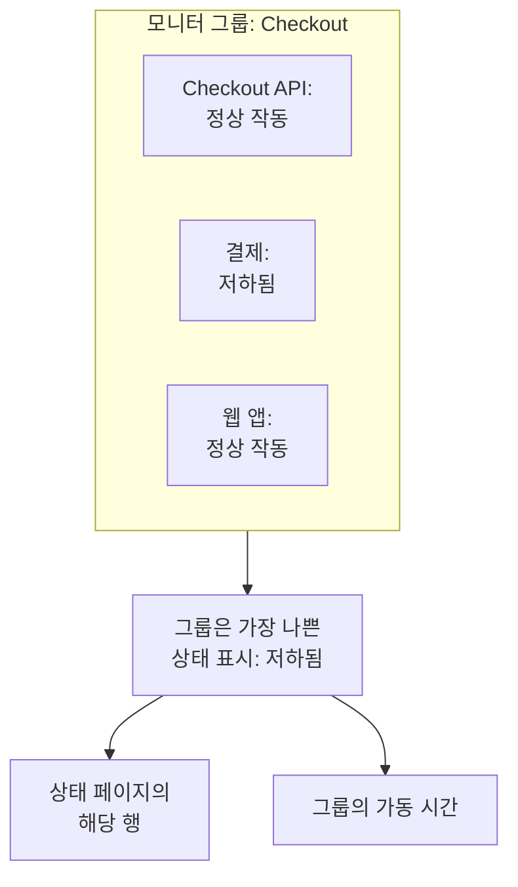

# 모니터 그룹

모니터 그룹은 여러 모니터를 하나의 상태로 묶습니다. 함께 하나의 서비스를 이루는 모니터를 그룹으로 만드세요. 예를 들어 Checkout이라면 그 API, 결제 서비스, 웹 앱입니다. 그룹은 그중 가장 나쁜 상태를 보여 주고, 자체 가동 시간을 가지며, 상태 페이지는 그룹 전체를 한 행으로 보여 줄 수 있습니다.

:::cards
- [그룹 상태를 정하는 방식](#그룹-상태를-정하는-방식): 모니터 중 가장 나쁜 상태.
- [모니터 그룹 켜기](#모니터-그룹-켜기): 프로젝트 설정의 스위치 하나.
- [모니터 그룹 만들기](#모니터-그룹-만들기): 이름을 붙이고 모니터를 추가합니다.
- [상태 페이지에 그룹 표시](#상태-페이지에-그룹-표시): 그룹 전체를 한 행으로.
:::

## 그룹 상태를 정하는 방식

그룹은 정상 작동 상태에서 시작해 모니터 중 가장 나쁜 상태를 따릅니다. 즉 프로젝트의 모니터 상태 목록에서 가장 아래에 있는 상태입니다. 모니터 하나가 **저하됨**이 되면 그룹 전체가 **저하됨**이 되고, 하나가 **오프라인**이 되면 그룹도 **오프라인**이 됩니다.

- **보관된 모니터는 세지 않습니다.** 보관된 모니터는 확인되지 않아 상태가 고정되므로 그룹에서 제외됩니다.
- **빈 그룹은 정상 작동입니다.** 모니터가 없거나 보관된 모니터만 있는 그룹은 정상 작동 상태를 보여 줍니다. 모니터를 추가하기 전까지 대시보드에는 상태 대신 **아직 모니터가 없습니다**라고 표시됩니다.
- **순서는 직접 정합니다.** 어떤 상태가 가장 나쁜지는 **모니터 → 설정 → 모니터 상태**의 순서를 따릅니다. [모니터 상태](/docs/monitor/criteria-and-statuses#모니터-상태)를 참고하세요.

모니터 그룹은 상태 페이지 그룹이 아닙니다. 상태 페이지 그룹은 한 상태 페이지에서 여러 행을 담는 제목입니다. 모니터 그룹은 여러 모니터를 대표하는 한 행이며, 어떤 상태 페이지에서든 보여 줄 수 있습니다.

## 시작하기 전에

- **요금제.** OneUptime Cloud에서는 모니터 그룹에 Scale 요금제가 필요합니다.
- **스위치.** 프로젝트에서 **모니터 그룹**을 켜기 전까지 모니터 그룹은 숨겨져 있습니다(아래 참고). 켜려면 Project Owner 역할이나, Edit Project 또는 Manage Billing 권한이 있는 사용자 지정 역할이 필요합니다.
- **역할.** 그룹을 만들고, 바꾸고, 삭제하려면 Project Owner, Project Admin, Project Member, Monitor Admin 또는 Monitor Member 역할이나, 해당 모니터 그룹 권한이 있는 사용자 지정 역할이 필요합니다. Viewer는 그룹을 볼 수 있지만 바꿀 수는 없습니다.

## 모니터 그룹 켜기

:::steps
### 기능 플래그 열기

**프로젝트 설정 → 고급 → 기능 플래그**로 이동합니다. 사이드 메뉴의 **고급**은 접혀 있으므로 먼저 펼칩니다.

### 스위치 켜기

**모니터 그룹** 스위치를 켭니다. 바로 저장됩니다. **모니터** 사이드 메뉴에 **모니터 그룹**이 나타나고, 각 상태 페이지의 **모니터** 메뉴 항목은 이름이 **리소스**로 바뀌며, 거기에서 그룹을 추가할 수 있습니다.
:::

스위치를 다시 끄면 메뉴에서 **모니터 그룹**이 숨겨집니다. 그룹은 삭제되지 않습니다.

## 모니터 그룹 만들기

:::steps
### 모니터 그룹 열기

**모니터 → 모니터 그룹**으로 이동합니다. **모니터 그룹** 카드에 각 그룹이 **현재 상태**, 레이블, 소유자와 함께 나열됩니다.

### 그룹 만들기

**모니터 그룹 만들기**를 클릭하고 **이름**과, 원하면 **설명**을 입력한 다음, 양식 아래쪽의 **모니터 그룹 만들기**를 클릭합니다. 그룹은 모니터 없이 시작합니다.

### 모니터 추가

그룹을 엽니다. 모니터가 하나도 없는 동안에는 **개요**에 **모니터 추가**가 표시됩니다. 그 뒤에는 사이드 메뉴의 **모니터**를 클릭한 다음 **모니터 추가**를 클릭합니다. **모니터**에서 그룹의 모니터를 모두 고르고 **모니터 추가**를 클릭합니다.

### 상태 확인

**개요**를 클릭합니다. **현재 상태**에는 지금 그룹의 상태가, **가동 시간 그래프**에는 최근 90일이 하루에 막대 하나씩 표시됩니다.
:::

그룹에서 모니터를 빼려면 **그룹 내 모니터**에서 해당 행의 **제거**를 클릭합니다. 모니터 자체는 바뀌지 않습니다. 모니터는 둘 이상의 그룹에 속할 수 있습니다.

## 그룹의 페이지

그룹을 열면 사이드 메뉴에 그 페이지들이 표시됩니다.

| 페이지 | 보여 주는 것 |
| --- | --- |
| **개요** | **모니터 그룹 세부정보**, **현재 상태**, 그리고 최근 90일 동안 그룹의 가동률을 보여 주는 **가동 시간 그래프**. 모니터가 없는 그룹은 그래프 대신 **모니터 추가**를 표시합니다. |
| **모니터** | **그룹 내 모니터**와 **모니터 추가**, **제거**. |
| **인시던트** | 그룹 안의 모니터에서 생긴 인시던트. |
| **알림** | 그룹 안의 모니터에서 생긴 알림. |
| **소유자** | 그룹을 책임지는 사람과 팀. 처음에 접혀 있는 **고급** 아래에 있습니다. |
| **감사 로그** | 누가 언제 그룹을 바꿨는지. 역시 **고급** 아래에 있습니다. |
| **그룹 삭제** | 그룹을 삭제합니다. 역시 **고급** 아래에 있습니다. |

**개요**의 가동 시간은 정상 작동을 제외한 모든 상태를 다운타임으로 셉니다. 상태 페이지는 자체 **다운타임으로 계산** 목록에 있는 상태만 셉니다. [페이지에 무엇을 표시할지 고르기](/docs/status-pages/index#페이지에-무엇을-표시할지-고르기)를 참고하세요.

**모니터 그룹** 목록에서는 소유자와 레이블로 그룹을 필터링하고, 여러 그룹에 한 번에 레이블과 소유자를 설정하고, 그룹을 JSON으로 내보내거나 가져올 수 있습니다.

## 상태 페이지에 그룹 표시

:::steps
### 상태 페이지의 리소스 열기

**상태 페이지**로 이동해 페이지를 열고 사이드 메뉴의 **리소스**를 클릭합니다.

### 대화 상자를 그룹으로 전환

**모니터 추가**를 클릭합니다. 모니터 드롭다운 아래에서 **Add a Monitor Group instead.** 링크를 클릭합니다. 드롭다운이 **모니터 그룹**으로 바뀝니다.

### 그룹을 골라 추가

그룹을 고릅니다. 방문자가 읽는 이름인 **표시 이름**에는 직접 입력하기 전까지 그룹 이름이 채워집니다. **모니터 추가**를 클릭하면 그룹의 상태와 함께 행이 페이지에 나타납니다.
:::

상태 페이지에서 그 행은 그룹 안의 모든 모니터를 대표합니다.

- **상태.** 그룹의 상태, 즉 모니터 중 가장 나쁜 상태입니다.
- **인시던트.** 그룹 안의 어떤 모니터에서 생긴 인시던트든 페이지에 나타나며, 영향받은 리소스 중에 그룹 이름이 표시됩니다.
- **구독자.** 그룹을 고른 구독자는 그룹 안의 모든 모니터에 대한 소식을 받습니다. [구독자가 리소스와 이벤트 유형을 고르게 하기](/docs/status-pages/subscribers#구독자가-리소스와-이벤트-유형을-고르게-하기)를 참고하세요.

가동 시간이나 기록 차트 같은 행의 나머지 옵션은 [상태 페이지 리소스 및 그룹](/docs/status-pages/resources-and-groups)을 참고하세요.

> [!WARNING]
> 모니터 그룹을 삭제하면 그 그룹을 보여 주는 모든 상태 페이지에서 해당 행도 삭제됩니다. 그룹 안의 모니터와 그 인시던트는 삭제되지 않습니다.

## API 및 Terraform

그룹은 `/api/monitor-group`이고, 그 안의 각 모니터는 `monitorGroupId`와 `monitorId`를 짝짓는 `/api/monitor-group-resource`의 행입니다. Terraform에서는 `oneuptime_monitor_group`과 `oneuptime_monitor_group_resource`입니다. [모니터 그룹](/docs/terraform/examples#모니터-그룹)을 참고하세요.

## 문제 해결

:::details 모니터 메뉴에 모니터 그룹이 없음
**모니터 그룹** 스위치가 꺼져 있습니다. **프로젝트 설정 → 고급 → 기능 플래그**에서 켜세요. OneUptime Cloud에서는 그룹에 Scale 요금제도 필요합니다.
:::

:::details 대부분의 모니터가 정상인데 그룹이 오프라인으로 표시됨
그것이 규칙입니다. 그룹은 가장 나쁜 모니터를 보여 줍니다. 그룹의 **모니터**를 열어 다운된 모니터를 찾거나, 그룹에 속하지 않는 모니터를 제거하세요.
:::

:::details 상태 페이지에 그룹을 추가할 수 없음
**Add a Monitor Group instead.** 링크는 프로젝트에서 **모니터 그룹** 스위치가 켜져 있을 때만 대화 상자에 나타납니다.
:::

## 다음 단계

:::cards
- [모니터 기준 및 상태](/docs/monitor/criteria-and-statuses): 각 모니터의 상태를 정하는 것.
- [상태 페이지 리소스 및 그룹](/docs/status-pages/resources-and-groups): 상태 페이지의 행을 배치합니다.
- [구독자 및 공지](/docs/status-pages/subscribers): 그룹의 인시던트를 고객에게 알립니다.
:::
