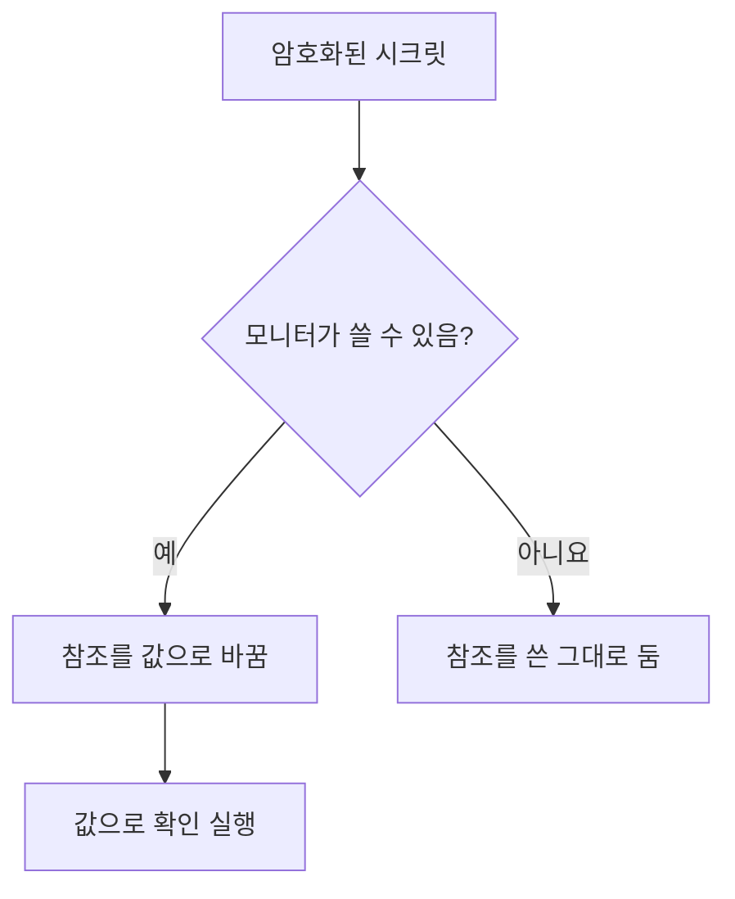

# 모니터 시크릿

모니터 시크릿은 모니터에 필요한 비밀번호, API 키, 토큰을 모니터 자체 밖에 둡니다. 값을 한 번 암호화해 저장하고, 어떤 모니터가 쓸 수 있는지 고른 다음, 모니터에서 필요한 곳에 `{{monitorSecrets.NAME}}`으로 참조합니다.

:::cards
- [시크릿 추가](#시크릿-추가): 값을 저장하고 누가 쓸 수 있는지 고릅니다.
- [접근 선택](#시크릿을-쓸-수-있는-모니터-선택): 모든 모니터, 특정 모니터, 레이블이 있는 모니터.
- [시크릿 사용](#시크릿-사용): `{{monitorSecrets.NAME}}`이 작동하는 곳.
- [일회용 코드로 로그인](#일회용-코드로-로그인): 모니터가 사이트의 2단계 인증 로그인을 통과하게 합니다.
:::

## 시크릿이 모니터에 전달되는 방식

시크릿은 암호화되어 저장되며, 저장한 뒤에는 다시 표시되지 않습니다. OneUptime은 모니터를 프로브에 넘기기 전에, 모니터가 쓸 수 있는 각 참조를 복호화된 값으로 바꿉니다. 모니터가 쓸 수 없는 참조는 쓴 그대로 남습니다. 일회용 코드 시크릿은 예외로, 프로브가 검사를 실행할 때 코드를 만듭니다([일회용 코드로 로그인](#일회용-코드로-로그인) 참고).



확인을 실행하는 프로브가 값을 받으므로, 시크릿을 쓰는 모니터는 신뢰하는 프로브에서 실행해야 합니다. OneUptime의 자체 프로브나, 직접 운영하는 [사용자 지정 프로브](/docs/probe/custom-probe)입니다.

## 시작하기 전에

- **Growth 요금제 이상**(OneUptime Cloud의 경우). 자체 호스팅 설치에는 요금제가 없습니다.
- **시크릿을 관리할 수 있는 역할**: 프로젝트 소유자, 프로젝트 관리자, 또는 Create Monitor Secret 권한이 있는 사용자 지정 역할.

## 시크릿 다루기

### 시크릿 추가

:::steps
1. **모니터 → 설정 → 시크릿**으로 이동해 **모니터 시크릿 만들기**를 클릭합니다.
2. **이름**과 **시크릿 값**을 입력합니다. 이름은 참조할 때 쓰는 것으로, 예를 들어 `ApiKey`입니다. 문자, 숫자, 하이픈(`-`), 밑줄(`_`)만 쓸 수 있으며, 한 프로젝트 안의 두 시크릿이 같은 이름을 가질 수 없습니다. 사이트의 2단계 인증 설정 키라면 먼저 **일회용 코드(TOTP)** 유형을 고르세요([일회용 코드로 로그인](#일회용-코드로-로그인) 참고).
3. **접근** 단계에서 어떤 모니터가 쓸 수 있는지 고른 다음(다음 섹션 참고) **모니터 시크릿 만들기**를 클릭합니다.
:::

> [!IMPORTANT]
> 시크릿은 암호화되어 안전하게 저장됩니다. 시크릿 값은 저장한 뒤 다시 표시되지 않습니다. 표에도, 편집 양식에도, API에도 나오지 않습니다. 값을 잃어버리면 원래 받은 곳에서 다시 가져와 다시 설정해야 합니다. 시크릿을 교체하려면 해당 행의 **시크릿 값 업데이트** 버튼을 사용합니다. 삭제하고 다시 만들 필요가 없습니다. 같은 버튼으로 새 값과 함께 시크릿이 담는 것을 **텍스트** 또는 **일회용 코드(TOTP)** 로 바꿀 수도 있으며, 시크릿을 사용하는 모니터는 다음 검사부터 새 유형을 사용합니다.

### 시크릿을 쓸 수 있는 모니터 선택

각 시크릿에는 세 가지 접근 옵션 중 하나가 있습니다.

| 옵션 | 시크릿을 쓸 수 있는 모니터 | 용도 |
| --- | --- | --- |
| **모든 모니터** | 나중에 만드는 모니터를 포함해 프로젝트의 모든 모니터. | 여러 모니터가 함께 쓰는 자격 증명. |
| **특정 모니터** | 고른 모니터만. 기본값이며, 이 옵션들이 생기기 전에 만든 시크릿도 이렇게 동작합니다. | 하나 또는 몇 개의 모니터를 위한 자격 증명. |
| **레이블이 있는 모니터** | 고른 레이블 중 하나 이상이 있는 모니터. 그 레이블 중 하나를 모니터에 추가하면 접근 권한이 생기고, 레이블을 빼면 모니터의 다음 실행부터 접근 권한이 없어집니다. | 시간이 지나며 바뀌는 모니터 그룹을 위한 자격 증명. |

옵션은 시크릿 행의 **편집**으로 언제든 바꿀 수 있습니다. 고른 옵션의 목록만 유지됩니다. **모든 모니터**로 바꾸면 시크릿의 모니터 목록과 레이블 목록이 비워지고, **특정 모니터**와 **레이블이 있는 모니터** 사이를 바꾸면 바꾸기 전 목록이 비워집니다.

시크릿은 다른 프로젝트의 모니터에서는 절대 쓸 수 없습니다.

> [!WARNING]
> 시크릿을 쓸 수 있는 모니터를 편집할 수 있는 사람은 누구나 그 시크릿을 모니터가 연결하는 곳으로 보낼 수 있습니다. **모든 모니터**라면 프로젝트에서 모니터를 만들거나 편집할 수 있는 모든 사람이 해당됩니다. **레이블이 있는 모니터**라면 그 레이블 중 하나를 모니터에 추가할 수 있는 사람도 포함됩니다.

API에서 접근 옵션은 `monitorAccess` 필드이며, 값은 `All Monitors`, `Specific Monitors`, `Monitors With Labels` 중 하나입니다. 목록은 `monitors` 필드와 `labels` 필드에 들어갑니다. `monitorAccess` 없이 만든 시크릿은 `Specific Monitors`가 됩니다.

### 시크릿 사용

시크릿을 쓰려면 시크릿을 받는 필드에 `{{monitorSecrets.SECRET_NAME}}`을 씁니다. 예를 들어 요청 헤더 `Authorization: Bearer {{monitorSecrets.ApiKey}}`는 `ApiKey` 시크릿의 값을 보냅니다.

다음 모니터 유형과 필드가 시크릿을 받습니다.

| 모니터 유형 | 필드 |
| --- | --- |
| API | URL, 요청 헤더와 본문, 클라이언트 인증서, 개인 키, 암호 문구(mTLS) |
| 웹사이트 | URL, 클라이언트 인증서, 개인 키, 암호 문구(mTLS) |
| Ping, IP, 포트, NTP, SSL 인증서 | 확인할 호스트 또는 URL |
| DNS | 도메인 이름과 DNS 서버 |
| DNSSEC, 도메인 | 도메인 이름 |
| SQL 쿼리 | 호스트, 데이터베이스 이름, 사용자 이름, 비밀번호, 쿼리 |
| 데이터베이스 상태 | 호스트, 데이터베이스 이름, 사용자 이름, 비밀번호 |
| 외부 상태 페이지 | 상태 페이지 URL |
| 합성 모니터, 사용자 지정 JavaScript 코드 | 스크립트 |
| 네트워크 디바이스 | SNMP 커뮤니티 문자열, SNMPv3 인증 키와 개인 정보 보호 키 |

합성 모니터나 사용자 지정 JavaScript 코드 모니터의 스크립트가 실행되기 전에 시크릿이 채워지므로, 스크립트 안의 `{{monitorSecrets.ApiKey}}` 같은 참조는 실행 시점에 복호화된 값입니다.

모니터가 쓸 수 없는 시크릿을 참조하면, 그 참조는 그대로 남고 값으로 바뀌지 않습니다.

모니터를 저장하기 전에 테스트하면 **모든 모니터**에서 쓸 수 있는 시크릿만 채워집니다. 새 모니터는 아직 어떤 목록에도 없고 레이블도 없기 때문입니다. 모니터를 저장한 뒤에는 모니터가 쓸 수 있는 모든 시크릿이 테스트에 사용됩니다.

## 일회용 코드로 로그인

어떤 사이트는 로그인할 때 인증 앱의 코드를 요구합니다. **일회용 코드(TOTP)** 시크릿은 그 사이트의 설정 키를 담고 있어서, 모니터가 사람과 같은 방식으로 로그인할 수 있습니다. 모니터가 시크릿을 쓰는 곳마다, 검사에 코드가 필요한 순간 프로브가 자신의 시계로 현재 코드를 만듭니다. 설정 키는 다른 시크릿 값처럼 암호화되어 저장되고 다시 표시되지 않으며, 모니터에 쓰이지도 않습니다.

1. 모니터가 로그인할 계정에서 2단계 인증을 켭니다. 사이트가 QR 코드를 보여 주면 대신 키를 직접 입력하는 방법을 고르고, 설정 키나 `otpauth://` 링크를 복사합니다.
2. **모니터 → 설정 → 시크릿**으로 이동해 **모니터 시크릿 만들기**를 클릭하고, **일회용 코드(TOTP)** 유형을 고른 다음 키나 링크를 **설정 키**에 붙여 넣습니다.
3. 그 아래의 **현재 코드**가 인증 앱에 지금 표시된 코드와 일치하는지 확인한 다음, 다른 시크릿처럼 **접근** 단계에서 시크릿을 쓸 수 있는 모니터를 고릅니다.

| 붙여 넣는 것 | 모니터가 만드는 코드 |
| --- | --- |
| `JBSW Y3DP EHPK 3PXP` 같은 설정 키 | SHA1, 6자리, 30초마다 새 코드: 모든 인증 앱이 가정하는 값 |
| `otpauth://totp/` 링크 | 링크의 `algorithm`(`SHA1`, `SHA256` 또는 `SHA512`), `digits`(`6` 또는 `8`), 초 단위의 `period`(링크에 없으면 `30`) |

| 모니터 유형 | 코드가 들어가는 곳과 만들어지는 때 |
| --- | --- |
| API | URL, 요청 헤더 또는 요청 본문의 `{{monitorSecrets.NAME}}`. 각 시도를 보내기 직전에 만들어집니다 |
| 합성 모니터, 사용자 지정 JavaScript 코드 | 스크립트의 `{{monitorSecrets.NAME}}`(스크립트가 시작될 때)와 `await oneuptime.getTotpCode("NAME")`(스크립트가 요청할 때) |

다른 모든 필드는 `{{monitorSecrets.NAME}}`을 입력한 그대로 둡니다. 코드는 0으로 시작할 수 있으므로, JSON 요청 본문에서는 `{"otp": "{{monitorSecrets.LoginCode}}"}`처럼 참조를 따옴표로 감싸세요.

로그인은 보통 스크립트가 시작되고 몇 페이지 뒤에 코드 입력 화면에 이르므로, 코드는 그곳에서 요청하세요. 이 스크립트는 비밀번호와 일회용 코드로 로그인합니다.

```javascript
await page.goto("https://app.example.com/login");
await page.fill("#email", "monitoring@example.com");
await page.fill("#password", "{{monitorSecrets.AppPassword}}");
await page.click("button[type=submit]");

// The code is made now, when the sign-in asks for it.
await page.waitForSelector("#otp");
await page.fill("#otp", await oneuptime.getTotpCode("AppLoginCode"));
await page.click("button[type=submit]");

await page.waitForSelector(".dashboard", { timeout: 10000 });

return {
  data: { signedIn: true },
};
```

프로브는 남은 시간이 5초 미만인 코드(주기가 더 짧으면 주기의 3분의 1 미만)를 넘겨주지 않습니다. 대신 다음 코드를 최대 5초까지 기다리며, 그 대기 시간은 검사의 실행 시간에서 뺍니다. 검사가 만든 모든 코드는 로그 메시지, 결과, 오류, 스크린샷 이름에서 `******` 같은 별표로 표시됩니다. 스크린샷은 페이지를 찍은 그림이므로, 코드를 입력하기 전이나 페이지가 넘어간 뒤에 찍으세요.

> [!NOTE]
> 코드는 프로브가 만들므로, 사용자 지정 프로브에는 OneUptime 17.0.1 이상이 필요합니다. 그보다 오래된 프로브에서는 코드가 필요한 검사가 실행되지 않고, 프로브를 업데이트하라는 문장과 함께 실패합니다. 너무 오래된 프로브는 모니터의 양식과 프로브 페이지에 표시되며, 업데이트 방법은 [프로브 업데이트](/docs/probe/custom-probe#프로브-업데이트)에서 설명합니다. 프로브의 시계도 정확해야 합니다. 1분 어긋난 프로브는 사이트가 이미 지나간 코드를 만듭니다.

## 문제 해결

:::details 모니터가 `{{monitorSecrets.NAME}}`을 문자 그대로 보냄
모니터가 그 시크릿을 쓸 수 없거나, 이름이 일치하지 않습니다. 해당 행의 **편집**으로 시크릿의 접근 옵션을 확인하고, 참조의 이름이 시크릿의 이름과 정확히 같은지 확인합니다.
:::

:::details 새 모니터를 테스트할 때 시크릿이 채워지지 않음
모니터를 저장하기 전에는 **모든 모니터**에서 쓸 수 있는 시크릿만 채워집니다. 모니터를 저장한 다음 다시 테스트합니다.
:::

:::details 필드가 시크릿을 무시함
위 표에 있는 필드만 시크릿을 받습니다. 그 밖의 필드에서는 `{{monitorSecrets.NAME}}`이 쓴 그대로 전송됩니다.
:::

:::details 사이트가 일회용 코드를 거부함
시크릿을 저장할 때 **현재 코드**가 인증 앱과 일치했는지, 프로브의 시계가 정확한지, JSON 요청 본문의 참조가 따옴표로 감싸져 있는지 확인하세요. 로그인이 코드 입력 화면에 이르기까지 시간이 걸린다면, 그곳에서 `oneuptime.getTotpCode`로 코드를 요청하세요.
:::

:::details 검사에서 프로브가 너무 오래되어 일회용 코드를 만들 수 없다고 함
프로브가 OneUptime 17.0.1보다 오래된 버전으로 실행되어 일회용 코드를 만들 수 없으므로, 그 프로브에서는 검사가 실행되지 않았습니다. 프로브를 업데이트하거나([프로브 업데이트](/docs/probe/custom-probe#프로브-업데이트) 참고), 17.0.1 이상으로 실행되는 프로브에서 모니터를 검사하세요.
:::

## 다음 단계

:::cards
- [API 모니터](/docs/monitor/api-monitor): 요청 헤더로 시크릿을 보냅니다.
- [합성 모니터](/docs/monitor/synthetic-monitor): 브라우저 스크립트 안에서 시크릿을 사용합니다.
- [SQL 쿼리 모니터](/docs/monitor/sql-monitor): 데이터베이스 비밀번호를 암호화된 상태로 둡니다.
:::
