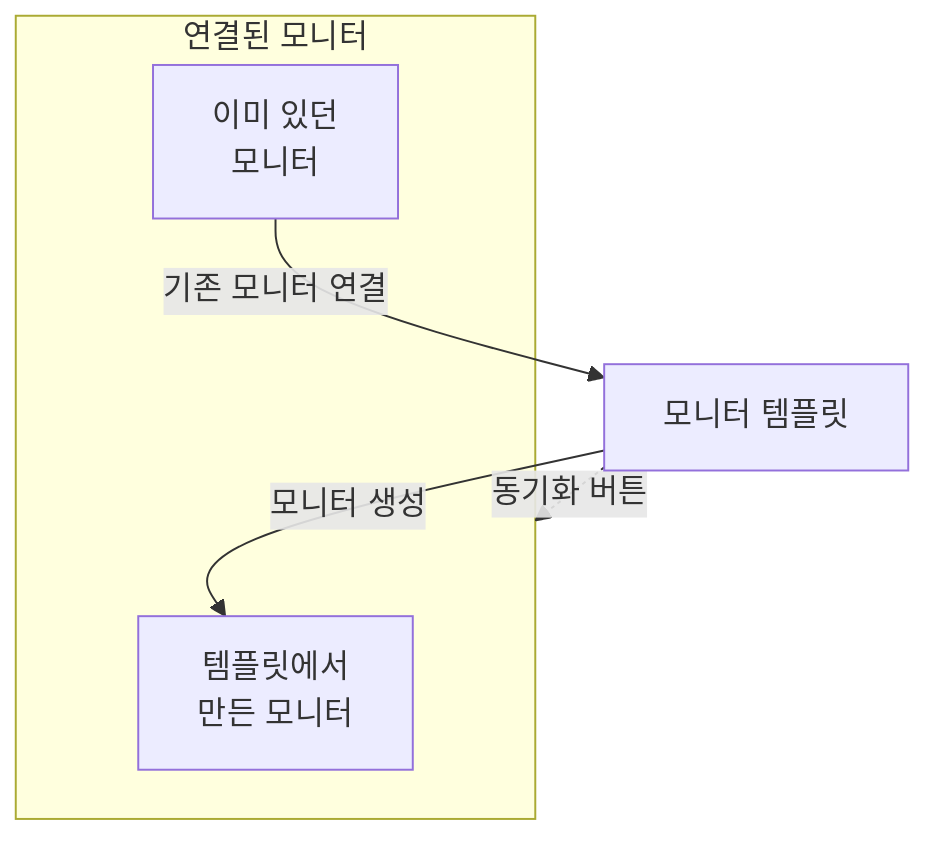

# 모니터 템플릿

모니터 템플릿은 저장된 모니터 구성(유형, 기준, 간격, 레이블, 사용자 정의 필드 기본값)으로, 여기서 클릭 한 번으로 모니터를 만들 수 있습니다. 템플릿에서 만들었거나 템플릿에 연결한 모니터는 계속 연결된 상태로 남습니다. 템플릿을 바꾼 다음 그 변경을 모든 모니터에 동기화합니다. 모든 서비스에 같은 상태 확인을 두거나 프로덕션과 스테이징에서 같은 API 확인을 하는 것처럼, 많은 모니터가 똑같이 동작해야 할 때 템플릿을 사용합니다.

:::cards
- [템플릿 만들기](#템플릿-만들기): 모니터 생성처럼 네 단계입니다.
- [템플릿으로 모니터 만들기](#템플릿으로-모니터-만들기): 클릭 한 번으로 만들거나, 이미 있는 모니터를 연결합니다.
- [변경 사항 동기화](#연결된-모니터에-변경-사항-동기화): 동기화 버튼마다 복사하는 내용.
- [모니터를 다른 템플릿으로 이동](#모니터를-다른-템플릿으로-이동): 더 나은 템플릿으로 옮겨도 각 모니터는 기록을 유지합니다.
- [모니터별 값 유지](#모니터별-값-유지): 대상이나 헤더를 동기화로부터 보호합니다.
:::

## 템플릿의 작동 방식

템플릿 자체는 아무것도 감시하지 않습니다. 모니터는 템플릿에서 만들어지거나 템플릿에 연결되며, 템플릿 페이지에 **연결된 모니터**로 나열됩니다. 템플릿을 바꿔도 동기화하기 전까지 그 모니터들은 바뀌지 않습니다. 각 동기화 버튼은 템플릿의 한 부분을 연결된 모든 모니터에 복사하며, 보호한 필드는 각 모니터 자신의 값을 유지합니다.



## 시작하기 전에

- **템플릿을 만들 수 있는 역할**: 프로젝트 소유자, 프로젝트 관리자, 프로젝트 구성원, 모니터 관리자 또는 모니터 구성원, 또는 Create Monitor Template 권한이 있는 사용자 지정 역할. 템플릿을 바꾸려면 같은 역할이나 Edit Monitor Template 권한이 필요합니다.
- **연결된 모니터를 업데이트할 권한.** 동기화는 여러분의 이름으로 연결된 각 모니터에 기록하며, 권한이 닿지 않는 모니터는 건너뜁니다.

## 템플릿 만들기

:::steps
### 템플릿 목록 열기

**모니터 → 설정 → 템플릿**으로 이동해 **모니터 템플릿 만들기**를 클릭합니다.

### 템플릿 이름 지정

**템플릿 정보**에서 `Production API Health` 같은 **템플릿 이름**을 입력합니다. **템플릿 설명**은 선택 사항입니다. 그런 다음 **다음**을 클릭합니다.

### 모니터 기본값 설정

**모니터 기본값**에서 모니터 생성과 같은 선택기로 **모니터 유형**을 고릅니다. 필요하면 **기본 모니터 이름**을 입력합니다. 비워 두면 각 모니터는 감시하는 리소스의 이름을 따릅니다. **기본 모니터 설명**과 **레이블**은 **추가 필드**에 있습니다. **다음**을 클릭합니다.

### 기준과 간격 설정

**기준**에서 [모니터 생성](/docs/monitor/create-monitor#기준)과 같은 방식으로 확인할 대상과 기준을 입력합니다. 맨 위의 **템플릿 동기화 설정** 카드에서 필드를 동기화로부터 보호할 수 있습니다([모니터별 값 유지](#모니터별-값-유지) 참고). 프로브가 확인하는 모니터 유형에서는 마지막 단계인 **간격**이 **모니터링 간격**을 묻습니다. 마지막 단계에서 **모니터 템플릿 만들기**를 클릭합니다.
:::

템플릿이 목록에 추가됩니다. 템플릿을 열면 부분마다 카드가 있는 페이지가 보입니다. **템플릿 정보**, **모니터 기본값**, **기준**, **모니터링 간격**(**최소 프로브 합의** 포함), **레이블**, **사용자 지정 필드 기본값**(프로젝트에 모니터 사용자 정의 필드가 있을 때), **연결된 모니터**입니다. 각 부분은 자기 카드에서 바꿉니다. 예를 들어 **기준 편집**이나 **간격 편집**을 사용합니다.

## 템플릿으로 모니터 만들기

- **새 모니터.** 목록의 템플릿 행에서 **모니터 생성**을 클릭하거나, 템플릿 페이지에서 **템플릿에서 모니터 만들기**를 클릭합니다. **모니터 생성**이 템플릿의 유형과 설정이 채워진 상태로 열립니다. 필요한 부분을 바꾼 뒤 만듭니다. 새 모니터는 템플릿에 연결됩니다.
- **이미 있는 모니터.** **연결된 모니터**에서 **기존 모니터 연결**을 클릭하고 모니터를 고릅니다. **템플릿의 기준과 간격 사용**을 켜면 연결될 때 템플릿의 기준, 간격, 프로브 합의를 받고, 끄면 동기화하기 전까지 각 모니터가 자기 설정을 유지합니다. 다른 템플릿에 연결된 모니터는 이 템플릿으로 옮겨집니다.

**사용자 지정 필드 기본값**에 설정한 값은 템플릿에서 만드는 모든 모니터에 기록됩니다. 자동 가져오기 규칙과 경고 정책이 템플릿으로 만드는 모니터도 포함됩니다.

## 연결된 모니터에 변경 사항 동기화

템플릿을 편집하면 템플릿만 바뀝니다. 변경을 연결된 모니터에 복사하려면 바꾼 카드의 동기화 버튼을 사용합니다. 각 버튼에는 **연결된 모니터 3개에 기준 동기화**처럼 대상 모니터 수가 표시되며, 연결된 것이 없는 동안에는 비활성화되어 있습니다. 동기화는 되돌릴 수 없습니다.

| 버튼 | 연결된 각 모니터에 복사하는 것 | 그대로 두는 것 |
| --- | --- | --- |
| **연결된 모니터에 기준 동기화** | 기준과 대상, 요청 옵션 같은 단계 설정(보호된 필드 제외) | 모니터링 간격, 최소 프로브 합의, 이름, 설명, 레이블, 사용자 정의 필드 값 |
| **연결된 모니터에 간격 동기화** | 모니터링 간격과 최소 프로브 합의 | 기준, 이름, 설명, 레이블, 사용자 정의 필드 값 |
| **연결된 모니터에 레이블 동기화** | 레이블만 | 그 밖의 모든 것 |
| **연결된 모니터에 사용자 지정 필드 동기화** | 템플릿에 기본값이 있는 사용자 정의 필드(각 모니터의 기존 값을 대체) | 템플릿이 비워 둔 사용자 정의 필드와 그 밖의 모든 것 |

모니터 하나만 동기화하려면 **연결된 모니터**의 해당 행에서 **템플릿에서 동기화**를 클릭합니다. 기준과 단계 설정(보호된 필드 제외), 모니터링 간격, 최소 프로브 합의, 레이블이 복사되고, 모니터의 이름, 설명, 사용자 정의 필드 값은 그대로 남습니다. 모니터의 연결을 끊으려면 [템플릿에서 모니터 연결 해제](#템플릿에서-모니터-연결-해제)를 참조하세요.

동기화 후에는 업데이트된 모니터 수가 요약으로 표시됩니다. **부분적으로 동기화됨**은 일부 연결된 모니터에 아직 이전 구성이 남아 있다는 뜻이며, 보통 여러분의 권한이 그 모니터에 닿지 않기 때문입니다.

## 모니터를 다른 템플릿으로 이동

더 나은 템플릿이 기존 템플릿을 대신할 때는 모니터를 삭제하지 말고 새 템플릿으로 옮기세요. 각 모니터는 이름, 상태 기록, 레이블, 소유자, 인시던트를 유지하고 새 템플릿의 기준을 받습니다.

:::steps
### 모니터 선택

모니터가 지금 연결된 템플릿을 엽니다. **연결된 모니터**에서 모니터를 선택하거나 모두 선택합니다. 모니터 목록에서 아무 열로나 필터링해 모니터를 선택할 수도 있습니다.

### 모니터 이동

**일괄 작업**에서 **다른 템플릿으로 이동**을 클릭합니다(모니터 목록에서는 **템플릿에 연결**). 템플릿을 고릅니다.

### 템플릿 설정을 켠 상태로 유지

**템플릿의 기준과 간격 사용**을 켠 상태로 두면 각 모니터가 템플릿의 기준, 단계 설정, 간격, 프로브 합의를 지금 받습니다. 끄면 동기화하기 전까지 각 모니터가 자기 설정을 유지합니다. 그런 다음 확인합니다.
:::

이동하면 일어나는 일:

- 모니터의 기준, 간격, 프로브 합의가 템플릿의 것으로 바뀝니다. 이전 기준에서 자동으로 해결되도록 설정되어 있던 열린 인시던트나 경고는 해결되고, 문제가 남아 있으면 새 기준이 새로 엽니다. 각 네트워크 디바이스 모니터는 계속 자기 디바이스를 감시하고, 각 주소 또는 URL 모니터는 계속 자기 디바이스의 주소를 확인합니다.
- 이름, 설명, 상태 기록, 레이블, 소유자, 사용자 정의 필드 값, 인시던트 연결은 그대로 유지됩니다.
- 가져오기, 자동 가져오기 규칙 또는 네트워크 경고 정책이 만든 모니터는 자신을 만든 템플릿을 유지합니다. 그 규칙은 모니터를 다시 만들지 않으며, 경고 정책은 모니터를 놓아줍니다. 더 이상 모니터를 삭제하거나 대체하지 않습니다.
- 디바이스는 템플릿마다 모니터를 하나씩 가집니다. 디바이스에 새 템플릿으로 만든 모니터가 이미 있으면 다른 모니터는 제외되고, 변경 결과에 걸림돌이 되는 모니터가 표시됩니다. 둘 중 하나를 삭제한 다음 다시 이동하세요.
- 템플릿과 유형이 다른 모니터는 제외됩니다.

변경은 서버에서 실행되며, 한 번에 최대 10,000개의 모니터를 처리하고 진행 상황을 보여 줍니다. 이동된 모니터, 제외된 모니터와 그 이유, 변경이 해결한 열린 인시던트와 경고가 표시됩니다. 대화 상자를 닫아도 변경은 멈추지 않으며, 템플릿 페이지에 아직 실행 중인 변경이 표시됩니다. **중지**는 다음 모니터 전에 변경을 멈추고, **다시 시도**는 실패했거나 도달하지 못한 모니터를 다시 시도합니다.

> [!TIP]
> 자동 가져오기 규칙의 디바이스를 새 템플릿으로 옮기나요? 먼저 모니터를 옮긴 다음 규칙이 새 템플릿을 가리키게 하세요. 순서를 반대로 하면 규칙이 각 디바이스에 기존 모니터와 별도로 새 템플릿의 두 번째 모니터를 만듭니다.

## 템플릿에서 모니터 연결 해제

**연결된 모니터**에서 모니터 행의 **템플릿에서 연결 해제**를 클릭하거나, 그곳이나 모니터 목록에서 모니터를 선택하고 **일괄 작업**에서 **템플릿에서 연결 해제**를 사용합니다. 모니터가 유지할 것을 고르세요:

| 선택 | 이후 모니터의 동작 |
| --- | --- |
| **설정 유지** | 독립된 모니터로서 현재 기준으로 계속 확인하고 경고를 보내며, 더 이상 템플릿의 업데이트를 받지 않습니다. |
| **모니터에서 템플릿의 기준 지우기** | 계속 확인하지만, 템플릿에 다시 연결할 때까지 인시던트나 경고를 만들지 않고 상태도 설정하지 않습니다. 기준에서 자동으로 해결되도록 설정되어 있던 열린 인시던트나 경고는 해결됩니다. |

어느 쪽이든 모니터는 이름, 상태 기록, 레이블, 소유자, 인시던트를 유지하며, 모니터를 만든 규칙은 다시 만들지 않습니다.

## 템플릿 삭제

네트워크 경고 정책이나 자동 가져오기 규칙이 모니터를 만드는 데 쓰는 템플릿은 삭제할 수 없습니다. 먼저 정책이나 규칙이 다른 템플릿을 가리키게 하세요. 템플릿에 모니터가 연결되어 있으면 삭제할 때 모니터를 어떻게 할지 묻습니다:

- **설정 유지**(기본값): 삭제하면 연결이 해제되고, 모니터는 현재 기준으로 계속 확인하고 경고를 보냅니다.
- **모니터에서 이 템플릿의 기준 지우기**: 위와 같이 각 모니터의 기준을 지우고 연결을 해제한 다음 템플릿을 삭제합니다. 권한이 미치지 않는 모니터처럼 연결된 채로 남는 모니터가 있으면 템플릿은 유지되고, 대화 상자에 그 수가 표시됩니다.

대신 모니터를 다른 템플릿으로 옮기려면 삭제하기 전에 **다른 템플릿으로 이동**을 사용하세요.

## 모니터별 값 유지

기준 동기화는 대상, 요청 헤더, 시간 초과 같은 단계 설정도 복사합니다. 이 필드를 보호하지 않으면 그렇습니다. 필드를 보호하면 연결된 각 모니터가 그 필드의 자기 값을 유지합니다.

:::steps
### 템플릿 열기

**모니터 → 설정 → 템플릿**으로 이동해 템플릿을 엽니다.

### 기준 편집

**기준** 카드에서 **기준 편집**을 클릭합니다.

### 필드 보호

**템플릿 동기화 설정**에서 연결된 모니터에 남겨 둘 각 필드 옆의 **이 필드 동기화 안 함**을 선택합니다.

### 저장

변경 사항을 저장합니다. **기준** 카드와 아래 두 동기화의 확인 창에 보호된 필드가 나열됩니다.

### 동기화

**연결된 모니터에 기준 동기화**를 사용하거나, 개별 연결된 모니터에서 **템플릿에서 동기화**를 사용합니다.
:::

예를 들어 API 템플릿에서 **모니터 대상**과 **요청 헤더**를 보호합니다. 프로덕션과 스테이징 모니터는 각자의 URL과 헤더를 유지하면서, 둘 다 템플릿의 업데이트된 기준과 보호되지 않은 다른 설정을 받습니다.

사용할 수 있는 옵션은 모니터 유형에 따라 다릅니다. 대상과 포트, HTTP 요청 옵션, 데이터베이스 연결, DNS 설정, 인프라 선택기, 텔레메트리 쿼리 등이 있습니다. 클라이언트 인증서와 그 개인 키처럼 서로 관련된 자격 증명은 함께 유지됩니다.

### 제외 항목의 동작

- 선택한 필드는 기존 각 모니터의 현재 값을 유지합니다. 비어 있거나 설정되지 않은 값도 포함됩니다. 요청 헤더와 다른 컬렉션은 통째로 유지됩니다.
- 선택하지 않은 필드는 계속 템플릿에서 동기화됩니다. 보호한 필드의 선택을 해제하고 저장하면 다음 동기화 때 템플릿의 값이 복사됩니다.
- 제외 항목은 일괄 동기화와 개별 동기화 모두에 적용됩니다. 제외 항목은 템플릿에 저장되며, 동기화할 때마다 따로 고르는 것이 아닙니다.
- 새 모니터는 여전히 템플릿의 필드 값으로 시작합니다. 제외 항목은 기존 모니터의 동기화에만 영향을 줍니다.
- 기준은 항상 동기화됩니다. 기준만 동기화하면 모니터링 간격, 레이블, 그 밖의 모니터 수준 설정은 그대로입니다.
- 기존 템플릿에는 설정하기 전까지 필드 제외 항목이 없습니다. 네트워크 장치 모니터는 계속 자기 장치 연결을 자동으로 유지하며, 네트워크 검색 가져오기가 장치마다 만든 Ping, IP, Port, NTP 모니터도 계속 각 장치 자신의 주소를 확인합니다. 가져오기가 만든 웹사이트, API, SSL 인증서 모니터는 각 장치의 주소를 URL의 호스트로 유지하고, 스킴, 포트, 경로는 템플릿의 것을 따릅니다.

여러 단계가 있는 템플릿에서는 보호된 값을 단계 ID로 대응시킵니다. 따로 만든 단일 단계 모니터도 단일 단계 템플릿을 받을 수 있습니다. 보호된 단계를 대응시킬 수 없으면 어떤 모니터도 업데이트되기 전에 동기화가 거부되므로, 새로 생겼거나 순서가 바뀐 단계가 실수로 다른 단계의 대상이나 자격 증명을 복사하는 일이 없습니다.

> [!IMPORTANT]
> 저장된 템플릿의 모니터 유형을(**모니터 기본값 편집**으로) 바꾸기 전에, **기준 편집**에서 새 유형에 해당하지 않는 제외 항목을 해제하세요. 템플릿의 제외 항목은 모두 그 모니터 유형에 존재해야 합니다.

## API로 구성하기

템플릿의 각 단계는 `MonitorStep.value` 객체 안에서 `doNotSyncFields` 배열을 받습니다. API 모니터의 대상과 헤더 컬렉션 전체를 보호하려면 다음과 같이 합니다.

```json title="monitorSteps (excerpt)"
{
  "_type": "MonitorSteps",
  "value": {
    "monitorStepsInstanceArray": [
      {
        "_type": "MonitorStep",
        "value": {
          "id": "<step id>",
          "doNotSyncFields": ["monitorDestination", "requestHeaders"]
        }
      }
    ]
  }
}
```

지원되는 모든 단계 설정을 동기화하려면 배열을 생략하거나 `[]`로 설정합니다. 지원되지 않는 필드 이름과 템플릿의 모니터 유형에 해당하지 않는 필드는 거부됩니다. 동기화를 제어하는 것은 템플릿의 배열이며, 연결된 모니터의 비슷한 메타데이터가 이를 덮어쓰지 않습니다.

:::details 모니터 유형별 doNotSyncFields 필드 이름
| 모니터 유형 | 필드 이름 |
| --- | --- |
| 웹사이트, API, Ping, IP, 포트, SSL 인증서, NTP | `monitorDestination`, `requestTimeoutInMs`, `retryCount` |
| API만 | `requestHeaders`, `requestType`, `requestBody` |
| 웹사이트와 API | `doNotFollowRedirects`, `allowSelfSignedCertificates`, `tlsClientAuthentication`(클라이언트 인증서, 키, 암호를 함께) |
| 포트, NTP | `monitorDestinationPort` |
| 합성 모니터, 사용자 지정 JavaScript 코드 | `customCode` |
| 합성 모니터 | `browserTypes`, `screenSizeTypes`, `retryCountOnError` |
| DNS | `dnsMonitor.queryName`, `dnsMonitor.recordType`, `dnsMonitor.resolver`(DNS 서버와 포트를 함께), `dnsMonitor.timeout`, `dnsMonitor.retries` |
| 도메인 | `domainMonitor.domainName`, `domainMonitor.lookupMethod`, `domainMonitor.timeout`, `domainMonitor.retries` |
| DNSSEC | `dnssecMonitor.domainName`, `dnssecMonitor.resolvers`, `dnssecMonitor.checkNameserverConsistency`, `dnssecMonitor.signatureExpiryWarningDays`, `dnssecMonitor.timeout`, `dnssecMonitor.retries` |
| SQL 쿼리 | `sqlMonitor.connection`, `sqlMonitor.connectionTimeoutInMs`, `sqlMonitor.statementTimeoutInMs`, `sqlMonitor.query`, `sqlMonitor.maxRows` |
| 데이터베이스 상태 | `databaseMonitor.connection`, `databaseMonitor.connectionTimeoutInMs`, `databaseMonitor.statementTimeoutInMs`, `databaseMonitor.enabledMetricGroups` |
| 외부 상태 페이지 | `externalStatusPageMonitor.statusPageUrl`, `externalStatusPageMonitor.provider`, `externalStatusPageMonitor.components`, `externalStatusPageMonitor.timeout`, `externalStatusPageMonitor.retries` |
| 로그, 보안 이벤트, 트레이스, AI / LLM, 메트릭, 예외, 프로필 | `logMonitor`, `securityEventsMonitor`, `traceMonitor`, `llmMonitor`, `metricMonitor`, `exceptionMonitor`, `profileMonitor`(모니터의 전체 구성) |
| 프로브 상태 | `probeStatusMonitor.probeIds` |

인프라 모니터(Kubernetes, Docker 컨테이너, 호스트, Podman 컨테이너, Proxmox, Docker Swarm, Ceph, 스토리지 어레이, IoT 디바이스)는 리소스 선택기, 필터(호스트 제외), 메트릭 쿼리, 쿼리 시간 범위를 보호할 수 있습니다. 그 이름은 해당 유형의 템플릿에 있는 **템플릿 동기화 설정**에 나열됩니다.
:::

## 문제 해결

:::details 동기화 결과가 "부분적으로 동기화됨"으로 표시됨
일부 연결된 모니터가 업데이트되지 않았습니다. 보통 여러분의 권한이 그 모니터에 닿지 않기 때문입니다. 연결된 모든 모니터를 업데이트할 수 있는 사람에게 동기화를 다시 실행해 달라고 요청합니다.
:::

:::details 동기화가 "a template step cannot be matched to an existing monitor step"으로 실패함
보호된 필드를 모니터 중 하나의 단계에 대응시킬 수 없어서, 어떤 모니터도 바뀌기 전에 동기화가 멈췄습니다. 템플릿의 단계에 모니터 단계와 같은 ID를 주거나, 단일 단계 모니터에는 단일 단계 템플릿을 사용합니다.
:::

:::details 동기화 버튼이 비활성화되어 있음
아직 템플릿에 연결된 모니터가 없습니다. 템플릿으로 모니터를 만들거나 **연결된 모니터**에서 **기존 모니터 연결**을 클릭합니다.
:::

:::details 이동에서 모니터가 제외됨: "이 모니터가 만들어진 디바이스에 이미 이 템플릿에 연결된 모니터가 있습니다"
디바이스에 이동 대상 템플릿으로 만든 모니터가 있습니다. 보통 이동하기 전에 자동 가져오기 규칙이 그 템플릿을 가리키도록 바뀌었기 때문입니다. 필요 없는 모니터를 삭제한 다음(새 모니터의 기록이 가장 적습니다) 다시 이동하세요.
:::

:::details 자동 가져오기 규칙을 새 템플릿으로 바꾼 뒤 디바이스에 모니터가 두 개 있음
규칙이 각 디바이스에 기존 모니터와 별도로 새 템플릿의 모니터를 만들었습니다. 새 모니터를 삭제한 다음 기존 모니터를 새 템플릿으로 옮기세요. 기존 모니터는 기록을 유지하고, 규칙은 더 이상 만들지 않습니다.
:::

:::details 저장이 "Unsupported do not sync field"로 실패함
`doNotSyncFields`의 이름이 템플릿 모니터 유형의 필드가 아닙니다. 위의 필드 이름과 대조해 보세요.
:::

## 다음 단계

:::cards
- [모니터 만들기](/docs/monitor/create-monitor): 템플릿이 채우는 양식.
- [API 모니터](/docs/monitor/api-monitor): API 템플릿이 담는 설정.
- [모니터 시크릿](/docs/monitor/monitor-secrets): 자격 증명을 복사하지 않고 여러 모니터에서 공유합니다.
- [Terraform 모니터 단계](/docs/terraform/monitor-steps): 모니터와 그 단계를 코드로 관리합니다.
:::
