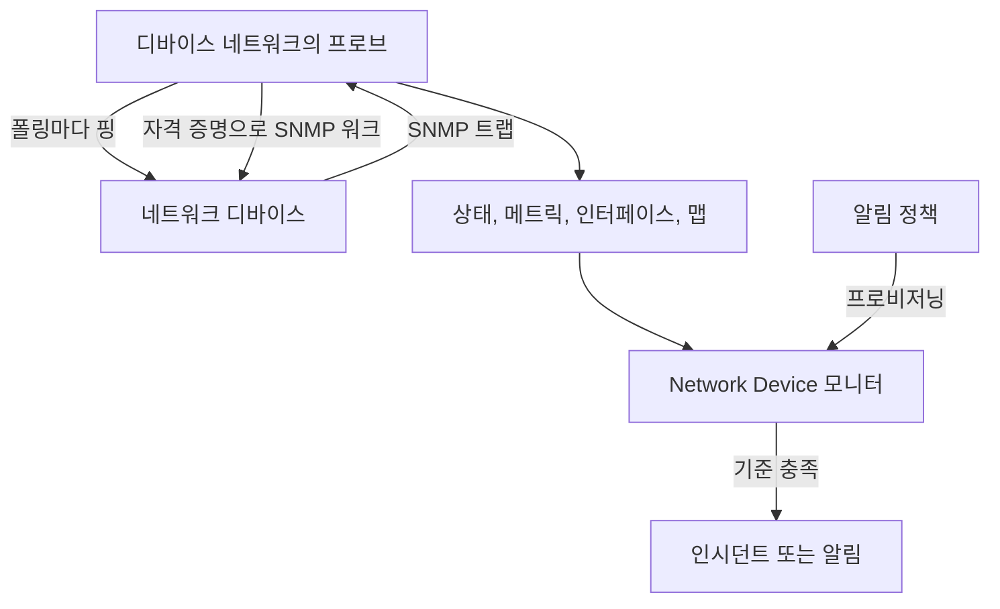
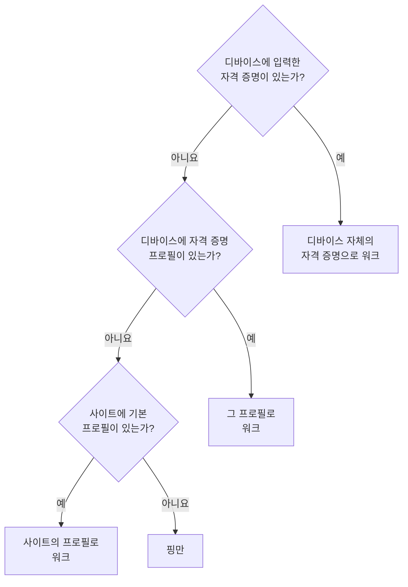
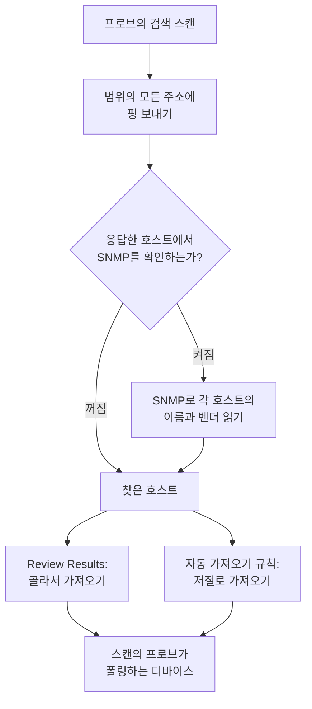
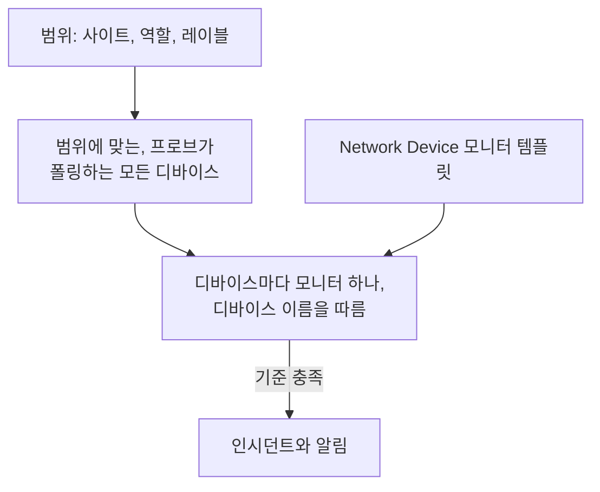
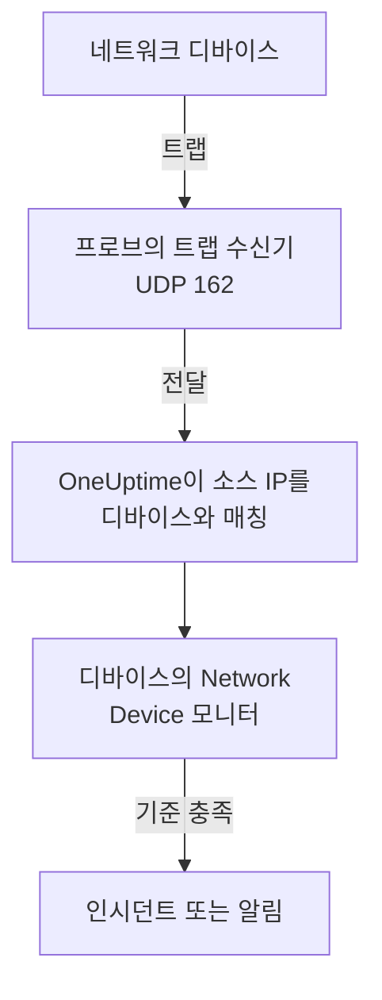

# 네트워크 장치 모니터

스위치, 라우터, 방화벽, 액세스 포인트, PDU, 카메라, 프린터를 모니터링합니다. SNMP를 지원하든 않든, 네트워크에서 주소를 가진 것이라면 무엇이든 됩니다.

주소와 프로브로 디바이스를 추가하면 프로브가 일정에 따라 디바이스에 핑을 보냅니다. 디바이스는 작동 또는 다운 상태를 얻고, 네트워크 맵에 자리를 잡고, 사이트의 상태에 한 표를 보탭니다. SNMP 자격 증명을 주면 같은 프로브가 디바이스를 워크하기도 합니다. 인터페이스와 거기에 꽂힌 광 모듈, 하드웨어 인벤토리, LLDP와 CDP 이웃, 헬스 OID를 읽습니다. 모니터를, 또는 여러 디바이스 전체를 위한 알림 정책을 추가하면 폴링과 트랩이 인시던트와 알림을 만듭니다.

:::cards
- [디바이스 추가](#네트워크-디바이스-추가하기): 주소와 프로브만, 한 페이지에서.
- [네트워크 검색](#네트워크-스캔으로-디바이스-검색하기): 주소 범위를 훑고 응답한 것을 가져옵니다.
- [SNMP로 디바이스 읽기](#snmp-자격-증명과-자격-증명-프로필): 인터페이스, 광 모듈, 인벤토리, 상태.
- [알림 받기](#알림): 디바이스 하나에는 모니터를, 여러 디바이스에는 정책을.
- [맵 보기](#네트워크-토폴로지): 실시간으로 그려지는 이웃, PDF로 내보내기.
- [문제 해결](#문제-해결): 대기 중인 디바이스, 실패하는 워크, 도착하지 않는 트랩.
:::

## 작동 방식



디바이스와 모니터는 하는 일이 다릅니다.

| 구성 요소 | 하는 일 | 필요한 때 |
| --- | --- | --- |
| 디바이스 | 프로브가 디바이스 자체의 일정에 따라 폴링합니다. 폴링할 때마다 도달 가능 여부, 핑 왕복 시간, 패킷 손실을 기록하고, SNMP 자격 증명이 있는 폴링은 디바이스의 ID, 인터페이스, 이웃, 헬스 OID도 읽습니다. | 항상: 추가하는 것이 디바이스입니다. |
| 모니터 | 디바이스의 모든 폴링 결과와 모든 트랩에 대해 기준을 평가하고, 인시던트와 알림을 엽니다. | 인시던트와 알림에만 필요합니다. 상태, 인벤토리, 차트, 맵에는 모니터가 필요 없습니다. |

## 시작하기 전에

- **디바이스에 도달할 수 있는 프로브.** 프로브는 자기 네트워크에서 디바이스에 핑을 보내고 워크하므로, 사설 주소의 디바이스에는 그 네트워크 안의 [사용자 지정 프로브](/docs/probe/custom-probe)가 필요합니다. 공용 인터넷의 프로브는 도달할 수 없습니다.
- **핑 이상을 원한다면 SNMP.** 선택 사항입니다. 디바이스에 설정된 v1 또는 v2c 커뮤니티 문자열이나 SNMPv3 사용자, 그리고 프로브에서 열려 있는 UDP 161이 필요합니다. 없으면 디바이스는 핑만 받습니다.
- **트랩, syslog, 플로.** 선택 사항입니다. 프로브는 UDP 162로 SNMP 트랩을, 켜면 UDP 5140으로 syslog를, UDP 2055, 4739, 6343으로 플로 레코드를 받으므로, 디바이스에서 프로브로 가는 이 포트들을 여세요.

## 네트워크 개요

**네트워크 → 개요**는 네트워크 영역이 열리는 곳이며, 답부터 시작합니다. 네트워크가 정상인지, 아니라면 무엇이 잘못됐는지를 가장 나쁜 소식부터 한 문장으로 알려 줍니다.

| 표시되는 문장 | 언제 |
| --- | --- |
| **디바이스 3대가 다운되었습니다** | 디바이스의 프로브나 모니터가 디바이스에 도달할 수 없습니다. |
| **사이트 2개에 주의가 필요합니다** | 모든 디바이스가 응답하지만, 사이트의 상태가 정상 작동이 아닙니다. |
| **인터페이스 5개가 다운되었습니다** | 모든 디바이스가 응답하지만, 포트가 꺼져 있습니다. |
| **디바이스 2대가 세부 정보를 보고하지 않습니다** | 핑에는 응답하지만 SNMP 워크가 실패해 인터페이스와 상태가 갱신되지 않습니다. 대개 자격 증명 문제입니다. |
| **첫 확인을 기다리는 중** | 디바이스가 추가되었지만 프로브가 아직 확인하지 않았습니다. |
| **디바이스 40대가 모두 작동 중입니다** | 모든 디바이스가 응답합니다. 아직 첫 확인을 기다리는 디바이스는 별도의 줄에 집계됩니다. |

그 아래 한 줄은 디바이스가 다운될 때 인시던트를 만드는 것이 있는지 알려 줍니다. 켜져 있는 [알림 정책](#알림-정책)의 수, 또는 하나도 없으면 **Set up alerts** 링크입니다. 옆의 **Add Device**와 **Discover Devices** 버튼이 각 양식을 열고, 아래의 타일과 목록이 세부 내용을 보여 줍니다. 주의가 필요한 디바이스와 사이트, 벤더별 디바이스, 최근 스캔입니다.

아무것도 추가되기 전에는 개요에 대신 두 가지 시작 방법이 표시됩니다. **디바이스 검색**은 주소 범위를 스캔해 추가할 것을 고르게 하며 네트워크 전체나 새 사이트에 가장 좋고, **디바이스 한 대 추가**는 IP 주소나 호스트 이름으로 한 대를 추가합니다.

네트워크 메뉴는 매일 여는 것을 늘 보이는 곳에 둡니다. **개요**, **Devices**, **사이트**, **Map**, **Traffic**, **Discovery**입니다. 나머지는 섹션으로 접혀 있으며, 섹션의 페이지 중 하나를 열면 그 섹션이 저절로 펼쳐집니다.

| 섹션 | 페이지 |
| --- | --- |
| **토폴로지** | **Device Topology**, **엔드포인트**, **Latency Matrix**, **Site Links**, **Device Links** |
| **규칙** | **Auto Import Rules**, **Site Assignment Rules**, **소유자 규칙**, **레이블 규칙**, **Link Rules** |
| **설정** | **Alert Policies**, **SNMP 자격 증명**, **Device Roles**, **Site Types**, **OID Collection Templates** |
| **고급** | **Archived Devices** |

## 네트워크 디바이스 추가하기

:::steps
### Devices 목록 열기
**네트워크 → Devices**로 이동해 **Add Device**를 클릭합니다. 네트워크 **개요**의 **Add Device**도 같은 양식을 엽니다.

### 디바이스 주소 입력하기
**호스트 이름**에 IP 주소나 호스트 이름을 입력합니다. **이름**을 비워 두면 디바이스 이름이 호스트 이름을 따릅니다.

### 사이트와 프로브 확인하기
사이트를 쓴다면 디바이스가 있는 **Site**를 고릅니다. **프로브**는 사이트의 기본 프로브나 프로젝트의 유일한 사용자 지정 프로브로 저절로 채워집니다. 디바이스에 도달할 수 있는 프로브인지 확인하세요.

### 디바이스 추가하기
**Add Device**를 클릭합니다. 몇 분 안에 프로브가 디바이스에 핑을 보내고 상태가 **Up** 또는 **Down**으로 바뀝니다. SNMP 자격 증명이 있으면 첫 워크가 성공한 뒤 개요에 디바이스의 ID, 인터페이스, 상태도 채워집니다.
:::

양식은 한 페이지입니다. 호스트 이름, 이름, 사이트, 프로브가 있고, 그 아래에 **SNMP**와 **추가 필드**가 접혀 있습니다. 디바이스를 어떻게 모니터링할지는 묻지 않습니다. 추가하는 모든 디바이스는 프로브가 폴링하며, 그것이 필요한 몇 안 되는 디바이스를 위해 [바인딩된 모니터 재정의](#바인딩된-모니터-재정의)가 디바이스의 **설정** 페이지에 있습니다.

디바이스의 세부 정보(이름, 설명, 역할, 사이트, 레이블, 주소)는 나중에 한 곳에서 편집합니다. **설정** 페이지의 **Device Settings** 카드입니다. 개요의 **디바이스 세부 정보** 카드가 이를 보여 주며, **설정에서 편집** 링크가 있습니다.

### 디바이스

| 필드 | 설명 | 필수 |
| --- | --- | --- |
| 호스트 이름 | 프로브가 핑을 보내고, 디바이스에 자격 증명이 생기면 SNMP로 워크하는 IP 주소나 호스트 이름입니다. | 예 |
| 이름 | core-switch-01 같은 알기 쉬운 이름입니다. 비워 두면 디바이스 이름이 호스트 이름을 따릅니다. API도 마찬가지로, 이름 없이 만든 디바이스는 호스트 이름을 따라 이름이 붙습니다. | 아니요 |
| Site | 디바이스가 속한 [네트워크 사이트](/docs/monitor/network-sites)입니다. 사이트의 상태는 디바이스에서 집계되며, 기본 프로브가 있는 사이트는 아래의 프로브를 채웁니다. | 아니요 |
| 프로브 | 이 디바이스에 핑을 보내고, 자격 증명이 있으면 SNMP로 워크하고, 트랩, syslog, [플로 레코드](/docs/monitor/network-traffic)를 받는 프로브입니다. 디바이스에 직접 도달해야 합니다. 공용 인터넷의 프로브는 사설 주소에 도달할 수 없습니다. | 예 |

**프로브**는 가능한 곳에서 저절로 채워집니다. 사용자 지정 프로브가 정확히 하나인 프로젝트에서는 그 프로브로 시작하고, 사이트를 고르면 [사이트의 기본 프로브](/docs/monitor/network-sites#모니터링-기본값)로 바뀝니다. 직접 고른 프로브는 절대 덮어쓰지 않습니다. 사이트에 기본 프로브를 설정하면 주소만으로 디바이스를 추가할 수 있습니다.

### 추가 필드(접힘)

| 필드 | 설명 | 필수 |
| --- | --- | --- |
| 설명 | 자유 텍스트입니다. | 아니요 |
| Device Role | 코어 스위치, 액세스 스위치, 방화벽 등입니다. 맵에서 디바이스의 계층을 정하고 알림 정책의 범위를 정합니다. | 아니요 |
| MAC 주소 | 디바이스 자체의 MAC입니다. LLDP도 CDP도 쓰지 않는 디바이스를 맵에서 그 MAC을 학습한 스위치 포트에 놓는 데 쓰입니다. [핑 전용 디바이스와 스위치 포트](#핑-전용-디바이스와-스위치-포트)를 참조하세요. 대개 라우터의 ARP 테이블에서 자동으로 학습됩니다. | 아니요 |
| 인시던트용 Ping 모니터도 만들기 | 프로브는 이미 디바이스에 핑을 보내 상태를 부여합니다. 실패한 핑을 인시던트로 바꾸는 것이 Ping 모니터입니다. 체크하면 저장할 때 호스트 이름에 대한 모니터가 만들어지고 디바이스에 바인딩됩니다. 플랜에 집계되며, 모니터 페이지에서 켤 때까지 인시던트는 꺼져 있습니다. | 아니요 |

Ping 모니터 상자를 체크하면 모니터 자체의 프로브인 **Ping from probes**가 표시됩니다. 이 프로브는 디바이스의 네트워크에 도달해야 하며, 필드를 비워 두면 프로젝트의 기본 프로브를 씁니다. 여러 디바이스에 한꺼번에 알림을 걸려면 대신 [알림 정책](#알림-정책)을 쓰세요.

### SNMP(접힘, 선택 사항)

접어 두면 디바이스는 핑만 받으며, 접힌 섹션이 한 문장으로 그렇게 알려 줍니다. 디바이스는 여전히 첫 폴링에서 상태를 얻고 사이트와 맵에 자리하지만, 자격 증명이 생길 때까지 인터페이스, 인벤토리, 헬스 OID가 없습니다. 섹션을 열어 커뮤니티 문자열이나 v3 사용자를 입력하거나 저장된 자격 증명 프로필을 고르세요.

:::tabs
@tab SNMP v1 / v2c
| 필드 | 설명 | 필수 |
| --- | --- | --- |
| SNMP 버전 | V1, V2c 또는 V3입니다. | 예, V2c로 시작 |
| SNMP Community String | `public` 같은 v1 또는 v2c 커뮤니티 문자열입니다. | 아니요: 비어 있으면 핑만 |
| SNMP Port | 에이전트가 수신 대기하는 UDP 포트입니다. | 아니요, 기본값 161 |
| SNMP Credential Profile | 여기에 자격 증명을 입력하는 대신 쓸 저장된 자격 증명 세트입니다. | 아니요 |
@tab SNMPv3
| 필드 | 설명 | 필수 |
| --- | --- | --- |
| SNMP v3 Security Level | No Auth, No Priv; Auth, No Priv; 또는 Auth, Priv입니다. | 예 |
| SNMP v3 Username | 디바이스에 설정된 보안 이름(사용자)입니다. | 예: 비어 있으면 핑만 |
| SNMP v3 Authentication Protocol | MD5, SHA, SHA-256 또는 SHA-512입니다. | 인증을 쓸 때 |
| SNMP v3 Authentication Key | 인증 암호입니다. | 인증을 쓸 때 |
| SNMP v3 Privacy Protocol | DES, AES 또는 AES-256입니다. | 프라이버시를 쓸 때 |
| SNMP v3 Privacy Key | 프라이버시(암호화) 암호입니다. | 프라이버시를 쓸 때 |
:::

디바이스에 입력한 자격 증명이 그 옆에서 고른 자격 증명 프로필보다 우선하며, 디바이스의 사이트도 기본 프로필을 가질 수 있습니다. 프로필의 자격 증명은 저장 시 암호화됩니다. 디바이스에 입력한 자격 증명은 같은 읽기 권한으로 보호되지만 저장 시 암호화되지 않습니다. 공유 자격 증명을 프로필에 두어야 할 또 하나의 이유입니다.

## 여러 디바이스를 한꺼번에 변경하기

고객 네트워크의 검색 스캔은 한 사이트에 속하고, 한 역할을 공유하며, 한 벤더에서 온 디바이스 수십 대를 가져옵니다. 하나씩 열 필요는 없습니다. **Devices** 목록에서 행을 체크하거나 필터에 맞는 모든 디바이스를 선택한 뒤 **일괄 작업**을 여세요.

| 작업 | 하는 일 |
| --- | --- |
| **사이트 설정** / **사이트 지우기** | 선택한 모든 디바이스를 고른 사이트로 옮기며, 디바이스는 그 사이트의 상태에 집계됩니다. 자체 프로브가 없는 디바이스는 사이트의 기본 프로브를 받습니다. **사이트 지우기**는 디바이스를 사이트에서 뺍니다. 사이트 할당 규칙에 맞는 디바이스는 다음 폴링에서 규칙의 사이트로 돌아가므로, 검색이 계속 찾아내는 디바이스에는 대신 **네트워크 → 규칙 → Site Assignment Rules**에 규칙을 추가하세요. **사이트 설정** 대화 상자가 그곳으로 연결됩니다. |
| **디바이스 역할 설정** / **디바이스 역할 지우기** | 선택한 모든 디바이스에 하나의 역할을 줍니다. 예를 들어 모두 "Access Switch"인 스위치 스무 대입니다. 역할은 프로젝트 자체의 것으로 **네트워크 → 설정 → Device Roles**에 있으며, 대화 상자가 그곳으로 연결됩니다. **디바이스 역할 지우기**는 각 디바이스의 역할을 SNMP ID에서 다시 판단합니다. |
| **벤더 템플릿 적용** | [벤더 템플릿](#벤더-헬스-템플릿)의 헬스 OID와 SNMP 테이블을 선택한 모든 디바이스에 추가합니다. 대화 상자의 첫 번째 선택지인 **각 디바이스의 벤더에 맞춤**은 SNMP 워크가 보고하는 내용에서 각 디바이스 자체의 템플릿을 고르므로, 섞인 선택에서도 모든 곳에 맞는 템플릿이 적용됩니다. 또는 모두에 하나의 템플릿을 고르세요. |

각 작업은 선택 전체에 대해 대화 상자 하나, 저장 한 번이며, 모든 디바이스는 자기 설정 페이지에서 편집할 때와 같은 검사를 거칩니다. 권한, 역할의 레이블 및 소유자 범위, 디바이스가 수집할 수 있는 항목의 한도입니다.

**벤더 템플릿 적용**은 무엇이든 하기 전에 무엇을 할지 보여 줍니다. 몇 대의 디바이스가 어떤 템플릿을 받는지, 몇 대를 그대로 두는지와 그 이유입니다. 각 디바이스가 이미 수집하는 것에 더하기만 하고 아무것도 제거하지 않으며, 템플릿의 모든 항목을 이미 가진 디바이스는 다시 쓰지 않습니다. 모니터 기반 디바이스(아무것도 폴링하지 않음), [OID Collection Template](#oid-수집-템플릿)에 연결된 디바이스(템플릿이 수집 항목을 정하므로 벤더의 OID는 그곳에 추가하세요), 그리고 맞춤 시에는 아직 SNMP로 워크되지 않았거나 벤더에 템플릿이 없는 디바이스는 그대로 둡니다.

작업이 끝나면 몇 대의 디바이스가 바뀌었는지, 어느 것이 왜 실패했는지(역할이 편집할 수 없는 디바이스, 한도를 넘은 목록), 그리고 어느 것을 왜 바꾸지 않았는지(이미 그 사이트나 역할에 있는 디바이스, 벤더 템플릿이 그대로 두는 디바이스)를 나열합니다.

다른 일괄 작업은 해당하는 곳에서 다룹니다. **Set OID Collection Template**은 [OID 수집 템플릿](#oid-수집-템플릿)에서, **Set SNMP Credential Profile**, **Switch to Probe Polling**, **Create Ping Monitors**는 [일괄로](#일괄로)에서, **Shorten Names to Hostname**은 [검색된 디바이스의 이름을 정하는 방법](#검색된-디바이스의-이름을-정하는-방법)에서 다룹니다.

## 폴링이 실제로 하는 일

프로브가 폴링하는 디바이스의 모든 폴링은 핑입니다. 디바이스에 쓸 수 있는 SNMP 자격 증명이 있으면 프로브는 전체 SNMP 워크도 실행합니다. 둘은 나란히 실행되며 워크는 핑을 기다리지 않으므로, ICMP를 차단하는 ACL 뒤의 SNMP 장비도 여전히 **Up**을 보고합니다.

| 결과 | 핑 전용 디바이스 | SNMP 자격 증명이 있는 디바이스 |
| --- | --- | --- |
| 상태(Up 또는 Down) | 핑에서 | 핑 또는 워크에서: 어느 쪽이든 응답하면 충분 |
| 핑 왕복 시간과 패킷 손실 | 디바이스 메트릭으로 기록 | 디바이스 메트릭으로 기록 |
| SNMP 응답 시간 | — | 워크의 시간이며, 핑의 시간은 아님 |
| 인터페이스, 이웃, 엔드포인트 | — | 성공한 워크에서 |
| 시스템 ID, 벤더, 모델, 시리얼 | — | 성공한 워크에서 |
| 헬스 OID와 SNMP 테이블 | — | 성공한 워크에서 |

쓸 수 있는 자격 증명이란 [자격 증명 체인](#snmp-자격-증명과-자격-증명-프로필)을 통해 찾은, 커뮤니티 문자열이 있는 v1 또는 v2c 세트나 사용자 이름이 있는 v3 세트입니다. 빈 세트는 건너뛰므로, 추측한 기본 커뮤니티로 디바이스를 워크하는 일은 없습니다.

패킷 손실은 [Ping 모니터](/docs/monitor/ping-monitor)의 시계열을 재사용하므로 제품 전체에서 같게 읽힙니다. 왕복 시간에는 별도의 시계열 `oneuptime.monitor.ping.round.trip.time`이 있습니다. 네트워크 디바이스에서 일반 응답 시간은 SNMP 워크의 시간이기 때문입니다. 디바이스의 **메트릭** 페이지는 인터페이스 사용률과 헬스 OID를 차트로 보여 주며, 최근 한 시간의 왕복 시간은 맵의 디바이스 패널에 그려집니다.

### "SNMP failing"은 "Down"이 아닙니다

핑에는 응답하지만 워크가 실패하는 디바이스는 **SNMP failing** 태그가 붙은 **Up**이며, 두 부분 모두 중요합니다.

- 그 주소에서 무언가가 응답하므로 Up입니다. 빨간색으로 칠하면 잘 작동하는 디바이스가 인시던트 수에 들어갑니다.
- 인터페이스, 인벤토리, 헬스 OID의 갱신이 멈췄으므로 SNMP failing입니다. 거의 언제나 자격 증명, 비활성화된 SNMP 에이전트 또는 ACL 때문입니다. 페이지의 다른 어떤 것도 숫자가 멈춰 있다는 사실을 알려 주지 않습니다.

핑과 워크가 모두 실패하는 디바이스는 그냥 **Down**이므로, 이 태그는 언제나 초록색 배지 옆에만 붙습니다.

### 디바이스 상태 읽기

디바이스를 보여 주는 모든 곳(Devices 목록, 사이트의 Devices 페이지, 개요, 맵)은 같은 세 가지 판정과 그 옆의 같은 한정어를 씁니다.

| 판정 | 의미 |
| --- | --- |
| **Up** | 마지막 폴링(핑 또는 SNMP)이나 바인딩된 모니터가 디바이스에 도달했습니다. |
| **Down** | 마지막 폴링(핑 또는 SNMP)이나 바인딩된 모니터가 디바이스에 도달하지 못했습니다. |
| **대기 중** | 아직 판정이 없습니다. 폴링된 적이 없거나, 할당된 프로브가 없거나, 바인딩된 모니터가 없습니다. |

| 한정어 | 표시되는 때 | 할 일 |
| --- | --- | --- |
| **Stale** | 디바이스의 간격을 훨씬 넘도록 폴링이 시도되지 않았습니다. | 디바이스의 프로브가 온라인이고 맡은 디바이스를 따라잡고 있는지 확인하세요. |
| **No probe** | 프로브가 폴링하는 디바이스인데 프로브가 없거나 폴링이 꺼져 있습니다. | 도달할 수 있는 프로브를 할당하세요. 그때까지 아무것도 폴링하지 않습니다. |
| **No monitor** | 디바이스가 [바인딩된 모니터 재정의](#바인딩된-모니터-재정의)를 쓰는데 아무것도 바인딩되지 않았습니다. | 모니터를 바인딩하거나 프로브 폴링으로 되돌리세요. |
| **SNMP failing** | 핑으로는 Up이지만 마지막 SNMP 워크가 실패했습니다. | 자격 증명, SNMP 에이전트 또는 ACL을 확인하세요. |

**Devices** 목록에는 값이 세 가지인 **SNMP** 필터가 있습니다. **OK**(마지막 워크 성공), **Failing**(마지막 워크 실패), **Not configured**(핑만, 자격 증명 없음, 또는 폴링된 적 없음)입니다. "자격 증명이 작동을 멈춘 디바이스는 어느 것인가"가 클릭 한 번입니다. 목록의 **Interfaces (Up / Down)** 열은 핑만 받고 워크된 적 없는 디바이스에 `0 / 0` 대신 **No SNMP**를 표시합니다. 작동하는 포트가 하나도 없다는 것은 다른 주장이고, 틀린 주장이기 때문입니다.

## SNMP 자격 증명과 자격 증명 프로필

디바이스는 다음 순서로 찾은 첫 번째 쓸 수 있는 자격 증명 세트로 워크되며, 처음 찾는 순간 검색이 멈춥니다.



사이트 단계는 디바이스 자체의 사이트만 읽고 그 이상은 보지 않습니다. Unit에 있는 디바이스는 그 위의 Region에 설정된 프로필을 받지 않습니다. 사이트의 기본 프로브는 트리 아래까지 미칩니다. 프로브는 디바이스에 한 번 복사되지만 자격 증명은 폴링할 때마다 다시 읽히기 때문입니다. 자세한 내용은 [네트워크 사이트](/docs/monitor/network-sites#모니터링-기본값)에 있습니다.

### SNMP 자격 증명 페이지

**네트워크 → 설정 → SNMP 자격 증명**에는 프로젝트의 자격 증명 프로필이 있습니다. 프로필은 이름이 붙은 세트 하나(v1 또는 v2c 커뮤니티 문자열, 또는 보안 수준, 프로토콜, 키가 있는 v3 사용자)이며, 디바이스와 사이트가 몇 개든 이를 가리킬 수 있습니다. 디바이스에 아무것도 복사되지 않으므로 커뮤니티 문자열 교체는 여기서 한 번 편집하면 끝나고, 프로필을 쓰는 모든 디바이스가 다음 폴링에서 새 값을 받습니다.

프로필의 비밀 값은 저장 시 암호화되며, 디바이스 자체의 자격 증명을 읽을 수 있는 역할만 읽을 수 있습니다. 프로필을 표시하는 디바이스나 사이트는 프로필의 이름과 버전만 보여 주며, 비밀 값은 절대 보여 주지 않습니다.

디바이스나 사이트가 아직 가리키는 프로필은 삭제할 수 없습니다. 삭제는 걸리는 항목의 수와 함께 거부됩니다. 그 디바이스와 사이트를 다른 프로필로 옮기거나 프로필을 지운 다음 삭제하세요.

### 디바이스를 핑 전용 디바이스로 되돌리기

디바이스의 **설정** 페이지에서 **설정 편집**의 **SNMP 자격 증명** 단계에 **Ping only — clear this device's own SNMP credentials** 체크박스가 있습니다. 저장하면 디바이스 자체의 커뮤니티 문자열과 v3 사용자 이름을 지웁니다. 어느 필드를 비워야 하는지가 분명하지 않아서 있는 기능입니다. v3 디바이스는 다른 무엇을 비우든 사용자 이름이 남아 있는 한 계속 워크할 수 있습니다.

디바이스 자체의 자격 증명을 지워도 프로필은 지워지지 않습니다. 디바이스나 사이트가 아직 프로필을 지정하고 있으면 디바이스는 계속 그 프로필로 워크됩니다. 디바이스가 핑만 받게 하려면 프로필도 지우세요.

### 일괄로

**Devices** 목록에서 디바이스를 선택하고 다음을 사용하세요.

- **Set SNMP Credential Profile** / **Clear SNMP Credential Profile**: 선택한 디바이스에 프로필을 붙이거나 뗍니다.
- **Switch to Probe Polling**: 바인딩된 모니터 재정의를 쓰는 디바이스용입니다. 프로브를 고르면 선택한 각 디바이스가 그때부터 일정에 따라 핑을 받고, 자격 증명이 생기면 워크됩니다. 이미 바인딩된 모니터는 그대로 바인딩되어 있으며, 디바이스의 상태는 이제 프로브에서 옵니다.
- **Create Ping Monitors**: 바인딩된 모니터 재정의를 쓰는 디바이스에 대해 각 디바이스의 호스트 이름으로 Ping 모니터를 만들고 바인딩하므로, 디바이스가 Up 또는 Down으로 표시됩니다.

프로젝트에 아무것도 바인딩되지 않은 바인딩된 모니터 재정의 디바이스(아무것도 폴링하지 않고 아무것도 보고하지 않는 디바이스)가 있으면 **Devices** 페이지에 배너가 표시되고, 이를 고치는 선택으로 연결됩니다.

## 사이트 모니터링 기본값

[네트워크 사이트](/docs/monitor/network-sites#모니터링-기본값)에는 그 안의 디바이스를 위한 기본값이 두 가지 있습니다. **Default Probe**는 자체 프로브 없이 사이트에서 만들어지거나 사이트로 옮겨진 디바이스에 복사됩니다. **Default SNMP Credential Profile**은 자체 자격 증명이 없는 사이트 내 디바이스를 폴링할 때마다 읽힙니다. 사이트에 둘 다 설정하면 그곳의 디바이스는 주소만으로 추가되어 첫 폴링부터 핑을 받고 워크됩니다. 각 기본값이 사이트 트리 아래로 어디까지 미치는지는 사이트 가이드에 있습니다.

## 바인딩된 모니터 재정의

어떤 프로브도 도달하지 못하거나 핑이 쓸모없는 장비도 있습니다. NAT 뒤의 디바이스, HTTP 검사로 상태를 더 잘 판단할 수 있는 어플라이언스, 포트 검사가 진짜 신호인 서비스입니다. 이런 경우를 위해 디바이스의 **설정** 페이지의 **설정 편집**에 **Monitoring Method**가 있습니다.

| 방식 | 의미 |
| --- | --- |
| **프로브** | 기본값입니다. 할당된 프로브가 일정에 따라 핑을 보내고, 자격 증명이 있으면 SNMP로 워크합니다. |
| **Bound monitor** | 기존 모니터의 상태가 이 디바이스의 상태가 됩니다. |

디바이스를 **Bound monitor**로 바꾸면 폴링이 멈춥니다. 프로브, 간격, 폴링 스위치가 **Polling & Data Collection** 카드에서 사라지고, 디바이스의 이전 폴링 결과가 지워지며, 상태는 바인딩하는 모니터에서 옵니다. 바인딩은 선택 사항입니다. 바인딩할 때까지 디바이스는 **No monitor** 태그가 붙은 **대기 중**으로 표시됩니다.

**프로브**로 되돌리면 폴링이 복원되고 프로브를 묻습니다. 바인딩되어 있던 모니터는 그대로 바인딩된 채 계속 알림을 보내며, 다만 더 이상 디바이스의 상태를 정하지 않습니다.

대부분의 디바이스에는 필요 없습니다. 프로브가 폴링하는 모든 디바이스에는 이미 도달 가능 상태가 있으므로, 이를 얻으려고 Ping 모니터를 바인딩할 필요가 없습니다. 그 모니터의 인시던트가 필요할 때 모니터를 바인딩하세요.

## 폴링과 데이터 수집

폴링은 디바이스의 **설정** 페이지, **Polling & Data Collection** 카드(**Polling 편집**)에 있습니다. 기본값이 새 디바이스에 맞으므로 조정할 필요가 없습니다.

| 설정 | 설명 | 기본값 |
| --- | --- | --- |
| 프로브 | 디바이스를 폴링하는 프로브입니다. | 디바이스를 추가할 때 설정 |
| Polling Enabled | 프로브가 아래 일정에 따라 디바이스를 폴링합니다. 디바이스를 삭제하지 않고 폴링을 멈추려면 끄세요. | 켜짐 |
| Polling Interval (Minutes) | 프로브가 디바이스를 폴링하는 주기입니다. 최소 1분입니다. | 5 |
| Walk Interfaces | 폴링할 때마다 인터페이스 테이블(IF-MIB)을 워크합니다. 모든 포트의 상태, 대역폭, 사용률, 오류와, 맵을 위한 LLDP 및 CDP 이웃입니다. | 켜짐 |
| Collect Connected Endpoints | ARP 테이블과 브리지 포워딩 테이블도 워크해 디바이스에 무엇이 꽂혀 있는지 찾습니다. POS 단말기, 프린터, 전화기, 노트북입니다. ARP 테이블에서는 그 주소에 등록된 디바이스의 MAC 주소도 채웁니다. 폴링마다 워크가 추가됩니다. | 꺼짐 |
| OID Collection Template | 디바이스가 수집하는, 이름이 붙은 공유 OID 목록입니다. 템플릿을 편집하면 연결된 모든 디바이스가 다음 폴링에서 바뀝니다. | 없음 |
| Device-Specific Health OIDs | 템플릿의 OID에 더해 이 디바이스만 수집하는 추가 OID입니다. | 없음 |
| Auto-Apply Vendor Health Template | 디바이스의 벤더가 인식되고 자체 OID 목록이 비어 있으면, 다음 폴링에서 벤더의 템플릿으로 목록을 채웁니다. | 꺼짐. 검색이 가져오는 디바이스는 켜짐 |
| Device-Specific SNMP Tables | 템플릿의 테이블에 더해 이 디바이스만 워크하는 추가 [SNMP 테이블](#snmp-테이블)입니다. 템플릿 테이블과 키가 같은 테이블은 이 디바이스에서 그 테이블을 대체합니다. | 없음 |

**Walk Interfaces**부터 아래는 모두 SNMP 자격 증명이 필요합니다. 핑 전용 디바이스에서는 이 설정이 유지되지만 적용할 워크가 없습니다.

### 인터페이스 워크

**Walk Interfaces**가 켜져 있고 자격 증명을 찾으면, 폴링할 때마다 각 인터페이스의 운영 상태와 관리 상태, 들어오고 나가는 비트, 사용률, 오류를 추적합니다. 같은 워크가 맵을 위한 LLDP와 CDP 이웃을 수집합니다.

실습용 포트나 일부러 뽑은 링크처럼 디바이스의 **Interfaces** 페이지에서 인터페이스를 음소거하면, 인벤토리에는 남지만 알림과 메트릭에서는 빠집니다. 실패한 워크는 수집된 것을 절반만 지우는 일이 없습니다. 마지막 인터페이스 스냅샷이 남고, 디바이스에 **SNMP failing** 태그가 붙어 아무도 이를 최신 스냅샷으로 착각하지 않습니다.

### 벤더 헬스 템플릿

**Health OIDs** 편집기에서 **Vendor Health Template**은 디바이스 벤더에 맞게 미리 만든 OID 세트를 적용합니다. 많은 템플릿에는 [SNMP 테이블](#snmp-테이블)도 들어 있으며, **SNMP Tables** 편집기의 **Add a Vendor's Tables**로 추가합니다.

| 벤더 템플릿 | 헬스 OID | SNMP 테이블 |
| --- | --- | --- |
| Generic (Host Resources MIB) | CPU 부하, 전체 및 사용 가능한 RAM, 로드 애버리지 | CPU 코어(플랫폼이 어떻게 번호를 매기든 코어마다 한 행) |
| Arista EOS | CPU 부하, 로드 애버리지, 전체 및 사용 가능한 RAM | — |
| Cambium Networks cnMatrix | CPU, RAM, 플래시, 온도, 공급 전압 | 팬, PoE 포트, 이중화 전원 공급 장치 |
| Cambium Networks Enterprise Wi-Fi (cnPilot, XV, XE, XH) | CPU, 여유 메모리, Wi-Fi 클라이언트, cnMaestro 연결 | Wi-Fi 무선(대역, 채널, 폭, TX 전력, 클라이언트, 노이즈 플로어, 에어타임, 상태), SSID |
| Cisco IOS / IOS-XE | CPU, 사용 및 여유 메모리, 온도, 팬 상태, 전원 공급 장치 상태 | — |
| Dell Force10 / OS9 | CPU, 메모리 | — |
| Extreme Networks EXOS / Switch Engine | CPU, 온도, 과열 알람, 전원 상태 | 전원 공급 장치, 팬, 슬롯별 메모리, 스택 멤버 |
| Extreme Networks Fabric Engine / VOSS | vIST 세션, I-SID 수 | 이웃 이름으로 명명된 Fabric(IS-IS) 인접 관계, 슬롯별 CPU와 메모리, 온도 센서, 팬, 전원 공급 장치 |
| Extreme Networks IQ Engine (HiveOS) Access Points | CPU, 메모리, Wi-Fi 클라이언트, 온도 | Wi-Fi 무선(채널, TX 전력, 노이즈 플로어), SSID |
| Extreme Networks Wireless Controller (XIQ-C, ExtremeWireless) | 액세스 포인트, 활성 액세스 포인트, Wi-Fi 클라이언트 | 액세스 포인트(상태, 클라이언트, 주소, 소프트웨어), Wi-Fi 무선(대역, 채널, 폭, 노이즈 플로어, 사용 중 에어타임), WLAN(SSID, 클라이언트) |
| Fortinet FortiGate | CPU, 메모리, 디스크 | — |
| HPE / Aruba ProCurve | CPU, 전체 및 여유 메모리 | — |
| HPE Aruba Instant (AOS 8) | 클러스터 이름, 펌웨어 버전, 컨덕터 | 액세스 포인트(상태, 모델, CPU, 메모리), 액세스 포인트 이름으로 명명된 Wi-Fi 무선(채널, TX 전력, 노이즈 플로어, 사용률, 클라이언트, 상태), SSID(클라이언트) |
| HPE Aruba Mobility Controller (AOS 8) | 액세스 포인트, Wi-Fi 클라이언트, 컨트롤러 역할 | 액세스 포인트(상태, 모델, AP 그룹), 액세스 포인트 이름으로 명명된 Wi-Fi 무선(대역, 채널, TX 전력, 사용률, 클라이언트, 모드), SSID(클라이언트, 작동 및 다운 액세스 포인트), 프로세서, 메모리 |
| Huawei VRP | CPU, 메모리, 온도 | — |
| Juniper Junos | CPU, 메모리 버퍼, 온도 | — |
| MikroTik RouterOS | CPU 부하, 온도, 전압 | — |
| Palo Alto PAN-OS | 관리 CPU, 세션 사용률, 활성 세션 | — |
| Sophos Firewall (SFOS / XGS) | 메모리, 디스크, 스왑, HA 상태와 피어 상태, IPsec 서비스, CPU 온도(SFOS v22 이상) | IPsec 터널(상태는 SFOS v20 이상 필요), CPU 코어 |
| TP-Link Omada Access Points (EAP) | Wi-Fi 클라이언트 | — |
| Ubiquiti EdgeOS / EdgeSwitch / UniFi Switches | CPU 부하, 전체 및 사용 가능한 RAM | — |
| Ubiquiti UniFi Access Points | 격리 상태, 로드 애버리지, 전체 및 사용 가능한 RAM | Wi-Fi 무선(대역, 에어타임), SSID(대역, 채널, 클라이언트, TX 전력, 연결 품질), CPU 코어 |

템플릿의 OID는 디바이스 자체의 목록에 복사되며, 그곳에서 줄이거나 늘릴 수 있습니다. 첫 워크가 벤더를 식별하면 디바이스 페이지가 맞는 템플릿을 제안합니다. 맞춤은 디바이스의 `sysObjectID`를 읽고, 하나의 엔터프라이즈 번호에 두 운영 체제가 있는 경우에는 `sysDescr`도 읽습니다. 범용 하드웨어의 Extreme Fabric Engine은 EXOS와 같은 엔터프라이즈(1916)를 보고하며, 설명(`…-FabricEngine (9.0.4.0)`)만이 둘을 구별합니다. UniFi 액세스 포인트도 같은 방식으로 Ubiquiti의 라우터와 구별되며(`U6-Pro 6.6.50.15098`), 구형 펌웨어가 Net-SNMP의 아크로 응답할 때도 마찬가지입니다. IQ Engine 액세스 포인트도 아크를 공유하는 Aerohive 스위치와 같은 방식으로 구별됩니다(`AP230, HiveOS 8.2r1`).

**Auto-Apply Vendor Health Template**이 켜진 디바이스는 첫 폴링에서 템플릿의 OID와 테이블을 받습니다. 자동 가져오기 규칙이 가져오는 디바이스, 그리고 벤더 템플릿 스위치를 켠 채 **Review Results**에서 가져온 디바이스입니다. 이 스위치는 끄지 않는 한 켜져 있습니다. 스위치가 생기기 전에 검색된 디바이스처럼 여러 디바이스에 한꺼번에 템플릿을 주려면 **Devices** 목록에서 선택하고 **벤더 템플릿 적용**을 쓰세요([여러 디바이스를 한꺼번에 변경하기](#여러-디바이스를-한꺼번에-변경하기) 참조).

벤더 템플릿 적용은 한 번만 하는 복사이므로, 템플릿이 바뀌어도 아무것도 전파되지 않습니다. 디바이스 한 대를 넘어서는 경우에는 대신 **OID Collection Template**을 쓰세요. 새로 만들 때 벤더 템플릿이 출발점으로 제공됩니다.

### OID 수집 템플릿

**OID Collection Template**(**네트워크 → 설정 → OID Collection Templates**)은 이름이 붙은 OID 목록으로, 대개 "Cisco Catalyst 9300" 같은 디바이스 유형의 이름을 따르며, 디바이스가 몇 대든 연결할 수 있습니다. 연결은 복사가 아니라 실시간입니다. 디바이스의 OID 목록은 폴링할 때마다 조립되므로, 템플릿을 편집하면 연결된 모든 디바이스가 다음 폴링에서 수집하는 것이 동기화 단계 없이 바뀝니다.

만들기 전에 정말 필요한지 확인하세요. 포트별 들어오고 나가는 비트, 운영 상태, 사용률, 초당 오류는 OID 없이도 폴링할 때마다 모든 포트에서 수집되며([인터페이스 워크](#인터페이스-워크) 참조), 이미 포트별로 알림을 걸 수 있습니다. 템플릿은 포트별이 아닌 것을 위한 것입니다. CPU, 메모리, 온도, 팬, 전원 공급 장치, BGP 피어입니다.

Zabbix에서 옮겨 온다면 다음과 같이 대응합니다.

| Zabbix | OneUptime |
| --- | --- |
| 템플릿 | OID Collection Template |
| 아이템 | 그 템플릿의 OID |
| 디스커버리 규칙 "Network interfaces by SNMP"와 아이템 프로토타입 | 인터페이스 카운터에는 기본 제공되며 항상 켜져 있음: 작성할 것이 없음 |
| 트리거 | 모니터 기준 |
| 트리거 프로토타입, 검색된 인터페이스마다 하나 | **인터페이스**를 `*`로 설정한 기준으로, 포트별로 펼쳐짐 |
| 다른 SNMP 테이블(터널, 무선, 팬)에 대한 디스커버리 규칙과 아이템 프로토타입 | 템플릿의 [SNMP 테이블](#snmp-테이블) |
| 그런 테이블에 대한 트리거 프로토타입 | **Row**를 `*`로 설정한 SNMP Table Value 또는 SNMP Table Row Is Unhealthy 기준 |
| 호스트 그룹 | 레이블 |
| "호스트 디스커버리 시 템플릿 연결" 액션 | 자동 가져오기 규칙의 **OID Collection Template** |
| 호스트 그룹에 대한 액션("모든 스위치에 알림") | [알림 정책](#알림-정책) |

템플릿의 OID는 적힌 그대로 수집되므로, 테이블의 한 행을 가리키는 OID(`…ifSpeed.3`)는 폴링하는 날 인덱스 3에 무엇이 있든 그 행만 수집합니다. 터널, 무선, 팬, 이웃처럼 목록인 것은 모두 [SNMP 테이블](#snmp-테이블)에 넣어야 합니다. SNMP 테이블은 모든 행을 워크하고, 행이 생기고 사라지는 것을 따라갑니다. 포트별 인터페이스 데이터에는 둘 다 필요 없습니다. 인터페이스 워크가 운영 상태, 초당 들어오고 나가는 비트, 사용률, 합산한 초당 오류율을 시계열로 기록합니다. 방향별 오류, 폐기, 관리 상태, 링크 속도는 디바이스의 인터페이스 인벤토리에 들어가지만 시계열이 아니므로 알림을 걸 수 없습니다.

디바이스를 연결하는 방법은 세 가지이며, 검색이 계속 찾아내는 디바이스들에는 세 번째가 가장 중요합니다.

- 한 번에 한 대씩, 디바이스의 **Polling & Data Collection** 카드에서.
- 일괄로, **Devices** 목록에서 디바이스를 선택하고 **Set OID Collection Template**을 사용해서. 목록의 **Template** 열에 어느 디바이스가 무엇에 연결되어 있는지 표시됩니다.
- 자동으로, 자동 가져오기 규칙에 OID Collection Template을 설정해서. 스캔이 가져오는 모든 디바이스가 만들어지는 순간 연결됩니다.

디바이스는 템플릿의 OID를 먼저 수집하고, 그다음 자체 **Device-Specific Health OIDs**를 수집합니다. 둘이 같은 OID를 지정하면 한 번만 수집되며 디바이스의 이름과 설명이 우선합니다. 템플릿 항목은 제자리를 지키므로 디바이스별 추가 항목이 이를 밀어낼 수 없습니다.

| 한도 | 값 |
| --- | --- |
| 디바이스가 폴링하는 헬스 OID | 200 |
| 템플릿의 OID | 150 |
| 연결된 디바이스 자체의 OID | 50 |
| 연결되지 않은 디바이스 자체의 OID | 200 |

한도는 합산되므로 연결된 디바이스는 OID를 200개 넘게 폴링할 수 없습니다. 초과하면 저장할 때 유효성 검사 오류가 되며, 폴링할 때 조용히 잘리는 일은 없습니다. 자체 OID를 이미 50개 넘게 가진 디바이스를 연결하면 몇 개를 제거해야 하는지 알려 주는 메시지와 함께 거부됩니다.

디바이스가 아직 연결된 템플릿은 삭제할 수 없습니다. 예를 들어 **Clear OID Collection Template** 일괄 작업으로 먼저 연결을 해제하세요. 그러면 삭제가 여러 디바이스의 수집을 조용히 멈추는 일이 없습니다.

### 사용자 지정 OID

폴링할 때마다 수집하려는 OID를 템플릿에, 또는 디바이스별 추가 항목으로 넣으세요.

| 필드 | 설명 | 필수 |
| --- | --- | --- |
| OID | 1.3.6.1.2.1.1.1.0 같은 숫자 OID입니다. | 예 |
| 이름 | sysDescr 같은 OID의 알기 쉬운 이름입니다. | 아니요 |
| 설명 | OID가 나타내는 것입니다. | 아니요 |

수집된 값은 디바이스의 **메트릭** 페이지에 차트로 표시되며, **SNMP OID Value**와 **SNMP OID Exists** 기준으로 알림을 걸 수 있습니다. 이 기준의 OID 선택기는 선택한 디바이스가 수집하는 OID(템플릿의 것과 자체의 것)를 나열하므로 입력할 것이 없습니다.

긴 OID 목록은 각각이 UDP 데이터그램 하나에 들어가도록 여러 SNMP GET 요청으로 나뉩니다. 이전 릴리스가 `tooBig`으로 응답하는 디바이스를 오프라인으로 보고해서 OID 목록을 짧게 유지했다면, 이제 그럴 필요가 없습니다.

### SNMP 테이블

디바이스가 아는 것 중 일부는 목록입니다. IPsec 터널, Wi-Fi 무선, SSID, 패브릭 이웃, 팬, 전원 공급 장치마다 한 행입니다. SNMP 테이블은 열로 정의되며 폴링할 때마다 모든 행이 워크되므로, 추가되거나 이름이 바뀌거나 삭제된 터널을 아무도 무엇을 편집하지 않아도 따라갑니다.

| 필드 | 하는 일 |
| --- | --- |
| 이름과 키 | 테이블의 이름입니다. 키(문자, 숫자, 밑줄로 이루어지며 비워 두면 이름에서 만들어짐)는 기준, 메트릭, 템플릿 변수가 쓰는 것이므로 테이블 이름을 바꿔도 알림이 깨지지 않습니다. |
| 종류 | 행이 무엇인지입니다. VPN 터널, Wi-Fi 액세스 포인트, Wi-Fi 무선, Wi-Fi SSID, 라우팅 이웃, 하드웨어, 또는 일반. Wi-Fi 종류는 디바이스의 [Wi-Fi 페이지](#wi-fi-탭)에 데이터를 공급합니다. |
| 열 | 수집할 열 OID(테이블 항목의 OID에 열 번호를 더한 것, 예: Sophos 터널 상태의 `1.3.6.1.4.1.2604.5.1.6.1.1.1.1.9`)이며, 각각 이름과, 선택적으로 단위, 역할(상태, 대역, 채널, 채널 폭, TX 전력, 클라이언트, 노이즈 플로어, 사용률, SSID), 값 레이블, 정상 값이 있습니다. |
| 행 이름 | 값이 각 행의 이름이 되는 선택적인 열로, 예를 들어 터널의 연결 이름입니다. 없으면 행은 인덱스로 이름이 붙습니다. 이름은 인덱스를 공유하는 형제 테이블에서 올 수도 있고(Fabric Engine은 `rcIsisAdjHostName`에서 IS-IS 인접 관계의 이름을 가져옴), 인덱스가 이 테이블 인덱스의 앞부분인 부모 테이블에서 올 수도 있습니다(Aruba Instant는 각 무선에 액세스 포인트의 이름을 붙임). 이름으로 인덱스되는 테이블(ArubaOS는 SSID를 SSID로 인덱스함)은 디코딩된 인덱스로 이름이 붙습니다. |
| 행 한도 | 유지할 행 수입니다. 기본값 100, 최대 250입니다. |

숫자는 숫자로 읽히고, 숫자로 시작하는 텍스트는 그 숫자로 읽힙니다(`"36"`, `"-95 dBm"`, `"80MHz"`). 많은 벤더가 문자열에 숫자를 넣기 때문입니다. 숫자처럼 보이기만 하는 값에는 열의 값 유형을 **Text only**로 설정하세요. **Value labels**는 코드를 단어로 바꿉니다(`0=inactive, 1=active`). 차트와 비교에는 여전히 원래 값이 쓰이고, 레이블은 표시에 쓰입니다. **Healthy values**(`1`)는 어떤 값이 정상인지 나타냅니다. 디바이스의 **SNMP Tables** 페이지에서 행에 색을 입히고, **SNMP Table Row Is Unhealthy** 기준을 움직입니다.

일부 벤더 템플릿 열은 값을 자체 단위로 보관하는 MIB를 위해 읽은 숫자를 **조정**하기도 합니다. ArubaOS는 송신 전력을 두 배로 보고하고(읽은 값 × 0.5), Aruba Instant는 노이즈 플로어를 부호 없이 보고하며(× −1), Aerohive는 노이즈 플로어에 256을 더해 보고하고(− 256), Extreme의 컨트롤러는 채널 폭을 20 MHz 단위로 보고합니다(× 20). 표시, 차트, 비교에 쓰이는 것은 조정된 숫자이므로 **Noise Floor Greater Than -80**은 모든 벤더에서 같은 의미이며, 테이블 편집기는 열 아래에 그 계산을 보여 줍니다.

테이블은 연결된 모든 디바이스가 공유하는 [OID Collection Template](#oid-수집-템플릿)에서 오거나(최대 10개), 디바이스 자체의 **Device-Specific SNMP Tables**에서 옵니다(추가로 최대 10개). 폴링할 때마다 키 기준으로 병합되며 템플릿이 먼저이고, 같은 키의 디바이스 테이블이 템플릿의 테이블을 대체합니다. 두 편집기 모두 **Add a Vendor's Tables**를 제공합니다.

프로브는 각 열을 하위 트리로 워크하며, 디바이스의 모든 테이블이 공유하는 30초 예산 안에서 합니다. 워크할 수 없는 테이블은 이유를 알려 주며 폴링을 실패시키지 않습니다. 디바이스의 **SNMP Tables** 페이지는 마지막으로 정상이었던 행을 유지하고 최근 워크가 실패했다고 알려 주며, 기준은 이번 워크가 만든 것만 판정하므로 타임아웃이 빈 테이블로 읽히는 일은 없습니다. 모든 숫자 셀은 `snmpTableKey`, `snmpTableName`, `snmpTableColumn`, `snmpTableColumnOid`, `snmpTableRow`, `snmpTableRowIndex` 속성과 함께 메트릭 `oneuptime.monitor.snmp.table.value`로 기록되므로, 대시보드에서 모든 터널의 상태나 모든 무선의 송신 전력을 차트로 그리고, Metrics 모니터에서 `snmpTableRow`로 그룹화할 수 있습니다.

### Wi-Fi 탭

워크에 Wi-Fi 테이블(Wi-Fi 벤더 템플릿이 가져오는 액세스 포인트, 무선, SSID)이 포함된 디바이스에는 **Wi-Fi** 페이지가 생깁니다. 작동 중인 액세스 포인트(컨트롤러의 경우), 켜진 무선, 클라이언트, SSID로 시작하고, 그다음 컨트롤러가 관리하는 모든 액세스 포인트를 상태, 무선, 클라이언트와 함께, 모든 무선을 대역, 채널, 주파수, 채널 폭, 송신 전력, 클라이언트, 노이즈 플로어, 에어타임과 함께, 모든 SSID를 대역, 클라이언트와 함께 나열합니다. 열은 역할로 찾으므로, 열에 역할을 지정한 벤더의 테이블이라면 어느 것이든 같은 방식으로 표시됩니다.

벤더마다 이런 정보를 나누는 방식이 다르며, 페이지가 이를 다시 맞춰 줍니다.

- 주파수는 802.11 채널 계획(2.4, 5, 6 GHz)에 따라 대역과 채널에서 계산됩니다. MIB에 채널이라고 된 곳에 주파수를 보고하는 컨트롤러(Extreme의 것)는 반대로 읽습니다.
- 대역을 보고하지 않는 무선은 채널로 배치됩니다. 1에서 14까지는 2.4 GHz, 32에서 177까지는 5 GHz이고, 6 GHz만 쓰는 번호(37, 53, 181…)는 6 GHz입니다.
- UniFi는 채널, 송신 전력, 클라이언트를 SSID별로 보고합니다. 무선은 자기 대역의 SSID에서 이를 가져옵니다.
- Aruba는 클라이언트를 무선별로 셉니다. 액세스 포인트의 클라이언트는 그 무선들의 클라이언트입니다.
- 네트워크를 브로드캐스트하지 않는 인터페이스(IQ Engine은 모든 인터페이스를 나열하며, 그런 인터페이스는 N/A로 표시)는 SSID로 나열되지 않습니다.

아직 Wi-Fi를 보고하지 않는 디바이스에서는 페이지가 마지막 폴링에서 자동 적용과 같은 방식으로 맞춘 벤더 템플릿의 이름을 알려 주며, **템플릿 적용**으로 적용할 수 있습니다. 무선은 다음 폴링 후에 나타납니다.

### 지원되는 Wi-Fi 벤더

각 Wi-Fi 벤더가 SNMP로 보고하는 것과 그 벤더의 클라우드에만 있는 것입니다.

| 벤더 | 액세스 포인트와 컨트롤러 | 벤더 템플릿 | SNMP로 읽는 것 | 벤더의 클라우드 API가 필요(미구현) |
| --- | --- | --- | --- | --- |
| Cambium Networks | Enterprise Wi-Fi 액세스 포인트(cnPilot, XV, XE, XH) | Cambium Networks Enterprise Wi-Fi (cnPilot, XV, XE, XH) | 모든 무선의 대역, 채널, 폭, TX 전력, 클라이언트, 노이즈 플로어, 에어타임, 상태; SSID; CPU, 메모리 | cnMaestro의 전체 보기 |
| Ubiquiti UniFi | UniFi 액세스 포인트(UAP, U6, U7, UK) | Ubiquiti UniFi Access Points | 모든 무선의 대역과 에어타임; 모든 SSID의 채널, 클라이언트, TX 전력; 코어별 CPU, 메모리 | UniFi Network 애플리케이션의 클라이언트별 데이터와 사이트 보기 |
| HPE Aruba | 가상 컨트롤러를 통한 Instant 클러스터(AOS 8) | HPE Aruba Instant (AOS 8) | 모든 액세스 포인트의 상태, CPU, 메모리; 모든 무선의 채널, TX 전력, 노이즈 플로어, 사용률, 클라이언트, 상태; 클라이언트가 있는 SSID | — |
| HPE Aruba | Mobility Controller(AOS 8) | HPE Aruba Mobility Controller (AOS 8) | 관리되는 모든 액세스 포인트의 상태; 모든 무선의 대역, 채널, TX 전력, 사용률, 클라이언트; 클라이언트가 있는 SSID; 컨트롤러의 CPU와 메모리 | — |
| HPE Aruba | Aruba Central이 관리하는 AOS 10의 액세스 포인트 | — | 도달 가능 여부(핑) | 무선, SSID, 클라이언트: Aruba Central API |
| Extreme Networks | IQ Engine(HiveOS) 액세스 포인트 | Extreme Networks IQ Engine (HiveOS) Access Points | 모든 무선의 채널, TX 전력, 노이즈 플로어; SSID; CPU, 메모리, 클라이언트, 온도 | ExtremeCloud IQ의 클라이언트 및 전체 보기 |
| Extreme Networks | ExtremeCloud IQ Controller(이전 Extreme Campus Controller)와 ExtremeWireless 컨트롤러 | Extreme Networks Wireless Controller (XIQ-C, ExtremeWireless) | 모든 액세스 포인트의 상태와 클라이언트; 모든 무선의 대역, 채널, 폭, 노이즈 플로어, 사용 중 에어타임; 클라이언트가 있는 WLAN | — |
| TP-Link | Omada 액세스 포인트(EAP) | TP-Link Omada Access Points (EAP) | TP-Link의 EAP 클라이언트 MIB가 있는 펌웨어에서 클라이언트 수 | 무선, 채널, SSID: Omada Controller API |
| Juniper | Mist 액세스 포인트 | — | 도달 가능 여부(핑); Mist의 웹후크를 통한 액세스 포인트 작동 및 다운 | 그 밖의 모든 것: Mist 클라우드 API |

템플릿은 각 디바이스의 `sysObjectID`와 `sysDescr`로 맞추므로, 자동 적용, **벤더 템플릿 적용** 일괄 작업의 **각 디바이스의 벤더에 맞춤**, Wi-Fi 페이지가 따로 알려 주지 않아도 템플릿을 고릅니다. 직접 적용해야 하는 TP-Link는 예외입니다. 벤더별로 SNMP를 켜는 방법은 다음과 같습니다.

- **Cambium**: cnMaestro에서 SNMP는 AP 그룹별로 설정하며(Configuration → Wi-Fi Profiles → AP Groups → Management → SNMP), v2c 커뮤니티나 v3 사용자를 씁니다. 각 액세스 포인트를 추가하세요.
- **Ubiquiti UniFi**: UniFi Network 애플리케이션에서 SNMP를 켜면 그 애플리케이션이 관리하는 디바이스에 설정됩니다. 각 액세스 포인트를 추가하세요.
- **HPE Aruba Instant**: 클러스터의 SNMP를 켜고 가상 컨트롤러의 주소를 디바이스 하나로 추가하세요. 모든 액세스 포인트를 대신해 응답합니다.
- **HPE Aruba Mobility Controller**: 컨트롤러를 추가하세요. 캠퍼스 액세스 포인트는 SNMP에 직접 응답하지 않습니다.
- **Extreme IQ Engine**: ExtremeCloud IQ가 액세스 포인트에 푸시하는 네트워크 정책에서 SNMP를 켜고, 각 액세스 포인트를 추가하세요.
- **Extreme Wireless Controller**: 컨트롤러의 관리 설정에서 SNMP를 켜고 컨트롤러를 추가하세요.
- **TP-Link Omada**: Omada Controller에서 사이트의 SNMP를 켜고(Network Config → SNMP), 액세스 포인트를 추가한 뒤, 설정 페이지나 **벤더 템플릿 적용**으로 템플릿을 적용하세요.
- **Juniper Mist**: Mist 액세스 포인트는 SNMP에 응답하지 않습니다. 도달 가능 여부를 위해 핑 전용 디바이스로 추가하고, Mist의 `device-updowns` 웹후크를 [Incoming Request 모니터](/docs/monitor/incoming-request-monitor)로 보내 액세스 포인트가 오프라인이 되는 것을 인시던트로 만드세요.

컨트롤러의 테이블은 최대 250행을 유지합니다. 액세스 포인트나 무선이 250개를 넘는 컨트롤러에서는 나머지가 나열되지 않으며, 테이블이 그렇게 알려 줍니다. 액세스 포인트 수와 클라이언트 수는 헬스 OID이므로 모두를 셉니다.

### 트랜시버

디바이스 포트에 꽂힌 SFP, SFP+, SFP28, QSFP 광 모듈은 인터페이스를 워크하는 모든 폴링에서 읽힙니다. 켤 것도 적용할 템플릿도 없습니다. OneUptime은 광 모듈마다 다음을 보관합니다.

- 무엇인지: 광 모듈이 보고하는 벤더, 부품 번호, 시리얼 번호, 리비전, 유형, 파장입니다. 서드파티 광 모듈(FS.com, FLEXOPTIX, Carritech 등)도 스위치 벤더의 것과 똑같이 읽힙니다.
- 측정값: 디지털 광 모니터링(DOM, DDM이라고도 함)에서 얻은 온도, 공급 전압, 레이저 바이어스 전류, 송신 및 수신 전력입니다. QSFP는 전력과 바이어스를 레인별로 보고합니다.
- 디바이스 자체의 임계값: 스위치가 측정값마다 보고하는 하한 및 상한 경고와 알람 한계입니다. 광 모듈은 이것만으로 판정되며, OneUptime이 자체 한계를 만들어 내는 일은 없습니다.
- 한 달간의 수신 전력: 최근 30일 동안 가장 약한 레인의 일일 평균입니다. 더러운 커넥터, 구부러진 광섬유, 노후한 광 모듈은 링크가 끊어지기 몇 주 전에 여기에 드러납니다.

디바이스의 **Interfaces** 페이지는 **트랜시버** 카드로 시작합니다. 문제가 먼저 나오고, 그다음 광 모듈마다 포트, 무엇인지, 말로 된 상태, 측정값이 한 행씩 나옵니다. 임계값을 넘은 측정값은 색과 이름(**하한 알람**, **상한 경고**)이 붙고, RX 값 옆에는 한 달간 수신 전력의 작은 차트가 있습니다. QSFP의 행은 가장 나쁜 레인을 보여 줍니다. 행을 클릭하면 모든 임계값에 대한 모든 레인, 가장 좋았던 날과 함께 수신 전력 추세, 광 모듈의 정보가 표시됩니다. 광 모듈을 보고하지 않는 디바이스(구리 포트만 있거나 에이전트가 노출하지 않는 경우)에는 카드가 전혀 표시되지 않습니다.

| 상태 | 의미 |
| --- | --- |
| 정상 | 디바이스에 임계값이 있는 모든 측정값이 그 안에 있습니다. |
| Warning | 측정값이 경고 임계값에 도달했거나 넘었습니다. |
| 알람 | 측정값이 알람 임계값에 도달했거나 넘었습니다. 또는 디바이스가 신호 손실이나 송신기 결함을 표시합니다. |
| 감지되지 않음 | 포트에 광 모듈이 있었는데 더 이상 보고되지 않으며, 포트는 아직 활성화되어 있습니다. 페이지는 전에 있던 것의 이름을 계속 보여 줍니다. |
| 임계값 없음 | 광 모듈이 측정값을 보고하지만, 디바이스가 판정 기준이 될 한계를 보고하지 않습니다. **SNMP Transceiver Reading**으로 알림을 거세요. |
| Detected | 광 모듈이 진단 정보를 전혀 보고하지 않습니다. 구리 SFP와 직결 케이블에서 흔합니다. |
| 포트 비활성화됨 | 포트가 닫혀 있어 레이저가 의도적으로 꺼져 있습니다. 측정값은 표시되지만 판정되지 않습니다. |

측정값을 어디서 읽을지는 디바이스의 `sysObjectID`가 정합니다. 표준 테이블에 없는 것을 벤더 자체 테이블이 담고 있으면 그것을 먼저 쓰고, ENTITY-SENSOR-MIB를 대체 수단으로 씁니다.

| 디바이스 | 읽는 곳 | 임계값 |
| --- | --- | --- |
| Cisco | CISCO-ENTITY-SENSOR-MIB, ENTITY-MIB로 포트에 매칭 | 예 |
| Arista | ENTITY-SENSOR-MIB, ARISTA-ENTITY-SENSOR-MIB 임계값과 함께 | 예 |
| Juniper | JUNIPER-DOM-MIB, 멀티 레인 광 모듈은 레인별 측정값과 함께 | 예 |
| HPE Comware 및 H3C | HH3C-TRANSCEIVER-INFO-MIB | 예 |
| HPE Aruba ProCurve / ArubaOS-Switch | HP-ICF-TRANSCEIVER-MIB | 예 |
| MikroTik RouterOS | MIKROTIK-MIB(`mtxrOpticalTable`), 신호 손실 및 송신기 결함 플래그와 함께 | 아니요 |
| Cambium Networks cnMatrix(4.5 이상) | CAMBIUM-NETWORKS-TRANSCEIVER-MIB | 아니요 |
| 그 밖의 모든 디바이스 | ENTITY-SENSOR-MIB(RFC 3433), ENTITY-MIB로 포트에 매칭 | 아니요 |

첫 폴링은 모든 것을 읽습니다. 이후 폴링은 바뀌는 것(측정값, 그리고 교체된 광 모듈을 구별하는 시리얼 번호)만 읽고, 나머지(임계값, 정보, 어느 광 모듈이 어느 포트에 있는지)는 광 모듈이 삽입, 제거, 교체될 때와 적어도 한 시간에 한 번 다시 읽습니다. 이 MIB가 하나도 없는 디바이스는 시도한 MIB마다 요청 하나의 비용만 듭니다. 읽기에는 별도의 20초 예산이 있으며, 시간 초과되거나 중간에 끊긴 읽기는 광 모듈이 사라졌다고 보고하지 않고 디바이스의 마지막 정상 광 모듈 정보를 유지합니다.

활성화된 포트에서 사라진 광 모듈은 페이지에 즉시 **감지되지 않음**으로 표시되고, 두 번 연속 폴링 후에 알림 목적으로 누락으로 집계되므로, 에이전트가 한 번 빈 응답을 해도 아무도 호출되지 않습니다. 닫힌 포트에서 뺀 광 모듈은 그냥 잊히며, 음소거된 인터페이스는 페이지에 광 모듈을 유지하지만 알림은 받지 않습니다.

모든 측정값은 페이지에 표시되는 단위로, 포트와 레인마다 하나의 시계열인 디바이스 메트릭이기도 합니다. `oneuptime.monitor.snmp.transceiver.temperature`(°C), `oneuptime.monitor.snmp.transceiver.voltage`(V), `oneuptime.monitor.snmp.transceiver.bias.current`(mA), `oneuptime.monitor.snmp.transceiver.tx.power`와 `oneuptime.monitor.snmp.transceiver.rx.power`(dBm)이며, `interfaceName`, `interfaceIndex`, `lane` 속성이 붙습니다. 대시보드에서 링크의 광량을 몇 달에 걸쳐 차트로 그릴 수 있고, Metrics 모니터로 알림을 걸 수 있습니다.

Network Device 모니터에서 온 인시던트나 알림을 OneUptime AI가 조사할 때는 관련 포트의 광 모듈부터 봅니다. 아직 감지되는지, 디바이스 임계값에 대한 모든 측정값, 최근 몇 주의 수신 전력입니다. 물어보면 AI는 어느 디바이스의 광 모듈이든 읽을 수 있습니다.

### 디바이스 정보

첫 워크가 성공하면 OneUptime은 SNMPv2 시스템 그룹과, 디바이스가 지원하면 ENTITY-MIB를 읽고 디바이스 레코드를 채웁니다. 시스템 이름, 설명, 위치, 연락처, 가동 시간, 벤더, 모델, 시리얼 번호, 펌웨어 버전입니다. 벤더의 엔터프라이즈 OID(`sysObjectID`)는 디바이스의 지문입니다. 벤더를 알려 주고 맞는 벤더 템플릿을 고릅니다. 같은 정보가 다른 모든 자산과 함께 [인벤토리](/docs/inventory/cmdb-sync#network-device-asset-attributes)에 나타납니다.

핑 전용 디바이스는 사용자나 검색 스캔이 준 이름과 주소를 유지합니다. 더 나은 것을 물어볼 SNMP 에이전트가 없기 때문입니다.

## 네트워크 스캔으로 디바이스 검색하기

디바이스를 한 대씩 추가하는 대신, 프로브에서 주소 범위를 훑고 응답한 것을 가져오세요.



:::steps
### Discovery 열기
**네트워크 → Discovery**로 이동해 **스캔 시작**을 클릭합니다. 네트워크 **개요**의 **Discover Devices**도 같은 양식을 엽니다.

### 스캔할 대상 지정하기
**스캔 대상** 단계에서 범위를 입력하고, **프로브**를 확인하고, **Check SNMP on hosts that answer**를 쓸지 정합니다.

### 시도할 자격 증명 추가하기
SNMP가 켜져 있으면 **SNMP 자격 증명** 단계에서 시도할 자격 증명 세트를 묻습니다. 꺼져 있으면 두 번째 단계가 없습니다. 스캔은 [핑 전용 스캔](#핑-전용-스캔)이 되고, **스캔 시작**이 첫 페이지에 있습니다.

### 스캔 시작하기
**스캔 시작**을 클릭합니다. 프로브가 범위를 훑고, 스캔한 호스트 수와 응답한 호스트 수를 보고합니다. SNMP에 응답한 수, 또는 핑 전용 스캔에서는 핑에 응답한 수입니다.

### 찾은 것 가져오기
끝난 스캔에서 **Review Results**를 클릭하고, 원하는 디바이스를 선택한 뒤 **Import Selected**를 클릭합니다.
:::

| 필드 | 설명 | 필수 |
| --- | --- | --- |
| 스캔 대상 | 스캔할 주소로, [CIDR 또는 옥텟 범위 표기법](#스캔-대상-표기법)으로 씁니다. | 예 |
| 프로브 | 훑기를 실행하는 프로브입니다. 범위에 직접 도달해야 합니다. 사용자 지정 프로브가 정확히 하나인 프로젝트에서는 그 프로브로 시작합니다. | 예 |
| Check SNMP on hosts that answer | 스캔은 먼저 범위에 핑을 보냅니다. 이 설정은 응답한 호스트에 이어서 SNMP로 이름과 벤더를 물을지 정합니다. [핑 전용 스캔](#핑-전용-스캔)을 하려면 끄세요. 스캔을 만들 때 정하며 그 뒤에는 바꿀 수 없습니다. 기본값은 켜짐입니다. | 아니요 |
| SNMP Configs | 두 번째 단계로, 시도할 자격 증명 세트를 순서대로 지정합니다. 각 호스트에 하나가 응답할 때까지 세트마다 물어보므로, 버전과 커뮤니티 또는 v3 사용자를 공유하는 디바이스 그룹마다 세트를 하나씩 추가하세요. | Check SNMP가 켜져 있을 때 |

첫 단계의 **추가 필드** 아래에 접혀 있으며, 필요한 스캔에 씁니다.

| 필드 | 설명 | 기본값 |
| --- | --- | --- |
| 이름 | 스캔의 용도로, 다른 스캔과 구별할 수 있게 합니다. 비어 있으면 목록에 스캔 대상이 표시됩니다. | 비어 있음 |
| Windows 이름 조회(NetBIOS) | SNMP 시스템 이름이 없는 각 호스트에 UDP 137로 NetBIOS 이름, 즉 Windows 컴퓨터 이름을 묻습니다. 그 이름이 호스트의 역방향 DNS 이름보다 우선합니다. 사설 주소와 사용자 지정 프로브에서만 동작합니다. [검색된 디바이스의 이름을 정하는 방법](#검색된-디바이스의-이름을-정하는-방법)을 참조하세요. | 켜짐 |
| Name devices by their short hostname | 가져온 디바이스에 정규화된 호스트 이름의 첫 부분으로 이름을 붙입니다. `core-sw-01.corp.example.com` 대신 `core-sw-01`입니다. | 꺼짐 |
| Repeat this scan | 스캔을 **Rescan Interval (Minutes)** 간격(최소 15분)으로 다시 실행해 검색을 계속합니다. [자동 가져오기 규칙](#자동-가져오기-규칙으로-자동-가져오기)을 참조하세요. 반복 스캔이 찾은 호스트는 자동 가져오기 규칙에 맞지 않는 한 검토를 기다립니다. | 꺼짐 |

### 스캔 대상 표기법

스캔 대상에는 두 가지 표기법을 쓸 수 있으며, 둘 다 IPv4 전용입니다. CIDR은 연속된 서브넷 하나입니다.

```text
192.168.1.0/24
10.0.5.0/28
```

네트워크 주소와 브로드캐스트 주소는 건너뛰므로 `/24`는 호스트 254개를 훑습니다. `/31`과 `/32`에는 건너뛸 네트워크 주소나 브로드캐스트 주소가 없으므로 그 안의 모든 주소가 스캔됩니다.

옥텟 범위에서는 네 옥텟 중 어느 것이든 숫자 하나 대신 양 끝을 포함하는 `low-high` 범위로 쓸 수 있습니다.

```text
10.16-22.0-255.51-66
10.48-50.0-255.51-66
192.168.1.10-40
10.0.0.5
```

결과의 모든 주소가 스캔되며, 어느 주소도 네트워크 주소나 브로드캐스트 주소로 취급되지 않습니다. 그것을 계산할 프리픽스 길이가 없기 때문입니다. `10.0.0.0-255`에는 `10.0.0.0`과 `10.0.0.255`가 포함됩니다.

- 각 옥텟은 0부터 255까지의 숫자이거나, 하한이 먼저 오는 범위입니다. `10.22-16.0.1`은 아무것도 스캔하지 않고 조용히 넘어가는 대신 뒤집힌 범위로 거부됩니다.
- 범위 없는 주소(`10.0.0.5`)는 정확히 그 호스트를 스캔합니다.
- 스캔 하나는 최대 32,768개 주소를 다룹니다. 더 큰 대상은 스캔을 저장할 때 거부됩니다. 여러 스캔으로 나누거나 범위를 좁히세요.

대상은 스캔을 저장할 때 검사되므로, 오타는 몇 분 뒤 실패한 스캔이 아니라 양식에 바로 표시됩니다.

옥텟 범위는 CIDR 블록 모양이 아닌 네트워크를 위해 있습니다. `10.16-22.0-255.51-66`은 `10.16`부터 `10.22`까지의 모든 `/24`에서 `.51`부터 `.66`까지를 훑습니다. 28,672개 주소입니다. CIDR로 쓰면 스캔 1,792개가 필요하고, 이를 포함하는 가장 작은 CIDR 블록(`10.16.0.0/13`)은 512k개 주소이며 그중 95%는 조사할 가치가 없습니다.

### 스캔이 가져오는 것

스캔이 찾은 모든 호스트는 스캔의 프로브가 할당되고 폴링이 켜진, 프로브가 폴링하는 디바이스로 가져와지므로 첫 폴링부터 상태가 있습니다. 호스트마다 다른 것은 함께 따라오는 것입니다.

- SNMP에 응답한 호스트는 응답한 주소를 호스트 이름으로, 아래처럼 고른 이름, 응답한 자격 증명과 함께 가져와집니다. 그래서 v3 스캔은 v3로 워크할 준비가 된 디바이스를 가져오며, 이 디바이스는 즉시 인터페이스와 인벤토리 수집을 시작합니다.
- 핑에는 응답했지만 SNMP에는 응답하지 않은 호스트([핑 전용 스캔](#핑-전용-스캔)이 찾은 모든 호스트와 SNMP 스캔이 식별하지 못한 호스트)는 자격 증명 없이 가져와집니다. 프로브는 일정에 따라 이들에게 핑을 보냅니다. 나중에 디바이스에, 또는 디바이스나 사이트의 프로필로 자격 증명을 추가하면 같은 프로브가 워크도 시작합니다.

이미 등록된 디바이스는 표시된 뒤 건너뜁니다. 가져온 디바이스에 [Ping](/docs/monitor/ping-monitor) 또는 [IP](/docs/monitor/ip-monitor) 모니터를 바인딩하는 것은 그 모니터의 인시던트가 필요할 때만 하세요. 여러 디바이스에는 대개 [알림 정책](#알림-정책)이 더 나은 답입니다.

스캔이 SNMP 호스트를 찾았으면 **Review Results**에 기본으로 켜진 **각 SNMP 호스트의 벤더 템플릿을 첫 폴링에서 적용 (권장)** 스위치가 있습니다. 가져온 각 SNMP 디바이스는 자동 가져오기 규칙이 가져오는 디바이스와 마찬가지로, 첫 워크가 보고하는 내용에 맞는 [벤더 템플릿](#벤더-헬스-템플릿)의 헬스 OID와 SNMP 테이블을 받습니다. 벤더에 템플릿이 없는 디바이스는 그대로 둡니다. 템플릿 없이 시작해야 하는 묶음에는 스위치를 끄세요.

### 검색된 디바이스의 이름을 정하는 방법

검색된 호스트는 다음 중 가진 첫 번째 것으로 이름이 붙습니다.

1. SNMP 시스템 이름(`sysName`), 즉 디바이스가 스스로 보고하는 이름입니다. `localhost` 같은 자리 표시자나 IP 주소는 해당하지 않습니다.
2. 스캔에서 **Windows 이름 조회(NetBIOS)** 가 켜져 있을 때, NetBIOS 이름, 즉 Windows 또는 Samba 호스트가 스스로 보고하는 컴퓨터 이름입니다. 호스트가 보고하는 대소문자를 유지합니다. `WB0024KDS03`.
3. 역방향 DNS 이름, 즉 프로브가 훑기 후에 조회하는 PTR 레코드입니다.
4. IP 주소입니다.

디바이스 자체의 이름이 먼저인 것은 소유자가 쓰는 이름이기 때문입니다. `WB0024KDS03`이라는 Windows 호스트는 역방향 영역에서 `wb-0024-kds03.wbhq.com`이라고 불려도 그 이름을 유지합니다. 역방향 DNS 이름도 보관됩니다. **Review Results**는 이를 주소 옆에 보여 주고, 디바이스는 이를 **DNS Name**으로 유지합니다. NetBIOS는 컴퓨터 이름을 15자로 자르므로, 더 긴 역방향 DNS 이름의 앞부분인 NetBIOS 이름(`wb-0024-kitchen-display-03.wbhq.com`에 대한 `WB-0024-KITCHEN`)은 역방향 DNS 이름에 자리를 내줍니다.

**Review Results**는 디바이스가 받을 이름을 보여 주며, 그곳에서 가져오든 [자동 가져오기 규칙](#자동-가져오기-규칙으로-자동-가져오기)이 가져오든 같은 이름을 받습니다. 디바이스의 호스트 이름은 항상 IP 주소입니다. 디바이스 이름이 아직 검색이 준 이름이면, 개요에 이름이 어디서 왔는지가 **이름 출처**로 표시됩니다.

**Name devices by their short hostname**은 정규화된 이름을 첫 레이블로 자릅니다. `core-sw-01.corp.example.com`은 `core-sw-01`로 가져와집니다. 역방향 DNS 이름과, 정규화된 호스트 이름인 `sysName`에 적용되며, 그 밖의 것(`Core Switch`, `ubuntu-22.04`, IP 주소)은 그대로 둡니다. 디바이스를 부르는 이름만 바꾸므로 다시 스캔할 필요가 없습니다. **Review Results**와 자동 가져오기 규칙이 다음에 호스트 이름을 정할 때 이를 쓰며, 이미 가져온 디바이스는 이름을 유지합니다.

역방향 DNS 이름이 있는 호스트에서 가져온 디바이스는 스캔이 짧은 이름을 쓰든 안 쓰든 전체 이름을 **DNS Name**으로 유지합니다. 이 이름은 디바이스의 개요에 표시되고, **Devices** 목록 검색에 걸리며, 사이트 할당 규칙이 호스트 이름 패턴을 이 이름과 맞춰 보므로, `*.store-0660.corp.example.com` 규칙은 이름에서 도메인이 빠진 디바이스도 계속 배치합니다. NetBIOS 이름은 DNS Name으로 저장되지 않습니다. 호스트가 자기에 대해 보고하는 것이지 DNS 레코드가 아니기 때문입니다.

> [!WARNING]
> 레이블 규칙과 소유자 규칙은 디바이스 이름으로 맞춥니다. DNS 이름(`*.wbhq.com`)이나 전체 이름(`*.corp.example.com`)을 기준으로 쓴 패턴은 자체 이름이나 짧은 이름으로 이름 붙은 디바이스에 맞지 않습니다. 사이트 할당 규칙은 DNS Name도 시도하므로 계속 맞습니다.

이미 가져온 디바이스의 이름을 줄이려면 **Devices** 목록에서 선택하고 **Shorten Names to Hostname**을 쓰세요. 확인 창에 이름이 바뀔 디바이스 수가 예시와 함께 표시됩니다. DNS Name이 없는 디바이스는 전체 이름을 DNS Name으로 유지합니다. 다만 그 이름이 SNMP 시스템 이름이기도 하거나, 가져올 때 잘렸을 만큼 긴 경우는 예외입니다. 다른 디바이스가 이미 그 짧은 이름을 가졌거나, 선택한 두 디바이스가 같은 짧은 이름을 받게 되거나, 선택한 뒤 이름이 바뀐 디바이스는 건너뜁니다. 이름이 바뀐 모든 디바이스에 대해 사이트 할당 규칙이 다시 실행되지만 레이블 규칙과 소유자 규칙은 실행되지 않으므로, 디바이스 이름으로 맞추는 규칙에는 [Run Now](/docs/configuration/run-rules-now)를 쓰세요. 기존 Ping 모니터는 이름을 유지하며, 디바이스 이름으로 레이블된 메트릭 시계열은 새 이름으로 새 시계열을 시작합니다.

:::details NetBIOS 이름: 조회가 작동하는 방식
Windows와 Samba 호스트에는 SNMP 에이전트가 없는 경우가 많아서, 이 기능이 없으면 소유자가 쓰지 않을 수도 있는 역방향 DNS 이름이나 주소로 나열됩니다. **Windows 이름 조회(NetBIOS)** 가 켜져 있으면 프로브는 훑기 후에 SNMP 시스템 이름이 없는 각 호스트에 UDP 137로 NBSTAT 쿼리를 보내 NetBIOS 이름을 묻습니다. 역방향 DNS 이름이 없는 호스트가 먼저입니다. 이 옵션은 새 스캔에서는 켜져 있고, 이 옵션이 생기기 전에 만든 스캔에서는 꺼져 있습니다. 켜거나 꺼도 스캔 결과는 유지되며 다음 스캔 실행부터 적용됩니다. 최선을 다하는 방식이며, 다음과 같은 제약이 있습니다.

- 사설 주소(`10.0.0.0/8`, `172.16.0.0/12`, `192.168.0.0/16`)와 캐리어급 NAT 주소(`100.64.0.0/10`)의 호스트에만 묻습니다. 공인 주소에는 절대 묻지 않습니다.
- 글로벌 프로브는 스캔 설정과 관계없이 쿼리를 보내지 않습니다. 네트워크 안의 [사용자 지정 프로브](/docs/probe/custom-probe)에서 스캔을 실행하고, 프로브에서 나가는 UDP 137과 돌아오는 응답을 허용하세요.
- 이름은 호스트가 보고하는 대소문자를 유지하며(`FILESRV01`), 1자에서 15자 사이이고, 유효한 호스트 이름 레이블이며, 문자가 하나 이상 있을 때만 쓰입니다.
- 조회는 스캔당 최대 2,000개 호스트에 묻고, 스캔 끝에 최대 약 1분을 더합니다. 사용자 지정 프로브는 `PROBE_DISCOVERY_NETBIOS_MAX_HOSTS`로 호스트 수를 늘릴 수 있습니다. 상한이나 시간 제한으로 중간에 멈추면 스캔의 상태 메시지가 묻지 못한 호스트 수를 알려 주며, 응답하지 않는 호스트는 역방향 DNS 이름이나 주소를 이름으로 유지합니다.
- 많은 호스트에 보내는 NBSTAT 쿼리는 침입 탐지 규칙에 걸릴 수 있습니다. 그것이 중요한 네트워크의 스캔에서는 옵션을 끄거나, 먼저 보안 팀에 알리세요.
:::

:::details 호스트에 이름이 없을 때
**Review Results**에서 주소로 나열된 호스트에는 **No name found**와 그 옆에 (i)가 표시됩니다. (i)에 마우스를 올리거나 포커스를 두면 각 이름 지정 방법이 어떤 결과를 돌려주었는지 볼 수 있습니다.

- SNMP: 스캔이 SNMP를 확인하지 않았거나, 호스트가 응답하지 않았거나, 시스템 이름 없이 응답했거나 `localhost`나 IP 주소처럼 이름이 될 수 없는 것으로 응답했습니다.
- NetBIOS: 스캔에서 옵션이 꺼져 있거나, 스캔이 글로벌 프로브에서 실행되었거나, 주소에 묻지 않았거나(공인 주소, 또는 호스트 수나 시간 제한에 도달), 호스트가 UDP 137에서 응답하지 않았습니다.
- 역방향 DNS: 프로브의 DNS 서버에 그 주소의 PTR 레코드가 없거나, 유효한 호스트 이름이 아닌 것을 반환했거나, 제시간에 응답하지 않았거나, 실패했거나(SERVFAIL), 쿼리를 거부했거나, 연결할 수 없었습니다. 또는 스캔의 이름 조회 시간이 다 되었거나 DNS 서버가 전혀 응답하지 않아서 주소를 조회하지 못했습니다.

프로브는 자체 DNS 서버, 즉 프로브가 실행되는 곳의 `/etc/resolv.conf`에 있는 서버로 이름을 조회합니다. 번들된 Docker Compose 프로브는 호스트의 서버를, Kubernetes의 프로브는 클러스터의 DNS를 씁니다. 워크스테이션이 묻는 서버와 다를 수 있으므로, PTR 레코드가 있다고 알고 있는 호스트에 레코드가 없다고 나오면 프로브의 컨테이너나 파드 안에서 `nslookup <address>`를 실행해 비교하세요. 시간 초과되거나 실패한 조회는 스캔의 이름 조회 시간이 남아 있는 동안 한 번 재시도되며, 설정된 네임서버에 차례로 묻고(최대 세 개), 첫 번째 네임서버의 "PTR 레코드 없음"만 최종 결과입니다. 그래도 조회가 실패하면 스캔의 상태 메시지가 몇 개 호스트인지 알려 주며, 다시 스캔하면 재시도합니다. 프로브의 `/etc/hosts`에 있는 이름은 DNS에 묻기 전에 쓰입니다.
:::

:::details 나중에 찾은 더 나은 이름
스캔이 호스트의 가장 좋은 이름을 처음부터 찾는 것은 아닙니다. 실행 중인 스캔이 업로드하는 부분 결과에는 이름이 없습니다. 역방향 DNS 이름과 NetBIOS 이름은 훑기가 끝난 뒤 한 번 조회되기 때문입니다. 그래서 부분 결과에서 가져온 호스트(자동 가져오기 규칙이 가져왔거나, 스캔이 아직 실행 중일 때 **Review Results**에서 가져온 호스트)는 처음에는 IP 주소로 이름이 붙습니다. NetBIOS 응답이 유실될 수도 있고, 가져온 뒤에 호스트에 SNMP 에이전트가 생길 수도 있습니다.

그래서 검색이 이름을 붙인 디바이스는 이름이 어디서 왔는지 기억합니다. 그 주소를 스캔해 완료된 스캔이 더 나은 이름(역방향 DNS 이름 대신 SNMP 시스템 이름이나 NetBIOS 이름, IP 주소 대신 어떤 이름이든)을 찾으면, 디바이스는 지금 가져오면 받을 이름으로 바뀌고, DNS Name이 없으면 채워집니다. 다른 디바이스가 이미 그 이름을 가졌으면 괄호 안에 주소를 넣은 이름(`FILESRV01 (10.0.0.5)`)이 붙고, 그것도 이미 쓰이고 있으면 이름을 유지합니다.

이름은 나아지기만 합니다. DNS 레코드가 바뀌거나 이후 스캔이 NetBIOS 응답을 받지 못해도 디바이스는 이름을 유지합니다. DNS 이름이 있는 디바이스는 그 주소에서 같은 DNS 이름을 찾은 스캔에 의해서만 이름이 바뀌므로, 주소가 이제 다른 기계의 것이 되었을 때(예를 들어 DHCP 임대가 옮겨 갔을 때) 디바이스가 그 기계의 이름을 가져가지 않습니다. 사용자가 이름을 바꾼 디바이스(설정 페이지에서, API로, 또는 **Shorten Names to Hostname**으로)는 스캔이 절대 이름을 바꾸지 않습니다. 검색이 이름의 출처를 기록하기 전에 가져온 디바이스는 이름을 유지합니다. 단, 아직 실행 중인 스캔이 IP 주소로 가져온 디바이스는 그 스캔이 끝날 때 이름이 바뀝니다.
:::

### 자동 가져오기 규칙으로 자동 가져오기

모든 스캔을 손으로 검토하는 방식은 처음 몇 개 서브넷을 넘어서면 감당할 수 없습니다. **네트워크 → 규칙 → Auto Import Rules**에서 가져오기를 한 번 적어 둡니다. 규칙은 검색된 호스트 중 어느 것을 가져갈지(IP 범위, 그리고 선택적인 시스템 이름, 설명, `sysObjectID` 패턴)와, 선택적으로 가져오는 디바이스가 받을 모니터 템플릿과 [OID Collection Template](#oid-수집-템플릿)을 정합니다. 제외로 표시된 규칙은 아무것도 가져가지 않고 다른 규칙을 거부합니다. 넓은 서브넷 규칙에서 프린터와 전화기를 빼내는 방법입니다.

규칙에는 자체 일정이 없으며 필요하지도 않습니다. 활성화된 규칙은 각 스캔의 결과가 도착하는 대로 저절로 실행되며, 긴 훑기가 아직 실행 중일 때 업로드하는 부분 결과도 포함하므로, 호스트는 범위 끝에서가 아니라 발견되고 1분 안에 가져와집니다. 검색 스캔에서 **Repeat this scan**을 켜면 둘은 상시 체계가 됩니다. 스캔이 정한 간격으로 범위를 다시 훑고, 찾은 새 호스트는 아무도 무엇을 누르지 않아도 모두 가져와집니다.

규칙을 저장하면 프로젝트에 이미 있는 결과에도 적용됩니다. 오늘 작성하거나 활성화한 규칙은 약 1분 안에 최근 24시간 동안 검색된 호스트에 미치므로, 일회성 스캔 뒤에 작성한 규칙이 다시는 실행되지 않을 스캔을 기다리며 남겨지지 않습니다. 더 오래된 결과는 그대로 둡니다. 지난달 검색된 장비 전체를 가져오는 것은 결정이지, 규칙 저장의 부수 효과가 아니기 때문입니다. 규칙의 두 버튼이 그 결정을 내리는 방법이며, 아무리 오래된 것이라도 프로젝트의 모든 스캔에 미칩니다.

- **Dry Run**은 완료된 모든 스캔을 평가하고 규칙이 무엇을 가져오고 모니터링할지 보고합니다. 아무것도 쓰지 않으므로, 운영 중인 환경에서 규칙을 활성화하기 전에 규칙이 무엇을 가져갈지 확인하는 안전한 방법입니다. 비활성화된 규칙도 Dry Run할 수 있으며 실제 실행에만 활성화가 필요합니다. 그래서 대시보드에서 만든 규칙은 **활성화됨**이 꺼진 상태로 시작합니다. Dry Run한 다음 켜세요.
- **Run Rule**은 같은 평가를 하고 가져오기를 실행합니다.

**규칙을 실행할 수 있는 사람.** 실행은 프로젝트의 모든 스캔에 미치므로, **Dry Run**이나 **Run Rule**을 누르려면 프로젝트 전체에 미치는 권한이 필요합니다. 규칙을 편집할 권한, 네트워크 디바이스를 만들 권한, 그리고 규칙에 Monitor Template이 있으면 모니터를 만들 권한이며, 각각 프로젝트의 모든 리소스를 범위로 해야 합니다. 레이블이나 소유한 디바이스로 제한된 권한으로는 충분하지 않으며, 디바이스나 모니터 생성에 레이블이 있는 팀의 차단이 있으면 실행이 거부됩니다. 사이트 할당 규칙이나 디바이스 레이블 규칙의 **Run Now**에는 규칙을 편집할 권한과 네트워크 디바이스를 편집할 권한이 필요하며, 마찬가지로 프로젝트 전체에 미쳐야 합니다(각 권한의 이름은 [기존 리소스에 규칙 실행](/docs/configuration/run-rules-now#시작하기-전에)에 있습니다).

큰 환경은 속도를 조절한 묶음으로 가져옵니다. 디바이스나 모니터를 만들면 전체 파이프라인(사이트 할당, 소유자, 레이블, 그리고 모니터의 경우 플랜, 상태, 상태 페이지 작업)이 실행되므로, 실행은 한 번에 수만 개가 아니라 각각 수백 개씩 만듭니다. **Run Rule**을 한 번 누르면 환경에 필요한 만큼 묶음을 진행하고 합계를 보고하므로, 라우터 900대의 스캔도 한 번 누르면 됩니다. 실행이 일을 남기고 멈추면 보고서가 정확히 얼마인지 알려 주며("Stopped at the run cap with 409 active Network Device monitors still to create"), 버튼을 다시 누르면 계속됩니다. 이미 가져온 호스트와 이미 만든 모니터는 건너뛰므로, 다시 실행해도 두 번 추가되지 않습니다.

디바이스와 모니터는 한도가 따로 있는 별개의 작업입니다. 디바이스를 가져온 뒤에 모니터 템플릿을 얻은 규칙은 디바이스를 전혀 만들지 않고 모니터만 만들며, 보고서가 그렇게 알려 줍니다.

### 핑 전용 스캔

**Check SNMP on hosts that answer**를 끄면 스캔은 단순한 ICMP 훑기가 됩니다. 범위의 모든 주소에 핑을 보내고, 응답한 것을 보고하며, SNMP 패킷은 전혀 보내지 않습니다. SNMP 자격 증명 단계가 양식에서 사라지므로 **스캔 시작**이 있는 한 페이지가 되며, 버전, 커뮤니티 문자열, v3 자격 증명을 묻지도 스캔에 저장하지도 않습니다.

이 선택은 스캔을 만들 때 하며 바꿀 수 없습니다. 핑 전용으로 만든 스캔은 반복 스캔의 모든 실행을 포함해 계속 핑 전용입니다. 같은 범위를 다른 방식으로 스캔하려면 스캔을 하나 더 만드세요.

다음과 같을 때 쓰세요.

- 범위에 대한 SNMP 자격 증명이 없을 때: 실습 환경, 테넌트 네트워크, 물려받은 서브넷입니다. 핑 전용 스캔은 커뮤니티 문자열을 먼저 추측하지 않아도 그곳에 무엇이 살아 있는지 알려 줍니다.
- 식별 확인이 아니라 인벤토리 훑기를 원할 때: 어떤 모델인지가 아니라 이 범위에서 무엇이 응답하는지입니다. 핑에는 응답하지만 SNMP로는 대화하지 않는 호스트에 대한 SNMP 탐색과 호스트별 타임아웃을 건너뛰므로, 둘 중 더 빠르기도 합니다.

실행하기 전에 알아 둘 두 가지가 있습니다.

- 프로브에는 ICMP를 허용하는 런타임이 필요합니다. 훑기는 운영 체제의 `ping`을 실행하므로, 프로브 컨테이너에 `NET_RAW` 권한과 바이너리가 필요합니다. OneUptime 자체 배포에는 둘 다 있습니다. `docker-compose.base.yml`과 Helm 차트의 `probeContainerSecurityContext`가 `NET_RAW`를 추가하고, 프로브 이미지가 `iputils-ping`을 설치합니다. 여기서 실패한다면 대개 강화된 Kubernetes `securityContext`가 `NET_RAW`를 제거했거나, 사용자 지정 프로브 이미지에 `ping`이 빠진 것입니다. 그러면 핑 전용 스캔은 더 시도할 것이 없으므로 빈 범위를 보고하는 대신 그렇다고 알리는 메시지와 함께 실패합니다. 도중에 핑이 작동을 멈추면 스캔은 이미 확인한 호스트를 유지하고 범위를 다 확인하지 못했다고 알려 줍니다.
- 찾은 모든 것은 자격 증명 없는, 프로브가 폴링하는 디바이스로 가져와지며, 첫 폴링부터 스캔의 프로브가 핑을 보냅니다. 자격 증명이 생기면 언제든 디바이스에, 또는 디바이스나 사이트의 프로필로 추가하세요. 그러면 프로브가 디바이스 워크도 시작합니다.

핑 전용 스캔은 ICMP 에코에 응답하는 호스트만 찾습니다. 핑을 차단하는 호스트(기본 설정의 Windows 호스트, 그리고 흔히 관리 VLAN)는 SNMP에 응답하더라도 보이지 않습니다. SNMP 스캔은 이 경우를 다룹니다. 핑 단계에서 SNMP 응답자를 하나도 찾지 못하면, 되돌아가서 응답하지 않은 주소에도 SNMP로 묻습니다. 그러니 범위에 관리형 디바이스가 있을 것으로 예상하는데 핑 전용 스캔이 빈 결과로 돌아오면, **Check SNMP on hosts that answer**를 켜고 다시 스캔하세요.

## 알림

폴링은 상태, 인벤토리, 차트를 줍니다. 인시던트, 알림, 호출에는 모니터가 필요하며, 모니터를 얻는 방법은 두 가지입니다. 한 묶음의 모든 디바이스에 모니터를 유지하는 알림 정책, 또는 디바이스 하나를 위해 직접 만드는 모니터입니다.

### 알림 정책

**네트워크 → 설정 → Alert Policies**에서 여러 디바이스의 알림을 한 번 적어 둡니다. 정책은 어느 디바이스인지(사이트, 디바이스 역할, 레이블의 범위)와 무엇에 대해 알림을 받는지(Network Device 모니터 템플릿)를 정하므로, "모든 창고 스위치는 도달할 수 없게 되면 인시던트를 만든다"가 모니터 이백 개가 아니라 한 행이 됩니다.



그러면 OneUptime은 디바이스가 추가되고, 사이트 사이를 옮기고, 레이블이 바뀌고, 보관되고, 제거되는 동안 템플릿으로 만든 Network Device 모니터를 맞는 디바이스마다 하나씩 유지합니다. 이백한 번째 스위치는 발견되는 순간 포함됩니다. 몇 대의 디바이스 변경은 즉시 적용되며, 디바이스 천 대를 사이트로 옮기는 것 같은 큰 변경은 5분마다 도는 점검이 반영합니다.

- **범위**는 종류 사이에서는 AND, 한 종류 안에서는 OR입니다. 디바이스는 사이트와 역할과 레이블에 모두 맞아야 하며, "사이트 A 또는 사이트 B"는 어느 쪽이든 충족합니다. 빈 종류는 모든 것에 맞으므로, 모든 종류가 빈 정책은 프로젝트의 모든 디바이스를 다루며 테이블에 **All devices**로 표시됩니다.
- 프로브가 있는, 프로브가 폴링하는 디바이스만 다룹니다. 바인딩된 모니터 재정의를 쓰는 디바이스에는 이미 자체 모니터가 있고, 보관된 디바이스는 그대로 둡니다.
- 프로비저닝된 모니터는 디바이스 이름을 따르며 템플릿과 보조를 맞춥니다. 템플릿의 기준을 편집하면 모든 모니터가 따라가고, 프로비저닝된 모니터를 손으로 편집하면 다음 동기화가 덮어씁니다. 정책을 비활성화하면 모니터를 삭제하지 않고 멈추며, 정책을 삭제하면 그 정책이 프로비저닝한 모니터가 삭제됩니다.
- 템플릿은 정책 하나만 뒷받침할 수 있으며, 동시에 자동 가져오기 규칙이 고를 수 없습니다. 프로비저닝된 모니터는 디바이스 하나와 템플릿 하나에 속하기 때문입니다. 양식은 그런 선택을 한 문장의 설명과 함께 거부합니다. 정책은 템플릿보다 오래 남습니다. 이름과 범위를 유지하고, 다른 템플릿을 고를 때까지 아무것도 프로비저닝하지 않으며, 테이블에 템플릿 없이 표시됩니다.

> [!IMPORTANT]
> 정책이 프로비저닝하는 모든 모니터는 플랜에 집계됩니다. 큰 환경에 대한 정책은 한 번 저장으로 많은 모니터를 만드므로, 권장 정책의 확인 창은 무엇이든 만들기 전에 프로젝트의 디바이스 수를 알려 줍니다.

테이블의 **Covered Devices** 열은 정책의 첫 동기화 전까지 **Not counted yet**으로 표시되며, **Last Sync**는 그것이 언제였는지, 또는 왜 실패했는지 알려 줍니다.

아직 정책이 없으면 페이지에 **Create the recommended policy**가 있습니다. [권장 알림 팩](#권장-알림-팩)을 담은 **Network device alert pack (recommended)** 모니터 템플릿과, 이를 프로젝트 전체에 적용하는 **Alert on every device** 정책을 만듭니다. 템플릿은 설명에 있는 표시로 다시 찾으므로 이 작업이 두 번째 사본을 만드는 일은 없으며, 직접 만드는 모니터에도 쓸 수 있는 모니터 템플릿입니다. 프로젝트 전체가 너무 많다면 나중에 정책의 범위를 좁히세요.

### 디바이스 하나씩

디바이스 페이지를 열고 **Monitors alerting on this device** 카드에서 **모니터 생성**을 클릭합니다. 모니터 양식이 Network Device 유형과 그 디바이스가 선택되고 [권장 알림 팩](#권장-알림-팩)이 채워진 채로 열립니다. 검토하고, 심각도와 온콜 정책을 정한 뒤 저장하세요.

대신 **모니터**에서 만들려면 다음과 같이 합니다.

1. **모니터**로 이동해 **모니터 생성**을 클릭합니다.
2. 모니터 유형으로 **Network Device**를 선택합니다.
3. 알림을 걸 네트워크 디바이스를 고릅니다. 데이터 수집에 관한 모든 것(호스트 이름, 자격 증명, 일정, 인터페이스 워크, 헬스 OID)은 디바이스에서 오며, 모니터는 기준을 통해 무엇에 대해 알림을 보낼지만 정합니다.

Network Device 모니터에는 자체 간격이 없습니다. 디바이스의 폴링 결과가 도착할 때마다, 그리고 디바이스에서 트랩이 도착할 때마다 평가됩니다.

### 사용자 지정 필드 기본값

프로젝트에 모니터 사용자 지정 필드(벤더, 구성 항목, 소유 서비스 등 CMDB가 필요로 하는 무엇이든)가 정의되어 있으면 모니터 템플릿이 이를 채울 수 있습니다. **모니터 → 설정 → 템플릿**에서 템플릿을 열고 **Custom Field Defaults**를 설정하세요.

이후 그 템플릿으로 만든 모든 모니터가 그 값을 가집니다. **템플릿에서 모니터 만들기**로 만드는 모니터, 그리고 [검색 스캔](#네트워크-스캔으로-디바이스-검색하기)이 디바이스 천 대를 한꺼번에 가져올 때 자동 가져오기 규칙이나 알림 정책이 만드는 모니터입니다.

- 템플릿에서 비워 둔 필드는 기본값이 아닙니다. 각 모니터가 계속 스스로 값을 정하므로, 템플릿이 스위치 전체에 벤더 기본값을 주면서 구성 항목은 디바이스별로 둘 수 있습니다.
- 기본값은 모니터를 만들 때 적용되며, 이미 있는 모니터에는 적용되지 않습니다. 같은 카드의 **Sync Custom Fields to Linked Monitors**가 기존 모니터에 이를 밀어 넣습니다. 손으로 입력한 값을 포함해 템플릿이 기본값을 주는 필드를 덮어쓰며, 확인 창이 먼저 그 필드를 알려 줍니다. 템플릿이 비워 둔 필드는 건드리지 않습니다.

일반 **템플릿에서 동기화**는 사용자 지정 필드를 건드리지 않습니다. 기준이나 간격을 밀어 넣어도 모니터의 값은 다시 쓰이지 않습니다.

## 모니터링 기준

기준은 각 폴링 결과와 트랩을 검사하고 인시던트나 알림을 엽니다.

### 사용 가능한 필터 유형

| 필터 유형 | 검사하는 것 | 핑 전용 폴링에서 |
| --- | --- | --- |
| SNMP Device Is Online | 핑 또는 SNMP로 디바이스에 도달할 수 있는지입니다. 상태와 같은 판정입니다. | 평가됨 |
| SNMP Walk Is Succeeding | 마지막 SNMP 워크가 성공했는지입니다. False는 "SNMP failing" 상태입니다. 도달할 수는 있지만 인터페이스와 인벤토리의 갱신이 멈췄습니다. | 평가 안 됨 |
| SNMP Response Time (in ms) | 워크의 응답 시간(밀리초)이며, 핑의 시간은 아닙니다. | 평가 안 됨 |
| SNMP OID Value | 하나의 OID가 반환한 값입니다. | 평가 안 됨 |
| SNMP OID Exists | OID가 값을 반환하는지입니다. | 평가 안 됨 |
| SNMP Interface Is Down | 관리상 활성화된 인터페이스가 운영상 다운일 때 true입니다. | 평가 안 됨 |
| SNMP Interface Utilization (in %) | 가장 바쁜 인터페이스의 링크 사용률입니다. | 평가 안 됨 |
| SNMP Interface Errors (per second) | 가장 나쁜 인터페이스의 오류율입니다. | 평가 안 됨 |
| SNMP Transceiver Not Detected | 광 모듈이 있던 포트가 활성화된 채로 두 번 연속 폴링에서 광 모듈을 보고하지 않으면 true입니다. | 평가 안 됨 |
| SNMP Transceiver Past Alarm Threshold | 광 모듈의 측정값이 디바이스가 보고하는 알람 임계값에 도달했거나 넘었을 때, 또는 디바이스가 신호 손실이나 송신기 결함을 표시할 때 true입니다. | 평가 안 됨 |
| SNMP Transceiver Past Warning Threshold | 경고 임계값에서 같은 판정입니다. 알람 임계값을 넘은 광 모듈도 해당합니다. | 평가 안 됨 |
| SNMP Transceiver RX Power Drop (in dB) | 광 모듈의 수신 전력이 최근 30일 중 가장 좋았던 일일 평균보다 얼마나 낮은지입니다. | 평가 안 됨 |
| SNMP Transceiver Reading | 하나의 측정값(RX 또는 TX 전력(dBm), 온도(°C), 공급 전압(V), 바이어스 전류(mA))을 사용자가 정한 값과 비교합니다. 임계값을 보고하지 않는 디바이스를 위한 것입니다. 범위 안의 어느 광 모듈이든 어느 레인이 맞으면 충족됩니다. | 평가 안 됨 |
| SNMP Table Value | [SNMP 테이블](#snmp-테이블)의 한 열을 행별로 봅니다. 범위 안의 어느 행이든 맞으면 충족되며, Row `*`는 행마다 알림 하나를 만듭니다. | 평가 안 됨 |
| SNMP Table Row Is Unhealthy | 범위 안의 행의 상태가 그 열의 정상 값 밖에 있을 때 true입니다. Row `*`는 행마다 알림 하나를 만듭니다. | 평가 안 됨 |
| SNMP Table Row Count | 테이블, 또는 범위 안의 행의 수입니다. | 평가 안 됨 |
| SNMP Trap Received (Trap OID) | 지정한 OID의 트랩이 디바이스에서 도착하면 충족됩니다. | 트랩 기반 |
| SNMP Trap Varbind Value | 트랩이 담은 값, 또는 그중 하나의 varbind입니다. | 트랩 기반 |

워크가 실행되지 않은 폴링에서는 "평가 안 됨"으로 표시된 기준이 실패 판정이 아니라 판정 없음을 반환합니다. SNMP 응답 시간이 너무 길 때 인시던트를 여는 기준은 핑만 받는 디바이스에서 발동할 수 없으므로, 워크 기반 기준으로 감시되는 핑 전용 디바이스가 잘못된 알람을 일으키는 일은 없습니다.

인터페이스 검사에는 디바이스의 폴링 설정에서 **Walk Interfaces**가 켜져 있어야 하며, 기본값은 켜짐입니다. OID 검사는 디바이스에 설정된 헬스 OID를 읽습니다. 관리상 비활성화된 인터페이스는 의도적으로 다운된 것이므로 실패로 집계되지 않습니다.

SNMP 테이블 기준은 테이블, 열(SNMP Table Value의 경우), 행 범위를 고릅니다. 비워 두면 모든 행을 합친 알림 하나로 판정하고, `*`는 행마다 별도의 알림을 만들어 각각 따로 해결되며 행의 이름을 따릅니다. 그 밖의 값은 이름이나 인덱스로 한 행을 지정합니다. 숫자는 숫자로 비교하고, 텍스트는 원래 값과 레이블 둘 다와 비교하므로, Not Equal To `active`와 Not Equal To `1` 모두 다운된 Sophos 터널을 잡아냅니다. 이번 폴링에서 워크가 실패한 테이블은 빈 테이블로 읽히지 않고 평가되지 않으며, 테이블 기준은 일정 기간이 아니라 현재 워크만 판정합니다.

트랜시버 기준의 범위는 인터페이스 검사와 같습니다. 비워 두면 모든 광 모듈을 합친 알림 하나로 판정하고, `*`는 광 모듈이 있는 포트마다 별도의 알림을 만들며(각각 따로 해결되고 포트 이름을 따름), 그 밖의 값은 이름이나 별칭으로 한 포트를 지정합니다. 이번 폴링 시점의 디바이스 [트랜시버](#트랜시버)를 판정하며, 트랜시버에는 이미 이력(광 모듈이 몇 번의 폴링 동안 없었는지, 한 달간의 수신 전력)이 담겨 있으므로 이것도 일정 기간에 걸쳐 평가되지 않습니다. 트랜시버 읽기가 실패한 폴링에서는 마지막 정상 읽기로 계속 판정하므로, 볼 수 없었던 폴링에서 열린 알림이 해결되는 일은 없습니다.

### 권장 알림 팩

기준 양식에서 **Add Recommended Alerts**를 클릭하면 미리 만든 기준 세트가 추가됩니다. 대부분의 네트워크 운영자가 원하는 알림을 매번 손으로 만들 필요가 없습니다. 디바이스 페이지에서 모니터를 만들면 팩이 채워지며, 권장 알림 정책의 템플릿이 담고 있는 것도 이 팩입니다.

| 기준 | 발동 조건 | 만드는 것 |
| --- | --- | --- |
| Device unreachable | 디바이스가 핑과 SNMP에 응답하지 않게 됩니다. | 인시던트 |
| SNMP walk failing | 디바이스가 핑에는 응답하지만 SNMP 워크가 실패합니다. | 알림 |
| Interface down | 관리상 활성화된 인터페이스가 운영상 다운됩니다. | 인시던트 |
| Interface saturated | 인터페이스 사용률이 80%를 넘습니다. | 알림 |
| Interface errors | 인터페이스가 초당 1개가 넘는 오류를 기록합니다. | 알림 |
| Transceiver not detected | 아직 활성화된 포트에서 광 모듈이 두 번 연속 폴링 동안 감지되지 않습니다. | 알림 |
| Transceiver past its alarm threshold | 광 모듈의 측정값이 디바이스가 보고하는 알람 임계값을 넘었거나, 디바이스가 신호 손실이나 송신기 결함을 표시합니다. | 알림 |
| Transceiver RX power dropping | 광 모듈이 받는 빛이 최근 30일 중 가장 좋았던 날보다 2 dB 이상 적습니다. | 알림 |

디바이스가 정상 값을 선언하는 [SNMP 테이블](#snmp-테이블)을 워크하면, 팩은 그런 테이블마다 Row `*`인 **SNMP Table Row Is Unhealthy** 기준도 하나씩 추가합니다. 터널, 라우팅 이웃, 컨트롤러의 액세스 포인트에는 행마다 인시던트("IPsec Tunnels: row unhealthy", 컨트롤러에서 사라진 액세스 포인트에는 "Access Points: row unhealthy"), 하드웨어 테이블과 무선에는 행마다 알림입니다.

SNMP walk failing이 인시던트가 아니라 알림인 것은 의도된 것입니다. 디바이스가 다운된 것이 아니므로 그 때문에 새벽 2시에 누군가를 깨우는 것은 잘못이지만, 인벤토리 갱신이 멈췄으니 누군가 자격 증명을 고쳐야 합니다. 워크가 실행되지 않으면 기준이 평가되지 않으므로 핑 전용 디바이스에서는 발동하지 않습니다.

세 가지 트랜시버 기준은 포트마다 알림 하나를 만들며(`*`), 같은 이유로 인시던트가 아니라 알림입니다. 꺼진 광 모듈은 이미 인터페이스를 다운시키고 Interface down이 그것으로 호출하므로, 이 기준들은 이유를 알려 주거나 일이 생기기 전에 경고합니다. 2 dB는 빛의 약 3분의 1이 사라진 것입니다. 정상 링크가 날마다 오르내리는 십분의 몇 dB를 훨씬 넘으면서도, 링크가 여유를 잃기 전에 커넥터를 청소할 만큼 이릅니다. 광 모듈을 보고하지 않는 디바이스에서는 어느 것도 발동할 수 없습니다.

팩을 추가한 뒤에는 평소처럼 각 기준의 심각도와 온콜 정책을 고르세요. 임계값은 직접 만드는 기준처럼 편집할 수 있습니다.

## SNMP 트랩

폴링은 다음 폴링에서 문제를 잡고, 트랩은 몇 초 안에 잡습니다. 모든 프로브는 v1과 v2c 트랩 및 inform을 받아 OneUptime으로 전달하는 SNMP 트랩 수신기를 실행합니다.



### 트랩 수신기 켜기

수신기는 기본적으로 켜져 있으며 UDP 162에서 수신 대기합니다. 프로브에서 환경 변수로 설정합니다.

| 환경 변수 | 설명 | 기본값 |
| --- | --- | --- |
| `PROBE_SNMP_TRAP_RECEIVER_ENABLED` | `false`로 설정하면 트랩 수신기가 꺼집니다. | `true` |
| `PROBE_SNMP_TRAP_RECEIVER_PORT` | 수신기가 수신 대기하는 UDP 포트입니다. | `162` |
| `PROBE_SNMP_TRAP_RATE_LIMIT_PER_MINUTE` | 나머지를 버리기 전에 분당 전달하는 트랩 수입니다. | `300` |

프로브가 Docker에서 실행되면 트랩이 도달할 수 있도록 UDP 포트를 게시하세요.

```bash
docker run ... -p 162:162/udp oneuptime/probe
```

Docker 밖에서는 1024 미만의 포트에 상승된 권한이 필요합니다. 그 권한으로 프로브를 실행하거나, `PROBE_SNMP_TRAP_RECEIVER_PORT`를 1024보다 큰 포트로 설정하고 디바이스의 트랩을 그 포트로 보내세요. 바인드 실패는 로그에 남으며 폴링에는 영향을 주지 않습니다.

그런 다음 디바이스의 트랩 대상을 프로브로 지정합니다. 예를 들어 Cisco IOS에서는 다음과 같습니다.

```text
snmp-server host <probe-ip> traps version 2c <community>
```

### 트랩이 모니터에 연결되는 방식

트랩은 디바이스 인벤토리를 통해 매칭됩니다.

1. 트랩이 프로브의 수신기에 도착해 OneUptime으로 전달됩니다.
2. OneUptime은 그 프로브에 할당된 네트워크 디바이스 중 호스트 이름이나 **기타 주소** 중 하나가 트랩의 소스 IP 주소인 디바이스를 찾습니다.
3. 트랩은 디바이스의 트랩 이력에 기록되며, 매칭된 디바이스의 모든 Network Device 모니터가 기준, 대개 **SNMP Trap Received (Trap OID)** 필터로 이를 평가합니다.

매칭은 자격 증명이 아니라 주소로 하므로, 핑 전용 디바이스도 트랩을 받을 수 있습니다. 읽기 자격 증명이 없는 디바이스도 트랩은 보낼 수 있습니다. 트랩을 보내는 주소로 디바이스를 등록하거나, **설정** 페이지의 **기타 주소**에 그 주소를 추가하세요. SNMPv1 일반 트랩(coldStart, linkDown, linkUp 등)은 표준 SNMPv2 알림 OID로 변환되므로, SNMP 버전과 관계없이 linkDown은 트랩 OID `1.3.6.1.6.3.1.1.5.3`에 매칭됩니다.

#### 예: linkDown에서 인시던트 만들기

- **필터 유형**: SNMP Trap Received (Trap OID)
- **필터 조건**: Equal To
- **값**: `1.3.6.1.6.3.1.1.5.3`

필터에는 Contains, Starts With, Ends With도 있으므로, 기준 하나로 OID 접두사에 따라 엔터프라이즈 트랩 계열 전체를 매칭할 수 있습니다.

#### 예: 트랩 OID 하나를 공유하는 이벤트 구별하기

일부 벤더는 모든 이벤트를 같은 트랩으로 보내고 이벤트 내용을 텍스트 varbind에 넣습니다. Sophos Firewall의 모든 알림은 `sfosNotification`(`1.3.6.1.4.1.2604.5.1.8.1.1`)이며 메시지는 `sfosTrapMessage`(`1.3.6.1.4.1.2604.5.1.8.1.2`)에 있습니다. 둘을 기준 하나에 결합하세요.

- **SNMP Trap Received (Trap OID)**: Equal To `1.3.6.1.4.1.2604.5.1.8.1.1`
- **SNMP Trap Varbind Value**: varbind OID `1.3.6.1.4.1.2604.5.1.8.1.2`, Contains `IPSec`

부정 필터(Not Contains, Not Equal To, Is Empty)는 범위 안의 어떤 varbind도 그 긍정 형태에 맞지 않을 때만 충족됩니다. 트랩이 담은 모든 varbind를 검색하려면 varbind OID를 비워 두세요.

## 알림용 템플릿 변수

Network Device 모니터의 인시던트 템플릿과 알림 템플릿에서 다음 변수를 쓸 수 있습니다.

| 변수 | 설명 |
| --- | --- |
| `{{isOnline}}` | 디바이스에 핑이나 SNMP로 도달할 수 있는지(true 또는 false) |
| `{{responseTimeInMs}}` | SNMP 워크의 시간(밀리초) |
| `{{failureCause}}` | SNMP 워크가 실패했을 때의 오류 메시지 |
| `{{isTimeout}}` | SNMP 워크가 시간 초과되었는지(true 또는 false) |
| `{{oidResponses}}` | 배열로 된 OID 응답 |
| `{{OID_NAME}}` | 이름으로 지정한 하나의 OID 값: `{{sysUpTime}}` |
| `{{sysName}}` | SNMP 시스템 그룹의 디바이스 이름 |
| `{{sysDescr}}` | SNMP 시스템 그룹의 디바이스 설명 |
| `{{sysObjectId}}` | 벤더의 엔터프라이즈 OID(디바이스의 지문) |
| `{{sysLocation}}` | SNMP 시스템 그룹의 디바이스 위치 |
| `{{downInterfaces}}` | 관리상 작동 중이지만 운영상 다운된 인터페이스로, 각각 `name`, `alias`, `interfaceIndex`가 있습니다 |
| `{{interfacesTotal}}` | 워크된 인터페이스 수 |
| `{{interfacesUp}}` | 관리상으로도 운영상으로도 작동 중인 인터페이스 |
| `{{interfacesDown}}` | 관리상 작동 중이지만 운영상 다운된 인터페이스 |
| `{{interfaceWalkFailure}}` | 인터페이스 워크가 실패했을 때의 오류 메시지 |
| `{{trapOid}}` | 트랩이 트리거한 검사에서의 트랩 OID |
| `{{trapSourceIp}}` | 트랩이 트리거한 검사에서 트랩이 온 주소 |
| `{{trapVarbinds}}` | 트랩이 담은 varbind로, 각각 `oid`와 `value`가 있습니다 |
| `{{tables.<key>.rowCount}}` | 키로 지정한 [SNMP 테이블](#snmp-테이블)에서 워크된 행: `{{tables.ipsec_tunnels.rowCount}}` |
| `{{tables.<key>.unhealthyRowCount}}` / `{{tables.<key>.unhealthyRows}}` | 상태가 정상 값 밖에 있는 행으로, 각각 `name`, `index`, `values.<column>`이 있습니다 |
| `{{tables.<key>.rows}}` | 모든 행(최대 50개)으로, 각각 `name`, `index`, `values.<column>`이 있으며, 열 이름은 소문자이고 공백은 `_`입니다 |
| `{{snmpTable}}` / `{{snmpTableRow}}` | 행별 알림(Row `*`)에서 그 알림이 다루는 테이블과 행 |

`{{isOnline}}`은 폴링할 때마다 채워집니다. 다른 모든 변수는 SNMP 워크에서 오므로 핑 전용 폴링에서는 모두 비어 있습니다. 정책의 범위에 자격 증명 없는 디바이스가 포함될 수 있다면 `{{isOnline}}`과 디바이스 이름을 앞세운 템플릿을 쓰세요. 인터페이스 변수와 시스템 변수에는 인터페이스 워크도 켜져 있어야 하며, 트랩 변수는 트랩이 검사를 트리거했을 때만 설정됩니다. 다음과 같은 인시던트 제목은

```text
{{downInterfaces.0.name}} on {{sysName}} is down
```

"Gi0/1 on core-switch-01 is down"으로 읽힙니다. 템플릿 작성 전반은 [인시던트 및 알림 템플릿](/docs/monitor/incident-alert-templating)에서 설명합니다.

## 네트워크 토폴로지

**네트워크 → 토폴로지 → Device Topology**는 인터페이스 워크가 수집하는 LLDP 이웃으로 만들고, Cisco 환경에서는 CDP를 더한 네트워크의 실시간 맵입니다. 관리되는 디바이스는 채워져 있고 관리되지 않는 LLDP 피어는 속이 비어 있습니다. 노드의 색은 디바이스의 상태이며, 관리되는 디바이스를 클릭하면 그 디바이스가 열립니다.

맵이 채워지려면 다음이 필요합니다.

- 디바이스에 SNMP 자격 증명을 주세요. 이웃 테이블은 워크에서 오므로, 핑 전용 디바이스는 맵에 나타나지만 자체 이웃은 보고하지 않습니다.
- 디바이스의 폴링 설정에서 **Walk Interfaces**를 켜 두세요. 이웃 테이블은 인터페이스와 함께 워크됩니다.
- 디바이스 자체에서 LLDP를, Cisco 디바이스에서는 CDP를 켜세요.

관리되지 않는 피어를 클릭하고 **Add to Monitoring**을 누르면 프로브가 폴링하는 디바이스로 등록됩니다. 이웃들이 공통으로 쓰는 프로브를 받으므로 첫 폴링부터 핑을 받으며, SNMP가 있는 것으로 밝혀지면 나중에 자격 증명을 추가할 수 있습니다.

### 맵을 PDF로 내보내기

맵 위쪽의 **PDF 내보내기**는 보고 있는 맵을 평가서, 변경 요청, 인시던트 검토에 첨부하거나 오프라인으로 읽을 수 있는 PDF로 내려받습니다. 디바이스 맵의 모든 보기에 있습니다. **Device Topology**, **Map**의 사이트, **토폴로지**의 **네트워크** 탭입니다.

PDF에는 다음이 들어 있습니다.

- 화면에 보이는 부분만이 아니라 맵 전체가 벡터로 그려져 어떤 배율에서도 선명합니다. 모든 디바이스에 이름, 유형에 맞는 모양, 상태에 맞는 색(Up, Down 또는 Unknown)이 있습니다. 모든 링크는 상태대로 그려지며, 링크가 없는 디바이스는 **Not linked to anything** 아래에 모입니다.
- 사용자의 보기: 고른 레이아웃, 끌어 옮긴 디바이스, 그리고 필터(숨긴 노드 유형, 엔드포인트 VLAN, 상태 필터, 또는 맞지 않는 디바이스를 흐리게 하는 검색)입니다. 머리글에 어떤 필터가 켜져 있었는지 표시됩니다.
- 범례, 그리고 프로젝트, 사이트, 내보낸 시각이 있는 머리글입니다.
- 두 개의 테이블: 모든 디바이스(유형, 종류, 상태, 벤더와 모델, 주소, 인터페이스, 링크 수)와 모든 연결(양 끝의 포트, 상태, 사용률, 찾은 방법)입니다.

작은 사이트는 A4 한 페이지에 들어갑니다. 더 큰 네트워크는 첫 페이지가 더 커서 확대해도 디바이스 이름을 읽을 수 있으며, 테이블은 A4 페이지에 이어집니다. PDF는 어떤 테마를 쓰든 항상 밝은 테마이며, 화면의 맵으로 브라우저에서 만들어집니다. 텍스트는 영어입니다. 한국어, 중국어, 일본어, 키릴 문자처럼 내장 글꼴이 그릴 수 없는 문자로 된 이름은 대체되며, PDF가 그렇게 알려 줍니다.

### 맵에서 핑과 traceroute 실행하기

맵에서 관리되는 디바이스를 클릭하면 패널이 열리며, 패널의 **Connectivity** 섹션이 "작동 중인가?" 다음에 흔히 따라오는 두 질문에 답합니다. 그동안 어땠는지, 그리고 지금 도달할 수 있는지입니다.

- **Round-trip time, past hour**는 디바이스 자체 폴링에서 얻은 핑 왕복 시간의 작은 차트로, 아래에 현재값, 평균값, 최댓값이, 그 옆에 그 시간 동안의 가장 나쁜 패킷 손실이 있습니다. **Open metrics**는 디바이스의 **메트릭** 페이지를 엽니다. 최근 한 시간 동안 핑을 받지 않은 디바이스에는 **No ping data in the last hour.** 가 표시됩니다.
- **Ping**은 디바이스에 ICMP 에코 요청 다섯 개를 보내고, 응답 여부, 최소, 평균, 최대 왕복 시간, 지터, 패킷 손실을 보고합니다. 일부에만 응답하는 디바이스는 패킷 손실과 함께 도달 가능으로 보고됩니다.
- **Traceroute**는 프로브에서 디바이스까지의 경로를 홉마다 보고합니다(홉 번호, 응답한 호스트, 그 왕복 시간). 시간 초과된 홉은 `* * *`로 표시되며, 경로가 디바이스에 도달하지 못했으면 끊긴 홉을 알려 줍니다.

둘 다 OneUptime 서버가 아니라 디바이스에 할당된 프로브에서 실행되므로, 결과는 디바이스가 실제로 모니터링되는 위치에서 본 모습입니다. 프로브는 약 10초 안에 요청을 가져가며, 프로브가 보고하는 즉시 결과가 나타납니다. 프로브가 2분 안에 응답하지 않으면 패널이 그렇게 알리고, 프로브가 온라인인지와 진단을 지원하는 버전을 실행하는지 확인하라고 제안합니다. 프로브가 없는 디바이스에는 버튼 대신 **설정** 페이지를 가리키는 안내가 표시됩니다. 진단을 실행하려면 프로젝트 멤버에게 있는 **Create Network Device Diagnostic** 권한이 필요합니다. 권한이 없으면 버튼은 숨겨지지만 왕복 시간 차트는 계속 표시됩니다.

결과는 이틀 동안 보관된 뒤 삭제됩니다. 맵이 아니라 디바이스 페이지로 들어왔을 때를 위해 같은 도구가 디바이스 개요의 **Connectivity tools** 카드에도 있습니다.

### 핑 전용 디바이스와 스위치 포트

계산대 단말기, 전화기, 키오스크, 카메라는 LLDP도 CDP도 쓰지 않으므로, 스스로 보고하는 것만으로는 맵에 놓을 수 없습니다. 하지만 스위치는 압니다. 워크되는 모든 스위치는 포워딩 테이블, 즉 어느 MAC을 어느 포트에서 학습했는지를 보고하며, 맵은 이를 이용해 스위치에서 디바이스 자체 노드까지 디바이스의 케이블을, 학습된 포트와 VLAN과 함께 그립니다. 링크는 맵을 불러올 때마다 최신 워크에서 계산되므로, 디바이스가 다른 포트나 스위치로 옮기면 맵은 다음 폴링에서 따라갑니다.

그러려면 맵이 학습된 MAC 중 어느 것이 그 디바이스의 것인지 알아야 합니다. 방법은 두 가지이며, 어느 쪽도 손으로 할 일은 거의 없습니다.

- ARP 테이블에서: 사이트의 라우터나 워크 결과로 ARP 테이블을 돌려주는 디바이스에 **Collect Connected Endpoints**가 켜져 있으면, 테이블이 각 주소를 MAC에 연결하고, 호스트 이름이 그 주소인 등록된 디바이스의 **MAC 주소**가 채워집니다. 이렇게 학습된 MAC은 이후 워크가 그 주소를 다른 MAC에 연결하면 고쳐지며, 직접 입력한 MAC은 절대 건드리지 않습니다. 검색이 가져오는 것처럼 IP 주소로 등록된 디바이스는 다른 것이 필요 없습니다.
- 직접 입력해서: 호스트 이름이 DNS 이름이거나 사이트의 어떤 라우터도 워크되지 않으면, 디바이스의 **설정** 페이지나 개요 카드에서 **MAC 주소**를 설정하세요. 흔히 쓰는 어떤 표기든 받아들입니다.

디바이스가 연결된 스위치에도 **Collect Connected Endpoints**가 켜져 있어야 합니다. 포트 정보가 거기서 오기 때문입니다. 지점마다 `10.0.0.5`가 있으므로 주소는 디바이스의 사이트 안에서 매칭되며, MAC은 사이트와 관계없이 매칭됩니다.

디바이스의 개요에는 스위치, 포트, VLAN을 알려 주는 **Connected to** 카드가 있습니다. 맵에서는 디바이스 패널의 **Connected to** 아래에 같은 내용이 표시되고, 링크 패널은 스위치의 포워딩 테이블에서 학습했다고 알려 줍니다. Parent-Child 보기는 디바이스를 스위치 아래에 그립니다. 같은 쌍에 대해 **Device Links**에서 손으로 그린 링크는 학습된 링크와 겹치지 않고 합쳐집니다. 학습된 포트가 잘못 입력된 포트를 대체하며, 손으로 그린 링크에 설정한 부모는 유지됩니다.


## 모범 사례

- **모든 것을 등록하고, 가능한 곳에 자격 증명을 추가하세요.** SNMP 자격 증명이 없는 디바이스도 상태, 사이트, 맵의 자리를 가지므로, 커뮤니티 문자열을 찾는 동안 아무것도 빠뜨리지 마세요.
- **사이트에 모니터링 기본값을 설정하세요.** 사이트마다 기본 프로브와 기본 자격 증명 프로필이 있으면 새 디바이스를 주소만으로 추가할 수 있고, 사이트 전체의 자격 증명 교체가 한 번의 편집으로 끝납니다.
- **디바이스별 자격 증명보다 자격 증명 프로필을, v2c보다 SNMPv3를 쓰세요.** 그러면 커뮤니티 문자열 교체가 수백 대의 디바이스가 아니라 프로필 하나만 건드리며, v3는 인증과 암호화를 더합니다.
- **검색한 다음 가져오세요.** 검색 스캔은 디바이스를 손으로 추가하는 것보다 빠르고 실수가 적으며, 찾은 모든 것이 가져온 순간부터 폴링됩니다.
- **여러 디바이스의 알림은 정책으로 적어 두세요.** 정책은 지금 있는 디바이스뿐 아니라 곧 검색할 디바이스도 다루지만, 손으로 만든 모니터는 이미 있던 디바이스만 다룹니다.
- **트랩을 보내는 주소로 디바이스를 등록하거나**, 그 주소를 **기타 주소**에 나열하세요. 트랩은 소스 IP로 매칭됩니다.
- **스위치와 라우터에서는 인터페이스 워크를 켜 두고, 각 사이트의 스위치와 라우터에서 Collect Connected Endpoints를 켜세요.** 인터페이스 워크는 인터페이스 알림, 사용률, 맵을 움직이고, 엔드포인트 워크는 모든 핑 전용 디바이스를 꽂혀 있는 포트에 놓습니다.
- **바인딩된 모니터 재정의는 프로브가 도달할 수 없는 장비에만 쓰세요.** 폴링을 끄며, 그와 함께 인터페이스, 인벤토리, 디바이스 자체 메트릭도 꺼집니다.

## 문제 해결

:::details 디바이스가 대기 중에서 벗어나지 않음
아직 아무것도 보고하지 않은 디바이스는 **대기 중**으로 표시됩니다. 배지 옆의 한정어를 읽으세요.

- **No probe**: 프로브를 할당하거나 **Polling Enabled**를 다시 켜세요. 그때까지 아무것도 디바이스를 폴링하지 않습니다.
- **No monitor**: 디바이스가 [바인딩된 모니터 재정의](#바인딩된-모니터-재정의)를 쓰는데 아무것도 바인딩되지 않았습니다. 모니터를 바인딩하거나, **Switch to Probe Polling**으로 프로브가 핑을 보내게 하세요.
- 한정어가 전혀 없음: 디바이스에 프로브가 있고 첫 폴링을 기다리는 중입니다. 디바이스가 많으면 프로브가 주기마다 정해진 수의 디바이스만 처리하므로, 첫 폴링이 디바이스의 간격보다 오래 걸릴 수 있습니다.

같은 프로브의 자격 증명 있는 디바이스는 괜찮은데 핑 전용 디바이스가 몇 시간째 대기 중이라면, 그 프로브의 버전을 확인하세요. 핑 우선 폴링 이전의 프로브는 디바이스에 핑을 보낼 수 없으며, 자격 증명 없는 디바이스를 맡기면 기본 커뮤니티로 워크해 정상 디바이스를 Down으로 보고하게 됩니다. 그래서 서버는 구형 프로브에 핑 전용 디바이스를 맡기지 않고, 묶음마다 프로브와 맡기지 않은 디바이스 수를 밝히는 경고를 하나씩 로그에 남깁니다. 그 디바이스들은 프로브가 업그레이드될 때까지 대기 중으로 남아, 기다리는 것이 보이고 잘못 Down이 되지 않습니다. 업그레이드 후에는 다른 할 일 없이 다음 주기에 보고합니다.
:::

:::details 디바이스가 Up인데 "SNMP failing" 태그가 붙어 있음
디바이스가 핑에는 응답하지만 SNMP 워크에는 응답하지 않습니다. 가능성이 높은 순서는 다음과 같습니다.

- 자격 증명이 틀렸거나 교체되었습니다. [자격 증명 체인](#snmp-자격-증명과-자격-증명-프로필)을 확인하세요. 디바이스 자체의 자격 증명이 프로필보다 우선하고, 프로필이 사이트의 것보다 우선합니다.
- 디바이스에서 SNMP가 활성화되지 않았거나 에이전트가 멈췄습니다.
- ACL이나 방화벽이 프로브에서 오는 UDP 161을 차단합니다.
- v3의 경우 사용자 이름, 인증 프로토콜이나 키, 프라이버시 프로토콜이나 키, 또는 보안 수준이 디바이스와 맞지 않습니다.

그동안 디바이스는 마지막 인터페이스와 인벤토리를 유지합니다. 지워진 것이 아니라 멈춰 있는 것이며, 태그가 알려 주는 것이 바로 그것입니다.
:::

:::details Interfaces 열에 "No SNMP"가 표시됨
디바이스는 폴링되었지만 체인 어디에서도 쓸 수 있는 자격 증명을 찾지 못해 워크를 시도하지 않았습니다. 디바이스에 자격 증명을 추가하거나, 자격 증명 프로필을 가리키게 하거나, 사이트에 기본 프로필을 설정하세요. 전화기, 카메라, PDU에는 정상적인 상태입니다. 모든 디바이스를 워크해야 하는 것은 아닙니다.
:::

:::details 자격 증명이 있는 디바이스에 인터페이스가 표시되지 않음
- 디바이스의 폴링 설정에서 **Walk Interfaces**가 켜져 있는지 확인하세요.
- `{{interfaceWalkFailure}}` 템플릿 변수와 모니터의 로그를 확인하세요. 디바이스가 사용 중인 자격 증명에 대해 IF-MIB 하위 트리를 제한하고 있을 수 있습니다.
:::

:::details 핑 전용 디바이스가 스위치에 연결되지 않음
맵은 핑 전용 디바이스의 케이블을 스위치의 포워딩 테이블로 그리며, 세 가지가 맞아야 합니다.

- 스위치가 엔드포인트를 수집해야 합니다. 폴링 설정에서 **Collect Connected Endpoints**가 켜져 있고, 워크가 성공하는 자격 증명이 있어야 합니다. 스위치가 디바이스를 학습하면 디바이스의 개요에 **Connected to** 카드가 표시됩니다.
- 디바이스의 MAC을 알아야 합니다. **MAC 주소**가 설정되어 있거나, 사이트의 라우터가 엔드포인트를 수집하고 디바이스의 호스트 이름이 그 라우터의 ARP 테이블이 연결하는 주소여야 합니다. MAC 없이 DNS 이름으로 등록된 디바이스는 매칭할 수 없으므로 MAC을 입력하세요.
- 같은 사이트여야 합니다. 주소는 그 주소를 학습한 스위치와 같은 사이트에 있는 디바이스에만 매칭됩니다. 사이트가 없는 디바이스는 그 스위치에도 사이트가 없을 때만 주소로 매칭되므로, 스위치가 사이트에 있다면 디바이스도 같은 사이트에 넣으세요. MAC은 사이트와 관계없이 매칭됩니다.

디바이스가 비관리형 스위치나 허브 뒤에 있으면 관리형 스위치는 그 뒤의 모든 MAC을 한 포트에서 학습하며, 맵이 그리는 것도 그 포트입니다. 관리형 스위치가 보는 물리적 사실입니다.
:::

:::details 검색된 디바이스 중 일부만 가져와짐
실행 보고서가 답해 줍니다. 로그가 아니라 실행이 끝날 때 열리는 대화 상자에서입니다. 묶음 한도에서 멈춘 실행은 그렇다고 알리고 남은 것을 알려 줍니다. **Run Rule**을 다시 누르면 멈춘 곳에서 계속합니다. 끝났지만 예상보다 적은 호스트를 가져간 실행은 나머지가 어디로 갔는지 알려 줍니다. 제외 규칙에 거부되었거나, 그 주소에 이미 등록되어 있거나, 규칙의 조건에 맞지 않았습니다.

디바이스는 모두 있는데 모니터가 없을 때: 디바이스와 모니터는 별개의 작업이므로, 디바이스를 가져온 뒤에 모니터 템플릿을 얻은 규칙은 가져온 디바이스 없이 모니터만 만들었다고 보고합니다. 실패한 가져오기가 아니라 규칙이 남은 일을 정확히 하고 있는 것입니다. [자동 가져오기 규칙으로 자동 가져오기](#자동-가져오기-규칙으로-자동-가져오기)를 참조하세요.
:::

:::details SNMP 테이블에 행이 없음
- 디바이스가 그 열 OID 아래에서 아무것도 반환하지 않았습니다. 프로브의 네트워크에서 하나를 워크해 보세요(`snmpwalk -v2c -c <community> <device> <column OID>`). 디바이스가 구현하지 않은 열에는 행이 없습니다.
- 자격 증명이 쓰는 SNMP 뷰에 그 하위 트리가 포함되지 않았을 수 있습니다. 제한된 v3 사용자는 시스템 그룹과 IF-MIB만 보는 경우가 많습니다.
- Sophos 터널 상태에는 SFOS v20 이상이 필요하고, Cambium 클라이언트 수는 펌웨어 6.5.3 이전에는 0으로 읽힙니다.
- Wi-Fi 테이블은 벤더가 설정하는 곳에서 SNMP를 켤 때까지 비어 있습니다([지원되는 Wi-Fi 벤더](#지원되는-wi-fi-벤더) 참조). Juniper Mist 액세스 포인트와 Aruba Central의 AOS 10 액세스 포인트는 SNMP에 전혀 응답하지 않습니다.
- **Waiting for the first walk** 아래에 나열된 테이블은 아직 워크되지 않았습니다. 디바이스의 다음 SNMP 폴링이 성공하면 나타납니다.
:::

:::details 트랜시버 카드가 나타나지 않음
- 디바이스가 광 모듈을 보고하지 않거나, SNMP로 노출하는 광 모듈이 없습니다. 프로브의 네트워크에서 ENTITY-SENSOR-MIB를 워크해 보세요(`snmpwalk -v2c -c <community> <device> 1.3.6.1.2.1.99.1.1.1.1`). 행이 없으면 에이전트가 그 방식으로 센서를 보고하지 않는 것입니다.
- 디바이스의 폴링 설정에서 **Walk Interfaces**가 꺼져 있습니다. 트랜시버는 인터페이스 워크와 함께 읽히고 워크가 찾은 포트에 매칭됩니다.
- 자격 증명이 쓰는 SNMP 뷰에 ENTITY-MIB나 벤더의 트랜시버 테이블이 포함되지 않았을 수 있습니다. 제한된 v3 사용자는 시스템 그룹과 IF-MIB만 보는 경우가 많습니다.
- Cambium cnMatrix 스위치는 펌웨어 4.5부터 트랜시버를 보고합니다.
:::

:::details 트랩이 도착하지 않음
- 프로브로 가는 UDP 162, 또는 `PROBE_SNMP_TRAP_RECEIVER_PORT`의 포트를 게시하고 허용하세요.
- 디바이스의 호스트 이름이나 **기타 주소** 중 하나가 트랩을 보내는 주소인지 확인하세요. 트랩은 그렇게 디바이스에 매칭됩니다.
- 프로브의 로그에서 바인드 오류를 확인하세요. 포트가 사용 중이거나, 1024 미만 포트에 대한 권한이 없는 경우입니다.
:::

:::details 프로브의 네트워크에서 SNMP 테스트하기
디바이스에 자격 증명을 추가하기 전에, 프로브 자체의 네트워크에서 명령줄 도구로 테스트하세요.

:::tabs
@tab SNMP v2c
```bash
snmpget -v2c -c public 192.168.1.1 1.3.6.1.2.1.1.1.0
```
@tab SNMPv3
```bash
snmpget -v3 -u username -l authPriv -a SHA -A authpassword -x AES -X privpassword 192.168.1.1 1.3.6.1.2.1.1.1.0
```
:::

디바이스의 설명이 담긴 응답이 오면 프로브가 그 자격 증명으로 디바이스를 워크할 수 있다는 뜻입니다.
:::

## 다음 단계

:::cards
- [네트워크 사이트](/docs/monitor/network-sites): 디바이스를 장소로 묶고 상태를 트리 위로 집계합니다.
- [네트워크 트래픽](/docs/monitor/network-traffic): 디바이스의 플로 레코드에서 누가 누구와 통신하는지 봅니다.
- [네트워크 공급업체별 가이드](/docs/monitor/network-vendor-guides): Sophos, Extreme, Cambium을 처음부터 끝까지.
- [패킷 캡처](/docs/probe/packet-capture): 디바이스의 프로브에서 Wireshark용 패킷을 캡처합니다.
:::
