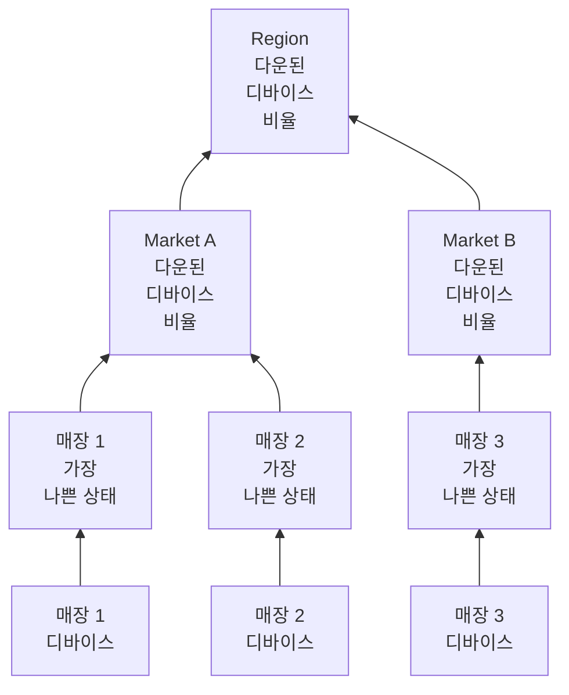

# 네트워크 사이트(상태 요약 및 가동 시간)

네트워크 사이트는 장소입니다. 지역, 시장, 가맹점주, 물류 센터, 매장 하나가 될 수 있습니다. 사이트는 서로 안에 중첩되고, 네트워크 디바이스가 사이트에 연결되며, OneUptime은 디바이스의 상태를 트리 위로 집계하므로 Region 하나의 상태가 "저기 어딘가에 문제가 있는가?"에 답합니다.

**네트워크 → 사이트**에서, 그리고 **네트워크 → Map**의 지도에서 찾을 수 있습니다. 이 페이지는 사이트의 상태가 그 아래에 있는 것에서 어떻게 계산되는지, 가동 시간이 무엇을 뜻하는지, 예정된 유지 관리가 둘을 어떻게 바꾸는지를 정확히 설명합니다.

:::cards
- [사이트 추가](#사이트-추가하기): 세 단계, 또는 전체 환경을 위한 CSV 파일.
- [모니터링 기본값 설정](#모니터링-기본값): 사이트의 모든 디바이스를 위한 프로브와 자격 증명.
- [상태 집계 방식 고르기](#부모-사이트의-상태를-계산하는-방법): 매장에는 가장 나쁜 상태, 지역에는 비율.
- [가동 시간 읽기](#가동-시간): 백분율이 무엇을 세는지, 하루 단위로.
:::

## 작동 방식



각 사이트의 상태는 하위 트리의 모든 디바이스에서 나오며, 사이트 자체의 [집계 정책](#부모-사이트의-상태를-계산하는-방법)으로 판정됩니다. 사이트의 가동 시간은 자체 상태 타임라인에서 나오며, 사이트의 [유지 관리 기간](#네트워크-사이트의-예정된-유지-관리)은 그 사이트의 디바이스를 위쪽의 투표에서 뺍니다.

## 계층 구조

사이트는 트리를 이룹니다. 각 사이트에는 **Site Type**과 선택적인 부모 사이트가 있습니다. 사이트 유형은 프로젝트 자체의 목록으로 **네트워크 → 설정 → Site Types**에 있으며, 새 프로젝트는 위에서부터 순서대로 Account Type, Region, Franchisee, Market, Unit과, 여기에 더해 Data Center와 Other로 시작합니다. 유형은 자체 계층 구조(**Parent Site Type**)를 이루며, 이것이 어떤 사이트가 사이트의 부모가 될 수 있는지를 정합니다. **Is Unit Level**로 표시된 유형은 환경의 말단 계층, 즉 개별 매장이나 지점입니다. 그 사이트에는 다른 사이트가 아니라 디바이스가 들어갑니다.

사이트의 유형, 이름, 설명, 부모, 위치는 한 곳에서 편집합니다. 사이트 **설정** 페이지의 **Site Settings** 카드입니다. 사이트의 개요가 이를 **설정에서 편집** 링크와 함께 보여 주며, **사이트** 목록은 사이트를 추가하지만 편집하지는 않습니다.

각 디바이스는 사이트 하나에 연결됩니다. 사이트의 하위 트리는 그 사이트 자신과 그 아래의 모든 사이트이며, 하위 트리의 디바이스가 상태 집계의 원천입니다. 그래서 자체 디바이스가 없는 Region도 그 아래의 Unit에 디바이스가 있으므로 상태를 가집니다.

> [!NOTE]
> 집계는 디바이스의 상태가 바뀔 때, 디바이스가 다른 사이트로 옮길 때, 사이트가 트리에서 옮길 때 다시 계산되며, 시간이 흐른 것만으로 답이 바뀌는 경우를 잡아내는 5분마다의 점검에서도 다시 계산됩니다.

## 사이트 추가하기

:::steps
### 새 사이트 시작하기
**네트워크 → 사이트**로 이동해 **Site 추가**를 클릭합니다.

### 사이트가 무엇인지 지정하기
**Site Details** 단계에서 **Site Type**(지역, 매장, 데이터 센터처럼 어떤 장소인지)을 고르고 **이름**을 입력합니다. 설명, 도로명 주소, 지도에 사이트를 표시하는 위도와 경도는 **추가 필드** 아래에 접혀 있습니다. 지금 채워도 되고 나중에 채워도 됩니다.

### 트리에 배치하기
**Hierarchy** 단계에서 사이트가 다른 사이트 아래에 있으면 **Parent Site**를 고릅니다. 비워 두면 사이트가 최상위에 남습니다.

### 기본값 설정하기
**Monitoring Defaults** 단계에서 사이트에 추가되는 디바이스를 위한 [기본 프로브와 자격 증명 프로필](#모니터링-기본값)을 고르고 **Site 추가**를 클릭합니다.
:::

사이트 자체의 **Child Sites** 페이지에서 **하위 사이트 추가**는 유형과 이름만 묻는 한 페이지 양식으로, 위치는 접혀 있으며, 새 사이트를 그 사이트 아래에 배치합니다.

### CSV 파일에서 사이트 가져오기

전체 환경을 한꺼번에 가져오려면 **사이트** 목록 위쪽의 메뉴를 열고 **Import from CSV**를 클릭합니다. 파일에는 머리글 행이 필요하며, 열은 어떤 순서로 와도 되고 열 이름은 대소문자를 구분하지 않습니다.

```csv title="sites.csv"
name,siteType,parentName,address,latitude,longitude
North,Region,,,,
Leeds,Market,North,,,
Store 0660,Unit,Leeds,"1 High Street, Leeds",53.7997,-1.5492
```

- `name`과 `siteType`은 필수입니다. `siteType`은 프로젝트의 사이트 유형 중 하나여야 합니다.
- `parentName`은 부모 사이트의 이름이며, 부모가 같은 파일에 있어도 됩니다. 부모가 없거나 부모가 이미 있는 행이 먼저 들어가고, 그다음 그 자식이 들어갑니다. 최상위 사이트는 비워 두세요.
- 부모를 찾을 수 없는 행은 건너뛰며, 결과에 나열됩니다. **Preview Import**는 무엇이든 쓰기 전에 파일이 무엇을 만들지 보여 줍니다.

## 맵

**네트워크 → Map**은 사이트를 지도에 표시하며, 사이트가 있는 곳에 맞춰 화면을 잡습니다. 사이트를 클릭하면 안으로 들어갑니다. 아래에 사이트가 있는 사이트는 그 사이트들을 지도에, 그리고 그 사이의 링크 그래프로 보여 줍니다. 아래에 사이트는 없지만 자체 디바이스가 있는 사이트, 또는 유형이 단위 수준인 사이트는 그 디바이스들의 실시간 토폴로지를 엽니다.

아직 사이트가 없는 프로젝트에도 맵이 있습니다. Map이 대신 디바이스의 토폴로지를 보여 주며, 디바이스를 사이트로 묶으면 위치에 따라 지도에 놓입니다.

## 모니터링 기본값

사이트는 그 안의 디바이스를 어떻게 모니터링할지 한 번에 정하는 곳이기도 합니다. **Site Settings** 카드의 **설정 편집**에는 필드가 두 개인 **Monitoring Defaults** 단계가 있습니다.

| 설정 | 효과 |
| --- | --- |
| **Default Probe** | 이 사이트의 디바이스에 핑을 보내고, 자격 증명이 있으면 SNMP로 워크하는 프로브입니다. 자체 프로브 없이 사이트에서 만들어진 디바이스가 이를 받으며, 프로브 없이 옮겨 온 디바이스도 마찬가지입니다. |
| **Default SNMP Credential Profile** | 디바이스와 디바이스 자체의 프로필 모두에 자격 증명이 없을 때 이 사이트의 디바이스를 워크하는 데 쓰는 [자격 증명 프로필](/docs/monitor/network-device-monitor#snmp-자격-증명과-자격-증명-프로필)입니다. |

사이트에 둘 다 설정하면 그곳의 새 디바이스는 주소만으로 추가할 수 있습니다. 첫 폴링부터 핑을 받고, 첫 폴링부터 워크됩니다.

둘은 의도적으로 다르게 동작합니다.

- 프로브는 디바이스가 사이트에서 만들어지거나 사이트로 옮겨질 때 디바이스에 복사됩니다. 나중에 사이트의 기본 프로브를 바꿔도 이미 프로브가 있는 디바이스는 옮겨지지 않습니다. 어느 프로브가 디바이스에 도달할 수 있는지는 네트워크에 관한 사실이지, 사이트 양식에서 일괄로 다시 쓸 취향이 아니기 때문입니다.
- 자격 증명 프로필은 폴링할 때마다 실시간으로 읽힙니다. 사이트에 설정하면 그 안의 자격 증명 없는 모든 디바이스가 디바이스별 편집 없이 다음 폴링부터 워크되기 시작하고, 지우면 다시 핑만 받습니다.

둘은 트리 아래로 미치는 범위도 다릅니다.

- 프로브는 트리 전체에 미칩니다. 기본 프로브가 없는 사이트에 들어온 디바이스는 가장 가까운 조상의 기본 프로브를 받으므로, Region에 설정한 프로브 하나가 그 아래의 모든 Market과 Unit을 다루며, 자체 프로브를 지정한 Market은 자기 하위 트리에서 이를 재정의합니다.
- 자격 증명 프로필은 디바이스 자체의 사이트에서만 읽힙니다. Unit에 있는 디바이스는 Region에 설정된 프로필을 받지 않으므로, 디바이스가 실제로 연결된 사이트에 설정하세요.

## 부모 사이트의 상태를 계산하는 방법

각 사이트는 **설정** 페이지의 **Health Rollup** 카드(**Rollup Policy**)에서 두 가지 집계 정책 중 하나를 고릅니다.

### 디바이스 중 가장 나쁜 상태(기본값)

하위 트리의 디바이스가 보고하는 가장 나쁜 상태가 사이트의 상태가 됩니다. 상태가 얼마나 나쁜지는 모니터 상태로서의 우선순위로 정해집니다. 새 프로젝트의 상태는 Operational(1), Degraded(2), Offline(3)이며, 높을수록 나쁩니다. 오프라인 디바이스 하나가 사이트를 오프라인으로 만들며, 그 옆에 정상 디바이스가 얼마나 많든 마찬가지입니다.

Unit에는 이것이 맞는 답입니다. 한 건물에 있는 스위치 네 대와 방화벽 한 대는 서로 독립적이지 않습니다. 그중 하나가 꺼지면 그 주소에 문제가 있는 것이며, 평균을 내 없애 버리면 실제 장애를 숨기게 됩니다.

매장 사백 곳 위의 Region에는 대개 틀린 답입니다. 12,000번 매장의 꺼진 스위치 하나가 지역 전체를 Offline으로 칠합니다. 가장 좁은 의미로는 사실이지만 실용적으로는 쓸모가 없습니다. 어느 매장이든 문제가 있을 때마다 지역이 빨간색이 되어 더 이상 아무것도 알려 주지 않기 때문입니다.

### 다운된 디바이스의 비율

사이트의 상태는 하위 트리에서 보고하는 디바이스 중 정상 작동 상태가 아닌 디바이스의 비율로 정해집니다.

| 다운된 디바이스 비율 | 사이트 상태 |
| --- | --- |
| 0% | Operational |
| 0% 초과, 임계값 미만 | Degraded: 프로젝트에서 정상 작동도 오프라인도 아닌 상태이며, 프로젝트에 그런 상태가 없으면 Offline |
| 임계값 이상 | Offline |

임계값은 사이트마다 **Offline Threshold (%)** 로 설정하며, 기본값은 50입니다.

다운된 것이 없으면 임계값을 아무리 낮게 설정해도 Operational입니다. 임계값 0은 "디바이스가 하나라도 다운되면 오프라인"이라는 뜻이지, "정상인 지역이 오프라인"이라는 뜻이 아닙니다.

### 투표하는 디바이스

두 정책은 여기서 일치하며, 생각보다 중요합니다.

- 보관된 디바이스는 투표하지 않습니다. 퇴역한 디바이스이므로 사이트는 유지하지만 제외됩니다.
- 아무것도 보고한 적 없는 디바이스는 투표하지 않습니다. 첫 폴링을 기다리는 디바이스는 장애의 증거가 아니므로 비율의 양쪽 모두에서 제외되며, 온보딩이 절반쯤 진행된 지역은 응답한 절반으로 점수가 매겨집니다.
- 일반적인 종류인 프로브가 폴링하는 디바이스는 마지막 폴링의 결과로 투표합니다. 마지막으로 성공한 지 얼마나 됐는지가 아니라 핑이나 SNMP로 도달할 수 있는지입니다. SNMP 워크가 실패하는 동안 핑에 응답하는 디바이스는 도달 가능하므로 그렇게 투표합니다. 사이트는 작동 중이라고 말하고, 디바이스의 행에는 **SNMP failing**이 표시되어 누군가 자격 증명을 고치게 합니다.
- 모니터 기반 디바이스, 즉 설정 페이지에서 바인딩된 모니터 재정의로 바꾼 디바이스는 아무것도 폴링하지 않으므로 바인딩된 모니터의 상태로 투표합니다. 아무것도 바인딩되지 않았으면 보고한 적이 없으므로 전혀 투표하지 않습니다.

프로브가 폴링하는 디바이스의 Network Device 모니터는 디바이스의 투표 방식을 바꾸지 않습니다. "인터페이스가 다운되면 Offline" 기준이 있는 모니터는 모든 핑에 응답하는 스위치에 Offline 도장을 찍을 것이고, 꺼진 포트 하나가 그 아래 모든 디바이스 행이 Up인데도 사이트 전체를 빨간색으로 만들 것입니다. 사이트가 자신이 요약하는 목록과 어긋나게 됩니다. 폴링되는 디바이스의 상태는 폴링이 원천이며, 모니터는 인시던트를 만들기 위해 있습니다.

### 정책 고르기

가맹점 환경에서 시작하기 좋은 설정은 다음과 같습니다.

| 계층 | 정책 | 이유 |
| --- | --- | --- |
| Unit 또는 매장 | 가장 나쁜 상태 | 디바이스 하나가 다운되면 사이트 하나에 문제가 있는 것입니다. |
| Market | 비율, 임계값 약 50% | 매장의 절반이 다운된 시장은 다운된 것입니다. |
| Region | 비율, 임계값 25%에서 50% | 매장 한 곳의 장애는 지역을 Offline이 아니라 Degraded로 만들고, 체계적인 문제가 생기면 Offline이 됩니다. |

정책은 사이트마다 설정하므로, Region 행에는 비율 정책을 주고 그 아래 모든 것은 기본값으로 둘 수 있습니다.

## 가동 시간

모든 사이트에는 상태 타임라인이 있습니다. 집계된 상태가 바뀔 때마다 한 행이 생기며, 상태가 바뀔 때 열리고 다시 바뀔 때 닫힙니다. 가동 시간은 여기서 계산됩니다.

- 정상 작동으로 표시되지 않은 상태에 있던 시간은 다운타임입니다.
- 겹치는 행은 병합되므로 어떤 1초도 두 번 세지 않습니다.
- 어떤 행에도 포함되지 않은 시간은 작동으로 셉니다. 타임라인은 집계가 실행된 뒤에야 행을 얻으며, 증거가 없는 것은 장애가 아닙니다.
- 아직 열려 있는 행은 측정하는 기간의 끝까지 이어집니다.

Degraded는 정상 작동이 아니므로 다운으로도 셉니다. 따라서 어느 정책이든 사이트의 가동 시간은 그 아래에서 보고하는 디바이스가 하나도 다운되지 않았던 시간의 비율입니다. 정책은 부분 장애가 보여 주는 상태(Degraded 또는 Offline)를 바꿀 뿐, 집계 여부를 바꾸지 않습니다.

타임라인 행이 전혀 없는 사이트는 100% 대신 `—`를 표시합니다. 한 번도 집계되지 않은 사이트는 완벽한 것이 아니라 모니터링되지 않는 것입니다.

### 일별 가동 시간

모든 사이트의 개요에는 30일 수치 옆에 **Uptime (24h)** 가 표시되며, **상태 타임라인** 페이지에는 최근 24시간, 7일, 30일, 90일과 최근 30일의 일별 막대가 표시됩니다.

30일 평균은 나쁜 하루를 보여 주지 못합니다. 30일 기간에서 하루 종일 장애가 나면 3.3포인트가 깎이므로, 화요일 하루 내내 꺼져 있던 사이트도 그 달에 96.7%를 보고합니다. 반올림처럼 읽히는 숫자입니다. 일별 막대는 같은 데이터를 나쁜 하루가 나쁜 막대 하나가 되는 곳에 놓습니다.

하루는 달력의 날이 아니라 지금 끝나는 24시간 단위의 이동 구간입니다. 디바이스, 보는 사람, 서버가 각각 다른 시간대에 있을 수 있어서, 모두가 동의할 하나의 "하루"가 없기 때문입니다.

### 부모의 가동 시간은 자식 가동 시간의 평균이 아닙니다

부모의 가동 시간은 자식들의 백분율 평균이 아니라, 부모의 집계 정책이 만든 부모 자체의 타임라인에서 나옵니다.

자식들의 평균은 디바이스가 두 대인 매장을 디바이스가 이백 대인 물류 센터와 똑같이 취급합니다. 반면 부모 자체의 타임라인은 한 문장으로 말할 수 있는 값을 줍니다. 지역 안의 어떤 것도 다운되지 않았던 시간의 비율입니다. 의도적으로 엄격하므로, 큰 지역에서는 일별 막대와, 부분 장애가 Degraded였는지 Offline이었는지 알려 주는 상태와 함께 읽으세요.

## 네트워크 사이트의 예정된 유지 관리

호스트를 붙일 때처럼, 예정된 유지 관리 이벤트의 **영향받는 리소스** 단계에서 **기타 영향받는 리소스** 아래에 사이트를 붙이세요. 사이트 자체의 **예정된 유지 관리** 페이지는 사이트에 붙은 이벤트를 나열하며, 그 페이지의 **예정된 유지 관리 이벤트 만들기**는 사이트가 이미 선택된 양식을 엽니다.

부모의 기간은 그 아래의 모든 것을 다룹니다. Region의 기간은 그 안의 모든 Market과 Unit을 다루며, 기간이 예약된 뒤에 만들어진 사이트도 포함하므로, 지역 통신사 전환 작업에 매장 사백 곳을 나열할 필요가 없습니다.

적용 범위는 아래로만 미칩니다. Unit 하나의 기간은 그 Region을 유지 관리 상태로 만들지 않습니다. 지역은 여전히 작동 중이어야 하며, 같은 시간에 다른 Unit에서 일어난 실제 장애는 여전히 지역에 불리하게 집계됩니다.

### 유지 관리 기간이 바꾸는 것

| 기간 동안 | 일어나는 일 |
| --- | --- |
| 사이트의 실시간 상태 | 바뀌지 않습니다. 계획된 작업으로 꺼진 Unit은 지도와 트리에서 여전히 Offline으로 표시되며, 옆에 "In maintenance" 배지가 붙습니다. 보는 사람은 그것이 꺼져 있다는 것을 알아야 합니다. |
| 사이트의 가동 시간 | 기간이 다운타임과 측정 기간 모두에서 빠집니다. 두 시간의 유지 관리로 그날은 22시간이 되며, 그 두 시간 안의 일은 어느 쪽으로도 집계되지 않습니다. |
| 조상의 상태 집계 | 유지 관리 중인 하위 트리의 디바이스가 투표를 멈추므로, 달력에 있던 전환 작업 때문에 지역이 빨간색이 되지 않습니다. |
| 조상의 가동 시간 | 영향받지 않으며 고칠 것도 없습니다. 계획된 중단이 조상의 타임라인에 닿지 않았기 때문입니다. |

이 마지막 행이 조상에 대해 기간을 가동 시간에서 빼는 대신 투표를 보류하는 이유입니다. 지역의 측정 기간에서 기간을 빼면 같은 시간에 지역의 다른 곳에서 일어난 실제 장애도 지워질 것입니다.

가동 시간은 작업자가 이벤트의 상태를 옮긴 시각이 아니라 이벤트에 선언된 시작 시각과 종료 시각으로 보정되므로, 숫자를 달력과 대조해 손으로 확인할 수 있습니다. 기간 안에 완전히 들어가는 날은 일별 막대에서 완벽한 날이 아니라 유지 관리로 그려지며, 평균에 아무것도 더하지 않습니다.

### 모니터와의 상호 작용

같은 이벤트에 모니터를 붙이면 여전히 늘 하던 대로 동작합니다. 그 모니터의 능동 모니터링이 기간 동안 일시 중지됩니다. 둘은 독립적입니다. 사이트를 집계와 가동 시간에서 빼려면 사이트를 붙이고, 모니터의 알림을 멈추려면 모니터를 붙이세요.

## 사이트에 대한 알림

사이트 **설정** 페이지의 **Alerting** 카드에는 **Alert When Unhealthy**가 있습니다. 사이트의 집계가 정상 작동이 아닌 상태로 바뀌면 알림이 열리고, 사이트가 회복되면 저절로 해결됩니다. **알림 심각도**는 심각도를 정하며, 비워 두면 프로젝트의 가장 높은 심각도입니다.

알림은 변화에 대해서만 보냅니다. 이미 비정상인 사이트에서 켜면 과거에 대해 알리는 대신 다음 변화에 대비합니다. Degraded는 정상 작동이 아니므로, 비율 정책의 사이트는 가장 나쁜 상태 정책의 사이트와 마찬가지로 보고하는 디바이스 중 하나가 다운되는 즉시 알립니다. 사이트가 Degraded와 Offline 사이를 오가는 동안 알림은 두 번째 알림 없이 열린 채로 있으며, 제목에는 사이트가 처음 도달한 상태가 들어갑니다.

## 문제 해결

:::details 지역이 항상 빨간색임
사이트가 가장 나쁜 상태 정책을 쓰므로, 그 아래 어디서든 오프라인 디바이스 하나가 사이트를 오프라인으로 만듭니다. 지역의 **Health Rollup** 카드에서 **Percentage of devices down**으로 바꾸고, 지역을 다운이라고 부르기 전에 지역의 얼마만큼이 다운되어야 하는지에 맞는 임계값을 정하세요.
:::

:::details 사이트에 가동 시간 대신 —가 표시됨
사이트에 대해 집계가 한 번도 실행되지 않아 타임라인 행이 없습니다. 완벽한 것이 아니라 모니터링되지 않는 것입니다. 사이트나 그 아래 사이트에 디바이스를 추가하면 다음 집계가 타임라인을 시작합니다.
:::

:::details 디바이스가 사이트에 집계되지 않음
보관된 디바이스와 아직 보고하지 않은 디바이스는 투표하지 않습니다. 바인딩된 모니터가 없는 모니터 기반 디바이스도 보고한 적이 없습니다. 디바이스의 상태를 확인하세요. **대기 중** 디바이스는 첫 폴링 후에 투표를 시작합니다.
:::

:::details 사이트의 알림이 발동하지 않음
**Alert When Unhealthy**는 정상 작동 상태에서 다른 상태로 바뀔 때 발동하므로, 켰을 때 이미 비정상이던 사이트는 회복된 뒤 다음 변화에서 알립니다. 디바이스가 투표하는지도 확인하세요. 보관된 디바이스와 첫 폴링을 기다리는 디바이스는 투표하지 않으며, 유지 관리 중인 사이트의 디바이스는 그 위의 집계에서 투표하지 않습니다.
:::

## 다음 단계

:::cards
- [네트워크 장치 모니터](/docs/monitor/network-device-monitor): 이 사이트에 연결되는 디바이스를 추가하고, 폴링하고, 알림을 겁니다.
- [네트워크 트래픽](/docs/monitor/network-traffic): 디바이스의 플로 레코드로 사이트의 트래픽을 봅니다.
- [인벤토리](/docs/inventory/overview): 다른 모든 자산 옆의 네트워크 디바이스.
:::
