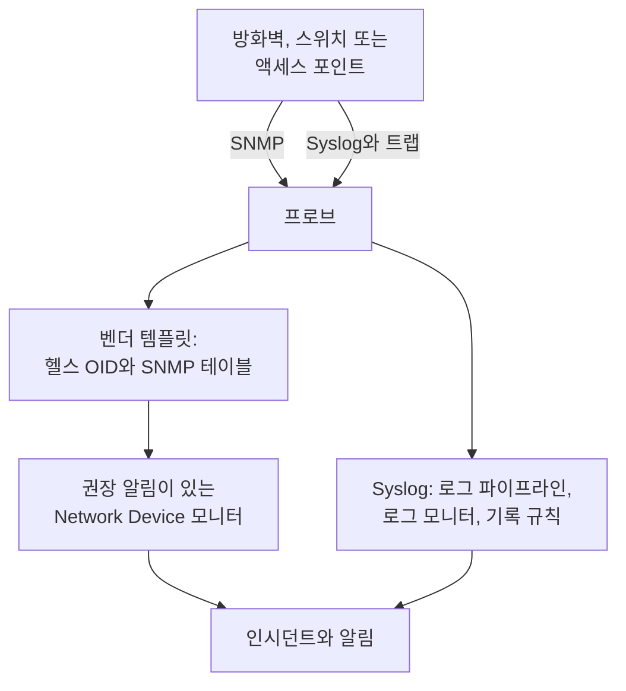

# 네트워크 공급업체별 가이드(Sophos, Extreme, Cambium)

OneUptime으로 흔한 세 가지 환경을 처음부터 끝까지 모니터링하는 방법입니다. IPsec 터널, WAN 링크, SD-WAN이 있는 Sophos Firewall(XGS, SFOS), 패브릭이 있는 Extreme Networks 스위치(EXOS / Switch Engine과 Fabric Engine / VOSS), 그리고 무선마다 채널과 송신 전력까지 보는 Cambium Networks cnMatrix 스위치와 Enterprise Wi-Fi 액세스 포인트입니다.

:::cards
- [Sophos Firewall](#sophos-firewall-xgs-sfos): 터널, WAN 링크, 게이트웨이, SD-WAN.
- [Extreme Networks](#extreme-networks-exos-switch-engine-및-fabric-engine-voss): 스위치, 패브릭, 하드웨어.
- [Cambium Networks](#cambium-networks-enterprise-wi-fi-및-cnmatrix): 무선 하나하나까지 보는 액세스 포인트와 cnMatrix 스위치.
:::

## 작동 방식

모든 가이드는 같은 구성 요소를 씁니다.

- 장비마다 하나의 [네트워크 디바이스](/docs/monitor/network-device-monitor). 도달할 수 있는 프로브가 폴링하며, 알맞은 헬스 OID와 [SNMP 테이블](/docs/monitor/network-device-monitor#snmp-테이블)을 가져오는 벤더 템플릿을 씁니다.
- 알림을 위한 디바이스마다 하나의 Network Device 모니터. 디바이스 페이지에서 만들면, 정상이 무엇인지 아는 테이블마다 행별 알림 하나를 포함한 [권장 알림](/docs/monitor/network-device-monitor#권장-알림-팩)이 채워집니다. 여러 디바이스에는 [알림 정책](/docs/monitor/network-device-monitor#알림-정책)이 모든 디바이스에 모니터를 하나씩 유지합니다.
- 벤더가 로그로만 보고하는 것을 위해: 프로브로 보내는 syslog, 각 줄을 속성으로 바꾸는 [로그 파이프라인](/docs/telemetry/log-pipelines), 터널이나 게이트웨이마다 한 번씩 알리는 [Group By를 쓰는 로그 모니터](/docs/monitor/logs-monitor#그룹별-알림group-by), 그 로그의 숫자를 차트로 그리는 [로그 기록 규칙](/docs/telemetry/log-recording-rules).

## Sophos Firewall (XGS / SFOS)

| 보고 싶은 것 | 출처 |
| --- | --- |
| 방화벽 상태: 메모리, 디스크, 스왑, HA 상태, IPsec 서비스, 코어별 CPU | **Sophos Firewall (SFOS / XGS)** 벤더 템플릿을 쓰는 SNMP |
| 모든 IPsec 터널의 상태(이름별) | SNMP 테이블 `ipsec_tunnels`(SFOS v20 이상) |
| 각 WAN 링크의 상태, 처리량, 사용률, 오류 | WAN 포트의 인터페이스 워크 |
| 각 WAN 링크의 지연 시간, 패킷 손실, 지터 | OneUptime 프로브의 Ping 모니터와 디바이스 폴링 |
| 게이트웨이 작동 및 다운, SD-WAN SLA 충족 여부, SD-WAN 경로 변경 | 방화벽의 syslog |
| 게이트웨이별 SD-WAN 지연 시간, 지터, 패킷 손실 차트 | SD-WAN SLA 로그에 대한 로그 기록 규칙 |

Sophos는 어떤 SFOS 버전에서도 게이트웨이나 SD-WAN 상태를 SNMP로 보고하지 않습니다. 그 정보는 방화벽의 로그와 Sophos Central의 알림에만 있으며, 그래서 마지막 세 행은 syslog를 거칩니다.

### 방화벽 등록하기

:::steps
1. 방화벽에서 **Administration → SNMP** 아래의 SNMP를 켭니다. SNMPv3 사용자나 v2c 커뮤니티를 추가하고, 프로브의 주소가 조회할 수 있도록 허용하세요.
2. OneUptime에서 **네트워크 → Devices**로 이동해 **Add Device**를 클릭합니다. 방화벽의 관리 주소를 입력하고, 도달할 수 있는 프로브를 고르고, **SNMP** 아래에 SNMP 자격 증명을 추가하세요.
3. 디바이스의 **설정** 페이지에서 **Polling & Data Collection** 아래의 **Vendor Health Template**에서 **Sophos Firewall (SFOS / XGS)** 템플릿을 적용하고, **Add a Vendor's Tables**에서 그 테이블을 추가합니다. 또는 **Auto-Apply Vendor Health Template**을 켜면 첫 폴링이 둘 다 해 줍니다.
:::

다음 폴링 후 디바이스의 **SNMP Tables** 페이지에 모든 IPsec 연결이 상태(active, inactive, partially active)와 함께 나열되고, CPU 코어도 나열됩니다. SFOS는 코어 번호를 196608부터 매기므로, CPU는 단일 `hrProcessorLoad.1`이 아니라 테이블에서 가져옵니다.

### 모든 IPsec 터널에 알림 걸기

디바이스 페이지에서 **모니터 생성**을 클릭합니다. 권장 알림에는 **IPsec Tunnels: row unhealthy**가 포함됩니다. `ipsec_tunnels` 테이블에 대해 Row `*`로 설정한 **SNMP Table Row Is Unhealthy** 기준으로, active가 아닌 터널마다 터널 이름을 딴 인시던트를 하나씩 열고, 터널이 돌아오면 각각 해결합니다.

Sophos가 active로 보고하는 터널은 보안 연결(SA)이 올라와 있다는 뜻일 뿐입니다. 트래픽이 실제로 지나가는지 증명하려면 한 사이트의 프로브에서 각 터널 건너편의 호스트로 가는 [Ping 모니터](/docs/monitor/ping-monitor)를 추가하고, **네트워크 → 토폴로지 → Site Links**에서 두 [사이트](/docs/monitor/network-sites) 사이의 사이트 링크로 터널을 그려 그 모니터에 바인딩하세요. 그러면 맵의 링크가 모니터의 색을 띱니다.

### WAN 링크

- **포트 상태.** 인터페이스 워크가 이미 모든 WAN 포트의 상태, 들어오고 나가는 비트, 사용률, 오류를 측정합니다. 방화벽의 모니터에서 **인터페이스**를 WAN 포트의 이름으로, 또는 모든 포트를 위해 `*`로 설정한 **SNMP Interface Is Down** 또는 **SNMP Interface Utilization (in %)** 기준이 링크마다 알림을 보냅니다.
- **경로 품질.** 각 링크의 지연 시간, 패킷 손실, 지터는 방화벽 밖에서 측정합니다. OneUptime 클라우드 프로브에서 각 WAN 링크의 공인 주소로 가는 Ping 모니터와, 사이트의 프로브에서 각 ISP 게이트웨이로 가는 Ping 모니터입니다. 이 모니터의 패킷 손실 및 지터 기준이 링크마다 알림을 보내며, **네트워크 → 토폴로지 → Latency Matrix**는 모든 프로브와 모든 모니터를 한눈에 보여 줍니다.
- **트래픽.** SFOS는 NetFlow v5를 내보냅니다. 프로브의 플로 수집기가 기본으로 수신 대기하는 UDP 2055로 프로브에 보내면, 디바이스의 **Traffic** 페이지가 각 WAN 링크에서 누가 누구와 통신하는지 보여 줍니다. 자세한 내용은 [네트워크 트래픽](/docs/monitor/network-traffic)에 있습니다.

### syslog로 보는 게이트웨이와 SD-WAN

:::steps
1. 프로브의 syslog 수신기를 켭니다. 프로브에 `PROBE_SYSLOG_RECEIVER_ENABLED=true`를 설정하세요. 기본적으로 UDP 5140에서 수신 대기하며(`PROBE_SYSLOG_RECEIVER_PORT`로 바꿀 수 있음), 프로브가 Docker에서 실행되면 포트를 게시하세요. 메시지는 호스트 이름이나 **기타 주소** 중 하나가 보낸 쪽의 주소인 네트워크 디바이스에 매칭되며, 디바이스의 **로그** 페이지에 나타납니다.
2. 방화벽의 **System services → Log settings**에서 프로브와 그 포트를 가리키는 syslog 서버를 추가하고, IPsec과 게이트웨이에 대한 **Event** 로그 유형과 **SD-WAN** 로그 유형을 체크하세요. SLA 로그는 체크할 때까지 꺼져 있습니다.
3. **로그 → 설정 → 파이프라인**에서 필터가 방화벽의 로그에 맞는 파이프라인(예: `attributes.networkDevice.name = 'hq-firewall'`)을 만들고, **Target Prefix**가 `sophos`인 **Key=Value Parser**를 추가합니다. 방화벽의 한 줄을 테스터에 붙여 넣으면 사용 중인 SFOS 버전이 만드는 정확한 속성 이름을 볼 수 있습니다. [Sophos 예시](/docs/telemetry/log-pipelines#예-sophos-xgs-방화벽)에서 차례로 설명합니다.
4. 방화벽의 로그에 대해 [로그 모니터](/docs/monitor/logs-monitor)를 만들고, 각각 **Group by Attributes**를 설정해 터널이나 게이트웨이마다 따로 알리게 하며, 기준은 몇 분 동안 **Log Count** **Greater Than** `0`으로 합니다. 아래 행이 시작하기 좋은 세 가지입니다.
5. SD-WAN 품질을 차트로 그립니다. SD-WAN 로깅이 켜져 있으면 방화벽은 프로필과 게이트웨이마다 SLA 요약(`latency`, `jitter`, `packet_loss`)을 씁니다. **로그 → 설정 → 기록 규칙**에서 숫자마다 규칙을 하나씩 만드세요. 예를 들어 `sophos.gw_name`과 `sophos.profile_name`으로 그룹화한 `sophos.latency`의 평균입니다. 그런 다음 결과를 차트로 그리거나, 게이트웨이로 그룹화하는 [Metrics 모니터](/docs/monitor/metrics-monitor)로 알림을 거세요. [로그 기록 규칙](/docs/telemetry/log-recording-rules)에서 이 예시를 차례로 설명합니다.
:::

| 알림 | 셀 로그 | 그룹화 기준 |
| --- | --- | --- |
| IPsec 터널 종료 | 속성 `sophos.log_component` = `IPSec`, 본문에 `terminated` 포함 | `sophos.con_name` |
| 게이트웨이 다운 | 속성 `sophos.log_component` = `Gateway`, 본문에 `is Down` 포함 | `sophos.gatewayname` |
| SD-WAN SLA 미충족 | 속성 `sophos.log_type` = `SD-WAN`, 본문에 `SLA not met` 포함 | `sophos.gw_name` |

syslog 이벤트는 SNMP 테이블을 보완합니다. 터널이 끊기는 순간 도착하며, 테이블은 한 번도 올라오지 않은 터널도 잡아냅니다.

### 트랩

Sophos의 모든 알림은 같은 트랩 `sfosNotification`(`1.3.6.1.4.1.2604.5.1.8.1.1`)이며, 이벤트는 `sfosTrapMessage`(`1.3.6.1.4.1.2604.5.1.8.1.2`)에 텍스트로 들어 있습니다. 한 종류의 이벤트에 알림을 걸려면 **SNMP Trap Received (Trap OID)** Equal To `1.3.6.1.4.1.2604.5.1.8.1.1`과, 그 varbind에 대한 **SNMP Trap Varbind Value**(예: Contains `IPSec`)를 결합하세요. 방화벽의 트랩 대상은 SNMP v2c로 설정하세요. 프로브의 트랩 수신기는 v1과 v2c 트랩을 받습니다.

## Extreme Networks (EXOS / Switch Engine 및 Fabric Engine / VOSS)

| 보고 싶은 것 | 출처 |
| --- | --- |
| EXOS: CPU, 온도와 그 알람, 전원 상태, 전원 공급 장치, 팬, 슬롯별 메모리, 스택 멤버 | **Extreme Networks EXOS / Switch Engine** 템플릿 |
| Fabric Engine: 슬롯별 CPU와 메모리, 온도 센서, 팬, 전원 공급 장치, vIST 세션, I-SID 수 | **Extreme Networks Fabric Engine / VOSS** 템플릿 |
| 이웃 이름으로 명명된 모든 Fabric Connect(IS-IS) 인접 관계 | Fabric Engine 템플릿의 테이블 `isis_adjacencies` |
| 포트, LLDP 이웃, 네트워크 맵 | 두 경우 모두 인터페이스 워크 |

### 어느 템플릿인가

Extreme의 범용 하드웨어(5000 및 7000 시리즈)에서 실행되는 Fabric Engine은 EXOS와 같은 엔터프라이즈 번호를 보고합니다. 시스템 설명(`7520-48Y-8C-FabricEngine (9.0.4.0)`)만이 어떤 운영 체제가 실행 중인지 알려 줍니다. OneUptime은 둘 다 읽으므로 자동 적용과 디바이스 페이지의 제안이 알맞은 템플릿을 고르며, 구형 VSP 스위치는 Avaya/Nortel 아크를 보고하므로 바로 Fabric Engine으로 인식됩니다.

### 패브릭과 하드웨어 알림

Fabric Engine 스위치의 권장 알림에는 **Fabric Adjacencies (IS-IS): row unhealthy**가 포함되어, 인접 관계가 올라와 있지 않은 이웃마다 인시던트를 엽니다. Fabric Engine은 인접 관계가 바뀔 때 트랩 `rcnIsisPlsbAdjStateTrap`(`1.3.6.1.4.1.2272.1.21.0.281`)도 보내며, 이 트랩에 대한 **SNMP Trap Received (Trap OID)** 기준은 다음 폴링 전에 몇 초 안에 알립니다.

전원 공급 장치, 팬, 온도 센서, 스택 멤버는 정상 값을 선언하는 테이블이므로, 각각 권장 알림에서 행별 알림을 받습니다.

### 플로와 Wi-Fi

EXOS와 Fabric Engine은 플로를 sFlow와 IPFIX로 내보냅니다. sFlow는 UDP 6343으로, IPFIX는 UDP 4739로 프로브에 보내면 디바이스의 **Traffic** 페이지에 트래픽이 표시됩니다. [네트워크 트래픽](/docs/monitor/network-traffic)을 참조하세요.

IQ Engine(HiveOS) 액세스 포인트와 ExtremeCloud IQ Controller에는 자체 벤더 템플릿이 있으며, 디바이스의 **Wi-Fi** 페이지를 채웁니다. [지원되는 Wi-Fi 벤더](/docs/monitor/network-device-monitor#지원되는-wi-fi-벤더)에서 Ubiquiti UniFi, HPE Aruba, TP-Link Omada, Juniper Mist와 함께 다룹니다.

## Cambium Networks (Enterprise Wi-Fi 및 cnMatrix)

### 액세스 포인트

:::steps
1. 액세스 포인트에서 SNMP를 켭니다. cnMaestro에서 SNMP는 AP 그룹별로 설정합니다. **Configuration → Wi-Fi Profiles → AP Groups → Management → SNMP**입니다. v2c 읽기 커뮤니티나 SNMPv3 사용자로 켜세요.
2. 각 액세스 포인트를 관리 주소와 그 자격 증명으로 추가하고, **Cambium Networks Enterprise Wi-Fi (cnPilot, XV, XE, XH)** 템플릿을 적용하거나 자동 적용을 켜세요.
3. 디바이스의 **Wi-Fi** 페이지를 엽니다. 켜진 무선 수, 클라이언트, SSID가 표시되고, 그다음 모든 무선의 대역, 채널, 주파수, 채널 폭, 송신 전력, 클라이언트, 노이즈 플로어, 에어타임과, 모든 SSID와 그 클라이언트가 표시됩니다. 주파수는 대역과 채널에서 계산되며, 액세스 포인트가 보고하지 않습니다.
:::

유용한 알림입니다. 모두 `wifi_radios` 테이블에 Row `*`로 걸어 무선마다 따로 알립니다.

| 알림 | 기준 |
| --- | --- |
| 꺼진 무선 | **SNMP Table Row Is Unhealthy**, 권장 알림에 포함 |
| 송신 전력 변경 | **SNMP Table Value**, 열 TX Power, 계획한 전력과 Not Equal To |
| 붐비는 무선 | **SNMP Table Value**, 열 Clients, 한도보다 Greater Than |
| 시끄러운 채널 | **SNMP Table Value**, 열 Noise Floor, Greater Than `-80` |

모든 숫자 무선 값은 메트릭(`oneuptime.monitor.snmp.table.value`, 무선과 열마다 하나의 시계열)이기도 하므로, 채널, 전력, 클라이언트를 대시보드에서 시간에 따라 차트로 그릴 수 있습니다. 계속 바뀌는 채널은 DFS가 작동하고 있다는 뜻입니다.

Cambium은 펌웨어 6.5.3부터만 전체 클라이언트 수를 보고하며, 이전 펌웨어는 0을 반환합니다.

### cnMatrix 스위치

**Cambium Networks cnMatrix** 템플릿은 CPU, RAM, 플래시, 온도, 공급 전압을 수집하고, 팬, 이중화 전원 공급 장치, 각 포트의 PoE 전력 사용량을 테이블로 수집합니다. 포트와 LLDP 이웃은 다른 스위치와 마찬가지로 인터페이스 워크에서 옵니다.

### cnMaestro 알람

cnMaestro는 액세스 포인트가 오프라인이 되는 것 같은 알람을 HTTPS 웹후크로 보낼 수 있습니다. 이를 [Incoming Request 모니터](/docs/monitor/incoming-request-monitor)로 향하게 하면 그 알람이 SNMP 데이터 옆에서 OneUptime 인시던트가 됩니다.

## 문제 해결

:::details IPsec Tunnels 테이블에 상태가 없음
터널 상태에는 SFOS v20 이상이 필요합니다. 자격 증명의 SNMP 뷰에 Sophos 엔터프라이즈 트리(`1.3.6.1.4.1.2604`)가 포함되는지도 확인하세요. 제한된 v3 사용자는 시스템 그룹과 IF-MIB만 보는 경우가 많습니다.
:::

:::details 방화벽에서 syslog가 도착하지 않음
프로브의 syslog 수신기는 기본적으로 꺼져 있습니다. `PROBE_SYSLOG_RECEIVER_ENABLED=true`를 설정하고 UDP 5140, 또는 설정한 `PROBE_SYSLOG_RECEIVER_PORT`를 프로브에 게시하세요. 메시지는 보낸 쪽의 주소로 디바이스에 매칭되므로, OneUptime에 있는 방화벽의 호스트 이름이나 **기타 주소** 중 하나가 syslog를 보내는 주소여야 합니다.
:::

:::details Fabric Engine 스위치에 EXOS 템플릿이 적용됨
템플릿은 스위치의 시스템 설명으로 고릅니다. 디바이스의 개요에 Fabric Engine이라고 적힌 설명(예: `7520-48Y-8C-FabricEngine (9.0.4.0)`)이 표시되는지 확인하세요. 표시된다면 EXOS OID와 테이블을 제거하고 **Vendor Health Template**에서 **Extreme Networks Fabric Engine / VOSS**를 적용하세요.
:::

:::details Cambium 액세스 포인트의 클라이언트가 0으로 보고됨
전체 클라이언트 수에는 펌웨어 6.5.3 이상이 필요합니다. 이전 펌웨어에서도 무선은 채널, 전력, 노이즈 플로어를 보고합니다.
:::

## 다음 단계

:::cards
- [네트워크 장치 모니터](/docs/monitor/network-device-monitor): 디바이스가 수집하는 모든 것과 알림을 걸 수 있는 모든 기준.
- [로그 파이프라인](/docs/telemetry/log-pipelines): 방화벽 로그를 속성으로 파싱합니다.
- [로그 모니터](/docs/monitor/logs-monitor): 터널이나 게이트웨이마다 한 번씩 알립니다.
:::
