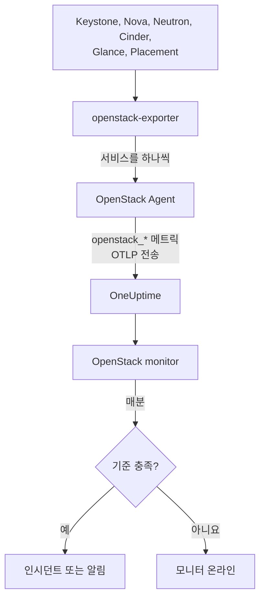

# OpenStack 모니터

OpenStack 모니터는 클라우드 하나를 감시합니다. API, API 뒤에서 동작하는 워커, 하이퍼바이저, 인스턴스, 네트워크, 스토리지 풀, 프로젝트 할당량을 대상으로 하며, API가 응답을 멈추거나 워커가 중단되거나 하이퍼바이저에 여유가 없거나 풀이 가득 차면 알려 줍니다. OneUptime OpenStack 에이전트가 openstack-exporter에서 수집하거나 프로브가 클라우드의 API에서 수집하는 `openstack_*` 시계열을 읽습니다.

:::cards
- [모니터 생성](#openstack-모니터-생성): 대시보드에서 진행하는 여섯 단계입니다.
- [템플릿](#사전-구성-알림-템플릿): 바로 쓸 수 있는 알림으로, 워커, 인스턴스, 네트워크, 지역마다 인시던트가 하나씩 생성됩니다.
- [외부 점검](#외부-점검): 클라우드 외부의 프로브에서 실제로 인스턴스를 부팅할 수 있는지 확인합니다.
- [아이덴티티 속성](#아이덴티티-속성): 특정 지역, 호스트, 프로젝트를 대상으로 지정하는 방법입니다.
- [메트릭](#수집되는-메트릭): 모니터가 알림 대상으로 삼을 수 있는 모든 시계열입니다.
:::

## 동작 방식

에이전트는 OpenTelemetry Collector와 openstack-exporter로 구성되며, 클라우드의 API에 접근할 수 있는 머신에서 실행합니다. OpenStack 서비스를 각각 별도의 수집으로 읽기 때문에 Nova가 실패해도 Nova의 시계열만 빠지며, 부담을 주지 않도록 천천히 읽습니다. 컴퓨트, 네트워크, 볼륨, Placement는 2분마다, 아이덴티티와 이미지는 5분마다 읽습니다.

각 시계열에는 클라우드 이름인 `openstack.cloud.name`이 붙고, 각 데이터포인트에는 `openstack.region.name`과 `openstack_service`가 붙습니다. 클라우드는 Keystone 하나에 해당하며, OpenStack 모니터는 클라우드 하나에 연결됩니다. 모니터는 1분마다 해당 클라우드의 메트릭에 쿼리를 실행하고 그 결과를 기준과 비교합니다.



## 시작하기 전에

- OpenStack 에이전트 또는 [프로브](/docs/telemetry/openstack-agentless)로 **클라우드의 메트릭을 수집**하세요. **문서**(**제품 → 인프라 → OpenStack**)에서 에이전트 설치 방법을 안내합니다.
- **클라우드가 등록되었는지 확인**하세요. 첫 수집이 끝나면 에이전트의 `OPENSTACK_CLOUD_NAME`이라는 이름으로 **제품 → 인프라 → OpenStack**에 나타납니다.

## OpenStack 모니터 생성

:::steps
### 새 모니터 시작

**모니터**로 이동해 **모니터 생성**을 클릭합니다.

### OpenStack 선택

**모니터 유형**에서 **더 많은 모니터 유형**을 클릭하고 **인프라** 아래의 **OpenStack**을 선택하거나, 검색창에 `openstack`을 입력합니다. **이름**을 입력하고(인시던트와 알림 제목에 사용됩니다) **다음**을 클릭합니다.

### 클라우드 선택

**OpenStack Monitor Configuration** 아래의 **OpenStack 클라우드**에서 클라우드를 선택합니다. 데이터를 보낸 적이 있는 모든 클라우드가 목록에 있습니다. 선택하면 필드 아래 한 줄에 데이터가 들어오고 있는지 표시됩니다.

### 감시 대상 선택

새 모니터는 **알림 대상** 아래의 **클라우드 보고 중단**으로 시작합니다. 다른 것을 감시하려면 다음을 사용합니다.

- **변경** - 다른 [템플릿](#사전-구성-알림-템플릿)을 선택합니다. 템플릿이 메트릭, 속성 필터, 집계, 시간 범위, 그룹화 기준, 임계값을 설정하며 아래의 기준을 템플릿의 기준으로 바꿉니다. **시간 범위**는 그대로 변경할 수 있습니다.
- **Custom Metric**(**추가 필드** 아래) - **OpenStack 메트릭**에서 메트릭 하나를 선택한 다음 **집계**와 **시간 범위**를 설정하고 [필터](#모니터-설정)로 범위를 좁힙니다.
- **고급**(**추가 필드** 아래) - **메트릭 선택**에서 쿼리와 수식을 직접 작성하며, `status`, `adminState`, `resourcetype` 같은 속성으로 필터링할 수 있습니다. [아이덴티티 속성](#아이덴티티-속성) 기준으로 **그룹화 기준**을 지정하면 각 부분을 따로 판단합니다.

### 기준 확인

**기준** 아래의 각 기준을 열어 **메트릭**, **집계**, **조건**, **임계값**을 확인합니다. 템플릿은 이 값들을 채워 줍니다. **Custom Metric**이나 **고급**을 쓰면 모니터는 메트릭이 데이터를 보내지 않을 때만 감지하는 기본 기준으로 시작하므로 임계값을 직접 설정하세요.

### 모니터 생성

**모니터 생성**을 클릭합니다. OneUptime이 모니터 페이지를 열고 매분 평가합니다. 모니터가 발생시킨 인시던트와 알림은 클라우드의 **인시던트** 및 **알림** 페이지에도 표시됩니다.
:::

> [!TIP]
> 여러 템플릿을 한 번에 설정하려면 **제품 → 인프라 → OpenStack**에서 클라우드를 열고 **권장 사항**으로 이동하세요. 원하는 템플릿을 선택하고 호출할 대상을 정하면 OneUptime이 템플릿마다 모니터를 하나씩 생성합니다.

## 모니터 설정

| 필드 | 탭 | 기능 |
| --- | --- | --- |
| **OpenStack 클라우드** | 전체 | 필수입니다. 모든 쿼리를 `resource.openstack.cloud.name`으로 한정합니다. |
| **지역** | 사용자 지정 메트릭, 고급 | 선택 사항입니다. 지역 하나를 지정합니다: `openstack.region.name`. 모든 시계열에 이 값이 있습니다. |
| **가용 영역** | 사용자 지정 메트릭, 고급 | 선택 사항입니다. 영역 하나를 지정합니다: 하이퍼바이저, 인스턴스, 볼륨, Neutron 에이전트에서는 `availability_zone`, Nova와 Cinder의 워커에서는 `zone`입니다. |
| **하이퍼바이저** | 사용자 지정 메트릭, 고급 | 선택 사항입니다. 호스트 하나를 지정합니다: 워커, 하이퍼바이저, Placement에서는 `hostname`, 인스턴스에서는 `hypervisor_hostname`입니다. Nova의 워커는 호스트의 짧은 이름을, 하이퍼바이저, Placement, 인스턴스는 전체 이름을 사용하므로 시계열에 표시된 쪽을 쓰세요. |
| **서비스** | 사용자 지정 메트릭, 고급 | 선택 사항입니다. 워커의 바이너리 하나를 지정합니다. 예: `nova-compute`: `service`. |
| **프로젝트 ID** | 사용자 지정 메트릭, 고급 | 선택 사항입니다. 프로젝트 하나를 지정합니다: Nova와 Cinder의 시계열과 네트워크, 서브넷에서는 `tenant_id`, 플로팅 IP, 라우터, 주소 가용성에서는 `project_id`입니다. |
| **OpenStack 메트릭** | 사용자 지정 메트릭 | [카탈로그](#수집되는-메트릭)에서 고른 메트릭 하나입니다. |
| **집계** | 사용자 지정 메트릭 | 샘플을 합치는 방식입니다: **평균**, **최대**, **최소**, **합계**, **개수**. 해당 메트릭의 일반적인 집계 방식으로 시작합니다. |
| **시간 범위** | 전체 | 쿼리가 읽는 롤링 윈도우로, **Past 1 Minute**부터 **Past 365 Days**까지입니다. 새 모니터는 **지난 15분**으로 시작하며 템플릿은 자체 값을 설정합니다. |
| **메트릭 선택** | 고급 | 쿼리 빌더입니다: **메트릭**, **Aggregate by**, **Filter by attributes**, **그룹화 기준**, 그리고 쿼리를 결합하는 **메트릭 추가**와 **수식 추가**가 있습니다. |

필터는 해당 레이블이 있는 시계열만 좁힙니다. `openstack_nova_up`에는 프로젝트가 없으므로 프로젝트 필터를 걸어도 그대로 남습니다.

읽으려는 대상의 수집 횟수가 세 번 이상 들어가도록 윈도우를 유지하세요. 컴퓨트, 네트워크, 볼륨, Placement는 6분, 아이덴티티와 이미지는 15분입니다. 그보다 짧으면 수집 횟수가 부족해서 **모든 값**이 기간을 뜻하지 않습니다.

## 아이덴티티 속성

모든 시계열에는 `openstack.cloud.name`이 **리소스 속성**으로, `openstack.region.name`과 `openstack_service`가 데이터포인트 속성으로 붙습니다. 나머지는 exporter 자체의 레이블이 알려 줍니다.

| 부분 | 시계열 | 식별 레이블 |
| --- | --- | --- |
| API | `openstack_*_up` | `openstack.region.name`, `openstack_service` |
| 워커 | `openstack_nova_agent_state`, `openstack_neutron_agent_state`, `openstack_cinder_agent_state` | `hostname`, `service`. `adminState`는 운영자가 켜 둔 상태인지 알려 줍니다. Cinder에서는 `uuid`로 그룹화하지 마세요. exporter가 수집할 때마다 새로 만들어 냅니다 |
| 하이퍼바이저 | `openstack_placement_resource_*`, `openstack_nova_vcpus_*` | `hostname`(전체 이름), Placement에서는 `resourcetype` |
| 인스턴스 | `openstack_nova_server_status` | `uuid`, `name`, `tenant_id`, `hypervisor_hostname`, `status`. 값은 코드입니다. `status` 단어로 필터링하세요 |
| 볼륨 | `openstack_cinder_volume_gb` | `id`, `name`, `tenant_id`, `status` |
| 스토리지 풀 | `openstack_cinder_pool_capacity_*` | `name`, `volume_backend_name` |
| 네트워크 | `openstack_neutron_network_ip_availabilities_*` | `network_id`, `network_name`, `cidr`, `ip_version` |
| 라우터 | `openstack_neutron_l3_agent_of_router` | `router_id`, `agent_host`, `ha_state`, `agent_alive`, `agent_admin_up` |
| 프로젝트 | `openstack_nova_limits_*`, `openstack_cinder_limits_*` | `tenant_id`, `tenant` |

모니터 필터와 그룹화 키에서 리소스 속성은 `resource.`로 시작하고(`resource.openstack.cloud.name`), 데이터포인트 속성은 그렇지 않습니다(`openstack.region.name`, `hostname`, `status`). 빈 레이블은 OneUptime에 전달되지 않으므로 `disabledReason`은 누군가 비활성화한 워커에만 있습니다.

## 사전 구성 알림 템플릿

OneUptime은 흔한 OpenStack 문제를 위한 템플릿 120개를 제공하며, **알림 대상** 목록에서 선택할 수 있습니다. 클라우드의 권장 사항 페이지는 Heat, Magnum, Ironic, Manila, Octavia, Trove, Designate, Gnocchi, Swift 템플릿을 해당 서비스를 실행하는 클라우드에만, 프로브만 보내는 시계열 기반 템플릿을 프로브로 수집하는 클라우드에만, [외부 점검](#외부-점검) 기반 템플릿을 해당 점검이 켜진 클라우드에만 제안합니다. 다른 클라우드에서는 그 시계열이 존재하지 않아 절대 발생할 수 없기 때문입니다. 각 템플릿은 완성된 모니터를 만듭니다. 메트릭 쿼리, 속성 필터, 인시던트 하나가 다루는 대상에 대한 그룹화 기준, 발생 기준과 복구 기준이 모두 포함됩니다. 임계값은 클라우드 자체 페이지가 그리는 선과 같으며 편집할 수 있는 출발점입니다.

모든 템플릿은 감시 대상의 수집을 최소 세 번 읽으며, 조건이 윈도우 전체에서 유지될 때만 발생합니다. 비율에 대한 임계값은 선보다 10% 더 지나야 복구되므로 그 부근을 오가는 값이 계속 뒤바뀌지 않습니다.

| 템플릿 | 범주 | 심각도 | 감시 대상 | 발생 조건 | 복구 조건 |
| --- | --- | --- | --- | --- | --- |
| Cloud Stopped Reporting | 가용성 | 치명적 | `openstack_identity_up`, 클라우드 전체의 개수, **지난 15분** | 윈도우 전체에서 데이터 없음: 에이전트가 중지되었거나 OneUptime에 접근할 수 없거나, exporter가 Keystone에 로그인할 수 없음 | 데이터가 다시 들어옴 |
| Identity API Down | 가용성 | 치명적 | `identity`에 대한 `openstack_identity_up`과 `scrape_samples_scraped`, 지역별 최소, **지난 15분** | 모든 호출이 실패했거나, exporter가 로그인하지 못해 수집 결과가 비어 있음 | 둘 다 1 이상 |
| Compute API Down | 가용성 | 치명적 | `compute`에 대한 `openstack_nova_up`과 `scrape_samples_scraped`, 지역별 최소, **지난 10분** | 모든 호출이 실패했거나, exporter가 Nova의 API에 접근하지 못해 수집 결과가 비어 있음 | 둘 다 1 이상 |
| Network API Down | 가용성 | 치명적 | `network`에 대한 `openstack_neutron_up`과 `up`, 지역별 최소, **지난 10분** | 모든 호출이 실패했거나 exporter가 응답하지 않음 | 둘 다 1 |
| Block Storage API Down | 가용성 | 치명적 | `volume`에 대한 `openstack_cinder_up`과 `up`, 지역별 최소, **지난 10분** | 모든 호출이 실패했거나 exporter가 응답하지 않음 | 둘 다 1 |
| Image API Down | 가용성 | 치명적 | `image`에 대한 `openstack_glance_up`과 `up`, 지역별 최소, **지난 15분** | 모든 호출이 실패했거나 exporter가 응답하지 않음 | 둘 다 1 |
| Placement API Down | 가용성 | 치명적 | `placement`에 대한 `openstack_placement_up`과 `up`, 지역별 최소, **지난 10분** | 모든 호출이 실패했거나 exporter가 응답하지 않음 | 둘 다 1 |
| Compute Service Down | 컨트롤 플레인 | 치명적 | `service = nova-compute` 및 `adminState = enabled`로 필터링한 `openstack_nova_agent_state`, 호스트별 최소, **지난 10분** | 1 미만: 활성화된 nova-compute가 중단됨. 누군가 비활성화한 것은 발생하지 않음 | 가동 중이거나 비활성화됨 |
| Compute Service Disabled | 컨트롤 플레인 | 경고 | `service = nova-compute` 및 `adminState = disabled`로 필터링한 `openstack_nova_agent_state`, 호스트별 개수, **지난 10분** | 0 초과: `nova-compute`가 비활성화되었고, 해당 호스트, 가용 영역 또는 클라우드를 포함하는 진행 중인 유지보수 이벤트가 없음. libvirt가 중단되어 스스로 비활성화된 것(사유가 `AUTO:`로 시작)은 libvirt Service Down이 열려 있는 동안 조용함. 프로젝트에는 알리지 않음 | 다시 활성화되거나 이벤트가 포함함 |
| Scheduler or Conductor Down | 컨트롤 플레인 | 경고 | `nova-scheduler` 또는 `nova-conductor` 및 `adminState = enabled`로 필터링한 `openstack_nova_agent_state`, 호스트 및 바이너리별 최소, **지난 10분** | 1 미만. 하나라도 남아 있으면 나머지가 계속 동작함 | 가동 중이거나 비활성화됨 |
| Every Scheduler or Conductor Down | 컨트롤 플레인 | 치명적 | 위와 같음, 지역 및 바이너리별 최대, **지난 10분** | 1 미만: 살아 있는 것이 없어 새로 부팅할 수 없음 | 하나가 가동됨 |
| Network Agent Down | 컨트롤 플레인 | 치명적 | `adminState = up`으로 필터링한 `openstack_neutron_agent_state`, 호스트 및 바이너리별 최소, **지난 10분** | 1 미만: 켜 둔 에이전트가 살아 있지 않음. 누군가 내려 둔 것은 발생하지 않음 | 살아 있거나 내려짐 |
| Block Storage Service Down | 컨트롤 플레인 | 치명적 | `adminState = enabled`로 필터링한 `openstack_cinder_agent_state`, 호스트 및 바이너리별 최소, **지난 10분** | 1 미만: 활성화된 Cinder 서비스가 중단됨. 누군가 비활성화한 것은 발생하지 않음 | 가동 중이거나 비활성화됨 |
| vCPU Allocation High | 컴퓨트 | 경고 | `resourcetype = VCPU`로 필터링한 `openstack_placement_resource_*`, 사용량 / ((총량 - 예약량) x 비율), 하이퍼바이저별, **지난 10분** | 90% 초과: 부하가 아닌 할당량 | 81% 이하 |
| Memory Allocation High | 컴퓨트 | 경고 | 위와 같음, `resourcetype = MEMORY_MB` | 90% 초과 | 81% 이하 |
| Local Disk Allocation High | 컴퓨트 | 경고 | 위와 같음, `resourcetype = DISK_GB` | 90% 초과 | 81% 이하 |
| Hypervisor CPU Saturated | 컴퓨트 | 경고 | `openstack.hypervisor.instances.cpu.utilization`, 하이퍼바이저별, **지난 15분**. libvirt 또는 Ceilometer의 exporter 필요 | CPU 스레드의 90% 초과: 할당량이 아닌 부하. 해당 페이지에 원인 인스턴스가 표시됨 | 81% 이하 |
| Hypervisor Memory Pressure | 컴퓨트 | 경고 | `openstack.hypervisor.instances.memory.utilization`, 하이퍼바이저별, **지난 15분**. libvirt의 exporter 또는 `memory.resident`를 폴링하는 Ceilometer 필요 | 메모리의 90% 초과: 약속된 양이 아닌 실제 사용량 | 81% 이하 |
| Instance CPU Saturated | 컴퓨트 | 경고 | `openstack.instance.cpu.utilization`, 인스턴스별 최대, **지난 15분**. libvirt 또는 Ceilometer의 exporter 필요 | vCPU의 95% 초과 | 85.5% 이하 |
| Instance Disk Latency High | 컴퓨트 | 경고 | `openstack.instance.disk.read.latency`와 `openstack.instance.disk.write.latency`, 인스턴스 및 디스크별 최대, **지난 15분**. libvirt의 exporter 또는 `disk.device.read.latency`와 `disk.device.write.latency`를 폴링하는 Ceilometer 필요 | 요청당 50 ms 초과. 요청이 없는 디스크는 지연 시간이 없으므로 유휴 디스크는 발생하지 않음 | 45 ms 이하이거나 사용되지 않음 |
| Instances in Error | 컴퓨트 | 경고 | `status = ERROR`로 필터링한 `openstack_nova_server_status`, 지역별 개수, **지난 10분** | 0 초과 | 남은 것이 없음 |
| Instance Stuck Building | 컴퓨트 | 경고 | `status = BUILD` 또는 `BUILD(spawning)`으로 필터링한 `openstack_nova_server_status`, 인스턴스별 최대, **지난 1시간** | 1시간 동안 모든 수집에서 해당 상태임 | 상태를 벗어남 |
| Instance Stuck Transitioning | 컴퓨트 | 경고 | `REBUILD`, `RESIZE`, `REVERT_RESIZE`, `MIGRATING`, `REBOOT`, `HARD_REBOOT`, `PASSWORD`에 대해 위와 같음, **지난 1시간** | 1시간 동안 모든 수집에서 이 중 하나의 상태임 | 상태를 벗어남 |
| Instance Stuck in Verify Resize | 컴퓨트 | 경고 | `VERIFY_RESIZE`에 대해 위와 같음, **지난 1시간** | 1시간 동안 누군가 확인하거나 되돌리기를 기다리는 중 | 확인되었거나 되돌려짐 |
| Router Not Active | 네트워크 | 경고 | `openstack_neutron_routers_not_active`, 지역별 최대, **지난 10분** | 0 초과 | 0 |
| Floating IP Not Active | 네트워크 | 경고 | `openstack_neutron_floating_ips_associated_not_active`, 지역별 최대, **지난 10분** | 0 초과: 사용 중인 것이 ACTIVE가 아님. 예비용은 내려가 있는 것이 정상임 | 0 |
| External IP Pool Nearly Full | 네트워크 | 경고 | `openstack_neutron_network`의 `is_external = true`와 함께 `ip_version = 4`인 `openstack_neutron_network_ip_availabilities_*`, 네트워크별, **지난 10분** | 외부 네트워크 IPv4 주소의 90% 초과. 테넌트 네트워크는 발생하지 않음 | 81% 이하 |
| Network Out of IPs | 네트워크 | 치명적 | 위와 같음 | 100%: 남은 주소 없음 | 90% 미만 |
| Router Without Active Agent | 네트워크 | 치명적 | `agent_admin_up = true`로 필터링한 `openstack_neutron_l3_agent_of_router`, 라우터별 최대, **지난 10분** | 1 미만: 라우터를 담당하는 에이전트가 모두 살아 있지 않음. 이런 에이전트가 없는 OVN에서는 조용함 | 하나가 살아 있음 |
| Router With Two Active Agents | 네트워크 | 치명적 | `ha_state = active` 및 `agent_alive = true`로 필터링한 위와 같음, 라우터별 개수, **지난 10분** | 1 초과: 스플릿 브레인. OVN에서는 조용함 | 1 이하 |
| Storage Pool Warning | 스토리지 | 경고 | `openstack_cinder_pool_capacity_*`, (총량 - 여유) / 총량, 풀별, **지난 10분** | 85% 초과 | 76.5% 이하 |
| Storage Pool Critical | 스토리지 | 치명적 | 위와 같음 | 95% 초과 | 85.5% 이하 |
| Volumes in Error | 스토리지 | 경고 | 오류 상태 단어별 `openstack_cinder_volume_status_counter`, 지역 및 단어별 최대, **지난 10분** | 0 초과 | 0 |
| Volume Stuck | 스토리지 | 경고 | 정상 진행 상태 단어별 `openstack_cinder_volume_gb`, 볼륨별 최대, **지난 30분** | 30분 동안 모든 수집에서 해당 상태임 | 상태를 벗어남 |
| Image Stuck | 스토리지 | 경고 | 정상 진행 상태 단어별 `openstack_glance_image_created_at`, 이미지별 최대, **지난 1시간** | 1시간 동안 모든 수집에서 해당 상태임 | 상태를 벗어나거나 삭제됨 |
| Orchestration API Down | 가용성 | 치명적 | `orchestration`에 대한 `openstack_heat_up`과 `up`, 지역별 최소, **지난 15분** | 모든 호출이 실패함(중지된 `heat-engine`도 이렇게 보임), 또는 exporter가 응답하지 않음 | 둘 다 1 |
| Kubernetes Clusters API Down | 가용성 | 치명적 | `container-infra`에 대한 `openstack_container_infra_up`과 `up`, 지역별 최소, **지난 15분** | 모든 호출이 실패했거나 exporter가 응답하지 않음 | 둘 다 1 |
| Rating API Down | 가용성 | 치명적 | `rating`에 대한 `openstack_cloudkitty_up`과 `up`, 지역별 최소, **지난 15분**. 프로브만 이 값을 보냄 | CloudKitty의 API가 응답하지 않아 프로젝트별 과금 집계가 갱신되지 않음 | 둘 다 1 |
| Heat Engine Down | 컨트롤 플레인 | 경고 | `openstack_heat_agent_state`, 호스트별 최소, **지난 15분**. 프로브만 이 값을 보냄 | Heat가 `heat-engine`을 중단된 것으로 표시함. 모든 엔진이 중지되면 Heat가 목록을 만들 수 없으므로 대신 Orchestration API Down이 발생함 | 1로 읽히거나 Heat가 해당 기록을 삭제함 |
| Magnum Conductor Down | 컨트롤 플레인 | 치명적 | `adminState=enabled`인 `openstack_container_infra_agent_state`, 호스트별 최소, **지난 15분**. 프로브만 이 값을 보냄 | Magnum이 활성화된 `magnum-conductor`를 중단된 것으로 표시함. Magnum의 API는 계속 응답하므로 다른 곳에서는 알 수 없음 | 1로 읽히거나 누군가 비활성화함 |
| Stack Failed | 오케스트레이션 | 경고 | 각 `*_FAILED` 상태의 `openstack_heat_stack_status`, 스택별, **지난 15분** | 스택이 윈도우 전체에서 실패 상태를 유지함 | 업데이트되거나 삭제됨 |
| Stack Stuck In Progress | 오케스트레이션 | 경고 | 각 `*_IN_PROGRESS` 상태의 `openstack_heat_stack_status`, 스택별, **지난 2시간** | 스택이 윈도우 전체에서 진행 중 상태를 유지함. 누군가 더 길게 정하지 않았다면 Heat가 허용하는 1시간을 넘김 | 다음 상태에 도달하거나 삭제됨 |
| Kubernetes Cluster Failed | 오케스트레이션 | 경고 | 각 `*_FAILED` 상태의 `openstack_container_infra_cluster_status`, 클러스터별, **지난 15분** | 클러스터가 윈도우 전체에서 실패 상태를 유지함 | 업데이트되거나 삭제됨 |
| Kubernetes Cluster Stuck | 오케스트레이션 | 경고 | 각 `*_IN_PROGRESS` 상태의 `openstack_container_infra_cluster_status`, 클러스터별, **지난 2시간** | 클러스터가 윈도우 전체에서 진행 중 상태를 유지함. Magnum의 conductor만 상태를 넘길 수 있음 | 다음 상태에 도달하거나 삭제됨 |
| Shared File Systems API Down | 가용성 | 치명적 | `sharev2`에 대한 `openstack_sharev2_up`과 `up`, 지역별 최소, **지난 15분** | 모든 호출이 실패했거나 exporter가 응답하지 않음. 로그인할 수 있는 자격 증명이면 모두 1로 읽히므로 자격 증명이 거부된 경우일 수는 없음 | 둘 다 1 |
| Manila Service Down | 컨트롤 플레인 | 경고 | `adminState=enabled`인 `openstack_sharev2_agent_state`, 호스트 및 서비스별 최소, **지난 15분**. 프로브만 이 값을 보냄 | Manila가 활성화된 서비스를 중지됨 또는 중단됨으로 표시함. API는 계속 응답하므로 다른 곳에서는 알 수 없음 | 1로 읽히거나 누군가 비활성화함 |
| Share in Error | 스토리지 | 경고 | 각 오류 상태의 `openstack_sharev2_share_gb`, 공유별, **지난 15분** | 공유가 윈도우 전체에서 오류 상태를 유지함 | 수정되거나 삭제됨 |
| Share Stuck | 스토리지 | 경고 | 각 정상 진행 상태의 `openstack_sharev2_share_gb`, 공유별, **지난 1시간** | 공유가 윈도우 전체에서 정상 진행 상태를 유지함. Manila에는 느린 백엔드에 대한 자체 타임아웃이 없음. 마이그레이션 중이거나 백업 중인 공유는 감시하지 않음 | 다음 상태에 도달하거나 삭제됨 |
| Load Balancers API Down | 로드 밸런서 | 치명적 | `openstack_loadbalancer_up`, 지역별 최소, **지난 15분** | 1 미만. Octavia API가 중지되면 에이전트의 exporter는 0이 아닌 빈 응답을 받으며 이는 Octavia가 없는 클라우드와 같으므로, 에이전트의 클라우드에서는 조용하고 클라우드 페이지에 Octavia의 마지막 응답 시점이 표시됨 | 1로 읽히거나 사라짐 |
| Load Balancer in Error | 로드 밸런서 | 치명적 | `provisioning_status=ERROR`인 `openstack_loadbalancer_loadbalancer_status`, 로드 밸런서별 개수, **지난 15분** | 로드 밸런서가 윈도우 전체에서 프로비저닝 ERROR를 유지함. Octavia는 이를 재시도하지 않음 | ACTIVE로 돌아오거나 삭제됨 |
| Load Balancer Stuck Pending | 로드 밸런서 | 경고 | 각 `PENDING_*` 프로비저닝 상태의 `openstack_loadbalancer_loadbalancer_status`, 로드 밸런서별 개수, **지난 1시간** | 로드 밸런서가 윈도우 전체에서 PENDING 상태를 유지함: Octavia의 워커가 중지되었거나 요청을 놓침 | ACTIVE 또는 ERROR에 도달하거나 삭제됨 |
| Load Balancer With Two Masters | 로드 밸런서 | 치명적 | `role=MASTER` 및 `status=ALLOCATED`인 `openstack_loadbalancer_amphora_status`, 로드 밸런서별 개수, **지난 15분**. amphora를 나열할 수 있는 자격 증명 필요 | 할당된 amphora 둘 이상이 한 로드 밸런서에 대해 MASTER로 표시됨 | 하나만 그렇게 표시됨 |
| Amphora in Error | 로드 밸런서 | 치명적 | `status=ERROR`인 `openstack_loadbalancer_amphora_status`, amphora별 개수, **지난 15분**. amphora를 나열할 수 있는 자격 증명 필요 | amphora가 윈도우 전체에서 ERROR를 유지함: 상태 관리자가 교체하지 못함 | 교체됨 |
| Pool Has No Healthy Members | 로드 밸런서 | 치명적 | `operating_status=ERROR`인 `openstack_loadbalancer_pool_status`, 풀별 개수, **지난 15분** | 풀과 로드 밸런서는 여전히 ACTIVE로 프로비저닝되지만 풀의 모든 멤버가 상태 확인에 실패함 | 멤버가 다시 정상이 됨 |
| DNS API Down | 가용성 | 치명적 | `openstack_designate_up`, 지역별 최소, **지난 15분**. 프로브만 이 값을 제공함 | 1 미만. Designate가 중지되면 에이전트의 exporter는 Designate가 없는 클라우드와 같은 빈 응답을 받으므로, 에이전트가 수집하는 클라우드에서는 응답이 끊겼다고만 알 수 있음 | 1로 읽힘 |
| DNS Zone in Error | 네트워크 | 경고 | `status=ERROR`인 `openstack_designate_zone_status`의 개수, 존별, **지난 15분** | 존이 윈도우 전체에서 `ERROR`로 읽힘: 워커가 DNS 서버에 기록하기를 포기함 | 다른 값으로 읽힘 |
| DNS Zone Stuck Pending | 네트워크 | 경고 | `status=PENDING`인 `openstack_designate_zone_status`의 개수, 존별, **지난 30분** | 존이 윈도우 전체에서 `PENDING`으로 읽힘. 워커는 몇 분 안에 포기하므로 해당 존을 처리 중인 것이 없음 | 다른 값으로 읽힘 |
| DNS Recordset in Error | 네트워크 | 경고 | `status=ERROR`와 요청된 각 유형의 `openstack_designate_recordsets_status` 개수, 존별, **지난 15분** | 존 자체의 SOA와 NS가 아닌 레코드셋이 `ERROR`로 읽힘. 이 둘은 존과 함께 `ERROR`로 읽히므로 DNS Zone in Error가 알려 줌 | 다른 값으로 읽힘 |
| Metrics API Down | 가용성 | 치명적 | `gnocchi`에 대한 `openstack_gnocchi_up`과 `up`, 지역별 최소, **지난 15분** | exporter의 Gnocchi 읽기가 실패했거나 exporter가 응답하지 않음. Gnocchi가 거부한 자격 증명도 같게 읽히므로, 자격 증명이 Gnocchi를 읽은 적이 없는 클라우드에는 제안하지 않음 | 둘 다 1 |
| Gnocchi No Processors | 메트릭 | 치명적 | `openstack_gnocchi_status_metricd_processors`, 지역별 최대, **지난 15분** | Gnocchi의 상태에 프로세서가 없음. API는 계속 응답하고 측정값을 받으므로 **Metrics API Down**은 이를 알리지 않음 | 프로세서가 하나 표시됨 |
| Gnocchi Backlog Growing | 메트릭 | 경고 | `openstack_gnocchi_status_measures_to_process`, **지난 2시간**을 지나는 추세선 | 추세선이 앞으로 1시간 안에 10,000개 측정값을 넘음. 그 이상이지만 줄고 있는 백로그는 발생하지 않음 | 추세선이 더 이상 9,000에 도달하지 않음 |
| Object Storage API Down | 가용성 | 치명적 | `object-store`에 대한 `openstack_object_store_up`과 `up`, 지역별 최소, **지난 15분** | exporter의 Swift 읽기가 실패했거나 exporter가 응답하지 않음. Swift가 거부한 자격 증명도 같게 읽히므로, 자격 증명이 Swift를 읽은 적이 없는 클라우드에는 제안하지 않음 | 둘 다 1 |
| Object Container Growth Forecast | 스토리지 | 경고 | `openstack_object_store_bytes`, **지난 7일**을 지나는 추세선, 컨테이너별 | 추세선이 앞으로 일주일 안에 1 TiB를 넘음. 클라우드에서 알려야 할 값으로 변경하세요 | 추세선이 그 값의 90%에 더 이상 도달하지 않음 |
| Key Manager API Down | 가용성 | 치명적 | `openstack_barbican_up`, 지역별 최소, **지난 15분**. 프로브만 이 값을 제공함 | 1 미만. exporter에는 Barbican 리더가 아예 없음 | 1로 읽힘 |
| Swift Storage Server Not Answering | 스토리지 | 경고 | `openstack_object_store_recon_up`, 서버별 최소, **지난 15분**. 클라우드 설정에 스토리지 서버 이름이 지정된 경우에 한해 프로브만 이 값을 제공함 | 서버가 `/recon`에 응답하지 않음. Swift의 프록시는 그 없이도 계속 응답함 | 응답함 |
| Swift Rings Differ | 스토리지 | 경고 | `openstack_object_store_recon_rings_differ`, 링별 최소, **지난 15분**. 프로브만 이 값을 제공함 | 지정된 서버들이 한 링에 대해 서로 다른 체크섬을 보고함 | 일치함 |
| Swift Replication Stale | 스토리지 | 경고 | `openstack_object_store_recon_replication_age_seconds`, 서버 및 링별 최소, **지난 15분**. 프로브만 이 값을 제공함 | 서버가 마지막으로 패스를 끝낸 지 6시간 넘음 | 패스가 끝남 |
| Databases API Down | 가용성 | 치명적 | `database`에 대한 `openstack_trove_up`과 `up`, 지역별 최소, **지난 15분** | exporter의 Trove 읽기가 실패했거나 exporter가 응답하지 않음. Trove의 mgmt API를 읽으므로 거부된 자격 증명도 중지된 API와 같게 읽히며, 자격 증명이 Trove를 읽은 적이 없는 클라우드에는 제안하지 않음 | 둘 다 1 |
| Database Instance in Error | 데이터베이스 | 경고 | 각 오류 상태의 `openstack_trove_instance_status` 개수, 인스턴스별, **지난 15분** | 인스턴스가 윈도우 전체에서 오류 상태를 유지함 | 수정되거나 삭제됨 |
| Database Instance Stuck | 데이터베이스 | 경고 | 각 정상 진행 상태의 `openstack_trove_instance_status` 개수, 인스턴스별, **지난 1시간** | 인스턴스가 윈도우 전체에서 정상 진행 상태를 유지함. Trove에는 워커 목록이 없으므로 이것이 `trove-taskmanager` 중지를 알려 줌 | 다음 상태에 도달하거나 삭제됨 |
| Database Volume Nearly Full | 데이터베이스 | 경고 | `openstack_trove_instance_volume_size_gb` 대비 `openstack_trove_instance_volume_used_gb`, 인스턴스별, **지난 15분** | 85% 이상. 실행 중이 아닌 인스턴스는 사용량이 0으로 읽힘. 실행 중인 인스턴스에 대한 기록은 없음 | 크기가 조정되거나 줄어듦 |
| Bare Metal API Down | 베어메탈 | 치명적 | `openstack_ironic_up`, 지역별 최소, **지난 15분** | 1 미만. Ironic 읽기로 알 수 있는 경우에만 동작함: 프로브 또는 exporter 1.7.0. Ironic이 중지되면 에이전트의 exporter는 Ironic이 없는 클라우드와 같이 읽을 것이 없으므로 그곳에서는 조용하고 클라우드 페이지에 Ironic의 마지막 응답 시점이 표시됨 | 1로 읽히거나 사라짐 |
| Bare Metal Conductor Down | 베어메탈 | 경고 | `openstack_ironic_agent_state`, 호스트별 최소, **지난 15분**. 프로브만 이 값을 보내며, 클라우드 정책이 자격 증명에 Ironic의 conductor 읽기를 허용한 경우에 한함: 기본값은 프로젝트의 읽기를 거부함 | Ironic이 conductor를 살아 있지 않은 것으로 표시함. API는 계속 응답하고 모든 노드가 이전처럼 읽히므로 다른 곳에서는 알 수 없음 | 1로 읽히거나 Ironic이 해당 기록을 삭제함 |
| Bare Metal Node in Error | 베어메탈 | 경고 | 실패한 각 `provision_state`의 `openstack_ironic_node`, 노드별 최대, **지난 15분** | 유지보수 여부와 관계없이 15분 동안 모든 수집에서 해당 상태임 | 상태를 벗어나거나 삭제됨 |
| Bare Metal Node Stuck Transitioning | 베어메탈 | 경고 | `maintenance = false`인 정상 진행 `provision_state`별 `openstack_ironic_node`, 노드별 최대, **지난 2시간** | 2시간 동안 모든 수집에서 해당 상태임. 디스크를 오래 지우면 실제로 이만큼 걸릴 수 있으며, 노드 페이지에서는 알 수 있지만 이 템플릿은 알 수 없음 | 상태를 벗어나거나 삭제됨 |
| Bare Metal Node in Maintenance Too Long | 베어메탈 | 경고 | `maintenance = true`인 `openstack_ironic_node`, 노드별 최대, **지난 7일** | 7일 동안 모든 수집에서 유지보수 중임. 메트릭을 그만큼 보관해야 함 | 유지보수에서 벗어나거나 삭제됨 |
| Bare Metal Power State Unexpected | 베어메탈 | 경고 | `provision_state = active`, `power_state = power off`, `maintenance = false`인 `openstack_ironic_node`, 노드별 최대, **지난 15분** | 15분 동안 모든 수집에서 해당 상태임. 소유자가 중지한 인스턴스도 같게 읽히며, 노드 페이지에서는 알 수 있지만 이 템플릿은 알 수 없음 | 전원이 켜지거나 더 이상 배포되지 않음 |
| Project Quota Nearly Reached | 프로젝트 | 경고 | `openstack_nova_limits_*`와 `openstack_cinder_limits_volume_*`, 프로젝트별 사용량 / 최대값, **지난 3시간** | vCPU, 메모리, 인스턴스 또는 볼륨 할당량의 90% 초과. [limits 시계열을 켜야](#limits-시계열-켜기) 함 | 81% 이하 |
| Token Issue Failing | 가용성 | 치명적 | `openstack_check_token_success`, 지역별 최소, **지난 5분**. API 점검을 켜야 함 | 1 미만: Keystone이 프로브에 토큰을 발급하지 않음 | 토큰이 발급됨 |
| Service API Check Failing | 가용성 | 치명적 | `openstack_check_api_success`, 지역 및 `service_type`별 최소, **지난 5분**. API 점검을 켜야 함 | 1 미만: 카탈로그의 어느 서비스든 해당 서비스가 응답하지 않음 | 응답하거나 카탈로그에서 사라짐 |
| Public Certificate Expiring in 30 Days | 가용성 | 경고 | `openstack_check_certificate_expiry_days`, 지역, 호스트, 포트별 최소, **지난 5분**. API 점검을 켜야 함 | 남은 기간 30일 미만 | 남은 기간 33일 이상이거나 엔드포인트가 카탈로그에서 사라짐 |
| Public Certificate Expiring in 7 Days | 가용성 | 치명적 | 위와 같음 | 남은 기간 7일 미만 | 남은 기간 7.7일 이상이거나 엔드포인트가 카탈로그에서 사라짐 |
| Instance Boot Failing | 컴퓨트 | 치명적 | `phase = boot`로 필터링한 `openstack_check_lifecycle_phase_success`, 지역별 최소, **지난 5분**. 수명 주기 점검을 켜야 함 | 1 미만: 마지막 실행에서 인스턴스를 부팅하지 못함 | 실행에서 인스턴스가 부팅됨 |
| Instance Boot Slow | 컴퓨트 | 경고 | `step = server_active`로 필터링한 `openstack_check_lifecycle_step_duration_seconds`, 지역별 최대, **지난 5분**. 수명 주기 점검을 켜야 함 | 300초 초과, Tempest 자체의 `build_timeout` | 270초 이하이거나 부팅하지 못한 실행(이는 Instance Boot Failing이 알려 줌) |
| Volume Attach Failing | 스토리지 | 치명적 | `phase = volume`으로 필터링한 `openstack_check_lifecycle_phase_success`, 지역별 최소, **지난 5분**. 점검의 볼륨 부분을 켜야 함 | 1 미만: 마지막 실행에서 볼륨을 생성하거나 연결하지 못함 | 실행에서 볼륨이 연결됨 |
| Floating IP Unreachable | 네트워크 | 치명적 | `phase = floating_ip`로 필터링한 `openstack_check_lifecycle_phase_success`, 지역별 최소, **지난 5분**. 점검의 플로팅 IP 부분을 켜야 함 | 1 미만: 마지막 실행에서 플로팅 IP로 서버에 접근하지 못함 | 실행에서 접근에 성공함 |
| Flavor Can No Longer Be Placed | 용량 | 경고 | `openstack_capacity_flavor_fits`, **플레이버별 지역별** | 10분 동안 하나를 더 올릴 여유가 있는 호스트가 없음. 누군가 요청할 수 있는 플레이버만 해당하며, 모든 호스트에 너무 큰 것이나 유일한 여유가 비활성화된 호스트에 있는 것은 제외 | 호스트에 여유가 생기거나 플레이버를 더 이상 감시하지 않음 |
| Capacity Forecast Under 14 Days | 용량 | 경고 | `openstack_capacity_days_until_full`, **영역 및 리소스 클래스, 외부 네트워크 또는 스토리지 풀별** | 지난 주의 증가 속도로 가득 찰 때까지 14일 미만인 상태가 10분 동안 유지됨. 이력이 하루 미만이거나 증가하지 않으면 조용함 | 15.4일 초과이거나 더 이상 예측이 없음 |
| Reserved Headroom Gone | 용량 | 경고 | `openstack_capacity_can_lose_a_host`, **영역별** | 가장 큰 호스트를 잃고도 그 위에서 실행 중인 것을 수용할 수 없는 상태가 10분 동안 유지됨. 호스트가 하나뿐인 영역이나 누군가 비활성화한 호스트가 있으면 조용함 | 수용할 수 있게 되거나 영역을 더 이상 판단하지 않음 |

**심각도**는 선택기에 표시되는 레이블입니다. 템플릿이 생성하는 인시던트와 알림은 프로젝트에서 가장 높은 인시던트 및 알림 심각도로 시작하며, 기준에서 변경할 수 있습니다.

- **가동, 생존, 상태 시계열은 최소를 사용합니다.** 하나라도 중단되면 0으로 읽힙니다. **개수와 정보 시계열은 최대를 사용합니다.** 합계는 어디에도 쓰지 않습니다. 모니터는 시계열과 수집에 걸친 1분 단위 버킷을 읽는데, 합계는 이를 모두 더하기 때문입니다.
- **Cloud Stopped Reporting을 제외한 모든 템플릿은 인시던트 하나가 다루는 대상별로 그룹화합니다.** 워커의 호스트와 바이너리, API의 지역, 인스턴스, 라우터, 네트워크, 풀, 프로젝트가 그 대상입니다. 인시던트에는 그 대상의 이름과 [다음에 실행할 명령](#다음에-실행할-명령)이 들어갑니다.
- **상태 시계열의 값은 개수가 아니라 코드입니다.** `openstack_nova_server_status`는 ERROR 상태의 인스턴스에 대해 4로 읽힙니다. 템플릿은 `status` 단어로 필터링합니다.
- **방금 나타난 시계열은 윈도우 전체를 기다립니다.** 따라서 다른 상태로 넘어가는 도중에 한 번 관찰된 인스턴스, 볼륨, 이미지는 아무것도 발생시키지 않습니다. 각 템플릿은 해당 서비스 자체의 `_up` 시계열로 그 서비스가 얼마나 자주 수집되는지 알고 있습니다.
- **사라진 시계열은 복구된 것으로 처리합니다.** 누군가 비활성화한 워커, 삭제된 마지막 ERROR 인스턴스, 제거된 풀이 그 예입니다. 각 템플릿은 자체 시계열과 함께 해당 서비스의 `_up` 시계열을 읽으므로, 사라진 부분과 조용해진 클라우드를 구분할 수 있습니다. 아무것도 들어오지 않으면 인시던트는 열린 채로 유지되고 **Cloud Stopped Reporting**이 대신 알립니다.
- **API가 중단되면 해당 서비스의 시계열도 함께 사라지므로** 그 서비스의 다른 템플릿은 해결되고, 장애가 계속되면 API가 복구된 뒤 한 윈도우가 지나 다시 발생합니다. 모든 API가 한꺼번에 중단된 것으로 읽히면 exporter부터 확인하세요.
- **해당 서비스가 없는 클라우드는 조용합니다.** exporter는 클라우드 카탈로그에 없는 서비스에 대해 아무것도 반환하지 않으며, **네트워크**, **Block Storage**, **이미지**, **Placement API Down**은 이를 장애로 보지 않습니다. **아이덴티티**와 **Compute API Down**은 장애로 봅니다. exporter가 Keystone이나 Nova의 API가 완전히 중지되었음을 알리는 방식도 같고 모든 클라우드에 이 둘이 있기 때문입니다.

### 발생했을 때

`nova-compute`가 중지되면 클라우드의 **서비스** 페이지에서 해당 행이 몇 분 안에 중단으로 바뀝니다.


이 상태가 템플릿의 윈도우 전체에 걸쳐 지속되면 **Compute Service Down**이 호스트 이름이 담긴 인시던트 하나를 열고, 서비스가 복구되면 저절로 해결됩니다.


### 서비스가 알려 주는 것

템플릿 일곱 개는 메트릭 대신 클라우드의 로그를 읽으므로 로그 모니터이며, 에이전트의 [로그 프로필](/docs/telemetry/openstack#서비스-로그)이 필요합니다. 각 템플릿은 이 클라우드의 로그만 읽고, 찾는 대상의 개수를 세며, 개수가 줄면 저절로 해결됩니다.

| 템플릿 | 범주 | 심각도 | 읽는 대상 | 발생 조건 | 복구 조건 |
| --- | --- | --- | --- | --- | --- |
| No Valid Host | 서비스 로그 | 경고 | 서비스가 `WARNING` 이상으로 기록한 줄 중 `No valid host was found`가 들어 있는 것, **지난 15분** | 1개 이상 | 윈도우에 남은 것이 없음 |
| RabbitMQ Connection Lost | 서비스 로그 | 치명적 | `AMQP server on <host> is unreachable`, `Unable to connect to AMQP server`, oslo.messaging의 `Connection failed` 또는 `MessagingTimeout`, **지난 5분** | 5개 이상 | 5개 미만 |
| Database Connection Lost | 서비스 로그 | 치명적 | `DBConnectionError`, `SQL connection failed`, MySQL의 `Lost connection`과 `Can't connect`, **지난 5분** | 5개 이상 | 5개 미만 |
| Too Many Errors from a Service | 서비스 로그 | 경고 | 서비스 및 머신별 `ERROR`와 `CRITICAL` 줄, **지난 5분** | 50개 이상 | 50개 미만 |
| Token Validation Failing | 서비스 로그 | 치명적 | 서비스의 `Authorization failed for token`, **지난 5분** | 10개 이상. 하나는 누군가의 오래된 세션임. Fernet 키가 다른 컨트롤러는 이렇게 읽히며 더 자세한 줄은 없으므로 각 컨트롤러의 `/etc/keystone/fernet-keys`를 비교할 것 | 10개 미만 |
| Instance Action Failed | 이벤트 | 경고 | 인스턴스, 이벤트, 사유별 `compute.exception`과 모든 `instance.*.error`, **지난 15분**. [알림](/docs/telemetry/openstack#알림-켜기) 또는 프로브 필요 | 1개 이상 | 윈도우에 남은 것이 없음 |
| Scheduling Failed | 이벤트 | 경고 | `NoValidHost`가 들어 있는 컴퓨트 작업의 오류로, Nova가 보내는 `compute_task.build_instances.error` 등. Cinder의 `scheduler.create_volume`과, Nova 문서에는 있지만 테스트 클라우드는 한 번도 보내지 않은 `scheduler.select_destinations.error`도 포함. 인스턴스, 이벤트, 사유별, **지난 15분**. 같은 것이 필요 | 1개 이상 | 윈도우에 남은 것이 없음 |

### 클라우드가 의존하는 것

이 템플릿들은 클라우드의 이름을 지정한 뒤 [에이전트가 클라우드 아래에서 읽는 것](/docs/telemetry/openstack#클라우드의-기반-구성)을 읽습니다. 윈도우는 최소 세 번의 수집을 읽습니다. 합계는 어디에도 쓰지 않으며, 사라진 시계열은 복구된 것으로 처리합니다. 각 템플릿은 실제 클러스터를 일부러 망가뜨렸을 때 나온 결과를 토대로 작성했습니다.

| 템플릿 | 심각도 | 감시 대상 | 발생 조건 | 인시던트 단위 |
| --- | --- | --- | --- | --- |
| RabbitMQ Down | 치명적 | `up`, **지난 5분** | 응답하는 노드가 없음 | 지역 |
| RabbitMQ Node Down | 경고 | `up`, **지난 10분** | 노드가 응답하지 않음 | 머신 |
| RabbitMQ Partition Detected | 치명적 | `erlang_vm_dist_node_state`, **지난 5분** | 모든 노드가 응답하지만 두 노드 사이의 링크가 연결되지 않음 | 지역 |
| RabbitMQ Memory Alarm | 치명적 | `rabbitmq_alarms_memory_used_watermark`, **지난 5분** | 0 초과: 메시지 수신을 중단함 | 머신 |
| RabbitMQ Disk Alarm | 치명적 | `rabbitmq_alarms_free_disk_space_watermark`, **지난 5분** | 0 초과: 메시지 수신을 중단함 | 머신 |
| RabbitMQ File Descriptors High | 경고 | 허용량 대비 열린 수, **지난 5분** | 90% 초과 | 머신 |
| RabbitMQ Messages Unacknowledged | 경고 | `rabbitmq_queue_messages_unacked`, **지난 10분** | 1000 초과 | 머신 |
| RabbitMQ Queue Without Consumers | 경고 | `/metrics/detailed`의 각 큐, **지난 10분** | 준비된 메시지가 있는데 읽는 곳이 없음. 응답 큐나 팬아웃 큐는 제외 | 큐 |
| MariaDB Cluster Down | 치명적 | `up`, `mysql_up`, `wsrep_cluster_status`, **지난 5분** | 응답하는 노드가 없거나 Primary 컴포넌트에 속한 노드가 없음 | 지역 |
| Galera Cluster Size Dropped | 경고 | 읽힌 노드 수와 `wsrep_cluster_size`의 비교, **지난 10분** | Galera가 지정한 것보다 적은 노드를 셈 | 지역 |
| Galera Node Not Ready | 경고 | `wsrep_ready`, **지난 10분** | Galera가 켜진 상태에서 1 미만 | 머신 |
| Galera Node Out of Sync | 경고 | `wsrep_local_state`, **지난 10분** | Synced가 아님. 백업처럼 누군가 요청했음을 `wsrep_desync`가 알려 주는 경우는 제외 | 머신 |
| MariaDB Too Many Connections | 경고 | 허용량 대비 연결 수, **지난 5분** | 80% 초과 | 머신 |
| MariaDB Slow Queries | 경고 | `mysql_slow_queries_increase`, **지난 10분** | 분당 10 초과 | 머신 |
| Memcached Cluster Down | 경고 | `memcached_up`, **지난 5분** | 응답하는 것이 없음. 멈추는 것은 없고 API만 느려짐 | 지역 |
| Memcached No Connections | 경고 | `memcached_current_connections`와 명령, **지난 15분** | 연결이 10개 미만이고 요청하는 곳이 없음. 자체 리스너와 exporter가 몇 개를 잡고 있어 0으로 읽히지는 않음 | 지역 |
| Memcached Evictions High | 경고 | `memcached_items_evicted_increase`, **지난 10분** | 분당 100 초과 | 머신 |
| HAProxy Down | 치명적 | `up`, **지난 5분** | 응답하는 것이 없음 | 지역 |
| HAProxy Backend Down | 치명적 | `DOWN`에 대한 `haproxy_backend_status`, **지난 5분** | 응답하는 모든 로드 밸런서에서 중단됨 | 백엔드 |
| HAProxy Server Down | 경고 | `DOWN`에 대한 `haproxy_server_status`, **지난 10분** | 서버가 중단되었고 백엔드에 다른 서버가 있음 | 백엔드 |
| API 5xx Rate High | 치명적 | `haproxy_backend_http_responses_increase`, **지난 5분** | 5% 초과, 응답할 서버가 남아 있음 | 백엔드 |
| API 4xx Rate High | 경고 | 위와 같음, **지난 5분** | 25% 초과. HAProxy는 클래스별로 세므로 401이 몰리면 여기에 나타남 | 백엔드 |
| OVN Controller Not Running | 치명적 | `ovnc_encap_ip`와 `ovnc_rconn_queued`, **지난 5분** | 값이 있던 섀시에서 값이 사라짐 | 머신 |
| Northbound or Southbound Database Without a Leader | 치명적 | `ovn_raft_cluster_leader`, **지난 5분** | 리더라고 말하는 멤버가 없음 | 데이터베이스 |
| OVN Northd Not Active | 치명적 | `ovn_northd_status`, **지난 10분** | 활성 상태인 것이 없음. OVN의 데이터베이스가 모두 중지된 경우도 이렇게 읽힘 | 지역 |
| Geneve Transmit Errors | 경고 | `type = geneve`인 `ovs_interface_tx_errors_increase`, **지난 10분** | 매분 오류 발생 | 머신 |
| Open vSwitch Service Down | 치명적 | `ovs_memory_rules_total`, **지난 5분** | exporter가 응답하는 상태에서 값이 있던 머신에서 사라짐 | 머신 |
| Exporter Lost Open vSwitch's Database | 경고 | `ovs_build_info`, **지난 10분** | Open vSwitch가 응답하는 상태에서 값이 있던 머신에서 사라짐. exporter를 재시작할 것 | 머신 |
| Network Exporter Target Down | 경고 | `up`, **지난 10분** | openstack-network-exporter가 응답하지 않음 | 머신 |
| libvirt Service Down | 치명적 | `libvirt_up`, **지난 5분** | 1 미만. nova-compute가 스스로 비활성화되므로 Compute Service Down과 Compute Service Disabled는 조용함 | 머신 |
| libvirt Exporter Target Down | 경고 | `up`, **지난 10분** | prometheus-libvirt-exporter가 응답하지 않음 | 머신 |

**장애 하나에 인시던트 하나만 열립니다.** RabbitMQ가 중지되면 `nova-compute`와, ML2/OVS에서는 Neutron의 에이전트도 함께 멈추며, 각각 자체 템플릿이 있습니다. 그래서 다른 것에 딸려 멈추는 쪽은 그 원인보다 더 오래 기다리고, 그 모니터는 기다리는 대상의 모니터에 연결됩니다. 이것이 모니터 종속성이며, 두 모니터가 모두 이 템플릿에서 왔다면 먼저 만드는 쪽에 관계없이 자동으로 만들어집니다. 지역에서 RabbitMQ Down이 열려 있는 동안 그에 의존하는 것은 그곳에서 인시던트를 열지 않고 자체 페이지에 중단으로 표시됩니다. RabbitMQ Down이 해결된 뒤에도 10분 동안 계속 기다립니다. 에이전트가 해당 워커를 2~5분마다 읽기 때문이며, 그 뒤에도 워커가 중단된 상태라면 다른 문제가 있는 것입니다.

| 원인 | 그에 의존하는 것 |
| --- | --- |
| RabbitMQ Down | RabbitMQ Node Down, 모든 워커 및 API 템플릿, 로그의 RabbitMQ Connection Lost와 Too Many Errors from a Service |
| MariaDB Cluster Down | Galera의 노드 및 크기 템플릿, 모든 워커 및 API 템플릿, Cloud Stopped Reporting, 로그의 Database Connection Lost, Token Validation Failing, Too Many Errors from a Service |
| HAProxy Down | HAProxy의 다른 템플릿, 모든 API 템플릿, Cloud Stopped Reporting |
| OVN Controller Not Running, Open vSwitch Service Down | 해당 지역에서 `ovn-controller`, `neutron-ovn-agent`, `neutron-openvswitch-agent`에 한한 Network Agent Down |
| Northbound or Southbound Database Without a Leader | OVN Northd Not Active |

exporter는 머신을 접근하는 주소로, Neutron은 호스트 이름으로 부르므로 이 둘은 머신으로 대응시킬 수 없습니다. 한 머신의 ovn-controller가 중단된 동안에는 같은 지역의 다른 머신에서 중단된 `ovn-controller` 에이전트도 함께 기다립니다.

인시던트에는 그것이 무엇을 중단시키는지가 표시되며, 의존 대상이 중단된 동안의 워커 알림에는 원인으로 추정되는 것이 표시됩니다.

### limits 시계열 켜기

세 가지 **용량** 템플릿은 클라우드가 보고하는 동안 2분마다 클라우드의 인벤토리에서 OneUptime이 직접 기록하는 시계열을 읽습니다. exporter 시계열에는 영역이나 플레이버 개수가 들어 있지 않습니다. 각 템플릿의 의미는 [용량](/docs/telemetry/openstack#용량)을 참고하세요. 세 가지 모두 부하가 아니라 약속된 양, 즉 할당에 관한 것입니다.

**Project Quota Nearly Reached**는 `openstack_nova_limits_*`와 `openstack_cinder_limits_*`를 읽는데, 프로젝트마다 API 호출 비용이 들기 때문에 기본값은 꺼져 있습니다. 켜기 전까지 이 템플릿은 조용합니다. 에이전트의 `install.sh`를 `OPENSTACK_COLLECT_QUOTAS=true`로 다시 실행하세요. 그러면 두 번째 exporter가 한 시간에 한 번 이 값을 읽으며, 템플릿은 그 읽기가 세 번 쌓이기를 기다립니다. 프로브가 읽는 클라우드에서는 **설정** 페이지의 **데이터 수집** 아래에서 **프로젝트 한도**를 켜세요.

### 다음에 실행할 명령

템플릿이 여는 인시던트에는 거기에 표시된 대상에 대해 실행할 명령이 안내되며, 항상 읽기 전용이고 해당 지역으로 한정됩니다. 예를 들면 다음과 같습니다.

| 인시던트에 표시된 대상 | 제안하는 명령 |
| --- | --- |
| nova-compute | `openstack compute service list --host <host> --service nova-compute --long`, `openstack server list --all-projects --host <host>` |
| Neutron 에이전트 | `openstack network agent list --host <host> --long` |
| Cinder 서비스 | `openstack volume service list --host <host> --service <binary> --long` |
| 하이퍼바이저 | `openstack hypervisor show <hypervisor>` |
| 인스턴스 | `openstack server show <instance>`, `openstack server event list <instance> --long` |
| 라우터 | `openstack router show <router>`, `openstack network agent list --router <router> --long` |
| 네트워크 | `openstack ip availability show <network>`, `openstack floating ip list --network <network> --long` |
| 프로젝트 | `openstack limits show --absolute --project <project>` |
| 베어메탈 노드 | `openstack baremetal node show <node>`, 작업이 끝나면 `openstack baremetal node maintenance unset <node>` |

## 수집되는 메트릭

아래 메트릭은 모니터 양식이 제공하는 카탈로그입니다. **읽기**는 양식이 기본으로 시작하는 해당 메트릭의 일반적인 집계 방식입니다. GiB와 MiB 단위의 크기는 OpenStack 자체의 `_gb`와 `_mb` 필드가 담고 있는 값입니다.

### 가용성

| 메트릭 | 단위 | 읽기 | 설명 |
| --- | --- | --- | --- |
| `up` | - | 최소 | exporter가 이번 수집에 응답했는지(1) 아닌지(0)를 나타냅니다. 중지되었거나, 시간 초과되었거나, 오류로 응답한 경우입니다. API에 접근하지 못한 경우에도 exporter는 응답하므로 1이어도 API 자체에 대해서는 알 수 없습니다. 에이전트의 콜렉터가 보고하며 지역별 서비스마다 시계열 하나입니다. |
| `scrape_samples_scraped` | `count` | 최소 | exporter가 수집에 대해 응답한 시계열의 수입니다. 0이면 말할 것이 없었다는 뜻입니다. Keystone에 로그인하지 못했거나, 마이크로버전을 합의하기 위해 Nova의 API에 접근하지 못한 경우이며, 이런 실패는 exporter의 시계열을 하나도 남기지 않습니다. 에이전트의 콜렉터가 보고하며 지역별 서비스마다 시계열 하나입니다. |
| `openstack_identity_up` | - | 최소 | Keystone의 API가 exporter의 호출에 응답했는지(1) 모든 호출이 실패했는지(0)를 나타냅니다. Keystone에 아예 로그인할 수 없으면 exporter가 아무것도 응답하지 않으므로, 이 시계열은 0으로 읽히지 않고 사라집니다. |
| `openstack_nova_up` | - | 최소 | Nova의 API가 exporter의 호출에 응답했는지(1) 모든 호출이 실패했는지(0)를 나타냅니다. Nova의 API에 아예 접근할 수 없으면 exporter가 아무것도 응답하지 않으므로, 이 시계열은 0으로 읽히지 않고 사라집니다. |
| `openstack_neutron_up` | - | 최소 | Neutron의 API가 exporter의 호출에 응답했는지(1) 모든 호출이 실패했는지(0)를 나타냅니다. |
| `openstack_cinder_up` | - | 최소 | Cinder의 API가 exporter의 호출에 응답했는지(1) 모든 호출이 실패했는지(0)를 나타냅니다. |
| `openstack_glance_up` | - | 최소 | Glance의 API가 exporter의 호출에 응답했는지(1) 모든 호출이 실패했는지(0)를 나타냅니다. |
| `openstack_placement_up` | - | 최소 | Placement의 API가 exporter의 호출에 응답했는지(1) 모든 호출이 실패했는지(0)를 나타냅니다. |

### 컨트롤 플레인

| 메트릭 | 단위 | 읽기 | 설명 |
| --- | --- | --- | --- |
| `openstack_nova_agent_state` | - | 최소 | Nova 워커(nova-compute, nova-scheduler, nova-conductor)가 가동 중인지(1) 중단되었는지(0)를 나타내며, 워커마다 시계열 하나입니다. adminState는 활성화 또는 비활성화를 나타내고, 비활성화된 것은 계획된 작업이며 사유는 disabledReason에 있습니다. hostname은 Nova의 짧은 호스트 이름이고, 하이퍼바이저와 Placement 시계열은 전체 이름을 사용합니다. forced_down은 운영자가 Nova에 중단되었다고 알렸음을 나타내며, 프로브만 이 값을 보냅니다. |
| `openstack_neutron_agent_state` | - | 최소 | Neutron 에이전트가 살아 있는지(1) 아닌지(0)를 나타내며, 호스트와 바이너리마다 시계열 하나입니다. adminState는 up 또는 down을 나타내고, 내려 둔 것은 계획된 작업입니다. dhcp_network_count는 DHCP 에이전트가 서비스하는 네트워크 수를 나타내며, 프로브만 이 값을 보냅니다. |
| `openstack_cinder_agent_state` | - | 최소 | Cinder 서비스(cinder-volume, cinder-scheduler, cinder-backup)가 가동 중인지(1) 중단되었는지(0)를 나타내며, 호스트와 바이너리마다 시계열 하나입니다. adminState는 활성화 또는 비활성화를 나타내고, 비활성화된 것은 계획된 작업입니다. uuid 레이블은 수집할 때마다 새로 만들어지므로 이것으로 그룹화하지 마세요. |

### RabbitMQ

| 메트릭 | 단위 | 읽기 | 설명 |
| --- | --- | --- | --- |
| `erlang_vm_dist_node_state` | - | 최소 | 이 노드에서 다른 노드로 향하는 링크의 상태입니다. 3은 연결됨, 1은 대기 중이며, 파티션으로 끊긴 피어가 이렇게 읽힙니다. 중지된 피어는 시계열이 아예 없습니다. |
| `rabbitmq_alarms_memory_used_watermark` | - | 최대 | 이 노드가 메모리 워터마크를 넘은 동안 1입니다. 지속되는 동안 RabbitMQ는 클러스터의 모든 발행자를 중단시킵니다. |
| `rabbitmq_alarms_free_disk_space_watermark` | - | 최대 | 이 노드의 여유 디스크가 한도보다 적은 동안 1입니다. 지속되는 동안 RabbitMQ는 클러스터의 모든 발행자를 중단시킵니다. |
| `rabbitmq_process_open_fds` | `count` | 최대 | 이 노드가 열어 둔 파일 디스크립터 수입니다. 연결마다 하나씩 사용합니다. |
| `rabbitmq_process_max_fds` | `count` | 최대 | 이 노드가 열 수 있는 파일 디스크립터 수입니다. |
| `rabbitmq_queue_messages_unacked` | `count` | 최대 | 이 노드의 큐가 전달했지만 확인 응답을 받지 못한 메시지 수입니다. 계속 늘기만 하는 수치는 컨슈머가 메시지를 놓지 않은 채 동작을 멈췄다는 뜻입니다. |
| `rabbitmq_queue_messages` | `count` | 최대 | 이 노드의 큐에 있는 메시지 수로, 준비된 것과 확인 응답 대기 중인 것을 모두 포함합니다. |
| `rabbitmq_connections` | `count` | 최대 | 이 노드가 유지하는 연결 수입니다. |
| `rabbitmq_detailed_queue_messages_ready` | `count` | 최대 | RabbitMQ의 상세 엔드포인트에서 가져온, 큐 하나에서 대기 중인 메시지 수입니다. 응답 큐와 팬아웃 큐는 제외됩니다. |
| `rabbitmq_detailed_queue_consumers` | `count` | 최대 | RabbitMQ의 상세 엔드포인트에서 가져온, 큐 하나의 컨슈머 수입니다. 응답 큐와 팬아웃 큐는 제외됩니다. |

### MariaDB와 Galera

| 메트릭 | 단위 | 읽기 | 설명 |
| --- | --- | --- | --- |
| `mysql_up` | - | 최소 | MariaDB가 exporter에 응답했는지(1) 아닌지(0)를 나타냅니다. exporter가 MariaDB 옆에서 실행되므로 MariaDB가 중지되어도 이 시계열은 사라지지 않고 0으로 읽힙니다. |
| `mysql_global_status_wsrep_cluster_status` | - | 최대 | 이 노드가 Primary 컴포넌트에 속해 있으면 1, 아니면 0입니다. 클러스터로 구성하지 않은 MariaDB도 0으로 읽히므로 Galera On과 함께 읽으세요. |
| `mysql_global_variables_wsrep_on` | - | 최대 | Galera가 켜져 있으면 1입니다. MariaDB 패키지에는 Galera가 내장되어 있으므로, 클러스터로 구성하지 않은 서버도 이 값이 0인 채로 나머지 시계열을 보고합니다. |
| `mysql_global_status_wsrep_cluster_size` | `count` | 최소 | 이 노드가 클러스터에 있다고 말하는 노드 수입니다. |
| `mysql_global_status_wsrep_ready` | - | 최소 | 이 노드가 쿼리를 받으면 1, 거부하면 0입니다. |
| `mysql_global_status_wsrep_local_state` | - | 최소 | 이 노드의 상태이며, 양이 아닌 코드입니다. 4는 Synced, 3은 Joined, 2는 Donor 또는 Desynced, 1은 Joining, 0은 Primary 컴포넌트 밖입니다. |
| `mysql_global_variables_wsrep_desync` | - | 최대 | 누군가 이 노드에 동기화에서 벗어나도록 지시한 동안 1이며, 보통 백업 때문입니다. 계획된 작업이므로 알림은 발생하지 않습니다. |
| `mysql_global_status_threads_connected` | `count` | 최대 | 이 노드가 유지하는 연결 수입니다. |
| `mysql_global_variables_max_connections` | `count` | 최대 | 이 노드가 받을 수 있는 연결 수입니다. |
| `mysql_slow_queries_increase` | `count` | 최대 | 마지막 수집 이후 이 노드가 센 long_query_time 초과 쿼리 수, 즉 mysql_global_status_slow_queries가 늘어난 양입니다. |

### Memcached

| 메트릭 | 단위 | 읽기 | 설명 |
| --- | --- | --- | --- |
| `memcached_up` | - | 최소 | Memcached가 exporter에 응답했는지(1) 아닌지(0)를 나타냅니다. exporter가 Memcached 옆에서 실행되므로 Memcached가 중지되어도 이 시계열은 사라지지 않고 0으로 읽힙니다. |
| `memcached_current_connections` | `count` | 최대 | 이 Memcached가 유지하는 연결 수입니다. 자체 리스너와 exporter가 몇 개를 잡고 있어 0으로 읽히지는 않습니다. |
| `memcached_commands_increase` | `count` | 최대 | 마지막 수집 이후 이 Memcached가 각 명령을 받은 횟수, 즉 memcached_commands_total이 늘어난 양입니다. |
| `memcached_items_evicted_increase` | `count` | 최대 | 마지막 수집 이후 이 Memcached가 공간을 확보하려고 항목을 일찍 내보낸 횟수, 즉 memcached_items_evicted_total이 늘어난 양입니다. |

### HAProxy

| 메트릭 | 단위 | 읽기 | 설명 |
| --- | --- | --- | --- |
| `haproxy_backend_status` | - | 최대 | 백엔드가 될 수 있는 상태마다 시계열 하나이며, 현재 상태에 1이 붙습니다. state 레이블이 그 단어입니다. |
| `haproxy_server_status` | - | 최대 | 백엔드의 서버가 될 수 있는 상태마다 시계열 하나이며, 현재 상태에 1이 붙습니다. state 레이블이 그 단어입니다. 유지보수는 가동도 중단도 아닌 것으로 읽힙니다. |
| `haproxy_backend_active_servers` | `count` | 최소 | 각 백엔드에서 가동 중인 서버 수입니다. 서버가 없는 섹션은 영원히 0으로 읽히므로 이것만으로는 백엔드가 중단되었다고 알 수 없습니다. |
| `haproxy_backend_http_responses_increase` | `count` | 최대 | 마지막 수집 이후 각 백엔드가 클래스별(2xx, 3xx, 4xx, 5xx)로 낸 응답 수입니다. HAProxy는 더 세분화해 세지 않으므로 401도 4xx입니다. |

### OVN과 Open vSwitch

| 메트릭 | 단위 | 읽기 | 설명 |
| --- | --- | --- | --- |
| `ovnc_encap_ip` | - | 최소 | OVN 섀시로 구성된 머신에서 1이며, 터널 주소가 레이블로 붙습니다. Open vSwitch에서 읽으므로 ovn-controller가 중지되어도 남아 있고 Open vSwitch와 함께 사라집니다. |
| `ovnc_rconn_queued` | `count` | 최대 | ovn-controller가 시작된 이후 큐에 넣은 OpenFlow 메시지 수입니다. 실행 중인 ovn-controller만 이 시계열을 가지며, 여기서는 그 점을 보고 읽습니다. |
| `ovn_raft_cluster_leader` | - | 최대 | OVN 데이터베이스의 리더인 멤버에서 1이고 나머지에서 0입니다. openstack-network-exporter는 두 데이터베이스의 소켓이 모두 있는 머신에서 Southbound를 읽으므로, Northbound는 읽을 Southbound가 없는 머신에서만 표시됩니다. |
| `ovn_northd_status` | - | 최대 | 활성 상태인 ovn-northd에서 1이고 대기 중인 것에서 0입니다. OVN의 데이터베이스가 중지되면 모든 곳에서 0으로 읽힙니다. |
| `ovs_memory_rules_total` | `count` | 최대 | ovs-vswitchd가 보유한 OpenFlow 규칙 수입니다. ovs-vswitchd 자체 소켓으로 조회하므로 중지되면 사라지고 시작되면 곧바로 돌아옵니다. |
| `ovs_build_info` | - | 최대 | openstack-network-exporter가 Open vSwitch의 데이터베이스를 읽을 수 있는 동안 1이며, 버전이 레이블로 붙습니다. 버전 0.3.0은 해당 데이터베이스에 한 번만 연결하므로 Open vSwitch가 재시작되면 exporter도 재시작될 때까지 사라진 채로 남습니다. |
| `ovs_interface_tx_errors_increase` | `count` | 최대 | 마지막 수집 이후 머신의 Geneve 터널이 보고한 전송 오류 수입니다. 머신은 포트마다 인터페이스가 하나씩 있으므로 에이전트는 Geneve 인터페이스만 남기고 나머지는 제외합니다. |

### libvirt

| 메트릭 | 단위 | 읽기 | 설명 |
| --- | --- | --- | --- |
| `libvirt_up` | - | 최소 | libvirt가 exporter에 응답했는지(1) 아닌지(0)를 나타냅니다. exporter가 libvirt 옆에서 실행되므로 libvirt가 중지되어도 exporter는 이 값을 0으로 하여 계속 응답합니다. |

### 컴퓨트

| 메트릭 | 단위 | 읽기 | 설명 |
| --- | --- | --- | --- |
| `openstack_placement_resource_total` | - | 최대 | 할당 비율을 적용하기 전에 하이퍼바이저가 가진 리소스의 양입니다. resourcetype 레이블에 따라 VCPU는 vCPU, MEMORY_MB는 MiB, DISK_GB는 GiB 단위입니다. hostname은 하이퍼바이저의 전체 이름입니다. |
| `openstack_placement_resource_reserved` | - | 최대 | Placement가 하이퍼바이저의 인스턴스에 내주지 않고 남겨 두는 리소스의 양이며, Placement Capacity와 같은 단위입니다. |
| `openstack_placement_resource_allocation_ratio` | `ratio` | 최대 | Placement가 하이퍼바이저의 리소스를 몇 배까지 약속할 수 있는지를 나타냅니다. 약속할 수 있는 양은 (용량 - 예약량) x 이 비율입니다. |
| `openstack_placement_resource_usage` | - | 최대 | Placement가 하이퍼바이저의 인스턴스에 약속한 리소스의 양입니다. 부하가 아닌 할당이며, 유휴 인스턴스도 그 전부를 차지합니다. |
| `openstack_placement_resource_generation` | `count` | 최대 | Placement가 센 하이퍼바이저 인벤토리의 변경 횟수입니다. 변경될 때마다 증가하므로 무언가 바뀌었다는 것만 알려 주고 무엇이 바뀌었는지는 알려 주지 않습니다. |
| `openstack_placement_resource_provider_allocations` | - | 최대 | 한 소비자(uuid)가 하이퍼바이저에서 차지하는 리소스의 양입니다. |
| `openstack_placement_flavor_fits` | `count` | 최대 | `GET /allocation_candidates`로 호스트별로 센, Placement가 더 들어갈 수 있다고 말하는 플레이버 수입니다. 지역마다 시계열 하나, 영역과 애그리게이트마다 하나씩 있습니다. 수집마다 플레이버 몇 개씩 번갈아 읽으며, 그 사이에는 마지막으로 읽은 값이 전송됩니다. 프로브만 이를 조회합니다. |
| `openstack_nova_vcpus_available` | `count` | 최대 | 이름과 관계없이 할당 비율을 적용하기 전에 하이퍼바이저가 가진 vCPU입니다. Nova는 마이크로버전 2.88부터 이 값을 보고하지 않으므로 Placement의 시계열을 신뢰하세요. |
| `openstack_nova_vcpus_used` | `count` | 최대 | Nova가 하이퍼바이저의 인스턴스에 약속한 vCPU입니다. 부하가 아닌 할당입니다. |
| `openstack_nova_memory_available_bytes` | `bytes` | 최대 | 이름과 관계없이 할당 비율을 적용하기 전에 하이퍼바이저가 가진 메모리입니다. |
| `openstack_nova_memory_used_bytes` | `bytes` | 최대 | Nova가 하이퍼바이저의 인스턴스에 약속한 메모리입니다. 부하가 아닌 할당입니다. |
| `openstack_nova_local_storage_available_bytes` | `bytes` | 최대 | 이름과 관계없이 할당 비율을 적용하기 전에 하이퍼바이저가 가진 로컬 디스크입니다. |
| `openstack_nova_local_storage_used_bytes` | `bytes` | 최대 | Nova가 하이퍼바이저의 인스턴스에 약속한 로컬 디스크입니다. 사용량이 아닌 할당입니다. |
| `openstack_nova_free_disk_bytes` | `bytes` | 최소 | Nova가 하이퍼바이저에서 여유로 세는 로컬 디스크입니다. 하이퍼바이저가 가진 것보다 많이 약속했다면 음수가 될 수 있습니다. |
| `openstack_nova_current_workload` | `count` | 최대 | 하이퍼바이저에서 실행 중인 빌드, 리사이즈, 스냅샷, 마이그레이션, 레스큐 작업 수입니다. CPU 부하가 아닙니다. |
| `openstack_nova_running_vms` | `count` | 최대 | 하이퍼바이저가 가진 ACTIVE 인스턴스 수입니다. hostname은 하이퍼바이저의 전체 이름입니다. |
| `openstack_nova_server_status` | - | 최대 | 인스턴스마다 시계열 하나이며, 값은 상태를 나타내는 숫자 코드입니다. ACTIVE는 0, BUILD는 1, ERROR는 4입니다. 상태 단어는 status 레이블에서 읽고 그것으로 필터링하세요. 코드는 개수도 심각도도 아닙니다. 에이전트의 exporter는 실제 클라우드에서 address_ipv4와 address_ipv6을 비워 두고, 프로브는 Nova가 나열한 주소로 이를 채웁니다. hypervisor_hostname, host_id, availability_zone은 인스턴스가 스케줄링되기 전까지 비어 있습니다. image_id는 부팅에 쓴 이미지를 나타내며 프로브만 보내고, 볼륨으로 부팅한 인스턴스에는 없습니다. network_names는 주소를 가진 네트워크의 이름을 JSON 배열로 나열하며 프로브만 보냅니다. |
| `openstack_nova_server_local_gb` | `GiB` | 최대 | 인스턴스 하나가 차지하는 로컬 디스크입니다. _기본적으로 꺼져 있음:_ exporter에서 `--disable-metric=nova-server_local_gb`를 삭제하세요. |
| `openstack_nova_total_vms` | `count` | 최대 | 지역이 가진 모든 상태의 인스턴스 수입니다. |
| `openstack_nova_instances_by_status` | `count` | 최대 | 상태별 인스턴스 수이며 지역마다 상태별로 시계열 하나입니다. 요약 크기를 넘는 클라우드는 인스턴스별 시계열 대신 이것을 유지합니다. 다른 클라우드는 보내지 않습니다. |
| `openstack_nova_instances_by_project` | `count` | 최대 | 프로젝트별 인스턴스 수이며 지역마다 프로젝트별로 시계열 하나입니다. 요약 크기를 넘는 클라우드는 인스턴스별 시계열 대신 이것을 유지합니다. 다른 클라우드는 보내지 않습니다. |
| `openstack_nova_flavors` | `count` | 최대 | 지역이 가진 플레이버 수입니다. |
| `openstack_nova_flavor` | `count` | 최대 | 플레이버마다 시계열 하나이며 항상 1이고, 크기는 vcpus, ram(MiB), disk(GiB) 레이블에 있습니다. |
| `openstack_nova_availability_zones` | `count` | 최대 | Nova가 지역에 가진 가용 영역 수입니다. |
| `openstack_nova_security_groups` | `count` | 최대 | Nova가 지역에서 보고하는 보안 그룹 수입니다. Nova에 더 이상 이 경로가 없으므로 에이전트는 `--disable-metric=nova-security_groups`로 이를 제외합니다. |
| `openstack.instance.cpu.usage` | `{cpu}` | 최대 | 누적 CPU 시간으로 계산한, 이 인스턴스가 사용 중인 하이퍼바이저의 CPU 스레드 수입니다. libvirt 또는 Ceilometer의 exporter를 읽는 곳에서만 보고됩니다. |
| `openstack.instance.cpu.utilization` | `%` | 최대 | 위 CPU를 인스턴스 자체 vCPU에 대한 비율로 나타낸 값입니다. 100은 모든 vCPU가 사용 중임을 뜻하며, QEMU 자체 스레드가 대신 일하는 동안에는 100을 넘을 수 있습니다. libvirt 또는 Ceilometer의 exporter를 읽는 곳에서만 보고됩니다. |
| `openstack.instance.cpu.contention` | `%` | 최대 | 인스턴스의 vCPU가 실행되기를 원했지만 하이퍼바이저가 기다리게 한 시간의 비율을 vCPU에 대한 비율로 나타낸 값이며, 게스트는 이를 steal이라 부릅니다. 문제가 인스턴스가 아니라 이웃에 있음을 알려 줍니다. libvirt의 exporter에서 가져옵니다. 출시된 Ceilometer에는 아직 `cpu.delay` 미터가 없으며, 생기면 읽습니다. |
| `openstack.instance.memory.usage` | `By` | 최대 | 게스트가 balloon 드라이버로 알려 주는 사용 중인 메모리입니다. 드라이버가 없는 게스트는 이 값이 없습니다. libvirt 또는 Ceilometer의 exporter를 읽는 곳에서만 보고됩니다. |
| `openstack.instance.memory.resident` | `By` | 최대 | 게스트가 사용 중이라고 말하는 양과 관계없이 인스턴스가 실제로 하이퍼바이저 메모리에서 차지하는 양이며, QEMU 자체가 포함되므로 플레이버의 크기보다 큽니다. libvirt의 exporter를 읽거나 Ceilometer가 `memory.resident`를 폴링하는 곳에서 보고됩니다. |
| `openstack.instance.disk.read.rate` | `By/s` | 최대 | 이 인스턴스가 디스크 하나(`device`)에서 초당 읽는 바이트입니다. libvirt 또는 Ceilometer의 exporter를 읽는 곳에서만 보고됩니다. |
| `openstack.instance.disk.write.rate` | `By/s` | 최대 | 이 인스턴스가 디스크 하나에 초당 쓰는 바이트입니다. libvirt 또는 Ceilometer의 exporter를 읽는 곳에서만 보고됩니다. |
| `openstack.instance.disk.read.operations` | `{operation}/s` | 최대 | 이 인스턴스의 디스크 하나에 대한 초당 읽기 요청 수입니다. libvirt 또는 Ceilometer의 exporter를 읽는 곳에서만 보고됩니다. |
| `openstack.instance.disk.write.operations` | `{operation}/s` | 최대 | 이 인스턴스의 디스크 하나에 대한 초당 쓰기 요청 수입니다. libvirt 또는 Ceilometer의 exporter를 읽는 곳에서만 보고됩니다. |
| `openstack.instance.disk.read.latency` | `ms` | 최대 | 이 인스턴스의 디스크 하나에서 읽기에 걸린 평균 시간입니다. 읽기가 없는 디스크는 0이 아니라 값이 없습니다. libvirt 또는 Ceilometer의 exporter를 읽는 곳에서만 보고됩니다. |
| `openstack.instance.disk.write.latency` | `ms` | 최대 | 이 인스턴스의 디스크 하나에서 쓰기에 걸린 평균 시간입니다. 쓰기가 없는 디스크는 0이 아니라 값이 없습니다. libvirt 또는 Ceilometer의 exporter를 읽는 곳에서만 보고됩니다. |
| `openstack.instance.network.receive.rate` | `By/s` | 최대 | 네트워크 인터페이스 하나(`device`)에서 이 인스턴스에 도달하는 초당 바이트입니다. libvirt 또는 Ceilometer의 exporter를 읽는 곳에서만 보고됩니다. |
| `openstack.instance.network.transmit.rate` | `By/s` | 최대 | 네트워크 인터페이스 하나에서 이 인스턴스를 떠나는 초당 바이트입니다. libvirt 또는 Ceilometer의 exporter를 읽는 곳에서만 보고됩니다. |
| `openstack.hypervisor.instances.cpu.usage` | `{cpu}` | 최대 | 이 하이퍼바이저의 인스턴스들이 합쳐서 사용 중인 CPU 스레드 수입니다. 호스트 자체 프로세스는 포함되지 않으며, OneUptime의 에이전트가 호스트에서 실행 중이라면 Host 제품에서 볼 수 있습니다. libvirt 또는 Ceilometer의 exporter를 읽는 곳에서만 보고됩니다. |
| `openstack.hypervisor.instances.cpu.utilization` | `%` | 최대 | 위 값을 할당 비율을 적용하기 전 이 하이퍼바이저가 가진 CPU 스레드에 대한 비율로 나타낸 값입니다. 100은 모든 스레드가 사용 중임을 뜻합니다. libvirt 또는 Ceilometer의 exporter를 읽고 인벤토리가 하이퍼바이저의 보유량을 아는 경우에만 보고됩니다. |
| `openstack.hypervisor.instances.memory.resident` | `By` | 최대 | 이 하이퍼바이저의 인스턴스들이 약속받은 양과 관계없이 합쳐서 실제로 차지하는 메모리입니다. libvirt 또는 Ceilometer의 exporter를 읽는 곳에서만 보고됩니다. |
| `openstack.hypervisor.instances.memory.utilization` | `%` | 최대 | 위 값을 할당 비율을 적용하기 전 이 하이퍼바이저가 가진 메모리에 대한 비율로 나타낸 값입니다. libvirt 또는 Ceilometer의 exporter를 읽고 인벤토리가 하이퍼바이저의 보유량을 아는 경우에만 보고됩니다. |
| `openstack.hypervisor.instances.reporting` | `{instance}` | 최대 | 위 시계열이 합산한 인스턴스 수이며, 합계와 일부가 빠진 합계를 구분할 수 있게 해 줍니다. libvirt 또는 Ceilometer의 exporter를 읽는 곳에서만 보고됩니다. |

### 네트워크

| 메트릭 | 단위 | 읽기 | 설명 |
| --- | --- | --- | --- |
| `openstack_neutron_routers_not_active` | `count` | 최대 | 지역에서 상태가 ACTIVE가 아닌 라우터 수입니다. 정상이면 0으로 읽힙니다. |
| `openstack_neutron_floating_ips_associated_not_active` | `count` | 최대 | 지역에서 무언가에 연결되어 있지만 ACTIVE가 아닌 플로팅 IP 수입니다. 예비용은 내려가 있는 것이 정상이므로 여기에 포함되지 않습니다. 정상이면 0으로 읽힙니다. |
| `openstack_neutron_l3_agent_of_router` | - | 최대 | 라우터와 이를 담당하는 L3 에이전트마다 시계열 하나입니다. 에이전트가 살아 있으면 1, 아니면 0이며, ha_state(active 또는 standby)와 agent_admin_up 레이블이 붙습니다. 라우터는 에이전트 하나라도 살아 있으면 정상이므로 라우터별 최대로 읽으세요. OVN을 쓰는 클라우드에는 이런 에이전트가 없으므로 이 시계열도 없습니다. |
| `openstack_neutron_network_ip_availabilities_total` | `count` | 최대 | 서브넷이 가진 주소 수이며, 각 네트워크의 서브넷마다 시계열 하나입니다. |
| `openstack_neutron_network_ip_availabilities_used` | `count` | 최대 | 서브넷의 주소 중 사용 중인 수이며, 각 네트워크의 서브넷마다 시계열 하나입니다. |
| `openstack_neutron_network` | - | 최대 | 네트워크마다 시계열 하나이며, 값은 상태를 나타내는 숫자 코드입니다. ACTIVE는 0, BUILD는 1, DOWN은 2, ERROR는 3입니다. 외부 네트워크인지 여부는 is_external 레이블에 있습니다. |
| `openstack_neutron_networks` | `count` | 최대 | 지역이 가진 네트워크 수입니다. |
| `openstack_neutron_subnet` | `count` | 최대 | 서브넷마다 시계열 하나이며 항상 1이고, 상세 정보는 레이블에 있습니다. |
| `openstack_neutron_subnets` | `count` | 최대 | 지역이 가진 서브넷 수입니다. |
| `openstack_neutron_subnets_total` | `count` | 최대 | 서브넷 풀이 전체적으로 담을 수 있는 특정 프리픽스 길이의 서브넷 수입니다. _기본적으로 꺼져 있음:_ exporter에서 `--disable-metric=neutron-subnets_total`을 삭제하세요. |
| `openstack_neutron_subnets_used` | `count` | 최대 | 서브넷 풀이 이미 내준 특정 프리픽스 길이의 서브넷 수입니다. _기본적으로 꺼져 있음:_ exporter에서 `--disable-metric=neutron-subnets_total`을 삭제하세요. |
| `openstack_neutron_subnets_free` | `count` | 최소 | 서브넷 풀이 앞으로 내줄 수 있는 특정 프리픽스 길이의 서브넷 수입니다. _기본적으로 꺼져 있음:_ exporter에서 `--disable-metric=neutron-subnets_total`을 삭제하세요. |
| `openstack_neutron_router` | `count` | 최대 | 라우터마다 시계열 하나이며 항상 1이고, status와 admin_state_up 레이블이 붙습니다. |
| `openstack_neutron_routers` | `count` | 최대 | 지역이 가진 라우터 수입니다. |
| `openstack_neutron_floating_ip` | `count` | 최대 | 플로팅 IP마다 시계열 하나이며 항상 1이고, status와 경유하는 라우터가 레이블에 있습니다. 예비용은 router_id 없이 DOWN으로 읽힙니다. |
| `openstack_neutron_floating_ips` | `count` | 최대 | 지역이 가진 플로팅 IP 수입니다. |
| `openstack_neutron_security_groups` | `count` | 최대 | Neutron이 지역에 가진 보안 그룹 수입니다. |
| `openstack_neutron_port` | `count` | 최대 | 포트마다 시계열 하나이며 항상 1이고, status와 binding_vif_type 레이블이 붙습니다. 관리자 자격 증명으로 모든 포트를 나열하면 대규모 클라우드에서 Neutron이 포화될 수 있으므로 에이전트는 이를 꺼 둡니다. _기본적으로 꺼져 있음:_ exporter에서 `--disable-metric=neutron-port`를 삭제하세요. |
| `openstack_neutron_ports` | `count` | 최대 | 지역이 가진 포트 수입니다. 관리자 자격 증명으로 모든 포트를 나열하면 대규모 클라우드에서 Neutron이 포화될 수 있으므로 에이전트는 이를 꺼 둡니다. _기본적으로 꺼져 있음:_ exporter에서 `--disable-metric=neutron-ports`를 삭제하세요. |
| `openstack_neutron_ports_no_ips` | `count` | 최대 | 주소가 없는 ACTIVE 포트 수입니다. 에이전트는 다른 포트 시계열과 함께 이를 꺼 둡니다. _기본적으로 꺼져 있음:_ exporter에서 `--disable-metric=neutron-ports_no_ips`를 삭제하세요. |
| `openstack_neutron_ports_lb_not_active` | `count` | 최대 | ACTIVE가 아닌 로드 밸런서 포트 수입니다. 에이전트는 다른 포트 시계열과 함께 이를 꺼 둡니다. _기본적으로 꺼져 있음:_ exporter에서 `--disable-metric=neutron-ports_lb_not_active`를 삭제하세요. |
| `openstack_neutron_vpn_endpoint_groups` | `count` | 최대 | 지역이 가진 VPN 엔드포인트 그룹 수입니다. |
| `openstack_neutron_vpn_ike_policies` | `count` | 최대 | 지역이 가진 VPN IKE 정책 수입니다. |
| `openstack_neutron_vpn_ipsec_policies` | `count` | 최대 | 지역이 가진 VPN IPsec 정책 수입니다. |
| `openstack_neutron_vpn_services` | `count` | 최대 | 지역이 가진 VPN 서비스 수입니다. |
| `openstack_neutron_vpn_service` | - | 최대 | VPN 서비스마다 시계열 하나이며, 값은 상태를 나타내는 숫자 코드입니다. ACTIVE는 0, DOWN은 1, BUILD는 2, ERROR는 3입니다. |
| `openstack_neutron_vpn_siteconnections` | `count` | 최대 | 지역이 가진 VPN 사이트 연결 수입니다. |
| `openstack_neutron_vpn_siteconnection` | - | 최대 | VPN 사이트 연결마다 시계열 하나이며, 값은 상태를 나타내는 숫자 코드입니다. ACTIVE는 0, DOWN은 1, BUILD는 2, ERROR는 3입니다. |

### 스토리지

| 메트릭 | 단위 | 읽기 | 설명 |
| --- | --- | --- | --- |
| `openstack_cinder_pool_capacity_total_gb` | `GiB` | 최대 | 백엔드가 알려 주는 Cinder 스토리지 풀의 전체 용량입니다. |
| `openstack_cinder_pool_capacity_free_gb` | `GiB` | 최소 | 백엔드가 알려 주는 Cinder 스토리지 풀의 여유 용량입니다. |
| `openstack_cinder_volume_status_counter` | `count` | 최대 | 상태별 볼륨 수이며, 상태 단어마다 status 레이블이 붙은 시계열 하나입니다. 볼륨이 없는 알려진 상태는 0으로 읽힙니다. |
| `openstack_cinder_volume_gb` | `GiB` | 최대 | 볼륨마다 시계열 하나이며, 값은 크기이고 상태 단어는 status 레이블에 있습니다. 프로브가 수집하는 클라우드에서는 Cinder가 관리자로 취급하는 자격 증명에 한해 pool 레이블이 볼륨을 담은 풀을 알려 줍니다. |
| `openstack_cinder_volume_status` | - | 최대 | 볼륨마다 시계열 하나이며, 값은 상태를 나타내는 숫자 코드입니다. exporter에서 더 이상 권장하지 않으므로 Volume Size의 status 레이블이나 Volumes by Status를 읽으세요. |
| `openstack_cinder_volumes` | `count` | 최대 | 지역이 가진 볼륨 수입니다. |
| `openstack_cinder_snapshots` | `count` | 최대 | 지역이 가진 볼륨 스냅샷 수입니다. |
| `openstack_cinder_snapshot_gb` | `GiB` | 최대 | 볼륨 스냅샷마다 시계열 하나이며, 값은 크기이고 상태 단어는 status 레이블에 있습니다. 프로브만 보냅니다. 에이전트의 exporter는 스냅샷 수만 셉니다. |
| `openstack_cinder_backup_gb` | `GiB` | 최대 | 볼륨 백업마다 시계열 하나이며, 값은 크기이고 상태 단어는 status 레이블에 있어 계속 실패하는 백업을 확인할 수 있습니다. 프로브만 보냅니다. 에이전트의 exporter에는 백업이 없습니다. |

### 용량

클라우드가 보고하는 동안 2분마다 OneUptime이 클라우드의 인벤토리에서 직접 기록합니다. 따로 수집하는 것은 없습니다. 각각은 약속된 양인 할당이며, 어느 것도 부하가 아닙니다.

| 메트릭 | 단위 | 읽기 | 담고 있는 내용 |
| --- | --- | --- | --- |
| `openstack_capacity_allocated` | - | 최대 | 가득 찰 수 있는 것에 할당된 양입니다. 영역의 리소스 클래스, 외부 네트워크의 IPv4 주소, 스토리지 풀의 바이트가 해당합니다. `capacity_scope`, `capacity_name`, `resourcetype`이 어느 것인지 알려 줍니다. 유실되었거나 비활성화된 호스트가 가진 것도 인스턴스가 존재하므로 포함합니다. |
| `openstack_capacity_total` | - | 최대 | 제공할 수 있는 호스트 기준으로 할당 가능한 양입니다. 영역의 경우 (총량 - 예약량) x 할당 비율입니다. |
| `openstack_capacity_days_until_full` | `d` | 최대 | 지난 주의 증가 속도로 가득 찰 때까지 남은 일수이며, 이미 가득 찼으면 0입니다. 이력이 하루 미만이거나 증가하지 않으면 시계열이 없습니다. |
| `openstack_capacity_flavor_fits` | `count` | 최대 | 각 지역에서 호스트별로 센, 더 들어갈 수 있는 플레이버 수입니다. `source`는 Placement가 응답했는지 인벤토리를 합산했는지 알려 줍니다. 누군가 요청할 수 있는 플레이버만 해당하며, 모든 호스트에 너무 큰 것은 제외합니다. |
| `openstack_capacity_can_lose_a_host` | - | 최소 | 영역이 가장 큰 호스트를 잃고도 그 위에서 실행 중인 것을 수용할 수 있으면 1, 없으면 0이며 리소스 클래스별입니다. 호스트가 하나뿐인 영역이나 누군가 호스트를 비활성화한 영역은 시계열이 없습니다. |

### 이미지

| 메트릭 | 단위 | 읽기 | 설명 |
| --- | --- | --- | --- |
| `openstack_glance_images` | `count` | 최대 | 지역이 가진 이미지 수입니다. |
| `openstack_glance_image_bytes` | `bytes` | 최대 | 이미지마다 시계열 하나이며, 값은 크기입니다. |
| `openstack_glance_image_created_at` | `seconds` | 최대 | 이미지마다 시계열 하나이며, 값은 생성 시각을 Unix 시간으로 나타낸 것입니다. |

### 아이덴티티

| 메트릭 | 단위 | 읽기 | 설명 |
| --- | --- | --- | --- |
| `openstack_identity_project_info` | `count` | 최대 | 프로젝트마다 시계열 하나이며 항상 1이고, name, domain, enabled 레이블이 붙습니다. |
| `openstack_identity_projects` | `count` | 최대 | 클라우드가 가진 프로젝트 수입니다. |
| `openstack_identity_domain_info` | `count` | 최대 | 도메인마다 시계열 하나이며 항상 1이고, name과 enabled 레이블이 붙습니다. |
| `openstack_identity_domains` | `count` | 최대 | 클라우드가 가진 도메인 수입니다. |
| `openstack_identity_users` | `count` | 최대 | 클라우드가 가진 사용자 수입니다. |
| `openstack_identity_groups` | `count` | 최대 | 클라우드가 가진 그룹 수입니다. |
| `openstack_identity_regions` | `count` | 최대 | Keystone이 아는 지역 수입니다. |

### 오케스트레이션

Heat나 Magnum을 실행하는 클라우드에는 이 메트릭이 있습니다. 실행하지 않는 클라우드에는 하나도 없으며, 해당 클라우드의 어떤 페이지나 권장 사항에도 언급되지 않습니다.

| 메트릭 | 단위 | 읽기 | 설명 |
| --- | --- | --- | --- |
| `openstack_heat_up` | | 최소 | Heat의 API가 응답했는지 여부입니다. Heat의 API는 목록을 얻기 위해 엔진에 요청하므로 중지된 `heat-engine`도 0으로 읽힙니다. |
| `openstack_heat_stack_status` | | 최대 | 스택마다 시계열 하나이며 `id`, `name`, `project_id`, `status`가 붙습니다. 값은 코드이므로 `status` 레이블을 읽으세요. `project_id`는 관리자 미만의 자격 증명에서는 비어 있습니다. |
| `openstack_heat_stack_status_counter` | `count` | 최대 | 지역별로 각 상태에 있는 스택 수입니다. |
| `openstack_heat_agent_state` | | 최소 | Heat가 각 `heat-engine`을 가동 중으로 나열하는지 여부입니다. 프로브만 보냅니다. |
| `openstack_container_infra_up` | | 최소 | Magnum의 API가 응답했는지 여부입니다. `magnum-conductor`가 중지되어도 1로 유지됩니다. |
| `openstack_cloudkitty_up` | | 최소 | CloudKitty를 실행하는 클라우드에서 CloudKitty의 API가 응답했는지 여부입니다. 프로브만 보냅니다. |
| `openstack_cloudkitty_rated` | | 최대 | CloudKitty가 프로젝트에 한 달 동안 과금한 금액이며 한 시간에 한 번, 프로젝트와 월별로 기록됩니다. 요율의 단위가 무엇이든 그 단위의 숫자입니다. 프로브만 보냅니다. |
| `openstack_container_infra_total_clusters` | `count` | 최대 | 이 자격 증명에 대해 Magnum이 나열한 클러스터 수입니다. |
| `openstack_container_infra_cluster_status` | | 최대 | 클러스터마다 시계열 하나이며 `uuid`, `name`, `stack_id`, `status`, `node_count`, `master_count`, `project_id`가 붙습니다. 값은 코드이므로 `status` 레이블을 읽으세요. `project_id`는 exporter에서 비어 있습니다. |
| `openstack_container_infra_cluster_masters` | `count` | 최대 | 각 클러스터에 요청된 컨트롤 플레인 노드 수입니다. |
| `openstack_container_infra_cluster_nodes` | `count` | 최대 | 각 클러스터에 요청된 워커 노드 수입니다. |
| `openstack_container_infra_agent_state` | | 최소 | Magnum이 각 `magnum-conductor`를 가동 중으로 나열하는지 여부입니다. 프로브만 보냅니다. |

### 공유 파일 시스템

Manila를 실행하는 클라우드만 이 메트릭을 보내며, 실행하지 않는 클라우드에는 흔적이 전혀 없습니다.

| 메트릭 | 단위 | 읽기 | 설명 |
| --- | --- | --- | --- |
| `openstack_sharev2_up` | | 최소 | Manila의 API가 응답했는지 여부입니다. API가 중지되면 0으로 읽히고, 로그인할 수 있는 자격 증명이면 모두 1로 읽힙니다. `manila-share`가 중지되어도 1로 유지됩니다. |
| `openstack_sharev2_share_gb` | `GiB` | 최대 | 공유마다 시계열 하나이며 `id`, `name`, `project_id`, `availability_zone`, `share_proto`, `share_type`, `status`가 붙습니다. 값은 0이 되지 않으므로 공유가 한동안 어떤 상태를 유지하고 있음을 알려 줍니다. |
| `openstack_sharev2_share_status` | | 최대 | 공유마다 시계열 하나입니다. 값은 코드이고 `creating`의 값이 0이므로 `status` 레이블을 읽으세요. |
| `openstack_sharev2_share_status_counter` | `count` | 최대 | 지역별로 각 상태에 있는 공유 수입니다. |
| `openstack_sharev2_shares_counter` | `count` | 최대 | 지역별로 이 자격 증명에 대해 Manila가 나열한 공유 수입니다. |
| `openstack_sharev2_agent_state` | | 최소 | Manila가 각 서비스를 가동 중으로 나열하는지 여부이며, `state`는 정상 종료된 서비스에 `stopped`, 비정상 종료된 서비스에 `down`을 나타냅니다. 프로브만 보냅니다. |

### 로드 밸런서

Octavia를 실행하는 클라우드만 이 메트릭을 보내며, 실행하지 않는 클라우드에는 흔적이 전혀 없습니다. Octavia의 시계열은 상태를 레이블에, 코드를 값에 담고 정상인 것의 코드는 0이므로, 템플릿은 값이 아니라 어떤 시계열이 존재하는지를 읽습니다.

| 메트릭 | 단위 | 읽기 | 설명 |
| --- | --- | --- | --- |
| `openstack_loadbalancer_up` | | 최소 | Octavia 읽기가 판단할 수 있을 만큼 진행되었는지 여부입니다. API가 중지되면 0이 아니라 빈 응답만 나옵니다. |
| `openstack_loadbalancer_loadbalancer_status` | | 최대 | 로드 밸런서마다 시계열 하나이며 `provisioning_status`, `operating_status`, `provider`, `vip_address`, `project_id`가 붙습니다. 값은 운영 상태를 나타내는 코드이므로 단어를 읽으세요. |
| `openstack_loadbalancer_pool_status` | | 최대 | 풀마다 시계열 하나이며 `provisioning_status`, `operating_status`, `protocol`, `lb_algorithm`이 붙습니다. 멤버가 모두 중단된 풀도 0으로 읽히므로 `operating_status`를 읽으세요. |
| `openstack_loadbalancer_amphora_status` | | 최대 | amphora마다 시계열 하나이며 `status`, `role`, `compute_id`, `loadbalancer_id`, `cert_expiration`이 붙고 값은 숫자가 아니라 텍스트입니다. 관리자만 amphora를 나열할 수 있습니다. |
| `openstack_loadbalancer_listener_status` | | 최대 | 리스너마다 시계열 하나이며 항상 1이고 `provisioning_status`, `operating_status`, `protocol`, `protocol_port`, `loadbalancer_id`가 붙습니다. 프로브만 보냅니다. |
| `openstack_loadbalancer_member_status` | | 최대 | 풀 멤버마다 시계열 하나이며 항상 1이고 무엇보다 `operating_status`, 그리고 `pool_id`, `address`, `protocol_port`, `weight`가 붙습니다. 프로브만 보냅니다. |
| `openstack_loadbalancer_stats_active_connections` | `{connection}` | 최대 | 로드 밸런서별로 읽는 시점에 열려 있는 연결 수입니다. 프로브만 보내며 Octavia의 API를 읽습니다. |
| `openstack_loadbalancer_stats_connections_per_second` | `{connection}/s` | 최대 | 두 읽기 사이에 로드 밸런서별로 초마다 새로 열린 연결 수입니다. 프로브만 보냅니다. |
| `openstack_loadbalancer_stats_bytes_in_per_second` | `By/s` | 최대 | 로드 밸런서별로 초마다 들어온 바이트입니다. 프로브만 보냅니다. |
| `openstack_loadbalancer_stats_bytes_out_per_second` | `By/s` | 최대 | 로드 밸런서별로 초마다 보낸 바이트입니다. 프로브만 보냅니다. |
| `openstack_loadbalancer_stats_request_errors_per_second` | `{request}/s` | 최대 | 로드 밸런서별로 초마다 실패한 요청 수입니다. 프로브만 보냅니다. |
| `openstack_loadbalancer_listener_stats_active_connections` | `{connection}` | 최대 | 위와 같으며 리스너별입니다. 프로브만 보냅니다. |
| `openstack_loadbalancer_listener_stats_connections_per_second` | `{connection}/s` | 최대 | 위와 같으며 리스너별입니다. 프로브만 보냅니다. |
| `openstack_loadbalancer_listener_stats_bytes_in_per_second` | `By/s` | 최대 | 위와 같으며 리스너별입니다. 프로브만 보냅니다. |
| `openstack_loadbalancer_listener_stats_bytes_out_per_second` | `By/s` | 최대 | 위와 같으며 리스너별입니다. 프로브만 보냅니다. |
| `openstack_loadbalancer_listener_stats_request_errors_per_second` | `{request}/s` | 최대 | 위와 같으며 리스너별입니다. 프로브만 보냅니다. |
| `openstack_loadbalancer_total_loadbalancers` | `count` | 최대 | 지역별로 이 자격 증명에 대해 Octavia가 나열한 로드 밸런서 수입니다. |
| `openstack_loadbalancer_total_pools` | `count` | 최대 | 지역별로 이 자격 증명에 대해 Octavia가 나열한 풀 수입니다. |
| `openstack_loadbalancer_total_amphorae` | `count` | 최대 | 지역별로 이 자격 증명에 대해 Octavia가 나열한 amphora 수입니다. |

### DNS

Designate를 실행하는 클라우드만 이 메트릭을 보내며, 실행하지 않는 클라우드에는 흔적이 전혀 없습니다.

| 메트릭 | 단위 | 읽기 | 설명 |
| --- | --- | --- | --- |
| `openstack_designate_up` | | 최소 | exporter가 Designate의 존을 읽었을 때 1입니다. API가 중지되면 아무 응답도 없으므로 이 시계열은 0으로 읽히지 않고 조용해집니다. 따라서 0은 Designate가 응답했지만 존 조회를 거부했다는 뜻이며, 관리자 미만의 자격 증명이 받는 결과입니다. |
| `openstack_designate_zones` | `count` | 최대 | 지역별로 Designate가 나열한 존 수입니다. |
| `openstack_designate_zone_status` | | 최대 | 존마다 시계열 하나이며 `id`, `name`, `tenant_id`, `type`, `status`가 붙습니다. 값은 코드이고 `PENDING`의 값이 0이므로 `status` 레이블을 읽으세요. |
| `openstack_designate_recordsets` | `count` | 최대 | 각 존이 가진 레코드셋 수입니다. exporter는 이를 알기 위해 수집할 때마다 존마다 한 번씩 호출합니다. |
| `openstack_designate_recordsets_status` | | 최대 | 레코드셋마다 시계열 하나이며 `id`, `name`, `type`, `zone_id`, `zone_name`, `status`가 붙습니다. 값은 코드이고 `PENDING`의 값이 0이므로 `status` 레이블을 읽으세요. |
| `openstack_designate_agent_state` | | 최소 | Designate가 각 서비스를 가동 중으로 나열하는지 여부입니다. 프로브만 보냅니다. |

### 메트릭

Gnocchi를 실행하는 클라우드만 이 메트릭을 보내며, 실행하지 않는 클라우드에는 흔적이 전혀 없습니다.

| 메트릭 | 단위 | 읽기 | 설명 |
| --- | --- | --- | --- |
| `openstack_gnocchi_up` | | 최소 | exporter의 Gnocchi 읽기가 응답했는지 여부입니다. 관리자만 읽을 수 있는 Gnocchi의 상태를 읽으므로, 관리자 미만의 자격 증명은 API가 중지된 경우와 똑같이 0으로 읽힙니다. |
| `openstack_gnocchi_status_measures_to_process` | `count` | 최대 | `gnocchi-metricd`가 아직 처리하지 못한 측정값 수입니다. |
| `openstack_gnocchi_status_metric_having_measures_to_process` | `count` | 최대 | 처리 대기 중인 측정값이 있는 메트릭 수입니다. |
| `openstack_gnocchi_status_metricd_processors` | `count` | 최대 | Gnocchi의 상태에 표시된 프로세서 수입니다. |

### 오브젝트 스토리지

Swift를 실행하는 클라우드만 이 메트릭을 보내며, 실행하지 않는 클라우드에는 흔적이 전혀 없습니다.

| 메트릭 | 단위 | 읽기 | 설명 |
| --- | --- | --- | --- |
| `openstack_object_store_up` | | 최소 | exporter의 Swift 읽기가 응답했는지 여부입니다. Swift가 거부한 자격 증명은 프록시가 중지된 경우와 똑같이 0으로 읽힙니다. |
| `openstack_object_store_bytes` | `bytes` | 최대 | 컨테이너가 담고 있는 용량이며 `container_name`이 붙습니다. 자격 증명 자체 프로젝트의 것만 해당하며 프로젝트 레이블은 없습니다. |
| `openstack_object_store_recon_servers` | `count` | 최대 | 클라우드 설정이 `/recon` 대상으로 지정한 Swift 스토리지 서버 수입니다. 프로브만 보냅니다. |
| `openstack_object_store_recon_up` | | 최소 | 지정된 서버가 `/recon`에 응답했는지 여부이며 `address`가 붙습니다. 프로브만 보냅니다. |
| `openstack_object_store_recon_servers_not_answering` | `count` | 최대 | 지정된 서버 중 응답하지 않는 서버 수입니다. 프로브만 보냅니다. |
| `openstack_object_store_recon_replication_age_seconds` | `s` | 최소 | 서버가 마지막으로 복제 패스를 끝낸 뒤 경과한 시간이며 `address`와 `ring`이 붙습니다. 프로브만 보냅니다. |
| `openstack_object_store_recon_replication_failures` | `count` | 최대 | 해당 패스의 시도 중 실패한 횟수이며 `address`와 `ring`이 붙습니다. 프로브만 보냅니다. |
| `openstack_object_store_recon_oldest_replication_seconds` | `s` | 최대 | 위 항목 중 가장 오래 기다린 시간입니다. 프로브만 보냅니다. |
| `openstack_object_store_recon_unmounted_drives` | `count` | 최대 | 서버가 마운트되지 않았다고 말하는 드라이브 수이며 `address`가 붙습니다. 프로브만 보냅니다. |
| `openstack_object_store_recon_rings_differ` | | 최소 | 지정된 서버들이 한 링에 대해 서로 다른 체크섬을 보고하는지 여부이며 `ring`이 붙습니다. 프로브만 보냅니다. |
| `openstack_object_store_recon_rings_differing` | `count` | 최대 | 위와 같은 상태인 링의 수입니다. 프로브만 보냅니다. |
| `openstack_object_store_objects` | `count` | 최대 | 컨테이너가 담고 있는 오브젝트 수이며 `container_name`이 붙습니다. 자격 증명 자체 프로젝트의 것만 해당하며 프로젝트 레이블은 없습니다. |

### 키 매니저

카탈로그에 Barbican이 있는 클라우드에서 프로브만 이 메트릭을 보냅니다. exporter에는 Barbican 리더가 없습니다. Barbican이 없는 클라우드와 에이전트가 수집하는 클라우드에는 흔적이 전혀 없습니다.

| 메트릭 | 단위 | 읽기 | 설명 |
| --- | --- | --- | --- |
| `openstack_barbican_up` | | 최소 | Barbican의 API가 응답했는지 여부입니다. 거부된 자격 증명도 응답은 했으므로 1로 읽힙니다. 프로브만 보냅니다. |
| `openstack_barbican_secrets` | `count` | 최대 | 이 자격 증명 자체 프로젝트가 가진 시크릿 수입니다. 프로브만 보냅니다. |
| `openstack_barbican_orders` | `count` | 최대 | 이 자격 증명 자체 프로젝트가 가진 주문 수입니다. 프로브만 보냅니다. |
| `openstack_barbican_containers` | `count` | 최대 | 이 자격 증명 자체 프로젝트가 가진 시크릿 컨테이너 수입니다. 프로브만 보냅니다. |

### 데이터베이스

Trove를 실행하는 클라우드만 이 메트릭을 보내며, 실행하지 않는 클라우드에는 흔적이 전혀 없습니다.

| 메트릭 | 단위 | 읽기 | 설명 |
| --- | --- | --- | --- |
| `openstack_trove_up` | | 최소 | exporter의 Trove 읽기가 응답했는지 여부입니다. 관리자만 쓸 수 있는 Trove의 mgmt API를 읽으므로, 관리자 미만의 자격 증명은 API가 중지된 경우와 똑같이 0으로 읽힙니다. `trove-taskmanager`가 중지되어도 1로 유지됩니다. |
| `openstack_trove_total_instances` | `count` | 최대 | 지역별로 Trove가 나열한 데이터베이스 인스턴스 수입니다. |
| `openstack_trove_instance_status` | | 최대 | 인스턴스마다 시계열 하나이며 `id`, `name`, `tenant_id`, `datastore_type`, `datastore_version`, `status`가 붙습니다. 값은 코드이므로 `status` 레이블을 읽으세요. |
| `openstack_trove_instance_volume_size_gb` | `GiB` | 최대 | 각 인스턴스의 볼륨이 담을 수 있는 GiB입니다. |
| `openstack_trove_instance_volume_used_gb` | `GiB` | 최대 | 각 인스턴스의 볼륨에서 데이터베이스가 사용한 GiB입니다. 실행 중이 아닌 인스턴스는 무엇을 담고 있든 0으로 읽힙니다. |

### 베어메탈

Ironic을 실행하는 클라우드만 이 메트릭을 보내며, 실행하지 않는 클라우드에는 흔적이 전혀 없습니다.

| 메트릭 | 단위 | 읽기 | 설명 |
| --- | --- | --- | --- |
| `openstack_ironic_up` | | 최소 | Ironic 읽기가 판단할 수 있을 만큼 진행되었을 때 1입니다. 중지되면 OpenStack 에이전트가 실행하는 exporter는 Ironic이 없는 클라우드와 같이 빈 200으로 응답하므로 이 시계열은 0으로 읽히지 않고 조용해집니다. 프로브와 exporter 1.7.0은 0을 보고할 수 있습니다. |
| `openstack_ironic_node` | | 최대 | Ironic이 이 자격 증명에 보여 주는 노드마다 시계열 하나이며 항상 1입니다. 내용은 레이블에 있으며 프로비저닝 상태, 전원 상태, 유지보수 여부입니다. Ironic은 프로젝트에 해당 프로젝트가 소유한 노드만 보여 줍니다. |
| `openstack_ironic_node_provision_updated_at` | `seconds` | 최대 | Ironic이 이 노드의 프로비저닝 상태가 마지막으로 바뀐 것을 본 시각이며 Unix 시간입니다. 배포 에이전트의 하트비트도 이 값을 바꾸므로 오래 걸리는 삭제가 노드가 멈춘 것은 아닙니다. 한 번도 바뀌지 않은 노드는 이 시계열이 없습니다. |
| `openstack_ironic_node_updated_at` | `seconds` | 최대 | 이 노드의 레코드가 마지막으로 변경된 시각이며 Unix 시간입니다. 한 번도 변경되지 않은 노드는 이 시계열이 없습니다. |
| `openstack_ironic_agent_state` | | 최소 | Ironic이 conductor를 살아 있다고 보는 동안 1이고, 하트비트가 오래되어 만료되면 0입니다. 프로브만 보냅니다. exporter에는 이런 시계열이 없고, 프로젝트로 한정된 자격 증명은 목록 조회가 거부됩니다. |

### 프로젝트

| 메트릭 | 단위 | 읽기 | 설명 |
| --- | --- | --- | --- |
| `openstack_nova_limits_vcpus_max` | `count` | 최대 | 프로젝트가 사용할 수 있는 vCPU 수이며, 제한이 없으면 -1입니다. _기본적으로 꺼져 있음:_ 에이전트의 `install.sh`를 `OPENSTACK_COLLECT_QUOTAS=true`로 실행하면 한 시간에 한 번 읽습니다. |
| `openstack_nova_limits_vcpus_used` | `count` | 최대 | 프로젝트의 인스턴스가 차지하는 vCPU 수입니다. _기본적으로 꺼져 있음:_ 에이전트의 `install.sh`를 `OPENSTACK_COLLECT_QUOTAS=true`로 실행하면 한 시간에 한 번 읽습니다. |
| `openstack_nova_limits_memory_max` | `MiB` | 최대 | 프로젝트가 사용할 수 있는 메모리(MiB)이며, 제한이 없으면 -1입니다. _기본적으로 꺼져 있음:_ 에이전트의 `install.sh`를 `OPENSTACK_COLLECT_QUOTAS=true`로 실행하면 한 시간에 한 번 읽습니다. |
| `openstack_nova_limits_memory_used` | `MiB` | 최대 | 프로젝트의 인스턴스가 차지하는 메모리(MiB)입니다. _기본적으로 꺼져 있음:_ 에이전트의 `install.sh`를 `OPENSTACK_COLLECT_QUOTAS=true`로 실행하면 한 시간에 한 번 읽습니다. |
| `openstack_nova_limits_instances_max` | `count` | 최대 | 프로젝트가 가질 수 있는 인스턴스 수이며, 제한이 없으면 -1입니다. _기본적으로 꺼져 있음:_ 에이전트의 `install.sh`를 `OPENSTACK_COLLECT_QUOTAS=true`로 실행하면 한 시간에 한 번 읽습니다. |
| `openstack_nova_limits_instances_used` | `count` | 최대 | 프로젝트가 가진 인스턴스 수입니다. _기본적으로 꺼져 있음:_ 에이전트의 `install.sh`를 `OPENSTACK_COLLECT_QUOTAS=true`로 실행하면 한 시간에 한 번 읽습니다. |
| `openstack_cinder_limits_volume_max_gb` | `GiB` | 최대 | 프로젝트가 사용할 수 있는 볼륨 공간이며, 제한이 없으면 -1입니다. _기본적으로 꺼져 있음:_ 에이전트의 `install.sh`를 `OPENSTACK_COLLECT_QUOTAS=true`로 실행하면 한 시간에 한 번 읽습니다. |
| `openstack_cinder_limits_volume_used_gb` | `GiB` | 최대 | 프로젝트가 차지하는 볼륨 공간입니다. _기본적으로 꺼져 있음:_ 에이전트의 `install.sh`를 `OPENSTACK_COLLECT_QUOTAS=true`로 실행하면 한 시간에 한 번 읽습니다. |
| `openstack_cinder_limits_backup_max_gb` | `GiB` | 최대 | 프로젝트가 사용할 수 있는 백업 공간이며, 제한이 없으면 -1입니다. _기본적으로 꺼져 있음:_ 에이전트의 `install.sh`를 `OPENSTACK_COLLECT_QUOTAS=true`로 실행하면 한 시간에 한 번 읽습니다. |
| `openstack_cinder_limits_backup_used_gb` | `GiB` | 최대 | 프로젝트가 차지하는 백업 공간입니다. _기본적으로 꺼져 있음:_ 에이전트의 `install.sh`를 `OPENSTACK_COLLECT_QUOTAS=true`로 실행하면 한 시간에 한 번 읽습니다. |
| `openstack_cinder_volume_type_quota_gigabytes` | `GiB` | 최대 | 프로젝트가 볼륨 유형 하나에서 사용할 수 있는 양입니다. _기본적으로 꺼져 있음:_ 에이전트의 `install.sh`를 `OPENSTACK_COLLECT_QUOTAS=true`로 실행하면 한 시간에 한 번 읽습니다. |
| `openstack_nova_quota_cores` | `count` | 최대 | 프로젝트의 vCPU 할당량입니다. type 레이블이 어떤 수치인지 알려 줍니다: in_use, reserved, limit. _기본적으로 꺼져 있음:_ exporter에서 `--disable-metric=nova-quota_cores`를 삭제하세요. |
| `openstack_nova_quota_instances` | `count` | 최대 | 프로젝트의 인스턴스 할당량입니다. type 레이블이 어떤 수치인지 알려 줍니다: in_use, reserved, limit. _기본적으로 꺼져 있음:_ exporter에서 `--disable-metric=nova-quota_cores`를 삭제하세요. |
| `openstack_nova_quota_ram` | `MiB` | 최대 | 프로젝트의 메모리 할당량(MiB)입니다. type 레이블이 어떤 수치인지 알려 줍니다: in_use, reserved, limit. _기본적으로 꺼져 있음:_ exporter에서 `--disable-metric=nova-quota_cores`를 삭제하세요. |
| `openstack_nova_quota_key_pairs` | `count` | 최대 | 프로젝트의 키 페어 할당량입니다. type 레이블이 어떤 수치인지 알려 줍니다: in_use, reserved, limit. _기본적으로 꺼져 있음:_ exporter에서 `--disable-metric=nova-quota_cores`를 삭제하세요. |
| `openstack_nova_quota_metadata_items` | `count` | 최대 | 인스턴스당 메타데이터 항목에 대한 프로젝트의 할당량입니다. type 레이블이 어떤 수치인지 알려 줍니다: in_use, reserved, limit. _기본적으로 꺼져 있음:_ exporter에서 `--disable-metric=nova-quota_cores`를 삭제하세요. |
| `openstack_nova_quota_server_groups` | `count` | 최대 | 프로젝트의 서버 그룹 할당량입니다. type 레이블이 어떤 수치인지 알려 줍니다: in_use, reserved, limit. _기본적으로 꺼져 있음:_ exporter에서 `--disable-metric=nova-quota_cores`를 삭제하세요. |
| `openstack_nova_quota_server_group_members` | `count` | 최대 | 서버 그룹당 멤버 수에 대한 프로젝트의 할당량입니다. type 레이블이 어떤 수치인지 알려 줍니다: in_use, reserved, limit. _기본적으로 꺼져 있음:_ exporter에서 `--disable-metric=nova-quota_cores`를 삭제하세요. |
| `openstack_nova_quota_fixed_ips` | `count` | 최대 | Nova에서의 프로젝트 고정 IP 할당량이며, 최신 클라우드는 이를 Neutron에 맡깁니다. type 레이블이 어떤 수치인지 알려 줍니다: in_use, reserved, limit. _기본적으로 꺼져 있음:_ exporter에서 `--disable-metric=nova-quota_cores`를 삭제하세요. |
| `openstack_nova_quota_floating_ips` | `count` | 최대 | Nova에서의 프로젝트 플로팅 IP 할당량이며, 최신 클라우드는 이를 Neutron에 맡깁니다. type 레이블이 어떤 수치인지 알려 줍니다: in_use, reserved, limit. _기본적으로 꺼져 있음:_ exporter에서 `--disable-metric=nova-quota_cores`를 삭제하세요. |
| `openstack_nova_quota_security_groups` | `count` | 최대 | Nova에서의 프로젝트 보안 그룹 할당량이며, 최신 클라우드는 이를 Neutron에 맡깁니다. type 레이블이 어떤 수치인지 알려 줍니다: in_use, reserved, limit. _기본적으로 꺼져 있음:_ exporter에서 `--disable-metric=nova-quota_cores`를 삭제하세요. |
| `openstack_nova_quota_security_group_rules` | `count` | 최대 | Nova에서의 프로젝트 보안 그룹 규칙 할당량이며, 최신 클라우드는 이를 Neutron에 맡깁니다. type 레이블이 어떤 수치인지 알려 줍니다: in_use, reserved, limit. _기본적으로 꺼져 있음:_ exporter에서 `--disable-metric=nova-quota_cores`를 삭제하세요. |
| `openstack_nova_quota_injected_files` | `count` | 최대 | 인스턴스당 주입되는 파일 수에 대한 프로젝트의 할당량입니다. type 레이블이 어떤 수치인지 알려 줍니다: in_use, reserved, limit. _기본적으로 꺼져 있음:_ exporter에서 `--disable-metric=nova-quota_cores`를 삭제하세요. |
| `openstack_nova_quota_injected_file_content_bytes` | `bytes` | 최대 | 주입되는 파일의 크기에 대한 프로젝트의 할당량입니다. type 레이블이 어떤 수치인지 알려 줍니다: in_use, reserved, limit. _기본적으로 꺼져 있음:_ exporter에서 `--disable-metric=nova-quota_cores`를 삭제하세요. |
| `openstack_nova_quota_injected_file_path_bytes` | `bytes` | 최대 | 주입되는 파일 경로의 길이에 대한 프로젝트의 할당량입니다. type 레이블이 어떤 수치인지 알려 줍니다: in_use, reserved, limit. _기본적으로 꺼져 있음:_ exporter에서 `--disable-metric=nova-quota_cores`를 삭제하세요. |
| `openstack_neutron_quota_network` | `count` | 최대 | 프로젝트의 네트워크 할당량입니다. type 레이블이 어떤 수치인지 알려 줍니다: used, reserved, limit. _기본적으로 꺼져 있음:_ 에이전트의 `install.sh`를 `OPENSTACK_COLLECT_QUOTAS=true`로 실행하면 한 시간에 한 번 읽습니다. |
| `openstack_neutron_quota_subnet` | `count` | 최대 | 프로젝트의 서브넷 할당량입니다. type 레이블이 어떤 수치인지 알려 줍니다: used, reserved, limit. _기본적으로 꺼져 있음:_ 에이전트의 `install.sh`를 `OPENSTACK_COLLECT_QUOTAS=true`로 실행하면 한 시간에 한 번 읽습니다. |
| `openstack_neutron_quota_subnetpool` | `count` | 최대 | 프로젝트의 서브넷 풀 할당량입니다. type 레이블이 어떤 수치인지 알려 줍니다: used, reserved, limit. _기본적으로 꺼져 있음:_ 에이전트의 `install.sh`를 `OPENSTACK_COLLECT_QUOTAS=true`로 실행하면 한 시간에 한 번 읽습니다. |
| `openstack_neutron_quota_port` | `count` | 최대 | 프로젝트의 포트 할당량입니다. type 레이블이 어떤 수치인지 알려 줍니다: used, reserved, limit. _기본적으로 꺼져 있음:_ 에이전트의 `install.sh`를 `OPENSTACK_COLLECT_QUOTAS=true`로 실행하면 한 시간에 한 번 읽습니다. |
| `openstack_neutron_quota_router` | `count` | 최대 | 프로젝트의 라우터 할당량입니다. type 레이블이 어떤 수치인지 알려 줍니다: used, reserved, limit. _기본적으로 꺼져 있음:_ 에이전트의 `install.sh`를 `OPENSTACK_COLLECT_QUOTAS=true`로 실행하면 한 시간에 한 번 읽습니다. |
| `openstack_neutron_quota_floatingip` | `count` | 최대 | 프로젝트의 플로팅 IP 할당량입니다. type 레이블이 어떤 수치인지 알려 줍니다: used, reserved, limit. _기본적으로 꺼져 있음:_ 에이전트의 `install.sh`를 `OPENSTACK_COLLECT_QUOTAS=true`로 실행하면 한 시간에 한 번 읽습니다. |
| `openstack_neutron_quota_security_group` | `count` | 최대 | 프로젝트의 보안 그룹 할당량입니다. type 레이블이 어떤 수치인지 알려 줍니다: used, reserved, limit. _기본적으로 꺼져 있음:_ 에이전트의 `install.sh`를 `OPENSTACK_COLLECT_QUOTAS=true`로 실행하면 한 시간에 한 번 읽습니다. |
| `openstack_neutron_quota_security_group_rule` | `count` | 최대 | 프로젝트의 보안 그룹 규칙 할당량입니다. type 레이블이 어떤 수치인지 알려 줍니다: used, reserved, limit. _기본적으로 꺼져 있음:_ 에이전트의 `install.sh`를 `OPENSTACK_COLLECT_QUOTAS=true`로 실행하면 한 시간에 한 번 읽습니다. |
| `openstack_neutron_quota_rbac_policy` | `count` | 최대 | 프로젝트의 RBAC 정책 할당량입니다. type 레이블이 어떤 수치인지 알려 줍니다: used, reserved, limit. _기본적으로 꺼져 있음:_ 에이전트의 `install.sh`를 `OPENSTACK_COLLECT_QUOTAS=true`로 실행하면 한 시간에 한 번 읽습니다. |

### 점검

프로브가 클라우드 외부에서 알아낸 것입니다. [외부 점검](#외부-점검)을 참고하세요. 따로 수집하는 것이 없으므로 누군가 점검을 켜기 전까지는 비어 있습니다. 모든 시계열에 `openstack.region.name`이 붙습니다.

| 메트릭 | 단위 | 읽기 | 설명 |
| --- | --- | --- | --- |
| `openstack_check_token_success` | - | 최소 | 이 클라우드를 외부에서 점검하는 프로브에 Keystone이 토큰을 발급했는지 여부입니다. 발급했으면 1, 아니면 0입니다. |
| `openstack_check_token_duration_seconds` | `s` | 최대 | Keystone이 해당 토큰을 발급하는 데 걸린 시간입니다. |
| `openstack_check_api_success` | - | 최소 | 카탈로그의 서비스가 한 행 읽기에 응답했는지 여부입니다. 응답했거나 이 자격 증명을 거부했으면 API가 동작하는 것이므로 1이고, 실패했거나 시간 초과되었거나 접근할 수 없으면 0입니다. 레이블은 `service_type`, `service_name`, `outcome`입니다. |
| `openstack_check_api_duration_seconds` | `s` | 최대 | 해당 서비스가 응답하는 데 걸린 시간입니다. 레이블은 `service_type`, `service_name`입니다. |
| `openstack_check_certificate_expiry_days` | `d` | 최소 | 카탈로그에 나온 엔드포인트의 인증서가 만료될 때까지 남은 일수이며, 만료된 뒤에는 음수입니다. 레이블은 `host`, `port`입니다. |
| `openstack_check_lifecycle_success` | - | 최소 | 지역에서 마지막으로 끝난 수명 주기 실행이 모든 단계를 통과했는지 여부이며 1 또는 0입니다. 다음 실행이 끝날 때까지 매분 다시 보고되므로, 한 달 동안의 평균은 그 달 중 누군가 인스턴스를 부팅할 수 있었던 비율입니다. |
| `openstack_check_lifecycle_phase_success` | - | 최소 | 수명 주기 점검의 각 부분이 마지막으로 어떻게 끝났는지입니다. 레이블 `phase`는 `credential`, `boot`, `floating_ip`, `volume`, `cleanup` 중 하나입니다. 실행이 도달하지 못한 부분은 마지막 결과를 유지합니다. |
| `openstack_check_lifecycle_step_success` | - | 최소 | 마지막 실행의 각 단계가 통과했는지 여부입니다. 레이블은 `step`입니다. 도달하지 못한 단계에는 시계열이 없습니다. |
| `openstack_check_lifecycle_step_duration_seconds` | `s` | 최대 | 통과한 단계에 대해 마지막 실행의 각 단계가 걸린 시간입니다. 레이블은 `step`입니다. `server_active`가 부팅 자체입니다. |
| `openstack_check_lifecycle_run_duration_seconds` | `s` | 최대 | 첫 요청부터 마지막 요청까지 마지막 실행이 걸린 시간입니다. |
| `openstack_check_lifecycle_run_age_seconds` | `s` | 최대 | 마지막 실행이 끝난 뒤 경과한 시간입니다. |
| `openstack_check_lifecycle_leftovers` | `count` | 최대 | 마지막 실행이 삭제하지 못한 항목 수입니다. |
| `openstack_check_lifecycle_janitor_removed` | `count` | 최대 | 마지막 실행을 시작할 때 janitor가 제거한 항목 수이며, 중단된 실행이 남긴 것입니다. |
| `openstack_check_lifecycle_refused` | - | 최대 | 점검이 자신의 자격 증명으로 쓰기를 거부하는 동안 1이며, 이때는 어떤 실행에도 판정이 없습니다. |

## 외부 점검

모든 서비스가 정상으로 보고되어도 아무도 인스턴스를 부팅하지 못할 수 있습니다. `oslo.middleware`의 `/healthcheck`는 서비스에 접근할 수 있다는 것만 보여 주므로, 가장 정확한 테스트는 사용자가 하는 일을 그대로 해 보는 것입니다. 장애가 난 클라우드 안에서 하는 점검은 아무것도 알려 주지 못하기 때문에 프로브가 클라우드 외부에서 이를 수행합니다. 클라우드의 **점검** 페이지에서 켜세요. [가이드](/docs/telemetry/openstack#외부에서-클라우드-점검)에서 방법과 수명 주기 점검이 무엇을 생성하고 어디까지 건드릴 수 있는지 자세히 설명합니다.

- **API 점검**은 기본적으로 매분 실행되며 읽기만 합니다. Keystone이 토큰을 발급하고, 카탈로그의 각 서비스가 인증된 한 행 읽기에 응답하며, 각 엔드포인트의 인증서 만료 시점을 읽습니다. 따로 관리할 목록은 없으며, 누군가 카탈로그에 추가한 서비스는 그때부터 점검됩니다.
- **수명 주기 점검**은 기본적으로 30분마다 실행되며 사용자가 선택한 경우에만 동작합니다. 점검 전용 프로젝트에서 서버를 생성하고, `ACTIVE`가 될 때까지 기다리고, 선택에 따라 플로팅 IP를 연결해 ping하고, 선택에 따라 볼륨을 생성해 연결한 뒤 모든 것을 삭제합니다. 각 단계의 소요 시간이 시계열 하나입니다.

### 실패한 실행부터 성공한 실행까지 지역마다 인시던트 하나

수명 주기 실행은 30분에 한 번 보고하고 템플릿은 여러 번의 수집을 읽습니다. 그래서 마지막 실행이 알아낸 결과는 그것이 마지막인 동안 매분 API 점검과 함께 다시 보고됩니다. 실행이 실패하면 몇 분 안에 인시던트가 열리고, 다음 실행이 통과하면 간격에 관계없이 몇 분 안에 닫힙니다. 실패한 실행의 인시던트에는 실행이 보고한 내용에서 읽은 단계와 Nova 또는 Cinder가 알려 준 오류가 표시됩니다. 오류는 자유 형식 텍스트이므로 레이블이 아니며, 다음에 다른 방식으로 부팅에 실패해도 같은 인시던트입니다.

침묵은 복구가 아닙니다. 간격의 2.5배보다 오래된 판정은 더 이상 보고되지 않으며, 프로브가 중지된 뒤에도 마찬가지이므로 열린 인시던트는 해결된 것으로 읽히지 않고 열린 채로 남습니다.

### 이 시계열 기반으로 구축하기

이 이름과 레이블은 안정적이며 SLO와 상태 페이지의 근거로 삼을 수 있습니다.

- `openstack_check_lifecycle_success`는 지역이 동작하고 있다는 가장 정확한 신호입니다. 언제든 마지막 실행이 통과했는지를 나타내므로, 한 달 동안의 평균은 그 달 중 누군가 인스턴스를 부팅할 수 있었던 비율입니다.
- `openstack_check_api_success`와 `openstack_check_token_success`는 각 API에 대해 같은 내용을 분 단위로 알려 줍니다.
- 자신의 자격 증명을 거부했거나 다른 실행이 진행 중일 수 있어 건너뛴 점검은 클라우드에 대해 아무것도 알려 주지 않으며, 이 시계열을 이전 상태 그대로 둡니다.

## 모니터링 기준

기준은 모니터의 쿼리 또는 수식 하나를 임계값과 비교합니다. OpenStack 모니터의 기준에는 **필터 유형**이 없습니다. 모든 규칙이 메트릭 값을 확인하며 다음 필드를 사용합니다.

| 필드 | 기능 |
| --- | --- |
| **메트릭** | 확인할 쿼리 또는 수식이며 변수 이름으로 지정합니다. |
| **집계** | 윈도우의 값들을 하나의 결과로 만드는 방식입니다: **평균**, **합계**, **최댓값**, **최솟값**, **모든 값**(윈도우 전체에서 모든 값이 일치해야 함) 또는 **임의의 값**(하나면 충분함). |
| **조건** | **보다 큼**, **보다 작음**, **이상**, **이하**, **같음** 또는 이상 징후 조건인 **비정상적으로 높음**, **비정상적으로 낮음**, **비정상**입니다. **데이터 없음**은 윈도우에서 쿼리가 아무것도 보내지 않았을 때, **데이터 있음**은 무엇이든 보냈을 때 일치합니다. **초과 예상**과 **미만 예상**은 윈도우 동안의 메트릭 추세가 **예측 기간**이 끝날 때 임계값을 넘어설 것으로 보일 때 일치합니다. |
| **임계값** | 비교할 값입니다. 메트릭에 단위가 있으면 옆에 단위 목록이 나타납니다. 이상 징후 조건에서는 표시되지 않습니다. |
| **민감도** | 이상 징후 조건에만 해당합니다. **낮음**(4σ), **중간**(3σ, 기본값) 또는 **높음**(2σ). |
| **기준선 기간** | 이상 징후 조건에만 해당합니다. 14일(기본값), 28일, 60일 또는 90일의 이력입니다. |
| **데이터가 없는 경우** | **추가 필드** 아래에 있습니다. 윈도우에 샘플이 없을 때의 동작입니다: **Ignore**(기본값), **Treat As Zero** 또는 **트리거**. |

이상 징후 조건은 각 값을 기준선에서 같은 요일의 같은 시간대와 비교합니다. 기준선 기간에 충분한 이력이 쌓일 때까지는 "학습 중" 상태에 머물며 아무것도 발생시키지 않습니다. 이 모니터는 쿼리를 속성으로 필터링하므로 각 쿼리와 그룹화된 쿼리의 각 시계열은 메트릭이 보관된 기간만큼의 자체 이력과 비교됩니다. 그 기간이 2주 미만이면 합계, 개수 또는 히스토그램 쿼리는 계속 그 상태에 머무르고, 그 외에는 해당 메트릭의 모든 시계열과 비교됩니다. 히스토그램의 백분위수는 항상 그 상태에 머뭅니다.

시작점으로 삼을 만한 기준은 다음과 같습니다.

- **영역의 nova-compute가 중단됨:** `service = nova-compute`, `adminState = enabled`, `zone = nova`로 필터링한 `openstack_nova_agent_state`, 최소, `hostname`으로 그룹화, **보다 작음** `1`, 지난 10분.
- **호스트가 너무 많은 인스턴스를 담고 있음:** `openstack_nova_running_vms`, 최대, `hostname`으로 그룹화, 호스트가 담아야 할 수보다 **보다 큼**.
- **스토리지 풀의 남은 공간이 적음:** `openstack_cinder_pool_capacity_free_gb`, 최소, `name`으로 그룹화, **보다 작음** `100`.
- **한꺼번에 너무 많은 인스턴스가 빌드 중임:** `status = BUILD`로 필터링한 `openstack_nova_server_status`, 개수, `openstack.region.name`으로 그룹화, **보다 큼** `20`.

### 기본 기준

템플릿으로 만들지 않은 모니터는 기준 두 개로 시작합니다.

| 순서 | 기준 | 일치 조건 | 동작 |
| --- | --- | --- | --- |
| 1 | Check if _monitor name_ is offline | 첫 번째 쿼리에 윈도우 전체에서 데이터가 없음 | 모니터를 **오프라인**으로 표시하고 "_monitor name_ is offline" 인시던트를 선언하며, 모니터가 복구되면 저절로 해결됩니다. |
| 2 | Check if _monitor name_ is online | 첫 번째 쿼리에 데이터가 있음 | 모니터를 **정상 작동**으로 표시합니다. |

> [!IMPORTANT]
> `0`이라는 값도 데이터이므로, 재시작이나 오류처럼 0인 경우가 많은 메트릭이 모니터를 오프라인으로 만들지는 않습니다. 값을 기준으로 알림을 받으려면 템플릿에서 시작하거나 임계값이 있는 기준을 추가하세요. 데이터가 전혀 들어오지 않고 일치하는 기준도 없으면 모니터는 상태를 유지하고 열린 인시던트도 열린 채로 남습니다. 침묵은 복구가 아닙니다. OneUptime 자체가 데이터를 받지 못한 시간은 데이터 없음으로 취급되지 않으며, 그 시간이 윈도우에 포함된 점검은 대신 기다립니다. 자세한 내용은 [OneUptime이 데이터를 수신하지 못하는 경우](/docs/monitor/when-oneuptime-is-not-receiving)를 참고하세요.

## Terraform

[OneUptime Terraform 프로바이더](/docs/terraform/monitor-steps)는 OpenStack 모니터 단계의 구성을 `openstack_monitor` 속성에 담습니다. 이 속성은 `openstackMonitor` 구성(`cloudIdentifier`, `resourceFilters`, `metricViewConfig`, `rollingTime`)의 원시 JSON입니다.

```hcl title="main.tf"
monitor_steps = [{
  openstack_monitor = jsonencode({
    cloudIdentifier = "production"
    resourceFilters = { regionName = "RegionOne" }
    rollingTime     = "Past 10 Minutes"
    metricViewConfig = {
      queryConfigs = [{
        metricAliasData = { metricVariable = "compute_service_up", title = "Compute Service", description = "", legend = "" }
        metricQueryData = {
          filterData = {
            metricName     = "openstack_nova_agent_state"
            attributes     = { service = "nova-compute", adminState = "enabled" }
            aggegationType = "Min"
            aggregateBy    = {}
          }
          groupByAttributeKeys = ["openstack.region.name", "hostname", "service"]
        }
      }]
      formulaConfigs = []
    }
  })
  criteria = [ /* ... */ ]
}]
```

`cloudIdentifier`는 OneUptime ID가 아니라 클라우드의 `openstack.cloud.name`, 즉 에이전트를 시작할 때 사용한 `OPENSTACK_CLOUD_NAME`입니다.

## 문제 해결

:::details 클라우드 목록에 클라우드가 없습니다
클라우드는 에이전트가 보낸 데이터로 스스로 등록됩니다. 에이전트의 컨테이너가 실행 중인지, 토큰으로 OneUptime에 접근할 수 있는지 확인하세요.
:::

:::details Project Quota Nearly Reached가 발생하지 않습니다
이 템플릿의 시계열은 기본적으로 꺼져 있습니다. [limits 시계열 켜기](#limits-시계열-켜기)를 참고하세요.
:::

:::details Router Without Active Agent가 발생하지 않습니다
OVN을 쓰는 클라우드에는 L3 에이전트가 없으므로 `openstack_neutron_l3_agent_of_router`가 존재하지 않으며, 라우터 에이전트 템플릿 두 개는 조용합니다.
:::

:::details Keystone이 중단되었는데 Block Storage API Down이 발생하지 않았습니다
Keystone이 없으면 exporter는 어떤 서비스도 읽을 수 없고 모든 수집에 빈 응답을 보냅니다. 이때 발생하는 것은 **Identity API Down**과 **Cloud Stopped Reporting**입니다.
:::

:::details 비활성화한 워커가 차트에 계속 표시됩니다
템플릿은 `adminState`로 워커를 필터링하므로 누군가 비활성화한 워커는 발생하지 않지만, 필터가 없는 차트에는 계속 그려집니다. 비활성화한 이유는 `disabledReason`에 있습니다.
:::

:::details 호스트에 대한 필터가 아무것도 일치하지 않습니다
Nova의 워커는 `hostname`에 호스트의 짧은 이름을 쓰는 반면, 하이퍼바이저, Placement, 인스턴스는 전체 이름을 씁니다. 시계열에 표시된 이름을 사용하세요.
:::

## 다음 단계

:::cards
- [Proxmox 모니터](/docs/monitor/proxmox-monitor): Proxmox VE를 위한 같은 종류의 모니터입니다.
- [VMware 모니터](/docs/monitor/vmware-monitor): vCenter를 위한 같은 종류의 모니터입니다.
- [인시던트](/docs/incidents/index): 기준이 인시던트를 선언한 뒤에 일어나는 일입니다.
:::
