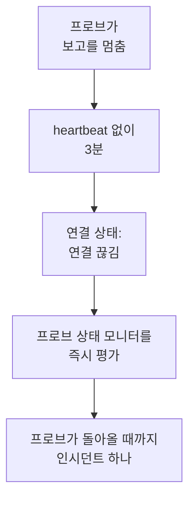

# 프로브 상태 모니터

프로브 상태 모니터는 프로브가 보고를 멈추면 알려 줍니다. 프로브 연결이 끊기면 인시던트가 하나 열리고, 프로브가 돌아오면 저절로 해결됩니다. 사용자 지정 프로브를 대상으로 하거나, 자체 호스팅 OneUptime에서는 모든 모니터가 실행되는 글로벌 프로브를 대상으로 하면, 조용해진 프로브 때문에 그 모니터들이 아무도 모르게 확인되지 않는 일이 없습니다.

:::cards
- [만들기](#프로브-상태-모니터-만들기): 프로브를 고르고 기본 기준을 그대로 둡니다.
- [기준](#기준): 연결된 프로브나 연결이 끊긴 프로브를 지금 또는 일정 기간 동안 셉니다.
- [메트릭](#메트릭): 연결되어 있던 프로브 수를 1분마다 기록합니다.
:::

## 작동 방식

OneUptime은 모든 프로브 상태 모니터를 1분마다 평가하고, 프로브 중 하나가 연결되거나 끊기는 순간에도 다시 평가합니다. 각 프로브의 연결 상태를 읽는데, 이는 프로브 페이지에 표시되는 것과 같습니다. 프로브는 3분 동안 아무 소식이 없으면 연결 끊김으로 간주됩니다. OneUptime 자체가 중단되었거나 데이터를 받지 못한 뒤에는 어떤 프로브든 연결 끊김으로 판단하기 전에 3분을 꼬박 기다리므로, OneUptime을 업그레이드해도 인시던트가 열리지 않습니다.

계속 중단된 프로브는 1분마다 하나가 아니라 인시던트 하나입니다. 모니터는 감시하는 모든 프로브가 다시 연결될 때까지 인시던트를 연 채로 오프라인 상태를 유지하고, 그런 다음 인시던트는 저절로 해결됩니다.

모니터는 자기 프로젝트의 프로브와 글로벌 프로브를 감시할 수 있습니다. 삭제된 프로브는 어느 쪽으로도 세지 않습니다. 모니터가 감시하는 프로브가 하나도 남지 않으면 모니터는 현재 상태를 유지하고, 하루가 지나면 개요에서 그 사실을 알려 줍니다.

## 프로브 상태 모니터 만들기

:::steps
### 새 모니터 시작

**모니터**로 이동해 **모니터 생성**을 클릭합니다.

### 프로브 상태 선택

**모니터 유형**에서 **더 많은 모니터 유형**을 클릭하고 **기타** 아래의 **프로브 상태**를 고릅니다. **이름**을 입력하고 **다음**을 클릭합니다.

### 프로브 선택

**감시할 프로브**에서 프로브를 고릅니다. 새 모니터는 프로젝트 자체의 프로브로 시작합니다. 자체 프로브가 없는 자체 호스팅 OneUptime은 글로벌 프로브로 시작합니다. OneUptime Cloud에서는 글로벌 프로브를 OneUptime이 운영하므로, 감시하려면 프로젝트가 직접 고릅니다.

### 모니터 생성

아래에 설명한 기본 기준을 그대로 두고 **모니터 생성**을 클릭합니다. 모니터는 즉시 평가되고, 개요에는 각 프로브와 마지막으로 응답한 시각이 표시됩니다.
:::

> [!TIP]
> 프로브 페이지와 **모니터 → 설정 → 프로브**에 있는 프로브 행의 메뉴에 있는 **이 프로브 모니터링**은 그 프로브를 감시하고 그 이름이 붙은 프로브 상태 모니터로 **모니터 생성**을 엽니다.

## 기준

프로브 상태 모니터의 필터는 프로브를 셉니다.

| 필터 | 세는 대상 |
| --- | --- |
| **Disconnected Probes** | 감시하는 프로브 중 연결이 끊긴 프로브. |
| **Connected Probes** | 감시하는 프로브 중 연결된 프로브. |

둘 다 정수이며 **보다 큼**, **보다 작음**, **같음** 등으로 비교합니다. 새 모니터는 두 가지 기준으로 시작합니다.

| 기준 | 필터 | 하는 일 |
| --- | --- | --- |
| Check if a probe is disconnected | **Disconnected Probes**가 `0`보다 큼 | 모니터를 오프라인으로 표시하고 제목이 `Probe disconnected: {{disconnectedProbeNames}}`인 인시던트를 선언하며, 이 인시던트는 저절로 해결됩니다. |
| Check if every probe is connected | **Disconnected Probes**가 `0`과 같음 | 모니터를 정상 상태로 표시합니다. |

**Connected Probes**는 여러 프로브를 감시하면서 하나쯤은 잃어도 되는 모니터에 알맞습니다. **Connected Probes**가 `2`보다 작음은 남은 프로브가 두 개 미만일 때만 인시던트를 선언합니다.

### 인시던트 전에 더 오래 기다리기

프로브는 3분 동안 조용해야 연결 끊김이 되므로, 짧은 재시작으로는 아무것도 열리지 않습니다. 더 오래 기다리려면 필터 아래에서 **일정 기간에 걸쳐 이 기준을 평가**를 선택하고, **평가**에서 **All Values**를, **지난 시간 동안(분)**에서 기간을 고릅니다. 5분으로 하면 인시던트가 선언되기 전에 프로브가 5분 더 연결이 끊긴 상태여야 합니다.

## 메트릭

평가할 때마다 모니터에 두 개의 시계열이 기록됩니다. `oneuptime.monitor.probes.connected`와 `oneuptime.monitor.probes.disconnected`로, 감시하는 프로브 중 연결되어 있던 수와 연결이 끊겨 있던 수입니다. 모니터의 **메트릭** 페이지에 차트로 표시되며, 대시보드나 메트릭 모니터도 다른 시계열처럼 읽을 수 있습니다.

## 템플릿 변수

프로브 상태 모니터의 인시던트 및 알림 템플릿에서는 모든 모니터에 있는 변수 외에 다음 변수를 쓸 수 있습니다.

| 변수 | 값 |
| --- | --- |
| `{{disconnectedProbeNames}}` | 연결이 끊긴 프로브의 이름(쉼표로 구분). |
| `{{disconnectedProbeCount}}` | 연결이 끊긴 프로브 수. |
| `{{connectedProbeNames}}` | 연결된 프로브의 이름(쉼표로 구분). |
| `{{connectedProbeCount}}` | 연결된 프로브 수. |
| `{{probeStatusSummary}}` | `1 of 3 probes is disconnected: EU Probe.`처럼 연결이 끊긴 프로브의 이름을 나열하거나 모든 프로브가 연결되어 있다고 알려 주는 한 문장. |
| `{{probes}}` | 각 프로브와 그 `probeName`, `isConnected`, `isGlobalProbe`, `lastAliveAt`. |

## 문제 해결

:::details 모니터가 데이터를 기다리는 중이라고 표시됨
새 모니터는 1~2분 안에 첫 평가를 표시합니다. 감시하는 프로브가 없으면 대신 **Not set up**이 표시됩니다. **기준**에서 프로브를 고르세요.
:::

:::details 프로브가 중단되었는데 인시던트가 선언되지 않음
프로브는 heartbeat 없이 3분이 지나야 연결 끊김이 되며, OneUptime 자체가 중단된 뒤에는 더 늦어집니다. 모니터가 비활성화되었거나 유지 관리 기간 중이 아닌지, 그리고 기준이 여전히 인시던트를 선언하는지 확인하세요.
:::

## 다음 단계

:::cards
- [사용자 지정 프로브](/docs/probe/custom-probe): 자체 네트워크에서 프로브를 실행합니다.
- [모니터 기준과 상태](/docs/monitor/criteria-and-statuses): 기준이 모니터의 상태를 정하는 방법.
- [인시던트 및 알림 템플릿](/docs/monitor/incident-alert-templating): 모니터가 선언하는 인시던트의 문구를 정합니다.
:::
