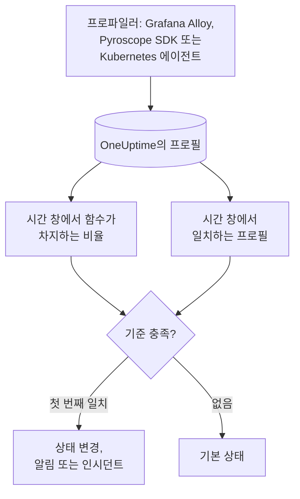

# 프로필 모니터

프로필 모니터는 서비스가 OneUptime으로 보내는 연속 프로필을 읽고 두 가지에 대해 알림을 보냅니다. 함수가 원래보다 더 큰 비율의 시간을 차지하게 될 때(예를 들어 배포 후 더 무거워진 파서)와, 서비스에서 프로필이 더 이상 들어오지 않을 때입니다. 매분 지정한 함수를 시간 창의 얼마만큼이 거쳤는지 측정하고, 필터와 일치하는 프로필을 세며, 기준을 충족하면 모니터의 상태를 바꾸거나 알림을 만들거나 인시던트를 선언합니다.

:::cards
- [모니터 만들기](#프로필-모니터-만들기): 프로파일러의 함수에서, 또는 모니터 생성에서.
- [조회 대상](#조회-대상): 함수, 프로파일 종류, 서비스, 시간 창.
- [기준](#기준): 시간 창에서 함수가 차지하는 비율, 또는 프로필 수.
- [함수가 무거워질 때](#실전-예-함수가-무거워질-때): 함수의 비율이 치솟으면 알림을 받습니다.
:::

## 작동 방식



OneUptime은 매분 모니터의 필터와 일치하고 시간 창 안에서 시작된 프로필을 읽습니다. 그 프로필을 세고, 모니터가 함수를 지정했다면 그 창의 시간 중 함수를 거친 비율을 측정합니다. 이 숫자들을 모니터의 기준과 위에서부터 차례로 비교하며, 처음 일치하는 기준이 무슨 일이 일어날지 결정합니다. 아무것도 일치하지 않으면 모니터는 기본 상태로 돌아갑니다.

## 시작하기 전에

- 서비스가 Grafana Alloy(eBPF), Pyroscope SDK 또는 OneUptime Kubernetes 에이전트를 통해 연속 프로파일링 데이터를 OneUptime으로 보내고 있어야 합니다. [연속 프로파일링](/docs/telemetry/profiles)을 참고하세요.
- 함수 하나를 지켜보려면, 프로파일러에 표시되는 대로 그 함수의 이름이나 파일 또는 패키지 경로의 일부를 알고 있어야 합니다.

## 프로필 모니터 만들기

:::steps
### 프로파일러에서, 또는 모니터 생성에서 시작하기

가장 빠른 방법은 함수 자체에서 시작하는 것입니다. **성능 프로파일** 에서 함수를 열고 그 비율에 대한 알림을 제안하는 링크를 클릭합니다. **모니터 생성** 이 열리고, 그 함수와 서비스에 맞춰 모니터가 채워져 있으며 임계값은 오늘 차지하는 비율보다 높게 잡혀 있습니다. 자세한 내용은 [실전 예: 함수가 무거워질 때](#실전-예-함수가-무거워질-때)를 참고하세요. 그렇지 않으면 **모니터** 로 가서 **모니터 생성** 을 클릭합니다.

### Profiles 선택하기

**모니터 유형** 에서 **더 많은 모니터 유형** 을 클릭하고 **텔레메트리** 아래의 **프로필** 을 고르거나, 검색 상자에 `profiles` 를 입력합니다. **이름** 을 입력한 다음 **다음** 을 클릭합니다.

### 읽을 내용 고르기

**프로파일 모니터 구성** 에서 **함수** 에는 지켜볼 함수를, **분석 대상** 에는 프로파일 종류를, **프로파일 모니터링 기간(시간)** 에는 시간 창을 설정합니다. 새 모니터는 **지난 5분** 동안의 **CPU 시간** 을 읽습니다. 필드 아래의 **이 모니터가 지금 읽는 내용** 은 일치하는 프로필 수와 함수가 오늘 창의 얼마를 차지하는지 보여 주므로, 임계값을 그보다 높게 설정할 수 있습니다. 텔레메트리 서비스나 인프라 엔터티로 필터링하려면 **추가 필드** 를 여세요.

### 기준 설정하기

**모니터 생성** 에서 시작한 모니터에는 기준이 두 개 있습니다. **프로파일 수** 가 0이면 인시던트와 함께 오프라인, 0보다 크면 온라인입니다. 함수에 대해 알림을 받으려면 **함수 비율(%)** 필터를 추가하세요. [기준](#기준)을 참고하세요.

### 모니터 만들기

**모니터 생성** 을 클릭합니다. 모니터가 **개요** 페이지에서 열리고, 첫 평가는 1분 안에 실행됩니다.
:::

### API 또는 Terraform으로 만들기

모니터의 단계에는 `profileMonitor` 구성과 같은 설정이 들어 있습니다. 다음 구성은 한 서비스의 CPU 프로필에서 지난 5분 동안의 `parseOrder` 를 지켜봅니다.

```json
{
  "profileMonitor": {
    "telemetryServiceIds": [],
    "profileTypes": ["cpu"],
    "profileType": "",
    "functionName": "parseOrder",
    "attributes": {},
    "lastXSecondsOfProfiles": 300
  }
}
```

서비스 ID를 `telemetryServiceIds` 에 넣거나, 모든 서비스의 프로필을 읽으려면 목록을 비워 두고, 프로필을 세기만 하려면 `functionName` 을 비워 둡니다. [API](/docs/api-reference/api-reference) 또는 [Terraform](/docs/terraform/monitor-steps)으로 모니터 유형이 `Profiles` 이고 이 구성과 기준을 하나 이상 담은 단계가 있는 모니터를 만드세요. Terraform에서는 `jsonencode()` 로 작성한 구성을 단계의 `profile_monitor` 속성으로 전달합니다.

## 조회 대상

| 필드 | 일치하는 대상 | 기본값 |
| --- | --- | --- |
| `profileTypes` | 이 유형 중 하나의 프로필. `cpu` 처럼 정확히 일치해야 합니다. | 비어 있음: 모든 유형 |
| `profileType` | 유형에 이 텍스트가 들어 있는 프로필. 대소문자를 구분하지 않습니다. 설정하면 `profileTypes` 는 무시됩니다. | 비어 있음 |
| `functionName` | **함수 비율(%)** 이 비율을 측정하는 코드. 함수 이름이나 파일 경로에 이 텍스트가 들어 있는 스택 프레임이며, 대소문자를 구분하지 않습니다. | 비어 있음: 비율을 측정하지 않음 |
| `telemetryServiceIds` | 이 텔레메트리 서비스 중 하나의 프로필. | 비어 있음: 모든 서비스 |
| `entityKeys` | 이 호스트, 파드, 컨테이너 및 기타 인프라 엔터티 중 하나의 프로필. | 비어 있음: 모든 엔터티 |
| `attributes` | 속성이 이 값을 가진 프로필. | 비어 있음: 조건 없음 |
| `lastXSecondsOfProfiles` | 평가 전 이 초 수 안에 시작된 프로필. | 없음: 항상 설정하세요. 그렇지 않으면 저장된 모든 프로필이 세어져 개수가 0으로 떨어지지 않습니다 |

프로필을 읽으려면 설정한 모든 필터와 일치해야 합니다. 양식에서 **함수** 는 `functionName` 을, **분석 대상** 은 `profileTypes` 를(**모든 종류의 프로파일** 이면 비워 둠), **프로파일 모니터링 기간(시간)** 은 `lastXSecondsOfProfiles` 를, **텔레메트리 서비스로 필터링** 과 **인프라 엔터티로 필터링** 은 `telemetryServiceIds` 와 `entityKeys` 를 설정합니다.

## 평가 방식

- **매분.** 프로필 모니터는 프로브가 확인하지 않으므로 설정할 간격도, **프로브 및 간격** 페이지도 없습니다.
- **평가마다 숫자 두 개.** 모니터는 모든 필터와 일치하고 `lastXSecondsOfProfiles` 안에서 시작된 프로필을 세고, 같은 프로필에서 함수가 차지하는 비율을 측정합니다. 프로파일러는 일정한 간격으로 업로드하므로, 창에 여러 번의 업로드가 들어갈 여유를 두세요.
- **한 번에 한 단위.** 비율은 한 단위의 샘플만 더합니다. 읽는 종류에 단위가 섞여 있으면(예: SDK의 나노초 단위 CPU 시간과 eBPF의 샘플 수) 창에서 샘플이 가장 많은 단위를 읽습니다.
- **프로필이 없으면 개수는 0이고 비율도 없습니다.** 프로파일러가 업로드를 멈춘 서비스의 개수는 0이 되고, **함수 비율(%)** 기준은 아무것도 없는 창과 일치하지 않습니다. 프로파일링이 멈춘 것을 알려면 **프로파일 수** 로 알림을 받으세요.
- **OneUptime 자체의 중단은 침묵이 아닙니다.** OneUptime 자체가 데이터를 받지 못한 시간(재시작, 업그레이드, 밀린 작업 처리 중)이 시간 창에 들어 있는 동안 확인은 기다립니다. 상태가 바뀌지 않으며, 인시던트나 알림이 열리거나 해결되지도 않습니다. [OneUptime이 데이터를 받지 못할 때](/docs/monitor/when-oneuptime-is-not-receiving)를 참고하세요.
- **기준은 위에서부터.** 처음 일치하는 기준이 결정하므로 가장 심각한 기준을 맨 위에 두세요.

모든 상태 변경은 그 이유와 함께 모니터의 **상태 타임라인**에 기록됩니다.

## 기준

프로필 모니터의 기준은 두 숫자 중 하나를 값과 비교합니다.

**함수 비율(%)** 은 창의 시간 중 모니터의 함수를 거친 비율로, 0부터 100까지입니다. `functionName` 과 일치하는 프레임이 있는 스택은 깊이와 상관없이 한 번만 세어지므로, 함수 자체의 코드와 함수가 호출하는 모든 것이 포함됩니다.

| 필터 조건 | 함수의 비율이 다음일 때 일치 |
| --- | --- |
| **보다 큼** | 값보다 큼 |
| **이상** | 값 이상 |
| **보다 작음** | 값보다 작음 |
| **이하** | 값 이하 |

**프로파일 수** 는 창에서 일치한 프로필의 개수입니다.

| 필터 조건 | 프로필 개수가 다음일 때 일치 |
| --- | --- |
| **보다 큼** | 값보다 큼 |
| **이상** | 값 이상 |
| **보다 작음** | 값보다 작음 |
| **이하** | 값 이하 |
| **같음** | 값과 정확히 같음 |
| **같지 않음** | 값이 아닌 모든 경우 |

프로필 개수에는 이상 조건이 없습니다. 비교할 기준선이 없기 때문입니다.

## 실전 예: 함수가 무거워질 때

checkout 서비스에서 `parseOrder` 가 CPU 시간의 18%를 차지합니다. 더 큰 페이로드를 파싱하는 배포를 놓치고 싶지 않습니다.

1. **성능 프로파일** 에서 checkout 서비스를 고르고 `parseOrder` 를 엽니다.
2. 그 비율에 대한 알림을 제안하는 링크를 클릭합니다. 프로파일러는 30%를 제안합니다. 오늘 비율의 1.5배이면서 최소 10포인트 높고, 5의 배수로 올림한 값입니다.
3. **모니터 생성** 이 열리고, **지난 5분** 동안의 **CPU 시간** 을 읽는 checkout 서비스의 프로필 모니터와 기준 두 개가 들어 있습니다. **함수 비율(%)** **보다 큼** `30` 은 저절로 해결되는 알림을 보내고 모니터를 성능 저하로 표시하며, **이하** `30` 은 모니터를 정상 작동으로 표시합니다. 인시던트는 채워져 있지만 꺼져 있습니다. 누군가를 호출하려면 켜세요.
4. **모니터 생성** 을 클릭합니다.

배포로 `parseOrder` 가 CPU 시간의 45%를 차지하게 되면 다음 평가에서 알림이 발생합니다. 수정으로 비율이 다시 30% 아래로 내려가면 알림은 저절로 해결됩니다.

## 실전 예: 프로필이 더 이상 들어오지 않음

checkout 서비스는 CPU 프로필을 업로드하는 Pyroscope SDK를 실행합니다. 프로필이 5분 동안 들어오지 않으면 인시던트를 만들고 싶다고 합시다.

- `profileTypes`: `["cpu"]`, `telemetryServiceIds`: checkout 서비스, `lastXSecondsOfProfiles`: `300`
- 기준 1: **프로파일 수** **같음** `0`: 모니터를 오프라인으로 표시하고 인시던트 선언
- 기준 2: **프로파일 수** **보다 큼** `0`: 모니터를 온라인으로 표시

SDK가 업로드하는 동안에는 평가마다 프로필 몇 개가 세어지고 기준 2가 모니터를 온라인으로 유지합니다. 서비스가 SDK 없이 배포되면 마지막 업로드 5분 뒤 개수가 0으로 떨어지고, 기준 1이 일치해 인시던트가 선언됩니다. 수정 후 첫 업로드로 개수가 다시 0을 넘고, 그 인시던트에 **인시던트 자동 해결**이 켜져 있으면 인시던트가 저절로 해결됩니다.

## 문제 해결

:::details 모니터는 0으로 세는데 OneUptime에는 프로필이 보임
보이는 프로필과 필터를 비교하세요. `profileTypes`는 유형과 정확히 일치해야 하고, `telemetryServiceIds`에는 올바른 서비스 ID가 들어 있어야 합니다. `lastXSecondsOfProfiles`가 짧으면 두 업로드 사이에 놓일 수도 있습니다.
:::

:::details 함수의 비율이 0%에 머무름
창의 어떤 프레임에도 함수 텍스트가 들어 있지 않습니다. 프로파일러에서 함수를 열고 표시된 그대로 이름을 복사하세요. 이름의 일부만 써도 되고, 대소문자는 상관없습니다. 그런 다음 서비스가 **분석 대상** 이 읽는 프로파일 종류를 보내는지 확인하세요.
:::

## 다음 단계

:::cards
- [연속 프로파일링](/docs/telemetry/profiles): 프로필을 보내고 프로파일러에서 읽습니다.
- [모니터 단계](/docs/terraform/monitor-steps): Terraform에서 단계 구성을 전달합니다.
- [트레이스 모니터](/docs/monitor/traces-monitor): 실패한 스팬에 대해 알림을 받습니다.
- [메트릭 모니터](/docs/monitor/metrics-monitor): CPU, 메모리 및 기타 메트릭에 대해 알림을 받습니다.
:::
