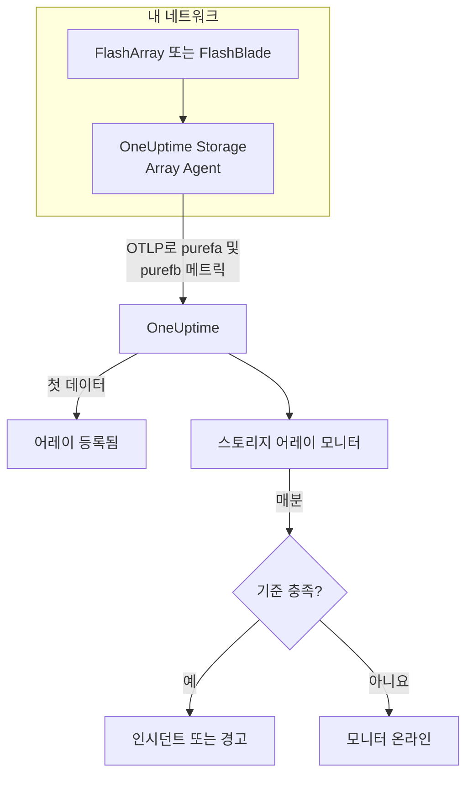

# 스토리지 어레이 모니터

스토리지 어레이 모니터는 스토리지 어레이 하나를 지켜보며, 어레이가 자체 경고를 올리거나, 공간이 부족해지거나, 느려지거나, 하드웨어나 호스트 경로를 잃거나, 복제가 뒤처질 때 알려 줍니다. Pure Storage FlashArray와 Pure Storage FlashBlade를 지원하며, 이들의 `purefa_*` 및 `purefb_*` 시리즈는 OneUptime Storage Array Agent가 수집합니다. Dell PowerMax도 지원하며, 그 `powermax_*` 시리즈는 OneUptime 프로브가 Unisphere for PowerMax에서 읽습니다.

Dell PowerStore(`dell.powerstore`)에서도 Dell의 `powerstore_*` 시리즈로 동작합니다.

:::cards
- [모니터 만들기](#스토리지-어레이-모니터-만들기): 대시보드에서 여섯 단계.
- [템플릿](#미리-만든-경고-템플릿): 미리 만든 경고. 볼륨, 호스트, 어플라이언스, 구성 요소마다 인시던트 하나.
- [Pure 시리즈의 작동 방식](#pure-시리즈의-구조): 메트릭 이름 하나에 여러 수치.
- [메트릭](#수집되는-메트릭): 모니터가 경고를 보낼 수 있는 모든 시리즈.
:::

## 작동 방식

OneUptime Storage Array Agent는 어레이의 관리 인터페이스에 닿을 수 있는 머신에서 실행됩니다. 읽기 전용 API 토큰으로 어레이의 메트릭을 읽고, 어레이 이름 `storage.array.name` 과 플랫폼 `storage.system` 레이블을 붙여 OTLP로 OneUptime에 보냅니다. 첫 데이터가 들어오면 어레이가 등록됩니다.

Dell PowerMax에는 에이전트가 필요 없습니다. OneUptime 프로브가 5분마다 읽기 전용 계정으로 Unisphere for PowerMax에 로그인하여, Unisphere가 관리하는 모든 어레이를 같은 방식으로 보냅니다. 어레이 이름은 바꾸기 전까지 Symmetrix ID입니다([Dell PowerMax](/docs/telemetry/storage-arrays#dell-powermax)).

스토리지 어레이 모니터는 어레이 하나에 연결됩니다. 매분 그 어레이의 메트릭에 쿼리를 실행하고 결과를 기준과 비교합니다.



## 시작하기 전에

- **Storage Array Agent를 설치하세요**. HTTPS로 어레이에 닿을 수 있는 곳에, 어레이의 **readonly** 역할을 가진 사용자의 API 토큰으로 설치합니다. [Storage Array Agent 가이드](/docs/telemetry/storage-arrays)는 사용자, 토큰, 설치를 `ONEUPTIME_URL`, `ONEUPTIME_TELEMETRY_INGESTION_KEY`, `STORAGE_ARRAY_NAME`, 어레이의 주소와 토큰(`PURE_FA_ENDPOINT` 및 `PURE_FA_API_TOKEN`, 또는 `PURE_FB_ENDPOINT` 및 `PURE_FB_API_TOKEN`)과 함께 다룹니다.
- **어레이가 등록되었는지 확인하세요.** 첫 수집 후 약 1분 뒤에 에이전트의 `STORAGE_ARRAY_NAME` 이름으로 **제품 → 인프라 → 스토리지 어레이 → 모든 스토리지 어레이** 에 나타납니다.
- **Dell PowerMax의 경우** 대신 그 어레이를 관리하는 Unisphere for PowerMax를 **제품 → 인프라 → 스토리지 어레이 → 연결** 에서 연결하세요. 자세한 내용은 [Dell PowerMax](/docs/telemetry/storage-arrays#dell-powermax) 를 참고하세요.

## 스토리지 어레이 모니터 만들기

:::steps
### 새 모니터 시작

**모니터** 로 이동해 **모니터 생성** 을 클릭합니다.

### 스토리지 어레이 선택

**모니터 유형** 에서 **더 많은 모니터 유형** 을 클릭하고 **인프라** 아래의 **스토리지 어레이** 를 선택하거나, 검색 상자에 `storage` 를 입력합니다. **이름** 을 입력하고(인시던트와 경고 제목에 쓰입니다) **다음** 을 클릭합니다.

### 어레이 선택

**Storage Array Monitor Configuration** 에서 **스토리지 어레이** 로 어레이를 선택합니다. 데이터를 보낸 적이 있는 모든 어레이가 목록에 있습니다. 어레이의 플랫폼에 따라 양식이 제공하는 메트릭과 템플릿이 정해집니다. 고르고 나면 필드 아래 줄에 데이터가 들어오는지 표시됩니다. **스토리지 어레이 추가** 는 키가 채워진 설정 단계를 열고, 첫 데이터를 기다립니다.

### 감시할 대상 선택

새 모니터는 **경고 대상** 아래의 **Array Stopped Reporting** 에서 시작합니다. 다른 것을 감시하려면 다음 중 하나를 사용합니다.

- **변경**: 다른 [템플릿](#미리-만든-경고-템플릿)을 고릅니다. 템플릿은 메트릭, 레이블 필터, 집계, 시간 범위, 임계값을 설정하고 아래의 기준을 자신의 기준으로 바꿉니다. **시간 범위** 는 나중에도 바꿀 수 있습니다.
- **Custom Metric** (**추가 필드** 안): **Storage Array Metric** 에서 메트릭 하나를 고른 다음 **집계** 와 **시간 범위** 를 설정합니다. [필터](#모니터-설정)로 볼륨, 호스트, 파드, 구성 요소, 파일 시스템, 버킷 하나로 좁힙니다.
- **고급** (**추가 필드** 안): **메트릭 선택** 에서 쿼리와 수식을 직접 만듭니다. 예를 들어 사용된 용량은 `purefa_array_space_bytes` 를 `space=capacity` 로 필터링한 값에서 같은 메트릭을 `space=empty` 로 필터링한 값을 뺀 것입니다. 객체의 레이블로 **그룹화 기준** 하면 각 객체를 따로 판단합니다.

### 기준 확인

**기준** 의 각 기준을 열고 **메트릭**, **집계**, **조건**, **임계값** 을 확인합니다. 템플릿을 쓰면 이 값들이 채워집니다. **Custom Metric** 이나 **고급** 에서는 모니터가 [기본 기준](#기본-기준)으로 시작하는데, 이 기준은 메트릭이 데이터를 보내지 않는 것만 알아차리므로 직접 임계값을 설정하세요.

### 모니터 만들기

**모니터 생성** 을 클릭합니다. OneUptime이 모니터 페이지를 열고 매분 평가합니다. 모니터가 올린 인시던트와 경고는 어레이의 **인시던트** 및 **경고** 페이지에도 표시됩니다.
:::

> [!TIP]
> 템플릿 여러 개를 한 번에 설정하려면 **제품 → 인프라 → 스토리지 어레이** 에서 어레이를 열고 **권장 사항** 으로 이동하세요. 원하는 템플릿을 고르고 호출할 사람을 정하면, OneUptime이 템플릿마다 모니터를 하나씩 만듭니다.

## 모니터 설정

| 필드 | 탭 | 하는 일 |
| --- | --- | --- |
| **스토리지 어레이** | 모두 | 필수. 모든 쿼리를 `resource.storage.array.name` 으로 한정하므로, 둘 다 `vol-01` 이라는 볼륨을 가진 두 어레이가 섞이지 않습니다. |
| **볼륨** | Custom Metric, 고급 | FlashArray와 PowerMax만. 볼륨 하나. FlashArray에서는 `name` 레이블로(예: `vol-db-01`, 파드나 볼륨 그룹 안의 볼륨은 `pod::volume` 이나 `group/volume` 이라는 이름을 씁니다), PowerMax에서는 `volume` 레이블, 즉 장치 ID로(예: `00847`). |
| **호스트** | Custom Metric, 고급 | FlashArray만. 어레이가 아는 호스트 하나를 `host` 레이블로(예: `esxi-01`). |
| **파드** | Custom Metric, 고급 | FlashArray만. ActiveCluster 또는 ActiveDR 파드 하나를 `name` 레이블로, 복제 링크 시리즈에서는 `local_pod` 로. |
| **하드웨어 구성 요소** | Custom Metric, 고급 | 하드웨어 구성 요소 하나(예: `CH0.BAY1`, `CT0`). FlashArray에서는 `component_name` 레이블, FlashBlade에서는 `name`, PowerMax에서는 `component`(`FA-1D` 같은 디렉터 또는 `FA-1D:4` 같은 포트). |
| **파일 시스템** | Custom Metric, 고급 | FlashBlade만. `name` 레이블로 파일 시스템 하나. |
| **버킷** | Custom Metric, 고급 | FlashBlade만. `name` 레이블로 객체 저장소 버킷 하나. |
| **Storage Array Metric** | Custom Metric | [카탈로그](#수집되는-메트릭)의 메트릭 하나. 양식은 그 의미를 주는 레이블 필터를 추가하고, 메트릭이 설명하는 객체로 그룹화하므로, 각 볼륨, 호스트, 구성 요소가 따로 판단됩니다. |
| **집계** | Custom Metric | 샘플을 합치는 방법: **평균**, **최대**, **최소**, **합계**, **개수**. 메트릭의 일반적인 집계로 시작합니다. |
| **시간 범위** | 모두 | 쿼리가 읽는 이동 기간으로, **Past 1 Minute** 부터 **Past 365 Days** 까지입니다. 새 모니터는 **지난 5분** 으로, 파일 시스템이나 버킷의 사용자 지정 메트릭은 **지난 15분** 으로 시작하며, 템플릿은 자체 값을 설정합니다. |
| **메트릭 선택** | 고급 | 쿼리 빌더: **메트릭**, **집계 기준**, **속성으로 필터링**, **그룹화 기준**, 그리고 쿼리를 합치는 **메트릭 추가** 와 **수식 추가**. |

에이전트는 어레이 엔드포인트를 60초마다, 볼륨, 호스트, 파드를 2분마다 읽으므로 5분 기간에는 항상 샘플이 있습니다. FlashBlade의 파일 시스템과 버킷은 5분마다 읽고(그래서 15분), FlashArray 디렉터리는 30분마다 읽습니다. 디렉터리 모니터에는 60분 기간을 주세요. 프로브는 PowerMax를 5분마다, 즉 Unisphere가 성능을 계산하는 주기와 같은 빈도로 읽습니다. PowerMax 모니터에는 10분 이상의 기간을 주세요.

PowerStore는 5분마다, 그 클러스터의 상태는 60초마다 읽습니다. PowerStore 모니터에는 15분 기간을 주세요.

## Pure 시리즈의 구조

Pure는 메트릭 이름 **하나** 에 여러 수치를 담고 레이블로 구분합니다.

- **`dimension`**(성능 시리즈). `purefa_array_performance_latency_usec` 는 읽기 지연 시간(`usec_per_read_op`), 쓰기 지연 시간(`usec_per_write_op`), 미러링된 쓰기 지연 시간, 그리고 각각의 SAN, 큐, QoS, 서비스 시간을 담습니다. 항상 `dimension` 하나로 필터링하세요. 여러 값을 평균하면 200 µs 읽기 지연 시간과 큐 수치가 섞입니다.
- **`space`**(용량 시리즈): `capacity`, `empty`, `snapshots`, `total_provisioned`, `total_physical`, `available_ratio` 등.

몇몇 시리즈는 상태를 **레이블** 에 담고, 값은 항상 1입니다.

| 시리즈 | 상태 레이블 | 시리즈 하나의 단위 |
| --- | --- | --- |
| `purefa_alerts_open` | `severity`(`summary`, `code`, `component_type` 포함) | 열린 경고 |
| `purefa_hw_component_status` | `component_status` | 하드웨어 구성 요소 |
| `purefa_host_connectivity_info` | `status`(`details` 포함) | 호스트 |
| `purefa_drive_capacity_bytes` | `component_status`(값은 드라이브의 용량) | 드라이브 |

나쁜 상태로 필터링한 시리즈는 무언가 그 상태에 있는 동안에만 존재하므로, 시리즈가 없으면 정상이라는 뜻입니다. 그래서 **0보다 큰 Max에서 발생하고 0에서 복구** 가 이 시리즈에 맞는 형태이며, 템플릿도 그렇게 만들어져 있습니다. 템플릿의 복구 기준은 시리즈가 없는 것을 0으로 셉니다. 시리즈가 전혀 남아 있지 않으면 이런 템플릿은 같은 윈도우에 `purefa_info`, `purefb_info` 또는 `powermax_array_info` 가 도착한 경우에만 복구되므로, 보고를 멈춘 어레이는 아무것도 닫지 않습니다.

PowerMax의 시리즈는 각각 값 하나만 담으며, 그 값에 맞춰 이름이 붙습니다. `powermax_array_response_time_usec` 는 `operation` 으로 읽기와 쓰기를 구분합니다. 상태 시리즈도 마찬가지로 무언가 잘못된 동안에만 존재합니다. `powermax_alert_open` 은 Unisphere에 열린 경고가 있는 동안, `powermax_director_offline` 은 디렉터가 온라인이 아닌 동안, `powermax_port_offline` 은 누군가 사용하는 포트가 다운된 동안, `powermax_srdf_group_not_healthy` 는 SRDF 그룹이 일시 중단되거나 오프라인인 동안 존재합니다.

모니터 필터와 그룹화 키에서 에이전트의 속성은 `resource.` 로 시작하지만(`resource.storage.array.name`, `resource.storage.system`), Pure 자체의 레이블은 그렇지 않으며(`name`, `host`, `component_name`, `dimension`, `space`, `severity`), PowerMax의 레이블도 마찬가지입니다(`storage_group`, `volume`, `director`, `port_id`, `srdf_group`).

## PowerStore 시리즈의 구성

Dell의 익스포터는 메트릭 이름마다 값 하나를 쓰므로 PowerStore 시리즈에는 레이블 필터가 필요 없습니다. 레이블이 객체를 가리킵니다. `appliance_id`는 어플라이언스, `name`은 부분, 볼륨 또는 파일 시스템, `volume_id`, `fc_port_id`, `eth_port_id`, `nas_id`, `volume_group_id`는 성능 시리즈의 객체입니다. 상태 시리즈는 정상인 동안 1, 그 밖에는 0이므로 템플릿은 1 미만에서 발생합니다. PowerStore 자체의 경고는 syslog로 들어오며, 그 템플릿(로그 모니터)은 아래 표 다음에 나옵니다.

## 미리 만든 경고 템플릿

OneUptime은 템플릿 49개(FlashArray용 12개, FlashBlade용 8개, PowerStore용 16개, PowerMax용 13개)를 제공하며, **경고 대상** 목록은 어레이의 플랫폼에 맞는 것을 보여 줍니다. 각 템플릿은 완전한 모니터를 만듭니다. 메트릭 쿼리, 레이블 필터, 객체 자체의 레이블로 하는 그룹화, 발생 기준과 복구 기준입니다. 임계값은 편집할 수 있는 출발점입니다.

기준은 기간 안의 **모든** 값에서 조건이 성립할 때만 발생합니다. 용량, 지연 시간, 지연, 비율 임계값에서 발생한 모니터는 임계값에서 10% 벗어나야 복구되므로, 임계값 근처를 오가는 값 때문에 상태가 흔들리지 않습니다. 경고, 하드웨어, 연결 템플릿은 상태가 5분 창 전체에서 보였을 때 작동하고, 상태가 사라진 뒤 약 5분 후에 복구됩니다. PowerMax 템플릿은 10분과 15분 기간을 씁니다. 5분 단위 수집 두 번과 세 번에 해당합니다.

### FlashArray

| 템플릿 | 범주 | 심각도 | 감시 대상 | 발생 조건 |
| --- | --- | --- | --- | --- |
| Array Stopped Reporting | 가용성 | 심각 | `purefa_info`, Count, 최근 10분 | 기간 내내 데이터 없음 — Storage Array Agent가 멈췄거나 OneUptime으로 가는 경로를 잃었거나 토큰이 취소됨, 또는 어레이가 에이전트에 더 이상 응답하지 않음. 데이터가 다시 들어오면 복구 |
| Critical Array Alert | 어레이 상태 | 심각 | `purefa_alerts_open` 을 `severity=critical` 로 필터링, `summary` 별 Max, 최근 5분 | > 0 — 어레이에 열린 심각 수준 경고가 있음(고장 난 구성 요소, 용량 비상, 복제 실패). 경고마다 인시던트 하나. 경고가 닫히면 복구 |
| Warning Array Alert | 어레이 상태 | 경고 | `purefa_alerts_open` 을 `severity=warning` 으로 필터링, `summary` 별 Max, 최근 5분 | > 0 — 어레이에 열린 경고 수준 경고가 있음. 경고마다 인시던트 하나. 경고가 닫히면 복구 |
| Capacity Above 80% | 용량 | 경고 | `purefa_array_space_utilization`, Max, 최근 15분 | > 80 — Pure 자체의 첫 번째 용량 임계값. ≤ 72에서 복구 |
| Capacity Above 90% | 용량 | 심각 | `purefa_array_space_utilization`, Max, 최근 5분 | > 90 — 어레이가 쓰기를 거부하기 직전. ≤ 81에서 복구 |
| High Read Latency | 성능 | 경고 | `purefa_array_performance_latency_usec` 를 `dimension=usec_per_read_op` 로 필터링, Avg, 최근 10분 | > 5000 µs (5 ms) — FlashArray 읽기는 보통 1 ms보다 훨씬 짧음. ≤ 4500에서 복구 |
| High Write Latency | 성능 | 경고 | `purefa_array_performance_latency_usec` 를 `dimension=usec_per_write_op` 로 필터링, Avg, 최근 10분 | > 5000 µs (5 ms). ≤ 4500에서 복구 |
| Hardware Component Failed | 하드웨어 | 심각 | `purefa_hw_component_status` 를 `component_status=critical` 로 필터링, `component_name` 별 Max, 최근 5분 | > 0 — 컨트롤러, 전원 공급 장치, 팬, 베이, 포트가 심각 상태이고 이중화가 사라짐. 구성 요소마다 인시던트 하나. ok를 보고하면 복구 |
| Hardware Component Degraded | 하드웨어 | 경고 | `purefa_hw_component_status` 를 `component_status=degraded` 로 필터링, `component_name` 별 Max, 최근 5분 | > 0 — 구성 요소의 성능이 저하됨. 구성 요소마다 인시던트 하나. ok를 보고하면 복구 |
| Drive Failed | 하드웨어 | 심각 | `purefa_drive_capacity_bytes` 를 `component_status=failed` 로 필터링, `component_name` 별 Max, 최근 5분 | > 0 — DirectFlash 모듈이나 SSD가 고장 나서 어레이가 나머지 드라이브로 재구성 중. 드라이브마다 인시던트 하나. 교체되면 복구 |
| Host Lost Redundant Paths | 호스트 | 경고 | `purefa_host_connectivity_info` 를 `status=critical` 로 필터링, `host` 별 Max, 최근 5분 | > 0 — 호스트가 컨트롤러 하나를 통해서만 어레이에 닿거나 전혀 닿지 않음. 컨트롤러 페일오버가 일어나면 스토리지가 오프라인이 됨. 호스트마다 인시던트 하나. 경로가 돌아오면 복구 |
| Replication Lag Above 1 Minute | 복제 | 경고 | `purefa_pod_replica_links_lag_max_msec`, `local_pod` 별 Max, 최근 10분 | > 60000 ms (60 s) — 지금 페일오버하면 계획보다 많은 최근 쓰기를 잃음. 파드마다 인시던트 하나. ≤ 54000에서 복구 |

### FlashBlade

| 템플릿 | 범주 | 심각도 | 감시 대상 | 발생 조건 |
| --- | --- | --- | --- | --- |
| Array Stopped Reporting | 가용성 | 심각 | `purefb_info`, Count, 최근 10분 | 기간 내내 데이터 없음 — 에이전트, 그 익스포터, 또는 FlashBlade가 응답을 멈춤. 데이터가 다시 들어오면 복구 |
| Critical Array Alert | 어레이 상태 | 심각 | `purefb_alerts_open` 을 `severity=critical` 로 필터링, `summary` 별 Max, 최근 5분 | > 0 — FlashBlade에 열린 심각 수준 경고가 있음. 경고마다 인시던트 하나. 경고가 닫히면 복구 |
| Warning Array Alert | 어레이 상태 | 경고 | `purefb_alerts_open` 을 `severity=warning` 으로 필터링, `summary` 별 Max, 최근 5분 | > 0 — FlashBlade에 열린 경고 수준 경고가 있음. 경고마다 인시던트 하나. 경고가 닫히면 복구 |
| Capacity Above 80% | 용량 | 경고 | `purefb_array_space_utilization` 을 `type=array` 로 필터링, Max, 최근 15분 | > 80. ≤ 72에서 복구 |
| Capacity Above 90% | 용량 | 심각 | `purefb_array_space_utilization` 을 `type=array` 로 필터링, Max, 최근 5분 | > 90 — 가득 차면 모든 클라이언트의 쓰기가 실패함. ≤ 81에서 복구 |
| Hardware Component Unhealthy | 하드웨어 | 심각 | `purefb_hardware_health`, `name` 별 Min, 최근 5분 | < 1 — 블레이드, 패브릭 모듈, 전원 공급 장치, 팬이 정상이 아님(사용하지 않는 슬롯은 2를 보고함). 구성 요소마다 인시던트 하나. ≥ 1에서 복구 |
| High Read Latency | 성능 | 경고 | `purefb_array_performance_latency_usec` 를 `dimension=usec_per_read_op` 및 `protocol=all` 로 필터링, Avg, 최근 10분 | > 10000 µs (10 ms), 모든 프로토콜 기준. ≤ 9000에서 복구 |
| File System Near Full | 파일 시스템 | 경고 | `purefb_file_systems_space_bytes` 를 `space=available_ratio` 로 필터링, `name` 별 Min, 최근 15분 | < 0.1 — 파일 시스템의 프로비저닝된 크기 중 10%도 남지 않음. 파일 시스템마다 인시던트 하나. ≥ 0.11에서 복구 |

### PowerStore

| 템플릿 | 범주 | 심각도 | 감시 대상 | 발생 조건 |
| --- | --- | --- | --- | --- |
| Array Stopped Reporting | 가용성 | 심각 | `powerstore_cluster`, Count, 최근 10분 | 기간 내내 데이터 없음 — 에이전트, Dell의 익스포터 또는 클러스터가 응답을 멈춤. 데이터가 다시 들어오면 복구 |
| Capacity Above 80% | 용량 | 경고 | `powerstore_cap_physical_used_percent`, `appliance_id` 별 Max, 최근 15분 | > 80 — 어플라이언스의 용량이 차고 있음. ≤ 72에서 복구 |
| Capacity Above 90% | 용량 | 심각 | `powerstore_cap_physical_used_percent`, `appliance_id` 별 Max, 최근 15분 | > 90 — 어플라이언스가 쓰기를 거부하기 직전. ≤ 81에서 복구 |
| High Read Latency | 성능 | 경고 | `powerstore_perf_avg_read_latency`, `appliance_id` 별 Avg, 최근 15분 | > 5000 µs (5 ms). ≤ 4500에서 복구 |
| High Write Latency | 성능 | 경고 | `powerstore_perf_avg_write_latency`, `appliance_id` 별 Avg, 최근 15분 | > 5000 µs (5 ms). ≤ 4500에서 복구 |
| Drive Failed | 하드웨어 | 심각 | `powerstore_hardware_Drive_state`, `name` 별 Min, 최근 10분 | < 1 — 드라이브가 고장 났거나 제거됨. ≥ 1에서 복구 |
| Node Unhealthy | 하드웨어 | 심각 | `powerstore_hardware_node_state`, `name` 별 Min, 최근 10분 | < 1 — 노드가 Healthy가 아님. ≥ 1에서 복구 |
| Power Supply Unhealthy | 하드웨어 | 경고 | `powerstore_hardware_Power_Supply_state`, `name` 별 Min, 최근 10분 | < 1 — 전원 공급 장치가 고장 났거나 전원을 잃음. ≥ 1에서 복구 |
| Fan Unhealthy | 하드웨어 | 경고 | `powerstore_hardware_Fan_state`, `name` 별 Min, 최근 10분 | < 1 — 팬이 고장 남. ≥ 1에서 복구 |
| Battery Unhealthy | 하드웨어 | 경고 | `powerstore_hardware_Battery_state`, `name` 별 Min, 최근 10분 | < 1 — 배터리 백업 모듈에 결함이 생김. ≥ 1에서 복구 |
| Drive Wearing Out | 하드웨어 | 경고 | `powerstore_wear_metrics_by_drive`, `name` 별 Min, 최근 15분 | < 10 — 드라이브의 남은 내구성이 10% 미만. ≥ 11에서 복구 |
| NAS Server Not Started | 파일 시스템 | 경고 | `powerstore_nas_server_operational_status`, `name` 별 Max, 최근 10분 | < 1 — NAS 서버가 중지되었거나 성능이 저하됨. ≥ 1에서 복구 |
| Volume Not Ready | 어레이 상태 | 경고 | `powerstore_volume_state`, `name` 별 Max, 최근 15분 | < 1 — 볼륨이 오프라인. ≥ 1에서 복구 |
| File System Near Full | 파일 시스템 | 경고 | `powerstore_filesystem_logical_used_percent`, `name` 별 Max, 최근 15분 | > 90 — 파일 시스템이 거의 가득 참. ≤ 81에서 복구 |
| Cluster Not Configured | 어레이 상태 | 경고 | `powerstore_cluster`, Max, 최근 10분 | < 1 — 클러스터가 Configured가 아님. ≥ 1에서 복구 |
| Metro Witness Not Connected | 복제 | 경고 | `powerstore_metro_witness_status`, `name` 별 Min, 최근 10분 | > 0 — Metro Witness가 연결되지 않음. 다시 OK가 되면 복구 |

### syslog를 통한 PowerStore 경고

PowerStore 자체의 경고는 로그로 들어오므로 그 템플릿은 **로그** 모니터이며, 어레이의 **권장 사항** 페이지의 **어레이 경고** 아래에 제공됩니다. 각 템플릿은 PowerStore 경고마다 경고 하나를 열어 `powerstore.resource.name`과 `powerstore.alert.id`로 그룹화하고, PowerStore가 그 경고를 해제하면 해결합니다:

| 템플릿 | 심각도 | 여는 줄의 내용 | 해결하는 줄의 내용 |
| --- | --- | --- | --- |
| Critical Array Alert | 심각 | `powerstore.alert.severity=Critical` | `powerstore.alert.state=Cleared` |
| Major Array Alert | 경고 | `powerstore.alert.severity=Major` | `powerstore.alert.state=Cleared` |
| Port Link Down | 경고 | `powerstore.event.code=0x00307404` | `powerstore.alert.state=Cleared` |

### PowerMax

| 템플릿 | 범주 | 심각도 | 감시 대상 | 발생 조건 |
| --- | --- | --- | --- | --- |
| Array Stopped Reporting | 가용성 | 심각 | `powermax_array_info`, Count, 최근 10분 | 기간 내내 데이터 없음 — 프로브가 어레이 수집을 멈춤. 연결이 실패하거나(**연결** 아래의 해당 페이지에 이유가 표시됨), 프로브의 연결이 끊겼거나, Unisphere가 더 이상 어레이를 관리하지 않음. 데이터가 다시 들어오면 복구 |
| Critical Unisphere Alert | 어레이 상태 | 심각 | `powermax_alert_open` 을 `severity=critical` 로 필터링, `description` 별 Max, 최근 10분 | > 0 — Unisphere에 어레이에 대한 심각도 Critical 또는 Fatal의 열린 경고가 있음. 경고마다 인시던트 하나. Unisphere에서 경고가 인지되거나 해제되면 복구 |
| Warning Unisphere Alert | 어레이 상태 | 경고 | `powermax_alert_open` 을 `severity=warning` 으로 필터링, `description` 별 Max, 최근 10분 | > 0 — Unisphere에 심각도 Warning 또는 Minor의 열린 경고가 있음. 경고마다 인시던트 하나. 경고가 인지되거나 해제되면 복구 |
| Performance Collection Off | 어레이 상태 | 경고 | `powermax_array_performance_collection`, Min, 최근 15분 | < 1 — Unisphere가 어레이의 5분 단위 성능을 수집하지 않으므로 응답 시간, IOPS, 처리량의 차트도 경고도 없음. ≥ 1에서 복구 |
| Storage Resource Pool Above 80% | 용량 | 경고 | `powermax_srp_capacity_used_percent`, `srp` 별 Max, 최근 15분 | > 80 — 풀이 가득 차면 그 스토리지 그룹이 새 쓰기를 받지 않음. 풀마다 인시던트 하나. ≤ 72에서 복구 |
| Storage Resource Pool Above 90% | 용량 | 심각 | `powermax_srp_capacity_used_percent`, `srp` 별 Max, 최근 15분 | > 90 — 가득 차는 순간 그 스토리지 그룹에 대한 쓰기가 실패함. 풀마다 인시던트 하나. ≤ 81에서 복구 |
| Storage Group Response Time Above 5 ms | 성능 | 경고 | `powermax_storage_group_response_time_usec`, `storage_group` 별 Avg, 최근 15분 | > 5000 µs (5 ms) — PowerMax는 보통 밀리초보다 훨씬 짧은 시간에 응답함. 스토리지 그룹마다 인시던트 하나. ≤ 4500에서 복구 |
| High Read Response Time | 성능 | 경고 | `powermax_array_response_time_usec` 를 `operation=read` 로 필터링, Avg, 최근 15분 | > 3000 µs (3 ms). ≤ 2700에서 복구 |
| High Write Response Time | 성능 | 경고 | `powermax_array_response_time_usec` 를 `operation=write` 로 필터링, Avg, 최근 15분 | > 3000 µs (3 ms) — 동기식 SRDF는 모든 쓰기에 원격 어레이까지의 왕복을 더함. ≤ 2700에서 복구 |
| Director Not Online | 하드웨어 | 심각 | `powermax_director_offline`, `component` 별 Max, 최근 10분 | > 0 — 디렉터가 온라인이 아니며, 어레이는 나머지 디렉터로 동작함. 디렉터마다 인시던트 하나. 다시 온라인이 되면 복구 |
| Port Down | 하드웨어 | 경고 | `powermax_port_offline`, `component` 별 Max, 최근 10분 | > 0 — 포트 그룹, 마스킹 뷰 또는 SRDF 그룹에 속한 포트가 작동하지 않음. 포트마다 인시던트 하나. 다시 작동하면 복구 |
| SRDF Group Suspended or Offline | 복제 | 심각 | `powermax_srdf_group_not_healthy`, `srdf_group` 별 Max, 최근 10분 | > 0 — 그룹의 링크가 오프라인이거나 페어가 일시 중단, 분할 또는 장애 조치 상태여서 원격 복사본이 최신으로 유지되지 않음. 그룹마다 인시던트 하나. 다시 동기화되면 복구 |
| SRDF/A Lag Above 2 Minutes | 복제 | 경고 | `powermax_srdf_group_lag_seconds`, `srdf_group` 별 Avg, 최근 15분 | > 120 (2분) — 지금 페일오버하면 계획보다 많은 최근 쓰기를 잃음. 그룹마다 인시던트 하나. ≤ 108에서 복구 |

**심각도** 는 선택기가 보여 주는 레이블입니다. 템플릿이 만드는 인시던트와 경고는 프로젝트에서 가장 심각한 인시던트 및 경고 심각도로 시작하며, 기준에서 바꿀 수 있습니다.

- **Array Stopped Reporting** 템플릿은 플랫폼의 식별 시리즈를 셉니다(`purefa_info` 또는 `purefb_info` 는 에이전트가 수집하는 모든 엔드포인트가 수집할 때마다 내보내고, `powermax_array_info` 는 PowerMax 수집마다 기록됩니다). 데이터가 끊기면 다른 템플릿은 비교할 값이 없어 마지막 상태를 그대로 유지하므로, 이를 알려 주는 것은 이 템플릿입니다.
- **열린 경고와 하드웨어 상태는 Max를 씁니다**. 경고가 열려 있거나 구성 요소가 그 상태에 있는 동안에만 존재하는 시리즈이므로, 상태가 5분 창 전체에서 보였을 때 임계값을 넘습니다.
- **객체별 템플릿은 모두 객체 자체의 레이블로 그룹화합니다**(`summary`, `component_name`, `host`, `local_pod`, `name`, 그리고 PowerMax에서는 `description`, `component`, `srp`, `srdf_group`, `storage_group`). 그래서 영향받은 객체마다 인시던트가 하나씩 발생하고, 인시던트에 그 객체의 이름이 들어갑니다.
- **지연 시간 템플릿은 Avg를 씁니다**. 어레이 자체의 작업당 평균에 대한 Avg이며, 용량 템플릿은 어레이 자체의 사용률에 대한 **최대** 를 씁니다. 지연 시간은 마이크로초, 용량은 퍼센트로 고정되어 있습니다.
- **Hardware Component Unhealthy는 구성 요소별 Min을 씁니다**. 상태는 정상일 때 1이고, 아닐 때 0으로 떨어집니다.

볼륨별 지연 시간 템플릿은 없습니다. 알맞은 임계값이 워크로드에 따라 다르기 때문입니다. 카탈로그에서 `name` 으로 그룹화해 직접 만드세요. 용량 예측에는 임계값보다 증가 추세가 필요하고, 드라이브 마모에는 경고를 걸 시리즈가 없습니다.

## 수집되는 메트릭

에이전트는 어레이가 내보내는 모든 것을, 프로브는 PowerMax에서 읽는 모든 것을 같은 단위로 보냅니다(Unisphere의 밀리초는 마이크로초로, 초당 MB는 초당 바이트로). 아래 시리즈는 모니터 양식이 제공하는 카탈로그입니다. 모든 값은 어레이가 직접 계산한 게이지이므로(지연 시간은 작업당 마이크로초, 처리량은 초당 값), 비율을 계산할 필요가 없습니다. **필터** 는 시리즈에 그 행이 말하는 의미를 주는 레이블 필터이며, 양식이 대신 적용합니다.

### 어레이 상태

| 메트릭 | 필터 | 플랫폼 | 단위 | 설명 |
| --- | --- | --- | --- | --- |
| `purefa_alerts_open` | — | FlashArray | `count` | 어레이의 열린 경고마다 시리즈 하나(값 1). 레이블은 `severity`(`critical`, `warning`, `info`, `hidden`), `category`, `code`, `component_type`, `summary` |
| `purefb_alerts_open` | — | FlashBlade | `count` | FlashBlade의 열린 경고마다 시리즈 하나(값 1). 레이블은 `severity`(`info`, `warning`, `critical`), `code`, `component_name`, `component_type`, `summary`, `kburl`(Pure 기술 자료 문서) |
| `powerstore_cluster` | — | PowerStore | `count` | PowerStore 클러스터가 Configured(구성되어 서비스 중)인 동안 1, 그 밖의 상태(Configuring, Expanding, Removing, Clustering_Failed, Unconfigured)에서는 0입니다. |
| `powermax_alert_open` | — | PowerMax | `count` | Unisphere가 어레이에 대해 열어 둔 경고마다 시리즈 하나(값 1). 인지되지 않고, 해제되지 않았으며, Minor 이상인 경고가 대상입니다. severity 레이블은 critical(Critical 및 Fatal) 또는 warning(Warning 및 Minor)이며, alert_type, object, description 레이블이 경고의 내용을 알려 줍니다. Unisphere에서 경고를 인지하면 시리즈가 사라집니다 |
| `powermax_array_health_score` | — | PowerMax | `score` | Unisphere가 매긴 어레이의 상태 점수(0~100). health_metric별로 전체 점수와 평가하는 각 영역(용량, 구성, 성능, 서비스 수준 준수)의 점수가 있습니다 |
| `powermax_array_performance_collection` | — | PowerMax | `count` | Unisphere가 어레이의 5분 단위 성능 데이터를 수집하는 동안은 1, 수집하지 않는 동안은 0. 꺼져 있으면 OneUptime은 어레이의 인벤토리와 경고는 계속 표시하지만 성능 차트는 그리지 않습니다. Unisphere의 Settings > Performance > System Registrations에서 켜세요 |

### 용량

| 메트릭 | 필터 | 플랫폼 | 단위 | 설명 |
| --- | --- | --- | --- | --- |
| `purefa_array_space_utilization` | — | FlashArray | `%` | 어레이의 사용 가능한 용량 중 사용 중인 비율. Pure는 80%, 90%, 100%에서 직접 용량 경고를 올립니다 |
| `purefa_array_space_bytes` | `space=capacity` | FlashArray | `bytes` | 어레이의 사용 가능한 용량 |
| `purefa_array_space_bytes` | `space=empty` | FlashArray | `bytes` | 사용하지 않는 용량. 추세를 따라가면 어레이가 언제 가득 찰지 예측할 수 있습니다 |
| `purefa_array_space_bytes` | `space=snapshots` | FlashArray | `bytes` | 스냅샷만 차지하는 물리 공간. 빠르게 늘면 대개 보호 그룹이 계획보다 많은 스냅샷을 유지하는 것입니다 |
| `purefa_array_space_data_reduction_ratio` | — | FlashArray | `ratio` | 어레이 전체의 중복 제거와 압축(예: 4.2:1이면 4.2). 계속 떨어지면 새 데이터가 잘 줄어들지 않는 것입니다 |
| `purefb_array_space_utilization` | `type=array` | FlashBlade | `%` | FlashBlade의 사용 가능한 용량 중 사용 중인 비율 |
| `purefb_array_space_bytes` | `type=array`, `space=empty` | FlashBlade | `bytes` | FlashBlade의 사용하지 않는 용량 |
| `purefb_array_space_data_reduction_ratio` | `type=array` | FlashBlade | `ratio` | FlashBlade 전체의 데이터 감소 |
| `powerstore_cap_physical_used_percent` | — | PowerStore | `%` | 각 어플라이언스의 물리 용량 중 사용 중인 비율(백분율)입니다. 물리 사용량을 전체 물리 용량으로 나눈 값으로, PowerStore의 일일 공간 집계 기준입니다. PowerStore는 70%부터 자체 용량 경고를 발생시킵니다. appliance_id로 그룹화하세요. |
| `powerstore_cap_last_physical_total` | — | PowerStore | `bytes` | 각 어플라이언스의 사용 가능한 물리 용량(바이트)입니다. |
| `powerstore_cap_last_physical_used` | — | PowerStore | `bytes` | 각 어플라이언스가 사용하는 물리 용량(바이트)으로, 중복 제거와 압축 후의 값입니다. 추세를 보고 어플라이언스가 언제 가득 찰지 예측하세요. |
| `powerstore_cap_last_logical_provisioned` | — | PowerStore | `bytes` | 각 어플라이언스에 프로비저닝된 논리 용량(바이트)입니다. 그 안의 모든 볼륨, 파일 시스템, vVol의 크기로, 물리 용량을 훨씬 넘을 수 있습니다. |
| `powerstore_cap_last_logical_used` | — | PowerStore | `bytes` | 호스트가 각 어플라이언스에 쓴 데이터(바이트)로, 중복 제거와 압축 전의 값입니다. |
| `powerstore_cap_last_data_reduction` | — | PowerStore | `ratio` | 각 어플라이언스의 중복 제거와 압축 효과로, 예를 들어 3.4:1이면 3.4입니다. 계속 떨어진다면 새로 쓴 데이터가 잘 줄어들지 않는다는 뜻으로, 암호화되었거나 이미 압축된 데이터입니다. |
| `powerstore_cap_last_efficiency_ratio` | — | PowerStore | `ratio` | 각 어플라이언스의 전체 효율입니다. 데이터 절감에 스냅샷과 씬 프로비저닝으로 아낀 용량을 더한 값입니다. |
| `powermax_array_capacity_used_percent` | — | PowerMax | `%` | 어레이의 모든 스토리지 리소스 풀에 걸친, 사용 가능한 용량 중 사용 중인 비율(%) |
| `powermax_array_capacity_usable_bytes` | — | PowerMax | `bytes` | Unisphere가 보고하는 어레이의 사용 가능한 용량(바이트) |
| `powermax_array_capacity_used_bytes` | — | PowerMax | `bytes` | 어레이의 사용 가능한 용량 중 사용 중인 용량(바이트) |
| `powermax_array_capacity_subscribed_bytes` | — | PowerMax | `bytes` | 어레이에 있는 모든 씬 볼륨의 용량(바이트). 호스트에 약속된 용량이며, 사용 가능한 용량을 초과할 수 있습니다 |
| `powermax_array_data_reduction_ratio` | — | PowerMax | `ratio` | 호스트가 쓴 데이터가 압축과 중복 제거 후 차지하는 공간보다 몇 배 큰지(Unisphere가 보고한 값) |
| `powermax_srp_capacity_used_percent` | — | PowerMax | `%` | srp 레이블별, 각 스토리지 리소스 풀의 사용 가능한 용량 중 사용 중인 비율(%). 가득 찬 풀은 그 안의 모든 스토리지 그룹에 대해 새 쓰기를 받지 않습니다 |
| `powermax_srp_capacity_used_bytes` | — | PowerMax | `bytes` | srp 레이블별, 각 스토리지 리소스 풀에서 사용 중인 사용 가능한 용량(바이트) |

### 성능

| 메트릭 | 필터 | 플랫폼 | 단위 | 설명 |
| --- | --- | --- | --- | --- |
| `purefa_array_performance_latency_usec` | `dimension=usec_per_read_op` | FlashArray | `µs` | 호스트가 보는 읽기 평균 지연 시간. FlashArray 읽기는 보통 1 ms보다 훨씬 짧습니다 |
| `purefa_array_performance_latency_usec` | `dimension=usec_per_write_op` | FlashArray | `µs` | 호스트가 보는 쓰기 평균 지연 시간 |
| `purefa_array_performance_latency_usec` | `dimension=usec_per_mirrored_write_op` | FlashArray | `µs` | 확장된 ActiveCluster 파드에 대한 쓰기 평균 지연 시간(파트너 어레이 왕복 포함) |
| `purefa_array_performance_latency_usec` | `dimension=san_usec_per_read_op` | FlashArray | `µs` | 읽기가 SAN에서 보내는 시간. SAN 지연 시간은 높고 서비스 지연 시간은 낮으면 패브릭이나 호스트가 원인입니다 |
| `purefa_array_performance_throughput_iops` | `dimension=reads_per_sec` | FlashArray | `ops/s` | 초당 읽기 작업 수 |
| `purefa_array_performance_throughput_iops` | `dimension=writes_per_sec` | FlashArray | `ops/s` | 초당 쓰기 작업 수 |
| `purefa_array_performance_bandwidth_bytes` | `dimension=read_bytes_per_sec` | FlashArray | `bytes/s` | 초당 읽은 바이트 수 |
| `purefa_array_performance_bandwidth_bytes` | `dimension=write_bytes_per_sec` | FlashArray | `bytes/s` | 초당 쓴 바이트 수 |
| `purefa_array_performance_queue_depth_ops` | — | FlashArray | `ops` | 어레이의 큐에 있는 작업. 지연 시간이 오르면서 큐가 길어지면 호스트가 어레이가 처리할 수 있는 것보다 많이 보내는 것입니다 |
| `purefa_array_performance_average_bytes` | `dimension=bytes_per_op` | FlashArray | `bytes` | 작업의 평균 크기. 큰 I/O는 아무 문제가 없어도 지연 시간을 높입니다 |
| `purefb_array_performance_latency_usec` | `dimension=usec_per_read_op`, `protocol=all` | FlashBlade | `µs` | 모든 프로토콜의 읽기 평균 지연 시간 |
| `purefb_array_performance_latency_usec` | `dimension=usec_per_write_op`, `protocol=all` | FlashBlade | `µs` | 모든 프로토콜의 쓰기 평균 지연 시간 |
| `purefb_array_performance_throughput_iops` | `dimension=reads_per_sec`, `protocol=all` | FlashBlade | `ops/s` | 모든 프로토콜의 초당 읽기 작업 수 |
| `purefb_array_performance_throughput_iops` | `dimension=writes_per_sec`, `protocol=all` | FlashBlade | `ops/s` | 모든 프로토콜의 초당 쓰기 작업 수 |
| `purefb_array_performance_bandwidth_bytes` | `dimension=read_bytes_per_sec`, `protocol=all` | FlashBlade | `bytes/s` | 모든 프로토콜의 초당 읽은 바이트 수 |
| `purefb_array_performance_bandwidth_bytes` | `dimension=write_bytes_per_sec`, `protocol=all` | FlashBlade | `bytes/s` | 모든 프로토콜의 초당 쓴 바이트 수 |
| `powerstore_perf_avg_read_latency` | — | PowerStore | `µs` | 각 어플라이언스의 읽기 평균 지연 시간(마이크로초)으로, PowerStore의 최신 5분 샘플 기준입니다. PowerStore의 읽기는 보통 1 ms보다 훨씬 짧게 끝납니다. |
| `powerstore_perf_avg_write_latency` | — | PowerStore | `µs` | 각 어플라이언스의 쓰기 평균 지연 시간(마이크로초)입니다. |
| `powerstore_perf_avg_read_iops` | — | PowerStore | `ops/s` | 각 어플라이언스의 초당 읽기 작업 수입니다. |
| `powerstore_perf_avg_write_iops` | — | PowerStore | `ops/s` | 각 어플라이언스의 초당 쓰기 작업 수입니다. |
| `powerstore_perf_avg_read_bandwidth` | — | PowerStore | `bytes/s` | 각 어플라이언스에서 초당 읽은 바이트 수입니다. |
| `powerstore_perf_avg_write_bandwidth` | — | PowerStore | `bytes/s` | 각 어플라이언스에서 초당 쓴 바이트 수입니다. |
| `powerstore_perf_avg_io_workload_cpu_utilization` | — | PowerStore | `%` | 각 어플라이언스가 스토리지 I/O에 할당한 CPU 코어 중 바쁜 비율(백분율)입니다. 높은 값이 계속되면 어플라이언스가 처리할 수 있는 부하의 한계에 가깝다는 뜻입니다. |
| `powermax_array_response_time_usec` | `operation=read` | PowerMax | `µs` | 어레이에서 호스트 읽기에 걸리는 평균 시간(마이크로초). Unisphere의 최근 5분 간격 기준(operation read) |
| `powermax_array_response_time_usec` | `operation=write` | PowerMax | `µs` | 어레이에서 호스트 쓰기에 걸리는 평균 시간(마이크로초). Unisphere의 최근 5분 간격 기준(operation write) |
| `powermax_array_read_iops` | — | PowerMax | `ops/s` | 어레이의 초당 호스트 읽기 수. Unisphere의 호스트 IO 수에 읽기 비율을 곱한 값입니다 |
| `powermax_array_write_iops` | — | PowerMax | `ops/s` | 어레이의 초당 호스트 쓰기 수. Unisphere의 호스트 IO 수에 쓰기 비율을 곱한 값입니다 |
| `powermax_array_read_throughput_bytes` | — | PowerMax | `bytes/s` | 호스트가 어레이에서 읽는 초당 바이트 수 |
| `powermax_array_write_throughput_bytes` | — | PowerMax | `bytes/s` | 호스트가 어레이에 쓰는 초당 바이트 수 |
| `powermax_array_cache_hit_percent` | — | PowerMax | `%` | 어레이가 캐시에서 응답한 호스트 I/O의 비율(%) |
| `powermax_array_write_pending_percent` | — | PowerMax | `%` | 어레이 캐시 중 아직 드라이브로 디스테이징되지 않은 쓰기를 보관하는 비율(%). 어레이의 한도에 가까워지면 호스트 쓰기가 느려집니다 |
| `powermax_array_frontend_busy_percent` | — | PowerMax | `%` | 호스트를 처리하는 디렉터의 사용률(%) |
| `powermax_array_backend_busy_percent` | — | PowerMax | `%` | 드라이브를 처리하는 디렉터의 사용률(%) |
| `powermax_array_srdf_busy_percent` | — | PowerMax | `%` | 다른 어레이로 복제하는 디렉터의 사용률(%) |
| `powermax_srp_response_time_usec` | — | PowerMax | `µs` | srp 레이블별, 각 스토리지 리소스 풀에서 I/O에 걸리는 평균 시간(마이크로초) |

### 볼륨

| 메트릭 | 필터 | 플랫폼 | 단위 | 설명 |
| --- | --- | --- | --- | --- |
| `purefa_volume_performance_latency_usec` | `dimension=usec_per_read_op` | FlashArray | `µs` | 각 볼륨의 읽기 평균 지연 시간. `name` 으로 그룹화하세요 |
| `purefa_volume_performance_latency_usec` | `dimension=usec_per_write_op` | FlashArray | `µs` | 각 볼륨의 쓰기 평균 지연 시간 |
| `purefa_volume_performance_throughput_iops` | `dimension=reads_per_sec` | FlashArray | `ops/s` | 각 볼륨의 초당 읽기 작업 수 |
| `purefa_volume_performance_throughput_iops` | `dimension=writes_per_sec` | FlashArray | `ops/s` | 각 볼륨의 초당 쓰기 작업 수 |
| `purefa_volume_performance_bandwidth_bytes` | `dimension=read_bytes_per_sec` | FlashArray | `bytes/s` | 각 볼륨에서 초당 읽은 바이트 수 |
| `purefa_volume_performance_bandwidth_bytes` | `dimension=write_bytes_per_sec` | FlashArray | `bytes/s` | 각 볼륨에 초당 쓴 바이트 수 |
| `purefa_volume_space_bytes` | `space=total_provisioned` | FlashArray | `bytes` | 호스트가 보는 각 볼륨의 크기 |
| `purefa_volume_space_bytes` | `space=total_physical` | FlashArray | `bytes` | 데이터 감소 후 각 볼륨이 쓰는 물리 공간 |
| `purefa_volume_space_data_reduction_ratio` | — | FlashArray | `ratio` | 각 볼륨의 데이터 감소 비율 |
| `powerstore_volume_state` | — | PowerStore | `count` | 볼륨이 Ready인 동안 1, Initializing, Offline 또는 삭제 중인 동안 0입니다. 호스트가 접근할 수 없는 볼륨을 찾으려면 name으로 그룹화하세요. |
| `powerstore_volume_size` | — | PowerStore | `bytes` | 호스트가 보는 각 볼륨의 크기(바이트)입니다. |
| `powerstore_volume_logical_used` | — | PowerStore | `bytes` | 호스트가 각 볼륨에 쓴 데이터(바이트)로, 중복 제거와 압축 전의 값입니다. |
| `powerstore_metricVolume_avg_read_latency` | — | PowerStore | `µs` | 각 볼륨의 평균 읽기 지연 시간(마이크로초)입니다. 느린 볼륨을 찾으려면 볼륨 이름이 담긴 volume_id로 그룹화하세요. |
| `powerstore_metricVolume_avg_write_latency` | — | PowerStore | `µs` | 각 볼륨의 평균 쓰기 지연 시간(마이크로초)입니다. |
| `powerstore_metricVolume_avg_read_iops` | — | PowerStore | `ops/s` | 각 볼륨의 초당 읽기 작업 수입니다. |
| `powerstore_metricVolume_avg_write_iops` | — | PowerStore | `ops/s` | 각 볼륨의 초당 쓰기 작업 수입니다. |
| `powerstore_metricVolume_avg_read_bandwidth` | — | PowerStore | `bytes/s` | 각 볼륨에서 초당 읽은 바이트 수입니다. |
| `powerstore_metricVolume_avg_write_bandwidth` | — | PowerStore | `bytes/s` | 각 볼륨에 초당 쓴 바이트 수입니다. |
| `powerstore_volumegroup_logical_provisioned` | — | PowerStore | `bytes` | 각 볼륨 그룹의 볼륨에 프로비저닝된 용량(바이트)입니다. name으로 그룹화하세요. |
| `powerstore_volumegroup_logical_used` | — | PowerStore | `bytes` | 호스트가 각 볼륨 그룹의 볼륨에 쓴 데이터(바이트)로, 중복 제거와 압축 전의 값입니다. |
| `powerstore_metricVg_avg_read_latency` | — | PowerStore | `µs` | 각 볼륨 그룹의 볼륨 전체에 걸친 평균 읽기 지연 시간(마이크로초)입니다. 그룹 이름이 담긴 volume_group_id로 그룹화하세요. |
| `powerstore_metricVg_avg_write_latency` | — | PowerStore | `µs` | 각 볼륨 그룹의 볼륨 전체에 걸친 평균 쓰기 지연 시간(마이크로초)입니다. |
| `powerstore_metricVg_avg_total_iops` | — | PowerStore | `ops/s` | 각 볼륨 그룹의 볼륨 전체에 걸친 초당 읽기 및 쓰기 작업 수입니다. |
| `powermax_storage_group_response_time_usec` | — | PowerMax | `µs` | storage_group 레이블별, 각 스토리지 그룹에서 I/O에 걸리는 평균 시간(마이크로초). Unisphere의 최근 5분 간격 기준 |
| `powermax_storage_group_read_response_time_usec` | — | PowerMax | `µs` | storage_group 레이블별, 각 스토리지 그룹에서 읽기에 걸리는 평균 시간(마이크로초) |
| `powermax_storage_group_write_response_time_usec` | — | PowerMax | `µs` | storage_group 레이블별, 각 스토리지 그룹에서 쓰기에 걸리는 평균 시간(마이크로초) |
| `powermax_storage_group_iops` | — | PowerMax | `ops/s` | storage_group 레이블별, 각 스토리지 그룹의 초당 호스트 I/O 수 |
| `powermax_storage_group_throughput_bytes` | — | PowerMax | `bytes/s` | storage_group 레이블별, 각 스토리지 그룹에서 호스트가 읽고 쓰는 초당 바이트 수 |
| `powermax_storage_group_used_bytes` | — | PowerMax | `bytes` | storage_group 레이블별, 각 스토리지 그룹의 볼륨이 사용하는 용량(바이트) |
| `powermax_storage_group_host_io_limit_exceeded_percent` | — | PowerMax | `%` | 각 스토리지 그룹이 호스트 I/O 한도로 인해 제한된 시간이 간격에서 차지하는 비율(%). 한도가 설정된 스토리지 그룹만 이 값을 보고합니다 |
| `powermax_storage_group_realtime_read_response_time_usec` | — | PowerMax | `µs` | Unisphere에서 실시간 수집에 등록된 스토리지 그룹의 읽기 응답 시간(마이크로초), 5초마다. 어레이당 최대 100개의 스토리지 그룹을 등록할 수 있습니다 |
| `powermax_storage_group_realtime_write_response_time_usec` | — | PowerMax | `µs` | Unisphere에서 실시간 수집에 등록된 스토리지 그룹의 쓰기 응답 시간(마이크로초), 5초마다 |
| `powermax_storage_group_realtime_iops` | — | PowerMax | `ops/s` | 실시간 수집에 등록된 스토리지 그룹의 초당 호스트 I/O 수, 5초마다 |
| `powermax_storage_group_realtime_throughput_bytes` | — | PowerMax | `bytes/s` | 실시간 수집에 등록된 스토리지 그룹의 초당 바이트 수, 5초마다 |
| `powermax_volume_response_time_usec` | — | PowerMax | `µs` | volume 레이블별, 각 볼륨에서 I/O에 걸리는 평균 시간(마이크로초). Unisphere는 실시간 수집에 등록된 스토리지 그룹의 볼륨에 대해서만 이 값을 보고합니다 |
| `powermax_volume_iops` | — | PowerMax | `ops/s` | volume 레이블별, 각 볼륨의 초당 호스트 I/O 수. 실시간 수집에 등록된 스토리지 그룹의 볼륨이 대상입니다 |
| `powermax_volume_used_bytes` | — | PowerMax | `bytes` | volume 레이블별, 각 볼륨이 사용하는 용량(바이트) |

### 호스트

| 메트릭 | 필터 | 플랫폼 | 단위 | 설명 |
| --- | --- | --- | --- | --- |
| `purefa_host_connectivity_info` | — | FlashArray | `count` | 호스트마다 시리즈 하나(값 1). 연결 레이블은 `status`(`healthy`, `critical`, `unused`)와 `details`(`Redundant`, `Single Controller`, `None`, ...) |
| `purefa_host_performance_latency_usec` | `dimension=usec_per_read_op` | FlashArray | `µs` | 각 호스트가 보는 읽기 평균 지연 시간. `host` 로 그룹화하세요 |
| `purefa_host_performance_latency_usec` | `dimension=usec_per_write_op` | FlashArray | `µs` | 각 호스트가 보는 쓰기 평균 지연 시간 |
| `purefa_host_performance_throughput_iops` | `dimension=reads_per_sec` | FlashArray | `ops/s` | 각 호스트의 초당 읽기 작업 수 |
| `purefa_host_performance_throughput_iops` | `dimension=writes_per_sec` | FlashArray | `ops/s` | 각 호스트의 초당 쓰기 작업 수 |

### 복제

| 메트릭 | 필터 | 플랫폼 | 단위 | 설명 |
| --- | --- | --- | --- | --- |
| `purefa_pod_replica_links_lag_max_msec` | — | FlashArray | `ms` | 각 파드 복제 링크(ActiveDR / 비동기)의 최대 복제 지연. 레이블은 `local_pod`, `remote_pod`, `remote`, `direction`, `status`. `local_pod` 로 그룹화하세요 |
| `purefa_pod_replica_links_lag_average_msec` | — | FlashArray | `ms` | 각 파드 복제 링크의 평균 복제 지연 |
| `purefa_pod_performance_replication_bandwidth_bytes` | `direction=total` | FlashArray | `bytes/s` | 각 파드의 복제 트래픽. 레이블은 `direction` 과 `dimension` |
| `purefa_pod_performance_latency_usec` | `dimension=usec_per_mirrored_write_op` | FlashArray | `µs` | 각 ActiveCluster 파드의 미러링된 쓰기 평균 지연 시간 |
| `powerstore_metro_witness_status` | — | PowerStore | `count` | 각 Metro Witness의 상태입니다: 0 OK, 1 부분 연결, 2 연결 끊김, 3 삭제 중, 4 초기화 중. 0보다 크면 Metro 세션이 스스로 페일오버하지 못할 수 있습니다. |
| `powermax_srdf_group_not_healthy` | — | PowerMax | `count` | 링크가 오프라인이거나 페어가 일시 중단, 파티션, 분할, 장애 조치 또는 무효 상태인 SRDF 그룹마다 시리즈 하나(값 1). srdf_group, state, remote_symmetrix_id 레이블이 붙습니다. 그룹이 복제 중인 동안에는 시리즈가 없습니다 |
| `powermax_srdf_group_lag_seconds` | — | PowerMax | `s` | srdf_group 레이블별, 각 비동기 SRDF 그룹의 원격 복사본이 뒤처진 시간(초). 지금 페일오버하면 그 시간만큼의 쓰기를 잃습니다 |
| `powermax_srdf_group_throughput_bytes` | — | PowerMax | `bytes/s` | srdf_group 레이블별, 각 SRDF 그룹이 원격 어레이로 보내는 초당 바이트 수 |
| `powermax_srdf_group_response_time_usec` | — | PowerMax | `µs` | srdf_group 레이블별, 각 SRDF 그룹에서 복제된 쓰기가 원격 어레이에 도달하는 데 걸리는 평균 시간(마이크로초) |

### 하드웨어

| 메트릭 | 필터 | 플랫폼 | 단위 | 설명 |
| --- | --- | --- | --- | --- |
| `purefa_hw_component_status` | — | FlashArray | `count` | 하드웨어 구성 요소마다 시리즈 하나(값 1). 섀시, 컨트롤러, 드라이브 및 NVRAM 베이, 전원 공급 장치, 팬, 온도 센서, Ethernet 및 Fibre Channel 포트가 대상이며, 레이블은 `component_status`(`ok`, `critical`, `degraded`, `device_off`, `identifying`, `not_installed`, `unknown`) |
| `purefa_hw_component_temperature_celsius` | — | FlashArray | `°C` | 각 센서의 온도. `component_name` 으로 그룹화하세요 |
| `purefa_drive_capacity_bytes` | — | FlashArray | `bytes` | 각 드라이브의 원시 용량. 레이블은 `component_status`(`healthy`, `failed`, `missing`, `recovering`, `unhealthy`, `empty`, ...)와 유형 |
| `purefa_network_interface_performance_errors` | `dimension=total_errors_per_sec` | FlashArray | `errors/s` | 각 Ethernet 및 Fibre Channel 인터페이스의 초당 오류 수. 오류가 계속되면 대개 케이블, 광 모듈, 스위치 포트 불량입니다 |
| `purefb_hardware_health` | — | FlashBlade | — | 각 하드웨어 구성 요소(블레이드, 패브릭 모듈, 전원 공급 장치, 팬, ...)의 상태: 1 = 정상, 2 = 사용 안 함, 0 = 비정상. `name` 별 최솟값을 쓰세요 |
| `powerstore_hardware_node_state` | — | PowerStore | `count` | 어플라이언스 노드가 Healthy인 동안 1, 그 밖의 상태에서는 0이며, 그 상태는 state 레이블이 알려 줍니다(Failed, Disconnected, Initializing...). name과 appliance_id로 그룹화하세요. |
| `powerstore_hardware_Drive_state` | — | PowerStore | `count` | 드라이브가 Healthy인 동안 1, 고장 났거나 제거되었거나 준비되지 않았을 때 0입니다. 드라이브마다 인시던트 하나를 발생시키려면 name으로 그룹화하세요. |
| `powerstore_wear_metrics_by_drive` | — | PowerStore | `%` | 각 드라이브의 남은 쓰기 내구성 비율(백분율)입니다. 0에 가까운 드라이브는 수명이 거의 다했으니 교체를 계획하세요. |
| `powerstore_hardware_Fan_state` | — | PowerStore | `count` | 노드의 팬 모듈이 Healthy인 동안 1, 고장 났거나 제거되었을 때 0입니다. |
| `powerstore_hardware_Power_Supply_state` | — | PowerStore | `count` | 노드의 전원 공급 장치가 Healthy인 동안 1, 고장 났거나 입력 전원을 잃었거나 연결이 끊겼을 때 0입니다. |
| `powerstore_hardware_Battery_state` | — | PowerStore | `count` | 노드의 배터리 백업 모듈이 Healthy인 동안 1, 결함이 생겼거나 연결이 끊겼을 때 0입니다. |
| `powerstore_fc_port_is_link_up` | — | PowerStore | `count` | 파이버 채널 포트의 링크가 올라와 있는 동안 1, 내려가 있는 동안 0입니다. 아무것도 연결되지 않은 포트는 항상 내려가 있습니다. 포트 이름이 담긴 fc_port_id로 그룹화하세요. |
| `powerstore_eth_port_is_link_up` | — | PowerStore | `count` | 이더넷 포트의 링크가 올라와 있는 동안 1, 내려가 있는 동안 0입니다. 포트 이름이 담긴 eth_port_id로 그룹화하세요. |
| `powerstore_metricFcPort_avg_read_latency` | — | PowerStore | `µs` | 각 파이버 채널 포트를 거치는 읽기의 평균 지연 시간(마이크로초)입니다. |
| `powerstore_metricFcPort_avg_write_latency` | — | PowerStore | `µs` | 각 파이버 채널 포트를 거치는 쓰기의 평균 지연 시간(마이크로초)입니다. |
| `powerstore_metricFcPort_avg_total_iops` | — | PowerStore | `ops/s` | 각 파이버 채널 포트를 거치는 초당 읽기 및 쓰기 작업 수입니다. |
| `powerstore_metricFcPort_avg_total_bandwidth` | — | PowerStore | `bytes/s` | 각 파이버 채널 포트를 거쳐 초당 읽고 쓴 바이트 수입니다. |
| `powerstore_metricFcPort_avg_invalid_crc_count_ps` | — | PowerStore | `errors/s` | 각 파이버 채널 포트에서 초당 받은, CRC가 잘못된 프레임 수입니다. 오류가 계속되면 보통 케이블, 광 모듈 또는 스위치 포트 불량입니다. |
| `powerstore_metricFcPort_avg_link_failure_count_ps` | — | PowerStore | `errors/s` | 각 파이버 채널 포트의 초당 링크 실패 수입니다. 하나라도 있으면 포트의 케이블, 광 모듈, 스위치를 살펴볼 만합니다. |
| `powerstore_metricEthPort_avg_bytes_rx_ps` | — | PowerStore | `bytes/s` | 각 이더넷 포트에서 초당 받은 바이트 수입니다. |
| `powerstore_metricEthPort_avg_bytes_tx_ps` | — | PowerStore | `bytes/s` | 각 이더넷 포트에서 초당 보낸 바이트 수입니다. |
| `powerstore_metricEthPort_avg_pkt_rx_crc_error_ps` | — | PowerStore | `errors/s` | 각 이더넷 포트에서 초당 받은, CRC 오류가 있는 패킷 수입니다. 오류가 계속되면 보통 케이블, 광 모듈 또는 스위치 포트 불량입니다. |
| `powermax_director_offline` | — | PowerMax | `count` | 온라인이 아닌 디렉터마다 시리즈 하나(값 1). director, role, status 레이블이 붙습니다. 모든 디렉터가 온라인인 동안에는 시리즈가 없습니다 |
| `powermax_director_busy_percent` | — | PowerMax | `%` | component 레이블(예: FA-1D)별, 각 디렉터의 사용률(%) |
| `powermax_port_offline` | — | PowerMax | `count` | 호스트나 SRDF를 처리하지만(포트 그룹, 마스킹 뷰 또는 SRDF 그룹에 속함) 작동하지 않는 포트마다 시리즈 하나(값 1). component, protocol, status 레이블이 붙습니다. 아무도 사용하지 않는 포트는 의도적으로 꺼 두었을 수 있으므로 제외됩니다 |
| `powermax_port_busy_percent` | — | PowerMax | `%` | component 레이블(예: FA-1D:4)별, 각 포트의 사용률(%) |
| `powermax_port_read_throughput_bytes` | — | PowerMax | `bytes/s` | component 레이블별, 각 포트를 통해 읽는 초당 바이트 수 |
| `powermax_port_rx_power_milliwatts` | — | PowerMax | `mW` | component 레이블별, 각 광 포트가 수신하는 광 출력(밀리와트). 값이 떨어지면 광 모듈이나 케이블이 나빠지고 있다는 뜻입니다. Unisphere 10.3 이상이 필요합니다 |

### 파일 시스템

| 메트릭 | 필터 | 플랫폼 | 단위 | 설명 |
| --- | --- | --- | --- | --- |
| `purefb_file_systems_performance_latency_usec` | `dimension=usec_per_read_op` | FlashBlade | `µs` | 각 파일 시스템의 읽기 평균 지연 시간. `name` 으로 그룹화하세요 |
| `purefb_file_systems_performance_latency_usec` | `dimension=usec_per_write_op` | FlashBlade | `µs` | 각 파일 시스템의 쓰기 평균 지연 시간 |
| `purefb_file_systems_space_bytes` | `space=total_physical` | FlashBlade | `bytes` | 각 파일 시스템이 쓰는 물리 공간 |
| `purefb_file_systems_space_bytes` | `space=available_ratio` | FlashBlade | `ratio` | 각 파일 시스템의 프로비저닝된 크기 중 아직 비어 있는 비율(0에서 1). 0에 가까우면 할당량이 곧 가득 찹니다 |
| `powerstore_nas_server_operational_status` | — | PowerStore | `count` | NAS 서버가 Started인 동안 1, Stopped, Starting, Stopping, 페일오버됨 또는 Degraded(백업 노드 없이 실행 중)인 동안 0입니다. name으로 그룹화하세요. |
| `powerstore_metricNas_avg_read_latency` | — | PowerStore | `µs` | 각 NAS 서버가 처리하는 읽기의 평균 지연 시간(마이크로초)입니다. 서버 이름이 담긴 nas_id로 그룹화하세요. |
| `powerstore_metricNas_avg_write_latency` | — | PowerStore | `µs` | 각 NAS 서버가 처리하는 쓰기의 평균 지연 시간(마이크로초)입니다. |
| `powerstore_metricNas_avg_total_iops` | — | PowerStore | `ops/s` | 각 NAS 서버가 처리하는 초당 읽기 및 쓰기 작업 수입니다. |
| `powerstore_filesystem_logical_used_percent` | — | PowerStore | `%` | 각 파일 시스템 크기 중 사용 중인 비율(백분율)입니다. 논리 사용량을 프로비저닝된 크기로 나눈 값입니다. name으로 그룹화하세요. |
| `powerstore_filesystem_logical_provisioned` | — | PowerStore | `bytes` | 클라이언트가 보는 각 파일 시스템의 크기(바이트)입니다. |
| `powerstore_filesystem_logical_used` | — | PowerStore | `bytes` | 클라이언트가 각 파일 시스템에 쓴 데이터(바이트)입니다. |
| `powerstore_metricFilesystem_avg_read_latency` | — | PowerStore | `µs` | 각 파일 시스템에서 읽기의 평균 지연 시간(마이크로초)입니다. name으로 그룹화하세요. |
| `powerstore_metricFilesystem_avg_write_latency` | — | PowerStore | `µs` | 각 파일 시스템으로의 쓰기 평균 지연 시간(마이크로초)입니다. |
| `powerstore_metricFilesystem_avg_read_iops` | — | PowerStore | `ops/s` | 각 파일 시스템의 초당 읽기 작업 수입니다. |
| `powerstore_metricFilesystem_avg_write_iops` | — | PowerStore | `ops/s` | 각 파일 시스템의 초당 쓰기 작업 수입니다. |

### 버킷

| 메트릭 | 필터 | 플랫폼 | 단위 | 설명 |
| --- | --- | --- | --- | --- |
| `purefb_buckets_performance_latency_usec` | `dimension=usec_per_read_op` | FlashBlade | `µs` | 각 버킷의 읽기 평균 지연 시간. `name` 으로 그룹화하세요 |
| `purefb_buckets_space_bytes` | `space=total_physical` | FlashBlade | `bytes` | 각 버킷이 쓰는 물리 공간 |
| `purefb_buckets_object_count` | — | FlashBlade | `count` | 각 버킷의 객체 수 |

## 모니터링 기준

기준은 모니터의 쿼리나 수식 하나를 임계값과 비교합니다. 스토리지 어레이 모니터의 기준에는 **필터 유형** 이 없으며, 모든 규칙이 다음 필드로 메트릭 값을 확인합니다.

| 필드 | 하는 일 |
| --- | --- |
| **메트릭** | 확인할 쿼리나 수식(변수 이름으로). |
| **집계** | 기간 안의 값을 답 하나로 만드는 방법: **평균**, **합계**, **최댓값**, **최솟값**, **모든 값**(기간 전체에서 모든 값이 일치해야 함), **임의의 값**(하나면 충분). |
| **조건** | **보다 큼**, **보다 작음**, **이상**, **이하**, **같음**, **같지 않음**, 또는 이상 조건: **비정상적으로 높음**, **비정상적으로 낮음**, **비정상**. **데이터 없음**은 창 안에서 쿼리가 아무것도 반환하지 않았을 때, **데이터 있음**은 무언가 반환했을 때 일치합니다. **초과 예상**과 **미만 예상**은 기간 안의 메트릭 추세가 **예측 기간**이 끝날 때 임계값을 넘어 있으면 일치합니다. |
| **임계값** | 비교할 값. 메트릭에 단위가 있으면 옆에 단위 목록이 있습니다. 이상 조건에서는 표시되지 않습니다. |
| **민감도** | 이상 조건만. **낮음**(4σ), **중간**(3σ, 기본값), **높음**(2σ). |
| **기준선 기간** | 이상 조건만. 14일(기본값), 28일, 60일, 90일의 기록. |
| **데이터가 없는 경우** | **추가 필드** 아래에 있습니다. 기간에 샘플이 없을 때의 동작: **Ignore**(기본값), **Treat As Zero**, **트리거**. |

이상 조건은 각 값을 기준선에서 같은 요일의 같은 시간과 비교합니다. 기준선 기간에 기록이 충분히 쌓일 때까지 "Learning" 상태에 머물며 아무것도 올리지 않습니다. 이 모니터는 쿼리를 속성으로 필터링하므로, 각 쿼리와 그룹화한 쿼리의 각 시리즈는 메트릭이 보관되는 기간까지 자신의 기록과 비교합니다. 그 기간이 2주 미만이면 합계, 개수 또는 히스토그램에 대한 쿼리는 계속 이 상태로 남고, 나머지는 메트릭의 모든 시리즈와 비교합니다. 히스토그램의 백분위수는 항상 이 상태로 남습니다.

시작하기 좋은 기준:

- **볼륨이 느림:** `purefa_volume_performance_latency_usec` 를 `dimension=usec_per_read_op` 로 필터링, 평균, `name` 으로 그룹화, **보다 큼** `2000`, 최근 10분.
- **어레이가 가득 차고 있음:** `purefa_array_space_utilization`, 최대, **보다 큼** `85`, 최근 15분.
- **호스트가 컨트롤러 하나로 동작함:** `purefa_host_connectivity_info` 를 `status=critical` 로 필터링, 최대, `host` 로 그룹화, **보다 큼** `0`.
- **FlashBlade 파일 시스템이 거의 가득 참:** `purefb_file_systems_space_bytes` 를 `space=available_ratio` 로 필터링, 최소, `name` 으로 그룹화, **보다 작음** `0.05`.

### 기본 기준

템플릿으로 만들지 않은 모니터는 기준 두 개로 시작합니다.

| 순서 | 기준 | 일치하는 경우 | 결과 |
| --- | --- | --- | --- |
| 1 | _모니터 이름_ 오프라인 여부 확인 | 첫 번째 쿼리에 창 전체 동안 데이터가 없음 | 모니터를 **오프라인** 으로 표시하고 인시던트 "_모니터 이름_ 오프라인" 을 선언하며, 모니터가 복구되면 저절로 해결됩니다. |
| 2 | _모니터 이름_ 온라인 여부 확인 | 첫 번째 쿼리에 데이터가 있음 | 모니터를 **정상 작동** 으로 표시합니다. |

> [!IMPORTANT]
> `0` 값도 데이터입니다. 재시작이나 오류처럼 자주 0인 메트릭 때문에 모니터가 오프라인이 되지는 않습니다. 값에 대해 경고를 받으려면 템플릿에서 시작하거나 임계값이 있는 기준을 추가하세요. 데이터가 전혀 오지 않고 어떤 기준도 일치하지 않는 동안 모니터는 상태를 유지하고 열린 인시던트도 열린 채로 남습니다. 침묵은 복구가 아닙니다. OneUptime 자체가 데이터를 받지 못한 시간은 데이터 없음으로 보지 않습니다. 그 시간이 들어 있는 창의 검사는 대신 기다리며, 자세한 내용은 [OneUptime이 데이터를 받지 못할 때](/docs/monitor/when-oneuptime-is-not-receiving)에서 설명합니다.

## Terraform

[OneUptime Terraform 공급자](/docs/terraform/monitor-steps)는 스토리지 어레이 모니터 단계의 구성을 `storage_array_monitor` 속성으로 다룹니다. 이 속성은 `storageArrayMonitor` 구성(`arrayIdentifier`, `storageSystem`, `resourceFilters`, `metricViewConfig`, `rollingTime`)의 원시 JSON이며, `jsonencode()` 로 작성합니다.

```hcl title="main.tf"
monitor_steps = [{
  storage_array_monitor = jsonencode({
    arrayIdentifier = "my-storage-array"
    storageSystem   = "purestorage.flasharray"
    resourceFilters = {}
    rollingTime     = "Past 15 Minutes"
    metricViewConfig = {
      queryConfigs = [{
        metricAliasData = { metricVariable = "capacity_used_percent", title = "Capacity Used", description = "", legend = "" }
        metricQueryData = {
          filterData = {
            metricName     = "purefa_array_space_utilization"
            attributes     = {}
            aggegationType = "Max"
            aggregateBy    = {}
          }
        }
      }]
      formulaConfigs = []
    }
  })
  criteria = [ /* ... */ ]
}]
```

`arrayIdentifier` 는 어레이의 `storage.array.name`(에이전트를 시작할 때 쓴 `STORAGE_ARRAY_NAME`, 또는 OneUptime에서의 PowerMax 이름으로, 바꾸기 전까지는 Symmetrix ID)이며, OneUptime ID가 아닙니다. `storageSystem` 은 `purestorage.flasharray`, `purestorage.flashblade` 또는 `dell.powermax` 입니다. 이 값에 따라 양식이 보여 주는 카탈로그와 템플릿, 그리고 하드웨어 필터가 `component_name`, `name`, `component` 중 무엇을 읽을지가 정해집니다.

## 문제 해결

:::details 어레이가 스토리지 어레이 목록에 없음
어레이는 에이전트의 데이터로 스스로 등록됩니다. 에이전트가 실행 중이고 데이터를 보내는지([Storage Array Agent 가이드](/docs/telemetry/storage-arrays) 참고), 그리고 `STORAGE_ARRAY_NAME` 이 설정되어 있는지 확인하세요.
:::

:::details 경고나 하드웨어 템플릿이 전혀 발생하지 않음
정상적인 경우입니다. `purefa_alerts_open`, `purefa_hw_component_status`, `purefa_drive_capacity_bytes`, `purefa_host_connectivity_info` 는 상태를 레이블에 담으며, 나쁜 상태로 필터링한 시리즈(`severity=critical`, `component_status=failed`)는 무언가 그 상태에 있는 동안에만 존재합니다. 템플릿 뒤의 시리즈를 보려면 **메트릭** 페이지에서 필터 없이 그 쿼리를 실행하세요.
:::

:::details 지연 시간 모니터의 값이 이상함
Pure는 읽기, 쓰기, 미러링된 쓰기, SAN, 큐, QoS 수치를 메트릭 이름 하나에 담고 `dimension` 레이블로만 구분하므로, `dimension` 필터가 없는 쿼리는 이를 모두 평균합니다. 템플릿과 양식의 카탈로그처럼 dimension 하나로 필터링하세요. 볼륨별 및 호스트별 시리즈는 `usec_per_read_op`, `usec_per_write_op`, `usec_per_mirrored_write_op` 만 유지합니다. 에이전트는 시리즈를 아끼려고 나머지를 버리며, 어레이 전체의 `purefa_array_performance_latency_usec` 만 모두 유지합니다.
:::

:::details 1분 기간에 데이터가 표시되지 않음
에이전트는 볼륨, 호스트, 파드를 2분마다, FlashBlade의 파일 시스템과 버킷을 5분마다, FlashArray 디렉터리를 30분마다 읽으므로 1분 기간에는 샘플이 없을 수 있습니다. 5분 이상을 쓰세요. 파일 시스템과 버킷에는 15분, 디렉터리에는 60분입니다.
:::

:::details PowerMax 모니터에 데이터가 표시되지 않음
프로브는 PowerMax를 5분마다 읽으므로 10분 이상의 기간을 쓰세요. 응답 시간, IOPS, 처리량에는 Unisphere의 성능 수집이 필요하며, 이는 **Performance Collection Off** 템플릿이 감시합니다. 볼륨의 값을 보려면 그 스토리지 그룹이 Unisphere에서 실시간 수집에 등록되어 있어야 합니다. **제품 → 인프라 → 스토리지 어레이 → 연결** 아래의 연결 페이지에 마지막 수집에서 읽지 못한 항목이 표시됩니다.
:::

:::details 볼륨마다가 아니라 어레이 전체에 대해 인시던트가 한 번만 발생함
쿼리를 객체의 레이블로 그룹화하세요. 볼륨, 파드, 디렉터리, 파일 시스템, 버킷에는 `name`, 호스트에는 `host`, FlashArray 하드웨어에는 `component_name`, PowerMax에서는 `storage_group`, `volume`, `component` 또는 `srdf_group` 을 씁니다. Pure와 PowerMax의 레이블에는 접두사가 없으므로 `resource.name` 은 아무것과도 일치하지 않습니다.
:::

## 다음 단계

:::cards
- [스토리지 어레이 에이전트](/docs/telemetry/storage-arrays): 메트릭을 보내는 에이전트를 설치합니다.
- [Ceph 모니터](/docs/monitor/ceph-monitor): Ceph 스토리지 클러스터를 위한 같은 종류의 모니터.
- [메트릭 모니터](/docs/monitor/metrics-monitor): 어떤 소스의 어떤 메트릭으로든 경고를 보냅니다.
- [인시던트 개요](/docs/incidents/index): 기준이 인시던트를 선언한 뒤 일어나는 일.
:::
