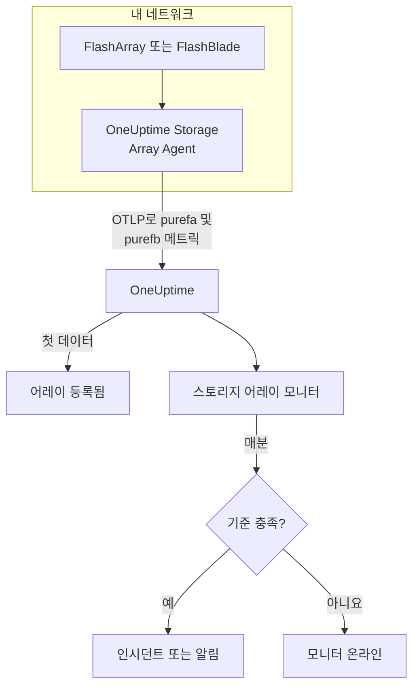

# 스토리지 어레이 모니터

스토리지 어레이 모니터는 스토리지 어레이 하나를 지켜보며, 어레이가 자체 알림을 올리거나, 공간이 부족해지거나, 느려지거나, 하드웨어나 호스트 경로를 잃거나, 복제가 뒤처질 때 알려 줍니다. Pure Storage FlashArray와 Pure Storage FlashBlade를 지원하며, 어레이가 직접 내보내는 메트릭(Pure의 `purefa_*` 및 `purefb_*` 시리즈)을 읽습니다. 이 메트릭은 OneUptime Storage Array Agent가 수집합니다.

:::cards
- [모니터 만들기](#스토리지-어레이-모니터-만들기): 대시보드에서 여섯 단계.
- [템플릿](#미리-만든-알림-템플릿): 미리 만든 알림 열여덟 개. 볼륨, 호스트, 구성 요소마다 인시던트 하나.
- [Pure 시리즈의 작동 방식](#pure-시리즈의-구조): 메트릭 이름 하나에 여러 수치.
- [메트릭](#수집되는-메트릭): 모니터가 알림을 보낼 수 있는 모든 시리즈.
:::

## 작동 방식

OneUptime Storage Array Agent는 어레이의 관리 인터페이스에 닿을 수 있는 머신에서 실행됩니다. 읽기 전용 API 토큰으로 어레이의 메트릭을 읽고, 어레이 이름 `storage.array.name` 과 플랫폼 `storage.system` 레이블을 붙여 OTLP로 OneUptime에 보냅니다. 첫 데이터가 들어오면 어레이가 등록됩니다.

스토리지 어레이 모니터는 어레이 하나에 연결됩니다. 매분 그 어레이의 메트릭에 쿼리를 실행하고 결과를 기준과 비교합니다.



## 시작하기 전에

- **Storage Array Agent를 설치하세요**. HTTPS로 어레이에 닿을 수 있는 곳에, 어레이의 **readonly** 역할을 가진 사용자의 API 토큰으로 설치합니다. [Storage Array Agent 가이드](/docs/telemetry/storage-arrays)는 사용자, 토큰, 설치를 `ONEUPTIME_URL`, `ONEUPTIME_TELEMETRY_INGESTION_KEY`, `STORAGE_ARRAY_NAME`, 어레이의 주소와 토큰(`PURE_FA_ENDPOINT` 및 `PURE_FA_API_TOKEN`, 또는 `PURE_FB_ENDPOINT` 및 `PURE_FB_API_TOKEN`)과 함께 다룹니다.
- **어레이가 등록되었는지 확인하세요.** 첫 수집 후 약 1분 뒤에 에이전트의 `STORAGE_ARRAY_NAME` 이름으로 **제품 → 인프라 → Storage Arrays → All Storage Arrays** 에 나타납니다.

## 스토리지 어레이 모니터 만들기

:::steps
### 새 모니터 시작

**모니터** 로 이동해 **모니터 생성** 을 클릭합니다.

### 스토리지 어레이 선택

**모니터 유형** 에서 **더 많은 모니터 유형** 을 클릭하고 **인프라** 아래의 **스토리지 어레이** 를 선택하거나, 검색 상자에 `storage` 를 입력합니다. **이름** 을 입력하고(인시던트와 알림 제목에 쓰입니다) **다음** 을 클릭합니다.

### 어레이 선택

**Storage Array Monitor Configuration** 에서 **스토리지 어레이** 로 어레이를 선택합니다. 데이터를 보낸 적이 있는 모든 어레이가 목록에 있습니다. 어레이의 플랫폼에 따라 양식이 제공하는 메트릭과 템플릿이 정해집니다.

### 감시할 대상 선택

세 탭 중 하나를 선택합니다.

- **Quick Setup**: [템플릿](#미리-만든-알림-템플릿)을 클릭합니다. 템플릿은 메트릭, 레이블 필터, 집계, 시간 범위, 임계값을 설정하고 아래의 기준을 자신의 기준으로 바꿉니다. **시간 범위** 는 나중에도 바꿀 수 있습니다.
- **Custom Metric**: **Storage Array Metric** 에서 메트릭 하나를 고른 다음 **집계** 와 **시간 범위** 를 설정합니다. [필터](#모니터-설정)로 볼륨, 호스트, 파드, 구성 요소, 파일 시스템, 버킷 하나로 좁힙니다.
- **고급**: **메트릭 선택** 에서 쿼리와 수식을 직접 만듭니다. 예를 들어 사용된 용량은 `purefa_array_space_bytes` 를 `space=capacity` 로 필터링한 값에서 같은 메트릭을 `space=empty` 로 필터링한 값을 뺀 것입니다. 객체의 레이블로 **Group by** 하면 각 객체를 따로 판단합니다.

### 기준 확인

**모니터 기준** 의 각 기준을 열고 **메트릭**, **집계**, **조건**, **Threshold** 를 확인합니다. 템플릿을 쓰면 이 값들이 채워집니다. **Custom Metric** 이나 **고급** 에서는 모니터가 [기본 기준](#기본-기준)으로 시작하는데, 이 기준은 메트릭이 0으로 떨어지는 것만 알아차리므로 직접 임계값을 설정하세요.

### 모니터 만들기

**모니터 생성** 을 클릭합니다. OneUptime이 모니터 페이지를 열고 매분 평가합니다. 모니터가 올린 인시던트와 알림은 어레이의 **인시던트** 및 **알림** 페이지에도 표시됩니다.
:::

> [!TIP]
> 템플릿 여러 개를 한 번에 설정하려면 **제품 → 인프라 → Storage Arrays** 에서 어레이를 열고 **Recommendations** 로 이동하세요. 원하는 템플릿을 고르고 호출할 사람을 정하면, OneUptime이 템플릿마다 모니터를 하나씩 만듭니다.

## 모니터 설정

| 필드 | 탭 | 하는 일 |
| --- | --- | --- |
| **스토리지 어레이** | 모두 | 필수. 모든 쿼리를 `resource.storage.array.name` 으로 한정하므로, 둘 다 `vol-01` 이라는 볼륨을 가진 두 어레이가 섞이지 않습니다. |
| **볼륨** | Custom Metric, 고급 | FlashArray만. `name` 레이블로 볼륨 하나(예: `vol-db-01`). 파드나 볼륨 그룹 안의 볼륨은 `pod::volume` 이나 `group/volume` 이라는 이름을 씁니다. |
| **호스트** | Custom Metric, 고급 | FlashArray만. 어레이가 아는 호스트 하나를 `host` 레이블로(예: `esxi-01`). |
| **Pod** | Custom Metric, 고급 | FlashArray만. ActiveCluster 또는 ActiveDR 파드 하나를 `name` 레이블로, 복제 링크 시리즈에서는 `local_pod` 로. |
| **Hardware Component** | Custom Metric, 고급 | 하드웨어 구성 요소 하나(예: `CH0.BAY1`, `CT0`). FlashArray에서는 `component_name` 레이블, FlashBlade에서는 `name`. |
| **File System** | Custom Metric, 고급 | FlashBlade만. `name` 레이블로 파일 시스템 하나. |
| **Bucket** | Custom Metric, 고급 | FlashBlade만. `name` 레이블로 객체 저장소 버킷 하나. |
| **Storage Array Metric** | Custom Metric | [카탈로그](#수집되는-메트릭)의 메트릭 하나. 양식은 그 의미를 주는 레이블 필터를 추가하고, 메트릭이 설명하는 객체로 그룹화하므로, 각 볼륨, 호스트, 구성 요소가 따로 판단됩니다. |
| **집계** | Custom Metric | 샘플을 합치는 방법: **평균**, **최대**, **최소**, **합계**, **개수**. 메트릭의 일반적인 집계로 시작합니다. |
| **시간 범위** | 모두 | 쿼리가 읽는 이동 기간으로, **Past 1 Minute** 부터 **Past 365 Days** 까지입니다. 새 모니터는 **Past 5 Minutes** 로, 파일 시스템이나 버킷의 사용자 지정 메트릭은 **Past 15 Minutes** 로 시작하며, 템플릿은 자체 값을 설정합니다. |
| **메트릭 선택** | 고급 | 쿼리 빌더: **메트릭**, **Aggregate by**, **Filter by attributes**, **Group by**, 그리고 쿼리를 합치는 **메트릭 추가** 와 **수식 추가**. |

에이전트는 어레이 엔드포인트를 60초마다, 볼륨, 호스트, 파드를 2분마다 읽으므로 5분 기간에는 항상 샘플이 있습니다. FlashBlade의 파일 시스템과 버킷은 5분마다 읽고(그래서 15분), FlashArray 디렉터리는 30분마다 읽습니다. 디렉터리 모니터에는 60분 기간을 주세요.

## Pure 시리즈의 구조

Pure는 메트릭 이름 **하나** 에 여러 수치를 담고 레이블로 구분합니다.

- **`dimension`**(성능 시리즈). `purefa_array_performance_latency_usec` 는 읽기 지연 시간(`usec_per_read_op`), 쓰기 지연 시간(`usec_per_write_op`), 미러링된 쓰기 지연 시간, 그리고 각각의 SAN, 큐, QoS, 서비스 시간을 담습니다. 항상 `dimension` 하나로 필터링하세요. 여러 값을 평균하면 200 µs 읽기 지연 시간과 큐 수치가 섞입니다.
- **`space`**(용량 시리즈): `capacity`, `empty`, `snapshots`, `total_provisioned`, `total_physical`, `available_ratio` 등.

몇몇 시리즈는 상태를 **레이블** 에 담고, 값은 항상 1입니다.

| 시리즈 | 상태 레이블 | 시리즈 하나의 단위 |
| --- | --- | --- |
| `purefa_alerts_open` | `severity`(`summary`, `code`, `component_type` 포함) | 열린 알림 |
| `purefa_hw_component_status` | `component_status` | 하드웨어 구성 요소 |
| `purefa_host_connectivity_info` | `status`(`details` 포함) | 호스트 |
| `purefa_drive_capacity_bytes` | `component_status`(값은 드라이브의 용량) | 드라이브 |

나쁜 상태로 필터링한 시리즈는 무언가 그 상태에 있는 동안에만 존재하므로, 시리즈가 없으면 정상이라는 뜻입니다. 그래서 **0보다 큰 Max에서 발생하고 0에서 복구** 가 이 시리즈에 맞는 형태이며, 템플릿도 그렇게 만들어져 있습니다. 템플릿의 복구 기준은 시리즈가 없는 것을 0으로 셉니다.

모니터 필터와 그룹화 키에서 에이전트의 속성은 `resource.` 로 시작하지만(`resource.storage.array.name`, `resource.storage.system`), Pure 자체의 레이블은 그렇지 않습니다(`name`, `host`, `component_name`, `dimension`, `space`, `severity`).

## 미리 만든 알림 템플릿

OneUptime은 템플릿 18개(FlashArray용 11개, FlashBlade용 7개)를 제공하며, **Quick Setup** 은 어레이의 플랫폼에 맞는 것을 보여 줍니다. 각 템플릿은 완전한 모니터를 만듭니다. 메트릭 쿼리, 레이블 필터, 객체 자체의 레이블로 하는 그룹화, 발생 기준과 복구 기준입니다. 임계값은 편집할 수 있는 출발점입니다.

기준은 기간 안의 **모든** 값에서 조건이 성립할 때만 발생합니다. 용량, 지연 시간, 지연, 비율 임계값에서 발생한 모니터는 임계값에서 10% 벗어나야 복구되므로, 임계값 근처를 오가는 값 때문에 상태가 흔들리지 않습니다. 알림 및 하드웨어 템플릿은 상태가 사라지는 즉시 복구됩니다.

### FlashArray

| 템플릿 | 범주 | 심각도 | 감시 대상 | 발생 조건 |
| --- | --- | --- | --- | --- |
| Critical Array Alert | Array Health | 심각 | `purefa_alerts_open` 을 `severity=critical` 로 필터링, `summary` 별 Max, 최근 5분 | > 0 — 어레이에 열린 심각 알림이 있음(고장 난 구성 요소, 용량 비상, 복제 실패). 알림마다 인시던트 하나. 알림이 닫히면 복구 |
| Warning Array Alert | Array Health | Warning | `purefa_alerts_open` 을 `severity=warning` 으로 필터링, `summary` 별 Max, 최근 5분 | > 0 — 어레이에 열린 경고 알림이 있음. 알림마다 인시던트 하나. 알림이 닫히면 복구 |
| Capacity Above 80% | 용량 | Warning | `purefa_array_space_utilization`, Max, 최근 15분 | > 80 — Pure 자체의 첫 번째 용량 임계값. ≤ 72에서 복구 |
| Capacity Above 90% | 용량 | 심각 | `purefa_array_space_utilization`, Max, 최근 5분 | > 90 — 어레이가 쓰기를 거부하기 직전. ≤ 81에서 복구 |
| High Read Latency | Performance | Warning | `purefa_array_performance_latency_usec` 를 `dimension=usec_per_read_op` 로 필터링, Avg, 최근 10분 | > 5000 µs (5 ms) — FlashArray 읽기는 보통 1 ms보다 훨씬 짧음. ≤ 4500에서 복구 |
| High Write Latency | Performance | Warning | `purefa_array_performance_latency_usec` 를 `dimension=usec_per_write_op` 로 필터링, Avg, 최근 10분 | > 5000 µs (5 ms). ≤ 4500에서 복구 |
| Hardware Component Failed | Hardware | 심각 | `purefa_hw_component_status` 를 `component_status=critical` 로 필터링, `component_name` 별 Max, 최근 5분 | > 0 — 컨트롤러, 전원 공급 장치, 팬, 베이, 포트가 심각 상태이고 이중화가 사라짐. 구성 요소마다 인시던트 하나. ok를 보고하면 복구 |
| Hardware Component Degraded | Hardware | Warning | `purefa_hw_component_status` 를 `component_status=degraded` 로 필터링, `component_name` 별 Max, 최근 5분 | > 0 — 구성 요소의 성능이 저하됨. 구성 요소마다 인시던트 하나. ok를 보고하면 복구 |
| Drive Failed | Hardware | 심각 | `purefa_drive_capacity_bytes` 를 `component_status=failed` 로 필터링, `component_name` 별 Max, 최근 5분 | > 0 — DirectFlash 모듈이나 SSD가 고장 나서 어레이가 나머지 드라이브로 재구성 중. 드라이브마다 인시던트 하나. 교체되면 복구 |
| Host Lost Redundant Paths | 호스트 | Warning | `purefa_host_connectivity_info` 를 `status=critical` 로 필터링, `host` 별 Max, 최근 5분 | > 0 — 호스트가 컨트롤러 하나를 통해서만 어레이에 닿거나 전혀 닿지 않음. 컨트롤러 페일오버가 일어나면 스토리지가 오프라인이 됨. 호스트마다 인시던트 하나. 경로가 돌아오면 복구 |
| Replication Lag Above 1 Minute | Replication | Warning | `purefa_pod_replica_links_lag_max_msec`, `local_pod` 별 Max, 최근 10분 | > 60000 ms (60 s) — 지금 페일오버하면 계획보다 많은 최근 쓰기를 잃음. 파드마다 인시던트 하나. ≤ 54000에서 복구 |

### FlashBlade

| 템플릿 | 범주 | 심각도 | 감시 대상 | 발생 조건 |
| --- | --- | --- | --- | --- |
| Critical Array Alert | Array Health | 심각 | `purefb_alerts_open` 을 `severity=critical` 로 필터링, `summary` 별 Max, 최근 5분 | > 0 — FlashBlade에 열린 심각 알림이 있음. 알림마다 인시던트 하나. 알림이 닫히면 복구 |
| Warning Array Alert | Array Health | Warning | `purefb_alerts_open` 을 `severity=warning` 으로 필터링, `summary` 별 Max, 최근 5분 | > 0 — FlashBlade에 열린 경고 알림이 있음. 알림마다 인시던트 하나. 알림이 닫히면 복구 |
| Capacity Above 80% | 용량 | Warning | `purefb_array_space_utilization` 을 `type=array` 로 필터링, Max, 최근 15분 | > 80. ≤ 72에서 복구 |
| Capacity Above 90% | 용량 | 심각 | `purefb_array_space_utilization` 을 `type=array` 로 필터링, Max, 최근 5분 | > 90 — 가득 차면 모든 클라이언트의 쓰기가 실패함. ≤ 81에서 복구 |
| Hardware Component Unhealthy | Hardware | 심각 | `purefb_hardware_health`, `name` 별 Min, 최근 5분 | < 1 — 블레이드, 패브릭 모듈, 전원 공급 장치, 팬이 정상이 아님(사용하지 않는 슬롯은 2를 보고함). 구성 요소마다 인시던트 하나. ≥ 1에서 복구 |
| High Read Latency | Performance | Warning | `purefb_array_performance_latency_usec` 를 `dimension=usec_per_read_op` 및 `protocol=all` 로 필터링, Avg, 최근 10분 | > 10000 µs (10 ms), 모든 프로토콜 기준. ≤ 9000에서 복구 |
| File System Near Full | File Systems | Warning | `purefb_file_systems_space_bytes` 를 `space=available_ratio` 로 필터링, `name` 별 Min, 최근 15분 | < 0.1 — 파일 시스템의 프로비저닝된 크기 중 10%도 남지 않음. 파일 시스템마다 인시던트 하나. ≥ 0.11에서 복구 |

**심각도** 는 선택기가 보여 주는 레이블입니다. 템플릿이 만드는 인시던트와 알림은 프로젝트에서 가장 심각한 인시던트 및 알림 심각도로 시작하며, 기준에서 바꿀 수 있습니다.

- **열린 알림과 하드웨어 상태는 Max를 씁니다**. 알림이 열려 있거나 구성 요소가 그 상태에 있는 동안에만 존재하는 시리즈이므로, 이를 보여 주는 수집 한 번으로 임계값을 넘습니다.
- **객체별 템플릿은 모두 객체 자체의 레이블로 그룹화합니다**(`summary`, `component_name`, `host`, `local_pod`, `name`). 그래서 영향받은 객체마다 인시던트가 하나씩 발생하고, 인시던트에 그 객체의 이름이 들어갑니다.
- **지연 시간 템플릿은 Avg를 씁니다**. 어레이 자체의 작업당 평균에 대한 Avg이며, 용량 템플릿은 어레이 자체의 사용률에 대한 **Max** 를 씁니다. 지연 시간은 마이크로초, 용량은 퍼센트로 고정되어 있습니다.
- **Hardware Component Unhealthy는 구성 요소별 Min을 씁니다**. 상태는 정상일 때 1이고, 아닐 때 0으로 떨어집니다.

볼륨별 지연 시간 템플릿은 없습니다. 알맞은 임계값이 워크로드에 따라 다르기 때문입니다. 카탈로그에서 `name` 으로 그룹화해 직접 만드세요. 용량 예측에는 임계값보다 증가 추세가 필요하고, 드라이브 마모에는 알림을 걸 시리즈가 없습니다.

## 수집되는 메트릭

에이전트는 어레이가 내보내는 모든 것을 보냅니다. 아래 시리즈는 모니터 양식이 제공하는 카탈로그입니다. 모든 값은 어레이가 직접 계산한 게이지이므로(지연 시간은 작업당 마이크로초, 처리량은 초당 값), 비율을 계산할 필요가 없습니다. **필터** 는 시리즈에 그 행이 말하는 의미를 주는 레이블 필터이며, 양식이 대신 적용합니다.

### Array Health

| 메트릭 | 필터 | 플랫폼 | 단위 | 설명 |
| --- | --- | --- | --- | --- |
| `purefa_alerts_open` | — | FlashArray | `count` | 어레이의 열린 알림마다 시리즈 하나(값 1). 레이블은 `severity`(`critical`, `warning`, `info`, `hidden`), `category`, `code`, `component_type`, `summary` |
| `purefb_alerts_open` | — | FlashBlade | `count` | FlashBlade의 열린 알림마다 시리즈 하나(값 1). 레이블은 `severity`(`info`, `warning`, `critical`), `code`, `component_name`, `component_type`, `summary`, `kburl`(Pure 기술 자료 문서) |

### Capacity

| 메트릭 | 필터 | 플랫폼 | 단위 | 설명 |
| --- | --- | --- | --- | --- |
| `purefa_array_space_utilization` | — | FlashArray | `%` | 어레이의 사용 가능한 용량 중 사용 중인 비율. Pure는 80%, 90%, 100%에서 직접 용량 알림을 올립니다 |
| `purefa_array_space_bytes` | `space=capacity` | FlashArray | `bytes` | 어레이의 사용 가능한 용량 |
| `purefa_array_space_bytes` | `space=empty` | FlashArray | `bytes` | 사용하지 않는 용량. 추세를 따라가면 어레이가 언제 가득 찰지 예측할 수 있습니다 |
| `purefa_array_space_bytes` | `space=snapshots` | FlashArray | `bytes` | 스냅샷만 차지하는 물리 공간. 빠르게 늘면 대개 보호 그룹이 계획보다 많은 스냅샷을 유지하는 것입니다 |
| `purefa_array_space_data_reduction_ratio` | — | FlashArray | `ratio` | 어레이 전체의 중복 제거와 압축(예: 4.2:1이면 4.2). 계속 떨어지면 새 데이터가 잘 줄어들지 않는 것입니다 |
| `purefb_array_space_utilization` | `type=array` | FlashBlade | `%` | FlashBlade의 사용 가능한 용량 중 사용 중인 비율 |
| `purefb_array_space_bytes` | `type=array`, `space=empty` | FlashBlade | `bytes` | FlashBlade의 사용하지 않는 용량 |
| `purefb_array_space_data_reduction_ratio` | `type=array` | FlashBlade | `ratio` | FlashBlade 전체의 데이터 감소 |

### Performance

| 메트릭 | 필터 | 플랫폼 | 단위 | 설명 |
| --- | --- | --- | --- | --- |
| `purefa_array_performance_latency_usec` | `dimension=usec_per_read_op` | FlashArray | `µs` | 호스트가 보는 읽기 평균 지연 시간. FlashArray 읽기는 보통 1 ms보다 훨씬 짧습니다 |
| `purefa_array_performance_latency_usec` | `dimension=usec_per_write_op` | FlashArray | `µs` | 호스트가 보는 쓰기 평균 지연 시간 |
| `purefa_array_performance_latency_usec` | `dimension=usec_per_mirrored_write_op` | FlashArray | `µs` | 확장된 ActiveCluster 파드에 대한 쓰기 평균 지연 시간(파트너 어레이 왕복 포함) |
| `purefa_array_performance_latency_usec` | `dimension=san_usec_per_read_op` | FlashArray | `µs` | 읽기가 SAN에서 보내는 시간. SAN 지연 시간은 높고 서비스 지연 시간은 낮으면 패브릭이나 호스트가 원인입니다 |
| `purefa_array_performance_throughput_iops` | `dimension=reads_per_sec` | FlashArray | `ops/s` | 초당 읽기 작업 수 |
| `purefa_array_performance_throughput_iops` | `dimension=writes_per_sec` | FlashArray | `ops/s` | 초당 쓰기 작업 수 |
| `purefa_array_performance_bandwidth_bytes` | `dimension=read_bytes_per_sec` | FlashArray | `bytes/s` | 초당 읽은 바이트 수 |
| `purefa_array_performance_bandwidth_bytes` | `dimension=write_bytes_per_sec` | FlashArray | `bytes/s` | 초당 쓴 바이트 수 |
| `purefa_array_performance_queue_depth_ops` | — | FlashArray | `ops` | 어레이의 큐에 있는 작업. 지연 시간이 오르면서 큐가 길어지면 호스트가 어레이가 처리할 수 있는 것보다 많이 보내는 것입니다 |
| `purefa_array_performance_average_bytes` | `dimension=bytes_per_op` | FlashArray | `bytes` | 작업의 평균 크기. 큰 I/O는 아무 문제가 없어도 지연 시간을 높입니다 |
| `purefb_array_performance_latency_usec` | `dimension=usec_per_read_op`, `protocol=all` | FlashBlade | `µs` | 모든 프로토콜의 읽기 평균 지연 시간 |
| `purefb_array_performance_latency_usec` | `dimension=usec_per_write_op`, `protocol=all` | FlashBlade | `µs` | 모든 프로토콜의 쓰기 평균 지연 시간 |
| `purefb_array_performance_throughput_iops` | `dimension=reads_per_sec`, `protocol=all` | FlashBlade | `ops/s` | 모든 프로토콜의 초당 읽기 작업 수 |
| `purefb_array_performance_throughput_iops` | `dimension=writes_per_sec`, `protocol=all` | FlashBlade | `ops/s` | 모든 프로토콜의 초당 쓰기 작업 수 |
| `purefb_array_performance_bandwidth_bytes` | `dimension=read_bytes_per_sec`, `protocol=all` | FlashBlade | `bytes/s` | 모든 프로토콜의 초당 읽은 바이트 수 |
| `purefb_array_performance_bandwidth_bytes` | `dimension=write_bytes_per_sec`, `protocol=all` | FlashBlade | `bytes/s` | 모든 프로토콜의 초당 쓴 바이트 수 |

### Volumes

| 메트릭 | 필터 | 플랫폼 | 단위 | 설명 |
| --- | --- | --- | --- | --- |
| `purefa_volume_performance_latency_usec` | `dimension=usec_per_read_op` | FlashArray | `µs` | 각 볼륨의 읽기 평균 지연 시간. `name` 으로 그룹화하세요 |
| `purefa_volume_performance_latency_usec` | `dimension=usec_per_write_op` | FlashArray | `µs` | 각 볼륨의 쓰기 평균 지연 시간 |
| `purefa_volume_performance_throughput_iops` | `dimension=reads_per_sec` | FlashArray | `ops/s` | 각 볼륨의 초당 읽기 작업 수 |
| `purefa_volume_performance_throughput_iops` | `dimension=writes_per_sec` | FlashArray | `ops/s` | 각 볼륨의 초당 쓰기 작업 수 |
| `purefa_volume_performance_bandwidth_bytes` | `dimension=read_bytes_per_sec` | FlashArray | `bytes/s` | 각 볼륨에서 초당 읽은 바이트 수 |
| `purefa_volume_performance_bandwidth_bytes` | `dimension=write_bytes_per_sec` | FlashArray | `bytes/s` | 각 볼륨에 초당 쓴 바이트 수 |
| `purefa_volume_space_bytes` | `space=total_provisioned` | FlashArray | `bytes` | 호스트가 보는 각 볼륨의 크기 |
| `purefa_volume_space_bytes` | `space=total_physical` | FlashArray | `bytes` | 데이터 감소 후 각 볼륨이 쓰는 물리 공간 |
| `purefa_volume_space_data_reduction_ratio` | — | FlashArray | `ratio` | 각 볼륨의 데이터 감소 비율 |

### Hosts

| 메트릭 | 필터 | 플랫폼 | 단위 | 설명 |
| --- | --- | --- | --- | --- |
| `purefa_host_connectivity_info` | — | FlashArray | `count` | 호스트마다 시리즈 하나(값 1). 연결 레이블은 `status`(`healthy`, `critical`, `unused`)와 `details`(`Redundant`, `Single Controller`, `None`, ...) |
| `purefa_host_performance_latency_usec` | `dimension=usec_per_read_op` | FlashArray | `µs` | 각 호스트가 보는 읽기 평균 지연 시간. `host` 로 그룹화하세요 |
| `purefa_host_performance_latency_usec` | `dimension=usec_per_write_op` | FlashArray | `µs` | 각 호스트가 보는 쓰기 평균 지연 시간 |
| `purefa_host_performance_throughput_iops` | `dimension=reads_per_sec` | FlashArray | `ops/s` | 각 호스트의 초당 읽기 작업 수 |
| `purefa_host_performance_throughput_iops` | `dimension=writes_per_sec` | FlashArray | `ops/s` | 각 호스트의 초당 쓰기 작업 수 |

### Replication

| 메트릭 | 필터 | 플랫폼 | 단위 | 설명 |
| --- | --- | --- | --- | --- |
| `purefa_pod_replica_links_lag_max_msec` | — | FlashArray | `ms` | 각 파드 복제 링크(ActiveDR / 비동기)의 최대 복제 지연. 레이블은 `local_pod`, `remote_pod`, `remote`, `direction`, `status`. `local_pod` 로 그룹화하세요 |
| `purefa_pod_replica_links_lag_average_msec` | — | FlashArray | `ms` | 각 파드 복제 링크의 평균 복제 지연 |
| `purefa_pod_performance_replication_bandwidth_bytes` | — | FlashArray | `bytes/s` | 각 파드의 복제 트래픽. 레이블은 `direction` 과 `dimension` |
| `purefa_pod_performance_latency_usec` | `dimension=usec_per_mirrored_write_op` | FlashArray | `µs` | 각 ActiveCluster 파드의 미러링된 쓰기 평균 지연 시간 |

### Hardware

| 메트릭 | 필터 | 플랫폼 | 단위 | 설명 |
| --- | --- | --- | --- | --- |
| `purefa_hw_component_status` | — | FlashArray | `count` | 하드웨어 구성 요소마다 시리즈 하나(값 1). 섀시, 컨트롤러, 드라이브 및 NVRAM 베이, 전원 공급 장치, 팬, 온도 센서, Ethernet 및 Fibre Channel 포트가 대상이며, 레이블은 `component_status`(`ok`, `critical`, `degraded`, `device_off`, `identifying`, `not_installed`, `unknown`) |
| `purefa_hw_component_temperature_celsius` | — | FlashArray | `°C` | 각 센서의 온도. `component_name` 으로 그룹화하세요 |
| `purefa_drive_capacity_bytes` | — | FlashArray | `bytes` | 각 드라이브의 원시 용량. 레이블은 `component_status`(`healthy`, `failed`, `missing`, `recovering`, `unhealthy`, `empty`, ...)와 유형 |
| `purefa_network_interface_performance_errors` | `dimension=total_errors_per_sec` | FlashArray | `errors/s` | 각 Ethernet 및 Fibre Channel 인터페이스의 초당 오류 수. 오류가 계속되면 대개 케이블, 광 모듈, 스위치 포트 불량입니다 |
| `purefb_hardware_health` | — | FlashBlade | — | 각 하드웨어 구성 요소(블레이드, 패브릭 모듈, 전원 공급 장치, 팬, ...)의 상태: 1 = 정상, 2 = 사용 안 함, 0 = 비정상. `name` 별 최솟값을 쓰세요 |

### File Systems

| 메트릭 | 필터 | 플랫폼 | 단위 | 설명 |
| --- | --- | --- | --- | --- |
| `purefb_file_systems_performance_latency_usec` | `dimension=usec_per_read_op` | FlashBlade | `µs` | 각 파일 시스템의 읽기 평균 지연 시간. `name` 으로 그룹화하세요 |
| `purefb_file_systems_performance_latency_usec` | `dimension=usec_per_write_op` | FlashBlade | `µs` | 각 파일 시스템의 쓰기 평균 지연 시간 |
| `purefb_file_systems_space_bytes` | `space=total_physical` | FlashBlade | `bytes` | 각 파일 시스템이 쓰는 물리 공간 |
| `purefb_file_systems_space_bytes` | `space=available_ratio` | FlashBlade | `ratio` | 각 파일 시스템의 프로비저닝된 크기 중 아직 비어 있는 비율(0에서 1). 0에 가까우면 할당량이 곧 가득 찹니다 |

### Buckets

| 메트릭 | 필터 | 플랫폼 | 단위 | 설명 |
| --- | --- | --- | --- | --- |
| `purefb_buckets_performance_latency_usec` | `dimension=usec_per_read_op` | FlashBlade | `µs` | 각 버킷의 읽기 평균 지연 시간. `name` 으로 그룹화하세요 |
| `purefb_buckets_space_bytes` | `space=total_physical` | FlashBlade | `bytes` | 각 버킷이 쓰는 물리 공간 |
| `purefb_buckets_object_count` | — | FlashBlade | `count` | 각 버킷의 객체 수 |

## 모니터링 기준

기준은 모니터의 쿼리나 수식 하나를 임계값과 비교합니다. 스토리지 어레이 모니터의 기준에는 **필터 유형** 이 없으며, 모든 규칙이 다음 필드로 메트릭 값을 확인합니다.

| 필드 | 하는 일 |
| --- | --- |
| **메트릭** | 확인할 쿼리나 수식(변수 이름으로). |
| **집계** | 기간 안의 값을 답 하나로 만드는 방법: **평균**, **합계**, **Maximum Value**, **Minimum Value**, **All Values**(모든 값이 일치해야 함), **Any Value**(하나면 충분). |
| **조건** | **Greater Than**, **Less Than**, **Greater Than Or Equal To**, **Less Than Or Equal To**, **Equal To**, 또는 이상 조건: **Anomalously High**, **Anomalously Low**, **Anomalous**. |
| **Threshold** | 비교할 값. 메트릭에 단위가 있으면 옆에 단위 목록이 있습니다. 이상 조건에서는 표시되지 않습니다. |
| **민감도** | 이상 조건만. **낮음**(4σ), **중간**(3σ, 기본값), **높음**(2σ). |
| **기준선 기간** | 이상 조건만. 14일(기본값), 28일, 60일, 90일의 기록. |
| **데이터가 없는 경우** | **추가 필드** 아래에 있습니다. 기간에 샘플이 없을 때의 동작: **Ignore**(기본값), **Treat As Zero**, **트리거**. |

이상 조건은 각 값을 기준선에서 같은 요일의 같은 시간과 비교합니다. 기준선 기간에 기록이 충분히 쌓일 때까지 "Learning" 상태에 머물며 아무것도 올리지 않습니다.

시작하기 좋은 기준:

- **볼륨이 느림:** `purefa_volume_performance_latency_usec` 를 `dimension=usec_per_read_op` 로 필터링, 평균, `name` 으로 그룹화, **Greater Than** `2000`, 최근 10분.
- **어레이가 가득 차고 있음:** `purefa_array_space_utilization`, 최대, **Greater Than** `85`, 최근 15분.
- **호스트가 컨트롤러 하나로 동작함:** `purefa_host_connectivity_info` 를 `status=critical` 로 필터링, 최대, `host` 로 그룹화, **Greater Than** `0`.
- **FlashBlade 파일 시스템이 거의 가득 참:** `purefb_file_systems_space_bytes` 를 `space=available_ratio` 로 필터링, 최소, `name` 으로 그룹화, **Less Than** `0.05`.

### 기본 기준

템플릿으로 만들지 않은 모니터는 기준 두 개로 시작합니다.

| 순서 | 기준 | 일치하는 경우 | 결과 |
| --- | --- | --- | --- |
| 1 | Check if _monitor name_ is offline | 첫 번째 쿼리의 값 중 하나가 `0` | 모니터를 **오프라인** 으로 표시하고 인시던트 "_monitor name_ is offline" 을 선언하며, 모니터가 복구되면 저절로 해결됩니다. |
| 2 | Check if _monitor name_ is online | 값 중 하나가 `0` 보다 큼 | 모니터를 **정상 작동** 으로 표시합니다. |

> [!IMPORTANT]
> 침묵은 어느 기준과도 일치하지 않습니다. 데이터를 보내지 않게 된 어레이는 모니터를 그대로 둡니다. 데이터가 끊긴 것을 알려면 기준에서 **데이터가 없는 경우** 를 **트리거** 로 설정하세요. OneUptime 자체가 데이터를 받지 못한 시간은 데이터 없음으로 치지 않습니다. 그 시간이 들어간 기간의 검사는 [OneUptime이 데이터를 받지 못할 때](/docs/monitor/when-oneuptime-is-not-receiving)에서 설명하듯 대신 기다립니다.

## Terraform

[OneUptime Terraform 공급자](/docs/terraform/monitor-steps)는 스토리지 어레이 모니터 단계의 구성을 `storage_array_monitor` 속성으로 다룹니다. 이 속성은 `storageArrayMonitor` 구성(`arrayIdentifier`, `storageSystem`, `resourceFilters`, `metricViewConfig`, `rollingTime`)의 원시 JSON이며, `jsonencode()` 로 작성합니다.

```hcl title="main.tf"
monitor_steps = [{
  storage_array_monitor = jsonencode({
    arrayIdentifier = "my-storage-array"
    storageSystem   = "purestorage.flasharray"
    resourceFilters = {}
    rollingTime     = "Past 15 Minutes"
    metricViewConfig = {
      queryConfigs = [{
        metricAliasData = { metricVariable = "capacity_used_percent", title = "Capacity Used", description = "", legend = "" }
        metricQueryData = {
          filterData = {
            metricName     = "purefa_array_space_utilization"
            attributes     = {}
            aggegationType = "Max"
            aggregateBy    = {}
          }
        }
      }]
      formulaConfigs = []
    }
  })
  criteria = [ /* ... */ ]
}]
```

`arrayIdentifier` 는 어레이의 `storage.array.name`(에이전트를 시작할 때 쓴 `STORAGE_ARRAY_NAME`)이며, OneUptime ID가 아닙니다. `storageSystem` 은 `purestorage.flasharray` 또는 `purestorage.flashblade` 입니다. 이 값에 따라 양식이 보여 주는 카탈로그와 템플릿, 그리고 하드웨어 필터가 `component_name` 과 `name` 중 무엇을 읽을지가 정해집니다.

## 문제 해결

:::details 어레이가 스토리지 어레이 목록에 없음
어레이는 에이전트의 데이터로 스스로 등록됩니다. 에이전트가 실행 중이고 데이터를 보내는지([Storage Array Agent 가이드](/docs/telemetry/storage-arrays) 참고), 그리고 `STORAGE_ARRAY_NAME` 이 설정되어 있는지 확인하세요.
:::

:::details 알림이나 하드웨어 템플릿이 전혀 발생하지 않음
정상적인 경우입니다. `purefa_alerts_open`, `purefa_hw_component_status`, `purefa_drive_capacity_bytes`, `purefa_host_connectivity_info` 는 상태를 레이블에 담으며, 나쁜 상태로 필터링한 시리즈(`severity=critical`, `component_status=failed`)는 무언가 그 상태에 있는 동안에만 존재합니다. 템플릿 뒤의 시리즈를 보려면 **메트릭** 페이지에서 필터 없이 그 쿼리를 실행하세요.
:::

:::details 지연 시간 모니터의 값이 이상함
Pure는 읽기, 쓰기, 미러링된 쓰기, SAN, 큐, QoS 수치를 메트릭 이름 하나에 담고 `dimension` 레이블로만 구분하므로, `dimension` 필터가 없는 쿼리는 이를 모두 평균합니다. 템플릿과 양식의 카탈로그처럼 dimension 하나로 필터링하세요. 볼륨별 및 호스트별 시리즈는 `usec_per_read_op`, `usec_per_write_op`, `usec_per_mirrored_write_op` 만 유지합니다. 에이전트는 시리즈를 아끼려고 나머지를 버리며, 어레이 전체의 `purefa_array_performance_latency_usec` 만 모두 유지합니다.
:::

:::details 1분 기간에 데이터가 표시되지 않음
에이전트는 볼륨, 호스트, 파드를 2분마다, FlashBlade의 파일 시스템과 버킷을 5분마다, FlashArray 디렉터리를 30분마다 읽으므로 1분 기간에는 샘플이 없을 수 있습니다. 5분 이상을 쓰세요. 파일 시스템과 버킷에는 15분, 디렉터리에는 60분입니다.
:::

:::details 볼륨마다가 아니라 어레이 전체에 대해 인시던트가 한 번만 발생함
쿼리를 객체의 레이블로 그룹화하세요. 볼륨, 파드, 디렉터리, 파일 시스템, 버킷에는 `name`, 호스트에는 `host`, FlashArray 하드웨어에는 `component_name` 을 씁니다. Pure의 레이블에는 접두사가 없으므로 `resource.name` 은 아무것과도 일치하지 않습니다.
:::

## 다음 단계

:::cards
- [스토리지 어레이 에이전트](/docs/telemetry/storage-arrays): 메트릭을 보내는 에이전트를 설치합니다.
- [Ceph 모니터](/docs/monitor/ceph-monitor): Ceph 스토리지 클러스터를 위한 같은 종류의 모니터.
- [메트릭 모니터](/docs/monitor/metrics-monitor): 어떤 소스의 어떤 메트릭으로든 알림을 보냅니다.
- [인시던트 개요](/docs/incidents/index): 기준이 인시던트를 선언한 뒤 일어나는 일.
:::
