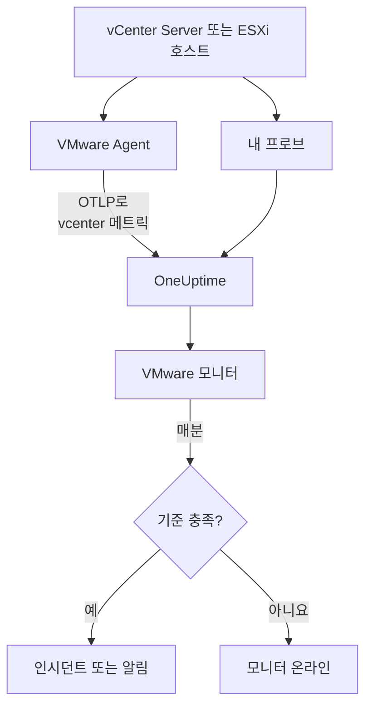

# VMware 모니터

VMware 모니터는 vCenter 하나(데이터센터, 클러스터, ESXi 호스트, 가상 머신, 데이터스토어, 리소스 풀, vSAN)를 지켜보며, 호스트가 포화되거나, VM에 CPU나 메모리가 부족하거나, 데이터스토어가 가득 차거나, vSphere가 경보를 올릴 때 알려 줍니다. OneUptime VMware Agent가 수집하는 `vcenter.*` 메트릭, 또는 에이전트 없이 프로브가 수집하는 메트릭을 읽습니다.

:::cards
- [모니터 만들기](#vmware-모니터-만들기): 대시보드에서 여섯 단계.
- [템플릿](#미리-만든-알림-템플릿): 미리 만든 알림 스물세 개. 호스트, VM, 데이터스토어마다 인시던트 하나.
- [식별 속성](#식별-속성): 호스트, VM, 데이터스토어 하나를 대상으로 하는 방법.
- [메트릭](#수집되는-메트릭): 모니터가 알림을 보낼 수 있는 모든 `vcenter.*` 시리즈.
:::

## 작동 방식

메트릭은 vCenter의 API에서 읽기 전용 계정으로 다음 두 가지 방법 중 하나로 읽습니다.

- **VMware Agent**: `vcenter` 리시버를 갖춘 OpenTelemetry Collector로, vCenter에 닿을 수 있는 머신에서 실행합니다. [VMware 에이전트](/docs/telemetry/vmware)를 참고하세요.
- **프로브**: 설치할 것이 없습니다. OneUptime에서 vCenter를 연결하고 거기에 닿는 프로브를 고릅니다. [에이전트 없는 VMware](/docs/telemetry/vmware-agentless)를 참고하세요.

둘 다 수집 간격(기본 2분)마다 같은 시리즈를 보내며, vCenter 이름 `vmware.vcenter.name` 을 붙입니다. vCenter는 vSphere 엔드포인트 하나로, vCenter Server이거나 독립형 ESXi 호스트입니다. VMware 모니터는 vCenter 하나에 연결됩니다. 매분 그 vCenter의 메트릭에 쿼리를 실행하고 결과를 기준과 비교합니다.



## 시작하기 전에

- **vCenter의 메트릭을 수집하세요**. [VMware Agent](/docs/telemetry/vmware)를 쓰거나 [에이전트 없이](/docs/telemetry/vmware-agentless) 수집합니다. 둘 다 최상위 vCenter 개체에서 **Read-Only** 역할을 가지고 **Propagate to children** 이 선택된 vSphere 사용자를 씁니다. 에이전트는 `ONEUPTIME_URL`, `ONEUPTIME_TELEMETRY_INGESTION_KEY`, `VMWARE_VCENTER_NAME`, `VCENTER_ENDPOINT`, `VCENTER_USERNAME`, `VCENTER_PASSWORD` 를 읽습니다.
- **vCenter가 등록되었는지 확인하세요.** **제품 → 인프라 → VMware → 모든 vCenter** 에 나타납니다. 에이전트를 통하면 첫 전체 수집 뒤 `VMWARE_VCENTER_NAME` 이름으로, 에이전트 없이 쓰면 연결하는 순간부터 나타납니다.

## VMware 모니터 만들기

:::steps
### 새 모니터 시작

**모니터** 로 이동해 **모니터 생성** 을 클릭합니다.

### VMware 선택

**모니터 유형** 에서 **더 많은 모니터 유형** 을 클릭하고 **인프라** 아래의 **VMware** 를 선택하거나, 검색 상자에 `vmware` 를 입력합니다. **이름** 을 입력하고(인시던트와 알림 제목에 쓰입니다) **다음** 을 클릭합니다.

### vCenter 선택

**VMware Monitor Configuration** 에서 **vCenter** 로 vCenter를 선택합니다. 데이터를 보낸 적이 있거나 에이전트 없이 연결한 모든 vCenter가 목록에 있습니다.

### 감시할 대상 선택

세 탭 중 하나를 선택합니다.

- **Quick Setup**: [템플릿](#미리-만든-알림-템플릿)을 클릭합니다. 템플릿은 메트릭, 속성 필터, 집계, 시간 범위, 그룹화, 임계값을 설정하고 아래의 기준을 자신의 기준으로 바꿉니다. **시간 범위** 는 나중에도 바꿀 수 있습니다.
- **Custom Metric**: **VMware Metric** 에서 메트릭 하나를 고른 다음 **집계** 와 **시간 범위** 를 설정합니다. 양식은 메트릭이 설명하는 개체로 그룹화하므로 각 호스트, VM, 데이터스토어가 따로 판단되며, [필터](#모니터-설정)로 데이터센터, 클러스터, 호스트, VM, 데이터스토어, 리소스 풀 하나로 좁힙니다.
- **고급**: **메트릭 선택** 에서 쿼리와 수식을 직접 만들고, `disk_state`, `power_state`, `status` 같은 속성으로 필터링합니다. [식별 속성](#식별-속성)으로 **Group by** 하면 각 개체를 따로 판단합니다.

### 기준 확인

**모니터 기준** 의 각 기준을 열고 **메트릭**, **집계**, **조건**, **Threshold** 를 확인합니다. 템플릿을 쓰면 이 값들이 채워집니다. **Custom Metric** 이나 **고급** 에서는 모니터가 [기본 기준](#기본-기준)으로 시작하는데, 이 기준은 메트릭이 0으로 떨어지는 것만 알아차리므로 직접 임계값을 설정하세요.

### 모니터 만들기

**모니터 생성** 을 클릭합니다. OneUptime이 모니터 페이지를 열고 매분 평가합니다. 모니터가 올린 인시던트와 알림은 vCenter의 **인시던트** 및 **알림** 페이지에도 표시됩니다.
:::

> [!TIP]
> 템플릿 여러 개를 한 번에 설정하려면 **제품 → 인프라 → VMware** 에서 vCenter를 열고 **Recommendations** 로 이동하세요. 원하는 템플릿을 고르고 호출할 사람을 정하면, OneUptime이 템플릿마다 모니터를 하나씩 만듭니다.

## 모니터 설정

| 필드 | 탭 | 하는 일 |
| --- | --- | --- |
| **vCenter** | 모두 | 필수. 모든 쿼리를 `resource.vmware.vcenter.name` 으로 한정합니다. |
| **Datacenter** | Custom Metric, 고급 | 선택 사항. 데이터센터 하나: `resource.vcenter.datacenter.name`. 모든 시리즈가 이 속성을 가집니다. |
| **클러스터** | Custom Metric, 고급 | 선택 사항. 클러스터 하나: `resource.vcenter.cluster.name`. 클러스터 자체의 시리즈와 그 안의 호스트, VM, 리소스 풀의 시리즈와 일치합니다. 독립형 ESXi 호스트에는 클러스터가 없습니다. |
| **ESXi Host** | Custom Metric, 고급 | 선택 사항. ESXi 호스트 하나: `resource.vcenter.host.name`. 호스트 자체의 시리즈 **와** 그 호스트가 실행하는 모든 VM의 시리즈와 일치합니다. VM이 호스트의 이름을 가지기 때문입니다. |
| **Virtual Machine** | Custom Metric, 고급 | 선택 사항. VM 하나: `resource.vcenter.vm.name`. VM 이름은 고유하지 않을 수 있으니, 두 VM이 같은 이름을 쓰면 호스트나 클러스터를 더하세요. |
| **Datastore** | Custom Metric, 고급 | 선택 사항. 데이터스토어 하나: `resource.vcenter.datastore.name`. |
| **Resource Pool Path** | Custom Metric, 고급 | 선택 사항. 인벤토리 경로(`/DC/host/Cluster/Resources/pool`)로 리소스 풀 하나: `resource.vcenter.resource_pool.inventory_path`. 풀 이름은 부모 안에서만 고유하므로 경로를 씁니다. |
| **VMware Metric** | Custom Metric | [카탈로그](#수집되는-메트릭)의 메트릭 하나. |
| **집계** | Custom Metric | 샘플을 합치는 방법: **평균**, **최대**, **최소**, **합계**, **개수**. 메트릭의 일반적인 집계로 시작합니다. |
| **시간 범위** | 모두 | 쿼리가 읽는 이동 기간으로, **Past 1 Minute** 부터 **Past 365 Days** 까지입니다. 새 모니터는 **Past 5 Minutes** 로 시작하며, 템플릿은 자체 값을 설정합니다. |
| **메트릭 선택** | 고급 | 쿼리 빌더: **메트릭**, **Aggregate by**, **Filter by attributes**, **Group by**, 그리고 쿼리를 합치는 **메트릭 추가** 와 **수식 추가**. |

vCenter는 수집 간격(기본 2분)마다 한 번 읽히므로, 1분 기간에는 샘플이 전혀 없을 수 있습니다. 기간을 5분 이상으로 두고, 큰 인벤토리 때문에 수집 간격을 늘렸다면 더 길게 두세요.

## 식별 속성

`vcenter` 리시버는 vSphere 개체마다 OpenTelemetry 리소스 하나를 보내고, **리소스 속성** 으로 이름을 붙입니다. 시리즈가 어떤 속성을 가지는지 보면 어떤 종류의 개체를 설명하는지 알 수 있습니다.

| vSphere 개체 | 식별 리소스 속성 |
| --- | --- |
| 데이터센터 | `vcenter.datacenter.name` |
| 클러스터 | `vcenter.datacenter.name`, `vcenter.cluster.name` |
| ESXi 호스트 | `vcenter.datacenter.name`, `vcenter.host.name`(클러스터에 속하면 + `vcenter.cluster.name`) |
| 가상 머신 | `vcenter.datacenter.name`, `vcenter.host.name`, `vcenter.vm.name`, `vcenter.vm.id`(+ `vcenter.cluster.name`; `vcenter.resource_pool.*` 또는 `vcenter.virtual_app.*`) |
| VM 템플릿 | `vcenter.datacenter.name`, `vcenter.host.name`, `vcenter.vm_template.name`, `vcenter.vm_template.id` |
| 데이터스토어 | `vcenter.datacenter.name`, `vcenter.datastore.name` |
| 리소스 풀 | `vcenter.datacenter.name`, `vcenter.resource_pool.name`, `vcenter.resource_pool.inventory_path`(+ `vcenter.cluster.name` 또는 `vcenter.host.name`) |

모니터 필터와 그룹화 키에서 리소스 속성은 `resource.` 로 시작하지만(`resource.vcenter.host.name`), 데이터 포인트 속성은 그렇지 않습니다(`disk_state`, `power_state`, `status`, `effective`, `direction`, `object`, `type`). 불리언 속성 `effective` 는 텍스트 `"true"` 또는 `"false"` 로 저장되므로 텍스트로 필터링하세요. 개체 하나를 대상으로 하려면 식별 속성으로 필터링하고, 각 개체를 따로 판단하려면 식별 속성으로 그룹화하세요.

## 미리 만든 알림 템플릿

OneUptime은 흔한 VMware 문제를 위한 템플릿 23개를 제공하며, **Quick Setup** 은 그 전부를 보여 줍니다. 각 템플릿은 완전한 모니터를 만듭니다. 메트릭 쿼리, 속성 필터, 개체 자체의 식별 속성으로 하는 그룹화, 발생 기준과 복구 기준입니다. 임계값은 편집할 수 있는 출발점입니다.

템플릿은 표에 따로 적혀 있지 않으면 최근 5분을 읽습니다. 기준은 기간의 모든 분에서 조건이 성립할 때만 발생하며, 임계값 기준은 임계값에서 10% 벗어난 지점에서 복구되므로 경계 근처를 오가는 값 때문에 상태가 흔들리지 않습니다.

| 템플릿 | 범주 | 심각도 | 감시 대상 | 발생 조건 | 복구 조건 |
| --- | --- | --- | --- | --- | --- |
| Host CPU Saturation | 호스트 | Warning | `vcenter.host.cpu.utilization`, `resource.vcenter.host.name` 별 Avg | 90% 초과: 호스트의 모든 VM이 코어를 두고 경쟁하며 CPU 준비 시간이 나타남 | 81% 이하 |
| Host Memory Saturation | 호스트 | Warning | `vcenter.host.memory.utilization`, 호스트별 Avg | 90% 초과: 호스트가 벌루닝, 압축, 스와핑으로 메모리를 회수하기 시작함 | 81% 이하 |
| Host Disk Latency High | 호스트 | Warning | `vcenter.host.disk.latency.max`, 호스트별 Max | 50 ms 초과: 그 경로에 디스크가 있는 모든 VM이 스토리지를 기다림. 성능 카운터 수준 3 필요 | 45 ms 이하 |
| Host Network Packet Errors | 호스트 | Warning | `vcenter.host.network.packet.error.rate`, 호스트별 Max | 0 초과: 거의 항상 케이블, SFP, 스위치 포트 결함 | 다시 0 |
| Host Network Packet Drops | 호스트 | Warning | `vcenter.host.network.packet.drop.rate`, 호스트별 Max | 0 초과: 과부하된 업링크, 또는 넘치는 NIC 링 버퍼 | 다시 0 |
| VM CPU Saturation | Virtual Machine | Warning | `vcenter.vm.cpu.utilization`, `resource.vcenter.vm.name` 별 Avg, **최근 15분** | 15분 내내 VM vCPU의 90% 초과: VM은 할당받은 만큼 쓸 수 있으므로, 전혀 내려오지 않는 VM만 호출함 | 81% 이하 |
| VM CPU Ready Contention | Virtual Machine | Warning | `vcenter.vm.cpu.readiness`, VM별 Avg | 10% 초과: VM은 실행할 준비가 되었지만 호스트에 내줄 물리 코어가 없었음. 게스트 안에서는 보이지 않음 | 9% 이하 |
| VM Memory Saturation | Virtual Machine | Warning | `vcenter.vm.memory.utilization`, VM별 Avg | 메모리의 90% 초과: 게스트가 곧 페이징을 시작함 | 81% 이하 |
| VM Memory Ballooning | Virtual Machine | Warning | `vcenter.vm.memory.ballooned`, VM별 Max | 0 초과: 호스트의 메모리가 부족해 이 게스트에서 회수하고 있음 | 다시 0 |
| VM Memory Swapping | Virtual Machine | 심각 | `vcenter.vm.memory.swapped`, VM별 Max | 0 초과: 호스트가 VM의 메모리를 스왑하고 있음. 벌루닝과 압축 다음의 마지막 수단 | 다시 0 |
| VM Disk Latency High | Virtual Machine | Warning | `vcenter.vm.disk.latency.max`, VM별 Max | 50 ms 초과: 게스트의 애플리케이션에서 I/O 시간 초과가 남 | 45 ms 이하 |
| VM Disk Usage High | Virtual Machine | Warning | `vcenter.vm.disk.utilization`, VM별 Avg | 프로비저닝된 스토리지의 90% 초과 사용: 씬 프로비저닝 VM이 곧 전체 크기를 차지함 | 81% 이하 |
| Datastore Capacity Warning | Datastore | Warning | `vcenter.datastore.disk.utilization`, `resource.vcenter.datastore.name` 별 Avg | 80% 초과: 씬 디스크와 스냅샷이 나머지를 빠르게 쓰므로 미리 보내는 경고 | 72% 이하 |
| Datastore Capacity Critical | Datastore | 심각 | `vcenter.datastore.disk.utilization`, 데이터스토어별 Avg | 90% 초과: 가득 찬 데이터스토어는 거기에 디스크가 있는 모든 VM을 일시 중지시킴 | 81% 이하 |
| Cluster Host Not Effective | 클러스터 | 심각 | `vcenter.cluster.host.count` 를 `effective = false` 로 필터링, `resource.vcenter.cluster.name` 별 Max | 0 초과: 호스트가 유지 관리 모드이거나, 연결이 끊겼거나, 응답하지 않아 클러스터가 설계보다 적은 용량으로 동작함 | 다시 0 |
| Datacenter Hosts Unhealthy | Datacenter | 심각 | `vcenter.datacenter.host.count` 를 `status = red` 로 필터링, `resource.vcenter.datacenter.name` 별 Max | 0 초과: 호스트에 심각 경보가 있음(하드웨어 센서, 끊긴 스토리지 경로, HA 에이전트 오류 등) | 다시 0 |
| Datacenter Hosts Degraded | Datacenter | Warning | `vcenter.datacenter.host.count` 를 `status = yellow` 로 필터링, 데이터센터별 Max | 0 초과: 호스트에 경고 경보가 있음 | 다시 0 |
| Datacenter Hosts Powered Off | Datacenter | Warning | `vcenter.datacenter.host.count` 를 `power_state = off` 로 필터링, 데이터센터별 Max | 0 초과: 호스트의 전원이 꺼짐(충돌, 전원 상실, DPM에 의한 대기) | 다시 0 |
| Datacenter VMs Unhealthy | Datacenter | Warning | `vcenter.datacenter.vm.count` 를 `status = red` 로 필터링, 데이터센터별 Max | 0 초과: VM에 심각 경보가 있음(실패한 HA 재시작, 잃어버린 데이터스토어, 끊긴 Tools 하트비트 등) | 다시 0 |
| Datacenter Clusters Unhealthy | Datacenter | 심각 | `vcenter.datacenter.cluster.count` 를 `status = red` 로 필터링, 데이터센터별 Max | 0 초과: 클러스터에 심각 경보가 있음(HA 장애 조치 리소스 부족, HA 선출 실패, 심각한 vSAN 상태 검사 등) | 다시 0 |
| vSAN Latency High | vSAN | Warning | `vcenter.cluster.vsan.latency.avg`, 클러스터별 Avg | 20 000 µs (20 ms) 초과: vSAN 데이터스토어의 모든 VM에서 스토리지가 느려짐. vSAN이 없는 클러스터에서는 조용함 | 18 000 µs 이하 |
| vSAN Congestion | vSAN | Warning | `vcenter.cluster.vsan.congestions`, 클러스터별 Max | 0 초과: 디스크 그룹이 따라가지 못해 vSAN이 클라이언트의 I/O를 늦춤 | 다시 0 |
| Resource Pool Memory Swapped | 클러스터 | Warning | `vcenter.resource_pool.memory.swapped`, `resource.vcenter.resource_pool.inventory_path` 별 Max | 0 초과: 풀의 VM이 호스트 스왑에서 메모리를 얻음. 대개 풀의 메모리 제한이나 공유가 너무 낮기 때문 | 다시 0 |

**심각도** 는 선택기가 보여 주는 레이블입니다. 템플릿이 만드는 인시던트와 알림은 프로젝트에서 가장 심각한 인시던트 및 알림 심각도로 시작하며, 기준에서 바꿀 수 있습니다.

- **사용률 템플릿은 Avg를 씁니다:** 리시버는 개체마다 0에서 100까지의 실제 백분율을 보고하므로, 1분 동안의 평균이 지속적인 사용률입니다.
- **지연 시간 템플릿은 Max를 씁니다:** 메트릭이 이미 개체의 디스크 전체에서 가장 나쁜 지연 시간이므로, 가장 높은 샘플이 정직한 값입니다.
- **개수와 상태 템플릿은 Max를 씁니다**. 상태를 보여 주는 수집 한 번으로 발생합니다. 패킷 오류, 벌루닝, 스와핑, 빨간색 및 노란색 상태, 유효하지 않은 호스트, 혼잡이 해당합니다.
- **모든 템플릿은 개체 자체의 식별 속성으로 그룹화합니다**. 그래서 영향받은 개체마다 인시던트가 하나씩 발생하고, 인시던트에 그 개체의 이름이 들어갑니다.
- **임계값은 단위에 고정되어 있습니다**(`%`, `ms`, `us`). 그래서 차트가 어떤 단위로 보여 주든 의미가 그대로입니다.

## 수집되는 메트릭

아래 메트릭은 모니터 양식이 제공하는 카탈로그입니다. 단위는 리시버 자체의 단위로, `MHz`, `%`, `MiBy`(메비바이트), `By`(바이트), `KiBy`, `ms`, `us`(마이크로초), `{KiBy/s}`, `By/s`, 그리고 개수입니다. _기본적으로 꺼짐_ 으로 표시된 메트릭은 에이전트의 `otel-collector-config.yaml` 에서 켤 때까지 수집되지 않으며, 함께 제공되는 구성은 이미 `vcenter.host.memory.capacity` 를 켜 둡니다.

### 데이터센터

| 메트릭 | 단위 | 설명 |
| --- | --- | --- |
| `vcenter.datacenter.cluster.count` | `{clusters}` | 데이터센터의 클러스터. `status`(`red` / `yellow` / `green` / `gray`)별로 나뉩니다. 합하면 총수이며, `status = red` 로 필터링하면 심각 경보가 있는 클러스터를 볼 수 있습니다 |
| `vcenter.datacenter.cpu.limit` | `MHz` | 모든 ESXi 호스트에 걸쳐 데이터센터가 쓸 수 있는 CPU 총량 |
| `vcenter.datacenter.datastore.count` | `{datastores}` | 데이터센터의 데이터스토어 |
| `vcenter.datacenter.disk.space` | `By` | 데이터센터 전체의 데이터스토어 공간. `disk_state`(`used` / `available`)별로 나뉩니다. used ÷ (used + available)가 데이터센터 전체의 스토리지 사용률입니다 |
| `vcenter.datacenter.host.count` | `{hosts}` | 데이터센터의 ESXi 호스트. `status` 와 `power_state`(`on` / `off` / `standby` / `unknown`)별로 나뉩니다. `status = red` 나 `power_state = off` 로 필터링하세요 |
| `vcenter.datacenter.memory.limit` | `By` | 모든 ESXi 호스트에 걸쳐 데이터센터가 쓸 수 있는 물리 메모리 총량 |
| `vcenter.datacenter.vm.count` | `{virtual_machines}` | 데이터센터의 가상 머신. `status` 와 `power_state`(`on` / `off` / `suspended` / `unknown`)별로 나뉩니다. `power_state = on` 으로 필터링하면 실행 중인 VM을 볼 수 있습니다 |

### 클러스터

| 메트릭 | 단위 | 설명 |
| --- | --- | --- |
| `vcenter.cluster.cpu.effective` | `MHz` | 클러스터가 실제로 스케줄할 수 있는 CPU. 유지 관리 모드이거나 응답하지 않는 호스트는 뺍니다. `vcenter.cluster.cpu.limit` 과 비교하면 서비스에서 빠진 용량을 볼 수 있습니다 |
| `vcenter.cluster.cpu.limit` | `MHz` | 호스트 상태와 관계없이 클러스터의 모든 ESXi 호스트의 CPU 총량 |
| `vcenter.cluster.host.count` | `{hosts}` | 클러스터의 ESXi 호스트. `effective`(`"true"` / `"false"`)별로 나뉩니다. 유지 관리 모드이거나, 연결이 끊겼거나, 응답하지 않는 동안 호스트는 유효하지 않습니다 |
| `vcenter.cluster.memory.effective` | `By` | 클러스터가 실제로 VM에 할당할 수 있는 메모리. 유지 관리 모드이거나 응답하지 않는 호스트와 ESXi 자체의 예약 메모리는 뺍니다 |
| `vcenter.cluster.memory.limit` | `By` | 클러스터의 모든 ESXi 호스트의 물리 메모리 총량 |
| `vcenter.cluster.vm.count` | `{virtual_machines}` | 클러스터의 가상 머신. `power_state` 별로 나뉩니다. 합하면 총수이며, `power_state = on` 으로 필터링하면 실행 중인 VM을 볼 수 있습니다 |
| `vcenter.cluster.vm_template.count` | `{virtual_machine_templates}` | 클러스터의 가상 머신 템플릿 |

### 호스트(ESXi)

| 메트릭 | 단위 | 설명 |
| --- | --- | --- |
| `vcenter.host.cpu.capacity` | `MHz` | ESXi 호스트의 전체 CPU 용량(코어 × 클럭). `vcenter.host.cpu.usage` 의 분모입니다 |
| `vcenter.host.cpu.reserved` | `MHz` | 가상 머신용으로 예약된 CPU. `cpu_reservation_type`(`total` / `used`)별로 나뉩니다. `used` 가 `total` 에 가까워지면 새 예약이 승인 제어에서 실패합니다 |
| `vcenter.host.cpu.usage` | `MHz` | 모든 VM과 하이퍼바이저 자체가 호스트에서 지금 쓰는 CPU |
| `vcenter.host.cpu.utilization` | `%` | 호스트의 CPU 사용률. 용량 대비 백분율(0–100) |
| `vcenter.host.disk.latency.avg` | `ms` | 디스크 평균 지연 시간(장치 + 커널 시간). `direction`(`read` / `write`)과 `object`(디스크 장치)별로 나뉩니다. 성능 카운터 수준 2가 필요합니다 |
| `vcenter.host.disk.latency.max` | `ms` | 최근 20 s 간격 동안 호스트가 쓰는 모든 디스크에서 관찰된 가장 높은 지연 시간(`object` 별). 성능 카운터 수준 3이 필요합니다 |
| `vcenter.host.disk.throughput` | `{KiBy/s}` | 호스트의 디스크에서 읽거나 디스크에 쓴 초당 킬로바이트. `direction` 과 `object` 별입니다. 성능 카운터 수준 4가 필요합니다 |
| `vcenter.host.memory.active` | `MiBy` | 호스트의 전원이 켜진 VM이 실제로 건드리는 메모리. _기본적으로 꺼짐_: 에이전트 구성에서 `vcenter.host.memory.active` 를 켜세요 |
| `vcenter.host.memory.ballooned` | `MiBy` | 벌룬 드라이버가 호스트의 VM에서 회수한 게스트 메모리. 0보다 크면 호스트 메모리 압박입니다. _기본적으로 꺼짐_ |
| `vcenter.host.memory.capacity` | `MiBy` | 호스트의 전체 물리 메모리. `vcenter.host.memory.usage` 의 분모입니다. 업스트림에서는 기본적으로 꺼져 있지만, 함께 제공되는 에이전트 구성이 이를 켭니다 |
| `vcenter.host.memory.granted` | `MiBy` | 호스트의 전원이 켜진 VM에 할당된 머신 메모리. _기본적으로 꺼짐_ |
| `vcenter.host.memory.usage` | `MiBy` | 하이퍼바이저 자체의 오버헤드를 포함해 호스트에서 지금 쓰는 메모리 |
| `vcenter.host.memory.utilization` | `%` | 호스트의 메모리 사용률. 물리 용량 대비 백분율(0–100) |
| `vcenter.host.network.packet.drop.rate` | `{packets/s}` | 각 물리 NIC에서 버려진 초당 패킷 수. `direction`(`transmitted` / `received`)과 `object`(예: `vmnic0`)별입니다. 과부하된 업링크나 고장 나는 NIC를 뜻합니다 |
| `vcenter.host.network.packet.error.rate` | `{errors/s}` | 호스트의 물리 NIC에서 발생한 초당 패킷 오류 수. `direction` 과 `object` 별입니다. 거의 항상 케이블, SFP, 스위치 포트 결함입니다 |
| `vcenter.host.network.packet.rate` | `{packets/s}` | 각 물리 NIC에서 보내거나 받은 초당 패킷 수. `direction` 과 `object` 별입니다 |
| `vcenter.host.network.throughput` | `{KiBy/s}` | 호스트가 보내거나 받은 초당 킬로바이트. `direction` 과 `object` 별입니다 |
| `vcenter.host.network.usage` | `{KiBy/s}` | 호스트의 NIC 전체에서 보내기와 받기를 합한 속도(`object` 별) |

### 가상 머신

| 메트릭 | 단위 | 설명 |
| --- | --- | --- |
| `vcenter.vm.cpu.readiness` | `%` | VM이 실행할 준비가 되었지만 물리 CPU에 스케줄되지 못한 시간의 비율(CPU 준비). 5%를 넘으면 게스트가 느리게 느껴지고, 10%를 넘으면 호스트가 과부하 상태입니다. 전원이 켜진 VM만 |
| `vcenter.vm.cpu.time` | `%` | VM의 vCPU가 각 상태에서 보낸 시간. `cpu_state`(`idle` / `ready` / `wait`)와 `object`(vCPU)별입니다. _기본적으로 꺼짐_: `vcenter.vm.cpu.time` 을 켜세요 |
| `vcenter.vm.cpu.usage` | `MHz` | VM이 쓴 CPU. 전원이 켜진 VM만 해당하며, 이 메트릭이 있는지로 OneUptime이 VM의 전원 상태를 추론합니다 |
| `vcenter.vm.cpu.utilization` | `%` | VM의 CPU 사용률. 구성된 vCPU 대비 백분율(0–100). 전원이 켜진 VM만 |
| `vcenter.vm.disk.latency.avg` | `ms` | 디스크 평균 지연 시간. `direction`(`read` / `write`), `disk_type`(`virtual` / `physical`), `object`(가상 디스크)별입니다. 성능 카운터 수준 2가 필요합니다 |
| `vcenter.vm.disk.latency.max` | `ms` | 20 s 간격 동안 VM이 어느 디스크에서 본 가장 높은 전체 지연 시간(장치 + 커널 시간). `object` 별입니다 |
| `vcenter.vm.disk.throughput` | `{KiBy/s}` | VM의 디스크에서 읽거나 디스크에 쓴 초당 킬로바이트. `direction` 과 `object` 별입니다. 성능 카운터 수준 2가 필요합니다 |
| `vcenter.vm.disk.usage` | `By` | VM의 파일이 쓰는 데이터스토어 공간. `disk_state`(`used` / `available`)별로 나뉩니다. VM 템플릿에 대해서도 보냅니다. 사용된 크기는 `disk_state = used` 로 필터링하세요 |
| `vcenter.vm.disk.utilization` | `%` | VM의 프로비저닝된 스토리지 중 데이터스토어에서 사용된 비율(0–100). 100%에 가까워진 씬 프로비저닝 VM은 곧 전체 크기를 차지합니다 |
| `vcenter.vm.memory.ballooned` | `MiBy` | 벌룬 드라이버(VMware Tools)가 VM에서 회수한 게스트 메모리. 0보다 크면 ESXi 호스트의 메모리가 부족한 것입니다 |
| `vcenter.vm.memory.granted` | `MiBy` | 호스트가 VM에 할당한 머신 메모리. _기본적으로 꺼짐_: `vcenter.vm.memory.granted` 를 켜세요 |
| `vcenter.vm.memory.swapped` | `MiBy` | 호스트의 스왑 파일에서 VM에 할당된 메모리. 벌루닝과 압축 다음의 마지막 수단이며, 0보다 큰 값은 VM이 RAM 대신 디스크 지연 시간을 치르고 있다는 뜻입니다 |
| `vcenter.vm.memory.swapped_ssd` | `KiBy` | 호스트의 플래시 스왑 캐시로 스왑된 VM의 메모리. 스왑 파일보다는 덜 아프지만 여전히 메모리 압박입니다 |
| `vcenter.vm.memory.usage` | `MiBy` | VM의 게스트가 실제로 쓰는 메모리. 전원이 켜진 VM과 꺼진 VM 모두에 대해 보냅니다(꺼져 있으면 0) |
| `vcenter.vm.memory.utilization` | `%` | VM의 메모리 사용률. 구성된 메모리 대비 백분율(0–100) |
| `vcenter.vm.network.broadcast.packet.rate` | `{packets/s}` | vNIC별 초당 브로드캐스트 패킷 수. `direction` 과 `object` 별입니다. _기본적으로 꺼짐_ |
| `vcenter.vm.network.multicast.packet.rate` | `{packets/s}` | vNIC별 초당 멀티캐스트 패킷 수. `direction` 과 `object` 별입니다. _기본적으로 꺼짐_ |
| `vcenter.vm.network.packet.drop.rate` | `{packets/s}` | 각 vNIC가 버린 초당 패킷 수. `direction` 과 `object` 별입니다. 받는 쪽에서 버려지면 대개 게스트가 링 버퍼를 충분히 빨리 비우지 못하는 것입니다 |
| `vcenter.vm.network.packet.rate` | `{packets/s}` | 각 vNIC가 보내거나 받은 초당 패킷 수. `direction` 과 `object` 별입니다 |
| `vcenter.vm.network.throughput` | `By/s` | VM의 네트워크로 보내거나 받은 초당 바이트. `direction` 과 `object` 별입니다 |
| `vcenter.vm.network.usage` | `{KiBy/s}` | VM의 보내기와 받기를 합한 속도(`object` 별) |

### 데이터스토어

| 메트릭 | 단위 | 설명 |
| --- | --- | --- |
| `vcenter.datastore.disk.usage` | `By` | 데이터스토어의 공간. `disk_state`(`used` / `available`)별로 나뉩니다. used + available이 데이터스토어의 용량입니다 |
| `vcenter.datastore.disk.utilization` | `%` | 데이터스토어 용량 중 사용 중인 비율(0–100). 가득 찬 데이터스토어는 거기에 쓰는 모든 VM을 일시 중지시키므로, 100%가 되기 훨씬 전에 알림을 보내세요 |

### 리소스 풀

| 메트릭 | 단위 | 설명 |
| --- | --- | --- |
| `vcenter.resource_pool.cpu.shares` | `{shares}` | 풀에 구성된 CPU 공유. 부모가 경합할 때 형제 풀에 대한 상대적인 우선순위입니다 |
| `vcenter.resource_pool.cpu.usage` | `MHz` | 풀(과 하위 풀)의 모든 VM이 쓴 CPU |
| `vcenter.resource_pool.memory.ballooned` | `MiBy` | 풀의 모든 VM에서 벌룬 드라이버가 회수한 메모리 |
| `vcenter.resource_pool.memory.granted` | `MiBy` | 풀의 VM에 할당된 호스트 메모리. `type`(`private` / `shared`, 공유 페이지는 투명한 페이지 공유로 중복 제거됨)별로 나뉩니다 |
| `vcenter.resource_pool.memory.shares` | `{shares}` | 풀에 구성된 메모리 공유 |
| `vcenter.resource_pool.memory.swapped` | `MiBy` | ESXi 호스트의 스왑 공간에서 풀의 VM에 할당된 메모리. 0보다 큰 값은 풀의 VM 중 적어도 하나가 호스트에 의해 스왑되고 있다는 뜻입니다 |
| `vcenter.resource_pool.memory.usage` | `MiBy` | 풀이 쓰는 메모리. 최근 컬렉터 빌드에서는 `type`(`guest` / `host` / `overhead`)별로 나뉘고, 이전 빌드는 유형 없는 시리즈 하나를 보냅니다. `type = guest` 로 필터링하세요 |

### vSAN

vSAN이 있는 클러스터, 그 안의 호스트, vSAN 데이터스토어의 VM에 대해서만 보냅니다. 지연 시간은 **마이크로초**(`us`) 단위이며, 호스트와 VM의 밀리초 지연 시간과 다릅니다.

| 메트릭 | 단위 | 설명 |
| --- | --- | --- |
| `vcenter.cluster.vsan.congestions` | `{congestions/s}` | 클러스터의 각 vSAN 클라이언트에서 온 I/O에 대해 발생한 초당 혼잡 이벤트 수. vSAN 자체의 역압 신호입니다 |
| `vcenter.cluster.vsan.latency.avg` | `us` | 클러스터가 vSAN 스토리지에 접근할 때 보는 평균 지연 시간. `type`(`read` / `write`)별입니다. 20 000 µs = 20 ms |
| `vcenter.cluster.vsan.operations` | `{operations/s}` | 클러스터 전체의 초당 vSAN I/O 작업 수. `type`(`read` / `write` / `unmap`)별입니다 |
| `vcenter.cluster.vsan.throughput` | `By/s` | 클러스터의 vSAN 처리량. `direction`(`read` / `write`)별입니다 |
| `vcenter.host.vsan.cache.hit_rate` | `%` | 최근 5 min 간격 동안 호스트의 vSAN 읽기 I/O 중 로컬 클라이언트 캐시에서 처리된 비율. 비율이 떨어지면 읽기가 용량 계층까지 내려가는 것입니다 |
| `vcenter.host.vsan.congestions` | `{congestions/s}` | 호스트에서 나온 vSAN I/O에 대해 발생한 초당 혼잡 이벤트 수 |
| `vcenter.host.vsan.latency.avg` | `us` | 호스트가 vSAN 스토리지에 접근할 때 보는 평균 지연 시간. `type` 별입니다 |
| `vcenter.host.vsan.operations` | `{operations/s}` | 호스트가 보낸 초당 vSAN I/O 작업 수. `type` 별입니다 |
| `vcenter.host.vsan.throughput` | `By/s` | 호스트의 vSAN 처리량. `direction` 별입니다 |
| `vcenter.vm.vsan.latency.avg` | `us` | VM이 vSAN 스토리지에 접근할 때 보는 평균 지연 시간. `type` 별입니다 |
| `vcenter.vm.vsan.operations` | `{operations/s}` | VM이 보낸 초당 vSAN I/O 작업 수. `type` 별입니다 |
| `vcenter.vm.vsan.throughput` | `By/s` | VM의 vSAN 처리량. `direction` 별입니다 |

> [!NOTE]
> VM의 전원 상태는 메트릭이 아닙니다. 리시버는 전원이 켜진 VM에 대해서만 `vcenter.vm.cpu.*` 를 보내므로, OneUptime은 VM의 메모리 및 디스크 데이터와 같은 수집에서 CPU 데이터가 왔는지로 **Powered on** 과 **Powered off** 를 구분합니다. 결과는 vCenter의 **Virtual Machines** 페이지에 표시됩니다. 전원이 꺼진 호스트나 실행 중인 VM 수에 대해 알림을 보내려면 `power_state` 속성을 쓰세요. 대상은 `vcenter.datacenter.host.count`, `vcenter.datacenter.vm.count`, `vcenter.cluster.vm.count` 입니다.

## 모니터링 기준

기준은 모니터의 쿼리나 수식 하나를 임계값과 비교합니다. VMware 모니터의 기준에는 **필터 유형** 이 없으며, 모든 규칙이 다음 필드로 메트릭 값을 확인합니다.

| 필드 | 하는 일 |
| --- | --- |
| **메트릭** | 확인할 쿼리나 수식(변수 이름으로). |
| **집계** | 기간 안의 값을 답 하나로 만드는 방법: **평균**, **합계**, **Maximum Value**, **Minimum Value**, **All Values**(모든 값이 일치해야 함), **Any Value**(하나면 충분). |
| **조건** | **Greater Than**, **Less Than**, **Greater Than Or Equal To**, **Less Than Or Equal To**, **Equal To**, 또는 이상 조건: **Anomalously High**, **Anomalously Low**, **Anomalous**. |
| **Threshold** | 비교할 값. 메트릭에 단위가 있으면 옆에 단위 목록이 있습니다. 이상 조건에서는 표시되지 않습니다. |
| **민감도** | 이상 조건만. **낮음**(4σ), **중간**(3σ, 기본값), **높음**(2σ). |
| **기준선 기간** | 이상 조건만. 14일(기본값), 28일, 60일, 90일의 기록. |
| **데이터가 없는 경우** | **추가 필드** 아래에 있습니다. 기간에 샘플이 없을 때의 동작: **Ignore**(기본값), **Treat As Zero**, **트리거**. |

이상 조건은 각 값을 기준선에서 같은 요일의 같은 시간과 비교합니다. 기준선 기간에 기록이 충분히 쌓일 때까지 "Learning" 상태에 머물며 아무것도 올리지 않습니다.

시작하기 좋은 기준:

- **호스트가 포화됨:** `vcenter.host.cpu.utilization`, 평균, `resource.vcenter.host.name` 으로 그룹화, **Greater Than** `90`, 최근 5분.
- **데이터스토어가 가득 차고 있음:** `vcenter.datastore.disk.utilization`, 평균, `resource.vcenter.datastore.name` 으로 그룹화, **Greater Than** `80`.
- **클러스터가 호스트를 잃음:** `vcenter.cluster.host.count` 를 `effective = false` 로 필터링, 최대, `resource.vcenter.cluster.name` 으로 그룹화, **Greater Than** `0`.
- **예상보다 적은 VM이 실행됨:** `vcenter.cluster.vm.count` 를 `power_state = on` 및 `resource.vcenter.cluster.name = Production` 으로 필터링, 합계, **Less Than** 예상하는 수.
- **VM이 호스트에 의해 스왑됨:** `vcenter.vm.memory.swapped`, 최대, `resource.vcenter.vm.name` 으로 그룹화, **Greater Than** `0`.

### 기본 기준

템플릿으로 만들지 않은 모니터는 기준 두 개로 시작합니다.

| 순서 | 기준 | 일치하는 경우 | 결과 |
| --- | --- | --- | --- |
| 1 | Check if _monitor name_ is offline | 첫 번째 쿼리의 값 중 하나가 `0` | 모니터를 **오프라인** 으로 표시하고 인시던트 "_monitor name_ is offline" 을 선언하며, 모니터가 복구되면 저절로 해결됩니다. |
| 2 | Check if _monitor name_ is online | 값 중 하나가 `0` 보다 큼 | 모니터를 **정상 작동** 으로 표시합니다. |

> [!IMPORTANT]
> 침묵은 어느 기준과도 일치하지 않습니다. 데이터를 보내지 않게 된 vCenter는 모니터를 그대로 둡니다. 데이터가 끊긴 것을 알려면 기준에서 **데이터가 없는 경우** 를 **트리거** 로 설정하세요. OneUptime 자체가 데이터를 받지 못한 시간은 데이터 없음으로 치지 않습니다. 그 시간이 들어간 기간의 검사는 [OneUptime이 데이터를 받지 못할 때](/docs/monitor/when-oneuptime-is-not-receiving)에서 설명하듯 대신 기다립니다.

## Terraform

[OneUptime Terraform 공급자](/docs/terraform/monitor-steps)는 VMware 모니터 단계의 구성을 `vmware_monitor` 속성으로 다룹니다. 이 속성은 `vmwareMonitor` 구성(`vcenterIdentifier`, `resourceFilters`, `metricViewConfig`, `rollingTime`)의 원시 JSON이며, `jsonencode()` 로 작성합니다.

```hcl title="main.tf"
monitor_steps = [{
  vmware_monitor = jsonencode({
    vcenterIdentifier = "prod-vcenter"
    resourceFilters   = { clusterName = "Production" }
    rollingTime       = "Past 5 Minutes"
    metricViewConfig = {
      queryConfigs = [{
        metricAliasData = { metricVariable = "host_cpu", title = "Host CPU", description = "", legend = "" }
        metricQueryData = {
          filterData = {
            metricName     = "vcenter.host.cpu.utilization"
            attributes     = {}
            aggegationType = "Avg"
            aggregateBy    = {}
          }
          groupByAttributeKeys = ["resource.vcenter.host.name"]
        }
      }]
      formulaConfigs = []
    }
  })
  criteria = [ /* ... */ ]
}]
```

`vcenterIdentifier` 는 vCenter의 `vmware.vcenter.name`(에이전트를 시작할 때 쓴 `VMWARE_VCENTER_NAME`)이며, OneUptime ID가 아닙니다.

## 문제 해결

:::details vCenter가 vCenter 목록에 없음
에이전트가 수집하는 vCenter는 에이전트의 데이터로 스스로 등록됩니다. 에이전트가 실행 중이고 데이터를 보내는지([설치 확인](/docs/telemetry/vmware#설치-확인) 참고), `VMWARE_VCENTER_NAME` 이 설정되어 있는지, 수집 간격이 한 번 지났는지 확인하세요. 인벤토리의 첫 전체 탐색이 끝날 때까지는 아무것도 보내지 않습니다.
:::

:::details 호스트에는 메트릭이 있지만 VM, 데이터스토어, 클러스터에는 없음
읽기 전용 vSphere 사용자가 **Propagate to children** 없이, 또는 vCenter 루트 아래의 개체에서 역할을 받았습니다. 사용자가 볼 수 없는 개체는 메트릭에서 그냥 빠집니다. 최상위 vCenter 개체에서 전파를 선택한 채로 권한을 설정하세요.
:::

:::details Host CPU Saturation이 전혀 발생하지 않음
템플릿은 `vcenter.host.cpu.utilization` 을 `resource.vcenter.host.name` 별로 평균하므로 각 호스트를 따로 확인합니다. 직접 쿼리를 만들었다면 `resource.` 접두사가 붙은 식별 속성으로 그룹화하세요. 접두사 없는 `vcenter.host.name` 은 아무것과도 일치하지 않으며, 모든 호스트의 평균은 유휴 호스트 때문에 낮아집니다.
:::

:::details vSAN 템플릿이 전혀 발생하지 않음
`vcenter.cluster.vsan.*`, `vcenter.host.vsan.*`, `vcenter.vm.vsan.*` 는 vSAN이 있는 클러스터, 그 안의 호스트, vSAN 데이터스토어의 VM에 대해서만 보냅니다. vSAN이 없으면 시리즈가 없고 템플릿은 조용합니다.
:::

:::details effective로 필터링한 기준이 아무것과도 일치하지 않음
리시버의 불리언 속성 `effective` 는 텍스트 `"true"` 또는 `"false"` 로 저장됩니다. 불리언 값이 아니라 텍스트로 필터링하세요.
:::

:::details 디스크 지연 시간이나 처리량 메트릭이 없음
`vcenter.host.disk.latency.avg` 와 `vcenter.vm.disk.*` 에는 vCenter 통계 수준 2, `vcenter.host.disk.latency.max` 에는 수준 3, `vcenter.host.disk.throughput` 에는 수준 4가 필요합니다. _vCenter → Configure → General → Statistics_ 에서 5분 간격의 통계 수준을 높이세요.
:::

:::details 1분 기간에 데이터가 표시되지 않음
vCenter는 수집 간격(기본 2분이며, 큰 인벤토리에서는 더 긴 경우가 많음)마다 한 번 읽히므로, 1분 기간에는 샘플이 없을 수 있습니다. 5분 이상을 쓰세요.
:::

## 다음 단계

:::cards
- [VMware 에이전트](/docs/telemetry/vmware): vCenter에서 수집하는 에이전트를 설치합니다.
- [에이전트 없는 VMware](/docs/telemetry/vmware-agentless): 대신 프로브가 수집하게 합니다.
- [Proxmox 모니터](/docs/monitor/proxmox-monitor): Proxmox VE를 위한 같은 종류의 모니터.
- [인시던트 개요](/docs/incidents/index): 기준이 인시던트를 선언한 뒤 일어나는 일.
:::
