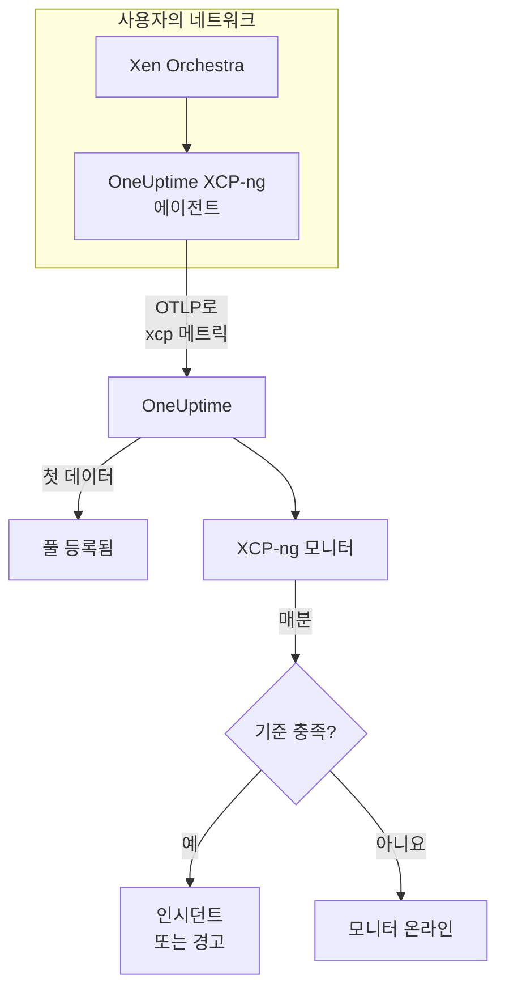

# XCP-ng 모니터

XCP-ng 모니터는 XCP-ng 풀 하나(그 호스트, VM, 스토리지 리포지토리, 가상 디스크)를 감시하고, Xen Orchestra가 풀을 잃거나, 호스트가 오프라인이 되거나 비활성 상태로 남거나, 실행 중이던 VM이 멈추거나 CPU가 부족해지거나, 스토리지 리포지토리가 가득 차거나 느려질 때 알려 줍니다. OneUptime XCP-ng 에이전트가 수집하는 Xen Orchestra OpenMetrics 플러그인의 `xcp_*` 계열과, OneUptime이 그로부터 만들어 내는 상태 계열을 읽으므로 외부에서 아무것도 조사하지 않습니다.

:::cards
- [모니터 만들기](#xcp-ng-모니터-만들기): 대시보드에서 6단계.
- [템플릿](#미리-만들어진-경고-템플릿): 호스트, VM, 스토리지 리포지토리마다 인시던트 하나를 만드는 10개의 기본 제공 경고.
- [리소스 식별](#리소스-식별): 호스트, VM, 스토리지 리포지토리 하나를 대상으로 지정하는 방법.
- [메트릭](#수집되는-메트릭): 모니터가 경고를 보낼 수 있는 모든 계열.
:::

## 작동 방식

OneUptime XCP-ng 에이전트는 Xen Orchestra에 닿을 수 있는 머신에서 실행됩니다. 60초마다 Xen Orchestra의 OpenMetrics 플러그인을 읽고(플러그인은 Xen Orchestra가 관리하는 모든 풀의 모든 호스트를 읽습니다), 풀마다 리소스 하나로, 풀의 UUID `xcp_ng.pool.id`를 붙여 OTLP로 계열을 OneUptime에 보냅니다. 첫 데이터가 각 풀을 등록합니다.

XCP-ng 모니터는 풀 하나에 묶입니다. 매분 그 풀의 메트릭에 대해 쿼리를 실행하고 결과를 기준과 비교합니다.



## 시작하기 전에

- **XCP-ng 에이전트를 설치하세요**. Xen Orchestra에 닿을 수 있는 곳에 Xen Orchestra OpenMetrics 플러그인의 시크릿으로 설치합니다. [XCP-ng 에이전트 가이드](/docs/telemetry/xcp-ng)에서 플러그인, Xen Orchestra의 인증서, 설치를 다룹니다.
- **풀이 등록되었는지 확인하세요.** 첫 수집 후 약 1분이 지나면 Xen Orchestra에서의 이름으로 **제품 → 인프라 → XCP-ng → 모든 풀** 에 나타납니다.

## XCP-ng 모니터 만들기

:::steps
### 새 모니터 시작

**모니터** 로 이동해 **모니터 생성** 을 클릭합니다.

### XCP-ng 고르기

**모니터 유형** 에서 **더 많은 모니터 유형** 을 클릭하고 **인프라** 아래의 **XCP-ng** 를 고르거나, 검색 상자에 `xcp`를 입력합니다. **이름** 을 입력하고(인시던트와 경고 제목에 쓰입니다) **다음** 을 클릭합니다.

### 풀 고르기

**XCP-ng Monitor Configuration** 에서 **XCP-ng 풀** 의 풀을 고릅니다. 데이터를 보낸 모든 풀이 목록에 있습니다. 고르고 나면 필드 아래 줄에 데이터가 들어오는지 표시됩니다. **XCP-ng 풀 추가** 는 키가 채워진 설정 단계를 열고 첫 데이터를 기다립니다.

### 감시할 대상 선택

새 모니터는 **경고 대상** 아래의 **Pool Disconnected** 에서 시작합니다. 다른 것을 감시하려면 다음 중 하나를 사용합니다.

- **변경** – 다른 [템플릿](#미리-만들어진-경고-템플릿)을 고릅니다. 메트릭, 필터, 집계, 시간 범위, 임계값을 설정하고 아래 기준을 템플릿의 기준으로 바꿉니다. **시간 범위** 는 계속 바꿀 수 있습니다.
- **Custom Metric** (**추가 필드** 안) – **XCP-ng Metric** 에서 메트릭 하나를 고른 다음 **집계** 와 **시간 범위** 를 설정합니다. [필터](#모니터-설정)로 객체 종류나 객체 하나로 좁힙니다.
- **고급** (**추가 필드** 안) – **메트릭 선택** 에서 쿼리와 수식을 직접 만듭니다. 예를 들어 `xcp_sr_physical_usage_bytes / xcp_sr_physical_size_bytes`로 스토리지 리포지토리의 사용 비율을 구합니다. **그룹화 기준** 에 `xcp_ng.id`를 지정하면 객체를 하나씩 판단합니다.

### 기준 확인

**기준** 의 각 기준을 열어 **메트릭**, **집계**, **조건**, **임계값** 을 확인합니다. 템플릿은 이것들을 채웁니다. **Custom Metric** 이나 **고급** 을 쓰면 모니터는 메트릭이 데이터를 보내지 않는 것만 감지하는 [기본 기준](#기본-기준)으로 시작하므로, 직접 임계값을 설정하세요.

### 모니터 만들기

**모니터 생성** 을 클릭합니다. OneUptime이 모니터 페이지를 열고 매분 평가합니다. 모니터가 연 인시던트와 경고는 풀의 **인시던트** 및 **경고** 페이지에도 표시됩니다.
:::

> [!TIP]
> 여러 템플릿을 한 번에 설정하려면 **제품 → 인프라 → XCP-ng** 에서 풀을 열고 **권장 사항** 으로 이동하세요. 원하는 템플릿과 호출할 사람을 고르면 OneUptime이 템플릿마다 모니터를 하나씩 만듭니다.

## 모니터 설정

| 필드 | 탭 | 하는 일 |
| --- | --- | --- |
| **XCP-ng 풀** | 모두 | 필수. 모든 쿼리를 풀의 UUID인 `resource.xcp_ng.pool.id`로 한정하므로 이름이 같은 두 풀이 섞이지 않습니다. |
| **리소스 범위** | Custom Metric, 고급 | 선택 사항. **호스트**, **VM**, **스토리지 리포지토리**, **가상 디스크**, **XOSTOR**, **XCP-ng 풀** 중 하나로, `xcp_ng.scope`와 정확히 일치합니다. |
| **UUID** | Custom Metric, 고급 | 선택 사항. `xcp_ng.id`와 정확히 일치하며, Xen Orchestra에 표시되는 호스트, VM, 스토리지 리포지토리, 가상 디스크 하나의 UUID입니다. 범위와 함께 쓰면 객체 하나를 대상으로 지정합니다. |
| **호스트 이름** | Custom Metric, 고급 | 선택 사항. Xen Orchestra의 `host_name` 레이블과 정확히 일치하며, 호스트 자체의 계열과 그 호스트에서 실행되는 VM의 계열이 대상입니다. |
| **XCP-ng Metric** | Custom Metric | [카탈로그](#수집되는-메트릭)의 메트릭 하나. |
| **집계** | Custom Metric | 샘플을 합치는 방식: **평균**, **최대**, **최소**, **합계**, **개수**. 메트릭의 일반적인 집계에서 시작합니다. |
| **시간 범위** | 모두 | 쿼리가 읽는 이동 기간으로, **Past 1 Minute** 부터 **Past 365 Days** 까지입니다. 새 모니터는 **Past 1 Minute** 에서 시작하고, 템플릿은 자체 값을 설정합니다. |
| **메트릭 선택** | 고급 | 쿼리 빌더: **메트릭**, **집계 기준**, **속성으로 필터링**, **그룹화 기준**, 그리고 쿼리를 결합하는 **메트릭 추가** 와 **수식 추가**. |

에이전트는 60초마다 Xen Orchestra를 읽고, Xen Orchestra는 60초 해상도로 호스트를 읽으므로 1분 기간에는 샘플이 대략 하나만 들어 있습니다. 템플릿은 5분 이상을 읽습니다.

## 리소스 식별

Xen Orchestra는 호스트나 VM을 `uuid` 레이블로, 스토리지 리포지토리를 `sr_uuid`로, 가상 디스크를 `vdi_uuid`로 식별합니다. OneUptime은 들어오는 모든 데이터 포인트에 속성 두 개를 붙이므로, 어떤 레이블로 식별되었든 필터 하나로 객체의 모든 계열을 읽습니다. 템플릿은 이 속성에 의존합니다.

| 속성 | 값 | VM의 경우 |
| --- | --- | --- |
| `xcp_ng.scope` | `pool`, `host`, `vm`, `sr`(스토리지 리포지토리), `vdi`(가상 디스크), `xostor` | `vm` |
| `xcp_ng.id` | 객체의 UUID(소문자). 호스트나 VM의 `uuid`, 스토리지 리포지토리나 XOSTOR 클러스터의 `sr_uuid`, 가상 디스크의 `vdi_uuid`, 풀 자체 계열에서는 풀 자체의 UUID | `5c6d7e8f-1a2b-4c3d-9e8f-0a1b2c3d4e5f` |

객체 종류 하나는 `xcp_ng.scope`로, 객체 하나는 `xcp_ng.id`로 필터링하고, 객체를 하나씩 판단하려면 `xcp_ng.id`로 그룹화하세요. Xen Orchestra 자체의 레이블은 보낸 그대로 남습니다. `host_name`은 호스트 계열에서는 호스트를, VM 계열에서는 그 VM의 호스트를 가리키고, `vm_name`, `sr_name`, `vdi_name`이 나머지를 가리키며, `power_state`와 `enabled`는 상태 계열에서 호스트나 VM의 상태를 담고, `is_control_domain`은 컨트롤 도메인의 VM 계열에서 `true`입니다.

풀 자체는 계열이 도착하는 리소스이므로, 그 속성은 필터와 그룹화 키에서 `resource.` 접두사를 붙여 씁니다: `resource.xcp_ng.pool.id`(UUID), `resource.xcp_ng.pool.name`(Xen Orchestra에서의 이름), `resource.xen_orchestra.name`(읽어 오는 Xen Orchestra).

## 미리 만들어진 경고 템플릿

**경고 대상** 목록에는 템플릿이 12개 있습니다. 각각 완전한 모니터를 만듭니다. 쿼리, 속성 필터, 그룹화, 작동하는 기준, 회복하는 기준입니다. 대부분 `xcp_ng.id`로 그룹화하므로 호스트, VM, 스토리지 리포지토리마다 자체 인시던트와 경고를 받습니다. 임계값은 출발점이며 편집할 수 있습니다.

기준은 기간의 매분 조건이 유지될 때만 작동하고, 임계값 기준은 임계값에서 10% 지난 지점에서 회복하므로 경계 근처를 오가는 값 때문에 깜빡이지 않습니다. 0/1 계열은 다른 쪽 값에서 회복합니다.

| 템플릿 | 카테고리 | 심각도 | 감시 대상 | 작동 조건 | 회복 조건 |
| --- | --- | --- | --- | --- | --- |
| Pool Disconnected | 가용성 | 심각 | `xcp_pool_connected`, 풀 전체에 대한 Count, 최근 10분 | 기간 내내 데이터 없음 | 데이터가 다시 들어옴 |
| Host Offline | 가용성 | 심각 | `xcp_ng.host.running`(`xcp_ng.scope = host`), `xcp_ng.id`별 Min, 최근 5분 | 1 미만 | 1이 됨 |
| HA Cannot Tolerate a Host Failure | 가용성 | 심각 | `xcp_ng.pool.ha.can_tolerate_host_failure`(`xcp_ng.scope = pool`), 풀 전체에 대한 Max, 최근 5분 | 1 미만 | 1이 됨 |
| VM Stopped | VM | 경고 | `xcp_ng.vm.stopped_after_running`(`xcp_ng.scope = vm`), `xcp_ng.id`별 Min, 최근 5분 | 0 초과 | 0이 됨 |
| VM Not Backed Up | VM | 경고 | `xcp_ng.vm.backup_overdue`(`xcp_ng.scope = vm`), `xcp_ng.id`별 Min, 최근 10분 | 0 초과 | 0이 됨 |
| Storage Repository Near Full | 스토리지 | 심각 | `xcp_sr_physical_usage_bytes` ÷ `xcp_sr_physical_size_bytes` × 100(`xcp_ng.scope = sr`, 둘 다 합계), `xcp_ng.id`별, 최근 5분 | 90% 초과 | 81% 이하 |
| Host Disabled | 호스트 | 경고 | `xcp_ng.host.enabled`(`xcp_ng.scope = host`), `xcp_ng.id`별 Max, 최근 30분 | 1 미만 | 1이 됨 |
| Host Restarted | 호스트 | 경고 | `xcp_host_uptime_seconds`와 `xcp_ng.host.running`(`xcp_ng.scope = host`), `xcp_ng.id`별 Min, 최근 5분 | `xcp_host_uptime_seconds`가 900(15분) 미만이고 `xcp_ng.host.running`이 1 | `xcp_host_uptime_seconds`가 990 이상이거나 `xcp_ng.host.running`이 0 |
| High Host CPU Usage | 호스트 | 경고 | `xcp_host_cpu_average`(`xcp_ng.scope = host`), `xcp_ng.id`별 Avg, 최근 10분 | 0.9 초과(호스트 CPU의 90%) | 0.81 이하 |
| High Host Memory Usage | 호스트 | 경고 | (`xcp_host_memory_total_bytes` − `xcp_host_memory_free_bytes`) ÷ `xcp_host_memory_total_bytes` × 100(`xcp_ng.scope = host`, 둘 다 합계), `xcp_ng.id`별, 최근 10분 | 95% 초과 | 85.5% 이하 |
| VM Starved of CPU | VM | 경고 | `xcp_vm_runstate_full_contention`(`xcp_ng.scope = vm`), `xcp_ng.id`별 Avg, 최근 15분 | 0.1 초과(시간의 10%) | 0.09 이하 |
| Storage Repository Slow | 스토리지 | 경고 | `xcp_host_disk_latency_seconds`(`xcp_ng.scope = host`), `sr`별 Avg, 최근 15분 | 0.05 초과(50 ms) | 0.045 이하 |

**심각도** 는 선택 목록에 표시되는 레이블입니다. 템플릿이 만드는 인시던트와 경고는 프로젝트에서 가장 심각한 인시던트 및 경고 심각도로 시작하니, 기준에서 바꾸세요.

- **Pool Disconnected** 템플릿은 `xcp_pool_connected`가 10분 동안 들어오지 않으면 작동합니다. Xen Orchestra는 풀에 연결된 동안 수집할 때마다 이를 보내고, 풀의 마스터를 잃으면 0을 보내는 대신 보내기를 멈춥니다. Xen Orchestra, 그 플러그인, XCP-ng 에이전트가 멈추거나 에이전트가 OneUptime으로 가는 경로를 잃어도 멈춥니다. 계열이 돌아오면 해결됩니다. 데이터가 멈추면 다른 템플릿은 비교할 것이 없어 마지막 상태를 유지하므로, 이를 알려 주는 것은 이 템플릿입니다.
- **Host Offline** 템플릿은 `xcp_ng.host.running`을 읽습니다. 이 계열은 OneUptime이 `xcp_host_status`에서 만들어 내며, Xen Orchestra가 호스트를 Halted로 보고하는 동안, 또는 풀 마스터가 호스트와 연락이 끊겨 상태가 Unknown인 동안 0입니다. HA가 다른 곳에서 다시 시작하지 않는 한 그 호스트에서 실행되던 VM도 다운된 상태입니다.
- **HA Cannot Tolerate a Host Failure**는 `xcp_ng.pool.ha.can_tolerate_host_failure`를 읽습니다. XAPI에서 직접 읽으면 HA 자체의 계획으로, 오버커밋되었거나 견디도록 설정된 것보다 적은 호스트 장애만 감당하는 상태입니다. 계획을 보고하지 않는 REST API를 가진 Xen Orchestra를 통해 읽으면, VM을 다시 시작할 수 있는 켜져 있고 활성화된 호스트가 두 대 미만인 상태이므로 호스트 두 대짜리 HA 풀에서 한 대를 비활성화하기만 해도 해당됩니다. HA가 꺼져 있는 동안에는 발생하지 않습니다.
- **VM Stopped** 템플릿은 `xcp_ng.vm.stopped_after_running`을 읽습니다. 지난 24시간 동안 실행된 VM이 Halted 또는 Paused인 동안 1입니다. 하루 넘게 꺼져 있는 VM은 의도적으로 끈 것으로 보아 경고를 멈추고, 일시 중단된 VM은 경고하지 않으며, 컨트롤 도메인과 VM 템플릿은 제외됩니다.
- **VM Not Backed Up**는 Xen Orchestra의 백업 로그에서 구한 `xcp_ng.vm.backup_overdue`를 읽습니다. 예약된 백업 작업에 포함된 VM이 간격(작업 일정의 두 실행 사이에서 가장 긴 간격)과 그 4분의 1(최소 1시간) 안에 성공한 백업이 없는 동안 1입니다. 매일 밤 실행되는 작업의 VM은 30시간 뒤에 발생하고, 어떤 예약 작업에도 포함되지 않은 VM은 발생하지 않습니다.
- **Host Disabled** 템플릿은 30분 동안 비활성 상태로 남은 호스트에서 작동합니다. 유지 관리 모드이거나 대피 후 비활성 상태로 남은 호스트입니다. XAPI는 그 호스트에서 VM을 시작하지 않으며 HA도 그 호스트로 장애 조치할 수 없습니다. 30분이면 계획된 재부팅이나 업데이트로 누군가를 호출하는 일이 없습니다.
- **Host Restarted** 템플릿은 실행 중이지만 가동된 지 15분이 안 된 호스트에서 작동합니다. 재부팅했거나, 충돌한 뒤 다시 올라온 호스트입니다. 호스트가 16.5분 동안 가동되면(임계값에서 10% 지난 지점) 해결됩니다. 다운된 호스트에서는 대신 **Host Offline** 이 작동합니다.
- **비율 수식** 은 양쪽의 **합계** 를 씁니다. 둘 다 같은 수집에서 오므로 결과는 진짜 퍼센트입니다. 일부 ISO 라이브러리와 이동식 미디어처럼 크기를 0으로 보고하는 스토리지 리포지토리에서는 작동하지 않습니다.
- **VM Starved of CPU** 템플릿은 전체 경합을 읽습니다. VM의 모든 vCPU가 실행할 준비가 되었지만 물리 CPU를 기다린 시간의 비율입니다. 그 호스트에는 CPU 스레드보다 실행 가능한 vCPU가 많아서, VM은 자체 CPU 사용량이 보여 주는 것보다 느리게 실행됩니다.
- **Storage Repository Slow** 템플릿은 `sr`로 그룹화합니다. 이는 호스트의 모든 디스크 계열에 있는 Xen Orchestra의 스토리지 리포지토리 짧은 ID입니다. 따라서 스토리지 리포지토리마다 인시던트 하나를 받으며, 그 지연 시간은 읽고 쓰는 호스트 전체에 대해 평균됩니다.

**HA Cannot Tolerate a Host Failure**와 **VM Not Backed Up**은 프로브가 풀을 읽을 때 더해지는 계열을 읽으므로, 프로브에서 연결한 풀이 필요합니다. XCP-ng 에이전트가 읽는 플러그인은 HA 상태도 백업도 보고하지 않습니다. 프로브가 읽는 풀은 충돌한 VM이나 HA가 잃은 호스트 같은 XAPI 메시지와 알람, 실패한 백업 작업에 대해서도 경고를 보낼 수 있습니다. [에이전트 없는 XCP-ng](/docs/telemetry/xcp-ng-agentless)에서 설명하듯이 풀의 **권장 사항**에서 그 템플릿을 켜세요.

## 수집되는 메트릭

에이전트는 Xen Orchestra OpenMetrics 플러그인의 모든 계열을 60초마다 읽습니다. 아래 계열은 모니터 양식이 제공하는 카탈로그입니다. Xen Orchestra는 XAPI의 KiB, MiB/s, 마이크로초를 이미 바이트, 초당 바이트, 초로 바꿔 둡니다. `_total`이라는 이름으로 카운터로 지정된 계열 8개에는 초당 비율이 들어 있으며, [XCP-ng 에이전트 가이드](/docs/telemetry/xcp-ng#에이전트가-수집하는-것)에서 설명하듯 OneUptime은 이를 본래의 비율로 저장합니다. `xcp_ng.*` 계열은 OneUptime 자체의 것입니다. 4개는 들어오는 Xen Orchestra의 상태 계열에서, 6개는 프로브가 메트릭 외에 읽는 내용에서 만들어 내며, 뒤의 6개는 XCP-ng 에이전트만 읽는 풀에는 없습니다.

### 가용성

| 메트릭 | 단위 | 설명 |
| --- | --- | --- |
| `xcp_pool_connected` | — | Xen Orchestra가 풀에 연결된 동안 1. Xen Orchestra는 풀을 잃으면 0을 보내는 대신 보내기를 멈추므로, 이 계열이 멈추는지 지켜보세요. |
| `xcp_ng.host.running` | — | Xen Orchestra가 호스트를 Running으로 보고하는 동안 1, Halted이거나 상태가 Unknown인 동안 0. OneUptime이 호스트의 상태에서 만들어 냅니다. |
| `xcp_ng.host.enabled` | — | 호스트가 활성화된 동안 1, 유지 관리 모드이거나 대피 중이라 XAPI가 그 호스트에서 VM을 시작하지 않는 동안 0. OneUptime이 호스트의 상태에서 만들어 냅니다. |
| `xcp_ng.vm.running` | — | VM이 Running인 동안 1, Halted, Paused, Suspended인 동안 0. 컨트롤 도메인은 제외됩니다. OneUptime이 VM의 상태에서 만들어 냅니다. |
| `xcp_ng.vm.stopped_after_running` | — | 지난 24시간 동안 실행된 VM이 Halted 또는 Paused인 동안 1, 그 밖에는 0. 하루 동안 아무도 실행을 보지 못한 VM은 의도적으로 끈 것으로 보며, 일시 중단된 VM은 세지 않습니다. OneUptime이 만들어 냅니다. |
| `xcp_ng.pool.ha.enabled` | — | 풀의 고가용성이 켜져 있는 동안 1, 그렇지 않으면 0입니다. 프로브가 Xen Orchestra의 REST API를 통해 또는 XAPI에서 직접 읽으며, XCP-ng 에이전트는 읽지 않습니다. |
| `xcp_ng.pool.ha.can_tolerate_host_failure` | — | HA가 켜져 있는 동안, 아직 호스트 장애를 견딜 수 있으면 1, 견딜 수 없게 되면 0입니다. XAPI에서 직접 읽으면 HA 자체의 계획이고, 계획을 보고하지 않는 Xen Orchestra를 통하면 장애가 난 호스트 외에 실행 중이고 활성화된 호스트가 있는지 여부입니다. OneUptime이 계산합니다. |
| `xcp_ng.pool.ha.host_failures_to_tolerate` | — | HA가 견디도록 설정된 호스트 장애 수입니다. XAPI에서 직접 읽을 때만 표시되며, Xen Orchestra의 REST API는 보고하지 않습니다. |
| `xcp_ng.pool.ha.plan_exists_for` | — | 보호된 모든 VM을 다시 시작한 상태로 HA 계획이 아직 견딜 수 있는 호스트 장애 수입니다. XAPI에서 직접 읽을 때만 표시됩니다. |
| `xcp_host_status` | count | 실행 여부와 관계없이 모든 호스트에서 항상 1. 호스트의 상태는 `power_state`(Running, Halted, Unknown)와 `enabled` 레이블에 있습니다. |
| `xcp_vm_status` | count | 컨트롤 도메인과 VM 템플릿을 제외한 모든 VM에서 항상 1. VM의 상태는 `power_state` 레이블(Running, Halted, Paused, Suspended)에 있습니다. |
| `xcp_host_uptime_seconds` | seconds | 호스트가 부팅된 뒤 가동된 시간. |
| `xcp_vm_uptime_seconds` | seconds | 실행 중인 VM이 시작된 뒤 가동된 시간. VM이 실행되는 동안에만 보고됩니다. |

### 호스트

| 메트릭 | 단위 | 설명 |
| --- | --- | --- |
| `xcp_ng.host.missing_patches` | — | Xen Orchestra가 마지막으로 나열한 호스트의 누락된 패치 수입니다(6시간마다 확인). |
| `xcp_host_cpu_average` | ratio | 호스트의 CPU 사용량을 코어 전체에 대해 평균한 값(0에서 1 사이의 비율). |
| `xcp_host_cpu_core_usage` | ratio | 호스트에 있는 CPU 스레드 하나의 사용량(0에서 1 사이의 비율). 어느 스레드인지는 `core` 레이블이 알려 줍니다. |
| `xcp_host_load` | — | 호스트에서 실행 중이거나 실행을 기다리는 vCPU를 물리 CPU 하나당으로 나타낸 값. 1을 넘으면 VM이 CPU를 기다립니다. |
| `xcp_host_load_average` | — | 호스트 컨트롤 도메인(dom0)의 부하 평균. |
| `xcp_host_memory_total_bytes` | bytes | 호스트의 물리 메모리. |
| `xcp_host_memory_free_bytes` | bytes | 어떤 VM에도 할당되지 않은 호스트의 메모리. `xcp_host_memory_total_bytes`와 비교하면 호스트가 얼마나 찼는지 알 수 있습니다. |
| `xcp_host_memory_reclaimed_bytes` | bytes | 동적 메모리 제어가 호스트의 VM에서 회수한 메모리. |
| `xcp_host_memory_reclaimed_max_bytes` | bytes | 동적 메모리 제어가 호스트의 VM에서 회수할 수 있었던 최대 메모리. |
| `xcp_host_running_vcpus` | count | 호스트에서 실행 중인 VM의 vCPU 합계. |
| `xcp_host_power_consumption_watts` | W | DCMI 센서에서 읽은 호스트의 소비 전력. Xen Orchestra가 대신 IPMI로 읽는 경우에는 그 값을 풀 없이 보내므로 에이전트가 유지하지 않습니다. 각 VM의 추정 몫은 유지됩니다. |

### VM

| 메트릭 | 단위 | 설명 |
| --- | --- | --- |
| `xcp_ng.vm.backup_overdue` | — | Xen Orchestra의 예약된 백업 작업에 포함된 VM의 경우, 작업 간격과 그 4분의 1(최소 1시간) 안에 성공한 백업이 없는 동안 1, 그렇지 않으면 0입니다. OneUptime이 백업 로그에서 계산합니다. |
| `xcp_vm_cpu_usage` | ratio | VM의 CPU 사용량을 vCPU 전체에 대해 평균한 값(0에서 1 사이의 비율). |
| `xcp_vm_cpu_core_usage` | ratio | vCPU 하나의 사용량(0에서 1 사이의 비율). 어느 vCPU인지는 `core` 레이블이 알려 줍니다. |
| `xcp_vm_runstate_full_contention` | ratio | VM의 모든 vCPU가 실행할 준비가 되었지만 물리 CPU를 기다린 시간의 비율(0에서 1). 값이 높으면 이웃 VM 때문에 VM의 CPU가 부족한 것입니다. |
| `xcp_vm_runstate_partial_contention` | ratio | VM의 일부 vCPU가 물리 CPU를 기다리고 나머지는 차단된 시간의 비율(0에서 1). |
| `xcp_vm_runstate_concurrency_hazard` | ratio | VM의 일부 vCPU가 실행되는 동안 다른 vCPU가 물리 CPU를 기다린 시간의 비율(0에서 1). |
| `xcp_vm_runstate_fullrun` | ratio | VM의 모든 vCPU가 실행된 시간의 비율(0에서 1). |
| `xcp_vm_runstate_partial_run` | ratio | VM의 일부 vCPU가 실행되고 나머지는 차단된 시간의 비율(0에서 1). |
| `xcp_vm_runstate_blocked` | ratio | VM의 모든 vCPU가 할 일이 없거나 I/O를 기다리며 차단된 시간의 비율(0에서 1). |
| `xcp_vm_memory_bytes` | bytes | VM에 할당된 메모리. |
| `xcp_vm_memory_target_bytes` | bytes | 동적 메모리 제어가 VM에 주려는 메모리. |
| `xcp_vm_memory_internal_free_bytes` | bytes | 게스트가 비어 있다고 보고하는 메모리. VM에 게스트 도구가 필요합니다. |
| `xcp_vm_power_consumption_watts` | W | 호스트 소비 전력 중 VM의 몫을 CPU 부하에 따라 나눠 Xen Orchestra가 추정한 값. VM의 CPU 값이 빠졌으면 그 `data_complete` 레이블이 `false`입니다. |

### 스토리지

| 메트릭 | 단위 | 설명 |
| --- | --- | --- |
| `xcp_sr_physical_size_bytes` | bytes | 스토리지 리포지토리의 물리 크기. 일부 ISO 라이브러리와 이동식 미디어는 0을 보고합니다. |
| `xcp_sr_physical_usage_bytes` | bytes | 스토리지 리포지토리에서 사용 중인 공간. 크기로 나누면 얼마나 찼는지 알 수 있습니다. |
| `xcp_sr_virtual_size_bytes` | bytes | 스토리지 리포지토리에 있는 모든 디스크의 가상 크기 합계. 크기를 넘으면 리포지토리는 담을 수 있는 것보다 많이 씬 프로비저닝된 것입니다. |
| `xcp_vdi_virtual_size_bytes` | bytes | VM이 보는 가상 디스크의 크기. |
| `xcp_vdi_physical_usage_bytes` | bytes | 가상 디스크가 스토리지 리포지토리에서 차지하는 공간. |
| `xcp_host_disk_iops_read` | ops/s | 호스트에서 스토리지 리포지토리로의 초당 읽기 작업 수. 어느 리포지토리인지는 `sr_name` 레이블이 알려 줍니다. |
| `xcp_host_disk_iops_write` | ops/s | 호스트에서 스토리지 리포지토리로의 초당 쓰기 작업 수. |
| `xcp_host_disk_iops_total` | ops/s | 호스트에서 스토리지 리포지토리로의 초당 읽기와 쓰기 작업 수. |
| `xcp_host_disk_throughput_read_bytes` | bytes/s | 호스트가 스토리지 리포지토리에서 읽는 초당 바이트 수. |
| `xcp_host_disk_throughput_write_bytes` | bytes/s | 호스트가 스토리지 리포지토리에 쓰는 초당 바이트 수. |
| `xcp_host_disk_throughput_total_bytes` | bytes/s | 호스트가 스토리지 리포지토리에서 읽고 쓰는 초당 바이트 수. |
| `xcp_host_disk_read_latency_seconds` | seconds | 호스트가 스토리지 리포지토리에서 읽는 데 걸리는 시간. |
| `xcp_host_disk_write_latency_seconds` | seconds | 호스트가 스토리지 리포지토리에 쓰는 데 걸리는 시간. |
| `xcp_host_disk_latency_seconds` | seconds | 호스트가 스토리지 리포지토리에서 읽고 쓰는 데 걸리는 시간. |
| `xcp_host_disk_iowait` | ratio | 호스트가 스토리지 리포지토리를 기다린 시간의 비율(0에서 1). |
| `xcp_vm_disk_read_bytes_total` | bytes/s | VM이 자신의 디스크 중 하나에서 읽는 초당 바이트 수. 어느 디스크인지는 `device` 레이블이 알려 줍니다. Xen Orchestra가 `_total`이라는 이름으로 카운터로 지정하지만 비율입니다. |
| `xcp_vm_disk_write_bytes_total` | bytes/s | VM이 자신의 디스크 중 하나에 쓰는 초당 바이트 수. Xen Orchestra가 `_total`이라는 이름으로 카운터로 지정하지만 비율입니다. |
| `xcp_vm_disk_iops_read` | ops/s | VM 디스크의 초당 읽기 작업 수. |
| `xcp_vm_disk_iops_write` | ops/s | VM 디스크의 초당 쓰기 작업 수. |
| `xcp_vm_disk_iops_total` | ops/s | VM 디스크의 초당 읽기와 쓰기 작업 수. |
| `xcp_vm_disk_throughput_read_bytes` | bytes/s | VM 디스크에서 읽는 초당 바이트 수. |
| `xcp_vm_disk_throughput_write_bytes` | bytes/s | VM 디스크에 쓰는 초당 바이트 수. |
| `xcp_vm_disk_throughput_total_bytes` | bytes/s | VM 디스크에서 읽고 쓰는 초당 바이트 수. |
| `xcp_vm_disk_read_latency_seconds` | seconds | VM 디스크에서 읽는 데 걸리는 시간. |
| `xcp_vm_disk_write_latency_seconds` | seconds | VM 디스크에 쓰는 데 걸리는 시간. |
| `xcp_vm_disk_latency_seconds` | seconds | VM 디스크에서 읽고 쓰는 데 걸리는 평균 시간. |
| `xcp_vm_disk_iowait` | ratio | VM이 자신의 디스크 중 하나를 기다린 시간의 비율(0에서 1). |
| `xcp_vm_disk_inflight` | count | VM 디스크에서 아직 응답하지 않은 요청. |
| `xcp_vm_disk_queue_size` | count | VM 디스크 요청 대기열의 평균. |

### 네트워크

| 메트릭 | 단위 | 설명 |
| --- | --- | --- |
| `xcp_host_network_receive_bytes_total` | bytes/s | 호스트가 물리 인터페이스 하나에서 받는 초당 바이트 수. 어느 인터페이스인지는 `interface` 레이블이 알려 줍니다. Xen Orchestra가 `_total`이라는 이름으로 카운터로 지정하지만 비율입니다. |
| `xcp_host_network_transmit_bytes_total` | bytes/s | 호스트가 물리 인터페이스 하나에서 보내는 초당 바이트 수. Xen Orchestra가 `_total`이라는 이름으로 카운터로 지정하지만 비율입니다. |
| `xcp_host_network_aggregated_receive_bytes` | bytes/s | 호스트가 모든 물리 인터페이스에서 받는 초당 바이트 수. |
| `xcp_host_network_aggregated_transmit_bytes` | bytes/s | 호스트가 모든 물리 인터페이스에서 보내는 초당 바이트 수. |
| `xcp_vm_network_receive_bytes_total` | bytes/s | VM이 자신의 네트워크 인터페이스 중 하나에서 받는 초당 바이트 수. 어느 인터페이스인지는 `vif` 레이블이 알려 줍니다. Xen Orchestra가 `_total`이라는 이름으로 카운터로 지정하지만 비율입니다. |
| `xcp_vm_network_transmit_bytes_total` | bytes/s | VM이 자신의 네트워크 인터페이스 중 하나에서 보내는 초당 바이트 수. Xen Orchestra가 `_total`이라는 이름으로 카운터로 지정하지만 비율입니다. |
| `xcp_vm_network_receive_errors_total` | errors/s | VM 네트워크 인터페이스 중 하나의 초당 수신 오류 수. Xen Orchestra가 카운터로 지정하지만 비율입니다. |
| `xcp_vm_network_transmit_errors_total` | errors/s | VM 네트워크 인터페이스 중 하나의 초당 송신 오류 수. Xen Orchestra가 카운터로 지정하지만 비율입니다. |

### XOSTOR

XOSTOR(LINSTOR 기반의 Vates 복제 스토리지)를 실행하는 풀에서만 보냅니다.

| 메트릭 | 단위 | 설명 |
| --- | --- | --- |
| `xcp_xostor_up` | — | Xen Orchestra가 XOSTOR 클러스터의 상태를 읽었으면 1, 읽지 못했으면 0. |
| `xcp_xostor_node_status` | count | XOSTOR 클러스터의 모든 노드에서 항상 1. 역할과 상태는 `role`과 `state` 레이블에 있습니다. |
| `xcp_xostor_resource_total` | count | XOSTOR 클러스터가 정의하는 LINSTOR 리소스. |
| `xcp_xostor_resource_state_count` | count | 디스크 상태별 XOSTOR 클러스터의 리소스 복제본. 어느 상태인지는 `state` 레이블이 알려 줍니다. |
| `xcp_xostor_alarms_up` | — | Xen Orchestra가 XOSTOR 클러스터의 알람을 읽었으면 1, 읽지 못했으면 0. |
| `xcp_xostor_alarms_count` | count | XOSTOR 스토리지 리포지토리나 그 호스트에서 활성화된 XAPI 알람(`alarm_name`과 `target_type`별). 발생한 알람이 없으면 존재하지 않습니다. |
| `xcp_xostor_smart_up` | — | Xen Orchestra가 XOSTOR용으로 호스트의 SMART 데이터를 읽었으면 1, 읽지 못했으면 0. |
| `xcp_xostor_disk_smart_status` | count | XOSTOR 호스트의 모든 디스크에서 항상 1. SMART 상태는 `status` 레이블에 있습니다. |
| `xcp_xostor_updates_up` | — | 호스트의 XOSTOR 업데이트 확인이 응답했으면 1, 실패했으면 0. |
| `xcp_xostor_package_update_available` | count | 호스트에서 업데이트를 기다리는 XOSTOR 패키지마다 1. 어느 패키지인지는 `package` 레이블이 알려 줍니다. |

## 모니터링 기준

기준은 모니터의 쿼리나 수식 하나를 임계값과 비교합니다. XCP-ng 모니터의 기준에는 **필터 유형** 이 없으며, 모든 규칙이 다음 필드로 메트릭 값을 확인합니다.

| 필드 | 하는 일 |
| --- | --- |
| **메트릭** | 확인할 쿼리나 수식(변수 이름으로 지정). |
| **집계** | 기간 안의 값을 하나의 답으로 만드는 방식: **평균**, **합계**, **최댓값**, **최솟값**, **모든 값**(기간 전체에서 모든 값이 일치해야 함), **임의의 값**(하나면 충분). |
| **조건** | **보다 큼**, **보다 작음**, **이상**, **이하**, **같음**, **같지 않음**, 또는 이상 조건 **비정상적으로 높음**, **비정상적으로 낮음**, **비정상**. **데이터 없음**은 창 안에서 쿼리가 아무것도 반환하지 않았을 때, **데이터 있음**은 무언가 반환했을 때 일치합니다. **초과 예상**과 **미만 예상**은 기간 안의 메트릭 추세가 **예측 기간**이 끝날 때 임계값을 넘어 있으면 일치합니다. |
| **임계값** | 비교할 값. 메트릭에 단위가 있으면 옆에 단위 목록이 있습니다. 이상 조건에서는 표시되지 않습니다. |
| **민감도** | 이상 조건 전용. **낮음**(4σ), **중간**(3σ, 기본값), **높음**(2σ). |
| **기준선 기간** | 이상 조건 전용. 기록 14일(기본값), 28일, 60일, 90일. |
| **데이터가 없는 경우** | **추가 필드** 아래에 있습니다. 기간에 샘플이 없을 때의 동작: **Ignore**(기본값), **Treat As Zero**, **트리거**. |

이상 조건은 각 값을 기준선의 같은 요일·같은 시간대와 비교합니다. 기준선 기간에 기록이 충분히 쌓일 때까지 "Learning" 상태로 남으며 아무것도 만들지 않습니다. 이 모니터는 쿼리를 속성으로 필터링하므로, 각 쿼리와 그룹화한 쿼리의 각 시리즈는 메트릭이 보관되는 기간까지 자신의 기록과 비교합니다. 그 기간이 2주 미만이면 합계, 개수 또는 히스토그램에 대한 쿼리는 계속 이 상태로 남고, 나머지는 메트릭의 모든 시리즈와 비교합니다. 히스토그램의 백분위수는 항상 이 상태로 남습니다.

각 기준은 일치했을 때 할 일도 정합니다. 모니터 상태 변경, 경고 생성, 인시던트 선언입니다. 기준은 위에서 아래로 확인되며, 처음 일치한 기준이 결정합니다.

### 기본 기준

템플릿으로 만들지 않은 모니터는 두 개의 기준으로 시작합니다.

| 순서 | 기준 | 일치하는 경우 | 결과 |
| --- | --- | --- | --- |
| 1 | _모니터 이름_ 오프라인 여부 확인 | 첫 번째 쿼리에 창 전체 동안 데이터가 없음 | 모니터를 **오프라인** 으로 표시하고 인시던트 "_모니터 이름_ 오프라인"을 선언합니다. 모니터가 회복하면 스스로 해결됩니다. |
| 2 | _모니터 이름_ 온라인 여부 확인 | 첫 번째 쿼리에 데이터가 있음 | 모니터를 **정상 작동** 으로 표시합니다. |

> [!IMPORTANT]
> `0` 값도 데이터입니다. VM의 네트워크 오류처럼 자주 0인 메트릭 때문에 모니터가 오프라인이 되지는 않습니다. 값에 대해 경고를 받으려면 템플릿에서 시작하거나 임계값이 있는 기준을 추가하세요. 데이터가 전혀 오지 않고 어떤 기준도 일치하지 않는 동안 모니터는 상태를 유지하고 열린 인시던트도 열린 채로 남습니다. 침묵은 복구가 아닙니다. OneUptime 자체가 데이터를 받지 못한 시간은 데이터 없음으로 보지 않습니다. 그 시간이 들어 있는 창의 검사는 대신 기다리며, 자세한 내용은 [OneUptime이 데이터를 받지 못할 때](/docs/monitor/when-oneuptime-is-not-receiving)에서 설명합니다.

## Terraform

[OneUptime Terraform 공급자](/docs/terraform/monitor-steps)는 XCP-ng 모니터 단계의 구성을 `xcp_ng_monitor` 속성으로 다룹니다. 이 속성은 `xcpNgMonitor` 구성(`poolIdentifier`, `resourceFilters`, `metricViewConfig`, `rollingTime`)의 원시 JSON이며, `jsonencode()`로 씁니다.

```hcl title="main.tf"
monitor_steps = [{
  xcp_ng_monitor = jsonencode({
    poolIdentifier  = "b7569d99-30f8-178a-7d94-801de3e29b5b"
    resourceFilters = { scope = "host" }
    rollingTime     = "Past 10 Minutes"
    metricViewConfig = {
      queryConfigs = [{
        metricAliasData = { metricVariable = "host_cpu", title = "Host CPU", description = "", legend = "" }
        metricQueryData = {
          filterData = {
            metricName     = "xcp_host_cpu_average"
            attributes     = {}
            aggegationType = "Avg"
            aggregateBy    = {}
          }
          groupByAttributeKeys = ["xcp_ng.id"]
        }
      }]
      formulaConfigs = []
    }
  })
  criteria = [ /* ... */ ]
}]
```

`poolIdentifier`는 풀의 UUID로, 풀의 **설정** 에 표시되는 `xcp_ng.pool.id`이며 OneUptime ID가 아닙니다. `resourceFilters`에는 양식에서 **리소스 범위**, **UUID**, **호스트 이름** 으로 부르는 [필터](#모니터-설정)가 들어갑니다: `scope`(`host`, `vm`, `sr`, `vdi`, `xostor`, `pool`), `xcpNgId`, `hostName`.

## 문제 해결

:::details 풀이 XCP-ng 풀 목록에 없음
풀은 에이전트의 데이터로 스스로 등록됩니다. 에이전트가 실행 중이고 데이터를 보내는지([XCP-ng 에이전트 가이드](/docs/telemetry/xcp-ng) 참조), 그리고 Xen Orchestra가 풀에 연결되어 있는지 확인하세요. Xen Orchestra가 보고하지 않는 풀은 OneUptime에 도달하지 않습니다.
:::

:::details Host Offline 또는 VM Stopped가 작동하지 않음
이 템플릿들은 `xcp_ng.host.running`과 `xcp_ng.vm.stopped_after_running`을 읽으며, OneUptime은 이를 `xcp_host_status`와 `xcp_vm_status`에서 만들어 냅니다. 두 상태 계열 모두 Xen Orchestra 6.9 이상의 OpenMetrics 플러그인에서 오므로, 오래된 Xen Orchestra는 업그레이드하세요. **VM Stopped** 는 지난 24시간 동안 아무도 실행을 보지 못한 VM과 일시 중단된 VM에서도 작동하지 않습니다.
:::

:::details 인시던트가 호스트마다가 아니라 풀 전체에 한 번만 작동함
템플릿처럼 쿼리를 `xcp_ng.id`로 그룹화하세요. 그룹화하지 않으면 쿼리는 풀의 모든 호스트, VM, 스토리지 리포지토리를 계열 하나로 읽고, 그 평균은 문제가 있는 하나를 가립니다.
:::

:::details 처리량 차트가 지나치게 높거나 0 아래로 떨어짐
비율을 담은 `_total` 계열 8개는 Xen Orchestra가 제공하는 값 그대로 초당 바이트 또는 오류 수의 게이지로 저장됩니다. **평균** 이나 **최대** 로 그대로 읽으세요. 쿼리 빌더의 **초당 비율로 변환** 은 비율의 비율을 구하게 됩니다. 직접 구성한 수집기도 에이전트의 `transform/xcp-ng-rates` 프로세서처럼 이들을 게이지로 바꿔야 합니다. OneUptime도 아직 카운터로 들어오는 것은 변환합니다.
:::

:::details Pool Disconnected가 Xen Orchestra 하나의 모든 풀에서 동시에 작동함
에이전트, Xen Orchestra, 그 OpenMetrics 플러그인 중 하나가 멈췄거나 에이전트가 OneUptime으로 가는 경로를 잃었습니다. 그 Xen Orchestra의 모든 풀이 함께 조용해졌습니다. [XCP-ng 에이전트 가이드](/docs/telemetry/xcp-ng#문제-해결)에서 설명하듯 에이전트의 `troubleshoot.sh`가 실패하는 단계를 알려 줍니다.
:::

## 다음 단계

:::cards
- [XCP-ng 에이전트](/docs/telemetry/xcp-ng): 메트릭을 보내는 에이전트를 설치합니다.
- [Proxmox 모니터](/docs/monitor/proxmox-monitor): Proxmox VE를 위한 같은 종류의 모니터.
- [VMware 모니터](/docs/monitor/vmware-monitor): vSphere용 같은 종류의 모니터.
- [인시던트 개요](/docs/incidents/index): 기준이 인시던트를 선언한 뒤 일어나는 일.
:::
