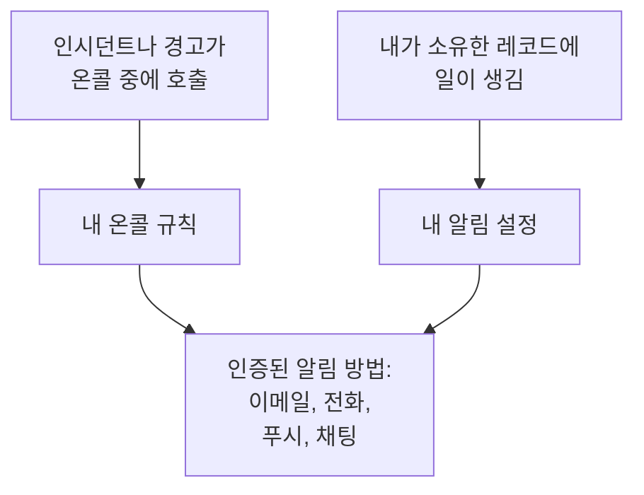

# OneUptime이 연락하는 방법

OneUptime은 두 가지 방법으로 연락합니다. 온콜 중에 인시던트나 경고가 발생하면 호출하고, 소유한 항목의 소식을 계속 알려 줍니다. 인시던트에 달린 노트, 상태가 바뀐 모니터, 다음 근무 같은 것입니다. 두 가지 모두 프로젝트마다 **사용자 설정**에서 관리하는 연락처로 전달됩니다. 이 페이지에서는 각 요소가 어떻게 맞물리는지, 어디에 있는지, 처음에 무엇이 준비되어 있는지 설명합니다.

:::cards
- [세 페이지, 세 가지 질문](#세-페이지-세-가지-질문): 알림 방법, 온콜 규칙, 알림 설정과 각각이 정하는 것.
- [찾는 위치](#찾는-위치): 사용자 설정의 페이지를 섹션별로.
- [처음에 준비되는 것](#처음에-준비되는-것): 새 멤버가 받는 알림 방법, 규칙, 설정.
- [일치하는 규칙이 없을 때](#일치하는-규칙이-없을-때): 그래도 호출이 전달되는 방식과 누가 알림을 받는지.
:::

## 작동 방식

- 온콜 정책은 에스컬레이션 규칙 중 하나가 나, 내가 속한 팀, 또는 내가 온콜인 스케줄을 지정하면 나를 호출합니다. 그러면 내 온콜 규칙이, OneUptime이 어떤 알림 방법을 얼마 후에 시도할지 정합니다.
- 내가 소유한 레코드나 내 근무에 일이 생기면, 알림 설정이 그 소식을 어떤 채널로 보낼지 정합니다.
- 어느 경우든 OneUptime은 호출이나 소식이 발생한 프로젝트에서 인증한 알림 방법만 사용합니다.

## 세 페이지, 세 가지 질문

| 페이지 | 담고 있는 것 | 답하는 질문 |
| --- | --- | --- |
| **알림 방법** | 이메일 주소, 전화번호, WhatsApp 번호, Telegram·Slack·Microsoft Teams 계정, 푸시 디바이스, 웹훅 | OneUptime이 어디로 연락할 수 있는가? |
| **온콜 규칙** | 호출의 종류와 심각도마다 어떤 알림 방법을 얼마 후에 시도할지 | 온콜 중에 어떻게 호출되는가? |
| **알림 설정** | 소유한 레코드나 내 근무에 관한 이벤트마다 어떤 채널을 사용할지 | 그 밖에 무엇을 어디로 알려 받는가? |

이 페이지들은 일부러 분리되어 있습니다. **알림 설정**에서 모든 채널을 켜도 호출되지는 않으며, 인증하지 않은 알림 방법은 규칙에 무엇이 적혀 있든 사용되지 않습니다.

> [!IMPORTANT]
> 알림 방법, 규칙, 설정은 하나의 프로젝트에 속합니다. 작업하는 모든 프로젝트에서 설정하세요. **사용자 설정**은 항상 현재 프로젝트의 설정을 보여 줍니다.

## 찾는 위치

상단 바 아래에 있는 바의 오른쪽에서 **사용자 설정**을 엽니다. 사이드 메뉴에 OneUptime이 연락하는 방법에 관한 모든 것이 있습니다.

| 섹션 | 페이지 |
| --- | --- |
| **시작하기** | **설정 체크리스트**: 아직 설정해야 할 것을 중요한 순서대로 |
| **알림 및 통지** | **알림 방법**, **온콜 규칙**, **알림 설정**, 그리고 소식이 몇 통의 이메일로 모이는지 정하는 **이메일 환경설정** |
| **온콜 로그** | **온콜 로그**: 이 프로젝트에서 호출된 모든 기록과 보낸 내용 |
| **수신 통화 정책** | **수신 전화번호**: 수신 통화 정책이 나에게 전화하는 번호 |
| **캘린더** | **캘린더 피드**: 캘린더 앱에 표시되는 근무와 시작 전 리마인더 |
| **프로필** | **사용자 정의 필드**: 프로젝트가 멤버에게 요청하는 정보 |
| **워크스페이스** | **Slack**과 **Microsoft Teams**: 프로젝트가 연결한 각 워크스페이스의 내 계정 |

**시작하기**와 **알림 및 통지**는 펼쳐져 있고 다른 섹션은 접힌 상태로 시작하며, 섹션의 페이지에 있으면 그 섹션이 저절로 펼쳐집니다. **워크스페이스**는 프로젝트가 Slack 또는 Microsoft Teams를 연결한 경우에만 표시됩니다.

프로젝트 소유자와 관리자도 내 설정을 볼 수 있습니다. **사용자**에서 내 행을 열고 **온콜** 섹션에서 **준비 상태**, **알림 방법**, **온콜 규칙**을 봅니다. 그곳에서 나 대신 알림 방법을 추가할 수도 있지만, 코드는 그 알림 방법 자체로 전송되므로 인증은 나만 할 수 있습니다.

## 처음에 준비되는 것

인증된 로그인 이메일로 프로젝트에 참여하면, 호출이 항상 전달되도록 OneUptime이 다음과 같이 설정합니다.

1. 로그인 이메일이 인증된 이메일 알림 방법으로 추가됩니다.
2. **온콜 규칙**의 네 탭 각각에서, 모든 심각도에 대해 호출되는 즉시 이메일을 보내는 규칙이 추가됩니다.
3. 소유한 항목과 내 근무에 관한 소식 일부가 이메일로 켜집니다. [알림 설정](/docs/notifications/notification-settings#새-멤버에게-켜져-있는-것)을 참고하세요.

나중에 인증하는 모든 알림 방법에도 같은 규칙이 추가됩니다. 모든 심각도에 하나씩, 호출되는 즉시 보내는 규칙입니다. 따라서 SMS용 전화번호를 인증하면 모든 호출이 SMS로도 옵니다. 중요한 호출에만 SMS를 받으려면 다른 심각도의 SMS 규칙을 삭제하세요. [개인 온콜 규칙](/docs/notifications/on-call-rules#처음에-있는-규칙)을 참고하세요.

## 설정 체크리스트

**사용자 설정 → 설정 체크리스트**를 열면 **Your setup checklist**가 표시됩니다. OneUptime이 연락하는 데 필요한 모든 것을 중요한 순서대로 보여 줍니다. 각 단계는 그 일을 하는 페이지로 연결되며, **다시 확인**은 모든 것을 다시 확인합니다.

| 섹션 | 확인하는 것 |
| --- | --- |
| **So we can reach you** | 알림 방법이 있고, 추가한 모든 알림 방법이 인증되었으며, 그중 하나 이상이 프로젝트에서 켜 둔 채널에 있는지 |
| **How you want to be paged** | **온콜 규칙**의 네 탭 각각에서 모든 심각도에 규칙이 있는지 |
| **Staying informed** | 근무가 시작될 때 알림을 받는지, 그리고 **알림 설정**에서 켠 모든 채널에 인증된 알림 방법이 있는지 |
| **Nice to have** | 수신 통화용 번호, Slack 및 Microsoft Teams 계정, 캘린더 링크, 프로필 필드 |

푸시는 **Staying informed**에서 세지 않습니다. 모바일 앱만 있으면 되고, 새 멤버가 푸시로 받는 모든 업데이트는 이메일로도 전송되기 때문입니다.

**Nice to have**는 진행률 막대에 포함되지 않으며, 다른 사람만 해결할 수 있는 단계도 포함되지 않습니다. 맨 위의 한 줄이 상태를 요약합니다.

| 제목 | 의미 |
| --- | --- |
| **모든 준비가 끝났습니다** | 호출이 전달되며, 더 할 일이 없습니다 |
| **아직 설정해야 할 항목이 몇 가지 있습니다** | 규칙이 없는 심각도가 있거나, 아직 끝나지 않은 단계가 있습니다 |
| **아직 연락받을 수 있는 방법이 없습니다** | 사용할 수 있는 알림 방법이 없습니다. 인증된 것이 없거나, 인증된 것이 모두 이 프로젝트에서 꺼 둔 채널에 있습니다 |
| **설정이 완료되었으며 지금은 온콜 담당이 아닙니다** | 정책이 나를 지정하는 날을 위한 준비가 모두 끝났습니다 |

## 일치하는 규칙이 없을 때

규칙이 없는 종류와 심각도로 호출될 수 있습니다. 예를 들어 참여한 뒤에 추가된 심각도입니다. 그래도 OneUptime은 인증된 것으로 호출합니다.

1. 가지고 있는 모든 무료 알림 방법: 푸시 디바이스, 이메일 주소, Slack, Microsoft Teams.
2. 그중 아무것도 없으면 유료 알림 방법 하나를 SMS, 전화, WhatsApp, Telegram 순서로. 인증되어 있고 프로젝트에서 켠 채널에 있는 첫 번째 것입니다.
3. 그것도 없으면 웹훅.

이 사실을 알리는 이메일이 나에게 오고, 온콜 정책의 소유자에게도 갑니다. 정책에 소유자가 없으면 프로젝트 소유자에게 갑니다. 인증된 것이 전혀 없으면 호출을 전달할 수 없고, 이메일에 그렇게 적힙니다. 이런 이메일은 호출이 계속되는 동안 보류되므로, 호출이 쏟아져도 이메일이 쏟아지지는 않습니다. 빠진 규칙을 추가하려면 [개인 온콜 규칙](/docs/notifications/on-call-rules#심각도에-규칙이-없을-때)을 참고하세요.

## 문제 해결

:::details 온콜 중이었는데 아무것도 오지 않았습니다
**사용자 설정 → 온콜 로그**를 엽니다. 인시던트의 행이 없으면 온콜 정책이 나를 호출하지 않은 것입니다. 에스컬레이션 규칙과 누가 온콜이었는지 확인하세요. 상태가 **오류**인 행에서는 **상태 메시지 보기**가 이유를 알려 줍니다. 예를 들어 프로젝트가 꺼 둔 채널입니다. 그런 다음 알림 방법이 인증되었는지, 그리고 **Your setup checklist**의 **So we can reach you**에 남은 것이 없는지 확인하세요.
:::

:::details 요청한 적 없는 레코드에 관한 이메일이 옵니다
직접 또는 팀을 통해 그 레코드의 소유자이거나, 레코드에 소유자가 없고 내가 프로젝트 소유자입니다. **사용자 설정 → 알림 설정**에서 그 이벤트를 끄거나, **사용자 설정 → 이메일 환경설정**에서 양을 줄이세요.
:::

:::details 전화번호를 추가했는데 규칙에 없습니다
번호는 인증되어야 규칙에 추가됩니다. 그 행의 **인증**을 클릭하고 코드를 입력하세요. 카드에 추가 버튼이 없다면 프로젝트에서 그 채널이 꺼져 있습니다. [알림 방법](/docs/notifications/notification-methods#프로젝트에서-채널-켜기)을 참고하세요.
:::

## 다음 단계

:::cards
- [알림 방법](/docs/notifications/notification-methods): OneUptime이 연락할 수 있는 연락처를 추가하고 인증합니다.
- [개인 온콜 규칙](/docs/notifications/on-call-rules): 각 호출이 어떤 알림 방법을 언제 시도할지 정합니다.
- [알림 설정](/docs/notifications/notification-settings): 받을 소식과 그 채널을 고릅니다.
- [에스컬레이션 규칙](/docs/on-call/escalation-rules): 온콜 정책이 누구를 호출할지 단계별로 정하는 방식.
:::
