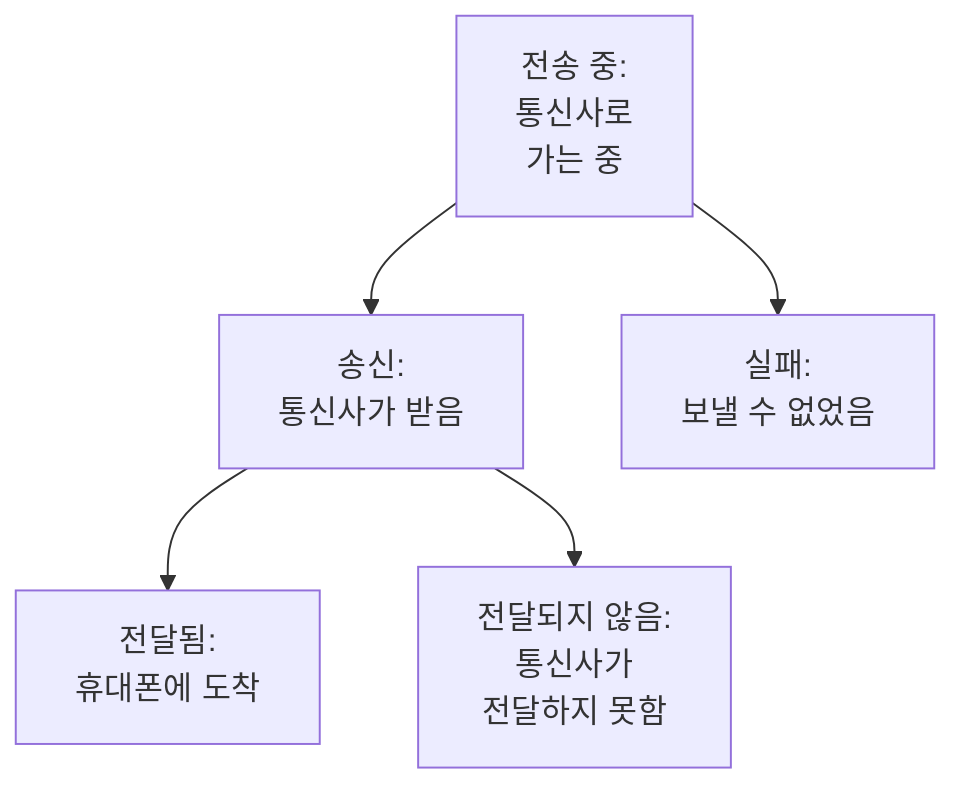

# 알림 로그

알림 로그는 OneUptime이 프로젝트를 위해 보낸 모든 메시지를 채널별 탭으로 보여 주고, 각 메시지가 어떻게 되었는지, 즉 나갔는지, 도착했는지, 도착하지 않았다면 그 이유를 알려 줍니다. **프로젝트 설정 → 알림 → 알림 로그**에서 열거나, 인시던트, 경고, 유지 관리 이벤트, 상태 페이지, 온콜 정책의 **알림 로그**에서 그에 관해 보낸 내용을 확인하세요.

:::cards
- [상태 읽는 법](#상태-읽는-법): 색은 메시지가 어디에 있는지 보여 주고, 가리키면 그 의미를 알려 줍니다.
- [SMS](#sms): 통신사의 보고에 따라 전송 중, 송신, 전달됨 순서로 바뀝니다.
- [통화](#통화): 발신 중, 그다음 통화가 어떻게 끝났는지입니다.
- [WhatsApp과 Telegram](#whatsapp과-telegram): 각 앱이 메시지를 받아들인 뒤 보고하는 내용입니다.
- [이메일, 푸시, 웹훅, 워크스페이스](#이메일-푸시-웹훅-워크스페이스): 성공, 또는 오류와 그 이유입니다.
- [SMS가 송신에 머무를 때](#sms가-송신에-머무를-때): 결과를 보고하지 않는 통신사와 도착하지 않는 보고입니다.
:::

## 상태 읽는 법

각 상태는 색이 있는 라벨이며, 그 색이 메시지가 어디에 있는지 보여 줍니다.

| 색 | 메시지가 있는 곳 |
| --- | --- |
| 회색 | 넘겨졌고 아직 돌아온 것이 없습니다. 예: **전송 중**. |
| 파란색 | 제공자가 받았고, 어떻게 끝났는지 아직 알리지 않았습니다. 예: SMS의 **송신**, 통화의 **발신 중**. |
| 초록색 | 상대에게 도착했거나(예: **전달됨**) 이것이 마지막 상태입니다. |
| 노란색 | 휴대폰에는 도착했지만 아무도 받지 않았거나(예: **부재중 전화**) 경고와 함께 나갔습니다. |
| 빨간색 | 상대에게 도착하지 않았습니다. 예: **전달되지 않음**, **실패**, **오류**, **잔액 부족**. |

상태를 가리키거나, 탭하거나, Tab 키로 이동하면 그 의미와 다음에 일어날 일을 알려 줍니다. 행 메뉴의 **상태 메시지 보기**에는 메시지 ID나 실패 이유 등 제공자가 응답한 내용이 나옵니다. 각 탭의 **상태** 필터에는 그 탭에 나올 수 있는 모든 상태가 메시지가 거치는 순서대로 나옵니다.

인시던트나 경고 개요의 **알림을 받은 사람** 카드와 테스트 호출 결과에도 각 메시지의 상태가 같은 방식, 같은 색으로 나옵니다. 아직 벨이 울리고 있는 통화는 그곳에서도 **발신 중**으로 표시되며, **송신**으로 표시되는 일은 없습니다.

## SMS

| 상태 | 의미 |
| --- | --- |
| **전송 중** | OneUptime이 SMS를 Twilio에 넘겼고, Twilio가 통신사로 전달하고 있습니다. |
| **송신** | 통신사가 SMS를 받아들였습니다. 통신사가 결과를 알려 주면 **전달됨** 또는 **전달되지 않음**으로 바뀝니다. |
| **전달됨** | SMS가 휴대폰에 도착했다고 통신사가 확인했습니다. 도착한 SMS의 마지막 상태입니다. |
| **전달되지 않음** | 통신사가 전달하지 못했습니다. 이유와 코드의 의미는 **오류 코드**에 나옵니다. |
| **실패** | Twilio가 보내지 못했습니다. 이유는 **오류 코드**에 나옵니다. |
| **오류** | 보내지 않았습니다. 예를 들어 프로젝트에서 SMS가 꺼져 있거나 Twilio가 번호를 거부한 경우입니다. 이유는 **상태 메시지 보기**에 나옵니다. |
| **잔액 부족** | 보내지 않았습니다. 프로젝트 잔액이 부족해 비용을 낼 수 없었습니다. |
| **성공** | OneUptime이 전달 여부를 추적하기 전에 보냈고, Twilio가 받아들인 SMS입니다. |

서버 자체의 SMS 및 통화 게이트웨이가 받아들인 SMS는 초록색 **송신**에 머무릅니다. 게이트웨이는 전달 여부를 보고하지 않으므로 이것이 마지막 상태입니다.

Twilio는 변화가 생길 때마다 SMS를 보낸 계정의 인증 토큰으로 서명해 OneUptime에 알리고, OneUptime은 Twilio가 보내지 않은 보고를 모두 거부합니다. 이를 위해 Twilio가 서버에 접근할 수 있어야 합니다. [Twilio 통합](/docs/self-hosted/twilio-integration)을 참고하세요.

### 오류 코드

**오류 코드**의 각 코드는 해당 코드에 대한 Twilio 페이지를 엽니다. 이 페이지에는 원인이 될 수 있는 것들이 나와 있습니다. SMS가 가장 자주 실패하는 코드 아래에는 로그가 그 의미를 한 줄로 알려 줍니다:

| 코드 | 의미 |
| --- | --- |
| `20003` | Twilio가 계정의 자격 증명을 받아들이지 않았습니다. |
| `21211` | 이 번호는 유효한 전화번호가 아닙니다. |
| `21408` | Twilio 계정에 이 국가로 SMS를 보낼 권한이 없습니다. |
| `21606` | 발신 번호는 이 Twilio 계정으로 SMS를 보낼 수 없습니다. |
| `21608` | Twilio 평가판 계정은 계정에서 인증된 번호로만 보낼 수 있습니다. |
| `21610` | 수신자가 STOP으로 답장해 Twilio가 이 번호에서 그 수신자에게 더 이상 SMS를 보내지 않습니다. |
| `21612` | 발신 번호에서 이 번호로 보낼 수 없습니다. |
| `21614` | 유선 전화처럼 휴대폰 번호가 아닌 번호입니다. |
| `30001` | 한 번에 너무 많은 SMS를 보내 Twilio의 대기열이 넘쳤습니다. |
| `30002` | SMS가 나가기 전에 Twilio 계정이 정지되었습니다. |
| `30003` | 휴대폰이 꺼져 있거나 서비스 지역을 벗어났습니다. |
| `30004` | 번호가 SMS를 받지 못하도록 차단되어 있습니다. |
| `30005` | 알 수 없는 번호이며 더 이상 존재하지 않을 수 있습니다. |
| `30006` | 유선 전화처럼 SMS를 받을 수 없는 번호입니다. |
| `30007` | Twilio나 통신사가 SMS를 스팸으로 걸러 냈습니다. |
| `30008` | 통신사가 SMS를 전달하지 못했고 이유도 알리지 않았습니다. |
| `30032` | 수신자 부담 발신 번호가 아직 인증되지 않았습니다. |
| `30034` | 발신 번호가 미국 통신사에서 요구하는 A2P 10DLC에 등록되어 있지 않습니다. |

Twilio가 아닌 곳에서 온 코드(예: 사용 중인 SMS 및 통화 게이트웨이가 응답한 HTTP 상태)는 그대로 표시됩니다.

## 통화

| 상태 | 의미 |
| --- | --- |
| **발신 중** | Twilio가 전화를 걸었습니다. Twilio가 통화가 어떻게 끝났는지 알려 주면 바뀝니다. |
| **성공** | 전화를 받았고, 통화 시간은 **상태 메시지 보기**에 나옵니다. 서버 자체의 SMS 및 통화 게이트웨이가 받아들인 통화는 게이트웨이가 받아들이는 즉시 **성공**이 됩니다. |
| **부재중 전화** | 신호가 갔지만 아무도 받지 않았습니다. |
| **바쁨** | 통화 중이었거나 전화가 거절되었습니다. |
| **음성사서함** | 온콜 전화를 음성 사서함이 받았습니다. 메시지를 남겼는지는 **상태 메시지 보기**에 나옵니다. |
| **오류** | 전화를 걸거나 연결할 수 없었습니다. |
| **잔액 부족** | 전화를 걸지 않았습니다. 프로젝트 잔액이 부족해 비용을 낼 수 없었습니다. |

## WhatsApp과 Telegram

WhatsApp 메시지는 OneUptime이 넘기는 동안 **대기열에 있음**, WhatsApp이 받아들이면 **송신**, 휴대폰에 도착하면 **전달됨**, 상대가 읽음 확인을 공유하는 경우 열면 **읽음**이 됩니다. **실패**는 WhatsApp이 전달하지 못한 메시지이고, **경고**는 경고와 함께 보낸 메시지입니다. WhatsApp이 보고한 내용은 **상태 메시지 보기**에 나옵니다. **오류**와 **잔액 부족**은 SMS와 마찬가지로 보내지 않았다는 뜻입니다.

Telegram은 메시지를 받아들인 뒤 아무것도 보고하지 않으므로, Telegram 메시지의 **송신**은 초록색입니다. Telegram이 채팅에 게시했고, 이것이 마지막 상태입니다.

## 이메일, 푸시, 웹훅, 워크스페이스

이 탭에는 **성공** 또는 **오류**가 나옵니다. **성공**은 마지막 상태입니다. 메일 서버가 이메일을 받아들였거나, 푸시 서비스가 알림을 받아들였거나, 웹훅 주소가 요청을 받았다고 응답했거나, 워크스페이스가 요청받은 일을 했다는 뜻입니다. OneUptime은 메일 서버가 받아들인 뒤의 이메일을 추적하지 않으며, 푸시 알림은 전달되지 않았다고 푸시 서비스가 나중에 보고하면 **오류**로 바뀝니다. 메시지가 **오류**인 이유는 **상태 메시지 보기**에 나오고, **워크스페이스** 탭에서는 **사유**에도 나옵니다.

## SMS가 송신에 머무를 때

**송신**은 통신사가 SMS를 받았고 아직 결과를 알려 주지 않았다는 뜻입니다. 대부분의 통신사는 몇 초나 몇 분 안에 알려 주지만, 전혀 알려 주지 않는 곳도 있습니다. 그러면 Twilio도 SMS를 `sent`로 두며(메시지 로그에서도 볼 수 있습니다), OneUptime은 도착했는지 알 수 없습니다.

SMS가 **전송 중**에 머무른다면 다른 문제입니다. Twilio의 보고가 OneUptime에 도착하지 않고 있습니다. Twilio가 서버에 접근할 수 있는지 확인하고, 서버 로그에서 `Twilio callback refused`로 시작하는 줄을 찾아보세요. [Twilio 통합](/docs/self-hosted/twilio-integration)을 참고하세요.

## 다음 단계

:::cards
- [Twilio 통합](/docs/self-hosted/twilio-integration): Twilio를 연결하고 전달 보고가 OneUptime에 도착하게 합니다.
- [SMS 및 통화 게이트웨이](/docs/self-hosted/sms-and-call-gateway): 자체 게이트웨이로 SMS와 통화를 보냅니다.
- [알림 전달 메트릭](/docs/self-hosted/notification-delivery-metrics): 설치 전체에서 전달된 것을 셉니다.
:::
