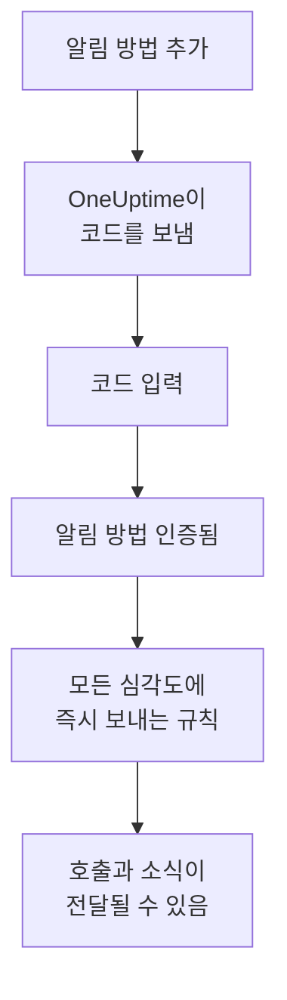

# 알림 방법

알림 방법은 한 프로젝트에서 OneUptime이 나에게 연락할 수 있는 연락처입니다. 이메일 주소, SMS나 전화용 전화번호, WhatsApp 번호, Telegram 계정, Slack 또는 Microsoft Teams 계정, 푸시 알림을 받을 휴대폰이나 브라우저, 또는 웹훅입니다. **사용자 설정 → 알림 방법**에서 추가하고 인증하면, OneUptime이 바로 호출에 사용하기 시작합니다.

:::cards
- [알림 방법 고르기](#알림-방법-고르기): 각 알림 방법에 필요한 것과 인증 방식.
- [알림 방법 추가 및 인증](#알림-방법-추가-및-인증): 이메일, SMS, 전화, WhatsApp을 6자리 코드로.
- [웹훅](#웹훅): 호출을 자체 엔드포인트로 보내며, 원하면 서명도 붙입니다.
- [프로젝트에서 채널 켜기](#프로젝트에서-채널-켜기): SMS, 전화, WhatsApp, Telegram이 보이지 않는 이유.
:::

## 알림 방법이 사용되기까지



인증하지 않은 알림 방법은 사용되지 않습니다. 푸시 디바이스, Slack, Microsoft Teams, 웹훅은 코드를 거치지 않습니다. 디바이스를 등록하거나 계정을 연결하면 내 것임이 증명되고, 웹훅은 증명이 필요 없습니다. 알림 방법을 인증하면 그 방법의 [기본 규칙](/docs/notifications/on-call-rules#처음에-있는-규칙)이 바로 추가되므로, 새 전화번호는 규칙을 바꿀 때까지 모든 심각도에서 나를 호출합니다.

## 알림 방법 고르기

**알림 방법**의 각 탭에는 알림 방법의 종류마다 하나씩, 하나 이상의 카드가 있습니다.

| 카드 | 탭 | 추가하는 것 | 인증 방식 |
| --- | --- | --- | --- |
| **이메일 알림용** | **Direct Contact** | 이메일 주소 | 이메일로 받는 코드 |
| **전화번호 SMS 알림용** | **Direct Contact** | 전화번호 | SMS로 받는 코드 |
| **통화 알림용 전화번호** | **Direct Contact** | 전화번호 | 전화로 읽어 주는 코드, SMS용으로 인증된 번호라면 필요 없음 |
| **알림용 WhatsApp 번호** | **Direct Contact** | WhatsApp 번호 | WhatsApp으로 받는 코드 |
| **알림을 위한 Telegram 계정** | **Direct Contact** | 내 Telegram 계정 | OneUptime 봇에 보내는 메시지 |
| **Slack Account for Notifications** | **Workspace Apps** | 내 Slack 계정 | 프로젝트의 워크스페이스에 계정 연결 |
| **Microsoft Teams Account for Notifications** | **Workspace Apps** | 내 Microsoft Teams 계정 | 프로젝트의 워크스페이스에 계정 연결 |
| **푸시 알림 디바이스** | **Push Notifications** | OneUptime On-Call 앱이 설치된 휴대폰 또는 브라우저 | 디바이스 등록 |
| **알림용 Webhook** | **Webhooks** | 자체 HTTPS 엔드포인트 | 없음 |

**Workspace Apps**는 프로젝트가 Slack 또는 Microsoft Teams를 연결한 경우에만 표시되며, 연결한 것만 담겨 있습니다. SMS, 전화, WhatsApp, Telegram은 프로젝트 전체에서 꺼질 수 있습니다. [프로젝트에서 채널 켜기](#프로젝트에서-채널-켜기)를 참고하세요.

## 알림 방법 추가 및 인증

이메일 주소, SMS 번호, 전화 번호, WhatsApp 번호는 6자리 코드로 인증합니다.

:::steps
### 알림 방법 열기

**사용자 설정 → 알림 방법**으로 이동합니다. 첫 번째 탭은 **Direct Contact**입니다.

### 연락처 추가

알림 방법의 카드에서 **전화번호 SMS 알림용 추가** 같은 추가 버튼을 클릭합니다. **이메일**을 입력하거나, `+11234567890`처럼 국제 형식으로 **전화번호**를 입력하고 저장합니다.

### 코드 입력

인증 대화 상자가 저절로 열리고, 코드를 보낸 곳과 코드의 유효 기간을 알려 줍니다. **인증 코드**에 코드를 입력하고 **인증**을 클릭합니다.

### 행 확인

이제 행에 **인증됨**이 표시됩니다. 대화 상자를 너무 일찍 닫았다면 행의 **인증**을 클릭해 다시 엽니다.
:::

- 코드는 15분 동안 유효합니다. 다섯 번 틀리면 코드가 취소되어 새 코드가 필요합니다.
- 대화 상자에는 **Send a new code**가 있고, 전화 번호에는 **Call me with a new code**가 있습니다. 새 코드는 마지막 요청 1분 후부터 요청할 수 있습니다.
- SMS용으로 인증한 번호는 전화용으로도 인증됩니다. **통화 알림용 전화번호**에 추가할 때 코드가 필요 없으며, SMS 번호를 인증하면 그 번호로 추가한 전화 번호도 인증됩니다.
- 로그인 이메일은 프로젝트에 참여한 날부터 인증된 상태로 이미 등록되어 있습니다.

## Telegram 연결

:::steps
### 계정 추가

**알림을 위한 Telegram 계정**에서 **텔레그램 계정 추가**를 클릭합니다. **Telegram 핸들(선택 사항)** 항목은 나를 위한 레이블일 뿐이며 비워 두어도 됩니다.

### 봇에 메시지 보내기

새 행의 **인증**을 클릭합니다. **Telegram 계정 인증** 대화 상자에는 OneUptime 봇에 연락하는 세 가지 방법이 있습니다. 휴대폰으로 QR 코드를 스캔하거나, **Open in Telegram**을 클릭하거나, Telegram에서 봇을 검색해 대화 상자에 표시된 `/start` 명령을 보냅니다.

### 확인하기

OneUptime으로 돌아와 **I've sent the message — check**를 클릭합니다. 봇이 메시지를 받으면 계정이 인증됩니다.
:::

**코드 교체**는 아직 인증되지 않은 계정의 새 코드를 만듭니다. 이전의 QR 코드와 열었던 링크는 더 이상 작동하지 않습니다. 자체 호스팅 OneUptime에서는 누군가 계정을 연결하기 전에 서버 관리자가 Telegram 봇을 연결해야 합니다.

## Slack과 Microsoft Teams

1. 내 계정을 프로젝트의 워크스페이스에 연결합니다: **사용자 설정 → 워크스페이스 → Slack** 또는 **Microsoft Teams**. [Slack](/docs/workspace-connections/slack)과 [Microsoft Teams](/docs/workspace-connections/microsoft-teams)를 참고하세요.
2. **Workspace Apps** 탭에서 **Add Slack Account** 또는 **Add Microsoft Teams Account**를 클릭합니다. 계정은 추가되는 즉시 인증됩니다.
3. 그 행의 **Send Test Message**를 클릭합니다. 호출은 OneUptime 앱의 다이렉트 메시지로 옵니다.

## 푸시 알림

**Push Notifications** 탭에는 **푸시 알림 디바이스**가 나열됩니다.

- **휴대폰.** OneUptime On-Call 앱을 설치하고, 내 OneUptime에 연결해 로그인한 뒤 알림을 허용합니다. 그러면 휴대폰이 이 목록에 저절로 추가됩니다. [앱 개요](/docs/mobile-desktop-apps/index)를 참고하세요.
- **이 브라우저.** **디바이스 등록**을 클릭하고 **디바이스 이름**을 입력한 뒤, 브라우저가 물으면 알림을 허용합니다.
- 디바이스 행의 **테스트 알림**은 그 디바이스에 지금 푸시를 보냅니다.
- **중요 알림**은 휴대폰에 오는 호출이 무음 모드와 방해 금지 모드를 뚫고 울리는지 보여 줍니다. 이 기능은 여기가 아니라 앱에서 켜며, 브라우저는 할 수 없습니다. [중요 온콜 알림](/docs/self-hosted/push-notifications#중요-온콜-알림무음-모드-무시)을 참고하세요.
- **알림을 받지 못하고 있습니다**로 표시된 디바이스에는 아무것도 보내지 않습니다. 그 휴대폰에서 앱을 열거나 브라우저를 다시 등록하면 돌아옵니다.

## 웹훅

웹훅은 각 호출을 JSON으로 내 HTTPS 엔드포인트에 보내, 자체 도구가 처리할 수 있게 합니다.

:::steps
### 웹훅 추가

**Webhooks** 탭에서 **웹훅 추가**를 클릭합니다. 알아볼 수 있는 **이름**, **웹훅 URL**, 그리고 **서명 시크릿(선택 사항)** 항목을 입력합니다.

### 테스트 전송

그 행의 **테스트 보내기**를 클릭합니다. 엔드포인트가 `eventType`이 `test`인 이벤트를 받습니다.

### 받는 내용 확인

호출은 아래와 같은 JSON `POST`입니다. 10초 안에 아무 `2xx` 상태로 응답하세요. 리디렉션은 따라가지 않습니다.
:::

```json title="A page, as your endpoint receives it"
{
  "eventType": "on-call.incident.created",
  "timestamp": "2026-10-15T09:30:00.000Z",
  "projectId": "6a3f0d2e-1c4b-4e8a-9b7d-2f5c8e1a0b3c",
  "userId": "0c9e8d7f-6b5a-4c3d-8e2f-1a0b9c8d7e6f",
  "incident": {
    "id": "5b4a3c2d-1e0f-4a9b-8c7d-6e5f4a3b2c1d",
    "title": "Checkout API is down",
    "description": "Health check failed from 3 probes.",
    "incidentNumber": 42,
    "incidentNumberWithPrefix": "INC-42",
    "severity": "Critical Incident",
    "state": "Identified"
  },
  "onCallPolicyId": "7d6c5b4a-3e2f-4d1c-9b8a-7f6e5d4c3b2a",
  "onCallPolicyEscalationRuleId": "8e7d6c5b-4a3f-4e2d-8c1b-9a8f7e6d5c4b"
}
```

| `eventType` | 보내는 대상 | 레코드의 키 |
| --- | --- | --- |
| `on-call.incident.created` | 인시던트 | `incident` |
| `on-call.alert.created` | 경고 | `alert` |
| `on-call.incidentEpisode.created` | 인시던트 에피소드 | `incidentEpisode` |
| `on-call.alertEpisode.created` | 경고 에피소드 | `alertEpisode` |

**알림 설정**에서 Webhook에 대해 켠 소식도 같은 엔드포인트로 오며, `eventType`에는 설정의 이벤트가, `subject`와 `message`에는 짧은 요약이 담깁니다.

모든 요청에는 이벤트 종류인 `X-OneUptime-Event`가 붙습니다. 서명 시크릿이 있으면 `X-OneUptime-Signature`도 붙는데, `sha256=` 뒤에 원본 본문의 HMAC-SHA256이 16진수로 이어집니다. 요청을 신뢰하기 전에 확인하세요:

```javascript title="verify-signature.js"
const crypto = require("crypto");

// rawBody: the request body exactly as it arrived, before any JSON parsing.
function isFromOneUptime(rawBody, signatureHeader, secret) {
  const expected =
    "sha256=" + crypto.createHmac("sha256", secret).update(rawBody).digest("hex");
  const received = Buffer.from(signatureHeader || "");
  const wanted = Buffer.from(expected);
  return received.length === wanted.length && crypto.timingSafeEqual(received, wanted);
}
```

웹훅은 인증이 필요 없으므로, 추가하면 규칙도 바로 추가됩니다. 사설 주소와 내부 주소는 자체 호스팅 서버의 관리자가 허용하지 않는 한 거부됩니다. [프라이빗 네트워크 접근](/docs/self-hosted/private-network-access#웹후크와-워크플로)을 참고하세요.

## 프로젝트에서 채널 켜기

**SMS**, **음성 전화**, **WhatsApp**, **Telegram**은 메시지마다 비용이 들기 때문에 모든 새 프로젝트에서 꺼진 상태로 시작합니다. OneUptime Cloud에서는 프로젝트 잔액에서 지불되며, 프로젝트의 기본 Twilio 계정이 SMS와 전화를 보내면 그 계정을 통해 나갑니다. 이메일, 푸시, Slack, Microsoft Teams, 웹훅은 항상 켜져 있습니다.

채널이 꺼져 있는 동안에는 프로젝트의 누구도 그 채널에 알림 방법을 추가할 수 없습니다. 카드에 추가 버튼이 없고, 누가 켤 수 있는지 알려 줍니다. 프로젝트 소유자, **결제 관리자**, 또는 **Manage Billing** 권한이 있는 사람이 **프로젝트 설정 → 알림 → 알림 설정**의 **알림 채널** 카드에서 켭니다. 프로젝트 관리자는 할 수 없습니다. 자체 호스팅 OneUptime에서는 SMS와 전화에 Twilio 계정도 필요하고, Telegram에는 서버 관리자가 연결하는 봇이 필요합니다. [Twilio 통합](/docs/self-hosted/twilio-integration)을 참고하세요.

## 알림 방법 삭제

알림 방법 행의 **삭제**를 클릭합니다. 알림 방법을 삭제하면 그것을 쓰는 온콜 규칙도 모두 삭제되므로, 대화 상자는 먼저 그 규칙의 수를 세고, 삭제하면 규칙이 하나도 남지 않을 심각도를 알려 줍니다.

## 문제 해결

:::details 카드에 추가 버튼이 없습니다
이 프로젝트에서 그 채널이 꺼져 있습니다. 카드에 누가 켤 수 있는지 나와 있습니다. [프로젝트에서 채널 켜기](#프로젝트에서-채널-켜기)를 참고하세요.
:::

:::details 코드가 오지 않았습니다
이메일은 몇 분 걸릴 수 있고 스팸함에 들어가기도 합니다. 문자는 1분쯤 걸릴 수 있습니다. 1분 기다린 다음 대화 상자에서 **Send a new code**를 클릭하세요. **프로젝트 설정 → 알림 → 알림 로그**에서 메시지가 어떻게 되었는지 볼 수 있습니다.
:::

:::details Slack 계정을 추가할 수 없습니다
먼저 **사용자 설정 → 워크스페이스 → Slack**에서 계정을 연결한 다음, **Add Slack Account**를 다시 클릭하세요. 오류 대화 상자에 그곳으로 가는 버튼이 있습니다.
:::

:::details 휴대폰에 푸시 알림이 오지 않습니다
휴대폰이 **푸시 알림 디바이스**에 있는지 확인하고, **테스트 알림**을 보내세요. [FAQ 및 문제 해결](/docs/mobile-desktop-apps/faq-troubleshooting#알림)을 참고하세요.
:::

## 다음 단계

:::cards
- [개인 온콜 규칙](/docs/notifications/on-call-rules): 각 호출이 어떤 알림 방법을 언제 시도할지 정합니다.
- [알림 설정](/docs/notifications/notification-settings): 받을 소식과 그 채널을 고릅니다.
- [앱 개요](/docs/mobile-desktop-apps/index): 휴대폰이나 데스크톱에서 호출을 받습니다.
- [OneUptime이 연락하는 방법](/docs/notifications/index): 알림 방법, 규칙, 설정이 맞물리는 방식.
:::
