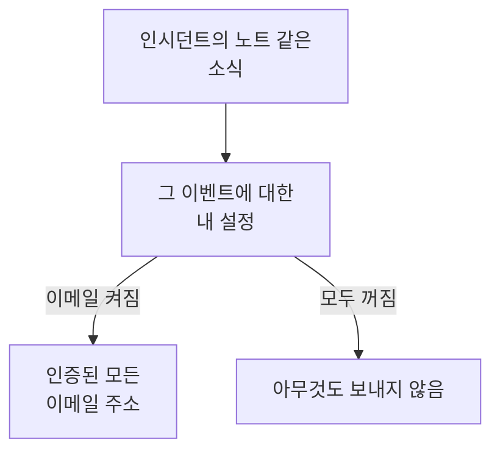

# 알림 설정

알림 설정은 인시던트, 모니터, 상태 페이지처럼 내가 소유한 레코드와 내 온콜 근무에 관한 소식 중 무엇을 어떤 채널로 받을지 정합니다. 알림 설정으로 호출되는 일은 없습니다. 호출은 온콜 규칙이 맡습니다. **사용자 설정 → 알림 설정**에서 이벤트와 채널마다 스위치 하나로 설정합니다.

:::cards
- [설정의 작동 방식](#설정의-작동-방식): 이벤트와 채널마다 스위치 하나, 인증된 모든 알림 방법으로 전송.
- [설정 변경](#설정-변경): 세 번의 클릭으로 바로 저장.
- [새 멤버에게 켜져 있는 것](#새-멤버에게-켜져-있는-것): 기본값을 탭별로.
- [이메일 줄이기](#이메일-줄이기): 몰려오는 소식을 묶거나, 일상적인 이메일을 끕니다.
:::

## 설정의 작동 방식

- 각 행은 이벤트이고 각 열은 채널입니다: 이메일, SMS, 전화, 푸시, WhatsApp, Telegram, Slack과 Microsoft Teams, 그리고 Webhook. Slack과 Microsoft Teams는 프로젝트가 연결한 경우에만 열로 나타납니다.
- 켜진 채널은 이 프로젝트에서 그 채널에 있는 인증된 알림 방법 하나가 아니라 모두에게 보냅니다.
- 켜져 있어도 뒤에 인증된 알림 방법이 없는 채널은 아무것도 보내지 않습니다. **Your setup checklist**의 **Staying informed**에서 이를 알려 줍니다.
- 소식은 레코드의 소유자에게 갑니다. 소유자로 지정된 사람과 소유자 팀의 멤버입니다. 레코드에 소유자가 없으면 대신 프로젝트 소유자에게 갑니다. 소유자로 추가되었다는 이벤트는 추가된 사람에게만 갑니다.
- 보안 케이스에는 소유자가 없습니다. 새 케이스는 프로젝트의 케이스를 볼 수 있는 모든 사람에게 각자 고른 우선순위에 따라 가고, 할당된 케이스는 그 케이스를 할당받은 사람에게 갑니다. [보안 케이스](/docs/telemetry/security-cases#알림)를 참고하세요.
- 소유자에게 가는 모든 이메일은 이 페이지로 돌아오는 "Manage notification preferences" 링크로 끝납니다.

## 설정 변경

:::steps
### 설정 열기

**사용자 설정 → 알림 설정**으로 이동합니다. 탭은 **인시던트**, **알림**, **모니터링**, **상태 페이지**, **예정된 유지 관리**, **온콜**, **보안**입니다.

### 이벤트 찾기

각 탭에는 **인시던트** 탭의 **인시던트 에피소드**처럼 하나 이상의 카드가 있습니다. 각 행은 이벤트이며, 언제 보내는지 설명하는 줄이 있습니다.

### 채널 클릭

채널의 원을 클릭하면 켜지고, 다시 클릭하면 꺼집니다. 체크 표시는 켜짐을 뜻합니다. 변경 사항은 자동으로 저장됩니다.
:::

## 새 멤버에게 켜져 있는 것

프로젝트에 참여하면 다음 이벤트가 이메일로 켜진 상태로 시작합니다. 나머지는 모두 꺼진 상태로 시작하며, 채널을 켤 때까지 아무것도 보내지 않습니다.

| 탭 | 이메일로 켜짐 | 켤 때까지 꺼짐 |
| --- | --- | --- |
| **인시던트** | **인시던트 생성됨**, **인시던트 상태 변경됨**, **Incident reminder**, **인시던트 에피소드 생성됨**, **인시던트 에피소드 상태 변경됨**, **인시던트가 인시던트 에피소드에 추가됨** | **인시던트 노트 게시됨**, **인시던트 소유자로 추가됨**, **인시던트에 할당됨**, **인시던트 에피소드 노트 게시됨**, **인시던트 에피소드 소유자로 추가됨** |
| **알림** | **경고 생성됨**, **경고 상태 변경됨**, **Alert reminder**, **경고 에피소드 생성됨**, **경고 에피소드 상태 변경됨**, **경고가 경고 에피소드에 추가됨** | **경고 노트 게시됨**, **경고 소유자로 추가됨**, **경고 에피소드 노트 게시됨**, **경고 에피소드 소유자로 추가됨** |
| **모니터링** | **모니터의 프로브 상태가 변경됨**, **모니터에 활성 프로브가 없습니다**, **SLO status changed**, **Added as SLO owner**, **프로브 상태 변경됨**, **프로브 소유자로 추가됨** | **모니터 생성됨**, **모니터 상태 변경됨**, **모니터 소유자로 추가됨**, **AI 에이전트 상태 변경됨**, **AI 에이전트 소유자로 추가됨** |
| **상태 페이지** | 없음 | **상태 페이지 생성됨**, **상태 페이지 공지사항 게시됨**, **상태 페이지 소유자로 추가됨** |
| **예정된 유지 관리** | **Maintenance reminder** | **유지 관리 이벤트 생성됨**, **유지 관리 상태 변경됨**, **유지 관리 노트 게시됨**, **유지 관리 소유자로 추가됨** |
| **온콜** | **온콜 시작**, **다음 온콜 차례입니다**, **온콜 종료**, **온콜 정책에 추가됨**, **온콜 정책에서 제거됨**, **부재중 전화**, 그리고 푸시로도: **내 대기 근무 시작 전**, **예정된 내 대기 근무가 재배정됨** | 없음 |
| **보안** | 푸시로도: **새 보안 케이스**(High와 Critical 케이스), **나에게 할당된 보안 케이스**, **내 승인을 기다리는 플레이북 단계** | 없음 |

> [!IMPORTANT]
> **모니터 상태 변경됨**은 꺼진 상태로 시작합니다. 소유한 모니터가 다운되거나 복구될 때 알림을 받으려면 **모니터링** 탭에서 켜세요.

## 내 근무

**온콜** 탭은 내가 소유한 레코드가 아니라 나에 관한 것입니다.

- **온콜 시작**, **다음 온콜 차례입니다**, **온콜 종료**는 내가 속한 온콜 스케줄의 차례를 따릅니다.
- **온콜 정책에 추가됨**과 **온콜 정책에서 제거됨**은 온콜 정책이 나를 지정하기 시작하거나 그만둘 때 알려 줍니다.
- **내 대기 근무 시작 전**은 **사용자 설정 → 캘린더 → 캘린더 피드**에서 고른 시점에 리마인더를 보내고, **예정된 내 대기 근무가 재배정됨**은 리마인더를 받은 근무를 다른 사람이 맡게 되면 알려 줍니다. [캘린더 피드](/docs/on-call/calendar-feeds#알림과-재배정-알림)를 참고하세요.
- **수신 통화 정책** 카드의 **부재중 전화**는 발신자가 아무와도 연결되지 않았음을 수신 통화 정책의 소유자에게 알립니다. [수신 전화 정책](/docs/on-call/incoming-call-policy#부재중-전화)을 참고하세요.

## 보안 케이스

**보안** 탭은 내가 볼 수 있는 보안 케이스에 관한 것입니다.

- **새 보안 케이스**에는 이름 아래에 우선순위가 있습니다. 나에게 알림을 보내는 케이스의 가장 낮은 우선순위입니다. **심각만**, **보통 이상**, **낮음 이상**, **모든 케이스** 중 하나를 고르지 않으면 **높음 이상**입니다.
- **나에게 할당된 보안 케이스**는 나에게, 그리고 내가 속한 팀에 할당된 케이스를 따릅니다.
- **내 승인을 기다리는 플레이북 단계**는 내가 승인할 수 있는 케이스에서 플레이북 단계를 승인하거나 거부하도록 요청합니다.

[보안 케이스](/docs/telemetry/security-cases#알림)를 참고하세요.

## 이메일 줄이기

이 스위치들은 어떤 소식을 받을지 정할 뿐, 그 소식이 몇 통의 이메일이 되는지는 정하지 않습니다. 그 일을 위해 **사용자 설정 → 이메일 환경설정**에 카드 두 개가 있으며, 둘 다 이 프로젝트에서 나에게만 적용됩니다.

- **Email Rollup**은 몰려오는 소식을 이메일 한 통에 담습니다. 처음 몇 개는 여전히 하나씩 오고, 나머지는 몇 분 뒤 함께 옵니다.
- **Fewer routine emails**는 **Reduce routine emails**로 노트, 새 소유자, 새 모니터와 상태 페이지, 에피소드 추가, 온콜 정책 변경에 관한 이메일을 끕니다.

[알림 요약](/docs/emails/notification-rollup)을 참고하세요.

## 문제 해결

:::details 스위치는 켜져 있는데 아무것도 오지 않습니다
**사용자 설정 → 알림 방법**에서 그 채널에 인증된 알림 방법이 있는지 확인하세요. SMS, 전화, WhatsApp, Telegram은 프로젝트에서도 그 채널이 켜져 있어야 합니다.
:::

:::details 모니터를 소유하고 있는데 다운되어도 알림이 없습니다
**모니터 상태 변경됨**은 꺼진 상태로 시작합니다. **모니터링** 탭에서 그 이벤트의 채널을 켜세요.
:::

:::details 모두 껐는데도 이메일이 옵니다
호출은 이 스위치가 아니라 온콜 규칙을 따르며, 로그인, 보안, 결제 이메일은 레코드에 관한 소식이 아닙니다. 프로젝트마다 설정이 따로 있으니, 이메일을 보낸 프로젝트를 확인하세요. [개인 온콜 규칙](/docs/notifications/on-call-rules)을 참고하세요.
:::

## 다음 단계

:::cards
- [알림 방법](/docs/notifications/notification-methods): 설정이 보내는 알림 방법을 추가합니다.
- [개인 온콜 규칙](/docs/notifications/on-call-rules): 호출이 어떻게 전달될지 정합니다.
- [알림 요약](/docs/emails/notification-rollup): 몰릴 때는 더 적고 더 알찬 이메일로.
- [OneUptime이 연락하는 방법](/docs/notifications/index): 알림 방법, 규칙, 설정이 맞물리는 방식.
:::
