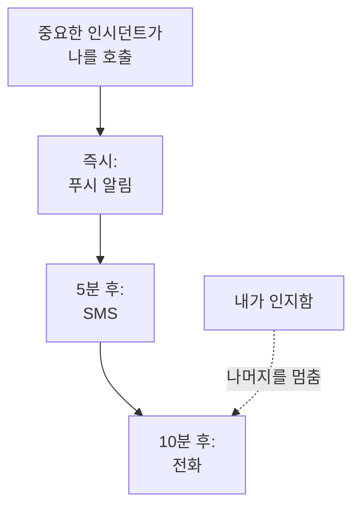

# 개인 온콜 규칙

온콜 규칙은 호출이 나에게 어떻게 전달될지 정합니다. OneUptime이 내 알림 방법 중 무엇을, 호출이 시작된 뒤 얼마 후에 시도할지입니다. 호출의 종류마다 규칙이 따로 있고 심각도마다 한 묶음씩 있으므로, 중요한 인시던트는 즉시 전화를 걸고 낮은 경고는 이메일을 기다리게 할 수 있습니다. **사용자 설정 → 온콜 규칙**에서 설정합니다.

> [!NOTE]
> 이 규칙은 나만의 것입니다. **인시던트 → 규칙**과 **경고 → 규칙** 아래의 **온콜 규칙**은 다른 것으로, 새 인시던트나 경고가 어떤 온콜 정책을 실행할지 정합니다.

:::cards
- [호출이 전달되는 방식](#호출이-전달되는-방식): 호출 하나에 대한 내 규칙을 단계별로.
- [처음에 있는 규칙](#처음에-있는-규칙): 인증된 알림 방법마다 추가되는 것과 줄이는 방법.
- [규칙 추가](#규칙-추가): 한 심각도에 대한 알림 방법과 지연 시간.
- [푸시 규칙](#푸시-규칙): 무음 모드를 뚫고 울리고, 누군가 인지할 때까지 반복합니다.
:::

## 호출이 전달되는 방식

온콜 정책은 에스컬레이션 규칙 중 하나가 나, 내가 속한 팀, 또는 내가 온콜인 스케줄을 지정하면 나를 호출합니다. 그러면 OneUptime은 그 호출의 종류와 심각도에 대한 내 규칙을 차례로 처리합니다. 각 규칙은 호출이 시작된 뒤 지연 시간이 지나면 자기 알림 방법으로 발송됩니다. 어떤 메시지에서든 OneUptime 안에서든 인시던트나 경고를 인지하면, 아직 발송되지 않은 규칙은 모두 멈춥니다.

대부분의 메시지에서 호출을 인지할 수 있습니다. 이메일, 문자, 그리고 WhatsApp, Telegram, Slack, Microsoft Teams 메시지에는 인지 링크가 있고, 전화는 1번을 누르라고 안내합니다. 호출을 받을 수 없을 때는 같은 메시지에서 에스컬레이션할 수 있고, 전화는 2번을 누르라고 안내합니다. 그러면 정책이 바로 다음 단계를 호출하고, 이 건으로 다시 호출되지 않습니다. [호출 에스컬레이션](/docs/on-call/escalation-rules#호출-에스컬레이션)을 참고하세요. 받은 호출은 모두 **사용자 설정 → 온콜 로그**에 나열되며, 여기서 **타임라인 보기**가 보낸 모든 메시지와 전달 여부를 보여 줍니다.

## 네 개의 탭

**사용자 설정 → 온콜 규칙**에는 호출의 종류마다 탭이 있습니다. 각 탭에는 심각도마다 카드가 있으며, 프로젝트에서 정한 이름과 색으로 표시됩니다.

| 탭 | 호출 대상 | 카드 대상 |
| --- | --- | --- |
| **인시던트** | 인시던트 | 인시던트 심각도 |
| **인시던트 에피소드** | 인시던트를 묶은 에피소드 | 인시던트 심각도 |
| **알림** | 경고 | 경고 심각도 |
| **경고 에피소드** | 경고를 묶은 에피소드 | 경고 심각도 |

에피소드는 그 안의 인시던트나 경고와 별도로 자체 온콜 정책을 통해 나를 호출하므로, 그 규칙은 별도의 탭에 있습니다. 페이지 주소는 `/dashboard/{projectId}/user-settings/on-call-rules?type=alerts`처럼 열린 탭을 나타냅니다. 다른 값은 `incident-episodes`와 `alert-episodes`이며, `type`이 없으면 **인시던트** 탭으로 열립니다.

## 처음에 있는 규칙

인증한 모든 알림 방법은 모든 탭의 모든 카드에 호출되는 즉시 보내는 규칙을 받습니다. 로그인 이메일은 참여한 날부터 이 규칙이 있어 호출이 항상 전달됩니다. SMS용 전화번호를 인증하면 모든 호출이 문자로도 옵니다.

안전한 시작이지만 대개는 너무 많습니다. 각 심각도에 맞게 줄이세요.

| 심각도 | 적절한 구성 |
| --- | --- |
| 중요 | 즉시 푸시, 5분 후 전화 |
| 높음 | 즉시 푸시, 10분 후 SMS |
| 경미 또는 낮음 | 즉시 이메일 |

내 규칙에는 방해 금지 시간 기능이 없습니다. 낮은 심각도는 이메일이나 **일반**으로 설정한 푸시 규칙에 두어, 잠을 깨우지 않게 하세요. 낮은 심각도의 호출을 모두에게 근무 시간까지 기다리게 하려면, 그 호출을 일으키는 온콜 규칙을 **근무 시간에만**으로 설정하세요. [온콜 규칙](/docs/alerts/settings#온콜-규칙)을 참고하세요.

## 규칙 추가

:::steps
### 카드 열기

**사용자 설정 → 온콜 규칙**으로 이동해 호출 종류의 탭을 열고, 심각도의 카드를 찾습니다.

### 알림 방법 고르기

**알림 규칙 추가**를 클릭합니다. **알림 방법**에서 인증된 알림 방법 하나를 고릅니다. 인증하지 않은 알림 방법은 목록에 나오지 않습니다.

### 푸시 소리 정하기

휴대폰이라면 **푸시 알림**에서 **중요 알림** 또는 **일반**을 고릅니다. 모든 푸시 디바이스에서 **인지될 때까지 반복**을 고릅니다. [푸시 규칙](#푸시-규칙)을 참고하세요.

### 지연 시간 설정

**다음 시간 후 알림**에서 **즉시**, **5분**, **10분**, **15분**, **30분**, **1시간** 중 하나를 고릅니다. 그런 다음 대화 상자에서 **알림 규칙 추가**를 클릭합니다.
:::

카드는 규칙을 지연 시간 순서로 나열하며, 각 규칙에 **알림 방법**과 **다음 시간 후 알림**을 보여 줍니다.

## 규칙 변경 또는 삭제

- 규칙 행의 **편집**은 지연 시간을 바꿉니다. 규칙을 다른 알림 방법으로 보내려면 삭제하고 새로 추가하세요.
- 푸시 규칙에서는 알림 방법 아래의 레이블을 클릭해 **중요 알림**과 **일반** 사이를 전환하거나 반복 간격을 바꿉니다. 바로 저장됩니다.
- **삭제**는 먼저 확인을 요청하고, 그 심각도에 규칙이 남지 않게 되는지 알려 줍니다. 규칙이 없는 심각도는 인증된 알림 방법으로 대체 전송됩니다. [심각도에 규칙이 없을 때](#심각도에-규칙이-없을-때)를 참고하세요.

## 푸시 규칙

휴대폰을 호출하는 규칙은 푸시의 소리를 정합니다.

| 선택 | 휴대폰의 동작 |
| --- | --- |
| **중요 알림** | OneUptime On-Call 앱에서 Critical On-Call Alerts가 켜져 있으면, 휴대폰이 무음이거나 방해 금지 모드여도 울립니다. 새 휴대폰 규칙은 이것으로 시작합니다. |
| **일반** | 휴대폰의 소리, 무음, 방해 금지 설정을 따릅니다. |

푸시 규칙은 휴대폰이든 브라우저든, 누군가 인지할 때까지 푸시를 다시 보낼 수도 있습니다: 기본값인 **반복 안 함**, 또는 **매분**, **2분마다**, **3분마다**, **5분마다**, **10분마다**, **15분마다**, **30분마다**. 최대 10번 더 반복하며, 인시던트, 경고 또는 에피소드가 인지되는 즉시 멈춥니다. [중요 온콜 알림](/docs/self-hosted/push-notifications#중요-온콜-알림무음-모드-무시)을 참고하세요.

## 심각도에 규칙이 없을 때

프로젝트에서 나중에 추가한 심각도는 몇 분 안에, 그 탭에서 이미 고른 선택으로 만든 규칙을 받습니다. 같은 알림 방법을 같은 지연 시간 뒤에 사용합니다. 그 탭에 규칙이 없었다면, 인증된 이메일로 즉시 보내는 규칙을 받습니다.

그래도 규칙을 찾지 못한 호출은 인증된 알림 방법으로 전송되며, 이 사실이 이메일로 옵니다. [일치하는 규칙이 없을 때](/docs/notifications/index#일치하는-규칙이-없을-때)를 참고하세요.

:::details 일부러 심각도 끄기
API로 `isOptOut`을 설정하고 알림 방법이 없는 옵트아웃 규칙을 저장할 수 있습니다. 그러면 그 호출 종류와 심각도로는 아예 호출되지 않으며, 대체 전송도 없습니다. 행에는 **Muted - notifications turned off for this rule**이 표시되고, 이를 삭제하면 호출이 다시 켜집니다. 그 탭의 모든 규칙이 옵트아웃이면 나중에 추가된 심각도도 음소거됩니다.
:::

:::details 프로젝트 전체에서 대체 전송 끄기
프로젝트 소유자나 **Manage Billing** 권한이 있는 사람은 API로 프로젝트의 `disableOnCallNotificationFallback`을 설정할 수 있습니다. 그러면 규칙을 찾지 못한 호출은 전달되지 않으며, 로그에는 사용자가 **사용자 설정 → 온콜 규칙**에서 규칙을 추가해야 한다고 남습니다.
:::

## 팀원의 규칙

프로젝트 소유자와 관리자는 프로젝트의 누구에 대해서든 같은 페이지를 보고 바꿀 수 있습니다. **사용자**에서 그 사람을 열고 **온콜** 섹션의 **온콜 규칙**을 엽니다. 그 옆의 **준비 상태**는 모든 심각도가 그 사람에게 전달되는지 보여 줍니다. 다른 사람이 내 규칙을 추가, 변경, 삭제하면 이메일로 알림을 받으며, 모든 변경은 프로젝트의 감사 로그에 남습니다.

## 문제 해결

:::details 중요한 호출에도 휴대폰이 울리지 않았습니다
규칙의 푸시가 **일반**이 아니라 **중요 알림**인지, 그리고 **사용자 설정 → 알림 방법**의 **Push Notifications** 탭에서 그 휴대폰의 **중요 알림**이 켜져 있는지 확인하세요.
:::

:::details 인시던트마다 두 번씩 호출됩니다
인증된 각 알림 방법에는 모든 심각도에 즉시 보내는 규칙이 있습니다. 원하지 않는 규칙을 삭제하거나 지연 시간을 주세요. 에피소드 안의 인시던트는 두 정책을 통해 인시던트로 한 번, 에피소드로 한 번 나를 호출할 수 있습니다.
:::

:::details 규칙은 SMS인데 이메일이 왔습니다
호출이 그 종류나 심각도에 맞는 규칙을 찾지 못해 무료 알림 방법으로 대체 전송되었습니다. 알맞은 탭과 카드에 규칙을 추가하세요. 또는 그 이메일은 내가 소유한 레코드의 소식이었고, 이런 소식은 내 규칙이 아니라 **알림 설정**을 따릅니다. **온콜 로그**에는 호출만 나열됩니다.
:::

## 다음 단계

:::cards
- [알림 방법](/docs/notifications/notification-methods): 규칙이 가리키는 알림 방법을 추가하고 인증합니다.
- [에스컬레이션 규칙](/docs/on-call/escalation-rules): 온콜 정책이 단계별로 사람을 호출하는 방식.
- [푸시 알림](/docs/self-hosted/push-notifications): 휴대폰의 중요 알림, 경보음, 반복.
- [OneUptime이 연락하는 방법](/docs/notifications/index): 알림 방법, 규칙, 설정이 맞물리는 방식.
:::
