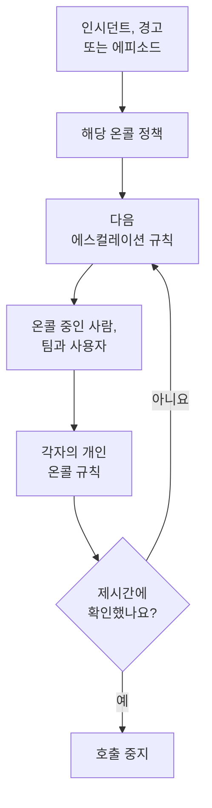

# 온콜 개요

온콜은 OneUptime이 시간에 상관없이 사람을 문제에 연결하는 방법입니다. 인시던트, 경고, 에피소드에 누군가가 필요하면 그 온콜 정책이 누군가 확인할 때까지 단계별로 사람을 호출하고, 각 사람에게는 본인이 고른 방식으로 연락합니다. 푸시 알림, 문자 메시지, 전화, 이메일, 채팅 메시지 중 하나입니다. 이 페이지에서는 각 요소가 어떻게 맞물리는지, 각각 어디에 있는지 보여 줍니다.

:::cards
- [호출이 사람에게 닿는 과정](#호출이-사람에게-닿는-과정): 새 인시던트부터 응답하는 사람까지.
- [구성 요소](#구성-요소): 정책, 에스컬레이션 규칙, 스케줄, 재정의, 개인 규칙.
- [온콜 설정하기](#온콜-설정하기): 아무것도 없는 상태에서 호출받는 팀까지, 다섯 단계로.
- [온콜이 있는 곳](#온콜이-있는-곳): 온콜 듀티 메뉴를 섹션별로.
:::

## 호출이 사람에게 닿는 과정

1. 새 인시던트, 경고, 에피소드는 생성되는 즉시 자신의 온콜 정책을 실행합니다. 여기에는 직접 선택된 정책과 온콜 규칙이 추가하는 정책이 포함됩니다. 각 정책은 따로 실행됩니다. **근무 시간에만**으로 설정한 온콜 규칙은 자신이 추가한 정책을 근무 시간이 시작될 때까지 기다리게 합니다.
2. 정책의 첫 번째 에스컬레이션 규칙은 바로 호출합니다. 대상은 해당 스케줄에서 지금 온콜인 사람, 해당 팀의 모든 멤버, 그리고 규칙이 지정한 사람입니다.
3. 그중 누군가 부재 중이면 사용자 재정의가 그 사람의 호출을 대신하는 사람에게 보내거나 그 사람을 건너뜁니다.
4. 각 사람에게는 개인 온콜 규칙을 통해 연락합니다. 어떤 알림 방법을 얼마 후에 시도할지가 여기서 정해집니다. 규칙이 없는 호출도 그 사람이 인증한 알림 방법으로 전달됩니다.
5. 규칙의 대기 시간이 끝나기 전에 아무도 확인하지 않으면 다음 규칙이 호출합니다. 마지막 규칙 다음에는 정책이 반복하도록 설정되어 있으면 처음부터 다시 시작하고, 그렇지 않으면 멈춥니다.

인시던트, 경고, 에피소드를 확인하거나 해결하면 그것을 위해 아직 호출 중인 모든 정책이 멈춥니다. OneUptime은 실행 중인 정책을 매분 진행시키고, 각 실행을 규칙별로 **실행 로그** 에 기록합니다.

호출이 처음으로 누군가에게 닿으면 OneUptime은 이를 인시던트, 경고, 에피소드에 `First Paged At` 으로 기록합니다. 측정은 이 시점부터 셀 수 있습니다. **호출 후 인지까지 걸린 시간** 은 호출을 받은 사람들이 응답하기까지 걸린 시간을 재며, 누군가 호출되기까지 기다린 시간은 포함하지 않습니다. [호출 후 인지까지 걸린 시간](/docs/incidents/settings#호출-후-인지까지-걸린-시간) 을 참조하세요.

> [!NOTE]
> 이미 인지되었거나 해결된 상태로 생성된 인시던트, 경고, 에피소드는 어떤 정책도 실행하지 않으며, 피드에 그렇게 표시됩니다. [이미 인지되었거나 해결된 상태로 생성](/docs/alerts/index#이미-인지되었거나-해결된-상태로-생성) 을 참조하세요.

## 구성 요소

| 요소 | 정하는 것 | 더 읽기 |
| --- | --- | --- |
| 온콜 정책 | 인시던트나 경고에 대해 단계별로 누구를 호출할지 | [온콜 정책](/docs/on-call/policies) |
| 에스컬레이션 규칙 | 정책의 한 단계: 누구를 호출하고 확인을 얼마나 기다릴지 | [에스컬레이션 규칙](/docs/on-call/escalation-rules) |
| 온콜 스케줄 | 사람들이 교대로 맡을 때, 매 순간 누가 온콜인지 | [온콜 스케줄](/docs/on-call/schedules) |
| 사용자 재정의 | 누군가 부재 중일 때 누가 대신하는지 | [사용자 재정의](/docs/on-call/user-overrides) |
| 개인 온콜 규칙 | 한 사람에게 연락하는 방법: 어떤 알림 방법을, 얼마 후에 | [개인 온콜 규칙](/docs/notifications/on-call-rules) |
| 수신 전화 정책 | 온콜인 사람에게 연결되는 전화번호 | [수신 전화 정책](/docs/on-call/incoming-call-policy) |

정책, 에스컬레이션 규칙, 스케줄, 재정의는 프로젝트에 속하며 **온콜 듀티** 아래에 있습니다. 알림 방법과 개인 온콜 규칙은 각 사람에게 속하며 **사용자 설정** 아래에 있습니다. 관리자는 다른 사람의 설정을 볼 수 있지만, 전화나 이메일을 인증할 수 있는 사람은 본인뿐입니다. [OneUptime이 연락하는 방법](/docs/notifications/index) 을 참조하세요.

## 온콜 설정하기

:::steps
### 스케줄 만들기

**제품** 메뉴에서 **온콜 듀티** 를 열고 **온콜 스케줄** 로 이동합니다. **온콜 스케줄 생성** 을 클릭하고 이름을 지정한 다음, **누가 교대로 담당하나요?** 에서 교대 순서대로 사람을 선택합니다. [온콜 스케줄](/docs/on-call/schedules) 을 참조하세요.

### 정책 만들기

**온콜 정책** 으로 이동하여 **온콜 정책 만들기** 를 클릭합니다. **누구에게 먼저 알릴까요?** 에서 스케줄을 선택합니다. 이 스케줄이 정책의 첫 번째 에스컬레이션 규칙인 **Level 1** 이 되며, 확인을 30분 기다립니다.

### 다음 단계 추가하기

정책의 **에스컬레이션 규칙** 페이지에서 첫 번째 이후의 각 단계마다 **에스컬레이션 규칙 추가** 를 클릭합니다. 같은 스케줄 로테이션의 다음 사람, 팀 리더, 관리자 같은 단계입니다. [에스컬레이션 규칙](/docs/on-call/escalation-rules) 을 참조하세요.

### 정책을 자동으로 실행하기

프로젝트의 첫 정책은 만들 때 바로 이 작업을 할 수 있습니다. **새 인시던트와 경고마다 트리거하기** 를 켜 두세요. 다른 정책은 **인시던트 → 규칙 → 온콜 규칙** 또는 **경고 → 규칙 → 온콜 규칙** 으로 이동하여, 일치하는 인시던트나 경고에 대해 정책을 실행하는 규칙을 추가합니다. 예를 들면 모든 심각한 인시던트입니다. [정책을 실행하는 것](/docs/on-call/policies#정책을-실행하는-것) 을 참조하세요.

### 모두에게 연락이 닿는지 확인하기

**온콜 듀티 → 준비 상태** 를 엽니다. 정책이 호출할 수 있는 모든 사람이 **준비**, **설정 필요**, **연결 불가** 중 하나로 표시되고, 무엇이 빠졌는지도 함께 나옵니다. [준비 상태 및 보고서](/docs/on-call/readiness) 를 참조하세요.
:::

> [!NOTE]
> OneUptime Cloud에서 온콜 정책과 에스컬레이션 규칙은 모든 요금제에 포함됩니다. 온콜 스케줄, 사용자 재정의, 실행 로그, 온콜 시간 보고서에는 **Growth** 요금제가 필요합니다.

## 온콜이 있는 곳

상단 바의 **제품** 메뉴에서 **온콜 듀티** 를 엽니다. `/dashboard/{projectId}/on-call-duty/policies` 의 **온콜 정책** 에서 열리며, 나머지는 사이드 메뉴에 있습니다.

| 섹션 | 페이지 |
| --- | --- |
| **정책** | **온콜 정책** 과 **준비 상태** : 정책이 실제로 연락할 수 있는 사람 |
| **스케줄** | **온콜 스케줄**, **스케줄 타임라인**, **캘린더 피드** |
| **수신 통화** | **수신 통화 정책** : 온콜인 사람에게 연결되는 전화번호 |
| **고급** | **사용자 재정의**, **실행 로그**, **보관된 정책** |
| **보고서** | **사용자 온콜 시간** : 각 사람이 얼마나 오래 온콜이었는지 |
| **워크스페이스** | **Slack** 과 **Microsoft Teams** : 온콜 이벤트를 채널에 게시하는 규칙 |
| **설정** | **사용자 정의 필드**, **레이블 규칙**, **소유자 규칙** |
| **개발자** | **Terraform**, **API**, **AI 어시스턴트** : 코드로 설정하는 온콜 |

**정책**, **스케줄**, **수신 통화** 는 열려 있습니다. 다른 섹션은 접힌 상태로 시작하며, 해당 섹션의 페이지에 있을 때는 저절로 열립니다. **워크스페이스** 에는 프로젝트가 연결한 채팅 도구가 표시되고, 연결된 도구가 없으면 **Slack 또는 Teams 연결** 이 표시됩니다.

정책의 온콜 담당일 때는 오른쪽 위의 종 아이콘이 알려 줍니다. 클릭하면 **내 온콜 정책** 이 열리고, 모든 프로젝트에서 내가 온콜인 모든 정책과, 직접 지정되었는지, 팀을 통해서인지, 스케줄을 통해서인지가 표시됩니다.

## 문제 해결

:::details 새 인시던트에 아무도 호출되지 않았습니다
인시던트의 **온콜 실행** 페이지를 엽니다. 비어 있다면 인시던트에 온콜 정책이 없었던 것입니다. 인시던트에서 선택된 정책도 없고 일치한 온콜 규칙도 없었습니다. **Execution Completed - No One Notified** 인 실행은 모든 에스컬레이션 규칙을 거쳤지만 아무도 찾지 못한 것입니다. 대개 아무도 온콜이 아닌 스케줄 때문입니다. [실행 로그](/docs/on-call/policies#실행-로그) 를 참조하세요. **대기 중** 인 실행은 **근무 시간에만**으로 설정한 온콜 규칙에 따라 근무 시간을 기다리는 것이며, 근무 시간이 시작될 때까지 아무도 호출하지 않습니다.
:::

:::details 잘못된 채널로 호출되었거나 전혀 호출되지 않았습니다
**온콜 듀티 → 준비 상태** 를 열고 그 사람의 행에서 **Coverage** 를 클릭합니다. 그 사람이 인증한 알림 방법과, 규칙이 없는 모든 심각도가 표시됩니다. 이를 고칠 수 있는 사람은 본인뿐이며, **사용자 설정** 에서 고칩니다. 같은 페이지에서 설정 알림을 보내세요. [준비 상태 및 보고서](/docs/on-call/readiness) 를 참조하세요. OneUptime Cloud에서는 모르는 발신자를 차단하는 전화가 호출을 무음으로 만들 수 있습니다. [OneUptime의 번호](/docs/on-call/phone-number-whitelist) 를 전화의 허용 목록에 추가하세요.
:::

:::details 휴가 중인 사람이 여전히 호출됩니다
**누가 부재 중인가요?** 에 그 사람을 지정하여 사용자 재정의를 추가합니다. **온콜 듀티 → 고급 → 사용자 재정의** 에서 추가한 재정의는 모든 정책에 적용되고, 정책 자체의 **사용자 재정의** 페이지에서 추가한 재정의는 그 정책에만 적용됩니다. [사용자 재정의](/docs/on-call/user-overrides) 를 참조하세요.
:::

## 다음 단계

:::cards
- [온콜 정책](/docs/on-call/policies): 정책을 만들고, 무엇이 정책을 실행할지 정하고, 정책이 한 일을 확인합니다.
- [에스컬레이션 규칙](/docs/on-call/escalation-rules): 누군가 응답할 때까지 단계별로 사람을 호출합니다.
- [온콜 스케줄](/docs/on-call/schedules): 로테이션, 레이어, 인수인계.
- [OneUptime이 연락하는 방법](/docs/notifications/index): 각 사람에게 연락하는 방식을 정하는 알림 방법과 규칙.
:::
