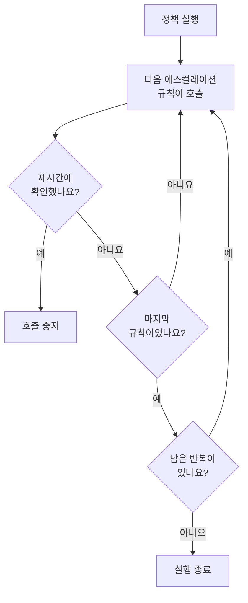

# 온콜 정책

온콜 정책은 인시던트나 경고에 대해 누구를 호출할지, 아무도 확인하지 않으면 다음은 누구인지를 정합니다. 에스컬레이션 규칙이 정책의 단계이며, 정책을 사용하는 인시던트, 경고, 에피소드가 정책을 실행합니다. 이 페이지에서는 정책을 만드는 방법, 정책을 실행하는 것, 정책 페이지에 표시되는 내용, 각 실행이 기록되는 방식을 다룹니다.

:::cards
- [정책 만들기](#정책-만들기): 이름, 그리고 먼저 호출할 사람.
- [정책을 실행하는 것](#정책을-실행하는-것): 규칙, 템플릿, 모니터, 채팅, 그리고 나 자신.
- [실행 로그](#실행-로그): 모든 실행을 규칙별로, 그리고 멈춘 이유.
- [정책 보관 또는 삭제](#정책-보관-또는-삭제): 정책을 운영에서 제외합니다.
:::

## 정책 만들기

:::steps
1. **온콜 듀티 → 온콜 정책** 으로 이동하여 **온콜 정책 만들기** 를 클릭합니다.
2. **이름** 을 입력합니다. 예: "결제 기본".
3. **누구에게 먼저 알릴까요?** 에서 **응답자 추가** 를 클릭하고 먼저 호출할 온콜 스케줄, 팀, 사람을 선택합니다.
4. **온콜 정책 만들기** 를 클릭합니다. 정책은 **Level 1** 이 이미 있는 상태로 해당 **에스컬레이션 규칙** 페이지에서 열립니다.
:::

**누구에게 먼저 알릴까요?** 는 선택 사항이며, 에스컬레이션 규칙을 추가할 수 있는 사람에게만 표시됩니다. 비워 두면 규칙이 생길 때까지 정책은 아무도 호출하지 않습니다. **설명** 과 **레이블** 은 **추가 필드** 아래에 있습니다. 다음 단계를 추가하려면 [에스컬레이션 규칙](/docs/on-call/escalation-rules) 을 참조하세요.

**온콜 정책** 목록에는 각 정책의 **이름**, **설명**, **레이블**, **소유자** 가 표시됩니다. 정책을 선택하면 **레이블 추가**, **레이블 제거**, **소유자 추가**, **소유자 제거**, **보관**, **JSON 내보내기** 를 하거나 정책을 삭제할 수 있습니다. **JSON 가져오기** 는 내보낸 파일에서 정책을 만듭니다. 내보낸 파일에는 정책 자체의 설정만 들어 있고, 에스컬레이션 규칙이나 소유자는 들어 있지 않습니다.

## 정책을 실행하는 것

무언가가 정책을 실행하기 전까지 정책은 아무도 호출하지 않습니다. 모든 인시던트, 경고, 에피소드는 생성되는 즉시 자신이 가진 정책을 실행합니다.

| 무엇 | 정책이 추가되는 방식 | 더 읽기 |
| --- | --- | --- |
| 레코드 자체 | 인시던트나 경고를 만들 때의 **온콜 정책** 필드, 인시던트 템플릿, 또는 모니터 조건의 **온콜** 접힌 영역 | [인시던트 선언](/docs/incidents/declaring-incidents) |
| 온콜 규칙 | **인시던트 → 규칙 → 온콜 규칙** 과 **경고 → 규칙 → 온콜 규칙** 이 일치하는 모든 규칙의 정책을 추가합니다 | [인시던트 온콜 규칙](/docs/incidents/settings#인시던트-온콜-규칙) |
| 그룹화 규칙 | 그룹화 규칙은 에피소드를 열 때 자신의 정책을 실행합니다 | [경고 에피소드 및 그룹화 규칙](/docs/alerts/episodes) |
| 수동 | 피드의 **작업** 메뉴, 또는 Slack이나 Microsoft Teams 메시지의 **온콜 정책 실행** | [인시던트 피드](/docs/incidents/notes-owners-and-feed#인시던트-피드) |
| 채팅과 워크플로우 | Slack이나 Microsoft Teams의 `/oneuptime page`, 그리고 워크플로우의 **Page an On-Call Policy** 단계 | [Paging](/docs/workflows/components#paging) |

여러 규칙이 추가한 정책도 한 번만 실행됩니다. 심각도가 스스로 정책을 실행하는 일은 없습니다. 그 심각도와 일치하는 온콜 규칙이 실행합니다. 이미 인지되었거나 해결된 상태로 생성된 인시던트나 경고는 어떤 정책도 실행하지 않습니다. **근무 시간에만**으로 설정한 온콜 규칙은 자신이 추가한 정책을 근무 시간이 시작될 때까지 기다리게 합니다.

## 정책 페이지

목록에서 정책을 엽니다. 사이드 메뉴에 정책에 관한 모든 것이 있습니다.

| 섹션 | 페이지 |
| --- | --- |
| **기본** | **개요**, **에스컬레이션 규칙**, **소유자** |
| **로그** | **실행 로그** 와 **알림 로그** |
| **개발자** | **Terraform**, **API**, **AI 어시스턴트** |
| **고급** | **사용자 재정의**, **사용자 정의 필드**, **설정**, **감사 로그**, **정책 삭제** |

**기본** 은 열려 있습니다. 다른 섹션은 클릭할 때까지 접혀 있습니다.

- **개요** 에는 **온콜 정책 세부 정보** 가 표시되고, 이어서 **정책 한눈에 보기** 가 표시됩니다. 정책의 단계 수와 응답자 수, 마지막 단계까지 걸리는 시간, 반복 횟수를 알 수 있습니다. **대응자 준비 상태** 는 정책이 호출할 수 있는 모든 사람에게 지금 연락이 닿는지 알려 주고, **온콜 정책 피드** 는 바뀐 내용을 보여 줍니다. 추가되거나 제거된 사람, 팀, 스케줄, 재정의, 인수인계입니다.
- **소유자** 는 정책을 책임지는 사람과 팀입니다. 정책이 보낸 호출이 누군가의 규칙을 찾지 못하거나 전달될 수 없으면 소유자에게 이메일이 갑니다. 소유자가 없는 정책은 대신 프로젝트 소유자에게 이메일을 보냅니다.
- **알림 로그** 에는 정책이 보낸 모든 메시지가 채널별 탭으로 표시됩니다.
- **사용자 재정의** 는 이 정책에서만 사람을 대신합니다. [사용자 재정의](/docs/on-call/user-overrides) 를 참조하세요.
- **설정** 에는 **온콜 정책 내보내기** 와 정책을 보관하는 카드가 있습니다.

## 정책 반복

마지막 단계의 대기 시간이 끝날 때까지 아무도 확인하지 않으면, 정책은 반복하도록 설정되어 있지 않은 한 멈춥니다. 선택하려면 정책의 **에스컬레이션 규칙** 페이지를 열고, 규칙 아래의 **반복 정책** 카드에서 **편집** 을 클릭합니다. **반복 정책 편집** 은 **마지막 단계 후에도 아무도 인지하지 않으면** 어떻게 할지 묻습니다.

| 답 | 하는 일 |
| --- | --- |
| **알림 중지** | 아무에게도 다시 알림이 가지 않으므로 정책은 한 번만 실행됩니다. 새 정책은 이 답으로 시작합니다. |
| **Level 1부터 다시 시작** | 모든 단계에 순서대로 다시 알림이 갑니다. **몇 번 더 할까요?** 에서 횟수를 정합니다(1 이상). |

세 번 더 다시 시작하는 정책은 단계를 모두 네 번 거칩니다. 카드의 **마지막 단계 후** 행이 정책이 하는 일을 보여 주고, **개요** 의 **정책 한눈에 보기** 도 같은 내용을 문장으로 보여 줍니다.

## 해결되지 않으면 다시 알림

인지하면 이후 아무도 인시던트나 경고를 해결하지 않더라도 정책의 호출이 완전히 멈춥니다. 대신 정책이 다시 알리게 할 수 있습니다. 정책의 **에스컬레이션 규칙** 페이지를 열고, 아래쪽의 **추가 설정** 을 연 다음, **인지 후 타임아웃** 카드에서 **편집** 을 클릭합니다. **인지 후 타임아웃 편집** 은 **인지되었지만 해결되지 않으면** 어떻게 할지 묻습니다.

| 답 | 하는 일 |
| --- | --- |
| **다시 알리지 않음** | 인지하면 알림이 완전히 멈춥니다. 새 정책은 이 답으로 시작합니다. |
| **다시 알림** | 인지한 사람과 현재 온콜 담당자에게 알립니다. **몇 분 후에?** 에서 시점을 정합니다(5~1440분, 처음에는 30분). |

분은 인지할 때마다 새로 세며, 정책은 같은 인시던트, 경고 또는 에피소드에 대해 최대 5번까지 다시 알립니다. 다시 알림은 인지되었을 때 호출하던 단계에서 시작해 지금 그 단계의 온콜 담당자를 호출하고, 첫 실행처럼 단계를 거쳐 갑니다. 인시던트나 경고는 인지된 상태로 남습니다. 다시 알림은 그 자체로 하나의 실행이며, 피드와 정책의 실행 로그에 표시되고, 그 **상태** 에는 "다시 알림 (1/5)"이 표시됩니다.

다시 알림을 받은 사람은 메시지에서, 또는 인시던트나 경고 페이지의 **다시 인지** 로 인지할 수 있으며, 그러면 분을 다시 셉니다. **에스컬레이션** 은 다음 단계로 넘깁니다. 인시던트나 경고를 해결하거나 삭제하거나, 정책을 보관하거나 삭제하거나, **다시 알리지 않음** 을 선택하면 멈춥니다. 카드의 **인지 후** 행이 정책이 하는 일을 보여 주고, **추가 설정** 은 접혀 있는 동안 분을 보여 줍니다. **개요** 의 **정책 한눈에 보기** 와 **에스컬레이션 요약** 도 같은 내용을 문장으로 보여 줍니다.

## 실행 로그

정책은 실행될 때마다 실행 로그를 기록하며, 로그는 실행이 진행됨에 따라 상태가 바뀝니다.

| 상태 | 의미 |
| --- | --- |
| **대기 중** | **근무 시간에만**으로 설정한 온콜 규칙이 근무 시간이 시작될 때까지 실행을 기다리게 합니다. 호출이 시작되는 시각을 알려 주며, 그때까지 아무도 호출하지 않습니다. 그 전에 인시던트나 경고가 인지되거나 해결되면 호출 없이 끝납니다. 기다리는 동안 인시던트나 경고가 바뀌어 바로 호출하는 온콜 규칙과 일치하게 되면 그 즉시 호출을 시작합니다. |
| **예정됨**, **시작됨** | 실행을 준비하고 있습니다. 5분이 지나도 이 상태인 실행은 **오류** 로 중지됩니다. |
| **Executing** | 실행이 호출 중입니다. OneUptime이 매분 진행시킵니다. |
| **Execution Completed** | 누군가 확인했거나, 인시던트나 경고가 해결되었거나, 모든 규칙과 반복을 사용했거나, 정책이 보관되었습니다. |
| **Execution Completed - No One Notified** | 실행이 모든 규칙을 거쳤지만 아무도 호출하지 않았습니다. 대개 아무도 온콜이 아닌 스케줄 때문입니다. |
| **오류** | 실행이 실패했습니다. **상태 메시지 보기** 에서 이유를 알 수 있습니다. |

실행 로그는 세 곳에서 볼 수 있습니다.

- **로그** 아래에 있는 정책 자체의 **실행 로그**.
- **온콜 듀티 → 고급 → 실행 로그**. 모든 정책의 실행이 표시되며, 워크플로우와 채팅의 직접 호출은 **직접 호출** 로 표시됩니다.
- 인시던트나 경고의 **온콜 실행** 페이지.

각 행에는 실행을 시작한 것, 시간, **상태**, 확인한 사람이 표시됩니다. **타임라인 보기** 는 **실행 타임라인** 을 엽니다. 각 에스컬레이션 규칙, 그 규칙이 호출한 사람, 거친 스케줄, 각 호출의 결과를 보여 줍니다. 아무도 온콜이 아닌 스케줄은 사람 대신 **당번이 없었음** 을 표시합니다. OneUptime Cloud에서 실행 로그에는 **Growth** 요금제가 필요합니다.

## 정책 보관 또는 삭제

보관하면 모든 것을 유지한 채 정책을 운영에서 제외합니다. 정책의 **설정** 을 열고 보관 카드에서 **보관** 을 클릭하거나, 목록에서 정책을 선택하고 **보관** 을 선택합니다.

- 보관된 정책은 아무도 호출하지 않습니다. 이 정책을 사용하는 인시던트와 경고는 이 정책을 건너뛰고, 아직 에스컬레이션 중인 실행은 다음 단계에서 멈춥니다.
- 정책은 **온콜 정책** 목록에서 **온콜 듀티 → 고급 → 보관된 정책** 으로 옮겨지며, 그곳에서 **보관 취소** 를 클릭하면 다시 운영됩니다.

**고급** 아래의 **정책 삭제** 는 정책을 에스컬레이션 규칙, 사용자 재정의와 함께 삭제합니다. 목록에서 삭제하면 먼저 확인을 요청하고, 대신 보관할 것을 제안합니다.

## 정책을 변경할 수 있는 사람

**프로젝트 소유자**, **프로젝트 관리자**, **프로젝트 구성원**, **온콜 관리자**, **온콜 구성원** 은 정책을 만들고, 변경하고, 삭제할 수 있으며, **뷰어** 와 **온콜 뷰어** 는 읽을 수 있습니다. 사용자 정의 역할에서 권한 이름은 **Create On-Call Duty Policy**, **Edit On-Call Duty Policy**, **Delete On-Call Duty Policy**, **Read On-Call Duty Policy** 이며, 일부 레이블로 제한된 역할은 그 레이블이 붙은 정책에만 접근합니다. OneUptime Cloud에서 소유자와 사용자 정의 필드를 추가하려면 **Growth** 요금제가 필요합니다.

## API와 Terraform

온콜 정책은 `/api/on-call-duty-policy` 리소스이며, Terraform에서는 `oneuptime_on_call_policy` 리소스입니다.

| 설정 | API 필드 |
| --- | --- |
| **이름** | `name` |
| **설명** | `description` |
| **마지막 단계 후에도 아무도 인지하지 않으면** | `repeatPolicyIfNoOneAcknowledges` |
| **몇 번 더 할까요?** | `repeatPolicyIfNoOneAcknowledgesNoOfTimes` |
| **몇 분 후에?** | `acknowledgementTimeoutInMinutes` |
| 보관됨 | `isArchived` |

`repeatPolicyIfNoOneAcknowledges` 는 **알림 중지** 이면 `false`, **Level 1부터 다시 시작** 이면 `true` 입니다. `true` 이면 `repeatPolicyIfNoOneAcknowledgesNoOfTimes` 는 1 이상의 정수여야 하며, OneUptime은 `0` 을 거부합니다. 예전에 `0` 으로 저장된 정책은 반복되지 않으며, 대시보드에는 **알림 중지** 로 표시됩니다.

`acknowledgementTimeoutInMinutes` 는 **다시 알리지 않음** 이면 `null`, **다시 알림** 이면 5~1440 사이의 정수 분입니다. 그 밖의 값은 OneUptime이 거부합니다.

첫 번째 단계가 있는 정책을 한 번의 요청으로 만들려면 [API 또는 Terraform으로 규칙 만들기](/docs/on-call/escalation-rules#api-또는-terraform으로-규칙-만들기) 를 참조하세요.

## 문제 해결

:::details 정책이 실행되었지만 아무도 호출되지 않았습니다
그 실행에는 **Execution Completed - No One Notified** 가 표시됩니다. **타임라인 보기** 를 여세요. **당번이 없었음** 행은 빈틈이 있는 스케줄을 가리키고, **건너뜀** 행의 상태 메시지는 이유를 알려 줍니다. 예를 들어 대신할 사람 없이 부재 중인 사람입니다. **온콜 듀티 → 준비 상태** 에서 연락이 닿지 않은 사람을 확인할 수 있습니다.
:::

:::details 다음 단계가 대기 시간 1분 후에 호출되었습니다
OneUptime은 실행 중인 정책을 1분에 한 번 진행시키므로, 단계는 대기 시간이 끝난 후 첫 번째 확인에서 호출됩니다.
:::

:::details 인시던트에 아무도 호출하지 않은 정책이 표시됩니다
정책이 보관되었습니다. 보관된 정책은 그것을 사용하는 인시던트와 경고에 남아 있지만 아무도 호출하지 않으며, 실행 로그에는 실행되지 않았다고 기록됩니다. **온콜 듀티 → 고급 → 보관된 정책** 에서 보관을 취소하세요.
:::

## 다음 단계

:::cards
- [에스컬레이션 규칙](/docs/on-call/escalation-rules): 정책이 호출하는 단계와 각 단계의 대기 시간을 추가합니다.
- [사용자 재정의](/docs/on-call/user-overrides): 누군가 부재 중인 동안 그 사람의 호출을 동료에게 보냅니다.
- [준비 상태 및 보고서](/docs/on-call/readiness): 정책이 호출하는 모든 사람에게 연락이 닿는지 확인합니다.
:::
