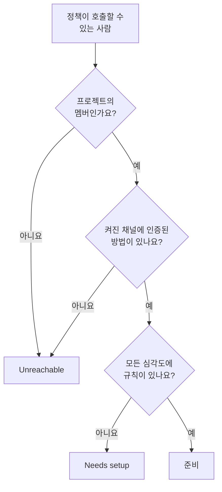

# 준비 상태 및 보고서

준비 상태는 인시던트보다 먼저 한 가지 질문에 답합니다. 지금 무언가 발생한다면, 온콜 정책이 호출하는 모든 사람에게 실제로 연락이 닿을까요? 프로젝트의 모든 응답자를 나열하고, 누가 준비되었고 누가 아닌지 알려 주며, 설정을 마치도록 사람들에게 알림을 보낼 수 있게 합니다. 그리고 **사용자 온콜 시간** 보고서는 각 사람이 얼마나 오래 온콜이었는지 보여 줍니다.

:::cards
- [상태가 정해지는 방식](#상태가-정해지는-방식): 준비, Needs setup, Unreachable과 그 이유.
- [준비 상태 페이지](#준비-상태-페이지): 프로젝트의 모든 응답자를 한 목록에.
- [설정을 마치도록 알림 보내기](#설정을-마치도록-알림-보내기): 빠진 것을 알려 주는 이메일.
- [사용자 온콜 시간](#사용자-온콜-시간): 각 사람이 얼마나 오래 온콜이었는지.
:::

## 상태가 정해지는 방식

응답자는 온콜 정책이 호출할 수 있는 모든 사람입니다. 에스컬레이션 규칙에 지정된 사람, 규칙이 호출하는 팀의 멤버, 규칙이 호출하는 스케줄의 레이어에 있는 사람, 그리고 아직 끝나지 않은 사용자 재정의에서 대신하는 사람이 포함됩니다. 어떤 정책도 호출하지 않는 스케줄은 아무도 추가하지 않습니다.

| 상태 | 의미 |
| --- | --- |
| **준비** | 프로젝트에서 켜 둔 채널에 인증된 알림 방법이 있고, 온콜 규칙의 모든 탭에서 모든 심각도에 규칙이 있습니다. |
| **설정 필요** | 연락은 닿지만 일부 심각도에 규칙이 없습니다. 행에 이 빈틈의 수가 표시됩니다. |
| **연결 불가** | 아무것도 닿지 않습니다. 인증된 알림 방법이 없거나, 인증된 알림 방법이 모두 프로젝트에서 꺼 둔 채널에 있거나, 프로젝트의 멤버가 아닙니다. |

빈틈은 인시던트, 인시던트 에피소드, 경고, 경고 에피소드 탭 중 하나에서 규칙이 없는 심각도입니다. 일부러 심각도를 끄는 규칙은 빈틈이 아닙니다. 빈틈에 걸린 호출도, 프로젝트가 그 대체 동작을 끄지 않았다면 인증된 알림 방법으로 그 사람에게 전달됩니다. [일치하는 규칙이 없을 때](/docs/notifications/index#일치하는-규칙이-없을-때) 를 참조하세요.

## 준비 상태 페이지

**온콜 듀티 → 준비 상태** 를 엽니다. **On-call readiness** 카드에는 프로젝트의 온콜 정책이 연락할 수 있는 모든 사람이, 조치가 필요한 사람부터 표시됩니다. 프로젝트의 누구나 열 수 있습니다.

목록 위의 타일은 **대응자**, **준비**, **설정 필요**, **연결 불가** 의 수를 보여 줍니다. **준비**, **설정 필요**, **연결 불가** 를 클릭하면 그 응답자만 표시되고, 다시 클릭하면 모두 표시됩니다.

| 열 | 표시 내용 |
| --- | --- |
| **대응자** | 그 사람과 이메일 주소. |
| **상태** | **준비**, **연결 불가**, 또는 빈틈의 수. |
| **팀** | 에스컬레이션 규칙을 통해 그 사람을 호출하는 팀. |
| **채널** | 채널별 세그먼트. 인증된 알림 방법이면 채워지고, 아직 인증되지 않았으면 비어 있습니다. |
| **Coverage** | 모든 심각도 중, 모든 탭에서 규칙이 있는 심각도의 수. |
| **Reached via** | 정책이 그 사람에게 닿는 경로: `Direct`, `Team`, `Schedule`, `Override` 중 하나. |

행의 **Coverage** 를 클릭하면 그 사람의 알림 방법, 그 상태인 이유, 그리고 규칙 유무를 보여 주는 모든 심각도의 격자가 표시됩니다. 깔때기 아이콘으로 **대응자**, **상태**, **팀**, **Reached via** 에 따라 목록을 필터링합니다. 결과는 최대 1분 전의 것일 수 있습니다. **새로고침** 으로 다시 판정합니다.

## 설정을 마치도록 알림 보내기

자신의 알림 방법과 규칙을 추가하고 인증할 수 있는 사람은 본인뿐이므로, 본인에게 요청하는 것이 해결책입니다.

:::steps
1. 준비 상태 페이지에서 알림을 보낼 응답자를 선택합니다. 준비된 응답자는 선택할 수 없습니다. 알릴 것이 없기 때문입니다.
2. **설정 알림 보내기** 를 클릭합니다. 확인 창에 이메일을 받을 모든 사람이 표시됩니다.
3. 확인합니다. 각 사람은 자신의 설정에서 빠진 것과 그것을 고치는 페이지 링크가 담긴 이메일을 한 통 받습니다.
:::

그다음 배너에 보낸 알림, 건너뛴 알림, 실패한 알림의 수와, 보내지 않은 각 알림의 이유가 표시됩니다. 같은 사람에게는 24시간에 한 번까지만 알림을 보내며, 한 번에 최대 250명에게 보낼 수 있습니다. 알림을 보내려면 **프로젝트 소유자**, **프로젝트 관리자**, **온콜 관리자** 중 하나이거나, 사용자 정의 역할에 **Edit On-Call Duty Policy** 가 있어야 합니다.

## 다른 페이지의 준비 상태

- 정책의 **개요** 에서는 **대응자 준비 상태** 가 그 정책이 호출할 수 있는 사람 중 조치가 필요한 모든 사람을 나열하고, **다시 확인** 으로 다시 확인합니다. 내 행에는 문제를 고치는 페이지로 가는 버튼이 있고, 다른 사람의 행은 내 메일 앱에서 그 사람에게 보내는 이메일을 고칠 방법과 함께 엽니다.
- 정책의 **에스컬레이션 규칙** 에서는 응답자 모두를 호출할 수 없는 단계가 카드에 그렇게 표시합니다. [에스컬레이션 요약](/docs/on-call/escalation-rules#에스컬레이션-요약) 을 참조하세요.
- **사용자** 에서 멤버를 열고 **온콜** 섹션의 **준비 상태** 를 열면 그 사람의 상태, 알림 방법, 커버리지 격자가 표시됩니다.
- 내 설정은 **사용자 설정 → 설정 체크리스트** 가 단계별로 안내합니다. [설정 체크리스트](/docs/notifications/index#설정-체크리스트) 를 참조하세요.

## 준비 상태 주간 이메일

OneUptime은 일주일에 한 번, 온콜 정책이 있는 모든 프로젝트를 확인합니다. 그 안에 **연결 불가** 이거나 **설정 필요** 인 사람이 있으면 프로젝트 소유자에게 이메일이 한 통 갑니다. 이메일은 그 사람들을 전혀 호출할 수 없는 사람과 빈틈이 있지만 연락이 닿는 사람의 두 그룹으로 나누어, 그룹마다 최대 20명까지 준비 상태 페이지 링크와 함께 나열합니다.

모두가 준비된 주에는 아무것도 보내지 않으므로, 이 이메일은 항상 고칠 것이 있다는 뜻입니다. 전혀 호출할 수 없는 사람이 있으면 제목이 `[Action Required]` 로 시작합니다.

## 사용자 온콜 시간

**온콜 듀티 → 보고서 → 사용자 온콜 시간** 은 선택한 기간 동안 각 사람이 얼마나 오래 온콜이었는지 보여 줍니다. 처음에는 **지난 1개월** 입니다.

| 열 | 표시 내용 |
| --- | --- |
| **사용자** | 그 사람. |
| **사용자가 온콜이었던 시간** | 기간 내 온콜 시간을 시간과 분으로. |

시간은 사람들이 온콜을 시작하고 끝낼 때 기록됩니다. 규칙이 호출하는 스케줄이 그 사람에게 차례를 넘기거나, 직접 또는 팀을 통해 규칙에 추가된 때부터, 인수인계 때까지 또는 빠질 때까지입니다. 두 정책을 통해 동시에 온콜인 시간은 한 번만 세며, 아직 진행 중인 시간은 지금까지 셉니다.

**스케줄 타임라인** 과 캘린더 피드는 지난 근무를 오늘 설정된 로테이션대로 보여 줍니다. 이 보고서는 일어나는 대로 기록되므로, 공정성 검토와 온콜 수당에 사용하세요.

> [!NOTE]
> OneUptime Cloud에서 이 보고서에는 **Growth** 요금제가 필요하며, 끝난 지 200일이 넘은 시간은 삭제됩니다. 자체 호스팅 설치는 모두 보관합니다.

## 문제 해결

:::details 인증된 전화번호가 있는데도 연락할 수 없다고 나옵니다
그 사람의 알림 방법이 모두 프로젝트에서 꺼 둔 채널에 있을 수 있습니다. 새 프로젝트에서는 SMS, 전화, WhatsApp, Telegram이 꺼진 상태로 시작합니다. [프로젝트에서 채널 켜기](/docs/notifications/notification-methods#프로젝트에서-채널-켜기) 를 참조하세요.
:::

:::details 목록에 없는 사람이 있습니다
목록에는 온콜 정책이 호출할 수 있는 사람만 있습니다. 초대를 수락하지 않은 팀 멤버, 어떤 정책도 호출하지 않는 스케줄에 있는 사람, 재정의가 끝난 대신하는 사람은 빠집니다.
:::

:::details 소유자가 주간 이메일을 받지 못합니다
이메일은 누군가 **연결 불가** 이거나 **설정 필요** 인 주에만, 프로젝트 소유자에게만 보내집니다.
:::

## 다음 단계

:::cards
- [OneUptime이 연락하는 방법](/docs/notifications/index): 각 상태 뒤에 있는 알림 방법, 규칙, 대체 동작.
- [알림 방법](/docs/notifications/notification-methods): OneUptime이 사람에게 연락하는 수단을 추가하고 인증합니다.
- [개인 온콜 규칙](/docs/notifications/on-call-rules): 심각도별로 빈틈을 메웁니다.
:::
