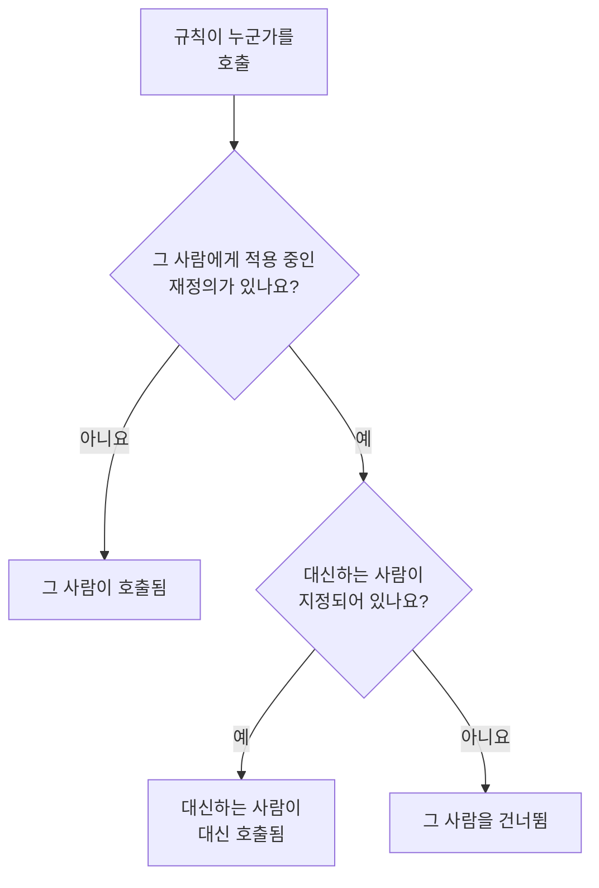

# 사용자 재정의

사용자 재정의는 누군가 부재 중인 동안, 그 사람에게 갈 호출을 정해진 기간 동안 대신하는 사람에게 보냅니다. 대신할 사람이 지정되지 않으면 대신 그 사람을 건너뜁니다. 온콜 스케줄에서 그 사람의 각 차례는 로테이션의 다음 사람에게 넘어갑니다. 휴가, 병가, 근무 교환에 사용하세요.

:::cards
- [재정의가 호출을 바꾸는 방식](#재정의가-호출을-바꾸는-방식): 대신 누가, 언제 호출되는지.
- [재정의 추가](#재정의-추가): 누가 부재 중인지, 누가 대신하는지, 언제부터 언제까지인지.
- [모든 정책 또는 하나의 정책](#모든-정책-또는-하나의-정책): 재정의를 추가하는 위치와 어느 것이 우선하는지.
- [다른 추가 방법](#다른-추가-방법): 스케줄에서, 그리고 예정된 근무에서.
:::

## 재정의가 호출을 바꾸는 방식



재정의가 적용되는 동안, 즉 시작부터 종료까지:

- **누가 대신하나요?** 에 누군가 지정되어 있으면, 그 사람이 재정의가 적용되는 모든 스케줄, 팀, 규칙에서 부재 중인 사람의 호출을 모두 받습니다. 호출은 대신하는 사람 자신의 개인 온콜 규칙을 통해 전달됩니다.
- 대신할 사람이 없으면 그 사람을 건너뜁니다. 온콜 스케줄에서는 그 사람의 각 차례가 부재 중이 아닌 로테이션의 다음 사람에게 넘어갑니다. 레이어의 모든 사람이 부재 중이면 그 아래 레이어가 이어받습니다. 그 사람을 직접 또는 팀을 통해 지정한 규칙은 그 사람을 호출하지 않으며, 정책 실행에는 그 사람이 부재 중이라는 것과 언제까지인지가 표시됩니다.
- 재정의는 연쇄되지 않습니다. 대신하는 사람도 부재 중이라도, 그 사람이 대신하는 상대의 호출은 여전히 그 사람에게 갑니다.

재정의가 끝나면 호출은 다시 원래 사람에게 갑니다. **스케줄 타임라인**, 스케줄의 레이어, 캘린더 피드는 모두 대신 맡은 각 근무를 누가 담당하는지 보여 줍니다.

## 재정의 추가

:::steps
### 재정의 열기

모든 온콜 정책에서 누군가를 대신하려면 **온콜 듀티 → 고급 → 사용자 재정의** 로, 그 정책에서만 대신하려면 **고급** 아래에 있는 정책 자체의 **사용자 재정의** 페이지로 이동합니다. **사용자 재정의 추가** 를 클릭합니다.

### 부재 중인 사람 지정

**누가 부재 중인가요?** 는 나로 시작합니다. 자신의 휴가를 등록하는 경우가 가장 많기 때문입니다. 다른 사람의 대체자를 정하려면 그 사람을 선택합니다.

### 대신하는 사람 지정

그 사람을 건너뛰려면 **누가 대신하나요?** 를 **로테이션의 다음 사람** 으로 두고, 아니면 모든 호출을 맡을 동료를 선택합니다. 부재 중인 사람은 선택지에 나오지 않습니다.

### 시간 설정

다른 시간을 고르지 않으면 **시작** 은 지금입니다. **종료** 를 그 사람이 돌아오는 시점으로 설정합니다. 종료는 시작보다 뒤여야 합니다. **사용자 재정의 추가** 를 클릭합니다.
:::

각 재정의는 한 행으로 표시되며 **부재**, **대신하는 사람**, **시작**, **종료** 열이 있고, 시작과 종료로 필터링할 수 있습니다. 건너뛰기인 경우 **대신하는 사람** 에 **로테이션의 다음 사람** 이 표시됩니다. 재정의는 편집할 수 없습니다. 삭제하고 새로 추가하거나, 삭제해서 그 사람을 일찍 돌아오게 하세요.

## 모든 정책 또는 하나의 정책

| 추가 위치 | 카드 | 적용 대상 |
| --- | --- | --- |
| **온콜 듀티 → 고급 → 사용자 재정의** | **전역 사용자 재정의** | 프로젝트의 모든 온콜 정책 |
| 정책의 **사용자 재정의** | **온콜 정책 사용자 재정의** | 그 정책만 |

같은 사람에 대한 재정의 두 개가 겹치면, 전역 재정의보다 정책 자체의 재정의가 우선하고, 건너뛰기보다 대신하는 사람을 지정한 재정의가 우선합니다. 워크플로우나 채팅에서 정책 없이 보낸 호출은 전역 재정의만 따릅니다.

## 다른 추가 방법

- 스케줄에서: 스케줄의 **레이어** 페이지에서 레이어를 펼치고 사람 옆의 **날짜까지 건너뛰기…** 를 클릭합니다. 그 사람이 부재 중이고 로테이션이 대신하는 같은 양식이 전역 재정의로 열립니다. [누군가 부재 중일 때](/docs/on-call/schedules#누군가-부재-중일-때) 를 참조하세요.
- 예정된 근무에서: **사용자 설정 → 캘린더 → 캘린더 피드** 에서 내 근무 중 하나의 **대체자 구하기** 를 클릭하면, 그 근무 시간 동안 내가 부재 중인 상태로 양식이 열리므로 **누가 대신하나요?** 만 남습니다. [예정된 근무와 대체](/docs/on-call/calendar-feeds#예정된-근무와-대체) 를 참조하세요.

누군가 프로젝트를 떠나면, 그 사람을 지정하고 아직 끝나지 않은 재정의는 어느 쪽이든 모두 삭제됩니다.

## 재정의를 추가할 수 있는 사람

**프로젝트 소유자**, **프로젝트 관리자**, **프로젝트 구성원**, **온콜 관리자**, **온콜 구성원** 은 재정의를 추가하고 삭제할 수 있으며, **뷰어** 와 **온콜 뷰어** 는 볼 수 있습니다. 사용자 정의 역할에서 권한 이름은 **Create On-Call Duty Policy User Override**, **Delete On-Call Duty Policy User Override**, **Read On-Call Duty Policy User Override** 입니다. **스케줄 타임라인** 에서는 재정의를 읽을 수 있는 사람만 누구의 근무를 대신하는지 볼 수 있습니다.

OneUptime Cloud에서 사용자 재정의에는 **Growth** 요금제가 필요합니다.

## API

사용자 재정의는 `/api/on-call-duty-policy-user-override` 리소스입니다.

| 필드 | 내용 |
| --- | --- |
| `overrideUserId` | 부재 중인 사람. 필수입니다. |
| `routeAlertsToUserId` | 대신하는 사람. 생략하면 대신 그 사람을 건너뜁니다. |
| `startsAt`, `endsAt` | 재정의의 시작과 종료. 둘 다 필수이며, 종료는 시작보다 뒤입니다. |
| `onCallDutyPolicyId` | 적용할 정책. 전역 재정의는 생략합니다. |

```bash
curl -X POST https://oneuptime.com/api/on-call-duty-policy-user-override \
  -H "apikey: $ONEUPTIME_API_KEY" \
  -H "Content-Type: application/json" \
  -d '{
    "data": {
      "projectId": "<project-id>",
      "overrideUserId": "<away-user-id>",
      "routeAlertsToUserId": "<cover-user-id>",
      "startsAt": "2026-12-22T09:00:00Z",
      "endsAt": "2027-01-05T09:00:00Z"
    }
  }'
```

부재 중인 사람과 대신하는 사람이 같은 재정의는 거부되며, 시작하기 전에 끝나는 재정의도 마찬가지입니다.

## 문제 해결

:::details 휴가 중인 사람이 그래도 호출되었습니다
재정의를 추가한 위치를 확인하세요. 정책의 **사용자 재정의** 페이지에서 추가한 재정의는 그 정책에만 적용되며, 다른 정책은 여전히 그 사람을 호출합니다. 모든 정책에 적용하려면 **온콜 듀티 → 고급 → 사용자 재정의** 에서 추가하세요. **시작** 과 **종료** 도 확인하세요. 시간은 내 시간대로 표시됩니다.
:::

:::details 대신하는 사람도 호출되지 않았습니다
대신하는 사람에게는 자신의 개인 온콜 규칙과 인증된 알림 방법을 통해 연락합니다. **온콜 듀티 → 준비 상태** 에서 그 사람을 확인하고, 정책의 **실행 로그** 에서 실행을 확인하세요.
:::

:::details 재정의를 추가할 수 없습니다
추가하려면 위의 역할 중 하나가 필요하며, OneUptime Cloud에서는 **Growth** 요금제도 필요합니다.
:::

## 다음 단계

:::cards
- [온콜 스케줄](/docs/on-call/schedules): 로테이션, 레이어, 레이어에서 누군가 건너뛰기.
- [스케줄 타임라인](/docs/on-call/schedule-timeline): 모든 스케줄에서 대신 맡은 근무를 봅니다.
- [캘린더 피드](/docs/on-call/calendar-feeds): 내 근무 중 하나의 대체자를 구합니다.
:::
