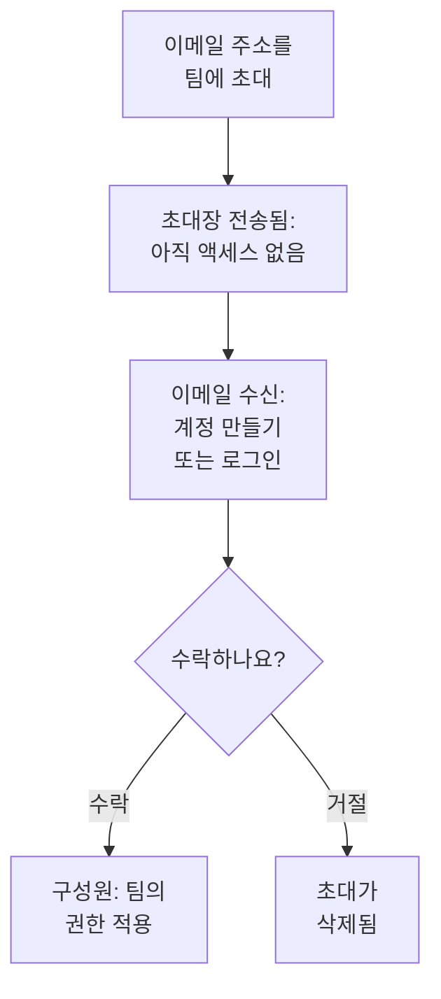

# 사람 초대

사람들은 초대를 통해 프로젝트에 들어옵니다. 어떤 사람의 이메일 주소를 팀에 초대하고 그 사람이 수락하면, 그때부터 그 사람이 할 수 있는 일은 팀이 정합니다. 이 페이지에서는 사람을 초대하는 방법, 초대받은 사람에게 보이는 내용, 나중에 액세스를 바꾸거나 끝내는 방법을 설명합니다.

:::cards
- [사람 초대하기](#사람-초대하기): 이메일 주소와 팀.
- [초대 수락하기](#초대-수락하기): 초대받은 사람이 보는 것과 하는 일.
- [팀 변경하기](#팀-변경하기): 액세스를 늘리거나 줄입니다.
- [사람 제거하기](#프로젝트에서-사람-제거하기): 프로젝트를 떠날 때 함께 사라지는 것.
:::

## 초대가 작동하는 방식

- **그 사람이 할 수 있는 일은 팀이 정합니다.** 누구도 개인 권한을 갖지 않습니다. 사람은 자신이 속한 팀이 허용하는 일을 할 수 있습니다. [사용자, 팀 및 권한](/docs/permissions/index)을 참조하세요.
- **수락하기 전에는 아무것도 주어지지 않습니다.** 대기 중인 초대는 **초대장 전송됨**으로 표시되며 프로젝트에 대한 액세스를 주지 않습니다.
- **한 번의 수락이 프로젝트 전체에 적용됩니다.** 초대를 수락하면 같은 프로젝트에 대한 그 사람의 다른 초대도 모두 수락됩니다. 나중에 다른 팀에 추가한 구성원은 수락할 필요 없이 바로 그 팀에 들어갑니다.

## 시작하기 전에

- **초대할 수 있는 역할.** Project Owner, Project Admin 또는 **Invite New Members** 권한이 있는 역할. 초대하면 그 팀의 액세스가 주어지므로, 자신이 그 권한을 가진 팀에만 사람을 초대할 수 있습니다. 차단이 하나도 없는 Project Admin은 이 판단에서 Project Admin이 이미 할 수 있는 모든 것을 가진 것으로 봅니다. **Members**나 더 좁은 역할을 가진 팀에는 초대할 수 있지만, Project Owner, 결제 권한, **Delete Project**, **Edit Project**, **Edit Team**, **Invite New Members**를 가진 팀에는 초대할 수 없습니다.
- **OneUptime Cloud에서는 요금제의 여유 좌석.** 프로젝트의 모든 사람은 초대된 순간부터 청구서의 좌석이 됩니다. Free 요금제에는 한 사람의 자리만 있습니다. [결제 및 사용량](/docs/configuration/billing#요금제와-좌석)을 참조하세요.
- **SCIM Push Groups를 사용하지 않을 것.** ID 공급자가 SCIM Push Groups로 프로젝트의 팀을 관리하는 동안에는 OneUptime이 아니라 그곳에서 사람을 초대하고 제거합니다.

## 사람 초대하기

:::steps
### 사용자 목록 열기

**제품 → 설정 → 사용자**로 이동합니다. **사용자** 목록에는 프로젝트의 모든 사람, 그들의 팀, 그리고 참여했는지 여부가 표시됩니다.

### 초대 대화 상자 열기

**사용자 초대**를 클릭합니다. **새 사용자 초대** 대화 상자가 열립니다.

### 이메일 주소 입력

**이메일**에 주소를 입력합니다. 아직 그 주소를 쓰는 OneUptime 계정이 없으면 대화 상자에서 **이름**도 묻습니다. 새 계정은 이 이름으로 시작합니다.

### 팀 선택

**팀**에는 처음에 프로젝트의 구성원 팀이 선택되어 있습니다. 프로젝트 전체에 Project Member 역할을 가진 팀, 없으면 Members라는 이름의 팀입니다. 더 많거나 적은 액세스를 주려면 다른 팀을 선택합니다. 프로젝트에 그런 팀이 없거나 직접 그 팀에 초대할 수 없는 경우 **팀**은 비어 있습니다.

### 초대 보내기

**초대**를 클릭합니다. OneUptime이 초대를 이메일로 보내고 그 사람의 페이지를 엽니다. 초대가 수락될 때까지 그 사람은 **초대장 전송됨**으로 표시됩니다.
:::

> [!TIP]
> 업무에 필요한 가장 작은 팀에 사람을 초대하세요. 나중에 다른 팀에 추가할 수 있으며, 참여하는 팀이 늘어날 때마다 할 수 있는 일도 늘어납니다.

## 초대 수락하기

초대 이메일에는 프로젝트 이름이 나옵니다. 이메일의 버튼은 아직 OneUptime 계정이 없는 사람에게는 **Create Your Account**, 계정이 있는 사람에게는 **Sign In to OneUptime**입니다. 로그인한 뒤 다음 두 곳 중 하나에서 수락합니다.

| 상황 | 보이는 것 | 클릭하는 것 |
| --- | --- | --- |
| 아직 어느 프로젝트에도 없음 | 로그인 후 처음 보이는 페이지의 초대 | **Accept & Join** 또는 **Decline** |
| 이미 다른 프로젝트에 있음 | 오른쪽 위 종 아이콘의 대기 중인 초대. 종을 누르면 **프로젝트 초대**가 열립니다 | **수락** 또는 **거부** |

수락하면 바로 프로젝트에 들어가며, 팀의 권한과 모든 구성원이 처음 갖는 알림 설정이 적용됩니다. [처음에 준비되는 것](/docs/notifications/index#처음에-준비되는-것)을 참조하세요. 거절하면 초대가 삭제되므로 나중에 참여하려면 새 초대가 필요합니다.

## 프로젝트에 누가 있는지 보기

**사용자**에는 사람마다 한 행이 있습니다.

| 열 | 표시 내용 |
| --- | --- |
| **사용자** | 이름과 이메일 주소. |
| **팀** | 그 사람이 속해 있거나 초대된 프로젝트의 모든 팀. |
| **상태** | 참여한 뒤에는 **구성원**이며, 아직 수락하지 않은 다른 팀 초대가 있으면 그 수도 함께 표시됩니다. 그전까지는 **초대장 전송됨**. |

**사용자**, **상태**, **팀**으로 목록을 필터링합니다. 행을 클릭하면 그 사람의 페이지가 열립니다.

| 페이지 | 용도 |
| --- | --- |
| **프로필** | 이름, 이메일 주소, 사진, 사용자 ID. |
| **팀** | 그 사람이 속한 팀. 여기서 팀을 추가하거나 제거합니다. |
| **준비 상태**, **알림 방법**, **온콜 규칙** | 호출할 수 있는지와 그 방법. Project Owner, Project Admin, 본인, 그리고 다른 사람의 알림 규칙을 읽을 수 있는 사람에게 표시됩니다. [준비 상태 및 보고서](/docs/on-call/readiness)를 참조하세요. |
| **사용자 정의 필드** | 사람에 대한 프로젝트의 사용자 정의 필드(있는 경우). |
| **프로젝트에서 제거** | 그 사람을 프로젝트에서 내보냅니다. |

## 팀 변경하기

:::steps
### 팀 페이지 열기

**사용자**에서 그 사람을 클릭한 다음 **팀**을 클릭합니다.

### 팀에 추가

**초대**를 클릭하고 **팀**을 선택한 다음 대화 상자에서 **초대**를 클릭합니다. 구성원은 바로 새 팀에 들어갑니다. 아직 참여하지 않은 사람은 초대를 하나 더 받으며, 둘 중 하나를 수락하면 둘 다 수락됩니다.

### 팀에서 빼기

팀 행에서 **제거**를 클릭합니다. 그 사람이 참여한 마지막 팀이면 제거하는 순간 프로젝트에서도 나가게 되며, 대화 상자가 변경 전에 이를 알려 줍니다.
:::

Owners 팀에는 참여한 구성원이 항상 최소 한 명 남아 있으므로, 프로젝트가 마지막 소유자를 잃는 일은 없습니다.

## 프로젝트에서 사람 제거하기

**사용자**에서 그 사람의 행 메뉴(**⋯**)를 열고 **프로젝트에서 제거**를 클릭합니다. 또는 그 사람을 열고 측면 메뉴에서 **프로젝트에서 제거**를 선택합니다. 여러 사람을 한 번에 제거하려면 행을 선택한 뒤 선택 항목을 삭제합니다. 각 사람은 같은 방식으로 제거됩니다.

제거하면 그 사람은 프로젝트의 모든 팀에서 빠집니다. 로그인 중이어도 즉시 액세스를 잃고, 프로젝트의 온콜 일정과 에스컬레이션 규칙에서 빠지며, 더 이상 프로젝트의 알림을 받지 않습니다. OneUptime 계정은 삭제되지 않으며 다시 초대할 수 있습니다. 프로젝트를 떠날 때 함께 사라지는 모든 것은 [사용자, 팀 및 권한](/docs/permissions/index#사용자)에 나와 있습니다.

## 그 밖의 참여 방법

- **싱글 사인온.** 프로젝트의 ID 공급자로 처음 로그인하는 사람은 공급자가 지정하는 팀에 들어갑니다. [SSO 사용자의 역할과 팀](/docs/identity/sso#sso-사용자의-역할과-팀)을 참조하세요.
- **SCIM.** ID 공급자가 사람을 만들고 연결의 기본 팀에 추가합니다. [SCIM](/docs/identity/scim#프로젝트-사용자가-프로비저닝되는-방식)을 참조하세요.
- **Admin Dashboard.** 자체 호스팅 설치에서는 마스터 관리자가 사람을 프로젝트에 추가하고 그 사람 대신 초대를 수락할 수 있습니다. [사용자, 팀 및 권한](/docs/permissions/index#사용자)을 참조하세요.

## 문제 해결

:::details "This user has already been invited to this team"
그 사람은 이미 구성원으로, 또는 수락하지 않은 초대로 그 팀에 있습니다. **사용자**에서 그 사람을 열어 팀을 확인하거나, 다른 팀에 초대하세요.
:::

:::details "You have reached the user limit for the free plan"
OneUptime Cloud에서 Free 요금제 프로젝트에는 한 사람의 자리만 있습니다. 요금제를 변경한 다음 다시 초대하세요. [요금제 변경하기](/docs/configuration/billing#요금제-변경하기)를 참조하세요.
:::

:::details "Too many invitations were sent to this email address in the last hour"
한 주소에는 프로젝트와 비공개 상태 페이지 초대를 합쳐, 누가 보내든 한 시간에 10건까지 보낼 수 있습니다. 한 시간 기다린 뒤 다시 초대하세요.
:::

:::details 초대 이메일이 오지 않았거나 링크가 만료됨
초대는 이메일에 의존하지 않습니다. 초대한 주소로 가입해 달라고 요청하세요. OneUptime이 그 주소로 계정 생성을 마칠 새 링크를 보냅니다. 이미 계정이 있는 사람은 로그인하면 기다리고 있는 초대를 찾을 수 있습니다.
:::

:::details 사용자 초대에 SCIM Push Groups가 사용자를 관리한다고 표시됨
ID 공급자가 프로젝트의 팀을 관리합니다. ID 공급자에서 사람을 초대하거나 제거하세요. 또는 **프로젝트 설정 → 보안 → SCIM**에서 Push Groups를 끄면 여기서 관리할 수 있습니다.
:::

## 다음 단계

:::cards
- [사용자, 팀 및 권한](/docs/permissions/index): 각 팀이 할 수 있는 일을 정합니다.
- [프로젝트 설정](/docs/configuration/project-settings): 프로젝트 전체에 적용되는 모든 것.
- [내 계정](/docs/introduction/your-account): 로그인, 프로필, 속한 프로젝트.
- [SCIM](/docs/identity/scim): ID 공급자가 사람과 팀을 관리하게 합니다.
:::
