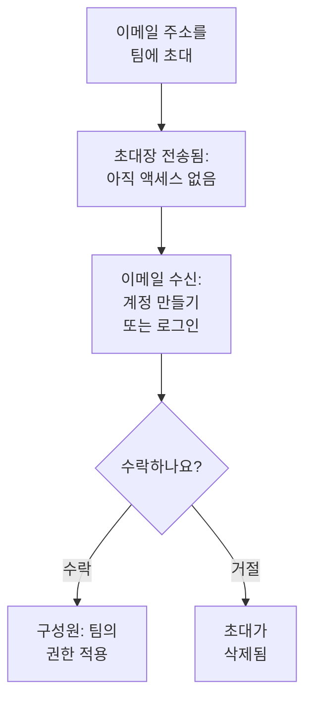

# 사람 초대

사람들은 초대를 통해 프로젝트에 들어옵니다. 어떤 사람의 이메일 주소를 팀에 초대하고 그 사람이 수락하면, 그때부터 그 사람이 할 수 있는 일은 팀이 정합니다. 이 페이지에서는 사람을 초대하는 방법, 초대받은 사람에게 보이는 내용, 나중에 액세스를 바꾸거나 끝내는 방법을 설명합니다.

:::cards
- [사람 초대하기](#사람-초대하기): 이메일 주소와 팀.
- [초대 수락하기](#초대-수락하기): 초대받은 사람이 보는 것과 하는 일.
- [팀 변경하기](#팀-변경하기): 액세스를 늘리거나 줄입니다.
- [사람 제거하기](#프로젝트에서-사람-제거하기): 프로젝트를 떠날 때 함께 사라지는 것.
:::

## 초대가 작동하는 방식

- **그 사람이 할 수 있는 일은 팀이 정합니다.** 누구도 개인 권한을 갖지 않습니다. 사람은 자신이 속한 팀이 허용하는 일을 할 수 있습니다. [사용자, 팀 및 권한](/docs/permissions/index)을 참조하세요.
- **수락하기 전에는 아무것도 주어지지 않습니다.** 대기 중인 초대는 **초대장 전송됨**으로 표시되며 프로젝트에 대한 액세스를 주지 않습니다.
- **한 번의 수락이 프로젝트 전체에 적용됩니다.** 초대를 수락하면 같은 프로젝트에 대한 그 사람의 다른 초대도 모두 수락됩니다. 나중에 다른 팀에 추가한 구성원은 수락할 필요 없이 바로 그 팀에 들어갑니다.

## 시작하기 전에

- **초대할 수 있는 역할.** 프로젝트 소유자, 프로젝트 관리자 또는 **Invite New Members** 권한이 있는 역할. 초대하면 그 팀의 액세스가 주어지므로, 자신이 그 권한을 가진 팀에만 사람을 초대할 수 있습니다.
- **OneUptime Cloud에서는 요금제의 여유 좌석.** 프로젝트의 모든 사람은 초대된 순간부터 청구서의 좌석이 됩니다. Free 요금제에는 한 사람의 자리만 있습니다. [결제 및 사용량](/docs/configuration/billing#요금제와-좌석)을 참조하세요.
- **SCIM Push Groups를 사용하지 않을 것.** ID 공급자가 SCIM Push Groups로 프로젝트의 팀을 관리하는 동안에는 OneUptime이 아니라 그곳에서 사람을 초대하고 제거합니다.

## 사람 초대하기

:::steps
### 사용자 목록 열기

**제품 → 설정 → 사용자**로 이동합니다. **사용자** 목록에는 프로젝트의 모든 사람, 그들의 팀, 그리고 참여했는지 여부가 표시됩니다.

### 초대 대화 상자 열기

**사용자 초대**를 클릭합니다. **새 사용자 초대** 대화 상자가 열립니다.

### 이메일 주소 입력

**이메일**에 주소를 입력합니다. 입력하는 동안 **이메일**은 프로젝트의 사람들을 이름이나 주소로 제안하고, 누가 **초대됨**이고 누가 **이미 이 팀에 있음**인지도 알려 줍니다. 하나를 클릭하면 그 사람의 주소가 채워집니다. 자체 호스팅 서버에서는 마스터 관리자에게 서버의 다른 계정도 제안되며, 이 계정들은 **아직 이 프로젝트에 없음**으로 표시됩니다. 마스터 관리자가 Admin Dashboard에서 허용하면 사람을 초대할 수 있는 누구에게나 제안됩니다. 직접 입력한 주소에는 대화 상자에서 **이름**도 묻는데, 선택 사항입니다. 아직 OneUptime 계정이 없는 사람이면 이 이름으로 계정이 만들어집니다. 초대를 수락하기 전까지 프로젝트에는 그 사람이 이 이름으로, 이름이 없으면 주소로만 표시되며, 그 사람 계정의 이름이나 사진은 표시되지 않습니다. Admin Dashboard의 초대 양식도 같은 방식으로 사람을 제안합니다.

### 팀 선택

**팀**에는 처음에 프로젝트의 구성원 팀이 선택되어 있습니다. 프로젝트 전체에 프로젝트 구성원 역할을 가진 팀, 없으면 Members라는 이름의 팀입니다. 더 많거나 적은 액세스를 주려면 다른 팀을 선택합니다. 프로젝트에 그런 팀이 없거나 직접 그 팀에 초대할 수 없는 경우 **팀**은 비어 있습니다.

### 초대 보내기

**초대**를 클릭합니다. OneUptime이 초대를 이메일로 보내고 그 사람의 페이지를 엽니다. 초대가 수락될 때까지 그 사람은 **초대장 전송됨**으로 표시됩니다.

아직 이메일을 보낼 수 없는 자체 호스팅 서버에서는 이메일이 전송되지 않고, 그 사람은 **초대됨**으로 표시됩니다. 마스터 관리자에게는 먼저 **초대 링크 보내기**가 표시됩니다. 링크를 복사해 직접 그 사람에게 보낸 뒤 **완료**를 클릭합니다. 그 밖의 사람은 서버 관리자에게 [이메일 설정](/docs/emails/smtp#양식-열기)을 요청합니다. 나중에 이메일을 설정해도 그 전에 만든 초대는 전송되지 않습니다. 그 사람은 초대 링크로, 또는 초대받은 주소로 가입해 들어옵니다.
:::

> [!TIP]
> 업무에 필요한 가장 작은 팀에 사람을 초대하세요. 나중에 다른 팀에 추가할 수 있으며, 참여하는 팀이 늘어날 때마다 할 수 있는 일도 늘어납니다.

## 초대 수락하기

초대 이메일에는 프로젝트 이름과 초대한 사람이 나옵니다. 이메일의 버튼은 아직 OneUptime 계정이 없는 사람에게는 **Create Your Account**, 계정이 있는 사람에게는 **Sign In to OneUptime**입니다. 프로젝트가 구성원의 로그인을 SSO로 관리하고 그 사람이 속한 다른 모든 프로젝트도 그렇거나, 서버 전체가 SSO를 요구해서 SSO가 그 사람의 로그인을 관리하게 되면, 이메일은 그 사실을 알리고 버튼은 **Sign In with SSO**가 됩니다.

**Create Your Account**를 누르면 그 사람의 주소와 내가 입력한 이름이 채워진 가입 페이지가 열리고, 어느 프로젝트에 누가 초대했는지 알려 줍니다. 거기서 가입하면 바로 프로젝트에 참여하며, 따로 수락할 것은 없습니다. **Sign In with SSO**를 누르면 같은 페이지가 열리며, 비밀번호 대신 SSO를 제공합니다. 거기서 프로젝트의 ID 공급자 중 하나로 로그인하면 프로젝트에 참여합니다.

아직 이메일을 보낼 수 없는 자체 호스팅 서버에서는 아무에게도 이메일이 가지 않습니다. 대신 받는 초대 링크는 같은 가입 페이지를 열고, 이미 계정이 있는 사람에게는 로그인 페이지를 엽니다.

로그인하거나 다른 방법으로 가입한 사람은 다음 두 곳 중 하나에서 수락합니다.

| 상황 | 보이는 것 | 클릭하는 것 |
| --- | --- | --- |
| 아직 어느 프로젝트에도 없음 | 로그인 후 처음 보이는 페이지의 초대 | **Accept & Join** 또는 **Decline** |
| 이미 다른 프로젝트에 있음 | 오른쪽 위 종 아이콘의 대기 중인 초대. 종을 누르면 **프로젝트 초대**가 열립니다 | **수락** 또는 **거부** |

수락하면 바로 프로젝트에 들어가며, 팀의 권한과 모든 구성원이 처음 갖는 알림 설정이 적용됩니다. [처음에 준비되는 것](/docs/notifications/index#처음에-준비되는-것)을 참조하세요. 거절하면 초대가 삭제되므로 나중에 참여하려면 새 초대가 필요합니다.

## 프로젝트에 누가 있는지 보기

**사용자**에는 사람마다 한 행이 있습니다.

| 열 | 표시 내용 |
| --- | --- |
| **사용자** | 이름과 이메일 주소. 초대를 수락하기 전까지는 초대할 때 입력한 이름(입력한 경우). |
| **팀** | 그 사람이 속해 있거나 초대된 프로젝트의 모든 팀. |
| **상태** | 참여한 뒤에는 **구성원**이며, 아직 수락하지 않은 다른 팀 초대가 있으면 그 수도 함께 표시됩니다. 그전까지는 **초대장 전송됨**이며, 메일 서비스가 최근 초대 이메일을 거부했다면 **이메일 전송 안 됨**으로 표시됩니다. 아직 이메일을 보낼 수 없는 자체 호스팅 서버에서는 대신 **초대됨**으로 표시됩니다. 초대는 생성되지만 이메일은 전송되지 않습니다. |

**사용자**, **상태**, **팀**으로 목록을 필터링합니다. 행을 클릭하면 그 사람의 페이지가 열립니다.

| 페이지 | 용도 |
| --- | --- |
| **프로필** | 이름, 이메일 주소, 사진, 사용자 ID. |
| **팀** | 그 사람이 속한 팀. 여기서 팀을 추가하거나 제거합니다. |
| **준비 상태**, **알림 방법**, **나에게 연락하는 방법** | 호출할 수 있는지와 그 방법. 프로젝트 소유자, 프로젝트 관리자, 본인, 그리고 다른 사람의 알림 규칙을 읽을 수 있는 사람에게 표시됩니다. [준비 상태 및 보고서](/docs/on-call/readiness)를 참조하세요. |
| **사용자 정의 필드** | 사람에 대한 프로젝트의 사용자 정의 필드(있는 경우). |
| **프로젝트에서 제거** | 그 사람을 프로젝트에서 내보냅니다. |

## 팀 변경하기

:::steps
### 팀 페이지 열기

**사용자**에서 그 사람을 클릭한 다음 **팀**을 클릭합니다.

### 팀에 추가

**초대**를 클릭하고 **팀**을 선택한 다음 대화 상자에서 **초대**를 클릭합니다. 구성원은 바로 새 팀에 들어갑니다. 아직 참여하지 않은 사람은 초대를 하나 더 받으며, 둘 중 하나를 수락하면 둘 다 수락됩니다.

내 프로젝트는 한 사람에게 초대 이메일을 한 시간에 한 통까지만 보냅니다. 마지막 이메일 후 한 시간 안의 초대는 다른 팀으로의 초대든 그 사람을 뺀 뒤의 초대든 만들어지지만, 그 사람이 초대 중 하나를 수락하거나 거절할 때까지 두 번째 이메일은 가지 않습니다. **사용자**에서 그 사람의 행 메뉴에 있는 **초대 다시 보내기**는 여전히 이메일을 보냅니다.

### 팀에서 빼기

팀 행에서 **제거**를 클릭합니다. 그 사람이 참여한 마지막 팀이면 제거하는 순간 프로젝트에서도 나가게 되며, 대화 상자가 변경 전에 이를 알려 줍니다.
:::

Owners 팀에는 참여한 구성원이 항상 최소 한 명 남아 있으므로, 프로젝트가 마지막 소유자를 잃는 일은 없습니다.

## 프로젝트에서 사람 제거하기

**사용자**에서 그 사람의 행 메뉴(**⋯**)를 열고 **프로젝트에서 제거**를 클릭합니다. 또는 그 사람을 열고 측면 메뉴에서 **프로젝트에서 제거**를 선택합니다. 여러 사람을 한 번에 제거하려면 행을 선택한 뒤 선택 항목을 삭제합니다. 각 사람은 같은 방식으로 제거됩니다.

내 역할이 일부 팀(예: 내가 소유한 팀)에서만 사람을 제거할 수 있다면, 내가 제거할 수 없는 팀에도 속한 사람의 **프로젝트에서 제거**는 잠기며, 그 사람을 프로젝트에 남기는 팀 중 내가 볼 수 있는 팀을 알려 줍니다. 여러 사람을 한 번에 제거하면 그 사람은 제외되며, 그렇다고 알려 줍니다.

제거하면 그 사람은 프로젝트의 모든 팀에서 빠집니다. 로그인 중이어도 즉시 액세스를 잃고, 프로젝트의 온콜 일정과 에스컬레이션 규칙에서 빠지며, 더 이상 프로젝트의 알림을 받지 않습니다. OneUptime 계정은 삭제되지 않으며 다시 초대할 수 있습니다. 프로젝트를 떠날 때 함께 사라지는 모든 것은 [사용자, 팀 및 권한](/docs/permissions/index#사용자)에 나와 있습니다.

## 그 밖의 참여 방법

- **싱글 사인온.** 프로젝트의 ID 공급자로 처음 로그인하는 사람은 공급자가 지정하는 팀에 들어갑니다. [SSO 사용자의 역할과 팀](/docs/identity/sso#sso-사용자의-역할과-팀)을 참조하세요.
- **SCIM.** ID 공급자가 사람을 만들고 연결의 기본 팀에 추가합니다. [SCIM](/docs/identity/scim#프로젝트-사용자가-프로비저닝되는-방식)을 참조하세요.
- **Admin Dashboard.** 자체 호스팅 설치에서는 마스터 관리자가 사람을 프로젝트에 추가하고 그 사람 대신 초대를 수락할 수 있습니다. [사용자, 팀 및 권한](/docs/permissions/index#사용자)을 참조하세요. 마스터 관리자는 **사용자**에서 **사용자 만들기**로 계정을 만들 수도 있습니다. 이름과 이메일을 입력하면 OneUptime이 그 주소로 비밀번호를 정하는 링크를 보내며, 링크는 한 번만, 7일 동안 사용할 수 있습니다. 비밀번호를 대신 설정하려면 **추가 필드**를 엽니다. 이메일이 보내지지 않으면 직접 보낼 수 있도록 링크가 표시됩니다.

## 문제 해결

:::details "This user has already been invited to this team"
그 사람은 이미 구성원으로, 또는 수락하지 않은 초대로 그 팀에 있습니다. **사용자**에서 그 사람을 열어 팀을 확인하거나, 다른 팀에 초대하세요.
:::

:::details "You have reached the user limit for the free plan"
OneUptime Cloud에서 Free 요금제 프로젝트에는 한 사람의 자리만 있습니다. 요금제를 변경한 다음 다시 초대하세요. [요금제 변경하기](/docs/configuration/billing#요금제-변경하기)를 참조하세요.
:::

:::details "Too many invitations were sent to this email address in the last hour"
내 프로젝트는 한 주소에, 프로젝트의 팀과 비공개 상태 페이지로의 초대를 합쳐 한 시간에 10건까지 보낼 수 있습니다. 다른 프로젝트의 초대는 세지 않습니다. 한 시간 기다린 뒤 다시 초대하세요.
:::

:::details "This invitation cannot be sent right now"
OneUptime은 모든 프로젝트를 합쳐 한 주소에 한 시간에 50건이 넘는 초대를 보내지 않으며, 이 초대는 그 한도를 넘게 됩니다. 아무것도 만들어지지 않았습니다. 한 시간 뒤에 다시 시도하세요.
:::

:::details "You can remove this person from only some of their teams, so you can't remove them from the project"
내 역할은 프로젝트의 일부 팀(예: 내가 소유한 팀)에서만 사람을 제거할 수 있는데, 이 사람은 다른 팀에도 속해 있습니다. 그 사람의 **팀** 페이지에서 내 팀에서 제거하거나, 프로젝트 소유자나 프로젝트 관리자에게 프로젝트에서 제거해 달라고 요청하세요.
:::

:::details 초대 이메일이 오지 않았거나 링크가 만료됨
초대는 이메일에 의존하지 않습니다. 초대한 주소로 가입해 달라고 요청하세요. OneUptime이 그 주소로 계정 생성을 마칠 새 링크를 보냅니다. 이미 계정이 있는 사람은 로그인하면 기다리고 있는 초대를 찾을 수 있습니다.

전송되었는지 보려면 프로젝트의 **알림 로그**에서 **이메일** 탭을 여세요. 각 초대의 행에 전송 여부와 전송되지 않은 이유가 나옵니다. 자체 호스팅 서버에서는 마스터 관리자가 서버가 보내지 못한 모든 이메일을 [이메일 로그](/docs/emails/email-providers#서버가-보낸-것-확인하기)에서도 찾을 수 있습니다.

아직 이메일을 보낼 수 없는 자체 호스팅 서버에서는 가입해도 새 링크를 이메일로 보낼 수 없으며, 대신 초대 링크를 요청하라는 안내가 표시됩니다. 서버 관리자가 [이메일을 설정](/docs/emails/smtp#양식-열기)하면 가입은 위와 같이 작동합니다. 그전까지는 마스터 관리자가 새 링크를 보낼 수 있습니다. 이 링크는 그 주소에서만 한 번, 7일 동안 작동합니다. **사용자**에서 그 사람의 행 메뉴(**⋯**)를 열고 **초대 링크 가져오기**를 클릭합니다.
:::

:::details 사용자에게 이메일 전송 안 됨이 표시됨
메일 서비스가 최근 초대 이메일을 거부해서 그 사람에게 아무것도 전달되지 않았습니다. **이메일 전송 안 됨**을 가리키거나 탭하면 프로젝트 **알림 로그**의 **이메일** 탭과 같은 말로 이유가 표시됩니다. 초대한 주소를 확인하고, 이메일이 작동하면 **사용자**에서 그 사람의 행 메뉴(**⋯**)를 열고 **초대 다시 보내기**를 클릭하세요. 이메일이 전송되면 다시 **초대장 전송됨**으로 표시됩니다. 자체 호스팅 서버에서는 대신 서버 관리자가 초대 링크를 보낼 수도 있습니다. 마스터 관리자가 같은 메뉴에서 **초대 링크 가져오기**를 클릭합니다.
:::

:::details 사용자 초대에 SCIM Push Groups가 사용자를 관리한다고 표시됨
ID 공급자가 프로젝트의 팀을 관리합니다. ID 공급자에서 사람을 초대하거나 제거하세요. 또는 **프로젝트 설정 → 보안 → SCIM**에서 Push Groups를 끄면 여기서 관리할 수 있습니다.
:::

## 다음 단계

:::cards
- [사용자, 팀 및 권한](/docs/permissions/index): 각 팀이 할 수 있는 일을 정합니다.
- [프로젝트 설정](/docs/configuration/project-settings): 프로젝트 전체에 적용되는 모든 것.
- [내 계정](/docs/introduction/your-account): 로그인, 프로필, 속한 프로젝트.
- [SCIM](/docs/identity/scim): ID 공급자가 사람과 팀을 관리하게 합니다.
:::
