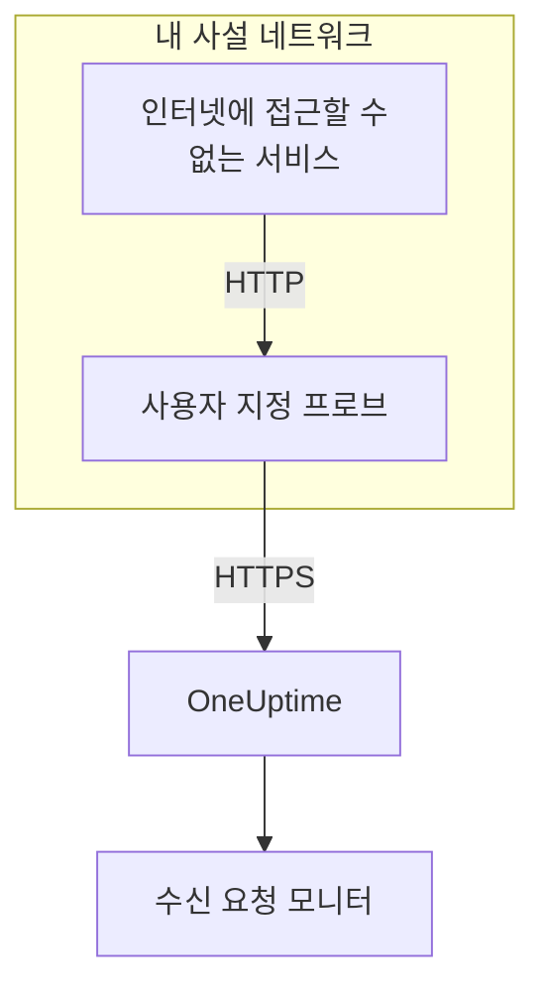

# 수신 요청 Ingress

인터넷에 접근할 수 없는 서비스도 [수신 요청 모니터](/docs/monitor/incoming-request-monitor)에 하트비트를 보낼 수 있습니다. 서비스는 대신 같은 네트워크의 [사용자 지정 프로브](/docs/probe/custom-probe)로 보내고, 프로브가 이를 OneUptime에 전달합니다.

:::cards
- [작동 방식](#작동-방식): 서비스에서 프로브를 거쳐 모니터까지.
- [리스너 켜기](#리스너-켜기): Docker, Docker Compose 또는 Kubernetes용 프로브 설정 하나.
- [프로브로 요청 보내기](#프로브로-요청-보내기): 서비스가 보내는 URL만 바꾸고 나머지는 그대로 둡니다.
- [문제 해결](#문제-해결): 요청이 전달되지 않을 때 프로브가 기록하는 내용.
:::

## 작동 방식



1. **서비스가 프로브로 요청을 보냅니다.** OneUptime에 보낼 것과 같은 `GET` 또는 `POST`를 같은 비밀 키와 함께, 프로브가 수신 대기하는 포트로 보냅니다.
2. **프로브가 바로 응답합니다.** 요청을 전달하기 전에 `200`을 돌려주므로 서비스는 OneUptime을 기다리지 않습니다.
3. **프로브가 요청을 전달합니다.** 메서드, 헤더, 본문과 함께 요청을 OneUptime에 보내고, 프로브를 가리키는 `OneUptime-Probe-Id` 헤더를 추가합니다.
4. **OneUptime은 평소처럼 읽습니다.** 모니터의 기준은 서비스가 직접 보낸 것처럼 요청을 봅니다.

리스너는 프로브의 상태 확인과 분리된 자체 포트에서 실행되므로, 다른 것은 열지 않고 사설 네트워크에만 열 수 있습니다.

## 사용하는 경우

다음과 같은 경우에 리스너를 사용합니다.

- 서비스가 나가는 HTTPS 접근이 없는 격리된 네트워크 구간에서 실행됩니다
- 모든 모니터링 트래픽을 VPC나 온프레미스 네트워크 안에 두어야 합니다
- OneUptime에 닿도록 허용된 출구를 프로브 하나로 두고 싶습니다
- 이미 [사용자 지정 프로브](/docs/probe/custom-probe)를 배포했고, 수신 하트비트에도 다시 쓰고 싶습니다

서비스가 이미 `https://oneuptime.com`(또는 자체 호스팅 URL)에 직접 닿는다면 이 기능은 **필요 없습니다** . 서비스에서 하트비트 URL을 직접 호출하세요.

## 시작하기 전에

- **실행 중인 사용자 지정 프로브.** 그 **상태** 가 **연결됨** 이어야 합니다. 설치 방법은 [사용자 지정 프로브](/docs/probe/custom-probe)를 참조하세요.
- **수신 요청 모니터.** 그 하트비트 URL에 서비스가 보내는 비밀 키가 들어 있습니다. [수신 요청 모니터](/docs/monitor/incoming-request-monitor)를 참조하세요.
- **서비스가 닿을 수 있는 프로브 호스트의 포트.** 예제에서는 `3875`를 씁니다.

## 리스너 켜기

`PROBE_INGRESS_PORT`를 리스너가 쓸 포트로 설정합니다. `0`보다 큰 값이면 켜지고, 설정하지 않거나 `0`이면 꺼진 상태로 남습니다.

:::tabs
@tab Docker
```bash
docker run --name oneuptime-probe --network host \
  -e PROBE_KEY=<probe-key> \
  -e PROBE_ID=<probe-id> \
  -e ONEUPTIME_URL=https://oneuptime.com \
  -e PROBE_INGRESS_PORT=3875 \
  -d oneuptime/probe:release
```

`--network host` 없이 실행한다면 `-p 3875:3875`로 포트를 게시하세요.
@tab Docker Compose
```yaml title="docker-compose.yml"
services:
  oneuptime-probe:
    image: oneuptime/probe:release
    container_name: oneuptime-probe
    environment:
      - PROBE_KEY=<probe-key>
      - PROBE_ID=<probe-id>
      - ONEUPTIME_URL=https://oneuptime.com
      - PROBE_INGRESS_PORT=3875
    network_mode: host
    restart: always
```

`network_mode: host` 없이 실행한다면 `ports:` 아래에 `"3875:3875"`로 포트를 게시하세요.
@tab Kubernetes
```yaml title="oneuptime-probe.yaml"
apiVersion: apps/v1
kind: Deployment
metadata:
  name: oneuptime-probe
spec:
  selector:
    matchLabels:
      app: oneuptime-probe
  template:
    metadata:
      labels:
        app: oneuptime-probe
    spec:
      containers:
        - name: oneuptime-probe
          image: oneuptime/probe:release
          env:
            - name: PROBE_KEY
              value: "<probe-key>"
            - name: PROBE_ID
              value: "<probe-id>"
            - name: ONEUPTIME_URL
              value: "https://oneuptime.com"
            - name: PROBE_INGRESS_PORT
              value: "3875"
          ports:
            - name: ingress
              containerPort: 3875
---
apiVersion: v1
kind: Service
metadata:
  name: oneuptime-probe-ingress
spec:
  selector:
    app: oneuptime-probe
  ports:
    - name: ingress
      port: 3875
      targetPort: 3875
  type: ClusterIP
```

그러면 클러스터 안의 서비스가 `http://oneuptime-probe-ingress.<namespace>.svc.cluster.local:3875/heartbeat/<secret-key>`로 보냅니다.
:::

리스너가 시작되면 프로브 로그에 `Probe ingress listener started on port 3875 (heartbeat / incoming-request endpoints)`가 나옵니다.

## 프로브로 요청 보내기

서비스는 OneUptime 대신 프로브로 보냅니다. 공개 하트비트 URL을:

```text
https://oneuptime.com/heartbeat/<secret-key>
```

프로브의 ingress URL로 바꿉니다:

```text
http://<probe-host>:<PROBE_INGRESS_PORT>/heartbeat/<secret-key>
```

경로, 메서드, 본문, 헤더는 그 밖에는 동일하므로 기존 클라이언트 코드는 기본 URL만 바꾸면 됩니다. 프로브는 `/incoming-request/<secret-key>`도 받으며, 같은 방식으로 작동합니다.

```bash
# GET heartbeat
curl http://probe.internal:3875/heartbeat/YOUR_SECRET_KEY

# POST heartbeat with JSON body
curl -X POST http://probe.internal:3875/heartbeat/YOUR_SECRET_KEY \
  -H "Content-Type: application/json" \
  -d '{"status": "healthy", "version": "1.2.3"}'

# Cron job
*/5 * * * * curl -s http://probe.internal:3875/heartbeat/YOUR_SECRET_KEY > /dev/null
```

## 요청을 전달하는 방식

| 항목 | 프로브의 처리 |
| --- | --- |
| 응답 | 빈 JSON 객체(`{}`)와 함께 `200`을, 요청을 전달하기 전에 보냅니다. OneUptime처럼 이후에 무슨 일이 생기든 보내므로, 잘못된 비밀 키도 이 응답을 받습니다. |
| 메서드 | `POST`는 `POST`로 전달합니다. `GET`과 `HEAD`는 `GET`으로 전달합니다. 다른 메서드에는 프로브가 `404`를 돌려줍니다. |
| 헤더 | 홉 단위 헤더(`Host`, `Connection`, `Content-Length`, `Transfer-Encoding`, `Keep-Alive`, `Proxy-Authenticate`, `Proxy-Authorization`, `TE`, `Trailer`, `Upgrade`)와 `Content-Encoding`을 제외한 모두. 프로브는 본문을 압축하지 않은 채로 전달합니다. 프로브는 `OneUptime-Probe-Id`를 추가합니다. |
| 본문 | 최대 50 MB의 JSON 및 폼 본문으로, OneUptime에 직접 보낼 때와 같습니다. 직접 보낼 때처럼 그 밖의 본문은 비어 있는 채로 모니터에 도착합니다. |
| 재시도 | 전달에 실패하면 프로브는 최대 `PROBE_INGRESS_FORWARD_RETRY_LIMIT`번 다시 시도하며 2초, 4초, 8초를 기다리고 15초를 넘지 않습니다. 그다음 실패를 기록하고 요청을 버립니다. |
| 프록시 | `HTTP_PROXY_URL`이나 `HTTPS_PROXY_URL`이 설정되어 있으면 전달은 프로브의 프록시를 거칩니다. |
| 전달 대상 | `ONEUPTIME_URL` 뒤에 `/incoming-request-ingest/incoming-request/<secret-key>`를 붙인 주소. |

## 환경 변수

| 변수 | 기본값 | 하는 일 |
| --- | --- | --- |
| `PROBE_INGRESS_PORT` | 설정 안 함(꺼짐) | 리스너가 쓰는 포트. `0`보다 큰 값이면 켜집니다. |
| `PROBE_INGRESS_FORWARD_TIMEOUT_MS` | `10000` | OneUptime으로의 각 전달에 걸릴 수 있는 시간(밀리초). `1000`보다 작은 값은 기본값으로 돌아갑니다. |
| `PROBE_INGRESS_FORWARD_RETRY_LIMIT` | `3` | 실패한 전달을 다시 시도하는 횟수. `0`이면 재시도를 끕니다. |

일반적인 프로브 변수(`PROBE_KEY`, `PROBE_ID`, `ONEUPTIME_URL`, 프록시 변수)도 모두 적용됩니다. 전체 목록은 [사용자 지정 프로브](/docs/probe/custom-probe)를 참조하세요.

## 보안 고려 사항

- **이 엔드포인트는 의도적으로 인증이 없습니다** . URL 경로의 비밀 키 *자체* 가 인증이며, 공개 `oneuptime.com` 엔드포인트와 같습니다. 비밀 키를 비밀번호처럼 다루세요.
- **리스너는 사설 네트워크 안에 두세요.** 인터넷에서 닿을 수 있으면 안 됩니다. 네트워크 정책, 방화벽 규칙 또는 `ClusterIP` 서비스로 접근할 수 있는 대상을 제한하세요.
- **네트워크 안에서 암호화가 필요하면 앞단에 TLS를 두세요.** 리스너는 일반 HTTP를 씁니다. 그 구간에 TLS를 쓰려면 내부 로드 밸런서나 인그레스 컨트롤러 뒤에 두세요. 프로브에서 OneUptime으로의 전달은 `ONEUPTIME_URL`이 `https://`로 시작하면 HTTPS를 씁니다.
- **50 MB가 너무 크다면 본문 크기를 직접 제한하세요.** 더 낮은 한도의 리버스 프록시를 리스너 앞에 두세요.

## 문제 해결

:::details 프로브 로그에 리스너가 시작됐다는 내용이 나오지 않습니다
`PROBE_INGRESS_PORT`가 설정되지 않았거나, `0`이거나, 숫자가 아닙니다. 포트 번호로 설정하고 프로브를 다시 시작하세요. 로그 줄은 `Probe ingress listener started on port <port> (heartbeat / incoming-request endpoints)`입니다.
:::

:::details 프로브가 `Probe ingress: failed to forward to <url> after N attempts`를 기록합니다
프로브가 재시도한 뒤에도 OneUptime에 닿지 못했습니다. 프로브의 나가는 연결, 프록시 설정, `ONEUPTIME_URL` 값을 확인하세요. 프로브가 **연결 끊김** 으로도 표시된다면 [사용자 지정 프로브](/docs/probe/custom-probe)를 참조해 요청이 어디서 멈추는지 찾으세요.
:::

:::details 프로브가 `Probe ingress: probe ID not available, forwarding without it`를 기록합니다
프로브가 아직 OneUptime에 연결을 마치지 않아 `OneUptime-Probe-Id` 헤더 없이 요청을 전달합니다. 요청은 그래도 모니터에 도착합니다.
:::

:::details 모니터가 요청을 받지만 프로브를 거치지 않습니다
서비스가 아직 공개 URL로 보내고 있습니다. `http://<probe-host>:<port>/...`로 보내는지 확인하세요. 다른 곳을 가리키는 DNS 이름이나 `/etc/hosts` 항목이 흔한 원인입니다.
:::

:::details 모니터가 아무것도 받지 못하고, 프로브도 아무것도 기록하지 않습니다
요청이 프로브에 닿지 못했습니다. 서비스가 그 포트로 프로브의 호스트에 닿는지 확인하세요. 방화벽 규칙, 게시되지 않은 포트, 프로브의 Pod를 선택하지 않는 Kubernetes Service 등이 원인일 수 있습니다.
:::

## 다음 단계

:::cards
- [수신 요청 모니터](/docs/monitor/incoming-request-monitor): 정상 하트비트의 기준을 정합니다.
- [사용자 지정 프로브](/docs/probe/custom-probe): 프로브를 설치하고, 프로브가 읽는 모든 설정을 확인합니다.
:::
