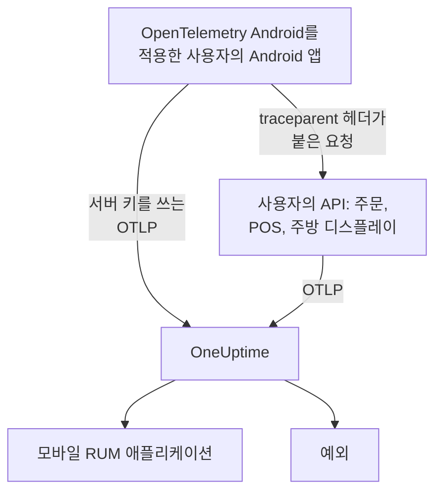

# Android 설정

네이티브 Android 앱을 OpenTelemetry Android로 계측해 모바일 RUM 애플리케이션으로 OneUptime에 보고하게 합니다. 크래시와 ANR, 느린 프레임과 정지된 프레임, 앱 시작, 화면, 세션, 그리고 백엔드까지 이어서 트레이스되는 네트워크 요청을 보고합니다.

:::cards
- [OpenTelemetry Android 추가하기](#opentelemetry-android-추가하기): Gradle 의존성 하나와, 앱이 시작될 때 실행하는 코드 몇 줄.
- [보고하는 내용](#보고하는-내용): 크래시, ANR, 정지된 프레임, 시작, 세션, 그리고 각각이 나타나는 곳.
- [백엔드로 가는 요청 트레이스하기](#백엔드로-가는-요청-트레이스하기): OkHttp 호출마다 스팬 하나와, 그 호출에 붙는 `traceparent`.
- [자체 워크플로 트레이스하기](#자체-워크플로-트레이스하기): 메뉴에서 주방까지 가는 주문, 결제 단말기, 프린터.
- [키오스크와 직접 소유한 그 밖의 기기](#키오스크와-직접-소유한-그-밖의-기기): 기기마다 이름을 붙이고, MDM에서 설정하고, 오프라인 동안에도 데이터를 보존합니다.
:::

## 작동 방식

OpenTelemetry Android는 앱 안에서 실행됩니다. **서버** 수집 키로 트레이스, 로그, 메트릭을 OTLP로 OneUptime에 보내고, 앱이 보내는 요청에 W3C `traceparent` 헤더를 추가해 백엔드의 스팬이 앱의 트레이스에 합류하게 합니다.



## 시작하기 전에

- `minSdk`가 23 이상이고 `compileSdk` 34 이상으로 빌드한 Android 앱. `minSdk`가 26 미만이면 Android Gradle Plugin 8.3.0 이상을 쓰고 `gradle.properties`에 `android.useFullClasspathForDexingTransform=true`를 설정해 [코어 라이브러리 디슈가링](https://developer.android.com/studio/write/java8-support#library-desugaring)을 켜세요.
- **프로젝트 설정 → 텔레메트리 및 APM → 수집 키**에서 **수집 키 생성**으로 만든 **서버** 수집 키. **브라우저** 키는 앱에서 거부됩니다. 이 키는 `Origin` 헤더로 확인되는데, 앱은 이 헤더를 보내지 않기 때문입니다.
- 다음 OTLP 설정. OneUptime을 직접 호스팅한다면 `https://oneuptime.com`을 자신의 호스트로 바꾸세요.

| 설정 | 값 |
| --- | --- |
| OTLP 엔드포인트 | `https://oneuptime.com/otlp` |
| 헤더 | `x-oneuptime-token: YOUR_TELEMETRY_INGESTION_TOKEN` |

> [!WARNING]
> 키는 앱 안에 담겨 배포되고 앱은 풀어 볼 수 있으므로, 누군가 키를 복사한다고 가정하세요. 키 페이지에서 **고정된 서비스 이름**, **Requests Per Minute Limit**, **만료 시각** 날짜를 설정하고, 릴리스마다 키를 교체하세요.

## OpenTelemetry Android 추가하기

:::steps
### 의존성 추가하기

```kotlin title="app/build.gradle.kts"
dependencies {
    implementation("io.opentelemetry.android:android-agent:1.8.1")
}
```

에이전트에는 크래시, ANR, 느린 렌더링, 액티비티, 프래그먼트, 네트워크, 세션 계측이 함께 들어 있습니다. 더 새로운 버전은 [릴리스 목록](https://github.com/open-telemetry/opentelemetry-android/releases)에서 확인하세요.

### 앱이 시작될 때 에이전트 시작하기

```kotlin title="KioskApplication.kt"
import android.app.Application
import io.opentelemetry.android.OpenTelemetryRum
import io.opentelemetry.android.agent.OpenTelemetryRumInitializer

class KioskApplication : Application() {
    lateinit var otelRum: OpenTelemetryRum

    override fun onCreate() {
        super.onCreate()

        otelRum = OpenTelemetryRumInitializer.initialize(this) {
            httpExport {
                baseUrl = "https://oneuptime.com/otlp"
                baseHeaders = mapOf("x-oneuptime-token" to BuildConfig.ONEUPTIME_TOKEN)
            }
            resource {
                put("service.name", "kiosk-ordering")
                put("deployment.environment.name", "production")
            }
        }
    }
}
```

`baseUrl`은 시그널을 붙이지 않은 엔드포인트입니다. 에이전트가 여기에 `/v1/traces`, `/v1/logs`, `/v1/metrics`를 붙입니다. `service.name`을 설정하세요. 설정하지 않으면 앱 이름이 런처 레이블을 따릅니다. 이 값은 OneUptime에서 애플리케이션의 식별자이므로 릴리스가 바뀌어도 같게 유지하세요.

이 클래스를 매니페스트의 `<application>` 요소의 `android:name`에 지정하세요. `BuildConfig.ONEUPTIME_TOKEN`은 빌드가 키를 보관하는 곳을 나타냅니다. [키오스크와 직접 소유한 그 밖의 기기](#키오스크와-직접-소유한-그-밖의-기기)에서 보여 주듯이, 기기 플릿은 대신 MDM에서 키를 받을 수 있습니다.

### 앱을 실행하고 도착 확인하기

```bash
curl -i https://oneuptime.com/otlp/v1/validate \
  -H "x-oneuptime-token: YOUR_TELEMETRY_INGESTION_TOKEN"
```

`"valid": true`와 함께 오는 `200`은 키가 수락되었다는 뜻입니다. 그런 다음 앱을 실행하고 잠시 사용해 보세요. 앱이 `service.name`의 이름으로 **제품 → 리소스 → 실제 사용자 모니터링**에 나타납니다. 에이전트는 텔레메트리를 보내기 전에 디스크에 쓰므로, 첫 배치가 도착하기까지 1분쯤 걸릴 수 있습니다.
:::

## 보고하는 내용

OpenTelemetry Android는 이 모든 것을 스스로 기록합니다. 에이전트가 설정하는 기기 속성인 `device.model.identifier`, `device.model.name`, `device.manufacturer`가 앱을 모바일 RUM 애플리케이션으로 분류하고 **클라이언트** 페이지를 채웁니다. 또한 `os.name`, `os.version`, 설치마다 `app.installation.id`를 설정하며, `device.id`는 설정하지 않습니다.

| 항목 | 에이전트가 보내는 방식 | OneUptime에서 나타나는 곳 |
| --- | --- | --- |
| 크래시 | 예외의 유형, 메시지, 스택 트레이스가 담긴 `app.crash` 이벤트 | **예외**(처리되지 않은 예외로) |
| ANR | 앱이 약 5초 동안 응답하지 않으면 보내는, 메인 스레드의 스택이 담긴 `device.anr` 이벤트 | **예외**(처리되지 않은 예외로, `ANR` 유형) |
| 느린 프레임과 정지된 프레임 | `app.jank.frame_count`가 담긴 `app.jank` 이벤트. 이 값은 16 ms(`app.jank.threshold`는 `0.016`) 또는 700 ms(`0.7`)보다 느린 프레임의 수입니다 | **로그**(`@event.name:app.jank`로 검색) |
| 앱 시작 | `start.type`이 `cold`, `warm`, `hot` 중 하나로 설정된 `AppStart` 스팬 | **트레이스** |
| 화면 | 액티비티나 프래그먼트의 수명 주기 단계마다 만드는 스팬, 그리고 모든 스팬과 로그에 붙는 `app.screen.name` | **트레이스** |
| 세션 | 모든 스팬과 로그에 붙는 `session.id`, 그리고 `session.start`와 `session.end` 이벤트 | **트레이스**와 **로그**(`@session.id:`로 검색) |
| 네트워크 변경 | `network.change` 이벤트, 그리고 모든 스팬과 로그에 붙는 `network.connection.type` | **로그** |

크래시와 ANR은 처리되지 않은 예외로 **예외**에 도착하며, 스택 트레이스별로 묶이고 발생한 세션이 함께 표시됩니다. 에이전트는 앱이 종료되는 순간 크래시를 디스크에 저장하고 거기서 보내므로, 오프라인에서 발생한 크래시도 앱이 네트워크에 연결된 상태로 다시 실행되면 도착합니다.

애플리케이션의 **개요**는 이를 대신 읽어 **세션**, **크래시 없는 세션**, **크래시**, **ANR**, **앱 시작**, **콜드 스타트(p95)**, **정지된 프레임**으로 보여 주며, 각 타일에서 그 타일이 세는 예외, 스팬 또는 이벤트를 열 수 있습니다. 앱이 앱 시작이나 프레임을 보내기 전까지는 해당 차트에 이를 켜는 방법이 표시됩니다. **권장 사항**은 크래시, ANR, 느린 콜드 스타트, 정지된 프레임, 보고를 멈춘 앱에 대한 모니터를 제안합니다.

세션은 백그라운드에서 15분이 지나거나 4시간이 지나면 끝납니다. 키오스크처럼 백그라운드로 가지 않는 앱은 세션 하나를 4시간 동안 유지하므로, [자체 워크플로 트레이스하기](#자체-워크플로-트레이스하기)에서 보여 주듯이 고객의 방문마다 별도의 스팬으로 트레이스하세요.

앱 자체의 `android.util.Log` 호출도 아래 OkHttp 모듈 옆에 `android-log-library`와 `android-log-agent`를 추가하면 로그가 됩니다. 각 호출의 태그는 `android.log.tag`에 들어가고, Throwable을 넘긴 호출은 **예외**에 예외로 나타납니다. OpenTelemetry Android는 Logcat을 읽지 않습니다.

## 백엔드로 가는 요청 트레이스하기

OkHttp 계측과, 그 빌드에 쓰이는 ByteBuddy 플러그인을 추가하세요.

```kotlin title="app/build.gradle.kts"
plugins {
    // ...the plugins your app already applies, then:
    id("net.bytebuddy.byte-buddy-gradle-plugin") version "1.18.15"
}

dependencies {
    implementation("io.opentelemetry.android:android-agent:1.8.1")
    implementation("io.opentelemetry.android.instrumentation:okhttp3-library:1.8.1-alpha")
    byteBuddy("io.opentelemetry.android.instrumentation:okhttp3-agent:1.8.1-alpha")
}
```

이 플러그인은 `OkHttpClient` 클래스 자체를 계측하므로, 라이브러리가 만드는 클라이언트를 포함해 앱의 모든 클라이언트가 트레이스됩니다. 각 요청은 메서드 이름을 딴 클라이언트 스팬이 되어 URL, 상태 코드, 소요 시간을 담고, W3C `traceparent` 헤더를 싣습니다. [OpenTelemetry](/docs/telemetry/open-telemetry)로 계측한 백엔드는 이 헤더에서 트레이스를 이어 가므로, 주문 API, POS 브리지, 주방 디스플레이 서비스가 키오스크에서의 탭과 같은 트레이스에 자신의 스팬을 더합니다.

- `HttpURLConnection`에도 같은 모듈 한 쌍이 있습니다. `httpurlconnection-library`와 `httpurlconnection-agent`입니다.
- 플러그인 없이 쓰려면 `io.opentelemetry.instrumentation:opentelemetry-okhttp-3.0`의 `OkHttpTelemetry.builder(otelRum.openTelemetry).build().createCallFactory(client)`로 클라이언트를 직접 감싸세요.
- 다음 섹션처럼 코드에서 연 스팬은 그 안에서 보낸 요청의 부모가 됩니다.

## 자체 워크플로 트레이스하기

에이전트에서 트레이서를 얻고, 고객 한 명의 주문 하나에 스팬 하나를 만든 뒤 주문의 단계마다 자식 스팬을 만드세요. 그러면 각 단계가 자신의 소요 시간과 오류를 갖고, 주문에는 어떻게 끝났는지가 남습니다.

```kotlin title="OrderTrace.kt"
import io.opentelemetry.api.trace.Span
import io.opentelemetry.api.trace.StatusCode
import io.opentelemetry.api.trace.Tracer
import io.opentelemetry.context.Context

class OrderTrace(private val tracer: Tracer) {
    // order.session: from the first tap to the order reaching the kitchen.
    private val order: Span = tracer.spanBuilder("order.session").startSpan()
    private val parent: Context = Context.current().with(order)

    // One step: menu.browse, cart.customize, payment.process, pos.inject.
    fun <T> step(name: String, block: (Span) -> T): T {
        val span = tracer.spanBuilder(name).setParent(parent).startSpan()
        return try {
            span.makeCurrent().use { block(span) }
        } catch (error: Throwable) {
            span.recordException(error)
            span.setStatus(StatusCode.ERROR)
            throw error
        } finally {
            span.end()
        }
    }

    fun complete() = finish("completed")

    fun abandon(reason: String) {
        order.setAttribute("order.abandon_reason", reason)
        finish("abandoned")
    }

    private fun finish(outcome: String) {
        order.setAttribute("order.outcome", outcome)
        order.end()
    }
}
```

```kotlin title="CheckoutFlow.kt"
val order = OrderTrace(otelRum.openTelemetry.getTracer("kiosk.ordering"))

order.step("cart.customize") { span ->
    span.setAttribute("cart.items", cart.size.toLong())
}
order.step("payment.process") { terminal.charge(cart.total) }
order.step("pos.inject") { posApi.submit(cart) } // its OkHttp span is a child
order.complete()
```

결제 단말기, 프린터, 스캐너, NFC 리더기의 SDK를 부르는 각 호출도 같은 방식으로 감싸고 어떤 기기였는지 기록하세요. 그러면 느리거나 실패하는 기기가 느리거나 실패한 스팬으로 나타납니다.

```kotlin title="ReceiptPrinter.kt"
order.step("printer.print") { span ->
    span.setAttribute("peripheral.type", "printer")
    span.setAttribute("peripheral.model", printer.model)
    span.setAttribute("peripheral.connection", "usb")
    printer.print(receipt, timeoutMillis = 10_000)
}
```

속성 이름은 직접 정하면 됩니다. 모든 앱에서 같은 이름을 쓰면 필터 하나로 모든 프린터를 찾을 수 있습니다. 스팬은 호출이 반환될 때만 끝나므로 각 호출에 제한 시간을 두세요. 메뉴 둘러보기처럼 여러 화면에 걸친 단계는 화면이 열릴 때 시작하고 닫힐 때 끝내는 스팬으로 만들고, 부모는 같게 둡니다. 프린터 용지가 떨어진 것처럼 소요 시간이 없는 사실은 `otelRum.emitEvent("printer.paper_low")`처럼 이벤트로 보내세요.

**트레이스**에서 단계 이름으로 필터링하면 그 단계가 얼마나 걸리고 얼마나 자주 실패하는지 볼 수 있고, `@order.outcome:abandoned`로 필터링하면 끝내지 못한 주문을 찾을 수 있습니다.

## 키오스크와 직접 소유한 그 밖의 기기

### 기기마다 이름 붙이기

OneUptime은 모바일 앱을 기기별이 아니라 언제나 애플리케이션별로 분류하므로, 수천 대의 휴대폰에서 실행되는 앱이 사용자의 휴대폰을 나열하는 일은 없습니다. 직접 소유한 기기라면 `host.name`에 기기마다 이름을 지정하세요. 그러면 각 기기가 다른 장비와 나란히 호스트로 **인벤토리**에 나타나며, 에이전트가 보고하는 제조사, 모델, OS 버전과 아래에서 추가하는 정보, 마지막으로 확인된 시각이 함께 표시됩니다.

```kotlin title="KioskApplication.kt"
resource {
    put("service.name", "kiosk-ordering")
    put("host.name", deviceName)
    put("host.serial_number", serialNumber)
    put("device.type", "kiosk")
    put("device.location", "Store 0412")
}
```

앱의 텔레메트리는 해당 RUM 애플리케이션에 남고, 기기가 **호스트**에 호스트로 나타나지는 않습니다. 앱은 호스트 메트릭을 보고하지 않으므로 그곳에 보여 줄 것이 없기 때문입니다. **인벤토리**의 기기 페이지에는 그 기기의 로그, 트레이스, 예외가 표시되며, `@resource.host.name:`으로 **트레이스**와 **로그**에서 이를 찾을 수 있습니다. 30일 동안 아무것도 보내지 않은 기기는 **인벤토리**에서 빠집니다.

### MDM에서 기기 플릿 설정하기

앱은 Android의 관리형 구성을 읽을 수 있으며, 모든 기기 관리 서비스는 관리하는 기기에 이 구성을 배포합니다. 키와 기기 이름을 앱에 넣어 빌드하는 대신 이 구성에서 읽으세요.

```kotlin title="KioskApplication.kt"
import android.content.RestrictionsManager

val restrictions = (getSystemService(RESTRICTIONS_SERVICE) as RestrictionsManager)
    .applicationRestrictions
val token = restrictions.getString("oneuptime_token").orEmpty()
val deviceName = restrictions.getString("device_name") ?: android.os.Build.MODEL
val serialNumber = restrictions.getString("device_serial").orEmpty()
```

그런 다음 `BuildConfig.ONEUPTIME_TOKEN` 대신 `token`을 `baseHeaders`에 넘기고, `deviceName`과 `serialNumber`를 위의 리소스에 넘기세요. Esper에서는 블루프린트에서 앱의 **Managed Configuration**에 아래 구성을 붙여 넣습니다. Esper Agent 8.00.0764 이상이면 Esper가 각 기기에서 자리 표시자를 채웁니다.

```json title="Managed configuration"
{
  "oneuptime_token": "YOUR_TELEMETRY_INGESTION_TOKEN",
  "device_name": "${esper.deviceName}",
  "device_serial": "${esper.serialNumber}"
}
```

변경한 뒤에는 기기에 Converge를 실행해 새 값을 읽게 하세요. MDM이 스키마를 요구하면 같은 키를 `app_restrictions.xml`에 선언하세요. Esper는 v1 서명이 없는 APK를 거부하므로, 릴리스에 v2나 v3와 함께 v1 방식으로도 서명하세요.

### 오프라인 동안 기록된 데이터 보존하기

에이전트는 모든 스팬, 로그, 메트릭을 보내기 전에 디스크에 씁니다. 네트워크가 끊긴 동안에는 그곳에 보관했다가 연결이 돌아오면 보내는데, 최대 18시간 뒤까지 보낼 수 있습니다. 보관 용량은 10 MB이며, 자주 오프라인이 되는 기기라면 늘리세요.

```kotlin title="KioskApplication.kt"
diskBuffering {
    maxCacheSize = 50 * 1024 * 1024
}
```

## 문제 해결

:::details 앱이 실제 사용자 모니터링이 아니라 서비스에 나타남
OpenTelemetry Android는 `device.model.identifier`를 스스로 설정하므로, 앱이 다른 SDK로 설정되었거나 리소스가 `resource(Resource)`로 교체되어 에이전트 자체의 속성이 사라진 것입니다. 이 속성에 더하는 `resource { }` 블록을 쓰세요. 이미 만들어진 서비스는 RUM 애플리케이션으로 바뀌지 않으므로, RUM 텔레메트리가 도착하면 **제품 → 서비스**에서 삭제하세요.
:::

:::details 아무것도 도착하지 않거나 키가 거부됨
[OpenTelemetry Android 추가하기](#opentelemetry-android-추가하기)의 키 확인을 실행하세요. `401`은 키가 알 수 없거나, 취소되었거나, 꺼져 있거나, 만료되었다는 뜻입니다. **브라우저** 키는 앱에서 거부되므로 **서버** 키를 쓰세요. `baseUrl`이 `/v1/traces` 없이 `/otlp`로 끝나는지 확인하세요. 경로는 에이전트가 직접 붙입니다.
:::

:::details 크래시나 ANR이 예외에 없음
크래시는 앱이 종료되는 순간 저장되고, ANR은 메인 스레드가 약 5초 동안 멈춘 시점에 저장됩니다. 둘 다 기기가 보낼 수 있을 때까지 디스크에서 기다리므로, 앱이 네트워크에 연결된 상태로 1분쯤 실행된 뒤 다시 확인하세요. 에이전트는 `Application`의 `onCreate` 맨 앞, 크래시가 날 수 있는 어떤 코드보다도 먼저 시작해 크래시 핸들러가 가장 먼저 자리 잡게 하세요.
:::

:::details 기기가 인벤토리에 없음
앱이 `host.name`을 설정한 기기만 나열됩니다. 스팬의 리소스 속성에서 값을 확인하세요. 값이 비어 있으면 어떤 기기도 가리키지 않고, 이름이 같은 두 기기는 한 행이 됩니다.
:::

## 다음 단계

:::cards
- [모바일 설정](/docs/rum/mobile-setup): iOS, React Native 및 그 밖의 플랫폼.
- [예외](/docs/telemetry/exceptions): 앱이 보고하는 크래시와 ANR을 분류합니다.
- [트레이스 탐색기](/docs/telemetry/traces-explorer): 키오스크에서 주방까지 주문을 따라갑니다.
- [애플리케이션 관리](/docs/rum/applications): 이름, 레이블, 소유자, 보존 기간.
:::
