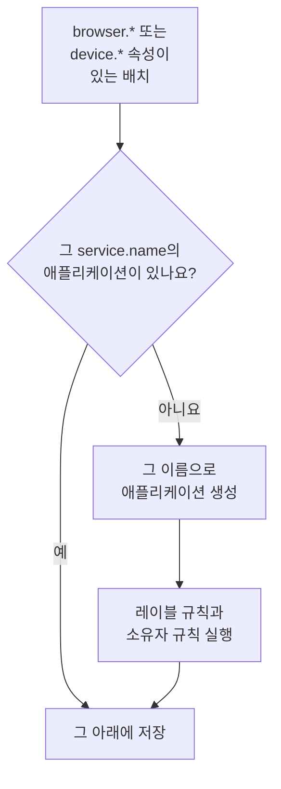

# 애플리케이션 관리

OneUptime은 앱의 텔레메트리가 처음 도착할 때 RUM 애플리케이션을 만듭니다. 이 페이지는 그 이후에 관리하는 내용을 다룹니다. 애플리케이션의 이름, 레이블과 소유자, 데이터 보존 기간, 보관, 볼 수 있는 사람, 알림입니다.

:::cards
- [애플리케이션이 만들어지는 방식](#애플리케이션이-만들어지는-방식): `service.name`으로 일치시키며, 첫 배치와 함께 만들어집니다.
- [레이블](#레이블): 애플리케이션을 그룹으로 묶고 누가 접근할 수 있는지 정합니다.
- [보존](#보존): 텔레메트리와 녹화를 보관하는 기간.
- [권한](#권한): 애플리케이션을 볼 수 있는 사람과 녹화를 시청할 수 있는 사람.
:::

## 애플리케이션이 만들어지는 방식

RUM 애플리케이션을 직접 만들 필요는 없습니다. 브라우저 또는 기기 속성과 `service.name`이 있는 텔레메트리 배치가 도착하면, OneUptime은 그 `service.name`을 가진 애플리케이션 아래에 배치를 저장하고, 프로젝트에 해당 애플리케이션이 없으면 새로 만듭니다.



- `service.name`은 애플리케이션의 식별자이며 대소문자를 구분하지 않고 비교합니다. `Storefront-Web`과 `storefront-web`은 하나의 애플리케이션입니다.
- 새 `service.name`은 새 애플리케이션을 시작합니다. 이전 애플리케이션은 기록을 유지한 채 **연결 끊김** 상태가 되고, 새 애플리케이션은 비어 있는 상태로 시작하며, 둘이 병합되는 일은 없습니다.
- `service.name`은 환경마다가 아니라 앱마다 하나를 사용하세요. 환경은 `oneuptime.label.env=production` 같은 레이블로 구분하면 하나의 애플리케이션과 하나의 기록을 공유합니다.

### 애플리케이션 이름 바꾸기

**표시 이름**은 처음에는 `service.name`과 같습니다. 바꾸려면 애플리케이션의 **설정** 페이지를 열고 **애플리케이션 세부 정보** 카드에서 **세부 정보 편집**을 클릭합니다. 설명과 레이블도 여기서 편집합니다. 텔레메트리는 카드에 표시되며 바뀌지 않는 **앱 이름 (service.name)** 값으로 일치시키므로, 이름을 바꿔도 안전합니다.

### 애플리케이션 직접 추가하기

첫 방문자가 오기 전에 레이블, 소유자, 리플레이 정책을 미리 갖춰 두고 싶다면 애플리케이션을 직접 만드세요.

:::steps
#### 애플리케이션 목록 열기

**제품 → 리소스 → 실제 사용자 모니터링**으로 이동해 **RUM 애플리케이션 만들기**를 클릭합니다.

#### 앱 이름 입력하기

**앱 이름 (service.name)** 필드에 앱이 보고할 `service.name`을 앱이 보고하는 그대로 정확하게 입력합니다.

#### 이름을 정하고 저장하기

애플리케이션은 감지된 애플리케이션과 마찬가지로 앱 이름을 따라 이름이 정해집니다. 다른 이름을 표시하려면 **추가 필드**를 열고 **표시 이름**을 입력하세요. 설명과 레이블도 거기에 있습니다. 그런 다음 양식을 저장합니다.
:::

그러면 애플리케이션의 설정 가이드가 자동으로 열리며, 스니펫의 `service.name`에는 앱 이름이 들어가 있습니다. 마지막 단계인 **연결 대기**가 첫 데이터가 도착하는 시점을 알려 줍니다.

프로젝트에 그 `service.name`을 가진 애플리케이션이 이미 있으면, 감지된 것이든 이전에 추가한 것이든 보관된 것이든, 양식은 두 번째 애플리케이션을 만들지 않고 그 사실을 알려 줍니다.

## 연결 상태

애플리케이션은 텔레메트리가 도착하는 동안 **연결됨**을, 15분 동안 아무것도 오지 않으면 **연결 끊김**을 표시합니다. OpenTelemetry 텔레메트리와 세션 리플레이 트래픽 모두 해당됩니다.

**마지막 확인**은 배치마다가 아니라 몇 분 간격으로 갱신되므로 실제 트래픽보다 최대 5분 정도 늦을 수 있으며, 15분이라는 시간은 그 여유를 감안한 것입니다. OneUptime 자체가 중단되었거나 수집 대기열을 따라잡던 시간은 계산하지 않습니다.

**연결 끊김** 자체는 오류가 아닙니다. 밤에 방문자가 없는 내부 도구는 실제로 연결이 끊긴 상태입니다. 사람들이 앱을 사용 중이라면 [RUM 문제 해결](/docs/rum/troubleshooting)을 참고하세요.

## 레이블

레이블은 목록과 필터에서 애플리케이션을 그룹으로 묶습니다. 또한 일부 레이블로 제한된 멤버가 접근할 수 있는 범위도 정합니다. 그런 멤버에게는 해당 레이블 중 하나가 붙은 애플리케이션만 보입니다. 애플리케이션에는 세 가지 방법으로 레이블이 붙습니다.

| 방법 | 위치 |
| --- | --- |
| 직접 | 만들기 양식의 **추가 필드** 아래에서, 또는 나중에 애플리케이션 **설정** 페이지의 **애플리케이션 세부 정보** 카드에 있는 **세부 정보 편집**으로. 여러 개에 한 번에 붙이려면 목록에서 선택한 뒤 **레이블 추가**를 **일괄 작업**에서 고르세요. |
| 텔레메트리에서 | 이름이 `oneuptime.label.<name>`인 리소스 속성이 아래와 같이 레이블 `<name>:<value>`를 추가합니다. |
| 레이블 규칙에서 | 규칙은 일치하는 모든 새 애플리케이션에 레이블을 추가합니다. [레이블 규칙과 소유자 규칙](#레이블-규칙과-소유자-규칙)을 참고하세요. |

속성은 `service.name`과 같은 리소스에 설정합니다. 예를 들어 [브라우저 설정](/docs/rum/browser-setup)의 `src/telemetry.ts` 파일에서 다음과 같이 합니다.

```ts
const resource = defaultResource().merge(
  resourceFromAttributes({
    [ATTR_SERVICE_NAME]: "storefront-web",
    "oneuptime.label.team": "payments",
    "oneuptime.label.env": "production",
  }),
);
```

이렇게 하면 레이블 `team:payments`와 `env:production`이 추가되고, 프로젝트에 없으면 만들어집니다. 속성 이름이 레이블에 들어가므로 `oneuptime.label.team=prod`와 `oneuptime.label.env=prod`는 구분됩니다. 100자를 넘는 레이블은 100자로 잘리고, 비어 있거나 문자열이 아닌 값은 아무것도 추가하지 않습니다.

## 레이블 규칙과 소유자 규칙

규칙은 일치하는 모든 새 애플리케이션에 레이블이나 소유자를 추가합니다. **실제 사용자 모니터링 → 설정 → 레이블 규칙** 또는 **소유자 규칙**을 열고 두 단계로 규칙을 만듭니다.

1. **일치** 단계에서 새 규칙이 처음 고르는 **모든 RUM 애플리케이션**은 모든 애플리케이션과 일치합니다. 범위를 좁히려면 **조건과 일치하는 RUM 애플리케이션만**을 고르고 **애플리케이션 레이블**(선택한 레이블 중 하나, 전부, 또는 하나도 없음), **애플리케이션 이름** 또는 **애플리케이션 설명**(같음, 포함, 시작, 끝남, 패턴 일치)에 대한 조건을 추가합니다.
2. **레이블** 단계(소유자 규칙에서는 **소유자** 단계)에서 규칙이 추가할 항목을 고릅니다. 새 규칙은 레이블이나 소유자를 적어도 하나 추가해야 합니다. **이름**은 직접 이름을 입력할 때까지 _Add team:payments_ 또는 _Add Payments as owners_ 같은 선택 내용으로 채워집니다. **설명**과 소유자 규칙의 **소유자에게 알림**은 **추가 필드** 아래에 있습니다.

규칙은 감지된 애플리케이션을 포함해 애플리케이션이 만들어질 때 실행됩니다. 이미 있는 애플리케이션에 규칙을 적용하려면 해당 행의 **⋯** 메뉴를 열고 **지금 실행**을 선택합니다. [기존 리소스에 규칙 실행](/docs/configuration/run-rules-now)을 참고하세요. 편집 후 추가할 것이 남지 않은 규칙은 목록에 **추가하는 항목 없음**으로 표시됩니다. 양식 전체는 [레이블 및 소유자 규칙](/docs/configuration/label-and-owner-rules)에서 다룹니다.

### 소유자

소유자는 애플리케이션을 책임지는 사람과 팀입니다. 소유자 규칙이 새 애플리케이션에 소유자를 추가합니다. 직접 추가하거나 제거하려면 목록에서 애플리케이션을 선택하고 **소유자 추가** 또는 **소유자 제거**를 **일괄 작업**에서 고르세요. API는 `/rum-application-owner-user`와 `/rum-application-owner-team`을 통해 추가합니다. 기본값인 **소유자에게 알림**이 켜져 있으면 규칙이 추가한 각 소유자에게 알림이 갑니다. 아무에게도 알리지 않으려면 여러 애플리케이션에 규칙을 실행하기 전에 끄세요.

## 보존

애플리케이션의 텔레메트리와 녹화는 서로 다른 기간 동안 보관됩니다.

| 데이터 | 보관 기간 | 설정 위치 |
| --- | --- | --- |
| 로그, 메트릭, 트레이스, 프로필 | 애플리케이션이 재정의하지 않는 한 프로젝트의 보존 기간 | 애플리케이션의 **설정** 페이지 |
| 세션 리플레이 녹화 | 기본 7일, 또는 1, 14, 30, 90일 | **Replay Policy**에서 **정책 편집 → 제한**으로 |

### 텔레메트리 보존

기본적으로 애플리케이션의 텔레메트리는 **프로젝트 설정 → 텔레메트리 및 APM → 데이터 보존**에서 설정하는 프로젝트의 보존 기간 동안 보관됩니다. 애플리케이션 **설정** 페이지의 카드 두 개가 이를 재정의합니다.

- **텔레메트리 데이터 보존** 카드에는 애플리케이션의 모든 텔레메트리에 적용되는 하나의 값인 **텔레메트리 데이터 보존 기간(일)** 필드가 있습니다. 비워 두면 프로젝트의 보존 기간을 사용합니다.
- **텔레메트리 유형별 보존** 카드에는 로그, 트레이스, 메트릭, 프로필 각각의 기본값과, 심각도별 로그와 상태별 트레이스의 값이 있습니다. 비워 둔 값은 애플리케이션의 값으로, 그다음 프로젝트의 값으로 대체됩니다.

보존 재정의는 [엔터프라이즈 에디션](/docs/self-hosted/enterprise)과 OneUptime Cloud의 Scale 요금제 이상에 포함됩니다. 이를 사용할 수 없으면 카드에 요금제가 추가하는 기능이 표시되고, 애플리케이션은 프로젝트의 보존 기간을 유지합니다.

더 낮은 Cloud 요금제에서는 평가판에서 남은 재정의가 새 텔레메트리에 계속 적용됩니다. **설정** 페이지는 이를 **보존 재정의** 카드에 **재정의 제거** 버튼과 함께 표시하며, 이 버튼은 모든 요금제에서 작동합니다. 그 후 애플리케이션은 프로젝트의 보존 기간을 따르고, 이미 저장된 데이터는 저장될 때의 보존 기간을 유지합니다. 재정의를 다시 설정하려면 Scale 요금제가 필요합니다.

### 세션 리플레이 보존

녹화에는 자체 보존 기간이 있으며, 애플리케이션의 **Replay Policy** 페이지에서 **정책 편집 → 제한**으로 설정합니다. 기본값은 7일이며 1, 14, 30, 90일도 선택할 수 있습니다. 녹화는 스팬보다 훨씬 민감하고 훨씬 크기 때문에 일부러 짧게 정했습니다. **설정** 페이지의 **세션 리플레이 보존** 카드가 이를 보여 주고(_Session replays are kept for 7 days._), 카드의 **Replay Policy에서 편집** 버튼이 정책을 엽니다.

텔레메트리 보존 기간을 늘려도 녹화를 더 오래 보관하지는 않습니다. 세션의 집계, 신호, 기기는 녹화와 함께 만료되며, 텔레메트리 보존 기간을 따르는 것은 세션의 로그, 스팬, 예외뿐입니다. [보존과 삭제](/docs/telemetry/session-replay#보존과-삭제)를 참고하세요.

> [!TIP]
> RUM은 서버가 아니라 사용자와 함께 늘어나기 때문에 프로젝트에서 가장 많은 텔레메트리인 경우가 많습니다. 여기서는 보존 기간을 짧게, 백엔드 서비스에서는 길게 두는 구성이 흔합니다.

## 보관과 삭제

**보관**은 텔레메트리 수집을 계속하면서 애플리케이션을 **모든 애플리케이션**에서 숨깁니다. 더 이상 지켜보지 않지만 기록은 남기고 싶은 앱을 보관하세요.

- 애플리케이션의 **설정** 페이지에서 **보관**을 클릭하거나, 목록에서 여러 애플리케이션을 선택해 한꺼번에 보관합니다.
- 보관된 애플리케이션은 **실제 사용자 모니터링 → 고급 → 보관됨**에 있습니다. 사이드 메뉴의 **고급**은 처음에 접혀 있으므로 클릭해 **보관됨**을 표시합니다. 거기서 애플리케이션 하나 또는 여러 개를 한꺼번에 **보관 취소**할 수 있습니다.

애플리케이션 사이드 메뉴의 **고급** 섹션에 있는 **애플리케이션 삭제**는 애플리케이션을 영구적으로 삭제합니다. 앱이 아직 텔레메트리를 보내고 있으면 다음 배치가 설정 없이 애플리케이션을 다시 만들므로, 먼저 계측을 멈추세요.

애플리케이션 전체가 아니라 한 사람의 데이터를 지우려면 삭제 요청을 제출하세요. [세션 삭제하기](/docs/telemetry/session-replay#세션-삭제하기)를 참고하세요.

## 권한

프로젝트의 Viewer 역할이 있는 사람은 누구나 RUM 애플리케이션과 그 텔레메트리를 볼 수 있습니다. 세션 리플레이는 일부러 이 역할에 포함하지 않았습니다. 녹화 목록 보기, 녹화 시청, 누가 시청했는지 읽기는 각각 별도의 권한입니다. 프로젝트 소유자와 관리자는 모든 권한을 가집니다. 권한 선택기는 각 권한을 제목으로 표시하며, 여기서는 기울임꼴로 나타냈습니다.

| 권한 | 멤버가 할 수 있는 일 |
| --- | --- |
| `ReadRumApplication` (_Read RUM Application_) | 애플리케이션과 그 텔레메트리 페이지를 봅니다. |
| `CreateRumApplication`, `EditRumApplication`, `DeleteRumApplication` | 애플리케이션을 추가, 편집, 삭제합니다. |
| `ReadRumSessionReplay` (_List Session Replays_) | 녹화된 세션과 그 세부 정보를 나열합니다. 재생하거나 사용자가 누구였는지 알 수는 없습니다. |
| `ReadRumSessionReplayPayload` (_Watch Session Replays_) | 녹화를 재생하고, 식별된 사용자의 참조와 특성을 읽습니다. |
| `ReadRumSessionReplayAudit` (_Read Session Replay Audit_) | **리플레이 접근 로그**를 읽습니다. 누가 어떤 녹화를 시청했는지입니다. |
| `DeleteRumSessionReplay` (_Delete Session Replays_) | 녹화를 삭제합니다. |
| `CreateRumSessionErasureRequest`, `ReadRumSessionErasureRequest` | 삭제 요청을 제출하고 진행 상황을 확인합니다. |
| `ReadRumApplicationLabelRule`, `ReadRumApplicationOwnerRule` (및 해당 Create, Edit, Delete) | 레이블 규칙과 소유자 규칙을 관리합니다. |
| `ReadRumApplicationOwnerUser`, `ReadRumApplicationOwnerTeam` (및 해당 Create, Edit, Delete) | API로 소유자를 추가하고 제거합니다. |

유용한 분리 방법: 지원 엔지니어에게 `ReadRumApplication`과 `ReadRumSessionReplay`를 부여하세요. 누구의 화면도 보지 않고 사용자가 누구였는지도 모른 채, 어떤 세션에 오류가 있었는지 확인할 수 있습니다. `ReadRumSessionReplayPayload`는 필요한 사람에게만 부여하세요. 그러면 `ReadRumSessionReplayAudit`이 있는 멤버가 애플리케이션의 **리플레이 접근 로그** 페이지에서 모든 시청 기록을 볼 수 있습니다. [녹화를 시청할 수 있는 사람](/docs/telemetry/session-replay#녹화를-시청할-수-있는-사람)에서 각 권한이 세션 목록과 플레이어에서 무엇을 여는지 설명합니다.

## RUM 데이터 알림

RUM 텔레메트리는 일반적인 로그, 메트릭, 트레이스이므로 별도의 RUM 모니터는 없습니다. 일반 모니터가 그대로 작동합니다. 가장 빠르게 시작하는 방법은 애플리케이션의 **권장 사항** 페이지로, 이미 애플리케이션 범위로 지정된 모니터를 제안합니다.

| 그룹 | 권장 사항 |
| --- | --- |
| Core Web Vitals | Poor Largest Contentful Paint, Poor Interaction to Next Paint, Poor Cumulative Layout Shift, Slow First Contentful Paint, Slow Time to First Byte. [Core Web Vitals](/docs/rum/web-vitals)를 참고하세요. |
| 오류 | Failed User Operations와 Unhandled Browser Exceptions. |
| 세션 리플레이 | 네 가지 [스토리지 예산 알림](/docs/telemetry/session-replay#스토리지-예산-알림)으로, 프로젝트의 일일 한도나 애플리케이션의 월간 예산이 소진되기 전에 경고합니다. 애플리케이션이 리플레이를 녹화하면 제안되고, 월간 쌍은 월간 예산도 있을 때 제안됩니다. |

직접 모니터를 만들려면 해당 신호를 읽는 모니터를 고르세요.

- [메트릭 모니터](/docs/monitor/metrics-monitor): Core Web Vitals 지표나 앱이 보내는 모든 메트릭.
- [트레이스 모니터](/docs/monitor/traces-monitor): 클라이언트 측 오류율이나 지연 시간.
- [로그 모니터](/docs/monitor/logs-monitor): 브라우저 로그의 패턴.
- [예외 모니터](/docs/monitor/exceptions-monitor): 새롭거나 급증하는 클라이언트 측 예외.

비슷한 시그니처를 가진 백엔드 서비스가 모니터를 트리거하지 않도록, 만든 모니터의 범위를 애플리케이션으로 지정하세요.

## 다음 단계

:::cards
- [세션 리플레이](/docs/telemetry/session-replay): 사용자가 본 것을 자체 정책과 보존 기간으로 녹화합니다.
- [레이블 및 소유자 규칙](/docs/configuration/label-and-owner-rules): 두 가지 규칙 양식을 단계별로 설명합니다.
- [기존 리소스에 규칙 실행](/docs/configuration/run-rules-now): 새 규칙을 이미 있는 애플리케이션에 적용합니다.
- [RUM 문제 해결](/docs/rum/troubleshooting): 애플리케이션이 없거나, 비어 있거나, 연결 끊김 상태일 때.
:::
