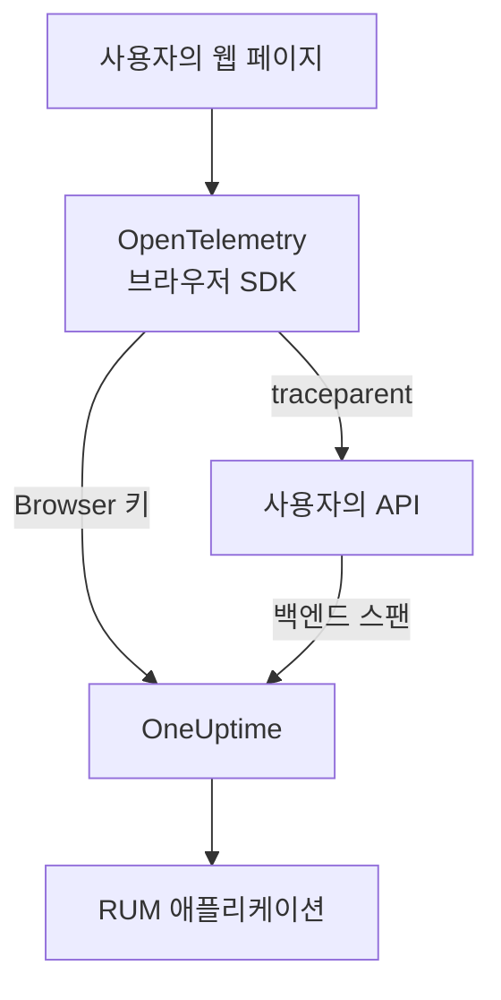

# 브라우저 설정

OpenTelemetry 브라우저 SDK로 웹 앱을 계측해 RUM 애플리케이션으로 OneUptime에 보고하게 합니다. 페이지 로드와 요청은 트레이스로 도착하며, 같은 설정으로 오류, 로그, 메트릭, Core Web Vitals도 보낼 수 있습니다.

:::cards
- [설정하기](#설정하기): Browser 키부터 첫 페이지 로드까지 여섯 단계.
- [백엔드와 연결](#백엔드-트레이스와-연결하기): 브라우저 스팬을 그것이 시작한 백엔드 트레이스에 연결합니다.
- [오류 보고](#처리되지-않은-오류-보고하기): 처리되지 않은 오류를 예외 보기로 보냅니다.
- [문제 해결](#문제-해결): 아무것도 도착하지 않을 때 확인할 사항.
:::

## 작동 방식

SDK는 방문자의 브라우저에서 실행됩니다. 페이지 로드와 요청마다 스팬을 기록하고, **브라우저** 수집 키로 OneUptime에 직접 내보냅니다. 중간에 별도의 수집기나 프록시가 필요 없습니다.



## 시작하기 전에

- 코드를 수정하고 다시 배포할 수 있으며, 의존성을 npm으로 설치하는 웹 앱.
- 페이지가 제공되는 출처. 예: `https://app.example.com`. Browser 키는 키에 등록한 출처에서 온 요청만 받습니다.
- 수집 키를 만들 수 있는 역할. 프로젝트 소유자와 관리자, 그리고 **Create Telemetry Ingestion Key** 권한이 있는 사용자는 누구나 만들 수 있습니다.

## 설정하기

:::steps
### Browser 수집 키 만들기

1. **제품 → 프로젝트 설정**으로 이동합니다.
2. 사이드 메뉴에서 **텔레메트리 및 APM**을 열고 **수집 키**를 선택합니다.
3. **수집 키 생성**을 클릭하고 **키 유형**으로 **브라우저**를 고릅니다.
4. **브라우저 설정** 단계에서 **허용된 출처**에 출처를 JSON 배열로 입력하고(예: `["https://app.example.com"]`) 키를 만듭니다. OneUptime Cloud의 Free 요금제에서는 마지막 **결제** 단계에서 텔레메트리 가격을 먼저 보여 줍니다.


새 키는 자체 페이지에서 열립니다. **시크릿 키**를 복사하세요. SDK가 `x-oneuptime-token`으로 보내는 토큰입니다.


### 패키지 설치하기

```bash
npm install @opentelemetry/api \
  @opentelemetry/sdk-trace-web \
  @opentelemetry/resources \
  @opentelemetry/semantic-conventions \
  @opentelemetry/opentelemetry-browser-detector \
  @opentelemetry/exporter-trace-otlp-http \
  @opentelemetry/context-zone \
  @opentelemetry/instrumentation \
  @opentelemetry/instrumentation-document-load \
  @opentelemetry/instrumentation-fetch \
  @opentelemetry/instrumentation-xml-http-request
```

### 텔레메트리 파일 만들기

`src/telemetry.ts`를 만듭니다. `browserDetector`는 텔레메트리를 RUM으로 분류하게 하는 `browser.*` 속성을 추가하고, `service.name`은 애플리케이션의 이름이 됩니다.

```ts title="src/telemetry.ts"
import {
  WebTracerProvider,
  BatchSpanProcessor,
} from "@opentelemetry/sdk-trace-web";
import { OTLPTraceExporter } from "@opentelemetry/exporter-trace-otlp-http";
import { ZoneContextManager } from "@opentelemetry/context-zone";
import { registerInstrumentations } from "@opentelemetry/instrumentation";
import { DocumentLoadInstrumentation } from "@opentelemetry/instrumentation-document-load";
import { FetchInstrumentation } from "@opentelemetry/instrumentation-fetch";
import { XMLHttpRequestInstrumentation } from "@opentelemetry/instrumentation-xml-http-request";
import {
  defaultResource,
  detectResources,
  resourceFromAttributes,
} from "@opentelemetry/resources";
import { browserDetector } from "@opentelemetry/opentelemetry-browser-detector";
import { ATTR_SERVICE_NAME } from "@opentelemetry/semantic-conventions";

const ONEUPTIME_URL = "https://oneuptime.com";
// Public: it ships in your page. It must be a Browser ingestion key.
const ONEUPTIME_TOKEN = "YOUR_TELEMETRY_INGESTION_TOKEN";

/*
 * browserDetector supplies the browser.* attributes. Without them this
 * telemetry is classified as a backend Service, not a RUM application.
 * The attributes set last win, so service.name here overrides the
 * "unknown_service" that defaultResource() provides.
 */
const resource = defaultResource()
  .merge(detectResources({ detectors: [browserDetector] }))
  .merge(
    resourceFromAttributes({
      [ATTR_SERVICE_NAME]: "storefront-web",
    }),
  );

const provider = new WebTracerProvider({
  resource: resource,
  spanProcessors: [
    new BatchSpanProcessor(
      new OTLPTraceExporter({
        url: `${ONEUPTIME_URL}/otlp/v1/traces`,
        headers: { "x-oneuptime-token": ONEUPTIME_TOKEN },
      }),
    ),
  ],
});

provider.register({
  contextManager: new ZoneContextManager(),
});

registerInstrumentations({
  instrumentations: [
    new DocumentLoadInstrumentation(),
    new FetchInstrumentation({
      // See "Linking to your backend traces" before widening this.
      propagateTraceHeaderCorsUrls: [/^https:\/\/api\.example\.com/],
    }),
    new XMLHttpRequestInstrumentation({
      propagateTraceHeaderCorsUrls: [/^https:\/\/api\.example\.com/],
    }),
  ],
});
```

### 가장 먼저 가져오기

앱의 첫 번째 import로 만드세요. 계측은 `fetch`와 `XMLHttpRequest`를 패치하므로, 패치 전에 보낸 요청은 트레이스되지 않습니다.

```ts
// src/index.tsx (React), src/main.ts (Vue / Angular), etc.
import "./telemetry";
import React from "react";
// ... the rest of your app
```

### 키 확인하기

다른 곳을 살펴보기 전에 OneUptime이 키를 받는지 확인합니다.

```bash
curl -i https://oneuptime.com/otlp/v1/validate \
  -H "x-oneuptime-token: YOUR_TELEMETRY_INGESTION_TOKEN"
```

`"valid": true`와 함께 오는 `200`은 키가 수락되었다는 뜻입니다. Browser 키라면 메시지에 브라우저에서, 그리고 허용된 출처 중 하나에서만 쓸 수 있다는 안내가 덧붙습니다. `401`은 키가 알 수 없거나, 취소되었거나, 꺼져 있거나, 만료되었다는 뜻입니다.

### 페이지 로드하기

사이트를 엽니다. 1분 안에 애플리케이션이 `service.name`의 이름으로 **제품 → 리소스 → 실제 사용자 모니터링**에 나타납니다.
:::

## Browser 키가 허용하는 것

스니펫의 모든 내용은 방문자에게 전달되므로 누구나 페이지에서 토큰을 복사할 수 있습니다. Browser 키는 복사본으로 할 수 있는 일을 제한합니다.

| 설정 | 역할 |
| --- | --- |
| **허용된 출처** | 이 출처에서 온 요청만 받습니다. 각 출처에는 스킴과, 있다면 포트를 포함합니다. 호스트는 `*.` 와일드카드 하나로 시작할 수 있습니다. `https://*.example.com`은 `example.com`의 모든 하위 도메인에 해당하지만 `example.com` 자체는 포함하지 않습니다. |
| **Requests Per Minute Limit** | 키를 쓰는 모든 방문자가 함께 쓰는 하나의 상한입니다. 직접 정하지 않으면 분당 6000건입니다. |
| **고정된 서비스 이름** | 키가 쓰는 모든 데이터에 `service.name`을 강제하므로, 복사본이 텔레메트리를 백엔드 서비스인 것처럼 꾸밀 수 없습니다. |
| **만료 시각** | 이 날짜가 지나면 키가 더는 수락되지 않습니다. |
| **활성화됨** | 끄면 유출된 키를 즉시 막을 수 있습니다. |

Browser 키는 OTLP 트레이스, 로그, 메트릭과 세션 리플레이만 쓸 수 있으며, 그 밖의 모든 수집 경로는 이 키를 거부합니다. 이 설정은 키 자체의 페이지에서 바꿉니다. 키 유형은 키를 만든 뒤에는 바꿀 수 없습니다.

> [!WARNING]
> **서버** 키는 절대 페이지에 넣지 마세요. 서버 키는 출처 확인 없이 어디서든 모든 종류의 텔레메트리를 쓸 수 있으므로, 페이지를 읽은 누구나 프로젝트에 데이터를 쓸 수 있게 됩니다.

## 감지기 없이 `browser.*` 설정하기

`browserDetector`는 [UA Client Hints API](https://wicg.github.io/ua-client-hints/)를 읽는데, 이 API는 Chromium 계열 브라우저에만 있습니다. Safari와 Firefox에서는 `browser.language`와 `user_agent.original`은 설정하지만 `browser.platform`, `browser.brands`, `browser.mobile`은 설정하지 않습니다.

`browser.language`만으로도 배치가 브라우저 RUM으로 표시되므로, 텔레메트리는 여전히 RUM으로 분류됩니다. 하지만 **클라이언트** 페이지는 `browser.platform`으로 플랫폼을 나열하므로, Safari와 Firefox 방문은 그곳에 행을 추가하지 않습니다.

감지기를 쓰지 않으려면, 또는 모든 브라우저에 플랫폼을 주려면 속성을 직접 설정하세요.

```ts
const resource = defaultResource().merge(
  resourceFromAttributes({
    [ATTR_SERVICE_NAME]: "storefront-web",
    // browser.language or browser.platform marks the telemetry as browser RUM.
    "browser.language": navigator.language,
    "browser.platform":
      (navigator as any).userAgentData?.platform ?? "unknown",
    "browser.mobile": (navigator as any).userAgentData?.mobile ?? false,
    "user_agent.original": navigator.userAgent,
  }),
);
```

`browser.platform`은 대략적인 값으로 유지하세요. 서로 다른 값마다 **클라이언트** 페이지의 행이 되므로, 전체 user-agent 문자열이나 사용자별 값을 넣으면 목록이 끝없이 늘어나고 개인정보 문제도 생깁니다.

## 경로 변경 트레이스하기

`DocumentLoadInstrumentation`은 첫 로드만 트레이스합니다. 싱글 페이지 앱에서는 경로 변경을 직접 기록하기 전까지 보이지 않으며, 라우터에 몇 줄만 추가하면 됩니다.

```ts
import { trace } from "@opentelemetry/api";

const tracer = trace.getTracer("app-router");

function onRouteChange(to: string): void {
  const span = tracer.startSpan("route-change", {
    attributes: { "app.route": to },
  });
  // End it when the route's data has loaded and the view has painted.
  requestAnimationFrame(() => {
    return span.end();
  });
}
```

클릭과 다른 DOM 이벤트도 트레이스하려면 `@opentelemetry/instrumentation-user-interaction`을 추가하세요. 경로별 INP는 [싱글 페이지 앱](/docs/rum/web-vitals#싱글-페이지-앱)을 참고하세요.

## 백엔드 트레이스와 연결하기

`propagateTraceHeaderCorsUrls`는 어떤 교차 출처 요청에 W3C `traceparent` 헤더를 붙일지 정합니다. 이 헤더가 브라우저 스팬을 그것이 시작한 백엔드 트레이스에 연결합니다. 페이지 자신의 출처로 가는 요청에는 설정 없이 붙습니다.

> [!WARNING]
> `/.*/`로 설정하지 마세요. 이 헤더는 단순한 교차 출처 요청을 사전 요청(preflight)이 필요한 요청으로 바꾸므로, `Access-Control-Allow-Headers`에 `traceparent`를 넣지 않은 서드파티 API가 실패하기 시작합니다.

직접 관리하고 설정해 둔 출처만 나열하세요.

```ts
new FetchInstrumentation({
  propagateTraceHeaderCorsUrls: [
    /^https:\/\/api\.example\.com/,
    /^https:\/\/auth\.example\.com/,
  ],
});
```

[세션 리플레이](/docs/telemetry/session-replay)를 설치하면 자신의 출처로 가는 요청에 리플레이의 세션 ID도 붙어, 백엔드 텔레메트리가 녹화에 연결됩니다. [트레이스를 세션 리플레이에 연결하기](#트레이스를-세션-리플레이에-연결하기)를 참고하세요.

## 트레이스를 세션 리플레이에 연결하기

[세션 리플레이](/docs/telemetry/session-replay)도 사용한다면, **백엔드** 텔레메트리는 여기서 코드를 쓰지 않아도 녹화에 연결됩니다. 세션이 업로드되는 동안 레코더는 페이지가 자신의 출처로 보내는 요청에 세션 ID를 담은 `tracestate` 멤버를 추가하고, `traceparent`는 `FetchInstrumentation` / `XMLHttpRequestInstrumentation`에 맡깁니다. W3C 트레이스 컨텍스트를 이어 가는 모든 서비스에서 백엔드 스팬에는 수집 시 세션 ID가 찍히고, 그 로그와 예외는 트레이스 ID로 녹화에 연결됩니다. 작동 방식, 다루지 않는 범위, 끄는 스위치는 [다른 텔레메트리와 상관관계 분석](/docs/telemetry/session-replay#나머지-텔레메트리와-연결하기)을 참고하세요.

레코더는 호출이 URL(init 객체가 있든 없든)을 넘기든 `Request` 객체를 넘기든 계측이 설정한 `traceparent`를 다시 읽으므로, 리플레이의 요청 행마다 해당 백엔드 트레이스로 연결됩니다. 다른 출처의 API는 위의 `propagateTraceHeaderCorsUrls`에 등록하세요. 그 요청에는 세션 ID가 붙지 않고 트레이스 ID로 녹화에 연결됩니다. 이 SDK를 *쓰지 않는* 페이지에서는 애플리케이션 리플레이 정책의 **트레이스 전파 출처**가 같은 역할을 합니다.

헤더가 닿지 않는 것은 이 SDK 자신의 브라우저 스팬, 즉 문서 로드, 경로 변경, 직접 보고한 오류입니다. 이것들도 녹화에 연결하려면 각 스팬이 시작될 때 `session.id`를 찍으세요. 레코더는 `onSessionChange`로 ID를 알려 줍니다. 세션이 이미 있으면 바로 호출되고, 그 뒤로는 ID가 바뀔 때마다 다시 호출됩니다. 방문자가 30분 동안 활동이 없다가 돌아왔을 때, 4시간 상한에 이르렀을 때, `identify()`가 다른 사용자를 지정했을 때, 같은 방문자의 다른 탭이 먼저 바꿨을 때입니다.

```ts title="src/replaySession.ts"
import type { Context } from "@opentelemetry/api";
import type {
  ReadableSpan,
  Span,
  SpanProcessor,
} from "@opentelemetry/sdk-trace-web";

declare global {
  interface Window {
    OneUptimeReplayQueue?: Array<Array<unknown>>;
  }
}

let replaySessionId: string | null = null;

// The recorder script loads asynchronously. The queue is applied the
// moment it starts and stays live afterwards, so this works either way.
(window.OneUptimeReplayQueue = window.OneUptimeReplayQueue || []).push([
  "onSessionChange",
  (sessionId: string): void => {
    replaySessionId = sessionId;
  },
]);

export class ReplaySessionSpanProcessor implements SpanProcessor {
  public onStart(span: Span, _parentContext: Context): void {
    if (replaySessionId) {
      span.setAttribute("session.id", replaySessionId);
    }
  }

  public onEnd(_span: ReadableSpan): void {}

  public forceFlush(): Promise<void> {
    return Promise.resolve();
  }

  public shutdown(): Promise<void> {
    return Promise.resolve();
  }
}
```

그런 다음 `src/telemetry.ts`에서 프로바이더의 스팬 프로세서 맨 앞에 넣으세요.

```ts
import { ReplaySessionSpanProcessor } from "./replaySession";

const provider = new WebTracerProvider({
  resource: resource,
  spanProcessors: [
    new ReplaySessionSpanProcessor(),
    new BatchSpanProcessor(
      new OTLPTraceExporter({
        url: `${ONEUPTIME_URL}/otlp/v1/traces`,
        headers: { "x-oneuptime-token": ONEUPTIME_TOKEN },
      }),
    ),
  ],
});
```

그 뒤에 시작된 스팬에는 ID가 붙고, 리플레이 플레이어의 **트레이스** 탭이 녹화 시간에 맞춰 이를 나열하며, 대시보드의 각 스팬에서 리플레이의 그 순간으로 돌아갈 수 있습니다. 스팬 프로세서는 각 스팬에 시작 시점의 ID를 찍습니다. 대신 `resource.attributes`에 ID를 쓰면, 세션이 바뀔 때 내보내기 배치에서 기다리던 스팬의 레이블까지 바뀝니다. 리스너는 동의나 캡처 트리거보다 앞서 레코더가 시작되자마자 ID를 받으므로, 이것이 중요하다면 페이지가 동의를 받은 뒤에만 ID를 찍으세요.

## Content Security Policy

사이트가 Content Security Policy를 보낸다면, `connect-src`에서 OneUptime을 허용하기 전까지 브라우저가 내보내기 요청을 차단합니다. 눈에 보이는 오류는 없고, 페이지가 아무것도 보고하지 않을 뿐입니다.

```text
connect-src 'self' https://oneuptime.com;
```

기존 `connect-src` 지시문에 합치세요. OneUptime을 직접 호스팅한다면 자신의 호스트를 쓰세요.

## 처리되지 않은 오류 보고하기

OpenTelemetry 브라우저 SDK는 처리되지 않은 오류를 수집하지 않습니다. 직접 보고하면 백엔드 오류와 함께 **예외**에 나타납니다.

```ts
import { trace, SpanStatusCode } from "@opentelemetry/api";

const tracer = trace.getTracer("app-errors");

window.addEventListener("error", (event: ErrorEvent) => {
  const span = tracer.startSpan("window.onerror");
  span.recordException(event.error ?? new Error(event.message));
  span.setStatus({ code: SpanStatusCode.ERROR });
  span.end();
});

window.addEventListener("unhandledrejection", (event: PromiseRejectionEvent) => {
  const span = tracer.startSpan("unhandledrejection");
  span.recordException(
    event.reason instanceof Error ? event.reason : new Error(String(event.reason)),
  );
  span.setStatus({ code: SpanStatusCode.ERROR });
  span.end();
});
```

[세션 리플레이](/docs/telemetry/session-replay)를 쓰면 레코더도 처리되지 않은 오류를 수집해 리플레이 타임라인에 표시합니다. 그러면 예외 페이지에 **Watch what the user saw** 카드가 나타나며, 오류 10초 전부터 리플레이를 엽니다. 기본 정책에서는 오류 여부와 관계없이 모든 세션이 녹화되며, 오류는 카드가 어디서 열릴지만 정합니다.

## 로그와 메트릭 추가하기

개요를 채우는 데는 트레이스만으로 충분합니다. 브라우저 로그를 OneUptime에서 보고 싶거나 [Core Web Vitals](/docs/rum/web-vitals)를 보내려면 로그와 메트릭 파이프라인을 추가하세요.

```bash
npm install @opentelemetry/api-logs @opentelemetry/sdk-logs \
  @opentelemetry/exporter-logs-otlp-http \
  @opentelemetry/sdk-metrics @opentelemetry/exporter-metrics-otlp-http
```

```ts
import { LoggerProvider, BatchLogRecordProcessor } from "@opentelemetry/sdk-logs";
import { OTLPLogExporter } from "@opentelemetry/exporter-logs-otlp-http";
import { MeterProvider, PeriodicExportingMetricReader } from "@opentelemetry/sdk-metrics";
import { OTLPMetricExporter } from "@opentelemetry/exporter-metrics-otlp-http";
import { logs } from "@opentelemetry/api-logs";
import { metrics } from "@opentelemetry/api";

const headers = { "x-oneuptime-token": ONEUPTIME_TOKEN };

logs.setGlobalLoggerProvider(
  new LoggerProvider({
    resource: resource,
    processors: [
      new BatchLogRecordProcessor({
        exporter: new OTLPLogExporter({
          url: `${ONEUPTIME_URL}/otlp/v1/logs`,
          headers,
        }),
      }),
    ],
  }),
);

metrics.setGlobalMeterProvider(
  new MeterProvider({
    resource: resource,
    readers: [
      new PeriodicExportingMetricReader({
        exporter: new OTLPMetricExporter({
          url: `${ONEUPTIME_URL}/otlp/v1/metrics`,
          headers,
        }),
        exportIntervalMillis: 30000,
      }),
    ],
  }),
);
```

같은 `resource` 객체로 만드세요. 리소스에 `browser.*`가 없는 로그나 메트릭 파이프라인은 별도의 백엔드 서비스로 분류됩니다.

## 엔드포인트 참고

| 신호 | 엔드포인트 | 헤더 |
| --- | --- | --- |
| 트레이스 | `POST {host}/otlp/v1/traces` | `x-oneuptime-token: <token>` |
| 메트릭 | `POST {host}/otlp/v1/metrics` | `x-oneuptime-token: <token>` |
| 로그 | `POST {host}/otlp/v1/logs` | `x-oneuptime-token: <token>` |

`{host}`는 `https://oneuptime.com`이며, OneUptime을 직접 운영한다면 자신의 호스트입니다. OTLP URL과 Content Security Policy 항목에서 바꾸세요. OneUptime은 OTLP/JSON과 OTLP/protobuf를 받습니다. 엔드포인트는 모든 출처의 교차 출처 요청에 응답하고 `x-oneuptime-token` 헤더를 허용하므로, 브라우저가 직접 내보낼 수 있습니다.

## 문제 해결

:::details 네트워크 탭에 OneUptime으로 가는 요청이 없음
브라우저의 개발자 도구를 열고 네트워크 탭에서 `otlp`로 필터링하세요. 찾는 것은 `POST /otlp/v1/traces`입니다. 요청이 전혀 없다면 SDK가 시작되지 않은 것입니다.

- `telemetry.ts`가 첫 번째 import가 아니거나, 번들러가 제거했습니다.
- 배치 프로세서가 아직 내보내지 않았습니다. 배치를 채우려고 몇 초 기다리므로, 아무것도 보내지 않는다고 판단하기 전에 잠시 기다리거나 다른 페이지로 이동하세요.
- 빌드 시점의 환경 변수가 `undefined`로 나와 내보내기 URL이 깨졌습니다. 시작할 때 URL을 한 번 로그로 남기세요.
:::

:::details 브라우저가 요청을 차단함
- 콘솔에 Content Security Policy 오류가 보이면 `connect-src`가 아직 OneUptime을 허용하지 않은 것입니다. [Content Security Policy](#content-security-policy)를 참고하세요.
- CORS 오류는 거의 항상 요청이 OneUptime에 닿지 않았다는 뜻입니다. OneUptime의 엔드포인트는 모든 출처를 허용하기 때문입니다. 회사 프록시, 광고 차단기, 호스트 이름의 오타를 확인하세요.
:::

:::details OneUptime이 요청을 거부함
- `Origin https://app.example.com is not allowed for this browser ingestion key.`와 함께 오는 `422`는 페이지의 정확한 출처(스킴, 호스트, 포트)가 키의 **허용된 출처**에 없다는 뜻입니다.
- `This telemetry ingestion key has been disabled.`와 함께 오는 `422`는 누군가 키를 껐다는 뜻입니다. 다시 켜거나 다른 키를 쓰세요.
- `401`은 키가 알 수 없거나, 취소되었거나, 만료되었다는 뜻입니다. [설정하기](#설정하기)의 키 확인을 실행한 뒤 유효한 Browser 키를 만드세요.
- `404`는 URL이 잘못되었다는 뜻입니다. 트레이스 내보내기에는 전체 경로 `/otlp/v1/traces`가 필요합니다.
:::

:::details 앱이 실제 사용자 모니터링이 아니라 서비스에 나타남
리소스에 `browser.*` 속성이 없어서 텔레메트리가 백엔드 서비스로 분류되었습니다. `browserDetector`를 추가하거나, [감지기 없이 `browser.*` 설정하기](#감지기-없이-browser-설정하기)처럼 속성을 설정하세요.

보내는 내용은 네트워크 탭의 요청 페이로드에서 확인하세요. 판단 기준은 `resourceSpans[0].resource.attributes` 목록입니다. 이미 만들어진 서비스는 RUM 애플리케이션으로 바뀌지 않으므로, RUM 텔레메트리가 도착하면 **제품 → 서비스**에서 삭제하세요.
:::

:::details Safari나 Firefox에서 클라이언트 페이지가 비어 있음
클라이언트 행은 `browser.platform`에서 나오는데, `browserDetector`는 Chromium 계열 브라우저에서만 이 값을 설정합니다. Safari와 Firefox 방문을 나열하려면 직접 설정하세요. [감지기 없이 `browser.*` 설정하기](#감지기-없이-browser-설정하기)를 참고하세요.
:::

## 다음 단계

:::cards
- [Core Web Vitals](/docs/rum/web-vitals): 같은 페이지에서 LCP, INP, CLS, FCP, TTFB를 보냅니다.
- [세션 리플레이](/docs/telemetry/session-replay): 사용자가 본 화면을 이 트레이스와 나란히 녹화합니다.
- [애플리케이션 관리](/docs/rum/applications): 이름, 레이블, 소유자, 보존 기간.
- [RUM 문제 해결](/docs/rum/troubleshooting): 문제가 흔히 생기는 순서대로 정리한 모든 확인 사항.
:::
