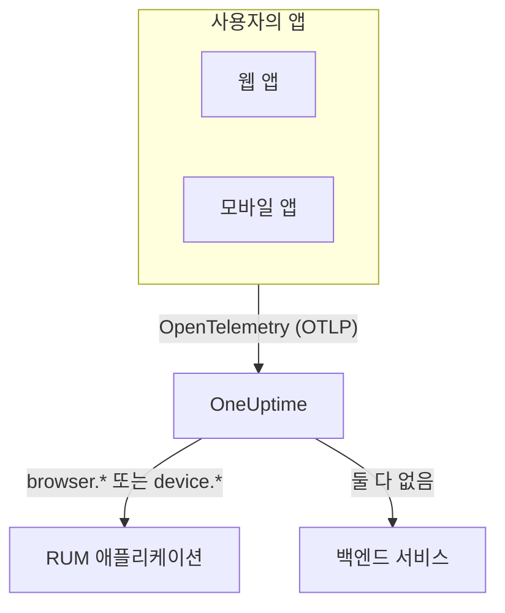

# RUM 개요

실제 사용자 모니터링(RUM)은 웹 앱과 모바일 앱에서 실제 사용자가 겪는 일, 즉 페이지 로드, 요청, 오류, Core Web Vitals를 프로브가 아닌 앱 자신의 보고로 보여 줍니다. OneUptime은 이 텔레메트리를 RUM 애플리케이션으로 모아 차트, 검색, 알림에 쓸 수 있게 합니다.

:::cards
- [작동 방식](#작동-방식): 하나의 OpenTelemetry 파이프라인이며, 도착할 때 RUM으로 분류됩니다.
- [OneUptime이 RUM을 알아보는 방법](#oneuptime이-rum을-알아보는-방법): 판단 기준이 되는 리소스 속성입니다.
- [제공되는 기능](#제공되는-기능): 개요, Web Vitals, 탐색기, 리플레이.
- [시작하기](#시작하기): 수집 키 생성부터 첫 페이지 로드까지.
:::

## 작동 방식

RUM은 OneUptime의 다른 기능과 같은 OpenTelemetry 파이프라인을 사용합니다. RUM 전용 에이전트나 자체 전송 형식은 없습니다. OpenTelemetry 브라우저 SDK나 모바일 SDK가 OneUptime으로 보내도록 설정하면, 도착한 텔레메트리가 RUM으로 분류됩니다.

- **앱마다 애플리케이션 하나.** 애플리케이션의 식별자는 SDK가 보고하는 `service.name`이며, 첫 텔레메트리 배치가 도착하면 OneUptime이 애플리케이션을 만듭니다.
- **두 번 집계되지 않습니다.** 클라이언트 텔레메트리는 해당 RUM 애플리케이션에만 속하며, 백엔드 서비스로 함께 표시되지 않습니다.
- **세션 리플레이는 별도의 선택 계층입니다.** 자체 스니펫과 개인정보 보호 설정이 있습니다. [세션 리플레이](/docs/telemetry/session-replay)를 참고하세요.

## 찾는 위치

**제품 → 리소스 → 실제 사용자 모니터링**을 엽니다. **모든 애플리케이션**에는 애플리케이션이 **클라이언트 유형**, **상태**, **마지막 확인**과 함께 표시됩니다. 사이드 메뉴의 다른 두 섹션은 처음에 접혀 있습니다.

- **설정**: **소유자 규칙**, **레이블 규칙**, 그리고 프로젝트 전체의 **세션 리플레이** 스위치.
- **고급**: **보관됨**, 보관한 애플리케이션.

애플리케이션 자체의 사이드 메뉴는 페이지를 다음과 같이 묶습니다. **설정**, **개발자**, **고급**은 처음에 접혀 있습니다.

| 섹션 | 페이지 |
| --- | --- |
| **기본** | **개요**, **권장 사항**, **문서** |
| **관측 가능성** | **메트릭**, **로그**, **트레이스**, **클라이언트** |
| **세션 리플레이** | **세션 리플레이**, **User Flows**, **Replay Users**, **상태**, **Replay Policy**, **리플레이 접근 로그**, **문서** |
| **설정** | **설정** |
| **개발자** | **Terraform**, **API**, **AI 어시스턴트** |
| **고급** | **애플리케이션 삭제** |

## OneUptime이 RUM을 알아보는 방법

"앱이 보이지 않는다"는 질문은 대부분 여기서 해결됩니다. OneUptime은 텔레메트리 배치가 도착할 때마다 그 배치의 **리소스 속성**으로 판단합니다.

1. 리소스에 `browser.platform`, `browser.language` 또는 비어 있지 않은 `browser.brands`가 있는 배치는 **브라우저** RUM입니다.
2. 그렇지 않고 `device.id` 또는 `device.model.identifier`가 있는 배치는 **모바일** RUM입니다.
3. 그렇지 않고 `device.manufacturer`가 있으면서 호스트 식별자(`host.name`, `host.id` 또는 `k8s.node.name`)가 없는 배치도 **모바일** RUM입니다.
4. 그 밖의 모든 배치는 백엔드 서비스입니다.

백엔드 SDK는 `browser.*`, `device.id`, `device.model.identifier`를 설정하지 않으므로 이 속성들은 확실한 신호입니다. 예외는 `device.manufacturer`입니다. 호스트 인벤토리도 이 속성으로 장비의 제조사를 보고하므로, 호스트 식별자가 없는 리소스에서만 판단에 쓰입니다. [인벤토리 속성](/docs/telemetry/host-otel-collector#인벤토리-속성-ip-mac-일련번호-제조사-모델-펌웨어)을 참고하세요.

| 속성 | 필수 | 역할 |
| --- | --- | --- |
| `service.name` | **예** | 애플리케이션의 식별자입니다. 예: `storefront-web`. 이 속성이 없으면 RUM 애플리케이션이 만들어지지 않습니다. |
| `browser.platform`, `browser.language`, `browser.brands` | 웹에서는 이 중 하나 | 배치를 브라우저 RUM으로 표시합니다. `browser.platform`은 **클라이언트** 페이지에도 쓰입니다. |
| `device.id`, `device.model.identifier` | 모바일에서는 이 중 하나 | 배치를 모바일 RUM으로 표시합니다. `device.model.identifier`는 **클라이언트** 페이지에도 쓰입니다. |
| `device.manufacturer` | 아니요 | 리소스에 호스트 식별자가 없을 때만 배치를 모바일 RUM으로 표시합니다. |
| `telemetry.sdk.language` | 아니요 | 개요에 표시됩니다. 예: `webjs`, `swift`. |
| `telemetry.sdk.version` | 아니요 | SDK 버전으로 표시됩니다. 없으면 `oneuptime.agent.version`을 읽습니다. |
| `oneuptime.label.<name>` | 아니요 | 프로젝트 레이블 `<name>:<value>`를 애플리케이션에 추가합니다. |

OneUptime은 대소문자를 구분하지 않고 `service.name`으로 애플리케이션을 찾고, 프로젝트에 없으면 새로 만듭니다. 새 `service.name`은 새 애플리케이션이 되므로 이름을 바꾸지 말고, 환경은 새 이름이 아니라 레이블로 구분하세요. 이름, 레이블, 소유자, 보존 기간은 [애플리케이션 관리](/docs/rum/applications)에서 다룹니다.

> [!IMPORTANT]
> OpenTelemetry 브라우저 SDK는 브라우저 리소스 감지기를 추가하거나 직접 설정하지 않는 한 `browser.*` 속성을 추가하지 않습니다. `service.name`만 있으면 텔레메트리는 RUM 애플리케이션이 아니라 백엔드 서비스가 됩니다. 두 방법 모두 [브라우저 설정](/docs/rum/browser-setup)에서 설명합니다.

## 제공되는 기능

| 위치 | 보여 주는 내용 |
| --- | --- |
| **개요** | **Page loads**, **Page load time (p95)**, **이벤트**, **오류율**, **Event duration (p95)**, **예외**, **클라이언트**, **Sessions recorded** 타일과 선택한 기간의 추세 차트. |
| **Core Web Vitals** | 개요에 있는 카드로, LCP, INP, CLS, FCP, TTFB를 각각 Google 기준으로 평가하고, 싱글 페이지 앱에서는 경로별 INP도 보여 줍니다. [Core Web Vitals](/docs/rum/web-vitals)와 [싱글 페이지 앱](/docs/rum/web-vitals#싱글-페이지-앱)을 참고하세요. |
| **메트릭**, **로그**, **트레이스** | 이 애플리케이션만 보여 주는 텔레메트리 탐색기. |
| **클라이언트** | 애플리케이션이 사용된 브라우저 플랫폼과 기기 모델. 플랫폼별 짧은 목록이며, 사용자마다 행을 만들지 않습니다. |
| **세션 리플레이** | 실제 세션의 녹화를 오류, 트레이스, 로그와 나란히 보여 줍니다. [세션 리플레이](/docs/telemetry/session-replay)를 참고하세요. |
| **권장 사항** | 애플리케이션용 기성 모니터. 나쁜 Core Web Vitals, 실패한 요청, 브라우저 예외, 그리고 녹화가 시작되면 세션 리플레이 예산. |

수치는 계측이 보내는 스팬으로 계산됩니다. **Page loads**는 페이지 로드 계측이 전체 로드마다 기록하는 `documentLoad` 스팬을 세므로, 싱글 페이지 앱 안의 경로 변경은 페이지 로드로 세지 않습니다.

애플리케이션은 텔레메트리가 도착하는 동안 **연결됨**으로 표시되고, 15분 동안 아무것도 오지 않으면 **연결 끊김**이 됩니다. OneUptime 자체가 중단되었거나 수집 대기열을 처리하느라 밀려 있던 시간은 이 15분에 포함되지 않습니다.

## 시작하기

:::steps
### 수집 키 만들기

**프로젝트 설정 → 텔레메트리 및 APM → 수집 키**를 열고 **수집 키 생성**을 클릭합니다. 웹 앱에는 지정한 출처에서만 쓸 수 있는 **브라우저** 키가 필요합니다. 모바일 앱에는 **서버** 키가 필요합니다. 모바일 SDK는 `Origin` 헤더를 보내지 않기 때문입니다.

### 앱 계측하기

웹 앱은 [브라우저 설정](/docs/rum/browser-setup)을, Android, iOS, React Native 등의 플랫폼은 [모바일 설정](/docs/rum/mobile-setup)을 따르세요.

### 페이지 열기

사이트의 페이지를 로드하거나 앱을 실행합니다. 첫 텔레메트리 배치가 도착하면 애플리케이션이 `service.name`의 이름으로 **제품 → 리소스 → 실제 사용자 모니터링**에 나타납니다. 미리 만들 필요는 없습니다.

### Web Vitals와 리플레이 추가하기

기본 데이터가 도착하면 [Core Web Vitals](/docs/rum/web-vitals)를 보내고 [세션 리플레이](/docs/telemetry/session-replay)를 추가하세요. 둘 다 선택 사항입니다.
:::

아무것도 나타나지 않으면 [RUM 문제 해결](/docs/rum/troubleshooting)에서 흔히 발생하는 순서대로 원인을 확인할 수 있습니다.

## 다음 단계

:::cards
- [브라우저 설정](/docs/rum/browser-setup): OpenTelemetry 브라우저 SDK로 웹 앱을 계측합니다.
- [모바일 설정](/docs/rum/mobile-setup): Android, iOS, React Native 및 그 밖의 OpenTelemetry SDK.
- [Core Web Vitals](/docs/rum/web-vitals): LCP, INP, CLS, FCP, TTFB를 보내고 INP를 경로별로 확인합니다.
- [세션 리플레이](/docs/telemetry/session-replay): 사용자가 본 화면을 오류, 트레이스와 나란히 확인합니다.
:::
