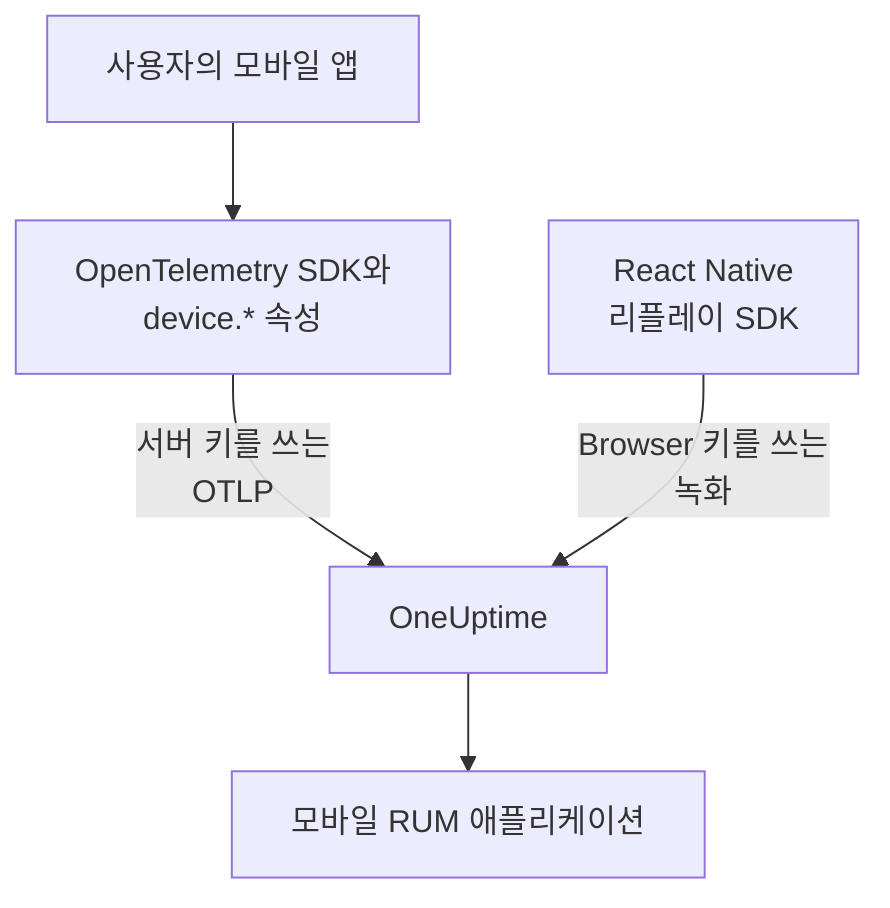

# 모바일 설정

Android, iOS, React Native 앱을 OpenTelemetry로 계측해 모바일 RUM 애플리케이션으로 OneUptime에 보고하게 합니다. OpenTelemetry SDK가 있는 다른 플랫폼도 같은 방식으로 작동합니다.

:::cards
- [OneUptime에 필요한 것](#oneuptime에-필요한-것): 서버 키로 보내는 두 가지 리소스 속성.
- [플랫폼 설정](#플랫폼-설정): Android, iOS, React Native 및 그 밖의 플랫폼.
- [도착 확인](#도착-확인하기): 키를 확인한 뒤 앱을 찾습니다.
- [모바일 세션 리플레이](#모바일-세션-리플레이): React Native 앱의 녹화.
:::

## 작동 방식

앱은 **서버** 수집 키로 OTLP를 OneUptime에 직접 내보냅니다. 앱을 백엔드 서비스가 아닌 모바일 RUM으로 분류하게 하는 것은 리소스의 `device.*` 속성입니다.



## OneUptime에 필요한 것

앱이 내보내는 모든 배치에 두 가지 리소스 속성이 있어야 합니다.

| 속성 | 의미 |
| --- | --- |
| `service.name` | 애플리케이션의 식별자입니다. 예: `storefront-android`. |
| `device.id` 또는 `device.model.identifier` | 텔레메트리를 모바일 RUM으로 표시합니다. `device.model.identifier`는 **클라이언트** 페이지에도 쓰입니다. |

기기 속성이 없어도 텔레메트리는 도착하고 조회할 수도 있지만, RUM 애플리케이션이 아니라 백엔드 서비스로 분류됩니다.

`device.manufacturer`도 배치를 모바일로 표시하지만, 호스트 식별자가 없는 리소스에서만 그렇습니다. 호스트 인벤토리가 이 속성으로 장비의 제조사를 보고하기 때문입니다. 아래의 모든 예시처럼 `device.id`나 `device.model.identifier`도 설정하면 이 점은 문제가 되지 않습니다.

`device.id`는 설치 단위의 식별자로 만들고, 광고 ID처럼 사람을 식별하는 값은 절대 쓰지 마세요. OneUptime은 모바일 텔레메트리를 알아보는 데만 이 값을 읽습니다.

## 시작하기 전에

- OpenTelemetry SDK가 들어 있는 앱. OpenTelemetry Java SDK 또는 OpenTelemetry Android, opentelemetry-swift, React Native라면 OpenTelemetry JavaScript SDK입니다.
- **프로젝트 설정 → 텔레메트리 및 APM → 수집 키**에서 **수집 키 생성**으로 만든 **서버** 수집 키. **Browser** 키는 모바일 앱에서 거부됩니다. 이 키는 `Origin` 헤더로 확인되는데, 모바일 SDK는 이 헤더를 보내지 않기 때문입니다.
- 다음 OTLP 설정. OneUptime을 직접 호스팅한다면 `https://oneuptime.com`을 자신의 호스트로 바꾸세요.

| 설정 | 값 |
| --- | --- |
| OTLP 엔드포인트 | `https://oneuptime.com/otlp` |
| 헤더 | `x-oneuptime-token: YOUR_TELEMETRY_INGESTION_TOKEN` |
| 트레이스 | `POST https://oneuptime.com/otlp/v1/traces` |
| 메트릭 | `POST https://oneuptime.com/otlp/v1/metrics` |
| 로그 | `POST https://oneuptime.com/otlp/v1/logs` |

> [!WARNING]
> 키는 앱 안에 담겨 배포되고 앱은 풀어 볼 수 있으므로, 누군가 키를 복사한다고 가정하세요. 키 페이지에서 **Pinned Service Name**을 설정해 복사본이 백엔드 서비스의 이름으로 쓰지 못하게 하고, **Requests Per Minute Limit**과 **만료 시각** 날짜를 추가하고, 릴리스마다 키를 교체하세요.

## 플랫폼 설정

스니펫은 설정의 형태를 보여 줍니다. 모바일 OpenTelemetry SDK는 릴리스마다 API가 바뀌므로, 메서드 이름은 고정한 버전과 대조해 확인하세요. OneUptime에 필요한 것은 바뀌지 않습니다. 엔드포인트, 헤더, `service.name`, 그리고 `device.*` 속성 하나입니다.

:::tabs
@tab Android
Android에서 실행되는 OpenTelemetry Java SDK와 그 OTLP 내보내기 도구를 사용하세요.

```kotlin title="app/build.gradle.kts"
dependencies {
    implementation(platform("io.opentelemetry:opentelemetry-bom:<latest>"))
    implementation("io.opentelemetry:opentelemetry-sdk")
    implementation("io.opentelemetry:opentelemetry-exporter-otlp")
}
```

```kotlin title="StorefrontApplication.kt"
import android.app.Application
import android.os.Build
import io.opentelemetry.exporter.otlp.http.trace.OtlpHttpSpanExporter
import io.opentelemetry.sdk.OpenTelemetrySdk
import io.opentelemetry.sdk.resources.Resource
import io.opentelemetry.sdk.trace.SdkTracerProvider
import io.opentelemetry.sdk.trace.export.BatchSpanProcessor

class StorefrontApplication : Application() {
    override fun onCreate() {
        super.onCreate()

        val resource = Resource.getDefault().toBuilder()
            .put("service.name", "storefront-android")
            .put("device.manufacturer", Build.MANUFACTURER)
            .put("device.model.identifier", Build.MODEL)
            .build()

        val exporter = OtlpHttpSpanExporter.builder()
            .setEndpoint("https://oneuptime.com/otlp/v1/traces")
            .addHeader("x-oneuptime-token", BuildConfig.ONEUPTIME_TOKEN)
            .build()

        OpenTelemetrySdk.builder()
            .setTracerProvider(
                SdkTracerProvider.builder()
                    .setResource(resource)
                    .addSpanProcessor(BatchSpanProcessor.builder(exporter).build())
                    .build()
            )
            .buildAndRegisterGlobal()
    }
}
```

[OpenTelemetry Android](https://github.com/open-telemetry/opentelemetry-android) 에이전트는 그 위에 자동 계측을 더하고, 자체 리소스에 기기 속성을 설정합니다. 이 에이전트를 쓴다면 내보내기 도구를 같은 엔드포인트와 헤더로 향하게 하고, 사용하는 버전에서 `device.model.identifier`가 리소스에 들어가는지 확인하세요.
@tab iOS
[opentelemetry-swift](https://github.com/open-telemetry/opentelemetry-swift)를 쓰고, 기기 속성은 직접 설정하세요. 각 버전이 자동으로 추가하는 리소스는 릴리스마다 달라져 왔습니다.

```swift
let resource = Resource(attributes: [
    "service.name": .string("storefront-ios"),
    "device.model.identifier": .string(UIDevice.current.model),
    "device.manufacturer": .string("Apple"),
    "telemetry.sdk.language": .string("swift"),
])

let exporter = OtlpHttpTraceExporter(
    endpoint: URL(string: "https://oneuptime.com/otlp/v1/traces")!,
    config: OtlpConfiguration(
        headers: [("x-oneuptime-token", oneUptimeToken)]
    )
)

OpenTelemetry.registerTracerProvider(
    tracerProvider: TracerProviderBuilder()
        .with(resource: resource)
        .add(spanProcessor: BatchSpanProcessor(spanExporter: exporter))
        .build()
)
```

`UIDevice.current.model`은 `iPhone` 같은 짧은 이름을 주므로, **클라이언트** 페이지가 기기 종류마다 한 행으로 유지됩니다.
@tab React Native
React Native는 OpenTelemetry JavaScript SDK로 실행되므로, [브라우저 설정](/docs/rum/browser-setup)처럼 프로바이더, OTLP 내보내기 도구, 배치 프로세서를 만들되 세 가지를 바꾸세요. **서버** 키로 보내고, `browserDetector`와 `DocumentLoadInstrumentation`을 빼고, 기기 속성을 직접 설정합니다.

```ts
import { Platform } from "react-native";
import * as Device from "expo-device"; // or react-native-device-info
import {
  defaultResource,
  resourceFromAttributes,
} from "@opentelemetry/resources";

const resource = defaultResource().merge(
  resourceFromAttributes({
    "service.name": "storefront-mobile",
    "device.manufacturer": Device.manufacturer ?? Platform.OS,
    "device.model.identifier":
      Device.modelId ?? Device.modelName ?? "unknown",
    "telemetry.sdk.language": "webjs",
  }),
);
```

`Device.modelId`는 iOS에서만 설정되므로 Android에서는 `Device.modelName`을 씁니다.
@tab 그 밖의 플랫폼
Flutter, Unity, .NET MAUI, 임베디드 클라이언트, 직접 만든 OTLP 작성기 모두 리소스에 `service.name`과 `device.*` 속성 하나가 있으면 작동합니다. 표준 OpenTelemetry 환경 변수를 읽는 SDK는 이 값을 그대로 씁니다.

```bash
OTEL_EXPORTER_OTLP_ENDPOINT="https://oneuptime.com/otlp"
OTEL_EXPORTER_OTLP_HEADERS="x-oneuptime-token=YOUR_TELEMETRY_INGESTION_TOKEN"
OTEL_RESOURCE_ATTRIBUTES="service.name=storefront-mobile,device.manufacturer=Acme,device.model.identifier=AC-100"
```

`/v1/traces`, `/v1/metrics`, `/v1/logs`는 SDK가 엔드포인트에 직접 붙입니다.
:::

## 도착 확인하기

:::steps
### 키 확인하기

SDK 설정을 살펴보기 전에 OneUptime이 키를 받는지 확인합니다.

```bash
curl -i https://oneuptime.com/otlp/v1/validate \
  -H "x-oneuptime-token: YOUR_TELEMETRY_INGESTION_TOKEN"
```

`"valid": true`와 함께 오는 `200`은 키가 수락되었다는 뜻입니다. Browser 키도 `200`을 돌려주지만, 메시지에 브라우저에서만 쓸 수 있다고 적혀 있습니다. 모바일 앱에는 서버 키가 필요합니다. `401`은 키가 알 수 없거나, 취소되었거나, 꺼져 있거나, 만료되었다는 뜻이며, SDK 설정으로는 고칠 수 없습니다.

### 앱 실행하기

앱을 실행하고 잠시 사용해 보세요. 첫 텔레메트리 배치가 도착하면 앱이 `service.name`의 이름으로 **제품 → 리소스 → 실제 사용자 모니터링**에 나타납니다.

### 클라이언트 페이지 열기

애플리케이션의 **클라이언트** 페이지를 엽니다. `device.model.identifier`의 기기 모델마다 행이 있습니다. **트레이스**에는 데이터가 쌓이는데 이 페이지가 비어 있다면, 기기 속성이 리소스에 들어가지 않고 있습니다.
:::

## 모바일 세션 리플레이

React Native 앱은 `@oneuptime/react-native-replay`로 세션을 녹화할 수 있습니다. 네이티브 뷰 트리를 와이어프레임으로 기록하며, 스크린샷이나 화면의 텍스트는 절대 기록하지 않습니다. 녹화는 웹 녹화와 같은 플레이어에서 열립니다. 전송에는 **Browser** 키를 쓰며, 그 **Allowed Origins**에 앱을 `app://` 뒤에 Android 애플리케이션 ID나 iOS 번들 ID를 붙인 형태로 등록합니다. 이 키는 OpenTelemetry SDK가 쓰는 서버 키와는 별개입니다. 자세한 절차는 [React Native에 설치하기](/docs/telemetry/session-replay#install-in-react-native)에서 안내합니다.

네이티브 Android 앱과 iOS 앱, 그리고 그 밖의 플랫폼에는 세션 레코더가 없습니다. 이들의 **Session Replay** 페이지는 비어 있지만, 트레이스, 로그, 메트릭, 예외, **클라이언트** 페이지는 평소처럼 작동합니다.

## 문제 해결

:::details 키 확인이 401을 돌려주거나 키가 거부됨
`401`은 키가 알 수 없거나, 취소되었거나, 꺼져 있거나, 만료되었다는 뜻입니다. 서버 키를 만들고 그 키로 앱을 다시 빌드하세요.

Browser 키는 확인을 통과하지만, 모바일 앱에서 보내는 모든 내보내기가 `This request did not send an Origin header, so it cannot be checked against the allowed origins of this browser ingestion key. Use a server ingestion key for requests that are not sent by a browser.`라는 `422`로 거부됩니다. **서버** 키를 쓰세요.
:::

:::details 앱이 실제 사용자 모니터링이 아니라 서비스에 나타남
리소스에 `device.id`도 `device.model.identifier`도 없어서 텔레메트리가 백엔드 서비스로 분류되었습니다. [플랫폼 설정](#플랫폼-설정)처럼 설정하세요.

이미 만들어진 서비스는 RUM 애플리케이션으로 바뀌지 않으므로, RUM 텔레메트리가 도착하면 **제품 → 서비스**에서 삭제하세요.
:::

:::details 클라이언트 페이지가 비어 있음
클라이언트 행은 `device.model.identifier`에서만 나옵니다. `device.id`나 `device.manufacturer`만 설정하는 SDK는 앱을 모바일 RUM으로 분류하지만 클라이언트는 나열하지 않습니다. `device.model.identifier`도 설정하세요.
:::

:::details 사람들이 앱을 쓰는데 상태가 연결 끊김으로 표시됨
텔레메트리 없이 15분이 지나면 상태가 **연결 끊김**이 됩니다. 사람들이 앱을 쓰고 있다면 다음을 확인하세요.

- 샘플러가 모든 것을 버리고 있을 수 있습니다. always-off 샘플러나 매우 낮은 비율이 있는지 확인하세요.
- 그 시간 동안 아무도 하지 않은 동작에 대해서만 앱이 텔레메트리를 보낼 수 있습니다.
- 릴리스 이후 키가 취소되었거나 만료되었을 수 있습니다. [도착 확인하기](#도착-확인하기)처럼 키를 확인하세요.
:::

## 다음 단계

:::cards
- [세션 리플레이](/docs/telemetry/session-replay): React Native 세션을 트레이스와 나란히 녹화합니다.
- [애플리케이션 관리](/docs/rum/applications): 이름, 레이블, 소유자, 보존 기간.
- [OpenTelemetry](/docs/telemetry/open-telemetry): OTLP 엔드포인트, 한도, 오류에 대한 자세한 내용.
- [RUM 문제 해결](/docs/rum/troubleshooting): 문제가 흔히 생기는 순서대로 정리한 모든 확인 사항.
:::
