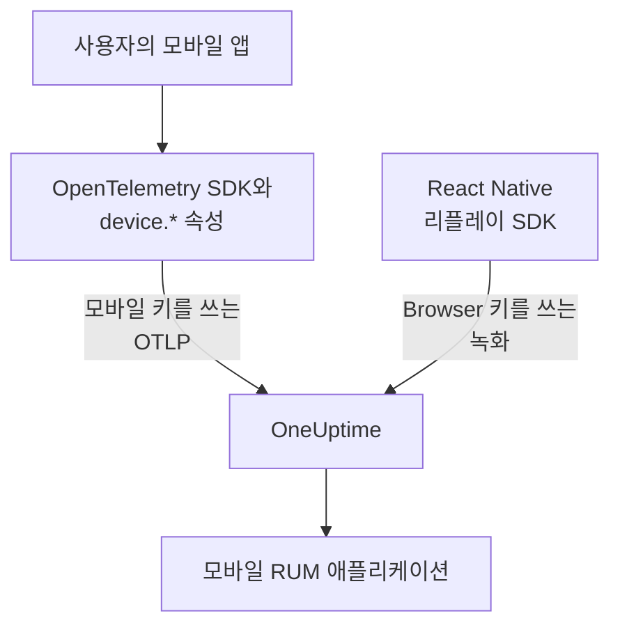

# 모바일 설정

Android, iOS, React Native 앱을 OpenTelemetry로 계측해 모바일 RUM 애플리케이션으로 OneUptime에 보고하게 합니다. OpenTelemetry SDK가 있는 다른 플랫폼도 같은 방식으로 작동합니다.

:::cards
- [OneUptime에 필요한 것](#oneuptime에-필요한-것): 모바일 키로 보내는 두 가지 리소스 속성.
- [플랫폼 설정](#플랫폼-설정): Android, iOS, React Native 및 그 밖의 플랫폼.
- [iOS 크래시와 멈춤](#ios-크래시와-멈춤): 예외에 나타나는 MetricKit과 KSCrash의 보고서, dSYM으로 이름이 붙습니다.
- [도착 확인](#도착-확인하기): 키를 확인한 뒤 앱을 찾습니다.
- [모바일 세션 리플레이](#모바일-세션-리플레이): React Native 앱의 녹화.
:::

## 작동 방식

앱은 앱에 고정된 **모바일** 수집 키로 OTLP를 OneUptime에 직접 내보내므로, 보내는 모든 것이 그 모바일 RUM 애플리케이션으로 분류됩니다. 다른 키를 쓰면, 앱을 백엔드 서비스가 아닌 모바일 RUM으로 분류하게 하는 것은 리소스의 `device.*` 속성입니다.



## OneUptime에 필요한 것

앱이 내보내는 모든 배치에 두 가지 리소스 속성이 있어야 합니다.

| 속성 | 의미 |
| --- | --- |
| `service.name` | 애플리케이션의 식별자입니다. 예: `storefront-android`. |
| `device.id` 또는 `device.model.identifier` | 텔레메트리를 모바일 RUM으로 표시합니다. `device.model.identifier`는 **클라이언트** 페이지에도 쓰입니다. |

다른 키로 보낸 텔레메트리는 기기 속성이 없어도 도착하고 조회할 수도 있지만, RUM 애플리케이션이 아니라 백엔드 서비스로 분류됩니다.

`device.manufacturer`도 배치를 모바일로 표시하지만, 호스트 식별자가 없는 리소스에서만 그렇습니다. 호스트 인벤토리가 이 속성으로 장비의 제조사를 보고하기 때문입니다. 아래의 모든 예시처럼 `device.id`나 `device.model.identifier`도 설정하면 이 점은 문제가 되지 않습니다.

`device.id`는 설치 단위의 식별자로 만들고, 광고 ID처럼 사람을 식별하는 값은 절대 쓰지 마세요. OneUptime은 모바일 텔레메트리를 알아보는 데만 이 값을 읽습니다.

## 시작하기 전에

- OpenTelemetry SDK가 들어 있는 앱. OpenTelemetry Java SDK 또는 OpenTelemetry Android, opentelemetry-swift, React Native라면 OpenTelemetry JavaScript SDK입니다.
- **프로젝트 설정 → 텔레메트리 및 APM → 수집 키**에서 **수집 키 생성**으로 만들고 **고정된 서비스 이름**에 앱의 `service.name`을 넣은 **모바일** 수집 키. **브라우저** 키는 모바일 앱에서 거부됩니다. 이 키는 `Origin` 헤더로 확인되는데, 모바일 SDK는 이 헤더를 보내지 않기 때문입니다. 앱에 **서버** 키를 넣어 배포하지 마세요.
- 다음 OTLP 설정. OneUptime을 직접 호스팅한다면 `https://oneuptime.com`을 자신의 호스트로 바꾸세요.

| 설정 | 값 |
| --- | --- |
| OTLP 엔드포인트 | `https://oneuptime.com/otlp` |
| 헤더 | `x-oneuptime-token: YOUR_TELEMETRY_INGESTION_TOKEN` |
| 트레이스 | `POST https://oneuptime.com/otlp/v1/traces` |
| 메트릭 | `POST https://oneuptime.com/otlp/v1/metrics` |
| 로그 | `POST https://oneuptime.com/otlp/v1/logs` |

> [!WARNING]
> 키는 앱 안에 담겨 배포되고 앱은 풀어 볼 수 있으므로, 누군가 키를 복사한다고 가정하세요. 모바일 키의 복사본은 이 앱의 트레이스, 로그, 메트릭만 보낼 수 있으며, 모두 **고정된 서비스 이름** 아래 분류되고, 웹 페이지에서는 보낼 수 없습니다. 그래도 키의 **분당 요청 한도**까지는 이 앱의 꾸며 낸 데이터를 보낼 수 있으므로, **만료 시각** 날짜를 추가하고 릴리스마다 키를 교체하세요.

## 플랫폼 설정

스니펫은 설정의 형태를 보여 줍니다. 모바일 OpenTelemetry SDK는 릴리스마다 API가 바뀌므로, 메서드 이름은 고정한 버전과 대조해 확인하세요. OneUptime에 필요한 것은 바뀌지 않습니다. 엔드포인트, 헤더, `service.name`, 그리고 `device.*` 속성 하나입니다.

:::tabs
@tab Android
Android에서 실행되는 OpenTelemetry Java SDK와 그 OTLP 내보내기 도구를 사용하세요.

```kotlin title="app/build.gradle.kts"
dependencies {
    implementation(platform("io.opentelemetry:opentelemetry-bom:<latest>"))
    implementation("io.opentelemetry:opentelemetry-sdk")
    implementation("io.opentelemetry:opentelemetry-exporter-otlp")
}
```

```kotlin title="StorefrontApplication.kt"
import android.app.Application
import android.os.Build
import io.opentelemetry.exporter.otlp.http.trace.OtlpHttpSpanExporter
import io.opentelemetry.sdk.OpenTelemetrySdk
import io.opentelemetry.sdk.resources.Resource
import io.opentelemetry.sdk.trace.SdkTracerProvider
import io.opentelemetry.sdk.trace.export.BatchSpanProcessor

class StorefrontApplication : Application() {
    override fun onCreate() {
        super.onCreate()

        val resource = Resource.getDefault().toBuilder()
            .put("service.name", "storefront-android")
            .put("device.manufacturer", Build.MANUFACTURER)
            .put("device.model.identifier", Build.MODEL)
            .build()

        val exporter = OtlpHttpSpanExporter.builder()
            .setEndpoint("https://oneuptime.com/otlp/v1/traces")
            .addHeader("x-oneuptime-token", BuildConfig.ONEUPTIME_TOKEN)
            .build()

        OpenTelemetrySdk.builder()
            .setTracerProvider(
                SdkTracerProvider.builder()
                    .setResource(resource)
                    .addSpanProcessor(BatchSpanProcessor.builder(exporter).build())
                    .build()
            )
            .buildAndRegisterGlobal()
    }
}
```

[OpenTelemetry Android](https://github.com/open-telemetry/opentelemetry-android) 에이전트는 그 위에 크래시, ANR, 느린 프레임과 정지된 프레임, 앱 시작을 더하고, 자체 리소스에 `device.model.identifier`와 `device.manufacturer`를 설정합니다. [Android 설정](/docs/rum/android-setup)에서는 위 코드 대신 이 에이전트를 설정합니다.
@tab iOS
[opentelemetry-swift](https://github.com/open-telemetry/opentelemetry-swift)를 쓰고, 기기 속성은 직접 설정하세요. 각 버전이 자동으로 추가하는 리소스는 릴리스마다 달라져 왔습니다.

```swift
let resource = Resource(attributes: [
    "service.name": .string("storefront-ios"),
    "device.model.identifier": .string(UIDevice.current.model),
    "device.manufacturer": .string("Apple"),
    "device.id": .string(UIDevice.current.identifierForVendor?.uuidString ?? ""),
    "telemetry.sdk.language": .string("swift"),
])

let exporter = OtlpHttpTraceExporter(
    endpoint: URL(string: "https://oneuptime.com/otlp/v1/traces")!,
    config: OtlpConfiguration(
        headers: [("x-oneuptime-token", oneUptimeToken)]
    )
)

OpenTelemetry.registerTracerProvider(
    tracerProvider: TracerProviderBuilder()
        .with(resource: resource)
        .add(spanProcessor: BatchSpanProcessor(spanExporter: exporter))
        .build()
)
```

`UIDevice.current.model`은 `iPhone` 같은 짧은 이름을 주므로, **클라이언트** 페이지가 기기 종류마다 한 행으로 유지됩니다. `identifierForVendor`는 OneUptime이 크래시 없는 설치를 셀 때 기준으로 삼는 설치이며, 자세한 내용은 [세션 기록하기](#세션-기록하기)에 있습니다.
@tab React Native
React Native는 OpenTelemetry JavaScript SDK로 실행되므로, [브라우저 설정](/docs/rum/browser-setup)처럼 프로바이더, OTLP 내보내기 도구, 배치 프로세서를 만들되 세 가지를 바꾸세요. **모바일** 키로 보내고, `browserDetector`와 `DocumentLoadInstrumentation`을 빼고, 기기 속성을 직접 설정합니다.

```ts
import { Platform } from "react-native";
import * as Device from "expo-device"; // or react-native-device-info
import {
  defaultResource,
  resourceFromAttributes,
} from "@opentelemetry/resources";

const resource = defaultResource().merge(
  resourceFromAttributes({
    "service.name": "storefront-mobile",
    "device.manufacturer": Device.manufacturer ?? Platform.OS,
    "device.model.identifier":
      Device.modelId ?? Device.modelName ?? "unknown",
    "telemetry.sdk.language": "webjs",
  }),
);
```

`Device.modelId`는 iOS에서만 설정되므로 Android에서는 `Device.modelName`을 씁니다.
@tab 그 밖의 플랫폼
Flutter, Unity, .NET MAUI, 임베디드 클라이언트, 직접 만든 OTLP 작성기 모두 리소스에 `service.name`과 `device.*` 속성 하나가 있으면 작동합니다. 표준 OpenTelemetry 환경 변수를 읽는 SDK는 이 값을 그대로 씁니다.

```bash
OTEL_EXPORTER_OTLP_ENDPOINT="https://oneuptime.com/otlp"
OTEL_EXPORTER_OTLP_HEADERS="x-oneuptime-token=YOUR_TELEMETRY_INGESTION_TOKEN"
OTEL_RESOURCE_ATTRIBUTES="service.name=storefront-mobile,device.manufacturer=Acme,device.model.identifier=AC-100"
```

`/v1/traces`, `/v1/metrics`, `/v1/logs`는 SDK가 엔드포인트에 직접 붙입니다.
:::

## iOS 크래시와 멈춤

opentelemetry-swift 2.3 이상은 MetricKit 계측으로 iOS 앱의 크래시와 멈춤(hang)을 보고하며, 이 계측은 Apple의 각 진단을 로그 레코드로 OpenTelemetry에 넘깁니다. OneUptime은 이를 OpenTelemetry Android의 크래시와 ANR처럼 분류하므로, **예외**와 애플리케이션의 **개요**에 나타납니다.

| Apple의 진단 | 이벤트 이름 | 예외에서 |
| --- | --- | --- |
| 크래시 | `metrickit.diagnostic.crash` | 처리되지 않은 예외로, 유형은 앱을 종료시킨 원인으로 정해집니다. iOS 17 이상에서는 Objective-C 예외, 그것이 없으면 Mach 예외(`EXC_BAD_ACCESS`), 그것도 없으면 시그널(`SIGSEGV`)입니다 |
| 멈춤(hang) | `metrickit.diagnostic.hang` | **Hang** 유형의 처리되지 않은 예외로, iOS에서 ANR에 해당하며 멈춤이 지속된 시간을 담고 있습니다 |

개요의 **크래시** 타일은 크래시를 세고, **ANR** 타일은 Android의 ANR과 함께 멈춤을 셉니다. 각 스택 트레이스는 크래시 보고서의 스레드처럼 그려지며, 크래시가 발생했거나 멈춘 스레드가 맨 앞에 옵니다. 앱 코드의 프레임은 해당 빌드의 dSYM이 업로드되면 `CartViewController.checkout()`처럼 함수 이름으로 표시됩니다. 업로드 방법은 [dSYM 업로드하기](#dsym-업로드하기)를 참고하세요. 그 밖의 프레임은 바이너리와 그 안에서 코드가 있던 위치를 알려 주며, **Binary Images**는 각 바이너리의 UUID를 나열하므로 어느 빌드의 dSYM이 그 이름을 붙이는지 알 수 있습니다.

크래시와 멈춤은 크래시가 발생했거나 멈춘 스레드에 있는 앱의 프레임으로 묶입니다. dSYM이 이름을 붙인 프레임은 함수로 묶이므로 크래시는 릴리스가 바뀌어도 하나의 예외로 남고, 이름이 붙지 않은 프레임은 바이너리 안의 오프셋으로 묶이는데, 오프셋은 빌드마다 바뀝니다. 보고서는 도착할 때 이름이 붙으므로, 빌드를 배포하기 전에 그 빌드의 dSYM을 업로드하세요. dSYM보다 먼저 도착한 크래시는 오프셋 그대로 남습니다.

:::steps
### 스팬과 함께 로그도 내보내기

MetricKit은 진단을 로그 레코드로 보고하므로, 트레이서 프로바이더 옆에 같은 리소스, 엔드포인트, 헤더로 로거 프로바이더를 등록하세요.

```swift
let logExporter = OtlpHttpLogExporter(
    endpoint: URL(string: "https://oneuptime.com/otlp/v1/logs")!,
    config: OtlpConfiguration(
        headers: [("x-oneuptime-token", oneUptimeToken)]
    )
)

OpenTelemetry.registerLoggerProvider(
    loggerProvider: LoggerProviderBuilder()
        .with(resource: resource)
        .with(processors: [
            BatchLogRecordProcessor(logRecordExporter: logExporter),
        ])
        .build()
)
```

### MetricKit 계측 등록하기

opentelemetry-swift의 `MetricKitInstrumentation` 제품을 추가하고, 로거 프로바이더를 등록한 다음 MetricKit에 등록하세요.

```swift
import MetricKit
import MetricKitInstrumentation

// MXMetricManager keeps only a weak reference: hold this for the app's lifetime.
let metricKitInstrumentation = MetricKitInstrumentation()
MXMetricManager.shared.add(metricKitInstrumentation)
```

### 세션 기록하기

**세션**과 **크래시 없는 세션** 타일은 스팬의 `session.id`를 셉니다. 이 값은 opentelemetry-swift의 `Sessions` 제품이 설정합니다. 트레이서 프로바이더에 `SessionSpanProcessor`를 추가하고, 로그 프로세서를 `SessionLogRecordProcessor`로 감싸 진단에도 세션이 붙게 하세요.

**크래시 없는 세션** 아래 줄은 크래시가 발생하지 않은 설치의 비율을 보여 주며, **Daily Crash Rate**와 **Daily ANR Rate**는 크래시가 발생한 설치의 비율로 경고합니다. 설치는 위 리소스의 `device.id`, 즉 앱의 공급업체용 식별자입니다. 한 기기에서 여러분의 모든 앱이 공유하는 하나의 값이며, 그중 하나라도 설치되어 있는 동안 유지됩니다. 따라서 하나뿐인 앱을 다시 설치하면 새 설치가 되지만, 두 앱 중 하나를 다시 설치하면 새 설치가 되지 않습니다. `app.installation.id`를 설정하는 opentelemetry-swift 릴리스에서는 대신 그 값으로 셉니다.

### dSYM 업로드하기

Xcode는 앱을 아카이브할 때 앱의 바이너리마다 dSYM을 만들고, App Store Connect의 **Download dSYMs**에서 이를 다시 받을 수 있습니다. 아카이브할 때마다 CI나 Xcode 빌드 단계에서 [OneUptime CLI](/docs/cli/index)로, 빌드용 서버 키를 사용해 업로드하세요. 앱에 담겨 배포되는 키처럼 **고정된 서비스 이름**이 설정된 키는 거부됩니다. dSYM은 그 바이너리를 배포하는 프로젝트의 모든 앱에서 프레임에 이름을 붙이기 때문입니다.

```bash
oneuptime dsym upload "$ARCHIVE_PATH/dSYMs" --app storefront-ios --url https://oneuptime.com --ingestion-key YOUR_TELEMETRY_INGESTION_TOKEN
```

CLI는 `.dSYM` 번들과 이를 담은 폴더와 zip, 그리고 DWARF 파일을 있는 위치 그대로 읽고, 각 바이너리의 UUID, 아키텍처, 함수 이름만 보냅니다. 큰 앱의 dSYM은 수백 메가바이트에 이르지만 이름은 몇 메가바이트에 불과합니다. CLI 없이 보내려면 dSYM의 DWARF 파일이나 `.dSYM` 번들의 zip을 그대로, 파일당 최대 50 MB까지 보내세요.

```bash
curl --fail -X POST "https://oneuptime.com/dsyms/v1/upload" \
  -H "x-oneuptime-token: YOUR_TELEMETRY_INGESTION_TOKEN" \
  -F "appName=storefront-ios" \
  -F "dsym=@MyApp.app.dSYM/Contents/Resources/DWARF/MyApp"
```

각 바이너리는 UUID별로 400일 동안 보관되므로, 몇 달 뒤에도 사람들의 휴대폰에 남아 있는 릴리스에도 계속 이름이 붙으며, 빌드를 다시 업로드하면 그 빌드에 대해 보관된 내용이 대체됩니다. dSYM은 앱 하나가 아니라 프로젝트에 속하므로, 두 앱에 포함된 프레임워크는 두 앱 모두에서 이름이 붙습니다.
:::

> [!NOTE]
> Apple은 MetricKit의 진단을 다음 실행 이후에 앱에 전달합니다. iOS 15 이상에서는 곧바로, 그 이전 버전에서는 하루에 한 번 전달하므로 크래시나 멈춤은 발생하고 몇 분 또는 하루 뒤에 도착할 수 있으며, 도착할 때 셉니다. iOS 앱의 개요에 나온 "지난 1시간 동안 크래시 0건"은 아직 좋은 소식이라고 할 수 없습니다. 진단에 붙는 세션은 그 진단을 보고한 세션이지, 진단된 문제로 끝난 세션이 아닙니다.

opentelemetry-swift는 앱이 시작될 때 스팬을 기록하지 않으므로, 앱이 직접 기록하기 전까지 **앱 시작**과 **콜드 스타트(p95)** 타일은 비어 있습니다. 기록할 스팬은 `AppStart`라는 이름에 `start.type`을 `cold`, `warm`, `hot` 중 하나로 설정한 스팬으로, 프로세스가 시작될 때부터 첫 화면이 준비될 때까지를 나타냅니다.

### KSCrash도 크래시를 보고할 때

opentelemetry-swift는 KSCrash로도 크래시를 보고할 수 있습니다. KSCrash는 앱이 다음에 열릴 때 앱이 크래시한 시각과 함께 보고서를 `device.crash` 로그 레코드로 보냅니다. 둘 다 등록한 앱은 크래시마다 두 번 보고합니다. KSCrash는 다음 실행 때, MetricKit은 다음 실행 때 또는 최대 하루 뒤에 보고합니다. OneUptime은 이런 크래시를 한 번만 셉니다. 먼저 도착한 보고서가 발생이 되고, 두 번째 보고서는 같은 크래시의 증거로 같은 예외 안에서 그 옆에 보관되며, 어떤 타일, 차트, 모니터에서도 세지 않습니다. 예외의 **발생 내역**에서는 그 발생에 **두 번 보고됨**이 표시됩니다.

두 보고서는 다음이 모두 성립할 때만 하나의 크래시로 간주됩니다.

- 두 보고 도구인 KSCrash와 MetricKit에서 각각 왔습니다. 둘 다 크래시 하나를 두 번 보고하지 않으므로, 한 도구에서 온 보고서 두 개는 크래시 두 개입니다.
- 같은 설치에서 왔습니다. 즉 `app.installation.id`나 `device.id`가 같습니다.
- 서로 26시간 넘게 떨어져 있지 않습니다. MetricKit은 크래시에 보고 대상인 날의 끝 시각을 찍고, KSCrash는 크래시가 난 순간을 찍습니다.
- 신호, Mach 예외, Objective-C 예외가 둘 다 밝힌 경우에는 모두 일치합니다.
- 크래시한 스레드가 스레드가 시작된 곳부터 안쪽으로, 바이너리와 오프셋 기준으로, 어느 한쪽이 밝힌 앱 코드의 모든 프레임에서 프레임 단위로 일치합니다. 크래시가 전부 Apple의 코드 안에서 일어났다면 최소 세 프레임에서, 그리고 그 모든 프레임에서 일치해야 합니다.

각 보고서는 시간상 가장 가까운 보고서와 한 번만 짝지어지므로, 같은 설치에서 같은 버그로 몇 분 간격으로 일어난 크래시 두 번은 각각 두 번째 보고서를 가진 두 개의 발생이 됩니다. OneUptime이 어떤 보고서를 그 설치의 다른 보고서와 비교할 수 없으면 그 보고서를 세므로, 크래시는 최악의 경우 두 번 세어질 뿐 사라지지 않습니다.

## 도착 확인하기

:::steps
### 키 확인하기

SDK 설정을 살펴보기 전에 OneUptime이 키를 받는지 확인합니다.

```bash
curl -i https://oneuptime.com/otlp/v1/validate \
  -H "x-oneuptime-token: YOUR_TELEMETRY_INGESTION_TOKEN"
```

`"valid": true`와 함께 오는 `200`은 키가 수락되었다는 뜻입니다. Browser 키도 `200`을 돌려주지만, 메시지에 브라우저에서만 쓸 수 있다고 적혀 있습니다. 모바일 앱에는 모바일 키가 필요합니다. `401`은 키가 알 수 없거나, 취소되었거나, 꺼져 있거나, 만료되었다는 뜻이며, SDK 설정으로는 고칠 수 없습니다.

### 앱 실행하기

앱을 실행하고 잠시 사용해 보세요. 첫 텔레메트리 배치가 도착하면 앱이 `service.name`의 이름으로 **제품 → 리소스 → 실제 사용자 모니터링**에 나타납니다.

### 클라이언트 페이지 열기

애플리케이션의 **클라이언트** 페이지를 엽니다. `device.model.identifier`의 기기 모델마다 행이 있습니다. **트레이스**에는 데이터가 쌓이는데 이 페이지가 비어 있다면, 기기 속성이 리소스에 들어가지 않고 있습니다.
:::

## 모바일 세션 리플레이

React Native 앱은 `@oneuptime/react-native-replay`로 세션을 녹화할 수 있습니다. 네이티브 뷰 트리를 와이어프레임으로 기록하며, 스크린샷이나 화면의 텍스트는 절대 기록하지 않습니다. 녹화는 웹 녹화와 같은 플레이어에서 열립니다. 전송에는 **브라우저** 키를 쓰며, 그 **허용된 출처**에 앱을 `app://` 뒤에 Android 애플리케이션 ID나 iOS 번들 ID를 붙인 형태로 등록합니다. 이 키는 OpenTelemetry SDK가 쓰는 모바일 키와는 별개입니다. 자세한 절차는 [React Native에 설치하기](/docs/telemetry/session-replay#react-native에-설치하기)에서 안내합니다.

네이티브 Android 앱과 iOS 앱, 그리고 그 밖의 플랫폼에는 세션 레코더가 없습니다. 이들의 **세션 리플레이** 페이지는 비어 있지만, 트레이스, 로그, 메트릭, 예외, **클라이언트** 페이지는 평소처럼 작동합니다.

## 문제 해결

:::details 키 확인이 401을 돌려주거나 키가 거부됨
`401`은 키가 알 수 없거나, 취소되었거나, 꺼져 있거나, 만료되었다는 뜻입니다. 모바일 키를 만들고 그 키로 앱을 다시 빌드하세요.

Browser 키는 확인을 통과하지만, 모바일 앱에서 보내는 모든 내보내기가 `This request did not send an Origin header, so it cannot be checked against the allowed origins of this browser ingestion key. Use a mobile ingestion key in a mobile app, and a server ingestion key on a server.`라는 `422`로 거부됩니다. **모바일** 키를 쓰세요. 모바일 키도 gRPC로 보내거나 웹 페이지에서 보내면 `422`로 거부됩니다. OTLP/HTTP로 내보내세요.
:::

:::details 앱이 실제 사용자 모니터링이 아니라 서비스에 나타남
모바일 키가 아닌 키로 보냈고 리소스에 `device.id`도 `device.model.identifier`도 없어서 텔레메트리가 백엔드 서비스로 분류되었습니다. 모바일 키로 보내거나 [플랫폼 설정](#플랫폼-설정)처럼 설정하세요.

이미 만들어진 서비스는 RUM 애플리케이션으로 바뀌지 않으므로, RUM 텔레메트리가 도착하면 **제품 → 서비스**에서 삭제하세요.
:::

:::details 클라이언트 페이지가 비어 있음
클라이언트 행은 `device.model.identifier`에서만 나옵니다. `device.id`나 `device.manufacturer`만 설정하는 SDK는 앱을 모바일 RUM으로 분류하지만 클라이언트는 나열하지 않습니다. `device.model.identifier`도 설정하세요.
:::

:::details 사람들이 앱을 쓰는데 상태가 최근 트래픽 없음으로 표시됨
텔레메트리 없이 15분이 지나면 상태가 **최근 트래픽 없음**이 됩니다. 사람들이 앱을 쓰고 있다면 다음을 확인하세요.

- 샘플러가 모든 것을 버리고 있을 수 있습니다. always-off 샘플러나 매우 낮은 비율이 있는지 확인하세요.
- 그 시간 동안 아무도 하지 않은 동작에 대해서만 앱이 텔레메트리를 보낼 수 있습니다.
- 릴리스 이후 키가 취소되었거나 만료되었을 수 있습니다. [도착 확인하기](#도착-확인하기)처럼 키를 확인하세요.
:::

## 다음 단계

:::cards
- [세션 리플레이](/docs/telemetry/session-replay): React Native 세션을 트레이스와 나란히 녹화합니다.
- [애플리케이션 관리](/docs/rum/applications): 이름, 레이블, 소유자, 보존 기간.
- [OpenTelemetry](/docs/telemetry/open-telemetry): OTLP 엔드포인트, 한도, 오류에 대한 자세한 내용.
- [RUM 문제 해결](/docs/rum/troubleshooting): 문제가 흔히 생기는 순서대로 정리한 모든 확인 사항.
:::
