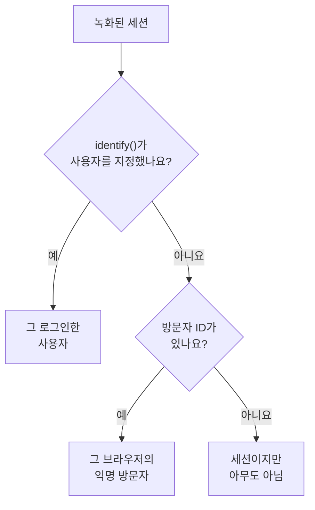

# 제품 분석

제품 분석은 RUM 애플리케이션을 사용하는 사람들과 그들의 세션이 어떻게 진행되는지를 셉니다. 활성, 신규, 재방문, 로그인, 휴면 사용자와 디바이스, 브라우저, 국가, 페이지별 세션입니다. [세션 리플레이](/docs/telemetry/session-replay)가 녹화하는 세션을 세므로 별도의 스니펫이 필요 없고, 숫자는 녹화가 만료된 뒤에도 13개월 동안 보관됩니다.

:::cards
- [사람을 세는 방법](#사람을-세는-방법): 로그인한 사용자는 한 번, 익명 브라우저도 한 번.
- [사용자](#사용자): 활성, 신규, 재방문, 로그인, 전체, 휴면 사용자.
- [세션](#세션): 몇 개인지, 얼마나 긴지, 그리고 디바이스, 브라우저, 국가, 페이지별.
- [개인정보와 보관](#개인정보와-보관): 13개월, 이름은 저장하지 않음, 요청 시 삭제.
:::

## 사람을 세는 방법

애플리케이션의 사이드 메뉴에는 **제품 분석** 섹션이 있고, 그 안에 **사용자**와 **세션** 두 페이지가 있습니다. 두 페이지 모두 세션 리플레이가 녹화하는 세션을 세므로 애플리케이션의 레코더가 시작될 때 함께 시작되고, 리플레이 정책이 녹화하지 않은 세션은 세지 않습니다. 각 세션은 한 사람으로 세거나, 아무도 아닌 것으로 셉니다:

- **로그인한 사용자는 한 번만 셉니다.** 사용하는 브라우저와 디바이스가 몇 개든 같습니다. 페이지가 `identify()`에 넘긴 참조의 단방향 해시로 알아봅니다([사용자 식별하기](/docs/telemetry/session-replay#사용자-식별하기) 참고).
- **익명 브라우저는 한 번만 셉니다.** [익명 방문자 ID](/docs/telemetry/session-replay#익명-방문자)로 알아봅니다. 브라우저가 둘이면 방문자도 둘이고, 누군가 그 브라우저에서 로그인하기 전의 세션은 그 방문자의 것으로 남습니다.
- **이전 레코더의 세션**은 방문자 ID를 보내지 않았으므로 세션으로는 세지만 사람으로는 세지 않습니다.

날짜는 사용자 자신의 시간대로 셉니다.

## 사용자

**사용자**는 선택한 기간의 사람들을 셉니다:

| 타일 | 세는 대상 |
| --- | --- |
| **활성 사용자** | 기간 중에 온 모든 사람. 로그인한 사용자는 각각 한 번, 익명 브라우저도 각각 한 번입니다. |
| **신규 사용자** | 첫 방문이 기간 안에 있었던 활성 사용자. |
| **재방문 사용자** | 기간이 시작되기 전에도 왔던 활성 사용자. |
| **로그인한 사용자** | 앱이 `identify()`로 로그인시킨 활성 사용자와, 전체 활성 사용자 중 그 비율. |
| **전체 사용자** | 애플리케이션이 최근 13개월 동안 본 모든 사람. |
| **휴면 사용자** | 이전에 왔지만 최근 30일, 또는 선택한 7, 14, 60, 90일 동안 오지 않은 사람. |

처음 세 타일은 이전 기간 대비 변화도 보여 줍니다. 타일 아래에서 **활성 사용자**는 날마다 그날 온 사람, 그날까지 7일 동안 온 사람, 그날까지 30일 동안 온 사람을 그리고, **신규 및 재방문 사용자**는 날마다의 사람을 둘로 나눕니다.

**사람**은 타일이 세는 모든 사람을 한 사람당 한 행씩 최근에 본 순서로 나열하며, 필터로 한 타일의 사람, 익명 방문자 또는 모두를 볼 수 있습니다. 사람을 열면 첫 방문과 마지막 방문, 그리고 최근 13개월 동안의 모든 세션이 표시되며, 녹화가 아직 보관된 세션에는 **보기**가 있습니다.

## 세션

**세션**은 기간 안에 시작된 세션을 셉니다: **세션**, **로그인 세션**, **세션 길이 중앙값**, **세션당 페이지 수**, **오류가 있는 세션**, **불만이 있었던 세션**. 타일 아래에는 다음이 있습니다:

- **디바이스별 세션**은 날마다의 세션을 데스크톱, 휴대폰, 태블릿별로 그립니다. 짧은 변이 600포인트 이상인 화면에서의 모바일 앱 세션은 태블릿의 세션으로 셉니다.
- **세션 길이**는 끝난 세션을 지속된 시간별로 나눕니다. 10초 미만부터 30분 초과까지입니다. 아직 녹화 중인 세션에는 아직 길이가 없습니다.
- **세부 내역**은 사용자와 세션을 디바이스 유형, 브라우저, 운영 체제, 국가, 앱 버전, 진입 페이지 또는 페이지별로, 사용자가 많은 순서로 나열합니다.

## 개인정보와 보관

- **13개월.** 한 달의 숫자는 그 뒤 13번째 달의 첫날에 삭제되므로 최근 12개월 전체는 항상 남아 있습니다. 녹화 자체의 보관 기간(기본값 7일)과는 상관없습니다.
- **이름은 저장하지 않습니다.** 숫자는 로그인한 사용자의 단방향 키와 브라우저의 방문자 ID만 보관하며, 참조, 특성, IP 주소는 절대 보관하지 않습니다. 행은 그 사람의 녹화가 아직 보관되는 동안에만, 그리고 신원을 읽을 수 있는 역할에게만 로그인한 사용자의 이름을 보여 줍니다. 그 밖에는 **로그인한 사용자** 또는 **익명 방문자**와 ID의 앞부분이 표시됩니다.
- **요청 시 삭제.** 삭제 요청은 여기서도 일치하는 숫자를 제거합니다([세션 삭제하기](/docs/telemetry/session-replay#세션-삭제하기) 참고).

## 볼 수 있는 사람

두 페이지를 읽으려면 세션 목록을 읽을 때와 같은 권한이 필요합니다: `ReadRumSessionReplay` (_List Session Replays_) 또는 `ReadRumSessionReplayPayload` (_Watch Session Replays_)이며, 프로젝트 소유자와 관리자가 가지고 있습니다. 로그인한 사용자가 누구인지 보고 이름으로 사람을 검색하려면 [녹화를 시청할 수 있는 사람](/docs/telemetry/session-replay#녹화를-시청할-수-있는-사람)에 설명된 신원 권한이 필요합니다.

## 다음 단계

:::cards
- [세션 리플레이](/docs/telemetry/session-replay): 이 페이지들이 세는 세션을 녹화하고 시청합니다.
- [애플리케이션 관리](/docs/rum/applications): 이름, 레이블, 소유자, 보관.
- [RUM 개요](/docs/rum/index): RUM 애플리케이션이 그 밖에 보여 주는 것.
:::
