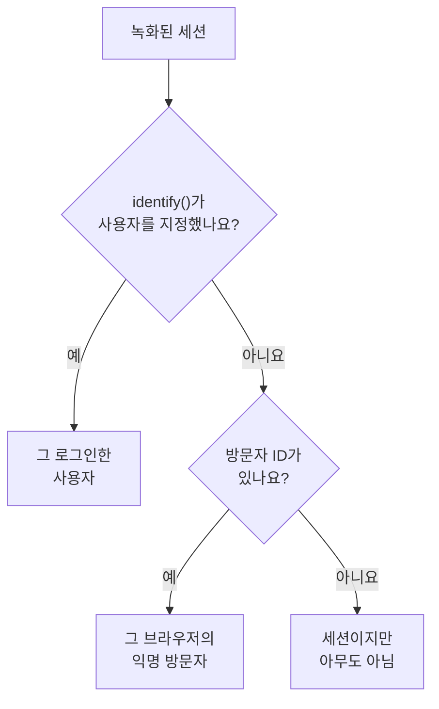

# 제품 분석

제품 분석은 RUM 애플리케이션을 사용하는 사람들과 그들의 세션이 어떻게 진행되는지, 그리고 그들이 무엇을 하는지를 셉니다. 활성, 신규, 재방문, 로그인, 휴면 사용자, 디바이스, 브라우저, 국가, 페이지별 세션, 그리고 앱이 보내는 이벤트를 추세, 퍼널, 리텐션으로 보여 줍니다. [세션 리플레이](/docs/telemetry/session-replay)가 녹화하는 세션과 그 레코더가 보내는 이벤트를 세므로 별도의 스니펫이 필요 없고, 숫자는 녹화가 만료된 뒤에도 13개월 동안 보관됩니다.

:::cards
- [사용자](#사용자): 활성, 신규, 재방문, 로그인, 전체, 휴면 사용자.
- [세션](#세션): 몇 개인지, 얼마나 긴지, 그리고 디바이스, 브라우저, 국가, 페이지별.
- [이벤트와 메트릭 보내기](#이벤트와-메트릭-보내기): 사람들이 하는 일과 페이지가 측정하는 숫자.
- [이벤트](#이벤트): 어떤 일이 얼마나 자주, 누구에 의해, 어디에서 일어났는지.
- [퍼널](#퍼널): 누가 단계별로 계속 진행했고 얼마나 걸렸는지.
- [사용자 리텐션](#사용자-리텐션): 코호트별로 누가 돌아왔는지.
:::

## 사람을 세는 방법

애플리케이션의 사이드 메뉴에는 **제품 분석** 섹션이 있고, 그 안에 **사용자**, **세션**, **이벤트**, **퍼널**, **사용자 리텐션**, **사용자 흐름**, **분석 설정** 페이지가 있습니다. **사용자**와 **세션**은 세션 리플레이가 녹화하는 세션을 세므로 애플리케이션의 레코더가 시작될 때 함께 시작되고, 리플레이 정책이 녹화하지 않은 세션은 세지 않습니다. 각 세션은 한 사람으로 세거나, 아무도 아닌 것으로 셉니다:



- **로그인한 사용자는 한 번만 셉니다.** 사용하는 브라우저와 디바이스가 몇 개든 같습니다. 페이지가 `identify()`에 넘긴 참조의 단방향 해시로 알아봅니다([사용자 식별하기](/docs/telemetry/session-replay#사용자-식별하기) 참고).
- **익명 브라우저는 한 번만 셉니다.** [익명 방문자 ID](/docs/telemetry/session-replay#익명-방문자)로 알아봅니다. 브라우저가 둘이면 방문자도 둘이고, 누군가 그 브라우저에서 로그인하기 전의 세션은 그 방문자의 것으로 남습니다.
- **이전 레코더의 세션**은 방문자 ID를 보내지 않았으므로 세션으로는 세지만 사람으로는 세지 않습니다.

**이벤트**, **퍼널**, **사용자 리텐션**도 같은 방식으로 사람을 세며, 녹화 여부와 관계없이 레코더가 모든 세션에서 보내는 이벤트를 기준으로 합니다([이벤트와 메트릭 보내기](#이벤트와-메트릭-보내기) 참고).

날짜는 사용자 자신의 시간대로 셉니다.

## 사용자

**사용자**는 선택한 기간의 사람들을 셉니다:

| 타일 | 세는 대상 |
| --- | --- |
| **활성 사용자** | 기간 중에 온 모든 사람. 로그인한 사용자는 각각 한 번, 익명 브라우저도 각각 한 번입니다. |
| **신규 사용자** | 첫 방문이 기간 안에 있었던 활성 사용자. |
| **재방문 사용자** | 기간이 시작되기 전에도 왔던 활성 사용자. |
| **로그인한 사용자** | 앱이 `identify()`로 로그인시킨 활성 사용자와, 전체 활성 사용자 중 그 비율. |
| **전체 사용자** | 애플리케이션이 최근 13개월 동안 본 모든 사람. |
| **휴면 사용자** | 이전에 왔지만 최근 30일, 또는 선택한 7, 14, 60, 90일 동안 오지 않은 사람. |

처음 세 타일은 이전 기간 대비 변화도 보여 줍니다. 타일 아래에서 **활성 사용자**는 날마다 그날 온 사람, 그날까지 7일 동안 온 사람, 그날까지 30일 동안 온 사람을 그리고, **신규 및 재방문 사용자**는 날마다의 사람을 둘로 나눕니다.

**사람**은 타일이 세는 모든 사람을 한 사람당 한 행씩 최근에 본 순서로 나열하며, 필터로 한 타일의 사람, 익명 방문자 또는 모두를 볼 수 있습니다. 사람을 열면 첫 방문과 마지막 방문, 그리고 최근 13개월 동안의 모든 세션이 표시되며, 녹화가 아직 보관된 세션에는 **보기**가 있습니다.

## 세션

**세션**은 기간 안에 시작된 세션을 셉니다: **세션**, **로그인 세션**, **세션 길이 중앙값**, **세션당 페이지 수**, **오류가 있는 세션**, **불만이 있었던 세션**. 타일 아래에는 다음이 있습니다:

- **디바이스별 세션**은 날마다의 세션을 데스크톱, 휴대폰, 태블릿별로 그립니다. 짧은 변이 600포인트 이상인 화면에서의 모바일 앱 세션은 태블릿의 세션으로 셉니다.
- **세션 길이**는 끝난 세션을 지속된 시간별로 나눕니다. 10초 미만부터 30분 초과까지입니다. 아직 녹화 중인 세션에는 아직 길이가 없습니다.
- **세부 내역**은 사용자와 세션을 디바이스 유형, 브라우저, 운영 체제, 국가, 앱 버전, 진입 페이지 또는 페이지별로, 사용자가 많은 순서로 나열합니다.

## 이벤트와 메트릭 보내기

이벤트는 애플리케이션의 **분석 설정** 페이지에서 **제품 분석 이벤트 보내기**가 켜져 있는 동안 전송됩니다. 새 애플리케이션에서는 처음부터 켜져 있고, 이 설정이 생기기 전에 만든 애플리케이션에서는 꺼져 있으므로 그곳에서 켜세요. 이벤트는 세션 리플레이의 레코더가 보내므로 애플리케이션의 세션 리플레이도 켜져 있어야 합니다. React Native 레코더는 아직 이벤트를 보내지 않습니다.

브라우저 레코더가 실행되는 모든 세션은 시작과 조회한 각 페이지를 자동으로 보냅니다. 단일 페이지 앱의 경로 변경도 포함되며, 리플레이 샘플과 정책이 그 세션을 녹화하는지와는 관계없습니다. 자체 이벤트와 숫자는 페이지 코드에서 보냅니다:

```js
OneUptimeReplay.track("Signed up", { plan: "pro" });
OneUptimeReplay.metric("cart.value", 42.5, { currency: "EUR" });
```

| 호출 | 보내는 것 |
| --- | --- |
| `track(name, properties?)` | **이벤트**, **퍼널**, **사용자 리텐션**이 세는 이벤트이며, 세션이 녹화되면 리플레이 타임라인의 마커도 됩니다. `name` ≤ 64자, 문자열, 숫자, 불리언 값의 속성 ≤ 20개, 키 ≤ 40자, 값 ≤ 200자. |
| `metric(name, value, attributes?)` | 페이지가 측정한 숫자를 애플리케이션 메트릭의 포인트로 보냅니다([대시보드와 알림](#대시보드와-알림) 참고). `name`은 문자, 숫자, `_`, `.`, `-`, `/`로 된 100자 이하이며, 문자로 시작하고 `oneuptime.`로 시작하지 않습니다. `value`는 유한한 숫자, `attributes`는 `track()` 속성과 같습니다. |

레코더가 로드되기 전에는 같은 호출을 `["track", name, properties]`와 `["metric", name, value, attributes]` 형태로 `window.OneUptimeReplayQueue`에 넣으세요([JavaScript API](/docs/telemetry/session-replay#javascript-api) 참고).

- **녹화 여부와 관계없이 모든 세션.** 리플레이 샘플과 업로드 정책은 어떤 세션을 녹화할지를 정할 뿐, 어떤 세션을 셀지는 정하지 않습니다. Do Not Track이나 Global Privacy Control에서는 아무것도 보내지 않으며, 애플리케이션이 허용하지 않는 출처에서 온 것은 아무것도 보관하지 않습니다. 정책이 동의를 요구하면 이벤트는 최대 500개까지 `grantConsent()`를 기다리고, `revokeConsent()`는 이를 버립니다.
- **녹화와 같이 마스킹됩니다.** _Mask all text_ 모드에서는 이벤트 속성과 메트릭 속성의 값이 페이지를 떠나기 전에 마스킹됩니다. 페이지는 쿼리와 프래그먼트를 뺀 경로로 보냅니다.
- **작은 배치로**, 5초마다, 그리고 탭이 숨겨질 때 보냅니다. 발생한 지 3일이 지나 OneUptime에 도착한 이벤트는 버려지며, 한 프로젝트는 모든 애플리케이션을 합쳐 분당 60,000개의 이벤트와 메트릭 포인트를 보낼 수 있습니다. 그보다 많으면 레코더가 기다렸다가 다시 보냅니다.

`metric()`은 이벤트가 꺼져 있는 동안 아무것도 보내지 않으며, `getDiagnostics().productAnalytics`가 이벤트가 켜져 있는지 알려 줍니다([`getDiagnostics()`](/docs/telemetry/session-replay#getdiagnostics) 참고).

### 사용자 속성

이벤트를 수행한 사람별로 나누고 세그먼트로 구분하려면 **분석 설정**의 **분석용 사용자 속성**에 `identify()` 특성 키를 `["plan", "role"]`처럼 최대 20개까지 나열하세요. 키는 쓰인 그대로 비교합니다. 그러면 각 이벤트는 페이지가 `identify()`에 넘긴 그대로 로그인한 사용자의 그 특성을 함께 지닙니다. 다른 특성은 페이지를 떠나지 않으며, **최종 사용자 신원 캡처**가 꺼져 있는 동안에는 어떤 특성도 떠나지 않습니다. 이메일 주소처럼 개인 데이터가 담긴 특성은 나열하지 마세요.

## 이벤트

**이벤트**는 한 번에 하나의 이벤트를 보여 줍니다. 다른 이벤트를 고르기 전까지는 앱에서 가장 많이 일어난 이벤트를, 앱이 아직 이벤트를 보내지 않는 동안에는 가장 많이 조회된 페이지를 보여 줍니다. 선택 목록에는 **세션 시작됨**과 조회된 각 페이지도 있으며, 아래의 **모든 이벤트**는 기간 안의 모든 이벤트를 발생 횟수와 수행한 사람 수와 함께 나열합니다. 하나를 고르면 위에 표시됩니다.

- 타일은 이벤트의 **이벤트**(한 사람당 평균 횟수 포함), **사용자**, **세션**을 셉니다.
- **이벤트 및 사용자**는 날마다 이벤트가 일어난 횟수와 그날 이벤트를 수행한 사람 수를 그립니다.
- **세부 내역**은 이벤트를 디바이스 유형, 브라우저, 운영 체제, 국가, 앱 버전, 페이지, 이벤트 속성 또는 사용자 속성별로, 각 값의 이벤트 수, 사용자 수, 비율과 함께 나열합니다. 값을 고르면 그 값만 표시됩니다.

**세그먼트**는 필드가 고른 값을 가진 이벤트로 페이지를 좁힙니다. **필터 추가**를 누른 뒤 필드와 값을 고르며, 값은 정확히 일치해야 합니다. 세그먼트에는 필터가 최대 5개까지 있으며, 이벤트는 모든 필터와 일치해야 합니다. 페이지 주소에 이벤트, 기간, 세그먼트, 세부 내역이 유지되므로 링크를 열면 같은 화면이 열립니다.

## 퍼널

**퍼널**은 2개에서 6개까지의 단계를 순서대로 밟는 사람들을 따라가며, 각 단계는 **이벤트**가 나열하는 이벤트입니다. 기간 안에 첫 단계를 수행한 사람 중 그 뒤에 두 번째, 이어서 세 번째 단계를 수행한 사람이 몇 명인지를, 모두 첫 단계부터 고른 시간 안에서 셉니다: **1시간 이내**, **1일 이내**, **7일 이내**, **14일 이내** 또는 **30일 이내**. **단계 추가**는 단계를 하나 추가합니다.

**전환**에는 모든 단계를 수행한 사람의 비율과, 단계마다 그 단계에 도달한 사람 수, 그것이 첫 단계 사람 중 차지하는 비율, 이전 단계 이후 이탈한 사람 수, 이전 단계에서 걸린 시간의 중앙값이 표시됩니다. 여러 번 시도한 사람은 가장 멀리 간 시도를 기준으로 한 번만 셉니다.

퍼널의 세그먼트와 리텐션 표의 세그먼트는 모든 이벤트가 지니는 필드와 사용자 속성을 사용하며, 이벤트 고유의 속성은 사용하지 않습니다. 단계마다 다른 이벤트이기 때문입니다.

## 사용자 리텐션

**사용자 리텐션**은 사람들이 한 이벤트(**처음 수행한 이벤트**)를 처음 수행한 날, 주 또는 월에 따라 기간 안에서 그룹으로 나누고, 각 그룹 중 다른 이벤트(**다시 와서 한 이벤트**)를 수행한 사람의 비율을 그 구간과 이후의 각 구간마다 보여 줍니다. 둘 다 다른 것을 고르기 전까지는 **세션 시작됨**입니다.

**코호트**는 구간을 정합니다: **일별**, **주별** 또는 **월별**. 기간에 표 하나가 보여 주는 것보다 많은 구간이 있으면(32일, 26주 또는 13개월), 페이지는 코호트를 더 길게 만들고 그렇다고 알려 줍니다.

각 행은 코호트와 그 인원이고, 각 셀은 그 구간에 돌아온 사람의 비율로, 많을수록 진하게 표시됩니다. 아직 시작되지 않은 구간은 비워 둡니다.

코호트 위의 **모든 코호트**는 코호트를 하나로 셉니다. 각 구간에서 돌아온 사람을 그 구간에 도달한 코호트의 인원으로 나누므로, 200명인 코호트는 50명인 코호트보다 네 배의 무게를 가집니다. 누군가 있는 코호트가 둘이 되면 표시됩니다.

## 저장된 퍼널과 리텐션 표

**퍼널** 페이지의 **저장된 퍼널**과 **사용자 리텐션**의 **저장된 리텐션 표**에는 팀이 애플리케이션에 저장한 것이 나열되어, 다시 열거나 대시보드에 표시할 수 있습니다. 저장된 퍼널은 단계, 완료까지의 시간, 세그먼트를 보관하고, 저장된 리텐션 표는 두 이벤트, 구간, 세그먼트를 보관합니다. 어느 쪽도 기간은 보관하지 않습니다. 페이지는 자신의 기간을 보관하고, 대시보드는 자신의 기간을 읽습니다.

- **+ 퍼널 저장** 또는 **+ 리텐션 표 저장**은 페이지에 보이는 것을 이름을 붙여 저장합니다. 한 애플리케이션은 각각 최대 100개까지 보관합니다.
- 하나를 고르면 열립니다. 페이지 주소가 그것을 가리키므로, 링크는 볼 수 있는 모든 사람에게 그것을 엽니다. 보이는 것을 바꾸면 이름에 그 사실이 표시되고, **업데이트**가 변경을 저장합니다.
- **편집**은 이름을 바꾸고, **삭제**는 모든 사람에게서 삭제합니다. **보기 지우기**는 열려 있는 것을 닫고, 페이지에 보이는 것은 그대로 둡니다.
- 삭제되었거나 볼 수 없는 것에 대한 링크는 그렇다고 알려 주고, 페이지는 그것 없이 열립니다.

## 대시보드와 알림

각 이벤트는 분 단위로 애플리케이션의 메트릭으로도 세어지며, `metric()` 호출 하나하나는 그 호출이 지정한 이름의 별도 메트릭의 포인트입니다. 애플리케이션의 **메트릭** 페이지에서 차트로 그리거나, 대시보드에 추가하거나, 메트릭 모니터로 알림을 받으세요. **모든 이벤트** 아래의 **메트릭 열기**가 그 페이지를 엽니다.

| 메트릭 | 세는 것 | 기준 |
| --- | --- | --- |
| `oneuptime.rum.product.events` | `track()` 이벤트, 분당 | `event.name` |
| `oneuptime.rum.product.sessions` | 시작된 세션, 분당 | `device.type` |
| `oneuptime.rum.product.page.views` | 조회된 페이지, 분당 | `device.type` |

이 세 메트릭은 과금되지 않으며, `metric()`은 `oneuptime.`로 시작하는 이름을 거부하므로 페이지가 보내는 어떤 것도 이들로 오인되지 않습니다. `metric()` 포인트는 애플리케이션의 다른 메트릭과 같이 보관되고 과금됩니다.

저장된 퍼널이나 리텐션 표는 대시보드에도 놓을 수 있습니다. 위젯 카탈로그의 **제품 분석** 그룹에 있는 **퍼널** 및 **사용자 리텐션** 위젯이 대시보드 시간 범위로 그것을 보여 주고, **퍼널에서 열기** 또는 **사용자 리텐션에서 열기**가 그 페이지에서 엽니다([대시보드 위젯](/docs/dashboards/widgets#제품-분석) 참고).

## 개인정보와 보관

- **13개월.** 한 달의 숫자는 그 뒤 13번째 달의 첫날에 삭제되므로 최근 12개월 전체는 항상 남아 있습니다. 녹화 자체의 보관 기간(기본값 7일)과는 상관없습니다. 이벤트도 같은 방식으로 보관됩니다.
- **이름은 저장하지 않습니다.** 숫자는 로그인한 사용자의 단방향 키와 브라우저의 방문자 ID만 보관하며, 참조와 IP 주소는 절대 보관하지 않으며, 특성 중에서는 나열한 사용자 속성만 보관합니다. 행은 그 사람의 녹화가 아직 보관되는 동안에만, 그리고 신원을 읽을 수 있는 역할에게만 로그인한 사용자의 이름을 보여 줍니다. 그 밖에는 **로그인한 사용자** 또는 **익명 방문자**와 ID의 앞부분이 표시됩니다.
- **요청 시 삭제.** 삭제 요청은 여기서도 일치하는 숫자와 이벤트를 제거합니다([세션 삭제하기](/docs/telemetry/session-replay#세션-삭제하기) 참고).

## 볼 수 있는 사람

이 페이지들을 읽으려면 세션 목록을 읽을 때와 같은 권한이 필요합니다: `ReadRumSessionReplay` (_List Session Replays_) 또는 `ReadRumSessionReplayPayload` (_Watch Session Replays_)이며, 프로젝트 소유자와 관리자가 가지고 있습니다. 로그인한 사용자가 누구인지 보고 이름으로 사람을 검색하려면 [녹화를 시청할 수 있는 사람](/docs/telemetry/session-replay#녹화를-시청할-수-있는-사람)에 설명된 신원 권한이 필요합니다.

저장된 퍼널과 리텐션 표를 저장하고, 이름을 바꾸고, 삭제하려면 이 페이지들을 읽을 때와 같은 권한이 필요하며, 대시보드 위젯은 그 권한이 있는 사람에게만 그것을 보여 줍니다.

이벤트를 켜거나 끄려면 `EditRumApplication` (_Edit RUM Application_) 또는 프로젝트 소유자, 관리자, 멤버 역할이 필요합니다. 사용자 속성을 나열하려면 `EditRumApplication` 또는 소유자나 관리자 역할이 필요합니다. 로그인한 사람에 대해 무엇을 보관할지 정하기 때문입니다.

## 다음 단계

:::cards
- [세션 리플레이](/docs/telemetry/session-replay): 이 페이지들이 세는 세션을 녹화하고 시청합니다.
- [애플리케이션 관리](/docs/rum/applications): 이름, 레이블, 소유자, 보관.
- [RUM 개요](/docs/rum/index): RUM 애플리케이션이 그 밖에 보여 주는 것.
:::
