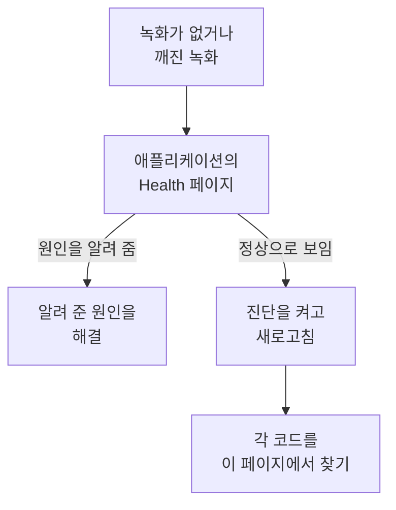

# 세션 리플레이 문제 해결

녹화가 도착하지 않거나 깨진 채로 도착할 때, 이 페이지에서 원인을 찾습니다. 세션 리플레이는 기본적으로 모든 세션을 녹화하고 진행하면서 업로드하므로, 정상적인 페이지는 사용자가 무언가를 하는 동안 약 15초마다 청크를 보냅니다. 유휴 상태의 탭은 이벤트를 만들지 않아 아무것도 보내지 않으며, 입력 없이 5분이 지나면 레코더가 완전히 일시 중지(`recording-paused-idle`)되므로, Network 탭으로 설치 상태를 판단하기 전에 마우스를 움직이거나 클릭하세요. 그래도 OneUptime으로 가는 요청이 전혀 보이지 않는다면, 아래 중 하나가 원인입니다.

:::cards
- [진단 켜기](#진단-켜기): 레코더가 콘솔에서 모든 결정을 설명하게 합니다.
- [코드](#코드): 레코더가 출력하는 모든 줄과 그 대처 방법.
- [OneUptime 앞의 방화벽이 청크를 거부함](#oneuptime-앞의-방화벽이-청크를-거부함): 확인할 규칙과 추가할 예외.
- [리플레이에 이미지, 아이콘, 스타일이 없음](#리플레이에-이미지-아이콘-스타일이-없음): 재생은 되지만 사용자가 본 모습과 다른 녹화.
:::



조용한 것이 정상인 유일한 설정은 _On error or frustration_(`OnErrorOrFrustration`) 업로드입니다. 이때 레코더는 메모리에 순환 버퍼를 유지하다가 무언가 잘못될 때만 업로드하므로, 트리거가 발생하기 전까지는 깨진 설치와 똑같아 보입니다. 다른 원인을 찾기 전에 어느 설정인지 확인하세요. 아래에서 설명하는 `config-accepted` 줄이 이를 출력합니다.

가능하면 서버 측부터 시작하세요. 애플리케이션 사이드 메뉴의 **세션 리플레이** 섹션에 있는 **상태** 페이지는 아무것도 도착하지 않을 때 원인을 알려 줍니다. 레코더가 한 번도 로드되지 않았거나, 로드되었지만 아무것도 업로드하지 않았거나(그리고 그 이유), 업로드가 거부되고 있거나(그리고 그 이유), 예산을 다 썼다는 것입니다. [녹화 상태](/docs/telemetry/session-replay#녹화-상태)를 참고하세요. 다음 내용은 브라우저 측입니다. 진단을 켜고, 한 번 새로고침한 뒤, 콘솔을 읽으세요.

녹화는 도착하지만 깨진 이미지, 빠진 아이콘, 스타일이 없는 영역과 함께 재생되나요? 이는 재생 문제이며, [리플레이에 이미지, 아이콘, 스타일이 없음](#리플레이에-이미지-아이콘-스타일이-없음)에서 답합니다.

## 진단 켜기

닿을 수 있는 스위치를 고르세요. 모두 같은 일을 합니다.

:::tabs
@tab 브라우저에서
문제가 생기는 브라우저에서 합니다. 다시 배포할 필요가 없고, 프로덕션에서도 작동하며, 새로고침 후에도 유지됩니다.

```js
localStorage.setItem("oneuptime.sessionReplay.debug", "true");
// then reload the page
```

다시 끄려면 다음을 사용합니다.

```js
localStorage.removeItem("oneuptime.sessionReplay.debug");
```
@tab 링크로
기술에 익숙하지 않은 사람이거나 콘솔을 열 수 없는 페이지라면, URL에 `oneuptime_debug=1`을 추가하세요. 프래그먼트에서도 작동하므로, 모르는 쿼리 매개변수를 제거하는 서버를 거쳐도 남습니다.

```text
https://your-app.example.com/checkout?oneuptime_debug=1
https://your-app.example.com/checkout#oneuptime_debug=1
```
@tab 스크립트 태그에서
모든 사람에게 켜 두고 싶은 스테이징 환경에 사용합니다.

```html
<script
  src="https://oneuptime.com/telemetry/session-replay/v1/recorder.js"
  data-oneuptime-token="YOUR_TELEMETRY_INGESTION_KEY"
  data-oneuptime-app-identifier="YOUR_RUM_APP_IDENTIFIER"
  data-oneuptime-debug="true"
  crossorigin="anonymous"
  async
></script>
```
@tab init 전역 객체에서
init 전역 객체로 레코더를 구성한다면 다음과 같이 합니다.

```js
window.__ONEUPTIME_SESSION_REPLAY__ = {
  host: "https://oneuptime.com",
  token: "YOUR_TELEMETRY_INGESTION_KEY",
  appIdentifier: "YOUR_RUM_APP_IDENTIFIER",
  debug: true,
};
```
@tab 배포에서
OneUptime 배포에서 하며, 문제가 생기는 브라우저 앞에 아무도 없어도 되는 유일한 스위치입니다. `SESSION_REPLAY_DEBUG=true`를 설정하고 다시 시작하세요. 그러면 이 인스턴스가 제공하는 모든 레코더가 실행되는 모든 페이지에서 로그를 남기므로, 켜고, 새로고침 한 번 분량을 수집한 뒤, 끄세요. 정책은 바뀌지 않습니다. 샘플링도, 마스킹도, 동의도 그대로입니다. 다른 배포 설정은 [자체 호스팅 참고 사항](/docs/telemetry/session-replay#자체-호스팅-참고-사항)을 참고하세요.
@tab 실행 중에
레코더가 로드된 뒤에 합니다.

```js
OneUptimeReplay.setDebug(true);
```
:::

출력은 다음과 같습니다.

```text
[OneUptime Session Replay] loader-start: Loader running.
[OneUptime Session Replay] init-options-read: Init options read. {host: "https://oneuptime.com", appIdentifier: "checkout-web", …}
[OneUptime Session Replay] config-fetch-start: Requesting the policy. {url: "https://oneuptime.com/telemetry/session-replay/v1/config", …}
[OneUptime Session Replay] config-accepted: Policy accepted. {captureTrigger: "Always", samplePercentage: 100, …}
[OneUptime Session Replay] recording: Recording and uploading …
```

## 아무것도 켜지 않고 타임라인 얻기

레코더는 진단이 켜져 있든 아니든 최근 250개의 결정을 보관합니다. 문제가 이미 일어났다면 로그를 켜고 재현할 필요가 없습니다. 대신 다음을 요청하세요.

```js
copy(JSON.stringify(OneUptimeReplay.getDiagnostics(), null, 2));
```

이 호출은 레코더 버전, 세션 ID, `state`(`recording`, `uploading`, `not-sampled`, `stopped`…), 멈춘 경우 그 이유, `bootstrapDecision`, `decisions` 아래 각 관문의 답(샘플링 여부, 동의 상태, 업로드 허용 여부와 이를 막는 것, 서버의 마지막 지시), 레코더의 `capabilities`, 그리고 전체 기록 목록을 반환합니다. 기록에는 레코더 아티팩트가 존재하기 전에 실행되며 대부분의 물러남이 결정되는 로더 스텁의 기록도 포함됩니다. 구조상 페이지 내용은 담지 않습니다. [진단에 절대 들어가지 않는 것](#진단에-절대-들어가지-않는-것)을 참고하세요. 필드는 [`getDiagnostics()`](/docs/telemetry/session-replay#getdiagnostics)에서 설명합니다.

**`OneUptimeReplay is not defined`가 나온다면** 레코더 아티팩트가 로드되지 않은 것입니다. 이는 그 자체로 아래 코드 중 상당수에 대한 답이며, 타임라인이 가장 필요한 바로 그때입니다. 기록은 여전히 남아 있으며, 아티팩트가 존재하기 전에 로더 스텁이 기록하는 전역 객체에 있습니다.

```js
copy(JSON.stringify(window.__ONEUPTIME_SESSION_REPLAY_DEBUG__.records, null, 2));
```

둘 중 하나를 지원 티켓에 붙여 넣으세요. 또는 애플리케이션의 **상태** 페이지에 있는 **Ask the browser**에 붙여 넣으면 그 안의 각 코드를 설명해 줍니다. 보통은 그것만으로 충분합니다.

## 조용한 것이 정상일 때: 오류 기반 정책

이 섹션은 `config-accepted`가 `captureTrigger: "OnErrorOrFrustration"`을 출력한 경우에만 해당합니다. 기본 정책인 `Always`에서는 레코더가 녹화하면서 보내므로, 사용자가 상호 작용하는 페이지가 조용하다면 정말로 무언가 잘못된 것입니다. 이 섹션 다음부터 계속 읽으세요.

콘솔에 다음과 같이 표시된다면

```text
[OneUptime Session Replay] recording: Recording into memory. Nothing uploads until a trigger fires - call OneUptimeReplay.captureSession() to force one.
```

…레코더는 작동하고 있습니다. 오류 기반 정책에서 정상적인 페이지는 페이지 로드마다 OneUptime에 정확히 한 번의 요청(구성 가져오기)을 보내고, 오류, 5xx, 좌절 신호, 성능 예산 초과가 일어날 때까지 아무것도 보내지 않습니다.

전체 경로를 처음부터 끝까지 확인하려면 업로드를 강제하세요.

```js
OneUptimeReplay.captureSession("installation test");
```

곧바로 Network 탭에 `POST /telemetry/session-replay/v1/chunk`가, 콘솔에 `chunk-accepted` 줄이 보여야 합니다. 보인다면 설치가 올바른 것이며, 약 1분 안에 리플레이가 대시보드에 나타나고 지정한 이유가 타임라인에 표시됩니다.

찾아야 할 것은 `chunk-accepted`와 함께 오는 `202`입니다. `204`는 대신 `chunk-not-recorded`를 로그에 남깁니다. 요청은 정상이었고 서버가 저장하지 않기로 한 것입니다. 예산 초과, 샘플링 제외, 또는 애플리케이션이 꺼진 경우입니다. 이는 정책의 답이지 설치 오류가 아니며, 옆의 `server-directive` 줄이 어느 쪽인지 알려 줍니다.

모든 세션을 다시 녹화하려면 애플리케이션의 **Replay Policy** 페이지에서 **녹화 업로드 시점**을 _Always_ 값으로, **샘플 비율**을 0보다 크게 설정하세요. 이것이 출고 시 기본값입니다.

## 코드

모든 줄에는 안정적인 `code`가 있습니다. 여기서 찾아보세요.

### 시작

| 코드 | 의미 |
| --- | --- |
| `loader-start` | 레코더 스크립트가 실행되었습니다. 진단이 켜져 있는데 이 줄이 보이지 않는다면 스크립트 자체가 실행되지 않은 것입니다. Network 탭의 `<script>` 요청과 CSP의 `script-src`를 확인하세요. |
| `init-options-read` | 옵션을 찾았습니다. 세부 정보에서 `host`와 `appIdentifier`를 확인하세요. `appIdentifier`는 RUM 애플리케이션과 정확히 일치해야 하고, `host`는 자신의 앱 출처가 아니라 OneUptime 출처여야 합니다. |
| `init-options-incomplete` | 필수 옵션이 빠졌습니다. 세부 정보가 `hasHost` / `hasToken` / `hasAppIdentifier` 중 어느 것이 false인지 알려 줍니다. `hasHost`가 false라면 스크립트 태그에 호스트를 알아낼 `src`가 없는 것이므로 `data-oneuptime-host`를 추가하세요. |
| `privacy-signal` | 브라우저가 Do Not Track 또는 Global Privacy Control을 보내고 있으며, 페이지(스크립트 태그에 다른 지정이 없음) 또는 서버 정책이 이를 존중합니다. 아무것도 녹화되지 않으며, `stage: "before-config-fetch"`일 때는 구성 요청도 보내지 않습니다. 오류가 아닙니다. 법적 근거가 정말로 이 신호에 좌우되지 않을 때만 `data-oneuptime-respect-do-not-track="false"`를 설정하세요. |
| `init-options-missing` | 페이지에 읽을 것이 없습니다. `script[data-oneuptime-token]` 태그도, `window.__ONEUPTIME_SESSION_REPLAY__`도 없습니다. 표시 속성의 철자가 틀렸거나, 스니펫이 다른 문서에 들어갔거나, 태그 관리자가 이를 제거했습니다. |
| `loader-threw` | 구성이 아니라 레코더 자체의 버그입니다. 진단 출력과 함께 보고하세요. |

### 정책

| 코드 | 의미 |
| --- | --- |
| `config-fetch-start` | 정책을 요청하려는 참입니다. 세부 정보의 `url`이 정확한 URL이니, 브라우저에서 응답하는지 확인하세요. |
| `config-fetch-rejected` | 엔드포인트가 2xx가 아닌 상태로 응답했습니다. 아래의 [구성 가져오기 상태](#구성-가져오기-상태)를 참고하세요. |
| `config-fetch-failed` | 요청이 끝나지 않았습니다. CSP의 `connect-src`, 광고 차단기, DNS, TLS, 연결 없음, 또는 5초 시간 초과입니다. 보통 브라우저도 이 옆에 자체 줄을 남깁니다. |
| `config-body-unparseable` | 엔드포인트가 2xx로 응답했지만 본문이 전혀 JSON이 아닙니다. `config-fetch-failed`와 달리 요청은 *끝났으므로*, 경로상의 무언가(프록시, 종속 포털, SSO 중간 페이지)가 OneUptime 대신 응답한 것입니다. |
| `config-unparseable` | 본문은 유효한 JSON*이었지만* 객체가 아닙니다. `null`, 문자열, 배열입니다. 내용을 고쳐 쓰는 프록시이거나, 다른 경로에서 응답하는 서버입니다. |
| `config-disabled` | 서버가 여기서는 리플레이가 꺼져 있다고 알립니다. 답은 세부 정보의 `disabledReason`입니다. 아래의 [disabledReason](#disabledreason)을 참고하세요. |
| `config-recorder-version-invalid` | 정책이 소문자 `latest`를 정확히 지정하지 않아 아티팩트 URL을 만들 수 없었습니다. 내용을 고쳐 쓰는 프록시이거나 변조된 응답입니다. 빌드가 없는 배포는 대신 `recorder-not-built`와 함께 `config-disabled`를 보고합니다. |
| `config-accepted` | 정책이 받아들여졌습니다. 세부 정보는 정책 전체입니다. `captureTrigger`, `samplePercentage`, `consentMode`, `maskingMode`. |
| `config-field-defaulted` | 서버가 정책 필드(세부 정보에 표시됨)의 값을 보내지 않아, 이 레코더가 제품 기본값을 사용했습니다. 참고용이며, 보통 서버가 레코더보다 오래된 경우입니다. 대시보드에 그 필드의 다른 값이 표시된다면 OneUptime을 업데이트하세요. |
| `config-value-unrecognised` | 서버가 이 레코더 빌드가 모르는 값을 보내서 가장 안전한 값으로 대체했으며, 이는 대시보드에 표시된 값과 다를 수 있습니다. 보통은 이전 배포의 레코더가 아직 실행 중인 페이지입니다. |
| `directive-stop` | 서버가 이 레코더에 물러나라고 지시했습니다. 예산, 속도 제한, 킬 스위치가 있는지 애플리케이션의 녹화 상태를 확인하세요. |

#### 구성 가져오기 상태

| 상태 | 조치 |
| --- | --- |
| `401` | 수집 토큰이 잘못되었거나, 취소되었거나, 만료되었거나, 다른 프로젝트의 것입니다. **프로젝트 설정 → 텔레메트리 및 APM → 수집 키**에서 하나 만들고 `GET /session-replay/v1/validate`로 확인하세요. 레코더처럼 키를 보내고 `x-oneuptime-app-identifier` 헤더를 추가하면, 응답에 해당 애플리케이션의 `isSessionReplayEnabled`, 켜져 있지 않을 때 꺼진 스위치를 알려 주는 `sessionReplayDisabledDetail`, `isIngestEnabledOnThisInstance`, `keyType`도 들어 있습니다. |
| `400` | `data-oneuptime-app-identifier`가 없습니다. |
| `403` | 페이지의 출처가 수집 키의 **허용된 출처**에 없습니다. 추가하거나, 허용 목록이 이 페이지를 포함하는 키를 사용하세요. |
| `404` | OneUptime 출처에서 경로를 찾을 수 없습니다. 거의 항상 `data-oneuptime-host`가 잘못되었거나, `/telemetry/*`를 전달하지 않는 OneUptime 앞의 리버스 프록시입니다. |
| `5xx` | 서버 측 오류입니다. OneUptime 앱의 로그를 확인하세요. |

#### disabledReason

| 값 | 할 일 |
| --- | --- |
| `not-enabled-for-application` | 이 RUM 애플리케이션에서 세션 리플레이가 꺼져 있거나, 식별자가 어느 것과도 일치하지 않거나, 프로젝트가 리플레이를 사용할 수 없습니다. `disabledDetail`이 어느 쪽인지 알려 줍니다. `application-not-enabled`(이 애플리케이션의 스위치), `project-not-allowed`(**실제 사용자 모니터링 → 설정 → 세션 리플레이**에 있는 프로젝트 전체 스위치), `application-unknown`(이 `appIdentifier`를 가진 애플리케이션이 없음. 애플리케이션의 **Replay Policy** 페이지에서 철자를 확인하세요), 또는 `project-killed`(이 배포에서 운영자의 킬 스위치)입니다. |
| `budget-exhausted` | 프로젝트의 일일 바이트 예산이나 애플리케이션의 월간 예산을 이미 다 써서, 거부될 청크를 업로드하는 대신 녹화하지 말라고 레코더에 지시합니다. `disabledDetail`은 `project-daily-budget-exhausted` 또는 `app-monthly-budget-exhausted`이며, `budgetResetsAt`이 언제 풀리는지 알려 줍니다. **Replay Policy** 페이지에서 예산을 올리거나 초기화를 기다리세요. |
| `recorder-not-built` | **배포에 레코더 아티팩트가 없습니다.** 고객 측에서는 아무것도 고칠 수 없습니다. `packages/App/FeatureSet/BrowserRecorder/public/dist/manifest.json`을 만드는 빌드가 실행되지 않았거나, 그 결과가 실행 중인 이미지에 들어가지 않았습니다. OneUptime 앱을 다시 빌드하고 다시 배포하세요. 리플레이가 한 번도 작동한 적 없는 자체 호스팅 설치에서 전형적인 답입니다. |
| `disabled-by-default` | 이 배포에서 `SESSION_REPLAY_ENABLED_BY_DEFAULT=false`입니다. `true`로 설정하세요. 자체 호스팅이라면 리플레이가 가장 무거운 테이블이므로 먼저 `SESSION_REPLAY_MAX_BYTES_PER_PROJECT_PER_DAY`를 설정하세요. |
| `ingest-disabled` | 이 배포에서 `SESSION_REPLAY_INGEST_ENABLED=false`입니다. |
| `policy-unavailable` | 서버가 정책을 결정할 수 없었습니다. 보통 Redis나 Postgres 때문입니다. 의도적으로 닫힌 쪽으로 실패합니다. OneUptime 앱의 로그를 확인하세요. |
| `not-reported` | 서버가 이 필드보다 오래되었습니다. 대신 대시보드의 **Replay Policy** 페이지에 있는 **Test your installation** 패널을 사용하세요. |

### 아티팩트

| 코드 | 의미 |
| --- | --- |
| `artifact-requested` | 최신 레코더 번들을 주입하고 있습니다. `url`이 정확한 주소입니다. |
| `artifact-load-failed` | 로드되지 않았습니다. 가능성이 높은 순서로, OneUptime 출처를 허용하지 않는 CSP의 `script-src`, SRI 불일치(번들을 고쳐 쓰는 프록시), 또는 이 배포가 레코더를 빌드하지 않아서 생긴 404입니다. |
| `artifact-url-invalid` | 정책이 소문자 `latest`를 정확히 지정하지 않아 URL을 만들지 않았습니다. 변조되었거나 프록시가 바꾼 구성 응답입니다. |
| `artifact-api-missing` | 번들은 로드되었지만 `window.OneUptimeReplay`를 공개하지 않았습니다. 페이지의 다른 스크립트가 덮어썼습니다. |
| `bootstrap` | 레코더 아티팩트가 시작되고 있습니다. |
| `bootstrap-already-started` | 같은 페이지에 스니펫이 두 개 있습니다. 하나를 제거하세요. |
| `bootstrap-already-running` | 레코더가 이미 실행 중일 때 `bootstrap()`이 다시 호출되었습니다. 무해하며, 보통 통합이 중복된 경우입니다. |
| `bootstrap-cancelled` | 레코더가 시작되기 전에 `window.OneUptimeReplayQueue` 대기열의 `revokeConsent()` 또는 `stop()`이 실행되어 이 세션은 녹화되지 않습니다. 배너가 이미 거부되었다면 올바른 동작입니다. |
| `start-stopped` | 독립 실행형 번들 경로에서 `start()`가 사용할 수 있는 정책을 얻지 못했습니다. 정확한 이유는 바로 위의 `config-*` 줄에 있습니다. |
| `rrweb-did-not-start` | DOM 레코더가 시작을 거부했습니다. 보고해 주세요. |
| `rrweb-error` | 이 페이지에서 DOM 레코더에 내부 오류가 발생했습니다(오류 이름은 세부 정보에 있으며, 로그는 한 번만 남습니다). 녹화가 그 지점에서 건너뛰거나 멈출 수 있으며, 이런 오류가 세 번 생기면 세션에 이를 알리는 충실도 알림이 붙습니다. 페이지의 프레임워크와 오류 이름을 함께 보고하세요. |

### 녹화와 업로드

| 코드 | 의미 |
| --- | --- |
| `not-sampled` | 이 세션은 샘플링 추첨에서 떨어져 전혀 녹화되지 않습니다. 샘플링은 세션 ID로 결정적으로 정해지므로, 새로고침해도 이 세션에는 도움이 되지 않습니다. 샘플링 비율을 높이세요. |
| `recording` | 녹화 중입니다. 세부 정보를 읽으세요. 기본 트리거 `Always`에서는 `uploading: true`가 정상 상태입니다. `captureTrigger: "OnErrorOrFrustration"`에서의 `uploading: false`는 요청이 없는 또 다른 정상 상태입니다. |
| `same-origin-propagation` | 레코더가 시작될 때 한 번 로그에 남습니다. 페이지 자체 출처로 가는 요청에 트레이스 컨텍스트(`traceparent`, 그리고 세션 ID를 담은 `tracestate`)를 추가하는지 여부입니다. `reason: "on"`과 함께 `enabled: true`가 기본값입니다. `reason: "policy-off"`는 애플리케이션의 **Replay Policy** 페이지에서 **동일 출처 트레이스 전파**가 꺼져 있다는 뜻이고, `reason: "opaque-origin"`은 페이지에 자체 출처가 없어(샌드박스된 iframe, `about:blank`, `srcdoc`, `file:`) 아무것도 같은 출처로 간주되지 않는다는 뜻입니다. 켜져 있어도 헤더는 세션이 업로드하는 동안 보낸 요청에만 붙으며, `/v1/traces`, `/v1/logs`, `/v1/metrics`로 끝나는 경로로 가는 `POST`(페이지 자체의 OpenTelemetry 내보내기)에는 절대 붙지 않습니다. 또한 에이전트가 요청을 트레이스하도록 구성되어 있어서 레코더가 페이지 로드 중 처음으로 같은 출처 요청의 `traceparent`를 그 에이전트에 양보할 때(Datadog RUM은 추적 중인 세션에서만) `reason: "agent-stand-down"`과 `agent` 필드(`DD_RUM`, `NREUM`, `elasticApm`)와 함께 한 번 더 로그에 남습니다. 요청은 여전히 `tracestate` 멤버를 받으며, 에이전트가 실제로 `traceparent`를 보낼 때만 연결됩니다. Datadog는 트레이스 샘플링 대상인 추적 중인 Datadog 세션에서만 이를 보냅니다. New Relic(`NREUM`)은 멤버 대신 자체 `tracestate`를 보내므로, 그 요청은 트레이스 ID로만 연결됩니다([Logs와 Traces 탭이 비어 있음](#플레이어의-logs와-traces-탭이-비어-있음) 참고). [나머지 텔레메트리와 연결하기](/docs/telemetry/session-replay#나머지-텔레메트리와-연결하기)를 참고하세요. |
| `same-origin-propagation-tripped` | 레코더가 트레이스 컨텍스트를 추가한 요청이 네트워크 수준에서 실패했습니다. 보통은 `traceparent`와 `tracestate`를 허용하지 않는 다른 출처로 리디렉션된 같은 출처 요청입니다. 레코더는 이번 페이지 로드의 나머지 동안 헤더 추가를 멈췄습니다. `retried: true`는 그것이 본문 없는 `fetch` `GET` 또는 `HEAD`였고 페이지가 보낸 그대로 한 번 더 보냈다는 뜻이며, `false`는 재시도할 수 없어 실패했다는 뜻입니다. 재시도되는 것은 본문 없는 `fetch` `GET` 또는 `HEAD`뿐입니다(XHR, 다른 메서드, 본문이 있는 요청은 제외). 페이지 자체의 중단과 시간 초과는 이를 일으키지 않으며, 브라우저가 오프라인이라고 보고하는 동안의 실패도 마찬가지입니다. 다음 페이지 로드에서 다시 시작합니다. [세션 리플레이를 켠 뒤 다운로드나 리디렉션이 실패함](#세션-리플레이를-켠-뒤-다운로드나-리디렉션이-실패함)을 참고하세요. |
| `trigger` | 보관할 가치가 있는 일이 일어났습니다. `reason`은 `error`, `frustration`, `performance`, `sampled`, `manual` 중 하나입니다. |
| `upload-started` | 버퍼의 사전 녹화분을 내보내고 있습니다. 청크 POST는 여기서 시작됩니다. |
| `upload-blocked-consent` | 트리거가 발생했지만 동의를 받지 못해 아무것도 업로드되지 않았습니다. 동의 모드 `RequireExplicit`에서는 배너가 수락될 때 페이지가 `OneUptimeReplay.grantConsent()`를 호출해야 합니다. |
| `chunk-discarded-consent` | 같은 원인이 한 층 아래에서 나타난 것입니다. 완성된 청크가 버려졌습니다. |
| `chunk-accepted` | 청크가 도착해 저장되었습니다. 설치가 작동하고 있습니다. |
| `chunk-not-recorded` | 서버가 요청을 받아들였지만 의도적으로 녹화하지 않기로 했습니다. 예산 초과, 샘플링 제외, 애플리케이션 비활성화, 또는 세션당 청크 한도입니다. 옆의 `server-directive` 줄이 이유를 알려 줍니다. 설치는 올바르며, 정책이나 예산이 예상과 다른 것입니다. |
| `chunk-post-failed` | 이 페이지가 업로드에 한 번도 성공하기 전에 POST가 서버에 도달하지 못했습니다. CSP의 `connect-src`, 광고 차단기, 수집 출처의 CORS, 또는 첫 업로드 전에 연결을 잃은 페이지입니다. 서킷 브레이커에 집계됩니다. |
| `chunk-held-offline` | 오프라인 모드입니다. 기기에 연결이 없습니다(브라우저가 오프라인이라고 보고하거나, 이전에 응답하던 서버에 요청이 도달하지 못함). 녹화는 계속되고 청크는 대기합니다. `queueDepth`는 대기 중인 수, `retryInMs`는 다음 시도까지의 시간입니다. 실패로 집계되지 않으며 아무것도 잃지 않습니다. |
| `back-online` | 연결 끊김 이후 첫 요청이 서버에 도달했습니다. 대기열의 청크를 오래된 것부터 업로드합니다. |
| `browser-offline` | 브라우저가 `offline` 이벤트를 보냈습니다. 녹화는 계속되며, 지금 닫히는 탭의 청크가 보존되도록 레코더가 오프라인 저장소를 엽니다. |
| `browser-online` | 브라우저가 `online` 이벤트를 보냈고, `queuedChunks`를 재시도 타이머를 기다리지 않고 지금 업로드합니다. |
| `offline-queue-full` | 연결 끊김이 업로드 대기열이 담을 수 있는 것(240개 청크 또는 4 MB)보다 길게 이어졌습니다. 최신 청크를 남기기 위해 가장 오래된 청크(`dropped`)를 버렸습니다. 세션에는 그 자리에 공백이 보입니다. |
| `offline-flush-stored` | 오프라인 상태에서 페이지가 숨겨지거나 닫혀, 마지막 청크가 전송되는 대신 브라우저의 IndexedDB에 기록되었습니다. `storeOpen: false`는 저장소가 아직 열리지 않아 닫히는 탭이 여전히 이를 잃을 수 있다는 뜻입니다. 앱의 다음 페이지가 업로드합니다. |
| `final-flush-deferred` | 마지막 요청이 모든 청크를 담지 못해, 나머지(`kept`)를 버리는 대신 다음 페이지를 위해 IndexedDB에 기록했습니다. |
| `offline-chunks-restored` | 이 페이지가 이전 페이지가 오프라인에서 녹화하고 보내지 못한 `chunks`를 찾아, 자신의 청크보다 먼저 업로드합니다. |
| `offline-chunk-claimed-elsewhere` | 이 탭이 저장한 청크를 같은 앱의 다른 탭이 이미 업로드해서, 이 탭은 건너뛰었습니다. 빠진 것은 없습니다. |
| `chunk-post-server-error` | 서버가 5xx로 응답했습니다. 레코더가 재시도합니다. 세부 정보의 `consecutiveFailures`를 `maxFlushFailures`와 비교하면 포기하기까지 얼마나 남았는지 알 수 있습니다. |
| `chunk-retry-scheduled` | 재시도할 수 있는 실패(네트워크, 5xx, 서버 제한)로 청크가 재시도 대기열에 들어갔습니다. 세부 정보의 `inMs`는 다음 시도 전의 대기 시간이고, `queueDepth`는 대기 중인 청크 수입니다. 아직 잃은 것은 없습니다. |
| `chunk-retry` | 대기가 끝나 대기열의 청크를 다시 보내고 있습니다. |
| `chunk-abandoned` | 청크가 너무 여러 번 실패해 버려졌고, 업로드는 다음 청크부터 계속됩니다. 세션에는 그 자리에 공백이 보입니다. 원인은 앞선 `chunk-post-*` 줄을 보세요. |
| `final-chunk-carried-queue` | 재시도 대기열에 아직 청크가 있는 상태에서 페이지가 숨겨지거나 닫혀, 그 청크들이 페이지가 숨겨질 때 보내는 단 하나의 요청에 추가 프레임으로 실렸습니다. `frames`는 요청이 실은 수, `bytes`는 전체 크기입니다. 잃은 것은 없으며, 들어가지 못한 것은 `final-flush-partial`이 보고합니다. |
| `final-flush-truncated` | 페이지가 사라질 때 버퍼에 keepalive 요청이 실을 수 있는 것보다 많은 데이터가 있어, 마지막 청크의 가장 오래된 이벤트를 버려 크기를 맞췄습니다. `droppedEvents`가 몇 개인지 알려 줍니다. 남는 것은 세션의 끝부분, 즉 보통 찾는 부분입니다. |
| `final-flush-partial` | 마지막 요청이 받은 청크를 모두 싣지 못했습니다. `sent` 프레임은 보냈고 `dropped` 프레임은 보내지 못했습니다. 봉인 청크가 먼저 선택되므로 잃는 것은 대기열의 오래된 청크이며, 세션에는 그 자리에 공백이 보입니다. |
| `chunk-too-large` | 압축 후에도 청크가 요청당 한도를 넘었습니다. 아주 큰 DOM의, 나눌 수 없는 전체 페이지 스냅샷입니다. 선언된 크기만 전송되고, 서버는 422로 응답하며, 세션은 실패하는 대신 그 스냅샷 자리에 충실도 알림을 가집니다. |
| `envelope-trimmed` | 청크의 헤더 JSON이 서버의 8 KB 봉투 한도를 넘어, 맞을 때까지 선택적 필드를 이 순서로 덜어 냈습니다. 트레이스 ID, 경로, 특성, 태그, 충실도 알림입니다(`shed`가 사라진 것을 나열). 녹화는 영향을 받지 않으며, 세션에서 일부 연관 데이터나 태그 데이터가 빠질 수 있습니다. 보통 한 세션에 최대 길이의 태그 20개와 특성 20개가 있을 때입니다. |
| `final-chunk-too-large` | 페이지가 사라질 때 보낸 청크가, 페이지가 숨겨질 때 비우면서 레코더가 스스로 허용하는 56 KB를 넘었습니다. 이는 의도적으로 브라우저의 keepalive 전체 할당량 64 KB보다 작습니다. `sealed: true`라면 마지막 청크였습니다. 그 이벤트는 버려져 녹화가 몇 초 일찍 끝나고, 대신 빈 마지막 청크를 보내 세션이 탭과 함께 끝나며 청크 순서에 공백이 생기지 않습니다. `sealed: false`라면 마지막 청크가 아니었습니다. 청크 전체가 버려지고, 아무것도 봉인되지 않으며, 세션은 청크가 있던 자리에 공백을 남긴 채 열린 상태로 남습니다. 어느 경우든 잃는 것은 그 청크의 이벤트이며, 같은 요청에 들어가지 못한 대기열의 청크는 `final-flush-partial`이 따로 보고합니다. |
| `upload-blocked-transport` | 이 페이지의 업로드가 이미 꺼진 뒤에 트리거가 발생했습니다. 이유는 위의 `transport-disabled` 줄이 알려 줍니다. |
| `chunk-rejected-terminal` | 업로드가 완전히 멈췄습니다. `status: 401`은 잘못된 토큰, `status: 403`은 애플리케이션이나 키의 허용 목록에 없는 출처, `status: 404`는 잘못된 호스트입니다. 고치고 새로고침하세요. 레코더가 스스로 재시도하지는 않습니다. 먼저 `answeredBy`를 읽으세요. `"not-oneuptime"`은 거부가 OneUptime에서 온 것이 아니라는 뜻입니다. 앞에 있는 웹 애플리케이션 방화벽, CDN, 프록시가 응답했거나, 호스트가 OneUptime이 아닙니다. [OneUptime 앞의 방화벽이 청크를 거부함](#oneuptime-앞의-방화벽이-청크를-거부함)을 참고하세요. |
| `chunk-refused` | 청크가 거부되었고(너무 크거나 읽을 수 없음), 녹화는 그것 없이 계속되었습니다. |
| `chunk-refused-terminal` | 서버가 이 레코더의 모든 청크를 거부할 것이므로 업로드가 멈췄습니다. 세부 정보의 `error`가 서버가 항상 같은 답을 주는 것이거나(`unsupported-wire-version`은 서버가 더 이상 받지 않는 레코더, `app-identifier-mismatch` 또는 `missing-app-identifier`는 정책을 가져온 애플리케이션과 다른 애플리케이션을 가리키는 청크, `malformed-body` / `malformed-envelope` / `missing-envelope`는 요청을 고쳐 쓰는 프록시), 최근 청크가 모두 잘못된 형식으로 거부된 경우입니다. 게시된 레코더가 서버와 맞도록 OneUptime을 업데이트하고, 계속되면 진단과 함께 보고하세요. |
| `chunk-throttled` | 속도 제한에 걸렸습니다. 업로드가 일시 중지되었다가 스스로 다시 시작됩니다. |
| `transport-disabled` | 실패가 반복되어 서킷 브레이커가 작동했습니다. `reason`이 어떤 실패인지 알려 줍니다. |
| `server-directive` | 서버가 세션 도중에 레코더가 할 일을 바꿨습니다. `reason`은 닫힌 어휘에서 옵니다. 아래의 [청크 POST 상태](#청크-post-상태)를 참고하세요. |
| `recorder-stopped-by-server` | 서버가 레코더에 멈추라고 지시했습니다. 보통 일일 바이트 예산 때문입니다. |
| `recorder-throttled-by-server` | 서버가 레코더에 속도를 줄이라고 요청했습니다. 업로드는 스스로 다시 시작되므로 할 일은 없습니다. |
| `recorder-stopped-transport` | 업로드가 영구적으로 실패해 녹화를 멈추고 버퍼를 비웠습니다. `reason`은 `transport-disabled`가 보고한 것과 같습니다. |
| `recorder-stopped` | 녹화가 끝났으며, 세션의 합계 `droppedEvents`, `droppedChunks`, `flushFailures`가 함께 표시됩니다. 정상적인 세션에서는 셋 다 0이어야 합니다. |
| `session-ended-idle` | 페이지에서 30분 동안 아무 일도 없어 세션이 끝났습니다. 레코더가 알아챈 시각이 아니라 마지막 활동 시각으로 끝납니다(`idleForMs`가 얼마나 지났는지 알려 줌). 사용자가 돌아올 때까지 아무것도 업로드되지 않으며, 자신의 출처로 가는 요청에 세션 ID가 붙지 않습니다. 아무도 없는 열린 탭이 반 시간마다 새 세션을 시작하지는 않습니다. |
| `recording-paused-idle` | 5분 동안 아무도 키를 누르거나, 클릭하거나, 마우스를 움직이거나, 스크롤하거나, 페이지를 터치하지 않아 녹화가 일시 중지되었습니다(`idleForMs`가 경과 시간을 알려 줌). 다음 입력이 같은 세션을 다시 시작할 때까지 아무것도 캡처하거나 업로드하지 않으며, 자신의 출처로 가는 요청에 세션 ID가 붙지 않습니다. [유휴 시간](/docs/telemetry/session-replay#유휴-시간)을 참고하세요. 방치된 탭에서는 모두 정상입니다. |
| `recording-resumed` | 녹화가 일시 중지된 동안 사용자가 돌아와, 새 스냅샷에서 같은 세션으로 다시 시작했습니다(`pausedForMs`가 일시 중지된 시간을 알려 줌). 플레이어는 그 사이 구간을 건너뜁니다. |
| `session-rotated` | 새 세션이 시작되었습니다(사용자가 30분 유휴 후 돌아왔거나, 세션이 4시간에 도달했거나, `identify()`가 세션의 사용자와 다른 사용자를 지정했거나 — `rotationReason: "identity-change"` — 같은 방문자의 다른 탭이 먼저 새 세션을 시작한 경우 — `rotationReason: "adopted"`). 녹화는 새 ID로 계속되고, `onSessionChange` 리스너에 알림이 가며, 그 이후 자신의 출처로 가는 요청에는 새 ID가 붙습니다. |
| `command-queue-not-an-array` | `window.OneUptimeReplayQueue`가 배열이 아니어서 대기열의 모든 명령이 무시되었습니다. `[command, ...arguments]` 항목의 배열이어야 합니다. |
| `command-queue-unknown-command` | 대기열의 명령 이름을 인식하지 못했습니다. [JavaScript API](/docs/telemetry/session-replay#javascript-api)와 철자를 대조해 보세요. |
| `command-queue-command-failed` | 대기열의 명령이 적용되는 중에 오류를 던졌습니다. `command`와 오류의 `name`이 세부 정보에 있습니다. 대기열의 나머지는 그래도 실행되었습니다. 보통 모양이 잘못된 인수입니다(특성 객체가 필요한 곳에 문자열 등). |

#### 청크 POST 상태

청크의 `POST`에 대해 수집 엔드포인트가 응답하는 내용을, Network 탭에서 보이는 그대로 정리했습니다. 설치가 잘못되었다는 뜻인 것은 429를 제외한 4xx뿐입니다.

| 상태 | 의미 |
| --- | --- |
| `202` | 받아들여져 저장을 위해 대기열에 들어갔습니다. 이유가 `session-chunk-cap`인 `directive: "stop"`도 함께 오면, 이 요청의 청크 중 세션당 한도 안에 드는 것은 도착했고 그 뒤로는 아무것도 오지 않습니다. 오래 열려 있던 탭이 세션이 담을 수 있는 끝에 도달한 것이며, 오류가 아닙니다. |
| `204` | 받았지만 의도적으로 저장하지 않았습니다. 204에는 본문이 없으므로 지시는 헤더로 전달됩니다. 레코더가 물러나야 할 때(리플레이 꺼짐, 샘플링 제외, 예산 초과, 한도 도달)는 `x-oneuptime-replay-directive`가 `stop`이고, 이 요청만 거부되었을 때는 `continue`이며, `x-oneuptime-replay-reason`이 이유를 담습니다. `continue`와 함께 돌아오는 것은 `consent-required`입니다. 동의 모드가 _Require explicit_ 상태이고 페이지가 아직 `grantConsent()`를 호출하지 않았으므로, 레코더는 계속 녹화하며 다시 시도합니다. 이유 어휘는 `ingest-disabled`, `instance-not-offering-replay`, `policy-unavailable`, `not-enabled`, `origin-not-allowed`, `session-chunk-cap`, `not-sampled`, `rate-limited`, `rate-counter-unavailable`, `budget-exhausted`, `budget-counter-unavailable`, `app-monthly-budget-exhausted`, `consent-required`이며, **상태** 페이지가 이름별로 집계합니다. |
| `400` | 프레임을 처리할 수 없었고 같은 빌드의 다음 프레임도 마찬가지이므로, 본문에 `directive: "stop"`과 안정적인 `error` 코드가 담깁니다. `empty-body`, `missing-envelope`, `envelope-too-large`, `malformed-envelope`, `malformed-body`, `unsupported-wire-version`, `truncated-payload`, `too-many-frames`, `app-identifier-mismatch`, `missing-app-identifier`, 또는 `chunk-index-malformed`(`chunkIndex`가 없거나, 음수이거나, 소수이거나, 말이 안 되는 값)입니다. 그중 여섯 개 — `unsupported-wire-version`, `app-identifier-mismatch`, `missing-app-identifier`, `malformed-body`, `malformed-envelope`, `missing-envelope` — 는 업로드를 즉시 멈춥니다(`chunk-refused-terminal`). 다른 400은 한 번은 넘어가고, 세 번 연속되면 업로드를 멈춥니다. 거의 항상 요청을 고쳐 쓰는 프록시이거나, 버전이 다른 레코더와 서버입니다. |
| `401` | 수집 키가 잘못되었거나, 취소되었거나, 만료되었거나, 다른 프로젝트의 것입니다. |
| `403` | 페이지의 출처가 수집 키나 애플리케이션의 허용 목록에 없습니다. 최종적이며, 레코더는 재시도하지 않습니다. 본문이 HTML 페이지이거나 비어 있는 403은 OneUptime에서 온 것이 아닙니다. 웹 애플리케이션 방화벽이 요청을 거부한 것입니다. [OneUptime 앞의 방화벽이 청크를 거부함](#oneuptime-앞의-방화벽이-청크를-거부함)을 참고하세요. |
| `413` | 본문이 요청당 한도를 넘었습니다. 레코더는 청크를 이 한도보다 훨씬 작게 나누므로, 압축된 본문을 풀어 버린 프록시가 있다는 뜻입니다. 그 청크는 버려지고 세션은 계속됩니다. |
| `422` | `snapshot-too-large`: 프레임이 한도를 넘는 페이로드를 선언했습니다. 들어가지 않는, 나눌 수 없는 전체 페이지 스냅샷입니다. 청크 단위이며 최종적이지 않습니다. 세션은 그 스냅샷이 없다는 충실도 알림과 함께 유지되고, 재생은 다음 스냅샷부터 이어집니다. DOM을 가볍게 하거나, 그 페이지 로드에 공백이 생길 것을 예상하세요. |
| `429` | 속도 제한에 걸렸습니다. `Retry-After`가 얼마나 기다릴지 알려 주며, 업로드는 일시 중지되었다가 스스로 다시 시작됩니다. |
| `503` | 청크 저장소에 연결할 수 없었습니다. 레코더가 재시도합니다. |

### 페이지가 한 호출

이 줄들은 자신의 코드가 레코더에 요청한 것을 기록합니다. 동의 배너나 수동 녹화가 실제로 레코더에 도달했는지와 그 시각을 확인하는 데 쓰입니다.

| 코드 | 의미 |
| --- | --- |
| `api-capture-session` | `captureSession()`이 호출되었습니다. `hasReason`은 타임라인용 이유가 함께 왔는지 알려 줍니다. |
| `api-grant-consent` | `grantConsent()`가 호출되었습니다. |
| `api-revoke-consent` | `revokeConsent()`가 호출되었습니다. 버퍼의 모든 것이 버려지고 업로드가 멈췄습니다. 레코더는 메모리에서만 계속 실행되므로, 나중에 `grantConsent()`를 호출하면 새 세션으로 이어집니다. |
| `api-stop` | `stop()`이 호출되었습니다. 마지막 청크가 업로드되고 세션이 봉인되었으며, 페이지가 남아 있는 동안 더 이상 아무것도 녹화되지 않습니다. |
| `api-no-recorder` | 위의 호출 중 하나가 활성 레코더 없이 실행되었습니다. 보통 레코더 아티팩트가 로드되기 전에 실행되었기 때문입니다. 대신 `window.OneUptimeReplayQueue`에 `[command, ...arguments]` 항목을 넣으면, 아티팩트가 도착하자마자 적용됩니다. |

## Network 탭에 요청이 전혀 없음

이 목록을 순서대로 확인하세요. 각 원인이 답인 경우가 많은 순서로 정렬되어 있습니다.

1. **애플리케이션 식별자가 아니라 `session-replay`로 필터링하세요.** 구성 요청은 `GET`이며, 트리거가 없는 정상 세션이 보내는 유일한 요청입니다.
2. **`GET .../session-replay/v1/config`가 있나요?**
   - **없고, 콘솔에 `loader-start`도 없음** → 스크립트가 실행되지 않았습니다. `<script>` 요소가 DOM에 있는지, 그 요청이 성공했는지, CSP의 `script-src`를 확인하세요.
   - **없지만 콘솔에 `privacy-signal`이 있음** → Do Not Track 또는 GPC입니다. 의도한 대로 작동하는 것입니다.
   - **있지만 2xx가 아님** → [구성 가져오기 상태](#구성-가져오기-상태)를 참고하세요.
3. **청크 `POST`가 없나요?** 먼저 페이지와 상호 작용하세요. 유휴 상태의 탭에는 보낼 것이 없습니다. 그런 다음 `recording` 줄을 읽으세요. 기본 트리거 `Always`에서는 `uploading`이 `true`이고 활동하는 동안 약 15초마다 청크가 나가야 합니다. `OnErrorOrFrustration`에서 `uploading: false`는 정상입니다. `OneUptimeReplay.captureSession()`을 호출해 하나를 강제로 보내고 경로가 작동하는지 확인하세요.
4. **`captureSession()` 후에도 여전히 아무것도 없나요?** `upload-blocked-consent`(`grantConsent()` 호출), `not-sampled`, `transport-disabled`를 찾아보세요.

## OneUptime 앞의 방화벽이 청크를 거부함

레코더가 자신의 엣지 — Azure Front Door나 Application Gateway 같은 웹 애플리케이션 방화벽, Cloudflare, ModSecurity나 Coraza 프록시 — 를 거쳐 OneUptime에 도달한다면, OneUptime이 보기 전에 그 방화벽이 모든 청크를 검사합니다. 방화벽이 청크를 거부하면 다음과 같은 현상이 보입니다.

- 청크 `POST`가 OneUptime의 JSON 대신 HTML 페이지나 빈 본문과 함께 `403`(때로는 `400`이나 `406`)으로 응답받습니다.
- 콘솔에 `answeredBy: "not-oneuptime"`과 함께 `chunk-rejected-terminal`이 나타나고, 페이지의 나머지 동안 업로드가 멈춥니다.
- 방화벽 로그에 `920420`(_Request content type is not allowed by policy_), `921110`(_HTTP Request Smuggling Attack_), 그다음 `949110`(_Inbound Anomaly Score Exceeded_) 같은 규칙 ID가 남습니다.

가장 빠른 확인은 요청이 어디로 가는지입니다. 레코더의 호스트가 자신의 도메인(예: OneUptime으로 프록시되는 `https://app.example.com/telemetry/...`)이라면 방화벽이 경로에 있는 것입니다. OneUptime 호스트에서 레코더를 직접 로드하면 방화벽이 경로에서 완전히 빠집니다.

### 레코더가 보내는 것

모든 예외 규칙은 정확히 이것에 맞게, 그보다 넓지 않게 작성하세요.

| 항목 | 모습 |
| --- | --- |
| 요청 | `GET /telemetry/session-replay/v1/config`, `POST /telemetry/session-replay/v1/chunk`, 그리고 각각에 대한 브라우저의 CORS 사전 요청 `OPTIONS`. `/telemetry` 접두사가 없는 같은 경로도 유효합니다. |
| `Content-Type` | `application/octet-stream`. 이 변경 이전에 빌드된 레코더는 `application/vnd.oneuptime.session-replay.v1`을 보냈으며, 규칙 920420이 이를 거부합니다. |
| 헤더 | 두 요청 모두에 `x-oneuptime-token`과 `x-oneuptime-app-identifier`, 페이지가 사용자를 식별했다면 구성 요청에 `x-oneuptime-user-ref`. `Content-Encoding`은 없습니다. |
| 본문 | JSON도, 폼도, XML도 아닙니다. `<envelope JSON>`과 그 뒤를 잇는 녹화(보통 gzip 압축)로 이루어진 프레임이 하나 이상 있습니다. 방화벽은 이를 불투명한 바이트로 읽습니다. |

이와 별도로, 레코더는 페이지 자체 출처로 가는 요청에 `traceparent`와 `tracestate` 헤더를 추가합니다([나머지 텔레메트리와 연결하기](/docs/telemetry/session-replay#나머지-텔레메트리와-연결하기) 참고). 이 헤더는 OneUptime이 아니라 자신의 백엔드로 가므로, 자신의 사이트 앞에 있는 방화벽이 모르는 헤더를 거부하거나 제거하는 경우에만 여기서 문제가 됩니다.

### OWASP Core Rule Set 3.3과 Azure DRS 2.x

설정할 것이 없습니다. `application/octet-stream`은 규칙 집합의 기본 허용 콘텐츠 유형 목록에 있으므로 920420이 통과시키며, 그런 유형의 본문은 인수로 분해되지 않으므로 인젝션 규칙이 그 안의 페이지 URL이나 속성 값을 보는 일도 없습니다. 원시 본문을 읽는 유일한 규칙인 921110은 HTTP 요청 줄 모양의 텍스트, 즉 `get` 같은 메서드 이름, 공백, 그다음 줄 바꿈이나 `HTTP/1.1`을 찾습니다. 레코더는 그 패턴이 생기지 않도록 모든 청크를 작성합니다. `%`, `&`, `http/`는 JSON 이스케이프로 내보내 방화벽의 URL 및 엔터티 디코딩이 줄 바꿈으로 바꿀 수 있는 것을 남기지 않고, 각 프레임 자체의 줄 바꿈 앞에는 공백을 둡니다. OneUptime은 청크를 이전과 똑같이 읽습니다.

Azure Front Door의 DRS 2.1과 2.2는 CRS 3.3.2와 3.3.4를 기반으로 하므로 여기에도 해당합니다.

이 변경 이전의 레코더가 아직 실행 중인 페이지 — 오래 열려 있던 탭이나 업데이트되지 않은 모바일 앱 빌드 — 가 있다면, 그 청크는 이전 콘텐츠 유형을 담고 있어 새로고침하거나 업데이트할 때까지 거부됩니다. Azure Front Door에서 그 기간을 감당하려면, `/session-replay/v1/chunk`를 포함하는 `RequestUri`와 `application/vnd.oneuptime.session-replay.v1`과 같은 요청 헤더 `Content-Type`에 일치하고 작업이 _Allow_ 값인 사용자 지정 규칙을 추가하세요. 그런 클라이언트가 사라지면 제거하세요.

### OWASP Core Rule Set 4

CRS 4는 기본 허용 유형에서 `application/octet-stream`을 뺐으므로, 그 유형을 허용할 때까지 920420이 청크를 거부합니다. 사이트 전체가 아니라 청크 경로에만 허용하세요.

```apache
# REQUEST-900-EXCLUSION-RULES-BEFORE-CRS.conf
SecRule REQUEST_FILENAME "@endsWith /session-replay/v1/chunk" \
    "id:1000100,phase:1,pass,nolog,ctl:ruleRemoveById=920420"
```

청크 본문에는 더 필요한 것이 없습니다. 같은 인코딩 덕분에 CRS 4에서도 921110이 반응하지 않습니다.

### OpenTelemetry 요청도 차단됨

OpenTelemetry 브라우저 SDK의 OTLP/HTTP 내보내기 도구는 `application/json`을 보내며 방화벽은 이를 파싱하므로, 모든 스팬 속성이 인젝션 규칙의 인수가 됩니다. 쿼리 문자열이 있는 스팬의 `http.url` 하나만으로도 규칙 하나가 발동하며, 방화벽 로그에서 `JsonValue:resourceSpans.scopeSpans.spans.attributes.value.stringValue`를 가리키는 줄이 바로 이 경우입니다. OneUptime은 그 SDK가 보내는 것을 바꿀 수 없으므로, 해결은 방화벽에서 합니다. OTLP 경로(`/otlp/v1/traces`, `/otlp/v1/logs`, `/otlp/v1/metrics`)에서만 OTLP 페이로드의 값을 검사에서 제외하세요. Azure Front Door에서는 이 경로를 제공하는 라우트에 별도의 WAF 정책을 연결하고, 거기에 일치 변수 _Request body JSON arg names_, 연산자 _Starts with_, 선택자 `resourceSpans`, `resourceLogs`, `resourceMetrics`로 관리형 규칙 예외를 추가하되, 로그에서 발동하는 것으로 보이는 규칙이나 규칙 그룹으로 범위를 제한하세요.

## 세션 목록에 "N chunks missing"이 표시되거나, 플레이어에 공백이 그려짐

녹화는 탭마다 번호가 매겨진 청크 순서로 업로드됩니다. 최종 처리기는 도착하지 않은 모든 인덱스를 누락된 청크로 보고하고, 목록은 세션을 누락된 초와 함께 **부분**으로 표시하며, 플레이어는 순서가 건너뛰는 곳에 레이블이 붙은 공백을 그리고 그 부분을 건너뜁니다. 이는 의도된 것입니다. 그렇지 않으면 구멍 너머로 변경 사항을 재생해 사용자가 본 적 없는 DOM을 보여 주게 됩니다.

그러니 숫자는 항상 사실을 말합니다. 그것이 무엇을 뜻하는지는 구멍이 어디 있는지에 달려 있습니다.

- **맨 끝에 있는 구멍**은 흔하고 무해한 경우입니다. 비우는 도중에 브라우저가 닫히거나 다른 페이지로 이동했습니다. 콘솔에서 `final-flush-partial` 또는 `final-chunk-carried-queue`를 찾으세요. `sealed: true`와 함께 나온 `final-chunk-too-large`는 청크 순서에 공백을 남기지 않고 마지막 몇 초를 잃습니다.
- **중간에 있는 구멍**은 서버가 거부했거나 받지 못한 청크입니다. 콘솔의 `chunk-refused`, `chunk-abandoned`, `chunk-post-failed`, `chunk-not-recorded`, `sealed: false`와 함께 나온 `final-chunk-too-large`가 각각 원인을 알려 주고, 옆의 `server-directive` 줄이 서버의 이유를 담고 있습니다.
- **DOM이 큰 페이지에서, 모든 세션의 같은 위치에 같은 공백이 있다면** 이전 레코더의 버그였으며, 이 OneUptime 버전이 게시하는 레코더에서 고쳐졌습니다. 그 빌드들은 256 KB 비우기 임계값보다 큰 rrweb 전체 페이지 스냅샷을 `snapshotPart` 레이블이 붙은 조각으로 나눴는데, 받는 쪽에서 아무것도 이를 다시 조립하지 않았으므로 스냅샷과 그것이 차지한 모든 청크 인덱스가 페이지를 로드할 때마다 버려졌고, 고객 측에서는 이를 피할 방법이 없었습니다. 현재 레코더는 스냅샷을 절대 나누지 않습니다. 서버는 거부한 것을 집계하므로, 이전 레코더는 **상태** 페이지에 이유가 `snapshot-fragment-unsupported`인 버려진 청크로 나타납니다. 영향을 받은 페이지를 브라우저 캐시 없이 새로고침해 `latest`를 받으세요. 이미 만들어진 녹화는 그대로 남습니다.

공백은 유휴 구간과 다릅니다. 유휴 구간은 아무 일도 일어나지 않은 녹화로, 타임라인에 회색으로 그려지며 건너뛸 수 있습니다. 공백은 도착하지 않은 녹화로, 호박색으로 그려집니다.

## 플레이어에 Buffering이 표시되거나, 세그먼트를 로드하지 못함

플레이어는 재생 위치가 다가올 때 녹화를 15초 단위 세그먼트로 가져옵니다. _Buffering_ 표시는 다음 세그먼트가 아직 도착하지 않았다는 뜻이며, 8초 뒤에 **다시 시도**를 제안합니다. 끝내 실패한 세그먼트에는 **다시 시도**와 **Copy diagnostic**이 있는 오류가 표시됩니다. 후자는 세션 ID, 탭, 세그먼트, 세대를 담고 있으며, 지원팀에 필요한 것이 바로 이것입니다. 녹화가 만료된 세션은 스테이지 대신 설명을 보여 주며, Logs, Traces, Errors 탭은 계속 자신의 텔레메트리로 작동합니다.

## 리플레이에 이미지, 아이콘, 스타일이 없음

녹화는 각 이미지와 레코더가 읽지 못한 각 스타일시트에 대해 파일이 아니라 주소를 보관하며, 플레이어는 시청하는 동안 그 주소에서 브라우저로 이를 로드합니다. [재생 중 이미지, 스타일, 글꼴](/docs/telemetry/session-replay#재생-중-이미지-스타일-글꼴)을 참고하세요. 그중 하나가 로드되지 않으면 리플레이는 사용자가 본 것과 다르게 보입니다.

- 깨진 이미지 아이콘. 때로는 "web"이나 "close" 같은 이미지의 대체 텍스트가 옆에 표시됩니다.
- 빠진 로고나 제품 사진.
- 스타일을 잃은 영역. 서식 없는 텍스트, 세로로 쌓인 레이아웃, 브라우저 기본 모양의 컨트롤.
- 사이트가 평소에 숨기는 배너나 대화 상자가 보이는 경우. 이를 숨기는 규칙이 로드되지 않은 스타일시트에 있기 때문입니다. Power Pages 포털의 _You're offline. This is a read only version of the page._ 표시줄이 그 예입니다. 이 표시줄은 포털의 모든 페이지에 있으며 `content.powerapps.com`의 스타일시트로 숨겨집니다. 이는 포털 자체의 요소이지 OneUptime의 [오프라인 모드](/docs/telemetry/session-replay#오프라인-모드)가 아니며, 사용자의 연결 상태에 대해 아무것도 말해 주지 않습니다.
- 다른 글꼴로 표시된 텍스트. 줄 바꿈 위치가 달라질 수 있습니다.
- 빈 사각형이나, 그것이 나타내는 단어로 그려지는 아이콘 글꼴.

### 먼저 이것을 확인하세요

1. **플레이어 아래의 녹화 메모를 읽으세요.** 이미지나 스타일시트가 브라우저에서 로드되지 않았다면 첫 번째 메모가 이를 알려 주며(예: _2 images didn't load in this replay_), 그 파일이 온 사이트를 알려 줍니다. 세션을 연 뒤 플레이어가 재생한 모든 탭을 대상으로 합니다. **세션 세부 정보**(`I`) → **Fidelity** → **Missing assets**에는 처음 200개까지 각 주소가 나열됩니다. 웹 글꼴, CSS 배경 이미지, 페이지가 브라우저에서 만든 이미지(`blob:` 주소)는 그 목록에 없으니 DevTools(아래)에서 찾으세요.
2. **마스킹 모드를 확인하세요.** _Mask all text_ 모드로 녹화된 세션은 설계상 이미지도 웹 글꼴도 로드하지 않으며(페이지가 `data:` URL로 가지고 있던 이미지는 녹화의 일부이므로 여전히 표시됨), 그 녹화 메모에는 _Images and web fonts are not loaded_ 문구가 표시됩니다. 마스킹 모드가 보고되지 않았거나 대시보드가 인식하지 못하는 모드인 세션도 마찬가지입니다. 두 경우 모두 스타일시트는 여전히 로드됩니다. **세션 세부 정보** → **개인 정보**에는 세션이 보고한 모드, 즉 마지막 페이지 로드의 모드가 표시됩니다.
3. **사용자에게서도 실패했는지 확인하세요.** 그 시점에 이벤트 패널의 **오류** 탭을 여세요. 같은 파일에 대한 _Resource failed to load_ 행이 있다면 사용자 화면에서도 깨져 있었다는 뜻이며, 리플레이는 이를 충실하게 보여 주고 있는 것입니다.

### DevTools에서 원인 찾기

대시보드 탭에서 브라우저 개발자 도구를 열고(F12, Mac에서는 Cmd+Option+I) **Network**를 선택한 뒤, 페이지를 새로고침하고 무언가 빠진 지점까지 재생하세요. 녹화 메모가 알려 준 호스트나 유형(**Img**, **CSS**, **Font**)으로 필터링하고 실패한 파일의 상태를 읽으세요. **Console**은 브라우저가 그 파일을 거부한 이유를 말로 알려 줍니다. 아래 문자열은 Chrome과 Edge가 표시하는 것이며, Firefox와 Safari는 다르게 표현합니다.

| 보이는 것 | 파일이 로드되지 않은 이유 | 바꿀 것 |
| --- | --- | --- |
| `401` 또는 `403` | 파일에 사용자의 로그인이 필요하거나, 서버가 거부합니다. IP 허용 목록, 방화벽 규칙, 또는 자신의 사이트에서 온 `Referer`를 요구하는 핫링크 보호입니다. 만료된 서명 링크도 보통 `403`으로 응답합니다. | 로고, 아이콘, 스타일시트 같은 정적 파일은 로그인 없이 제공하고, 핫링크 보호가 `Referer`가 없는 요청과 `Referer`가 자신의 OneUptime 출처인 요청을 받아들이게 하세요. 배경 이미지와 글꼴처럼 CSS가 보내는 요청은 Chrome과 Edge에서 이를 보냅니다. 로그인한 사용자만 가져올 수 있는 파일은 리플레이에 표시할 수 없습니다. |
| `404` 또는 `410` | 파일이 사라졌습니다. 배포로 해시된 이름이 바뀌었거나 삭제되었습니다. 리플레이는 사용자가 봤을 때의 파일이 아니라 지금의 파일을 요청합니다. | 녹화를 보관하는 동안 이전 배포의 파일도 온라인에 두세요. 이미 사라진 파일은 되돌릴 수 없습니다. |
| _CORS error_, 그리고 콘솔에 _No 'Access-Control-Allow-Origin' header is present on the requested resource_ | 웹 글꼴, 또는 페이지가 `crossorigin`으로 로드하는 이미지입니다. 브라우저는 서버의 허락이 있을 때만 다른 사이트에서 이를 사용하며, 리플레이는 OneUptime 출처에서 실행됩니다. | 그 파일들과 함께 `Access-Control-Allow-Origin: *` 또는 자신의 OneUptime 출처를 보내세요. |
| 콘솔에 `ERR_BLOCKED_BY_RESPONSE.NotSameOrigin` 또는 `ERR_BLOCKED_BY_RESPONSE.NotSameSite`, Network 패널에 `(blocked:CORP not "same-origin")` 또는 `(blocked:CORP not "same-site")` | 서버가 `Cross-Origin-Resource-Policy: same-origin` 또는 `same-site`를 보내, 다른 모든 사이트에 파일을 거부합니다. | 정적 파일에는 `Cross-Origin-Resource-Policy: cross-origin`을 보내거나 이 헤더를 빼세요. |
| `(blocked:mixed-content)`, 그리고 _This request has been blocked; the content must be served over HTTPS_ 로 끝나는 콘솔 오류 | `https` 대시보드에서의 `http://` 스타일시트, 글꼴, `srcset` 후보, 또는 `<picture>` 안의 이미지입니다. 다른 `http://` 이미지(일반 ``, 동영상 포스터, CSS 배경)는 대신 `https://`로 업그레이드되며 _Mixed Content_ 경고가 표시되고, 호스트에 `https`가 없으면 실패합니다. | 파일을 `https`로 제공하세요. |
| `(blocked:csp)`, 그리고 파일이 _violates the following Content Security Policy directive_ 라고 말하는 콘솔 줄 | 그 줄이 파일을 거부한 지시문을 알려 줍니다. `img-src data: blob:` 또는 `font-src data:`는 이미지와 웹 글꼴 없이 재생되는 세션(_Mask all text_, 또는 보고되지 않았거나 인식되지 않은 마스킹 모드)에 대한 리플레이 자체의 정책이고, `object-src 'none'` 또는 `media-src 'none'`은 모든 녹화의 임베드, 동영상, 오디오에 대한 정책입니다. 둘 다 의도된 것입니다. 다른 지시문은 OneUptime 대시보드 자체의 `Content-Security-Policy`에서 오며, 이는 리플레이 안에도 적용됩니다. 자체 호스팅 설치에서는 보통 리버스 프록시가 추가합니다. | 리플레이 자체의 정책이라면 할 일이 없습니다. 대시보드의 정책이라면 그 `img-src`, `style-src`, `font-src`에서 `https:` 또는 페이지가 사용하는 호스트를 허용하세요. |
| `ERR_NAME_NOT_RESOLVED`나 `ERR_CONNECTION_TIMED_OUT` 같은 네트워크 오류 | 브라우저가 호스트에 도달할 수 없습니다. 인트라넷 이름, VPN으로만 접근할 수 있는 호스트, 자신이 포함되지 않은 IP 허용 목록입니다. | 호스트에 도달할 수 있는 네트워크에서 리플레이를 시청하세요. |
| 콘솔에 `ERR_BLOCKED_BY_CLIENT`, Network 패널에 `(blocked:other)` | 광고 차단기나 추적기 차단기 같은 브라우저 확장 프로그램이 파일을 거부했습니다. 사용자는 이를 봤을 수 있으며, 녹화 메모도 이 원인을 알려 줍니다. | 그 확장 프로그램에서 사이트를 허용하거나, 확장 프로그램이 없는 브라우저 프로필에서 리플레이를 시청하세요. 사이트에서 바꿀 것은 없습니다. |
| 스프라이트 파일에 `(blocked:origin)`(유형이 **Other**이므로 **Img** 필터에서는 숨겨짐), 그리고 콘솔에 _Unsafe attempt to load URL … Domains, protocols and ports must match._ | 아이콘이 SVG 스프라이트 파일(`<use href="/icons.svg#close">`)에서 그려집니다. 브라우저는 `<use>`가 페이지 자체 출처의 파일만 가리키게 하며, 리플레이는 OneUptime의 출처에서 실행되므로, 자신의 도메인에서 오더라도 이 아이콘은 그려지지 않습니다. | 스프라이트를 페이지에 인라인으로 넣거나(`<use href="#close">`), `` 또는 인라인 `<svg>`로 아이콘을 그리세요. |
| `blob:` 주소에 `(blocked:other)`, 그리고 콘솔에 _Not allowed to load local resource: blob:…_ | 페이지가 `URL.createObjectURL`로 브라우저에서 만든 이미지입니다. 업로드 미리 보기나 토큰으로 가져온 이미지입니다. `blob:` 주소는 그것을 만든 탭 안에서만 의미가 있으므로 리플레이에서는 절대 로드되지 않으며, 녹화 메모에도 나열되지 않습니다. | 할 수 있는 것이 없습니다. 리플레이는 이를 보여 줄 수 없습니다. |

### Power Pages 포털

- 오프라인 표시줄의 스타일시트와 그 아이콘 `web.png`, `close.png`는 어떤 사이트에도 제공하는 `content.powerapps.com`에서 오므로, 플레이어가 이를 로드하고 표시줄은 사용자에게 그랬던 것처럼 숨겨진 채로 남습니다. 그래도 보인다면, 녹화 메모가 브라우저에서 로드되지 않은 `content.powerapps.com` 스타일시트를 알려 줍니다. 자신의 네트워크나 자체 호스팅 대시보드의 정책이 그 호스트에 도달하도록 허용하는지 확인하세요. `404`는 그 버전의 파일이 더 이상 제공되지 않는다는 뜻입니다.
- Glyphicons(`/fonts/glyphicons-halflings-regular.woff2`)처럼 포털이 자체 도메인에서 제공하는 아이콘 글꼴은 포털이 CORS로 자신의 OneUptime 출처를 허용할 때만 로드됩니다. Portal Management 앱의 사이트 설정 `HTTP/Access-Control-Allow-Origin`이나, Power Pages 디자인 스튜디오의 **Security** → **Advanced settings** → **CORS**에서 이를(예: `https://oneuptime.com`) 추가하세요.
- 포털 로그인이 필요한 페이지, 웹 파일, 이미지 — 페이지나 테이블 권한 뒤에 있거나 비공개 사이트에 있는 것 — 는 브라우저에 사용자의 포털 세션이 없으므로 리플레이에서 깨진 채로 남습니다.

OneUptime이 재생 중에 이런 파일을 로드하기 전에 만들어진 포털 녹화, 즉 재생할 때마다 오프라인 표시줄이 보이던 녹화도, 그 녹화가 가리키는 스타일시트가 아직 제공되는 한 이제 표시줄이 숨겨진 채로 재생됩니다. 녹화에서 바꿀 것은 없습니다.

## RUM 애플리케이션에 "연결 끊김"이 표시됨

애플리케이션 페이지의 상태 표시와 **마지막 확인**은 그 애플리케이션에 텔레메트리가 마지막으로 도착한 시각을 알려 줍니다. 세션 리플레이도 포함됩니다. 정책을 가져오는 레코더와 받아들여진 청크 모두 이를 갱신하므로, 리플레이 스니펫만으로 계측한 애플리케이션도 연결됨 상태를 유지합니다. 이전 버전에서는 OpenTelemetry RUM 텔레메트리만 이를 갱신했기 때문에, 리플레이만 있는 애플리케이션은 레코더가 완벽히 작동하는데도 며칠 전의 마지막 확인과 함께 "연결 끊김"으로 표시되었습니다.

그러므로 "연결됨"은 *무언가가* 보고하고 있다는 뜻이지, 모든 것이 보고한다는 뜻은 아닙니다. 페이지 조회수, 오류율, p95 지속 시간, 클라이언트는 별도로 설치하는 OpenTelemetry 브라우저 SDK에서 옵니다. 녹화는 도착하는데 이 값들이 0이라면, 애플리케이션의 개요 페이지가 이를 바로 알려 줍니다.

## RUM 텔레메트리는 별개입니다

세션 리플레이와 RUM 트레이스는 서로 독립적인 두 가지 실패 방식을 가진 서로 독립적인 두 파이프라인입니다. 레코더가 작동한다고 RUM 텔레메트리가 도착하는 것은 아니며, 레코더가 로드되는 데 작동하는 RUM 애플리케이션이 필요한 것도 아닙니다.

Network 탭에 OTLP 요청이 없다면, 이는 이 레코더가 아니라 페이지의 OpenTelemetry 브라우저 SDK 문제입니다. SDK 측 원인을 순서대로 다루는 [RUM 문제 해결](/docs/rum/troubleshooting)을 참고하세요.

## 플레이어의 Logs와 Traces 탭이 비어 있음

이 탭들은 사용자 측 코드 없이 녹화에 연결된 백엔드 텔레메트리를 보여 줍니다. 레코더가 페이지 자체 출처로 가는 요청에 추가하는 `tracestate`로 수집 시 세션 ID가 찍힌 스팬과, 같은 트레이스의 로그와 예외를 트레이스 ID로 합친 것입니다. [나머지 텔레메트리와 연결하기](/docs/telemetry/session-replay#나머지-텔레메트리와-연결하기)를 참고하세요. 계속 비어 있다면 이 목록을 순서대로 확인하세요.

1. **레코더가 헤더를 추가했나요?** 진단을 켜면 `same-origin-propagation`이 `enabled: true`를 보여야 합니다. `reason: "policy-off"`는 애플리케이션에서 **동일 출처 트레이스 전파**가 꺼져 있다는 뜻이고, `"opaque-origin"`은 페이지에 자체 출처가 없다는 뜻입니다. `same-origin-propagation-tripped` 줄은 요청이 실패해 레코더가 페이지 로드의 나머지 동안 헤더 추가를 멈췄다는 뜻입니다([아래](#세션-리플레이를-켠-뒤-다운로드나-리디렉션이-실패함) 참고). DevTools에서 세션이 업로드하는 동안 보낸 같은 출처 `fetch`에는 `tracestate: oneuptime=sid:…`가 붙어 있습니다. _Require explicit_ 모드에서는 동의 전에, _On error or frustration_ 설정에서는 트리거 전에 아무것도 추가되지 않습니다.
2. **`tracestate`는 있는데 `traceparent`가 없나요?** DevTools에서 `tracestate: oneuptime=…`는 보이지만 `traceparent`가 없는 같은 출처 요청은, 페이지의 다른 트레이싱 에이전트가 레코더를 물러나게 한 뒤 스스로 `traceparent`를 추가하지 않았다는 뜻입니다. 백엔드는 그런 헤더 없이 도착한 `tracestate`를 버리므로 아무것도 연결되지 않습니다. 진단을 켜고 `reason: "agent-stand-down"`이 있는 `same-origin-propagation`을 찾으세요. 그 `agent`가 Datadog RUM(`DD_RUM`) 또는 Elastic APM(`elasticApm`)을 가리킵니다. Datadog라면 보통 Datadog가 트레이스 샘플링을 하지 않는 세션입니다. `traceSampleRate`가 100 미만이고 기본값 `traceContextInjection: "sampled"`이면 다른 세션에서는 `traceparent`를 보내지 않습니다. 추적하는 모든 세션을 연결하려면 `traceSampleRate: 100`을 설정하세요. `traceContextInjection: "all"`은 그 세션들에서도 `traceparent`를 보내지만 샘플링되지 않음으로 표시되므로, 백엔드의 기본 `ParentBased` 샘플러가 어차피 그 트레이스를 버립니다. Elastic APM이라면 `disableInstrumentations`에 `fetch`나 `xmlhttprequest`가 없는지 확인하세요. 그 밖의 경우에는 그 에이전트가 자신의 출처로 W3C `traceparent`를 전파하도록 구성하세요. OpenTelemetry 브라우저 SDK라면 URL이 계측의 `ignoreUrls`에 없는지 확인하세요. New Relic(`NREUM`)은 다른 증상을 보이며, 5단계에서 다룹니다.
3. **API가 다른 출처에 있나요?** 그 요청에는 출처가 **트레이스 전파 출처**에 있지 않으면 아무것도 붙지 않으며, 있더라도 트레이스 ID로 매칭되는 `traceparent`만 붙습니다. Network 탭의 그 요청 행에도 트레이스 링크가 없다면, 출처가 목록에 없고 페이지도 스스로 `traceparent`를 설정하지 않는 것입니다.
4. **백엔드가 W3C 트레이스 컨텍스트를 이어 가나요?** 백엔드의 OpenTelemetry 전파기에 `tracecontext`가 포함되어야 하며(Go SDK는 `otel.SetTextMapPropagator(propagation.TraceContext{})`를 호출하기 전까지 아무것도 전파하지 않음), 앞단의 프록시나 CDN이 `traceparent`와 `tracestate`를 제거해서는 안 됩니다. ID가 Network 행의 트레이스 ID와 일치하는데 스팬이 탭에 없는 백엔드 트레이스는 여기를 가리킵니다.
5. **요청에 이미 `tracestate`가 있었나요?** Datadog RUM, Elastic RUM, 일부 OpenTelemetry 구성은 자체 헤더를 보냅니다. 레코더는 다른 공급업체의 헤더에 쓰지 않으므로, 그 스팬에는 표시가 찍히지 않고 트레이스 ID로만 연결됩니다. 분산 트레이싱이 켜진 New Relic(`agent-stand-down`이 `NREUM`을 가리킴)은 자신이 추가하는 모든 `traceparent`와 함께 멤버 대신 자체 `tracestate`를 보냅니다. DevTools에는 `oneuptime=` 항목이 없는 `traceparent`와 `tracestate`가 보입니다. 그 `XMLHttpRequest` 호출과 `Request` 객체로 한 `fetch` 호출은 트레이스 ID로 연결되며, URL로 호출한 `fetch`는 New Relic이 먼저 로드되면 전혀 연결되지 않습니다. New Relic이 레코더가 보지 못하는 요청 옵션의 사본을 보내기 때문입니다. 멤버를 되돌리는 New Relic 설정은 없습니다. 분산 트레이싱을 끌 때만 돌아오며, 그때는 레코더가 직접 `traceparent`를 만듭니다.
6. **트레이스는 있는데 로그가 비어 있나요?** 로그는 트레이스 ID로 합쳐지므로, 백엔드가 활성 트레이스 ID를 기록하는 OpenTelemetry 로깅으로 요청의 스팬 안에서 로그를 남겨야 합니다.
7. **샘플링으로 버려졌나요?** 백엔드가 버린 트레이스는 OneUptime에 도달하지 않습니다. [브라우저에서 시작된 트레이스의 샘플링](/docs/telemetry/session-replay#브라우저에서-시작된-트레이스의-샘플링)을 참고하세요.

권한 이름이 적힌 잠긴 탭은 역할이 Logs나 Traces를 읽을 수 없다는 뜻입니다. React Native 녹화는 스스로 아무것도 연결하지 않습니다. SDK가 네트워크를 계측하지 않으므로, `onSessionChange()`에서 직접 `session.id`를 붙이세요.

## 세션 리플레이를 켠 뒤 다운로드나 리디렉션이 실패함

서버가 다른 출처로 리디렉션하는 자신의 출처로의 요청(S3, GCS, Azure Blob의 미리 서명된 URL로 보내는 다운로드, CDN에서 제공하는 아바타)은 레코더가 추가한 `traceparent`와 `tracestate` 헤더를 그대로 가지고 갑니다. 그러면 브라우저는 CORS 사전 요청으로 다른 출처에 허락을 구해야 하며, 그 출처가 이 헤더를 허용하지 않으면 요청은 콘솔의 CORS 오류와 함께 실패합니다.

레코더는 이런 실패가 처음 일어날 때 서킷 브레이커를 작동시킵니다. `same-origin-propagation-tripped`를 로그에 남기고, 페이지 로드의 나머지 동안 헤더 추가를 멈추며, 본문 없는 `fetch` `GET` 또는 `HEAD`는 페이지가 보낸 그대로 한 번 재시도하므로(세부 정보의 `retried: true`), 페이지는 재시도 결과를 받습니다. 본문 없는 `fetch` `GET` 또는 `HEAD` 외의 것(`XMLHttpRequest`, 다른 메서드, 본문이 있는 요청)은 재시도하지 않으므로 그 요청은 계속 실패하며, 다음 페이지 로드에서는 다시 헤더가 추가됩니다. 영구적으로 고치려면 다음 중 하나를 하세요.

- 다른 출처의 CORS 구성에서 `traceparent`와 `tracestate`를 허용합니다(S3에서는 버킷 CORS의 `AllowedHeaders`). 또는
- 애플리케이션의 **Replay Policy** 페이지에서 **동일 출처 트레이스 전파**를 끄고, 자신의 출처를 **트레이스 전파 출처**에 추가했다면 거기서도 제거합니다. 그렇지 않으면 그 요청에 계속 `traceparent`가 붙습니다. 그러면 백엔드 텔레메트리는 **트레이스 전파 출처**의 출처와 페이지가 스스로 트레이스하는 요청에 대해서만 연결됩니다.

[다른 출처로의 리디렉션](/docs/telemetry/session-replay#다른-출처로의-리디렉션)을 참고하세요.

## 목록의 모든 세션에 Anonymous 또는 Visitor가 표시됨

레코더는 페이지가 알려 주지 않으면 사용자가 누구인지 모릅니다. 알게 되는 즉시 `OneUptimeReplay.identify(userRef, traits)`를 호출하거나, 스크립트가 로드되기 전에 `window.OneUptimeReplayQueue` 대기열에 넣으세요. [사용자 식별하기](/docs/telemetry/session-replay#사용자-식별하기)를 참고하세요. 그때까지 목록은 한 브라우저의 세션을 _Visitor a1b2c3_ 아래에 묶습니다. 이는 레코더가 브라우저마다 만드는 무작위 [방문자 ID](/docs/telemetry/session-replay#익명-방문자)로, 브라우저를 따라가며 기기를 넘나드는 사람을 따라가지는 않습니다. **Replay Users** 페이지와 플레이어의 다른 세션 메뉴는 이 ID로 작동하지만, `user:` 검색은 작동하지 않습니다.

행이 알려 주는 다섯 가지:

- **모든 행에 _Visitor_ 표시** — 레코더는 최신이고, 페이지가 `identify()`를 호출하지 않거나 세션이 끝난 뒤에야 호출합니다. 특성이 있는 `identify()`가 레코더에 도달하면 `getDiagnostics()`의 `hasTraits`가 `true`가 됩니다.
- **_Visitor_ 대신 _Anonymous_ 표시** — 그 세션은 방문자 ID가 생기기 전에 빌드된 레코더에서 왔습니다. `getDiagnostics().capabilities`에 `visitor-id`가 있는지 확인하고, 없다면 페이지를 새로고침해 최신 `latest` 레코더를 받으세요.
- **같은 브라우저에서 페이지를 로드할 때마다 새 _Visitor_ ID** — 레코더가 `localStorage`에 쓸 수 없어(비공개 브라우징, 차단된 사이트 데이터) 로드할 때마다 새 ID를 만들었습니다. 녹화는 여전히 작동하며, 방문 간 그룹화만 사라집니다.
- **페이지가 `identify()`를 호출하는데도 _Visitor_ 표시** — 애플리케이션에서 **최종 사용자 신원 캡처**가 켜져 있는지 확인하세요. 꺼져 있으면 참조는 의도적으로 브라우저를 떠나지 않으므로, 세션은 방문자의 세션으로 남습니다. _Hidden_ 표시 행은 다른 경우입니다. 페이지가 누군가를 식별했지만 역할이 그가 누구인지 읽을 수 없는 것입니다.
- **로그인한 사용자의 일부 세션은 _Visitor_ 표시이고 다른 세션은 사용자 이름이 표시됨** — 세션은 그 페이지 중 하나가 `identify()`를 호출하는 순간 사용자 이름을 얻고, 그 이후로는 그 세션의 모든 페이지와 탭이, 스스로 호출하지 않는 페이지까지 포함해 사용자를 가집니다([사용자 식별하기](/docs/telemetry/session-replay#사용자-식별하기) 참고). _Visitor_ 행은 어떤 페이지도 아무도 식별하지 않은 세션입니다. 보통 열어 둔 로그인 페이지, 사용자가 로그인하기 전에 끝난 방문, 또는 30분 유휴나 4시간 한도 이후에 스스로 `identify()`를 호출하지 않은 페이지에서 시작된 새 세션입니다. 마지막 경우는 로그인 직후만이 아니라, 앱이 사용자를 아는 모든 페이지 로드에서 `identify()`를 호출하면 해결됩니다. 같은 브라우저에서 한 사람이 로그아웃하고 다른 사람이 로그인하면 각자 자신의 세션을 받습니다. 다른 참조로 `identify()`를 호출하면 현재 세션이 끝나고 새 세션이 시작됩니다.

## 진단에 절대 들어가지 않는 것

진단은 페이지 내용을 담지 않으며, 이는 약속이 아니라 강제된 것입니다.

- 각 기록의 세부 정보는 타입 수준에서 문자열, 숫자, 불리언, null로 제한됩니다. 타입이 없는 JavaScript에서 전달된 DOM 노드, Response, 기타 객체는 출력하기 전뿐 아니라 기록이 만들어지기 전에 `<object omitted>`로 바뀝니다.
- 문자열 값은 잘립니다.
- 기록에 나타나는 URL은 OneUptime 자체 엔드포인트이거나, 녹화 자체가 사용하는 것과 같은 정리기로 쿼리 문자열과 프래그먼트를 이미 제거한 URL입니다.

그러므로 `getDiagnostics()` 출력은 지원 티켓에 안전하게 붙여 넣을 수 있습니다. 좋지 않은 것은 프로덕션 사이트의 모든 방문자에게 진단을 켜 두는 것입니다. 개인정보 때문이 아니라, 최종 사용자의 콘솔에 소음이 생기기 때문입니다.

## 그래도 해결되지 않나요?

도움을 요청하기 전에 다음을 모으세요.

- `OneUptimeReplay.getDiagnostics()`의 출력.
- `session-replay/v1/config` 요청의 상태.
- 애플리케이션의 **상태** 페이지와 **Replay Policy**의 **Test your installation** 패널이 알려 주는 내용. 이들은 서버 측, 즉 브라우저가 볼 수 없는 절반에서 답합니다.
- 이미지, 아이콘, 스타일이 빠졌다면: 로드되지 않은 파일 하나의 주소(**Missing assets**에 나열됨)와 그 파일에 대해 브라우저 콘솔이 출력한 줄.

그런 다음 support@oneuptime.com으로 문의하거나 [GitHub](https://github.com/OneUptime/oneuptime)에서 이슈를 여세요.

## 다음 단계

:::cards
- [세션 리플레이](/docs/telemetry/session-replay): 설치, 정책, 그리고 이 페이지가 언급하는 모든 설정.
- [RUM 문제 해결](/docs/rum/troubleshooting): 빠진 것이 녹화가 아니라 OpenTelemetry 텔레메트리일 때.
- [브라우저 설정](/docs/rum/browser-setup): 수집 키, 허용된 출처, Content Security Policy.
:::
