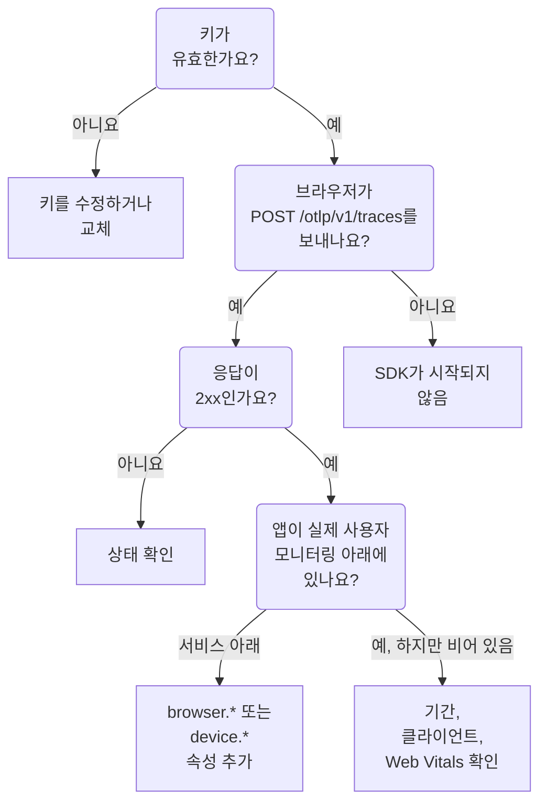

# RUM 문제 해결

RUM 애플리케이션이 없거나, 비어 있거나, **연결 끊김** 상태라면 이 페이지를 순서대로 따라가세요. 각 확인은 앱에서 OneUptime까지 가는 경로의 한 부분을, 이런 문제가 보통 일어나는 순서대로 배제합니다.

:::cards
- [키 확인하기](#키-확인하기): 가장 빠른 확인이며, 이후의 모든 단계가 여기에 달려 있습니다.
- [브라우저에서 나가는 것 확인하기](#브라우저에서-나가는-것-확인하기): 브라우저 개발자 도구에서 내보내기 요청을 확인합니다.
- [텔레메트리가 도착하는 곳 확인하기](#텔레메트리가-도착하는-곳-확인하기): RUM 애플리케이션인지, 백엔드 서비스인지.
- [세션 리플레이 문제](#세션-리플레이-문제): 자체 페이지가 있는 별도의 파이프라인입니다.
:::

## RUM 텔레메트리가 멈추는 곳

텔레메트리는 RUM 애플리케이션에 도달하기까지 세 가지 확인을 거칩니다. 처음으로 실패하는 확인을 찾으세요.



## 키 확인하기

먼저 키를 확인하세요. 가장 빠른 확인이며, OneUptime이 받아들이는 키가 없으면 이후의 어떤 것도 작동하지 않습니다.

```bash
curl -i https://oneuptime.com/otlp/v1/validate \
  -H "x-oneuptime-token: YOUR_TELEMETRY_INGESTION_TOKEN"
```

| 응답 | 의미 |
| --- | --- |
| `200`과 `"valid": true` | OneUptime이 키를 받아들입니다. 응답에는 키의 `keyType`과 `projectId`도 들어 있습니다. 다음 확인으로 넘어가세요. |
| `401`과 `"valid": false` | 키가 없거나, 알 수 없거나, 취소되었거나, 꺼졌거나, 만료되었으며, `message`가 어느 쪽인지 알려 줍니다. **프로젝트 설정 → 텔레메트리 및 APM → 수집 키**에서 유효한 키를 만드세요. |

웹 앱에는 **브라우저** 키가, 모바일 앱에는 **서버** 키가 필요합니다. [브라우저 설정](/docs/rum/browser-setup)과 [모바일 설정](/docs/rum/mobile-setup)을 참고하세요. 내보내기 엔드포인트도 OTLP 사양에 따라 잘못된 키를 `401`로 거부하므로, 잘 동작하는 SDK는 재시도하지 않고 거부를 로그에 남깁니다. 그 줄은 브라우저 콘솔에서 놓치기 쉽지만, 이 확인은 바로 답을 줍니다.

## 브라우저에서 나가는 것 확인하기

앱 페이지에서 브라우저 개발자 도구를 열고 Network 탭을 선택한 뒤 `otlp`로 필터링합니다. `2xx` 상태로 응답한 `POST /otlp/v1/traces`를 찾으면 됩니다.

### 요청이 전혀 없음

SDK가 시작되지 않았습니다. 거의 항상 다음 중 하나입니다.

- `telemetry.ts`가 앱의 첫 번째 import가 아니거나, 번들러가 이를 제거했습니다. 계측은 `fetch`와 `XMLHttpRequest`를 패치하므로 패치 전에 보낸 요청은 트레이스되지 않으며, 번들러가 제거한 파일은 아무것도 실행하지 않습니다.
- 배치 프로세서가 아직 내보내지 않았습니다. `BatchSpanProcessor`는 배치를 채우려고 몇 초 기다리므로, 아무것도 전송되지 않는다고 판단하기 전에 기다리거나 다른 페이지로 이동하세요.
- 빌드 시점 환경 변수가 `undefined`가 되어 내보내기 도구의 URL이 깨졌습니다. 시작할 때 URL을 한 번 로그로 남기세요.

### 브라우저가 요청을 차단함

- **콘솔의 Content Security Policy 오류.** 페이지의 정책이 아직 OneUptime을 허용하지 않습니다. 기존 `connect-src` 지시문에 추가하거나, OneUptime을 직접 운영한다면 자신의 호스트를 사용하세요.

  ```text
  connect-src 'self' https://oneuptime.com;
  ```

- **CORS 오류.** OTLP 엔드포인트는 모든 출처의 요청을 받고 `x-oneuptime-token` 헤더를 허용하므로, 진짜 CORS 오류는 거의 항상 요청이 OneUptime에 도달하지 못했다는 뜻입니다. 회사 프록시, 광고 차단기, 호스트 오타를 찾아보고, Network 탭에서 요청의 URL을 확인하세요.

### 요청이 오류 상태를 받음

**`401`.** 키를 알 수 없거나, 취소되었거나, 만료되었습니다. [키 확인](#키-확인하기)을 실행한 다음 유효한 키를 사용하세요.

**`404`.** URL이 잘못되었습니다. 트레이스 내보내기 도구에는 전체 경로 `/otlp/v1/traces`가 필요합니다. 흔한 실수는 전체 URL을 기대하는 내보내기 도구에 기본 주소(`https://oneuptime.com/otlp`)를 주거나, 경로를 스스로 붙이는 도구에 전체 URL을 주어 `/otlp/v1/traces/v1/traces`로 가게 만드는 것입니다.

**`413`.** 배치가 프록시가 허용하는 크기보다 컸습니다. OneUptime 자체 인그레스는 `/otlp`에서 최대 4 MB를 받지만, OneUptime 앞에 둔 프록시는 더 엄격할 수 있습니다 — 예를 들어 ingress-nginx는 `proxy-body-size`의 기본값이 1 MB입니다 — 그러니 프록시가 있다면 `/otlp`의 한도도 함께 올리세요. 어느 경우든 `BatchSpanProcessor`의 `maxExportBatchSize`를 줄이면 각 내보내기가 작아집니다.

```ts
new BatchSpanProcessor(exporter, { maxExportBatchSize: 100 });
```

스팬이 전체 스택 트레이스나 응답 본문 같은 큰 속성을 담지 않는 한, 브라우저가 이렇게 큰 배치를 보내는 일은 드뭅니다. 그런 속성을 줄이는 편이 더 나은 해결책입니다.

**`422`.** OneUptime이 여기서 키를 거부했으며, 메시지가 이유를 알려 줍니다. `Origin https://app.example.com is not allowed for this browser ingestion key.`는 스킴과 포트(있는 경우)를 포함한 페이지의 정확한 출처가 키의 **허용된 출처**에 없다는 뜻입니다. `This telemetry ingestion key has been disabled.`는 누군가 키를 껐다는 뜻입니다.

**`429`.** 키의 **Requests Per Minute Limit**을 다 썼습니다: `Too many telemetry requests for this ingestion key. Please retry later.` Browser 키는 키에 직접 한도를 설정하지 않는 한, 모든 방문자를 합쳐 분당 6000개의 요청을 허용합니다.

**HTML 페이지나 빈 본문이 있는 `403`.** OneUptime은 모든 거부에 JSON으로 응답하므로, 이 응답은 그 앞에 있는 무언가에서 왔습니다. 보통은 OneUptime을 프록시하는 자신의 도메인에 있는 웹 애플리케이션 방화벽입니다. 방화벽은 OTLP/JSON을 파싱해 모든 스팬 속성을 인젝션 규칙과 대조하므로, 스팬에 쿼리 문자열이 있는 URL 하나만으로도 차단될 수 있고, 방화벽 로그에 그 규칙이 기록됩니다. OTLP 경로에서만 OTLP 페이로드를 검사에서 제외하세요. 방법은 [OpenTelemetry 요청도 차단됨](/docs/rum/session-replay-troubleshooting#opentelemetry-요청도-차단됨)에서 설명하며, 같은 방화벽 뒤에 있는 리플레이 레코더도 다룹니다.

## 텔레메트리가 도착하는 곳 확인하기

요청은 성공하지만 앱이 **제품 → 리소스 → 실제 사용자 모니터링**이 아니라 **제품 → 서비스** 아래에 나타납니다. 가장 흔한 보고이며, 원인은 거의 항상 클라이언트 속성이 없는 리소스입니다. OneUptime은 리소스에 다음 중 하나가 있을 때만 배치를 RUM으로 저장합니다.

| 종류 | 속성 |
| --- | --- |
| 브라우저 | `browser.platform`, `browser.language`, 또는 비어 있지 않은 `browser.brands` |
| 모바일 | `device.id` 또는 `device.model.identifier`, 또는 호스트 식별 정보(`host.name`, `host.id`, `k8s.node.name`)가 없는 리소스의 `device.manufacturer` |

`service.name`만 있으면 백엔드 서비스가 됩니다. OpenTelemetry 브라우저 SDK는 브라우저 리소스 감지기를 추가하거나 직접 설정하지 않는 한 `browser.*` 속성을 추가하지 않습니다. [브라우저 설정](/docs/rum/browser-setup)을 참고하세요.

실제로 무엇을 보내는지 보려면 Network 탭에서 OTLP 요청을 열고 페이로드를 확인하세요. 판단에 쓰이는 것은 `resourceSpans[0].resource.attributes` 목록입니다. 그곳에 `browser.*` 속성이 없다면, 문서에 뭐라고 쓰여 있든 SDK가 이를 추가하지 않는 것입니다.

속성을 추가하면 다음 배치가 RUM 애플리케이션을 만듭니다. 먼저 만들어진 서비스는 별도의 레코드이므로 RUM 애플리케이션으로 바뀌지 않습니다. RUM 텔레메트리가 도착하면 **제품 → 서비스**에서 삭제하세요.

> [!NOTE]
> 클라이언트 속성이 `device.manufacturer`뿐이고 호스트 식별 정보도 있는 리소스는, 호스트 인벤토리도 같은 속성으로 제조사를 보고하기 때문에 휴대폰이 아니라 머신으로 해석됩니다. `device.id` 또는 `device.model.identifier`를 추가하면 다른 무엇을 담고 있든 배치가 모바일 RUM으로 저장됩니다.

## 애플리케이션이 비어 있음

애플리케이션은 있지만 페이지에 아무것도 표시되지 않습니다.

- **기간을 확인하세요.** 개요는 기본적으로 지난 1시간을 보여 주므로, 오늘 아침에 보낸 테스트 배치는 범위 밖입니다.
- **몇 분 기다리세요.** 수집은 대기열을 거치며, **마지막 확인**은 배치마다가 아니라 몇 분 간격으로 갱신됩니다.
- **프로젝트를 확인하세요.** 키는 자신의 프로젝트에 기록하므로, 다른 프로젝트의 키로 보낸 텔레메트리는 여기가 아니라 그쪽에 있습니다.

## 클라이언트 페이지가 비어 있음

**클라이언트** 페이지는 웹에서는 `browser.platform`을, 모바일에서는 `device.model.identifier`를 나열합니다. 다른 모든 것이 작동하는데도 이 페이지가 비어 있는 이유는 두 가지입니다.

- **Safari와 Firefox.** `browserDetector`는 UA Client Hints API를 읽는데, 이 API는 Chromium 계열 브라우저에만 있습니다. 다른 브라우저에서는 `browser.language`를 설정하며, 텔레메트리를 RUM으로 저장하기에는 충분하지만 `browser.platform`은 설정하지 않습니다. 이런 클라이언트도 나열하려면 `browser.platform`을 직접 설정하세요.
- **`device.manufacturer`만 설정하는 모바일 SDK.** 텔레메트리는 모바일 RUM으로 저장되지만, **클라이언트** 페이지에는 `device.model.identifier`가 필요합니다.

## Core Web Vitals에 "No web vitals reported yet"가 표시됨

이 카드는 앱이 보내는 메트릭으로만 채워지므로, 트레이스만으로는 채워지지 않습니다. 메트릭을 내보내고 있는지, 메트릭 이름이 OneUptime이 읽는 이름인지, 그리고 애플리케이션의 **메트릭** 페이지에 나타나는지 확인하세요. [카드에 "No web vitals reported yet"가 표시됨](/docs/rum/web-vitals#문제-해결)에서 다음 내보내기 전에 방문자가 탭을 닫아 값이 사라지는 경우를 포함해 각 확인을 설명합니다.

## 사람들이 앱을 사용하는데도 상태가 연결 끊김

애플리케이션은 15분 동안 텔레메트리가 없으면 **연결 끊김** 상태가 됩니다. 사람들이 앱을 사용 중이라면 다음을 확인하세요.

- **샘플러가 모든 것을 버리고 있을 수 있습니다.** 항상 꺼져 있는 샘플러나 매우 낮은 비율을 설정하지 않았는지 확인하세요.
- **앱이 일부 상호 작용에서만 텔레메트리를 보낼 수 있으며**, 그 시간 동안 아무도 그 상호 작용을 하지 않았을 수 있습니다.
- **배포 후 키가 취소되었거나 꺼졌을 수 있습니다**. [키 확인](#키-확인하기)을 다시 실행하세요.

밤에 방문자가 없는 내부 앱이나 트래픽이 적은 앱은 실제로 연결이 끊긴 상태입니다. 이는 장애가 아닙니다.

## 세션 리플레이 문제

세션 리플레이는 자체 문제가 있는 별도의 파이프라인입니다. 레코더 스크립트, 출처 허용 목록, 동의, Content Security Policy, 마스킹입니다. 이는 [세션 리플레이 문제 해결](/docs/rum/session-replay-troubleshooting)에서 다룹니다. 그곳에서 시작하고, 레코더의 진단을 켜는 것부터 시작하세요. 레코더의 실패는 대부분 의도적으로 조용히 일어나기 때문입니다.

```js
localStorage.setItem("oneuptime.sessionReplay.debug", "true");
// then reload the page
```

애플리케이션의 **세션 리플레이** 섹션에 있는 **상태** 페이지와 **Replay Policy**의 **Test your installation** 패널은 서버 측에서 키, 허용 목록, 정책을 확인하고 아무것도 도착하지 않는 이유를 알려 줍니다. 브라우저 콘솔은 서버가 볼 수 없는 나머지 절반을 알려 줍니다.

기본 정책에서는 사용자가 페이지와 상호 작용하는 동안 레코더가 약 15초마다 청크를 보냅니다. 유휴 상태의 탭에는 보낼 것이 없으므로 먼저 클릭하거나 마우스를 움직이세요. 그 뒤에도 청크 요청이 전혀 없다면 무언가 잘못된 것입니다. 애플리케이션이 _On error or frustration_ 설정에서만 업로드한다면, 무언가 잘못될 때까지 조용한 것이 정상입니다. `OneUptimeReplay.captureSession()`을 호출해 업로드를 강제하고, 어느 쪽이든 경로를 확인하세요.

두 파이프라인은 서로 독립적입니다. 레코더가 로드되는 데 작동하는 RUM 애플리케이션이 필요하지 않으며, 레코더가 작동한다고 해서 RUM 텔레메트리가 도착하는 것은 아닙니다. 둘 다 각자 실패할 수 있습니다.

## 그래도 해결되지 않나요?

도움을 요청하기 전에 다음을 모으세요. 주고받는 횟수를 줄여 줍니다.

- 실제 OTLP 요청 페이로드의 `resource.attributes` 목록.
- 그 요청의 HTTP 상태.
- 보내는 정확한 `service.name`과, 프로젝트에 그 이름의 애플리케이션이나 서비스가 있는지 여부.
- 배포된 빌드의 키에 대해 `/otlp/v1/validate`가 `200`으로 응답하는지 여부.

그런 다음 support@oneuptime.com으로 문의하거나 [GitHub](https://github.com/OneUptime/oneuptime)에서 이슈를 여세요.

## 다음 단계

:::cards
- [브라우저 설정](/docs/rum/browser-setup): 이 확인들이 전제로 하는 설정을 단계별로 설명합니다.
- [모바일 설정](/docs/rum/mobile-setup): 모바일 앱에 필요한 키와 속성.
- [애플리케이션 관리](/docs/rum/applications): 이름, 레이블, 보존, 상태.
- [세션 리플레이 문제 해결](/docs/rum/session-replay-troubleshooting): 레코더의 모든 코드와 대처 방법.
:::
