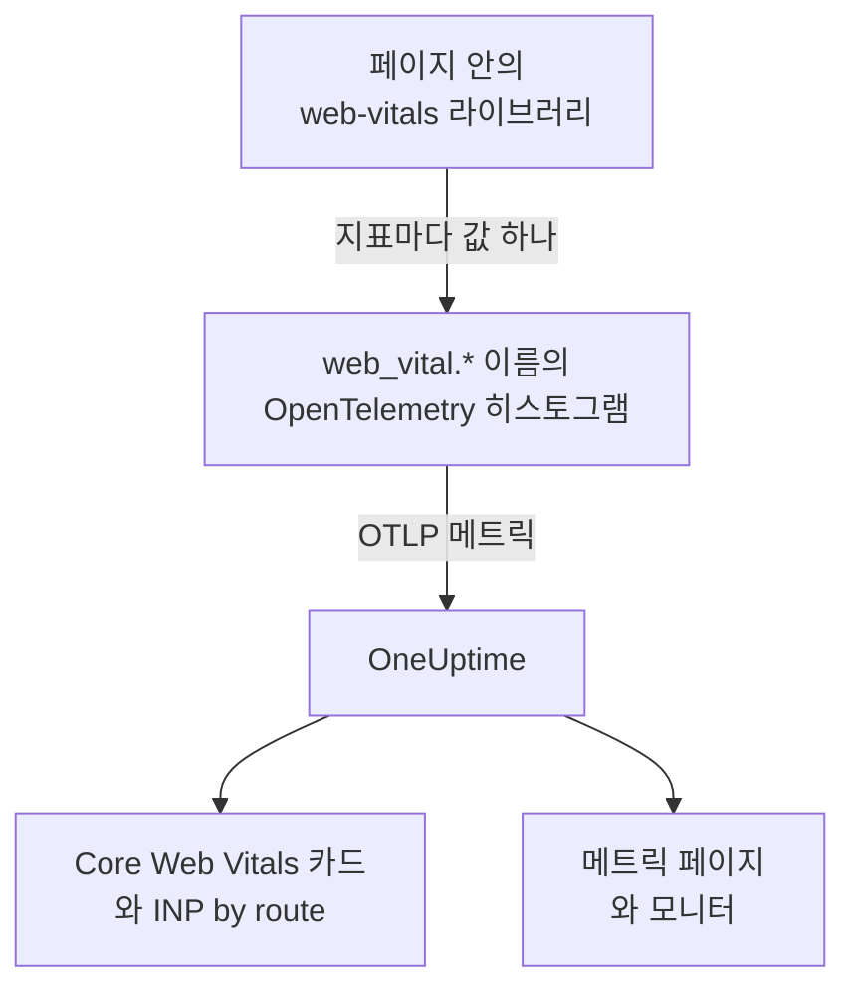
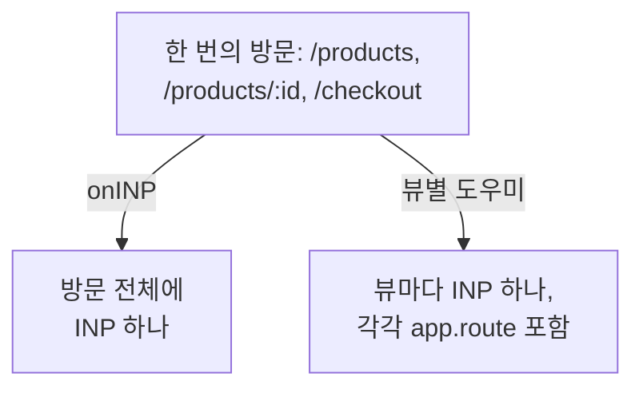

# Core Web Vitals

RUM 애플리케이션 개요의 **Core Web Vitals** 카드는 LCP, INP, CLS, FCP, TTFB를 각각 Google 기준으로 평가해 보여 줍니다. OneUptime은 이 중 어느 것도 직접 측정하지 않습니다. 카드는 브라우저 계측이 보고하는 메트릭으로만 채워지며, 이 페이지는 그 메트릭을 보내는 방법을 설명합니다.

:::cards
- [보내기](#앱에서-보내기): web-vitals 라이브러리의 값을 OpenTelemetry 메트릭으로 전달합니다.
- [OneUptime이 읽는 이름](#oneuptime이-인식하는-메트릭-이름): 각 지표가 도착할 수 있는 메트릭 이름.
- [싱글 페이지 앱](#싱글-페이지-앱): 페이지 로드마다 하나가 아니라 뷰마다 하나의 INP.
- [지표 알림](#지표로-알림-받기): 나쁜 지표를 위한 기성 모니터.
:::

## 작동 방식

[`web-vitals`](https://github.com/GoogleChrome/web-vitals) 라이브러리는 Chrome 자체 도구가 쓰는 것과 같은 라이브러리로, 페이지 안에서 각 지표를 측정합니다. 코드가 각 값을 OpenTelemetry 히스토그램에 기록하고, 브라우저의 메트릭 파이프라인이 이를 OneUptime으로 내보냅니다.



OpenTelemetry에는 아직 web vitals 이름에 대한 최종 규약이 없으므로, OneUptime은 각 지표를 여러 이름으로 찾아 데이터가 있는 첫 번째 이름을 씁니다. 새 계측에는 `web_vital.*` 이름을 쓰세요.

## 시작하기 전에

- [브라우저 설정](/docs/rum/browser-setup)처럼 설정되고 메트릭 파이프라인을 갖춘 웹 앱. 이 값을 내보내는 것은 [로그와 메트릭 추가하기](/docs/rum/browser-setup#로그와-메트릭-추가하기)의 `MeterProvider`입니다.

## 앱에서 보내기

:::steps
### 라이브러리 설치하기

```bash
npm install web-vitals
```

### 각 지표를 히스토그램에 기록하기

`src/web-vitals.ts`를 만듭니다. 각 지표를 히스토그램으로 기록하므로 **메트릭** 페이지에서 나중에 백분위수를 구할 수 있으며, 버킷 경계는 Google의 좋음과 나쁨 기준에 맞춥니다.

```ts title="src/web-vitals.ts"
// Import after ./telemetry
import { metrics } from "@opentelemetry/api";
import { onCLS, onFCP, onINP, onLCP, onTTFB, type Metric } from "web-vitals";

const meter = metrics.getMeter("web-vitals");

// Histograms, so the Metrics tab can compute percentiles later. The bucket
// edges sit on each vital's good / poor limits: a percentile is read from
// the buckets, and the defaults are far too coarse for these ranges.
const buckets = (...edges: number[]) => ({ advice: { explicitBucketBoundaries: edges } });

const lcp = meter.createHistogram("web_vital.lcp", { unit: "ms", ...buckets(0, 1000, 1500, 2000, 2500, 3000, 3500, 4000, 5000, 7500, 10000) });
const inp = meter.createHistogram("web_vital.inp", { unit: "ms", ...buckets(0, 50, 100, 150, 200, 250, 300, 400, 500, 750, 1000, 2000) });
const fcp = meter.createHistogram("web_vital.fcp", { unit: "ms", ...buckets(0, 600, 1200, 1800, 2400, 3000, 4000, 6000, 10000) });
const ttfb = meter.createHistogram("web_vital.ttfb", { unit: "ms", ...buckets(0, 200, 400, 600, 800, 1200, 1800, 2500, 4000) });
const cls = meter.createHistogram("web_vital.cls", { unit: "1", ...buckets(0, 0.025, 0.05, 0.1, 0.15, 0.2, 0.25, 0.4, 0.6, 1) });

function record(
  histogram: { record: (v: number, a?: Record<string, string>) => void },
) {
  return (metric: Metric): void => {
    histogram.record(metric.value, {
      // Keep attributes low-cardinality. Never put a full URL or a user id here.
      "web_vital.rating": metric.rating,
    });
  };
}

onLCP(record(lcp));
onINP(record(inp));
onCLS(record(cls));
onFCP(record(fcp));
onTTFB(record(ttfb));
```

### 텔레메트리 설정 뒤에 가져오기

```ts
import "./telemetry";
import "./web-vitals";
```

### 메트릭 페이지 확인하기

페이지를 몇 개 로드한 뒤 애플리케이션의 **메트릭** 페이지에서 `web_vital.lcp`를 검색하세요. 메트릭이 보이면 선택한 기간의 **Core Web Vitals** 카드가 채워집니다.
:::

## 페이지가 닫히기 전에 마지막 값 보내기

`onINP`와 `onCLS`는 방문 중이 아니라 페이지가 숨겨질 때 보고합니다. [브라우저 설정](/docs/rum/browser-setup)의 30초 내보내기 간격에서는, 마지막 값 직후에 탭을 닫은 방문자가 값이 내보내지기 전에 떠날 수 있습니다. 빠짐없이 모으려면 `exportIntervalMillis`를 줄이거나, `telemetry.ts`에서 만든 `MeterProvider`를 보관해 두었다가 페이지가 숨겨질 때 플러시하세요.

```ts
// In telemetry.ts, export the provider you created:
export const meterProvider = new MeterProvider({ /* ... */ });

// Anywhere after setup:
import { meterProvider } from "./telemetry";

document.addEventListener("visibilitychange", () => {
  if (document.visibilityState === "hidden") {
    void meterProvider.forceFlush();
  }
});
```

## OneUptime이 인식하는 메트릭 이름

OneUptime은 이 순서대로 이름을 시도하며, 선택한 기간에 데이터가 있는 첫 번째 이름이 쓰입니다.

| 지표 | 메트릭 이름(이 중 하나) | 단위 |
| --- | --- | --- |
| LCP: Largest Contentful Paint | `web_vital.lcp`, `browser.largest_contentful_paint`, `largest_contentful_paint`, `web.vitals.lcp` | 밀리초 |
| INP: Interaction to Next Paint | `web_vital.inp`, `browser.interaction_to_next_paint`, `interaction_to_next_paint`, `web.vitals.inp` | 밀리초 |
| CLS: Cumulative Layout Shift | `web_vital.cls`, `browser.cumulative_layout_shift`, `cumulative_layout_shift`, `web.vitals.cls` | 점수 |
| FCP: First Contentful Paint | `web_vital.fcp`, `browser.first_contentful_paint`, `first_contentful_paint`, `web.vitals.fcp` | 밀리초 |
| TTFB: Time to First Byte | `web_vital.ttfb`, `browser.time_to_first_byte`, `time_to_first_byte`, `web.vitals.ttfb` | 밀리초 |

나머지 이름은 이미 커뮤니티 규약으로 보내고 있는 앱이 변경 없이 나타나도록 하기 위한 것입니다.

## 평가 기준

카드는 Google이 공개한 Core Web Vitals 기준으로 각 값을 평가합니다.

| 지표 | **Good** | **Needs work** | **Poor** |
| --- | --- | --- | --- |
| LCP | 2500밀리초 미만 | 2500~4000밀리초 | 4000밀리초 이상 |
| INP | 200밀리초 미만 | 200~500밀리초 | 500밀리초 이상 |
| CLS | 0.1 미만 | 0.1~0.25 | 0.25 이상 |
| FCP | 1800밀리초 미만 | 1800~3000밀리초 | 3000밀리초 이상 |
| TTFB | 800밀리초 미만 | 800~1800밀리초 | 1800밀리초 이상 |

카드는 Google의 현장 도구가 보고하는 75번째 백분위수가 아니라 선택한 기간의 **평균**을 보여 줍니다. 이는 의도된 것입니다. OneUptime은 히스토그램의 백분위수를 버킷에서 읽으므로 백분위수는 버킷만큼만 정확하지만, 평균은 히스토그램의 정확한 합계와 개수에서 나옵니다. OpenTelemetry의 기본 버킷(`0, 5, 10, 25, 50, …`)에서는 모든 CLS 값이 첫 번째 버킷에 들어가므로, 거의 움직이지 않는 페이지에서도 75번째 백분위수가 2.5로 나옵니다.

> [!TIP]
> 카드는 추세로 읽으세요. 75번째 백분위수를 보려면 위의 버킷 경계로 기록한 뒤 **메트릭** 페이지에서 **P75** 집계로 메트릭을 차트로 그리세요. 메트릭 모니터에서도 같은 선택을 할 수 있습니다.

## 싱글 페이지 앱

`onINP`는 브라우저의 정의대로 INP를 측정합니다. 즉 **페이지 로드마다 값 하나**입니다. 싱글 페이지 앱은 한 번 로드된 뒤 `history.pushState`로 경로를 바꾸므로, `/products`, `/products/42`, `/checkout`을 거치는 방문도 방문 전체에 INP가 하나뿐입니다. 모든 뷰의 상호 작용이 이 하나의 숫자를 두고 경쟁하며, 거기에 붙은 경로 속성은 느렸던 페이지가 아니라 보고 시점에 표시되던 페이지를 가리킵니다.



뷰별 INP를 보려면 뷰별로 측정하세요. 경로가 바뀔 때마다 현재 뷰가 끝나고 새 뷰가 시작되며, 각 뷰가 자신의 INP를 보고합니다. 아래 도우미는 `onINP`가 쓰는 것과 같은 데이터인 브라우저의 Event Timing API로 이를 처리하고, 틀리기 쉬운 부분도 다룹니다. 탐색을 **일으킨** 클릭은 경로가 이미 바뀐 뒤에 전달되지만, 클릭이 일어난 페이지에 속한다는 점입니다.

```ts title="src/inp-per-route.ts"
// INP for each view of a single-page app.
type Report = (inpMs: number, route: string) => void;

interface View {
  route: string;
  path: string; // the URL path it was opened for
  start: number; // performance.now() when the view began
  latencies: Map<number, number>; // interactionId -> its slowest entry
}

// Long enough for the click that navigated to be delivered: its entry
// arrives after the next paint, i.e. after the route has changed.
const SETTLE_MS = 1000;

let views: Array<View> = [];
let report: Report = () => {};

// The path, plus the hash when a hash router keeps the route there.
const currentPath = (): string =>
  location.pathname + (location.hash.startsWith("#/") ? location.hash : "");

function close(view: View): void {
  if (!views.includes(view)) return; // already reported
  views = views.filter((v) => v !== view);

  const sorted = [...view.latencies.values()].sort((a, b) => b - a);
  if (sorted.length === 0) return; // nobody interacted: no INP, not 0

  // web-vitals' p98: skip one outlier for every 50 interactions.
  report(sorted[Math.min(sorted.length - 1, Math.floor(sorted.length / 50))]!, view.route);
}

function record(entries: PerformanceEntryList): void {
  for (const entry of entries as Array<PerformanceEventTiming & { interactionId?: number }>) {
    if (!entry.interactionId) continue; // hovers, scrolls: not interactions

    // The view the interaction STARTED in, so the click that navigated
    // counts towards the page it was clicked on.
    const view = [...views].reverse().find((v) => entry.startTime >= v.start);
    if (!view) continue;

    const slowest = view.latencies.get(entry.interactionId) ?? 0;
    view.latencies.set(entry.interactionId, Math.max(slowest, entry.duration));
  }
}

export function observeInpPerRoute(route: string, onReport: Report): void {
  if (typeof PerformanceObserver === "undefined" || !PerformanceObserver.supportedEntryTypes?.includes("event")) return;

  report = onReport;
  views = [{ route, path: currentPath(), start: 0, latencies: new Map() }];

  const observer = new PerformanceObserver((list) => record(list.getEntries()));
  observer.observe({ type: "event", durationThreshold: 40, buffered: true } as PerformanceObserverInit);

  // The tab may never come back: report every view now, then keep
  // measuring the current route as a fresh view.
  document.addEventListener("visibilitychange", () => {
    if (document.visibilityState !== "hidden") return;
    record(observer.takeRecords());
    const current = views[views.length - 1]?.route ?? route;
    [...views].forEach(close);
    views = [{ route: current, path: currentPath(), start: performance.now(), latencies: new Map() }];
  });
}

// Call after every navigation, with the route PATTERN ("/products/:id").
// Safe to call when nothing changed (a router's initial navigation, a
// query-string update): the view only ends when the path does.
export function startView(route: string): void {
  const closing = views[views.length - 1];
  if (!closing || closing.path === currentPath()) return;

  views.push({ route, path: currentPath(), start: performance.now(), latencies: new Map() });
  setTimeout(() => close(closing), SETTLE_MS);
}
```

두 함수 모두 URL이 아니라 경로 **패턴**을 받습니다. `/products/42`와 `/products/7`은 하나의 경로여야 하며, 그렇지 않으면 상품마다 별도의 계열이 됩니다. 라우터에 패턴이 있으면 그것을 쓰고, 없으면 ID를 직접 합치세요.

```ts
// "/products/42" -> "/products/:id", also for UUIDs.
export const toRoutePattern = (path: string): string =>
  path.replace(/\/(\d+|[0-9a-f]{8}-[0-9a-f-]{27})(?=\/|$)/gi, "/:id");
```

도우미가 보고하는 값은 경로를 `app.route`로 하여 같은 `web_vital.inp` 히스토그램에 기록하고, 위의 스니펫에서 **`onINP`를 제거**하세요. 둘 다 남겨 두면 모든 상호 작용이 두 번 집계됩니다.

```ts
// src/web-vitals.ts, in place of onINP(record(inp))
import { observeInpPerRoute } from "./inp-per-route";

observeInpPerRoute(toRoutePattern(location.pathname), (inpMs, route) => {
  inp.record(inpMs, {
    "app.route": route,
    "web_vital.rating": inpMs <= 200 ? "good" : inpMs <= 500 ? "needs-improvement" : "poor",
  });
});
```

그런 다음 라우터가 탐색 완료를 알리는 곳에서 `startView`를 호출하세요. URL 경로가 바뀌지 않은 호출은 무시하므로, 첫 로드나 쿼리 문자열 변경도 알리는 라우터라도 뷰가 나뉘지 않습니다.

:::tabs
@tab Vue Router
```ts
router.afterEach((to) => startView(to.matched[to.matched.length - 1]?.path ?? toRoutePattern(to.path)));
```
@tab React Router
```tsx
// In a component that stays mounted inside the router
const { pathname } = useLocation();
useEffect(() => startView(toRoutePattern(pathname)), [pathname]);
```
:::

얻게 되는 것:

- 개요의 **INP by route**. `app.route`를 기준으로 느린 순서대로 표시됩니다. OneUptime은 OpenTelemetry의 `url.template`도 읽습니다.
- 알림용 경로 필터. 메트릭 모니터에서 `web_vital.inp`를 `app.route`로 필터링하면 `/checkout` 같은 흐름 하나를 따로 지켜볼 수 있습니다.
- **Core Web Vitals** 카드의 앱 전체 INP는 그대로 작동합니다. 같은 메트릭이며, 이제 페이지 로드마다 하나가 아니라 뷰마다 값 하나가 될 뿐입니다.

여기에 필요한 상호 작용 ID는 Chromium 계열 브라우저가 보고합니다. Safari는 보고하지 않으며, 그래서 `onINP`도 Safari에서는 아무것도 보고하지 않습니다. Chrome의 실험적인 Soft Navigations API가 이를 기본으로 처리하는 것을 목표로 하지만 아직 정식으로 제공되지 않습니다. 이 도우미는 지금 바로 쓸 수 있습니다.

> [!NOTE]
> [세션 리플레이](/docs/telemetry/session-replay) 레코더는 코드 없이도 이미 뷰별 INP를 측정합니다. 각 녹화에는 사용자가 상호 작용한 경로마다 INP 행이 있으며, 느린 요소와 그 시간이 입력 지연, 처리, 표시로 어떻게 나뉘었는지 보여 줍니다.

## 카디널리티 관리하기

메트릭 속성은 곱해집니다. `web_vital.rating`의 가능한 값은 셋이라 괜찮고, 경로나 페이지 유형 속성은 보통 붙일 만한 가치가 있습니다.

```ts
histogram.record(metric.value, {
  "web_vital.rating": metric.rating,
  "app.route": routePattern, // "/product/:id" — the PATTERN, not "/product/8842"
});
```

경로 패턴 대신 구체적인 URL을 기록하면 상품 페이지마다 시계열이 하나씩 생겨 **메트릭** 페이지가 느려지고 저장 비용이 커집니다. 사용자 ID, 세션 ID, 화면 크기도 마찬가지입니다.

## 지표로 알림 받기

애플리케이션의 **권장 사항** 페이지는 지표마다 기성 모니터를 제공합니다. 각 모니터는 메트릭의 5분 평균을 읽고, Google의 나쁨 기준에 이르면 발생합니다.

| 권장 모니터 | 메트릭 | 발생 기준 | 심각도 |
| --- | --- | --- | --- |
| **Poor Largest Contentful Paint** | `web_vital.lcp` | 4000밀리초 | **심각** |
| **Poor Interaction to Next Paint** | `web_vital.inp` | 500밀리초 | **심각** |
| **Poor Cumulative Layout Shift** | `web_vital.cls` | 0.25 | **심각** |
| **Slow First Contentful Paint** | `web_vital.fcp` | 3000밀리초 | **Warning** |
| **Slow Time to First Byte** | `web_vital.ttfb` | 1800밀리초 | **Warning** |

이 모니터는 `web_vital.*` 이름만 읽습니다. 앱이 다른 이름으로 지표를 보낸다면 만들어진 모니터의 메트릭을 수정하세요. 경로 하나에 대해 알림을 받으려면 모니터에 `app.route` 필터를 추가하세요. 이 메트릭 중 어느 것으로든 직접 모니터를 만들 수도 있습니다. [메트릭 모니터](/docs/monitor/metrics-monitor)를 참고하세요.

## 문제 해결

:::details 카드에 "No web vitals reported yet"이 표시됨
카드는 앱이 보내는 메트릭으로만 채워집니다. 다음 순서로 확인하세요.

1. 메트릭 파이프라인이 있는지. 트레이스만으로는 이 카드가 절대 채워지지 않습니다.
2. 메트릭 이름이 OneUptime이 읽는 이름인지. [OneUptime이 인식하는 메트릭 이름](#oneuptime이-인식하는-메트릭-이름)을 참고하세요.
3. 애플리케이션의 **메트릭** 페이지에 메트릭이 있는지. 있다면 내보내기는 작동하고 있으며, 문제는 이름이나 기간입니다.
4. INP와 CLS는 페이지가 숨겨질 때 보고되므로, 짧은 방문은 다음 내보내기 전에 끝날 수 있습니다. [페이지가 닫히기 전에 마지막 값 보내기](#페이지가-닫히기-전에-마지막-값-보내기)를 참고하세요.

이 중 어느 것도 도움이 되지 않으면 [RUM 문제 해결](/docs/rum/troubleshooting)에서 파이프라인 전체를 확인하세요.
:::

:::details INP는 보고되지만 경로별로는 나오지 않음
**INP by route** 카드에는 `web_vital.inp`에 `app.route` 속성이나 `url.template`이 있어야 합니다. [싱글 페이지 앱](#싱글-페이지-앱)처럼 각 값과 함께 경로 패턴을 기록하세요.
:::

:::details 값이 Google의 보고서와 다름
카드는 선택한 기간의 평균을 보여 주고, Google은 자신의 방문자에 대한 75번째 백분위수를 보고합니다. 같은 조건으로 비교하려면 **메트릭** 페이지에서 **P75**를 차트로 그리세요.
:::

## 다음 단계

:::cards
- [브라우저 설정](/docs/rum/browser-setup): 이 지표가 실려 가는 트레이스, 로그, 메트릭 파이프라인.
- [메트릭 모니터](/docs/monitor/metrics-monitor): 앱 전체나 경로 하나에 대해 어떤 지표로든 알림을 받습니다.
- [세션 리플레이](/docs/telemetry/session-replay): 코드 없이 녹화에서 뷰별 INP를 확인합니다.
- [RUM 문제 해결](/docs/rum/troubleshooting): 문제가 흔히 생기는 순서대로 정리한 모든 확인 사항.
:::
