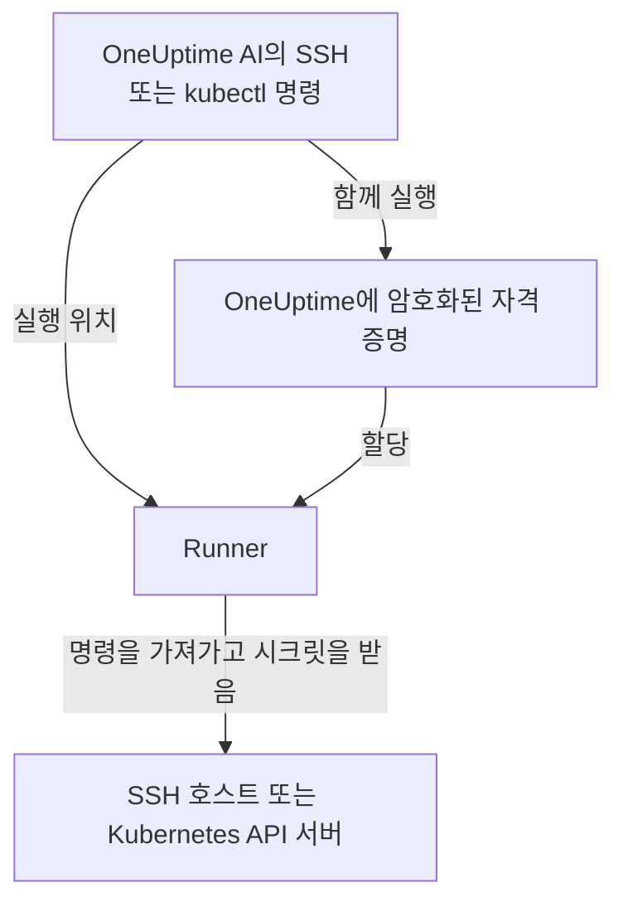

# AI 액세스

AI 액세스는 OneUptime AI 자체 명령이 Runner 자신의 호스트가 **아닌** 것, 즉 SSH로 접근하는 서버나 Kubernetes 에이전트 차트를 실행하지 않는 Kubernetes 클러스터의 API 서버에 닿는 방법입니다. 각각은 자격 증명입니다. 저장 시 암호화되고 특정 Runner에 할당된 관리 대상 접근 권한으로, 명령에 적히는 대신 OneUptime AI가 고릅니다. Runbook 단계는 이것을 쓰지 않습니다. SSH나 kubectl 단계는 시크릿 [Runbook 변수](/docs/runbooks/variables)로 로그인합니다. 이 릴리스보다 오래된 Runner는 예외입니다. 동작에서 옮겨진 Kubernetes 단계를 그 단계의 스크립트나 kubeconfig가 바뀌기 전까지 단계가 지정하던 자격 증명으로 실행합니다.

**런북 → Runbook 에이전트 → AI 액세스**에서 관리합니다.

:::cards
- [자격 증명 만들기](#자격-증명-만들기): 접근 권한과 그것을 쓸 수 있는 Runner.
- [상대편의 최소 권한](#상대편의-최소-권한): 키나 토큰으로 할 수 있는 일을 제한합니다.
- [OneUptime AI의 명령을 실행하는 Runner](#oneuptime-ai의-명령을-실행하는-runner): 그런 Runner에 SSH 자격 증명을 줄 수 있는 사람.
:::

## 자격 증명이 쓰이는 방식

OneUptime AI는 SSH 명령을 실행되는 Runner에 할당된 SSH 자격 증명 중 하나로 실행하고, Kubernetes 에이전트 차트를 실행하지 않는 클러스터용 kubectl 명령은 그 클러스터에 연결된 Kubernetes 자격 증명으로 실행합니다. [AI SRE](/docs/ai/ai-sre)를 참고하세요. Runner가 명령을 가져가면 OneUptime은 자격 증명이 그 Runner에 할당되어 있는지 확인하고, 시크릿을 복호화해 그 요청에 대한 응답으로만 전달합니다. 시크릿은 작업에 저장되지 않으며 API로 읽을 수도 없습니다.

## 시작하기 전에

- **자격 증명을 관리할 수 있는 역할.** Project Owner와 Project Admin, 또는 **Create Runbook Credential** 권한이 있는 사람입니다. Runbook Admin 역할에는 포함되지 않습니다. OneUptime AI의 명령을 실행하는 Runner에 SSH 자격 증명을 할당하려면 **Read Runbook Credential**도 필요합니다. [OneUptime AI의 명령을 실행하는 Runner](#oneuptime-ai의-명령을-실행하는-runner)를 참조하세요.
- **자격 증명이 포함된 요금제.** OneUptime Cloud에서 Runbook 자격 증명에는 **Growth** 이상 요금제가 필요합니다.
- 네트워크를 통해 호스트나 클러스터의 API 서버에 접근할 수 있는 **[Runner](/docs/runbooks/agents)**.

## 자격 증명 만들기

:::steps
### AI 액세스 열기

**런북 → Runbook 에이전트 → AI 액세스**을 열고 **Credential 만들기**를 클릭합니다.

### 이름을 정하고 유형 고르기

**Credential** 단계에서 **이름**(예: `prod-cluster`), 선택 사항인 **설명**, **유형**(**SSH** 또는 **Kubernetes**)을 입력합니다. 유형은 나중에 바꿀 수 없으니, 바꾸려면 새 자격 증명을 만드세요.

### 접근 정보 입력

:::tabs
@tab SSH
**SSH 호스트** 아래에 **호스트 이름**, **포트**(비워 두면 22), **사용자 이름**을 입력합니다. **SSH 인증** 아래 **로그인 방법** 에서 고릅니다. 선택할 수 있다면 더 나은 **개인 키** 를 고르고 **Private Key (PEM)** 와 패스프레이즈가 있다면 **Private Key Passphrase** 를 붙여 넣거나, 키로 접근할 수 없는 호스트라면 **비밀번호** 를 고르고 **비밀번호**를 입력합니다.
@tab Kubernetes
**Kubernetes** 아래에 **API Server URL**(예: `https://10.0.0.1:6443`), **Service Account Token**, **CA Certificate (PEM)** 를 입력해 Runner가 API 서버를 검증할 수 있게 합니다. CA는 API 서버가 Runner가 이미 신뢰하는 인증서를 제시할 때만 비워 두세요.
:::

### Runner에 할당

**Runbook 에이전트** 단계에서 이 자격 증명을 쓸 수 있는 Runner를 고른 다음 **Credential 만들기**를 클릭합니다. 어떤 Runner에도 할당되지 않은 자격 증명은 어떤 명령도 사용할 수 없습니다.

### OneUptime AI가 사용하게 하기

OneUptime AI는 자동 해결 규칙이 그 명령을 위해 고른 Runner에서, 그 Runner에 할당된 SSH 자격 증명 중 하나로 SSH 명령을 실행합니다. Kubernetes 자격 증명은 자신의 Runner 하나와 함께 클러스터에 연결되면 사용됩니다. [AI SRE](/docs/ai/ai-sre)를 참고하세요.
:::

## 저장되는 내용

| 유형 | 필드 |
| --- | --- |
| SSH | 호스트 이름, 포트(기본값 22), 사용자 이름, 그리고 PEM 개인 키(선택적 패스프레이즈 포함) 또는 비밀번호. |
| Kubernetes | API 서버 URL, 서비스 계정 토큰, 클러스터의 CA 인증서. |

## 시크릿 값은 쓰기 전용

개인 키, 패스프레이즈, 비밀번호, 서비스 계정 토큰은 저장 시 암호화되며 API는 이를 **절대 반환하지 않습니다**. 대시보드에도, 워크플로에도, 내보내기에도 반환하지 않습니다. 표는 자격 증명이 *무엇인지*는 보여 주지만 그 안에 무엇이 들어 있는지는 절대 보여 주지 않습니다.

그래서 시크릿 값에는 "보기"가 없고 "바꾸기"만 있습니다. 값을 다시 입력하는 것이 교체하는 방법입니다. 원래 값을 잃어버렸다면 대상 시스템에서 새 키를 발급하고 자격 증명을 업데이트하세요.

## 자격 증명을 Runner에 할당하기

자격 증명은 할당한 Runner만 사용할 수 있습니다. 자신의 Runner에 할당되지 않은 자격 증명을 지정한 명령은 **실행되지 않고 실패합니다**. 아무것도 하지 않고 조용히 있는 Runner는 제대로 동작한 Runner와 똑같아 보이기 때문입니다.

할당이 곧 접근 경계이므로 좁게 유지하세요. 클러스터 하나만 다시 시작하는 Runner에는 데이터베이스 호스트의 SSH 키가 필요 없습니다.

### OneUptime AI의 명령을 실행하는 Runner

Runner는 OneUptime AI의 명령을 위해 선택되면 그 명령을 실행합니다. 자동 해결 규칙의 Runner로 선택되거나 Kubernetes 클러스터의 AI 액세스를 위해 선택될 때입니다. 그런 Runner에서는 OneUptime AI가 그 Runner에서 실행하는 명령을 위해 Runner에 할당된 SSH 자격 증명 중에서 고릅니다. 그래서 무엇을 먼저 저장하든, SSH 자격 증명은 Runbook 자격 증명을 읽을 수 있는 사람(**Read Runbook Credential**, 또는 Project Owner나 Project Admin)을 통해서만 그런 Runner에 닿습니다.

- **자격 증명 할당.** 그런 Runner와 함께 SSH 자격 증명을 만들거나, 자격 증명에 그런 Runner를 추가하려면 그 권한이 필요합니다. 권한이 없으면 저장이 거부되고 Runner 이름이 표시됩니다. AI 해결 명령을 실행하지 않는 Runner에 자격 증명을 할당하거나, 권한이 있는 사람에게 할당을 요청하세요.
- **Runner 선택.** SSH 자격 증명이 있는 Runner를 OneUptime AI의 명령을 위해 선택하려면(규칙의 Runner로, 또는 클러스터를 위해) 처음 선택할 때 같은 권한이 필요합니다.

자격 증명에서 Runner를 빼는 것, 자격 증명을 이미 가진 Runner 그대로 저장하는 것, Kubernetes 자격 증명에는 그 이상의 권한이 필요 없습니다. OneUptime AI의 kubectl 명령은 해당 클러스터에 묶인 자격 증명으로 실행되기 때문입니다. 그 권한이 없는 사람의 자격 증명 할당과 Runner 선택은 프로젝트에서 한 번에 하나씩 저장되므로, 두 저장이 함께 검사를 통과할 수 없습니다. 다른 저장이 진행 중일 때 들어온 저장은 그것을 기다리며, 너무 오래 걸리면 *Try again in a moment*와 함께 거부됩니다. 다시 저장하세요. 설명을 편집하는 것처럼 Runner를 저장할 때는 기다리지 않습니다.

워크플로의 단계는 Project Admin으로 동작하지만, Project Admin의 Runbook 자격 증명 읽기 권한을 빌리지는 않습니다. 단계는 워크플로의 단계를 마지막으로 저장한 사람이 그 권한을 가진 경우에만 그 권한을 가집니다. [워크플로 단계가 할 수 있는 일](/docs/workflows/configuration#워크플로-단계가-할-수-있는-일)을 참조하세요.

## 상대편의 최소 권한

OneUptime은 자격 증명이 대상 시스템에서 할 수 있는 일을 제한할 수 없습니다. 그것은 대상 시스템의 몫이며, 할 만한 가치가 있습니다.

- **SSH** — 비밀번호보다 키를 쓰고, 사용자에게 필요한 명령만 주고(실용적이라면 강제 명령이나 제한된 셸), 관리자의 개인 키를 재사용하지 마세요.
- **Kubernetes** — 서비스 계정을 OneUptime AI에 허용하는 일만, 작업해도 되는 namespace에서만 허용하는 Role에 바인딩하세요. 읽기만 할 수 있는 서비스 계정이라면 OneUptime AI는 조사는 할 수 있지만 모든 수정은 거부됩니다.

## 볼 수 있는 사람

자격 증명을 만들고, 편집하고, 삭제하려면 Runbook 자격 증명 권한(또는 Project Owner/Admin)이 필요합니다. 자격 증명을 읽으면 시크릿이 아닌 필드만 보입니다.

Runner의 **에이전트 키**는 그 Runner에 할당된 자격 증명과 같다는 점에 유의하세요. 키를 가진 것은 무엇이든 그 Runner로서 작업을 가져가고 자격 증명을 받을 수 있습니다. 그래서 에이전트 키는 Project Owner, Project Admin, Runbook Admin만 읽을 수 있습니다. 자격 증명 자체처럼 다루세요.

## 다음 단계

:::cards
- [Runbook 변수](/docs/runbooks/variables): SSH와 kubectl 단계가 로그인에 쓰는 시크릿.
- [Runbook 에이전트](/docs/runbooks/agents): 자격 증명을 할당할 Runner를 설치합니다.
- [Runbook 설정과 안전성](/docs/runbooks/configuration): Runbook 스택 전체의 권한과 보안 강화.
:::
