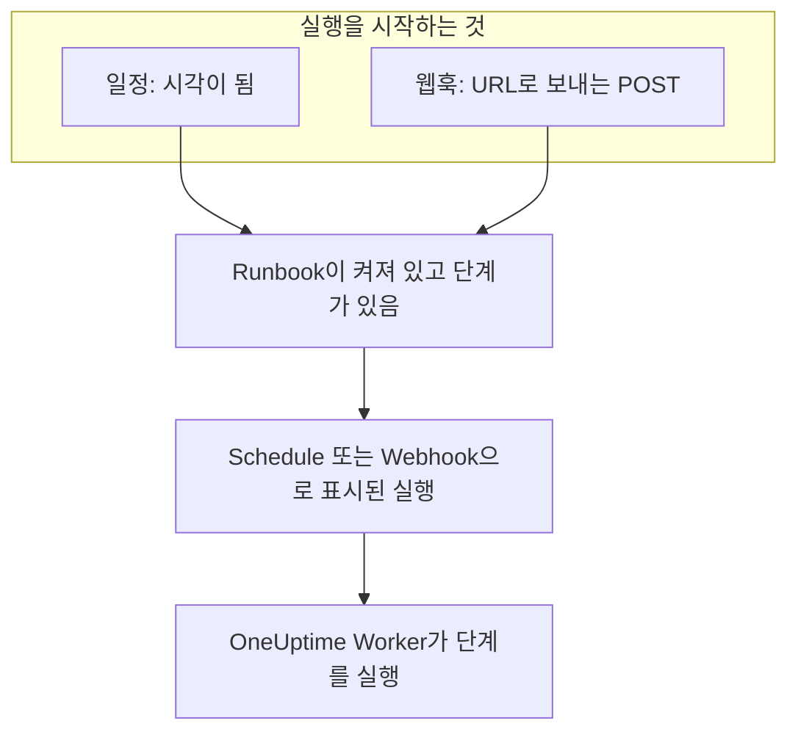

# Runbook 트리거

Runbook은 스스로 시작할 수 있습니다. 일정에 따라, 또는 다른 도구가 웹훅 URL을 호출할 때입니다. 야간 정리나 주간 인증서 점검 같은 정기 작업에는 일정을, 알림 시스템이나 CI 파이프라인, 스크립트에서 Runbook을 시작하려면 웹훅을 사용하세요. 둘 다 Runbook의 **트리거** 페이지에서 설정합니다.

:::cards
- [일정에 따라 실행](#일정에-따라-실행): 몇 분마다, 매일, 선택한 요일 또는 cron 식으로.
- [웹훅 호출](#웹훅-호출): Runbook URL로 POST 요청을 보내 실행을 시작합니다.
- [웹훅 호출이 보내는 값](#웹훅-호출이-보내는-값): 호출자가 보내는 JSON을 단계가 읽는 방법.
- [문제 해결](#문제-해결): 실행되지 않는 일정, 거부되는 호출.
:::

## 트리거가 실행을 시작하는 방법



트리거는 **지금 실행** 과 같은 방식으로 실행을 시작합니다. 실행은 Runbook의 현재 단계를 대상으로 하며 인시던트, 알림, 예약된 유지 관리 이벤트 어디에도 연결되지 않습니다. 각 실행은 무엇이 자신을 시작했는지 기록합니다. Runbook의 **실행** 과 **런북 → 실행** 은 이를 **트리거한 사용자** 에 표시하고, 예약 실행의 예정 시각이나 웹훅을 호출한 주소도 함께 보여 주며, 두 목록 모두 이를 기준으로 필터링할 수 있습니다.

## 시작하기 전에

- 단계가 하나 이상 있고 **설정** 페이지의 **이 런북 실행** 스위치가 켜져 있는 Runbook.
- Runbook을 편집하고 실행할 권한. [트리거를 설정할 수 있는 사람](#트리거를-설정할-수-있는-사람)을 참고하세요.

## 일정에 따라 실행

:::steps
### Runbook의 트리거 페이지 열기
**런북** 에서 Runbook을 열고 사이드 메뉴에서 **설정 → 트리거** 를 클릭합니다. **설정** 은 처음에 접혀 있으므로 클릭해 **트리거** 를 표시합니다.

### 일정 설정
**일정 설정** 을 클릭합니다. **실행 시점** 에서 **반복** 을 고르고 필요한 항목을 지정합니다. 대화 상자는 "평일마다 09:00에 실행"처럼 일정을 한 문장으로 말하고, 일정을 바꾸는 동안 다음 실행을 나열합니다.

### 시간대 확인
**시간대** 는 처음에 사용자의 시간대입니다. 일정의 시각은 이 시간대의 시계를 기준으로 합니다.

### 저장
**일정 저장** 을 클릭합니다. 일정이 켜지고, 카드에 일정이 한 문장과 **다음 실행** 으로 표시됩니다.
:::

| **반복** | 선택하는 항목 | 예 |
| --- | --- | --- |
| **몇 분마다** | **간격**: 1, 2, 3, 4, 5, 6, 10, 12, 15, 20 또는 30분 | 15분마다 |
| **몇 시간마다** | **간격**: 1, 2, 3, 4, 6, 8 또는 12시간, 그리고 **매시 분** | 2시간마다 :30분 |
| **매일** | **시각** | 매일 09:00 |
| **선택한 요일** | **실행 요일** (바로 가기 **평일** 과 **매일**), 그리고 **시각** | 평일마다 09:00 |
| **사용자 지정 (cron 식)** | **cron 식** | `0 2 1 * *`: 매월 1일 02:00 |

cron 식에는 분, 시, 일, 월, 요일의 다섯 필드가 있습니다. Runbook은 최대 1분에 한 번 실행되므로 초 필드는 없습니다. 대화 상자는 읽을 수 없는 식이나 `0 0 31 2 *` 처럼 절대 실행되지 않는 식을 설명하고, 실행할 수 있을 때까지 아무것도 저장하지 않습니다.

그다음 카드에는 일정, 시간대 시계 기준의 다음 세 번의 실행, 실행이 아직 진행 중이거나 시각을 놓쳤을 때의 동작, 그리고 **마지막 예약 실행** 과 **실행 보기** 가 표시됩니다. **일정 편집** 은 같은 대화 상자를 열고, **이 일정에 따라 실행** 스위치는 일정을 잃지 않고 일시 중지합니다.

### 실행이 아직 진행 중인 경우

실행은 대기열에 있거나, 실행 중이거나, 누군가 단계를 완료하거나 승인하기를 기다리는 동안 진행 중으로 봅니다. 어떻게 시작되었는지는 관계없습니다. 대화 상자의 **추가 필드** 에 접혀 있는 일정의 **실행이 아직 진행 중인 경우** 설정이 그때 돌아온 시각의 동작을 정합니다.

| 설정 | 동작 |
| --- | --- |
| **그 시각 건너뛰기** (기본값) | 아무것도 시작되지 않습니다. 일정은 다음 시각을 기다립니다. |
| **끝나면 실행** | 실행 하나가 기다렸다가 진행 중인 실행이 끝나면 시작됩니다. 그 사이에 돌아온 다른 시각은 아무것도 시작하지 않습니다. |

### OneUptime이 시각을 놓친 경우

예약된 시각에 OneUptime이 중단되었거나 업그레이드 중이었다면, 5분을 넘게 늦어지는 순간 그 시각은 놓친 것이 됩니다. **OneUptime이 시각을 놓친 경우** 는 OneUptime이 복구되었을 때의 동작을 정합니다.

| 설정 | 동작 |
| --- | --- |
| **OneUptime이 복구되면 한 번 실행** (기본값) | 놓친 시각이 몇 개든 실행 하나가 시작되고, "OneUptime이 놓친 시각을 보충하려고 한 번 실행됨"로 표시됩니다. |
| **놓친 시각 건너뛰기** | 다음 시각까지 아무것도 시작되지 않습니다. |

일정이나 Runbook이 꺼져 있는 동안 지나간 시각은 놓친 것이 아닙니다. 둘 중 하나를 다시 켜면 다음 시각부터 시작합니다.

### 시간대와 일광 절약 시간

시각은 일 년 내내 시간대의 시계를 기준으로 합니다. Europe/London의 09:00 일정은 겨울에도 여름에도 런던 시간 09:00에 실행됩니다. 시계를 앞당기는 밤에는 그 밤에 존재하지 않는 시각이 시계상 한 시간 늦게 실행됩니다. 시계를 되돌려 같은 시간대가 두 번 오면, 매시 실행되는 일정은 두 번 모두 실행되고 그 밖의 일정은 첫 번째에 한 번만 실행됩니다.

## 웹훅 호출

:::steps
### 웹훅 켜기
Runbook의 **트리거** 페이지에서 **이 URL이 호출되면 실행** 을 켭니다. Runbook에 전용 URL이 생깁니다.

### URL 복사
**웹훅 URL** 은 가려져 있습니다. **표시** 를 클릭하면 볼 수 있고, **URL 복사** 를 클릭하면 전체를 복사합니다. **사용해 보기** 에는 시작점으로 쓸 `curl` 명령이 있습니다.

### 도구에서 호출
본문으로 JSON 개체를 넣거나 본문 없이 URL로 `POST` 요청을 보냅니다.

```bash
curl -X POST "https://oneuptime.com/runbook/webhook/RUNBOOK_ID/SECRET_KEY" \
  -H "Content-Type: application/json" \
  -d '{"host": "web-1", "reason": "Disk almost full"}'
```

### 실행 확인
응답은 시작한 실행을 알려 줍니다: `{"runbookExecutionId": "...", "status": "Scheduled"}`. 실행은 Runbook의 **실행** 에 있으며 **트리거한 사용자** 에 **웹훅** 이 표시되고, 실행 페이지의 **입력** 에서 호출이 보낸 내용을 볼 수 있습니다.
:::

**테스트 요청 보내기** 는 다른 도구처럼 직접 작성한 본문으로 URL에 `POST` 를 보내고, 시작된 실행으로 연결합니다. 이것은 Runbook의 실제 실행입니다.

### 호출이 받는 응답

| 응답 | 경우 |
| --- | --- |
| `200` | 실행이 시작되었습니다. 본문이 실행을 알려 줍니다. |
| `400` | 본문이 JSON 개체가 아니거나, 32단계를 넘게 중첩되었거나, NUL 문자가 있거나, Runbook에 단계가 없습니다. |
| `403` | 웹훅이나 Runbook이 꺼져 있습니다. |
| `404` | 이 URL에 응답하는 Runbook 웹훅이 없습니다. Runbook ID나 키가 틀렸거나 URL이 재설정되었습니다. |
| `405` | 요청이 `GET` 입니다. `GET` 은 실행을 시작하지 않으므로 채팅 앱의 링크 미리보기가 실수로 실행할 수 없습니다. |
| `413` | 본문이 64KB보다 큽니다. |
| `429` | 웹훅이 지난 1분 동안 30번 실행을 시작했거나, 그 실행 중 10개가 아직 진행 중이거나, 한 주소가 1분 동안 Runbook 웹훅을 120번 넘게 호출했거나, 하나의 IPv6 /64 에 속한 주소들이 합쳐서 1200번 넘게 호출했습니다. 가능한 경우 `Retry-After` 헤더가 다시 시도할 시점을 알려 줍니다. |
| `503` | OneUptime이 지금은 호출 수를 셀 수 없습니다. 1분 후에 다시 시도하세요. |

거부된 호출은 아무것도 시작하지 않으며, 본문이 이유를 한 문장으로 알려 줍니다. 예: "This runbook is turned off, so it was not started. Turn it on with Run this runbook, under the runbook's Settings."

### URL 비공개 유지

URL에는 Runbook의 비밀 키가 들어 있어, URL이 있는 사람은 누구나 Runbook을 시작할 수 있습니다. 키는 무작위 문자 43자이고 상수 시간으로 비교되며, 틀린 키에는 그런 Runbook이 없는 것과 같은 응답이 돌아갑니다.

URL이 유출되면 **URL 재설정** 을 클릭하세요. Runbook에 새 URL이 생기고 이전 URL은 즉시 작동을 멈추므로, URL을 호출하는 모든 도구에 새 URL을 알려 주세요. 웹훅을 껐다가 다시 켜도 URL은 그대로입니다.

## 웹훅 호출이 보내는 값

본문의 최상위 값은 실행의 입력이 됩니다. 입력은 스크립트나 명령에 붙여 넣는 텍스트가 아니라 항상 데이터로 단계에 전달됩니다.

| 단계 유형 | 입력을 읽는 방법 |
| --- | --- |
| Bash, kubectl | 환경 변수: 최상위 값마다 하나씩인 `ONEUPTIME_INPUT_<NAME>`, 개체 전체를 JSON으로 담은 `ONEUPTIME_INPUTS`, 실행을 시작한 것을 담은 `ONEUPTIME_TRIGGER` (예: `Webhook` 또는 `Schedule`). |
| JavaScript | 보낸 그대로의 개체인 `args.inputs` 와 `args.trigger`. |
| AI | **트리거 컨텍스트 포함** 이 켜져 있으면 프롬프트 안에서 OneUptime 외부의 데이터로 표시됩니다. |
| HTTP request, SSH | 전혀 읽지 않습니다. URL, 스크립트, 대상은 Runbook에 적힌 그대로이며 호출자가 보내는 어떤 것도 이를 바꾸지 못합니다. |

변수 이름은 값의 이름을 대문자로 바꾼 것이며, 문자나 숫자가 아닌 모든 문자는 `_` 로 씁니다. `host-name` 은 `ONEUPTIME_INPUT_HOST_NAME` 이 됩니다. 텍스트는 그대로, 숫자와 `true` 또는 `false` 는 쓰인 그대로, 개체와 목록은 JSON으로 전달됩니다. 단계는 이런 변수를 최대 100개까지 받고, 100자보다 긴 이름은 변수가 되지 않습니다. 모든 값은 여전히 `ONEUPTIME_INPUTS` 에 있습니다. 모든 이름이 `ONEUPTIME_` 으로 시작하므로 호출자는 `PATH` 나 Runner가 읽는 다른 변수를 설정할 수 없습니다.

이 값은 호출자가 정하므로, 값에 따라 동작하기 전에 확인하세요.

```bash
set -euo pipefail
case "$ONEUPTIME_INPUT_HOST" in
  web-1|web-2|web-3) ;;
  *) echo "Unknown host: $ONEUPTIME_INPUT_HOST"; exit 1 ;;
esac
curl -fsS -X POST "http://$ONEUPTIME_INPUT_HOST.internal:8080/restart"
```

```javascript
const host = args.inputs.host;
if (!["web-1", "web-2", "web-3"].includes(host)) {
  throw new Error(`Unknown host: ${host}`);
}
console.log(`Started by ${args.trigger} for ${host}`);
return { host };
```

## 트리거를 설정할 수 있는 사람

일정이나 웹훅은 아무도 없을 때 실행을 시작하므로, 설정하려면 Runbook을 편집하고 실행할 권한이 필요합니다. Project Owner, Project Admin, Runbook Admin이거나, **Edit Runbook** 과 함께 Project Member, Runbook Member 또는 **Create Runbook Execution** 이 있어야 합니다. **지금 실행** 과 마찬가지로 역할이 제한된 레이블도 적용됩니다. 웹훅 URL을 보거나 재설정할 때도 같은 권한이 필요합니다.

일정이나 웹훅을 끄는 것은 아무것도 시작하지 않으므로 Runbook을 편집할 권한만 있으면 됩니다. Runbook을 편집할 수 있지만 실행할 수 없는 사람에게는 **일정 설정** 이 잠긴 **트리거** 페이지가 보이고, 웹훅 URL을 볼 수 있는 사람이 안내됩니다.

## 문제 해결

:::details 일정에 따라 아무것도 실행되지 않음
Runbook이 꺼져 있거나 단계가 없습니다. 카드에 어느 쪽인지 표시됩니다. Runbook의 **설정** 페이지에서 **이 런북 실행** 을 켜거나 **단계** 페이지에서 단계를 추가하세요. 카드에 일정이 일시 중지되었다고 나오면 **이 일정에 따라 실행** 을 켜세요.
:::

:::details 예약된 시각에 아무것도 시작되지 않음
실행이 아직 진행 중이었고 일정이 그런 시각을 건너뛰도록 되어 있거나, OneUptime이 시각을 놓쳤고 일정이 놓친 시각을 건너뛰도록 되어 있습니다. [실행이 아직 진행 중인 경우](#실행이-아직-진행-중인-경우)와 [OneUptime이 시각을 놓친 경우](#oneuptime이-시각을-놓친-경우)를 참고하세요.
:::

:::details 일정 저장이 "You do not have permission to set up this runbook's schedule or webhook."으로 실패함
트리거를 설정하려면 Runbook을 편집할 권한뿐 아니라 실행할 권한도 필요합니다. Runbook Admin을 요청하거나, **Edit Runbook** 에 더해 Runbook Member 또는 **Create Runbook Execution** 을 요청하세요.
:::

:::details 호출에 "No runbook webhook answers at this URL."라는 응답이 옴
URL이 재설정되었거나 잘못 복사되었습니다. Runbook의 **트리거** 페이지에서 다시 복사하세요.
:::

:::details 호출에 "This runbook's webhook is turned off, so the runbook was not started."라는 응답이 옴
Runbook의 **트리거** 페이지에서 **이 URL이 호출되면 실행** 을 켜세요. URL은 이전과 같습니다.
:::

## 다음 단계

:::cards
- [Runbook 실행](/docs/runbooks/running): 실행에 표시되는 내용과 실행을 진행하는 방법.
- [Runbook 작성](/docs/runbooks/authoring): 트리거가 실행하는 단계를 작성합니다.
- [Runbook 설정과 안전성](/docs/runbooks/configuration): 제한, 권한, 보안 강화.
:::
