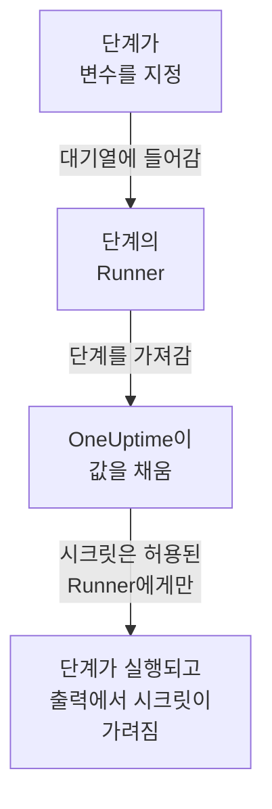

# Runbook 변수

Runbook 변수는 단계가 값을 직접 담는 대신 이름으로 사용하는 값입니다. 호스트, namespace, URL 같은 값이나 SSH 키, 비밀번호, kubeconfig, API 토큰 같은 시크릿을 담습니다. 값을 한 번 바꾸면 그 이름을 쓰는 모든 단계가 다음 실행부터 새 값을 사용합니다. 시크릿은 암호화되고, 다시는 표시되지 않으며, 단계가 출력하는 내용에서 가려집니다.

:::cards
- [변수 만들기](#변수-만들기): 일반 값, 또는 시크릿과 그것을 사용할 수 있는 Runner.
- [단계에서 변수 사용하기](#단계에서-변수-사용하기): 스크립트나 HTTP 요청 안에서, 또는 SSH 단계의 로그인과 kubectl 단계의 kubeconfig로.
- [시크릿을 받는 대상](#시크릿을-받는-대상): 자체 Runner, 허용한 경우 글로벌 Runner, 그리고 HTTP 요청 단계에서는 OneUptime 자체.
:::

## 변수가 단계에 전달되는 방식



단계에는 변수의 이름만 있고 값은 없습니다. 단계의 Runner가 단계를 가져가면 OneUptime이 값을 채워 넣고(스크립트, SSH 단계의 대상 머신과 로그인, kubectl 단계의 kubeconfig) 그 Runner에게만 전달합니다. 사용할 수 없는 변수를 지정한 단계는 값 자리에 이름을 둔 채 실행되지 않고, 이유와 함께 실패합니다.

변수를 사용하는 단계는 Bash, JavaScript, SSH, kubectl, HTTP 요청 단계입니다. AI 단계는 변수를 채우지 않습니다. HTTP 요청 단계는 Runner 없이 OneUptime이 직접 보내므로, 지정한 모든 변수를 시크릿까지 받고, 기록하는 응답에서는 그것들을 숨깁니다.

## 전역 변수와 Runbook 변수

| | 전역 변수 | Runbook 자체 변수 |
| --- | --- | --- |
| 관리 위치 | **런북 → 설정 → 전역 변수** | Runbook의 **설정 → 변수** |
| 사용하는 대상 | 프로젝트의 모든 Runbook | 그 Runbook의 단계만 |
| 단계에서 쓰는 방법 | `{{global.variables.NAME}}` | `{{local.variables.NAME}}` |

이름은 대소문자와 상관없이 프로젝트의 전역 변수 중에서 한 번, Runbook 자체 변수 중에서 한 번만 쓸 수 있습니다. Runbook의 변수는 전역 변수와 이름이 같아도 됩니다. 쓰는 방법이 서로 다르기 때문입니다.

## 시작하기 전에

- **변수를 관리하는 역할.** Project Owner와 Project Admin, 또는 **Create Runbook Variable** 권한입니다. Runbook Admin은 자신이 작성하는 단계에서 고르기 위해 변수를 읽을 수 있지만 변경하지는 못합니다.
- **변수를 포함하는 요금제.** OneUptime Cloud에서는 Runbook 변수에 **Growth** 이상의 요금제가 필요합니다.

## 변수 만들기

:::steps
### 변수 열기

**런북 → 설정 → 전역 변수** 또는 Runbook의 **설정 → 변수** 를 열고 **변수 만들기** 를 클릭합니다.

### 이름을 정하고 값 입력하기

**변수** 단계에서 **이름** 을 입력합니다. 영문자, 숫자, 하이픈, 밑줄로 100자까지 쓸 수 있습니다(예: `PROD_DB_SSH_KEY`). **시크릿** 은 처음부터 켜져 있습니다. 키, 비밀번호, 토큰 또는 kubeconfig를 **시크릿 값** 에 붙여 넣고 **다음** 을 클릭합니다. 호스트처럼 누구나 읽어도 되는 값이라면 **시크릿** 을 끄고 **값** 에 입력한 뒤 **변수 만들기** 를 클릭합니다. 선택 사항인 **설명** 은 **추가 필드** 아래에 있습니다.

### 시크릿을 사용할 수 있는 대상 고르기

**사용할 수 있는 대상** 단계에서 **사용할 수 있는 Runner** 아래의 자체 Runner를 고릅니다. [글로벌 Runner](/docs/runbooks/agents#글로벌-runner)가 있는 서버에서는 **글로벌 Runner가 사용할 수 있음** 을 켜면 이 프로젝트의 단계 중 글로벌 Runner에서 실행되는 단계도 시크릿을 사용할 수 있습니다. 프로젝트가 글로벌 Runner를 사용하는 동안에는 처음부터 켜져 있습니다. 시크릿에는 둘 중 하나가 필요합니다. **변수 만들기** 를 클릭합니다.
:::

변수가 시크릿인지는 나중에 바꿀 수 없습니다. 대신 삭제한 뒤 같은 이름으로 다시 만드세요. 단계는 변수를 이름으로 지정하므로 계속 동작합니다. Kubernetes 에이전트 차트가 설치하는 클러스터 내부 Runner에는 시크릿이 절대 전달되지 않습니다.

## 시크릿 값은 쓰기 전용

시크릿의 값은 저장 시 암호화되며 API는 **절대 반환하지 않습니다**. 대시보드에도, 워크플로에도, 내보내기에도 반환하지 않습니다. 목록에서는 일반 변수가 값을 표시하는 자리에 **시크릿** 이 표시되고, **Runbook 에이전트** 열에는 각 시크릿을 받는 Runner가 표시됩니다. 값을 바꾸려면 해당 행의 **값 교체** 를 클릭하세요. 새 값은 암호화되고, 이전 값은 영구히 사라지며, 단계는 다음 실행부터 새 값을 받습니다.

단계가 받은 시크릿을 출력하면 Runner가 출력이 호스트를 떠나기 전에 그것을 `[REDACTED]`로 바꾸고, OneUptime도 출력을 저장하기 전에 다시 한 번 바꿉니다. 개인 키의 한 줄이나 kubeconfig 안의 토큰도 가려집니다. 4자보다 짧은 시크릿은 찾지 않습니다.

## 단계에서 변수 사용하기

:::tabs
@tab 스크립트에서
Bash, JavaScript, SSH, kubectl 스크립트에서 값이 들어갈 자리에 참조를 씁니다.

```bash
curl -s -X POST \
  -H "Authorization: Bearer {{global.variables.CDN_API_TOKEN}}" \
  "https://api.cdn.example.com/v1/purge"
```
@tab HTTP 요청에서
[HTTP 요청 단계](/docs/runbooks/authoring#http-request)의 URL, 헤더, 본문에 참조를 씁니다.

```json
{ "Authorization": "Bearer {{global.variables.API_TOKEN}}" }
```
@tab SSH 로그인
[SSH 단계](/docs/runbooks/authoring#ssh)는 개인 키나 비밀번호를 담은 시크릿 변수를 **로그인 방법** 에서 고르고, 키의 암호 문구를 **추가 필드 → 키 암호 문구** 에서 고릅니다. 키인지 비밀번호인지는 값으로 판단합니다.
@tab Kubeconfig
[kubectl 단계](/docs/runbooks/authoring#kubectl)는 클러스터의 kubeconfig를 담은 시크릿 변수를 **Kubeconfig** 에서 고르거나, Runner의 것을 쓰는 **Runner 자체 액세스** 를 고릅니다.
:::

Runbook의 **단계** 페이지에서는 각 스크립트와 각 HTTP 요청 아래의 **변수 — 클릭하여 복사** 에 그 단계가 사용할 수 있는 변수가 나열되고, 단계가 없는 변수나 Runner가 사용할 수 없는 시크릿을 지정하면 편집기가 알려 줍니다.

## 시크릿을 받는 대상

| 단계를 실행하는 대상 | 일반 변수 | 시크릿 |
| --- | --- | --- |
| 자체 Runner | 항상 | 시크릿의 **사용할 수 있는 Runner** 에 그 Runner가 있을 때 |
| 글로벌 Runner | 항상 | **글로벌 Runner가 사용할 수 있음** 이 켜져 있고, 시크릿이 속한 프로젝트의 단계일 때 |
| OneUptime 자체 (HTTP 요청 단계) | 항상 | 항상 |

Runner가 사용할 수 없는 시크릿을 지정한 단계는 시크릿 이름과 바꿔야 할 점을 알리며 실패하고, 아무것도 전달되지 않습니다.

## Runbook 시크릿과 자격 증명은 변수가 되었습니다

Runbook 변수는 Runbook 시크릿과, SSH 및 Kubernetes 단계가 지정하던 자격 증명을 대신합니다. OneUptime을 업그레이드할 때 각 프로젝트의 것이 한 번 옮겨졌으므로 모든 Runbook은 이전처럼 실행됩니다.

- 각 Runbook 시크릿은 같은 이름, 같은 값, 같은 Runner, 같은 글로벌 Runner 스위치를 가진 시크릿 전역 변수가 되었습니다.
- 스크립트의 `{{runbookSecrets.NAME}}` 은 `{{global.variables.NAME}}` 으로 바뀌었고, 예전 표기도 여전히 전역 변수 `NAME` 을 읽습니다.
- 단계가 지정하던 각 자격 증명은 같은 Runner를 가진 시크릿 전역 변수가 되었고, 그 이름을 따서 `<name>-ssh-key`(암호 문구가 있는 키라면 `<name>-ssh-key-passphrase` 도), `<name>-ssh-password` 또는 `<name>-kubeconfig` 로 이름이 지어졌습니다.
- 자격 증명을 지정하던 각 SSH 단계는 그 변수로 대상 머신에 로그인해 자신의 명령을 스크립트로 실행하고, 각 Kubernetes 단계는 자신의 동작이 하던 `kubectl patch` 를 실행하는 kubectl 단계가 되었으므로 단계가 갖던 것보다 더 많은 접근 권한이 필요하지 않습니다.

이 릴리스(14.0.79)보다 오래된 Runner는 kubectl 스크립트를 실행할 수 없으며, kubectl 단계를 실패시키고 Runner를 업데이트하라고 알립니다. 이렇게 옮겨진 각 Kubernetes 단계는 처음에 그런 Runner를 위해 스크립트 옆에 자격 증명과 동작을 유지했습니다. 그것들은 Runbook 자격 증명과 함께 사라졌으므로, 모든 kubectl 단계에는 14.0.79 이상의 Runner가 필요합니다.

그 뒤 Runbook 자격 증명이 제거되었고, 아직 자격 증명을 지정하던 단계는 먼저 같은 방식으로 옮겨졌습니다. 자격 증명을 지정하는 단계는 더 이상 실행되지 않으며, 그 단계 페이지에 **스크립트 단계로 바꾸기** 가 표시됩니다. API나 Terraform으로 단계에 자격 증명을 주어 저장하면 거부됩니다. [Runbook 자격 증명이 제거되었습니다](/docs/installation/upgrading#runbook-자격-증명이-제거되었습니다)를 참고하세요.

## 다음 단계

:::cards
- [Runbook 작성하기](/docs/runbooks/authoring): 변수를 사용하는 SSH와 kubectl 단계를 작성합니다.
- [Runbook 에이전트](/docs/runbooks/agents): 시크릿을 전달받는 Runner를 설치합니다.
- [Runbook 구성과 안전](/docs/runbooks/configuration): Runbook 전체의 권한과 보안 강화.
:::
