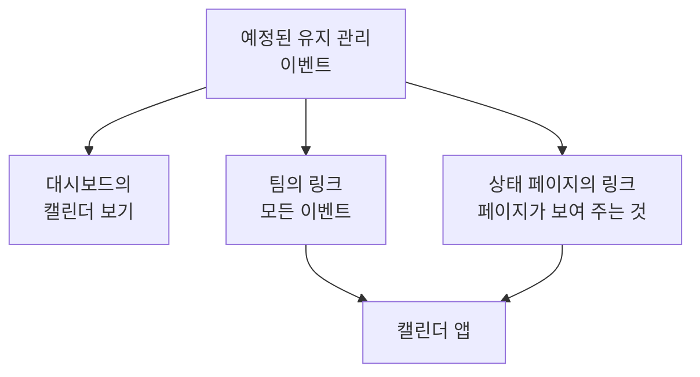

# 유지 관리 캘린더

유지 관리 캘린더는 예정된 유지 관리를 날짜별로 보여 줍니다. 대시보드의 캘린더로, 비밀 링크를 통해 팀의 캘린더 앱에서, 그리고 상태 페이지를 팔로우하는 사람들의 캘린더에서 볼 수 있습니다. 이 페이지에서는 캘린더 보기, 팀의 캘린더 링크, 상태 페이지의 캘린더, 그리고 각 캘린더 일정에 담기는 내용을 설명합니다.

:::cards
- [캘린더 보기](#캘린더-보기): 모든 이벤트를 월, 주 또는 일 단위로, 상태의 색으로 보여 줍니다.
- [팀의 캘린더 링크](#팀의-캘린더-링크): 프로젝트의 모든 이벤트를 Google 캘린더, Outlook 또는 Apple 캘린더에서 봅니다.
- [상태 페이지의 캘린더](#상태-페이지의-캘린더): 상태 페이지가 보여 주는 내용을 방문자의 캘린더에서 봅니다.
- [캘린더 일정에 담기는 내용](#캘린더-일정에-담기는-내용): 제목, 시간대, 상태, 그리고 돌아가는 링크입니다.
:::



## 캘린더 보기

**예정된 유지 관리 → 모든 이벤트** 를 엽니다. 필터 막대의 오른쪽 끝에서 **목록** 과 **캘린더** 가 이벤트 표와 그 캘린더 사이를 전환합니다. 브라우저가 선택을 기억하므로 다음에는 페이지가 캘린더로 열립니다.

- 캘린더는 이번 달로 열리고 오늘이 표시됩니다. **월**, **주**, **일** 로 보여 주는 범위를 바꾸고, 화살표로 이동하고, **오늘** 로 돌아옵니다. 시간은 사용자 자신의 시간대로 표시됩니다.
- 각 이벤트는 상태의 색으로 된 블록이며, 상태의 색 이름은 캘린더 아래에 표시됩니다. 이벤트를 클릭하면 열립니다.
- 캘린더 위의 필터는 목록에서와 같이 작동합니다. 상태, 레이블 또는 소유자를 고르면 해당 이벤트만 보입니다.
- 아직 오지 않은 날에는 그 주에 포인터를 올리면 **+** 가 나타납니다. 이를 누르면 **예정된 유지 관리 이벤트 만들기** 가 열리고, **시작** 이 그날, 양식이 오늘 고를 시각으로 채워집니다. 이벤트를 만들 수 있는 사람에게만 보입니다.
- 한 보기에는 이벤트가 최대 500개까지 표시됩니다. 그보다 많은 달은 그렇다고 알려 주므로, 필터로 좁히거나 한 주를 보세요.

## 팀의 캘린더 링크

캘린더 아래나 목록의 **⋯** 메뉴에 있는 **캘린더 구독** 은 프로젝트의 캘린더 링크를 엽니다. 이는 비밀 iCalendar(`.ics`) 링크 하나로, 프로젝트의 모든 예정된 유지 관리 이벤트를 Google 캘린더, Outlook, Apple 캘린더 또는 URL로 캘린더를 구독하는 어떤 앱에든 넣어 줍니다.

:::steps
### 링크 게시하기

**링크 게시** 를 클릭합니다. 프로젝트에는 팀 전체를 위한 링크가 하나뿐이므로, 이 작업은 한 번만 하면 됩니다.

### 캘린더 앱에 추가하기

**Google 캘린더** 는 Google 캘린더를 열고, 캘린더를 추가할지 묻습니다. **Apple 캘린더 / Outlook** 은 컴퓨터나 휴대폰의 캘린더 앱에서 링크를 엽니다. **링크 복사** 는 다른 앱을 위해 링크를 복사합니다.

### 작동하는지 확인하기

**상태** 패널은 캘린더 앱이 마지막으로 링크를 읽은 시각과 어떤 앱이었는지를 알려 줍니다. 새 링크는 앱이 읽을 때까지 **첫 동기화 대기 중** 으로 표시됩니다.
:::

링크는 다음과 같은 형태입니다.

```text
https://<your host>/api/scheduled-maintenance-calendar/project/<token>/maintenance.ics
```

> [!WARNING]
> 링크가 있는 사람은 누구나 로그인하지 않고도 프로젝트의 모든 예정된 유지 관리 이벤트를 봅니다. 비밀번호처럼 다루고, 실수로 공유되었다면 다시 생성하세요.

### 링크를 볼 수 있는 사람

링크는 프로젝트의 모든 이벤트를 보여 주므로, 대화 상자는 모든 이벤트를 읽을 수 있는 사람에게만 링크를 보여 줍니다. 역할 때문에 일부 이벤트(레이블별이거나 자신이 소유한 이벤트)로 제한된 사람에게는 대신 그 이유가 표시됩니다.

| 작업 | 할 수 있는 사람 |
| --- | --- |
| 링크 복사 | 프로젝트의 모든 예정된 유지 관리 이벤트를 읽을 수 있는 사람 |
| **링크 게시** | 예정된 유지 관리 이벤트를 만들 수도 있는 사람 |
| **링크 다시 생성**, **링크 비활성화** | 예정된 유지 관리 이벤트를 편집할 수도 있는 사람 |

### 링크 관리

**링크 다시 생성** 과 **링크 비활성화** 는 대화 상자 위쪽의 **⋯** 메뉴에 있습니다.

| 작업 | 일어나는 일 |
| --- | --- |
| **링크 다시 생성** | 새 링크를 만듭니다. 30일 동안 이전 링크는 빈 캘린더를 제공하므로, 그 링크를 가진 앱은 사본을 비웁니다. 그 후에는 찾을 수 없습니다. 새 링크로 다시 구독하세요. |
| **링크 비활성화** | 링크는 유지되지만, **링크 활성화** 를 누를 때까지 빈 캘린더를 제공합니다. |

캘린더에는 90일 전부터 1년 후까지의 모든 이벤트가 최대 1,000개까지 담깁니다.

## 상태 페이지의 캘린더

상태 페이지를 팔로우하는 사람은 그 예정된 유지 관리를 자신의 캘린더에 넣을 수 있습니다. 상태 페이지의 예정된 이벤트 페이지에서 **캘린더 구독** 은 Google 캘린더, 기기의 캘린더 앱, 또는 복사할 링크를 제공합니다. 링크는 페이지 주소 뒤에 `/maintenance.ics` 를 붙인 것으로, 예를 들면 `https://status.example.com/maintenance.ics` 입니다.

- **담기는 내용.** 페이지가 보여 주는 것과 정확히 같습니다. 페이지의 기록 기간 안의 이벤트, 아직 시작하지 않은 모든 이벤트, 진행 중인 모든 이벤트가 **상태 페이지에 표시** 가 켜져 있는 동안 담깁니다. 각 이벤트가 영향을 주는 대상은 모니터 자체의 이름이 아니라 페이지가 리소스에 붙인 이름으로 표시됩니다.
- **비공개 페이지.** 캘린더 앱은 로그인할 수 없으므로, 비공개 페이지에는 **캘린더 구독** 이 없고, 그 링크는 페이지가 비공개라고 알리는 빈 캘린더를 제공합니다.
- **이벤트 하나.** 이벤트 페이지의 **캘린더에 추가** 는 그 이벤트만 추가합니다. Google 캘린더가 내용이 채워진 채로 열리거나, 기기의 캘린더 앱이 여는 파일로 다운로드됩니다. 로그인한 방문자라면 비공개 페이지에서도 작동하며, 이벤트가 끝나면 더 이상 제공되지 않습니다.

## 캘린더 일정에 담기는 내용

팀의 캘린더와 상태 페이지의 캘린더 모두 일정을 같은 방식으로 씁니다.

| 부분 | 담기는 내용 |
| --- | --- |
| 제목 | 이벤트의 제목 |
| 시작과 종료 | 계획된 시간대, UTC 기준. 캘린더 앱은 사용자 자신의 시간대로 표시합니다 |
| 설명 | 일반 텍스트로 된 설명, 상태, 영향을 주는 대상, 이벤트로 가는 링크. 팀의 링크는 상태 페이지도 알려 줍니다 |
| 상태 표시 | 이벤트가 취소되었을 때(한 번도 진행 중이 되지 않고 완료되었을 때)는 취소됨 |
| 한가함 또는 바쁨 | 한가함. 유지 관리 시간대가 사용자의 가용 시간을 막지 않습니다 |
| 범주 | 이벤트의 레이블. 상태 페이지의 캘린더는 페이지가 레이블을 보여 줄 때만 표시합니다 |

OneUptime에서 편집한 이벤트는 그 이벤트가 있는 모든 캘린더에서 그 자리에서 업데이트되고, 삭제되거나 상태 페이지에서 빠진 이벤트는 다음 새로 고침 때 캘린더에서 사라집니다.

## 캘린더 새로 고침 주기

캘린더 앱은 구독한 링크를 자체 일정에 따라 읽습니다. Google 캘린더는 몇 시간마다, 때로는 하루에 한 번만 읽고, Apple 캘린더와 Outlook은 보통 한 시간마다 읽습니다. OneUptime은 캘린더를 최대 5분 동안만 보관하므로, 보이는 대기 시간은 캘린더 앱의 것입니다. 앱별 단계는 [캘린더 피드](/docs/on-call/calendar-feeds#캘린더-앱에서-구독하기) 에 있으며, 온콜 근무에도 같은 방식으로 작동합니다.

## 문제 해결

:::details 캘린더 앱에 새 이벤트가 더 이상 표시되지 않음
링크가 다시 생성되었거나 비활성화되었습니다. **캘린더 구독** 을 열어 상태를 확인하세요. 다시 생성된 링크는 새 링크로 다시 구독해야 하고, 비활성화된 링크는 **링크 활성화** 로 되돌릴 수 있습니다.
:::

:::details Google 캘린더가 링크를 추가하지 못함
Google 캘린더는 Google 서버에서 링크를 읽으므로, OneUptime 서버가 인터넷에서 접근 가능해야 합니다. 자체 호스팅 서버라면 [캘린더 피드](/docs/on-call/calendar-feeds#문제-해결) 를 참조하세요.
:::

:::details 상태 페이지의 캘린더에 이벤트가 없음
페이지의 캘린더에는 페이지가 보여 주는 것이 담깁니다. 이벤트가 그 페이지를 지정하는지, 이벤트의 **설정** 에서 **상태 페이지에 표시** 가 켜져 있는지, 페이지의 기록 기간 안에 시작했는지 확인하세요.
:::

## 다음 단계

:::cards
- [유지 관리 이벤트 만들기](/docs/scheduled-maintenance/creating-events): 양식의 각 필드와 그다음에 일어나는 일.
- [구독자 및 공지](/docs/status-pages/subscribers#예정된-유지-관리-이벤트): 상태 페이지의 구독자가 유지 관리에 대해 듣는 내용.
- [캘린더 피드](/docs/on-call/calendar-feeds): 온콜 근무를 위한 같은 종류의 링크.
:::
