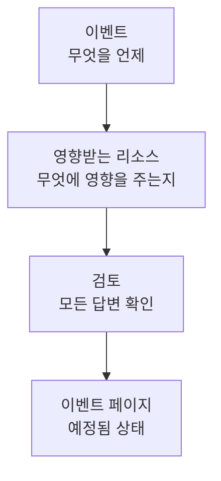

# 유지 관리 이벤트 만들기

유지 관리는 짧은 두 단계로 예약합니다. 무슨 일이 언제 일어나는지 말하고, 그다음 무엇에 영향을 주며 누가 알아야 하는지 말합니다. 직접 입력해야 하는 것은 제목뿐이고, 나머지는 모두 적절한 기본값으로 시작합니다. 이 페이지에서는 양식, 이벤트를 만드는 순간 일어나는 일, 나중에 변경하는 방법, 코드로 이벤트를 만드는 방법을 설명합니다.

:::cards
- [이벤트 만들기](#이벤트-만들기): 두 단계와 검토.
- [만들 때 일어나는 일](#만들-때-일어나는-일): 번호, 규칙, 소유자, 첫 메시지.
- [나중에 이벤트 변경하기](#나중에-이벤트-변경하기): 기간, 리소스, 상태 페이지, 노트.
- [코드로 이벤트 만들기](#코드로-이벤트-만들기): API, Terraform, 워크플로우, 채팅.
:::

## 작동 방식

양식은 단계마다 하나씩 두 가지를 묻고, 이벤트를 만들기 전에 모든 내용을 검토 화면에 보여 줍니다. 이벤트는 예정 상태로 시작하고, 이벤트 페이지가 열립니다.



## 시작하기 전에

- **역할.** 이벤트를 만들려면 **프로젝트 소유자**, **프로젝트 관리자**, **프로젝트 구성원**, **예정된 유지 관리 관리자**, **예정된 유지 관리 구성원** 중 하나이거나 **Create Scheduled Maintenance** 권한이 있는 사용자 지정 역할이 필요합니다.
- **상태 페이지.** 고객에게 알리려면 예정된 유지 관리 이벤트를 표시하는 상태 페이지가 필요합니다. [상태 페이지 개요](/docs/status-pages/index) 를 참조하세요.

## 이벤트 만들기

:::steps
### 양식 열기

**예정된 유지 관리 → 모든 이벤트** 로 이동하여 **예정된 유지 관리 이벤트 만들기** 를 클릭합니다. 양식은 첫 번째 단계인 **이벤트** 에서 열립니다.

### 무슨 일이 언제 일어나는지 말하기

**제목** 을 입력하고, 도움이 된다면 **설명** 을 추가합니다. 설명은 Markdown이며 상태 페이지에 표시됩니다. **시작** 은 이미 사용자 시계의 다음 정시로, **종료** 는 그 한 시간 뒤로 설정되어 있으니 틀린 경우에만 바꾸세요. **시작** 을 옮기면 **종료** 도 함께 옮겨져 기간의 길이가 유지됩니다. **소유자** 와 **레이블** 은 접혀 있는 **추가 필드** 아래에 있습니다.

### 영향을 주는 대상 선택하기

**다음** 을 클릭하여 **영향받는 리소스** 로 이동합니다. 작업이 영향을 주는 **모니터** 를 선택합니다. 하나를 선택하면 그 아래에 **모니터 상태를 다음으로 변경** 이 나타납니다. 이벤트가 시작될 때 모니터가 바뀌는 상태입니다. 그런 다음 호스트, 클러스터, 데이터베이스, 네트워크 사이트, 서비스 같은 **기타 영향받는 리소스** 가 있으면 선택합니다.

### 누가 알게 될지 선택하기

**이 상태 페이지에 이벤트 표시** 에서 상태 페이지를 선택합니다. 접혀 있는 **구독자 알림** 은 누가 언제 알림을 받는지 한 줄로 보여 줍니다. 펼치면 **이벤트가 예약될 때**, **이벤트가 시작될 때**, **이벤트가 종료될 때**, **이벤트 전 리마인더** 를 바꿀 수 있습니다.

### 만들기

**다음** 을 클릭하여 검토 화면을 보고, 확인한 다음 **예정된 유지 관리 이벤트 만들기** 를 클릭합니다. 이벤트 자체의 페이지가 열립니다.
:::

상태 페이지를 선택하기 전에는 아무것도 보내지지 않습니다. 어떤 상태 페이지에도 표시되지 않는 이벤트는 어떤 구독자에게도 알리지 않습니다.

## 양식의 필드

| 필드                                 | 단계               | 초기값                          | 하는 일                                                                          |
| ------------------------------------ | ------------------ | ------------------------------- | -------------------------------------------------------------------------------- |
| **제목**                             | **이벤트**         | 비어 있음, 필수                 | 상태 페이지를 포함한 모든 곳에서 이벤트의 이름이 됩니다.                         |
| **설명**                             | **이벤트**         | 비어 있음                       | 고객에게 작업을 Markdown으로 설명합니다.                                         |
| **시작**                             | **이벤트**         | 다음 정시                       | 이벤트가 저절로 시작되는 시각입니다.                                             |
| **종료**                             | **이벤트**         | **시작** 한 시간 후             | 이벤트가 저절로 종료되는 시각입니다. **시작** 보다 뒤여야 합니다.                 |
| **소유자**                           | **이벤트**         | 없음                            | 이벤트를 소유하고 알림을 받는 사람과 팀입니다.                                   |
| **레이블**                           | **이벤트**         | 없음                            | 규칙과 필터가 일치시킬 수 있는 레이블입니다.                                     |
| **모니터**                           | **영향받는 리소스** | 없음                           | 이벤트가 진행되는 동안 검사되지 않는 모니터입니다.                               |
| **모니터 상태를 다음으로 변경**      | **영향받는 리소스** | 변경 없음                      | 이벤트 동안 그 모니터들이 표시하는 상태입니다. 모니터를 선택하면 묻습니다.       |
| **기타 영향받는 리소스**             | **영향받는 리소스** | 없음                           | 호스트, 클러스터, 데이터베이스, 네트워크 사이트, 서비스 등입니다.                |
| **이 상태 페이지에 이벤트 표시**     | **영향받는 리소스** | 없음                           | 이벤트를 표시하고 구독자에게 알리는 상태 페이지입니다.                           |
| **구독자 알림**                      | **영향받는 리소스** | 세 시점 모두 켜짐, 리마인더 없음 | 해당 페이지의 구독자가 알림을 받는 시점입니다.                                 |

진행하는 동안 두 가지가 양식을 대신 채워 줍니다.

- **연결된 리소스.** 모니터를 선택하면 그 모니터에 연결된 호스트, 클러스터, 서비스 및 기타 리소스가 **기타 영향받는 리소스** 에 추가되고, 필드 아래의 한 줄에 그 이름이 표시됩니다. 원하지 않는 것은 제거하세요. 클라우드 리소스는 추가되지 않습니다. 유지 관리 이벤트에는 클라우드 리소스가 담기지 않기 때문입니다.
- **추천 상태 페이지.** **이 상태 페이지에 이벤트 표시** 아래에 모니터를 표시하는 페이지가 추천됩니다. 페이지 이름을 클릭해 추가하거나 **모두 추가** 를 클릭하세요. 자동으로 선택되는 것은 없습니다. [예정된 유지 관리 이벤트](/docs/status-pages/subscribers#예정된-유지-관리-이벤트) 를 참조하세요.

## 리소스나 템플릿에서 시작하기

호스트, Kubernetes·Proxmox·Ceph·Docker Swarm 클러스터, Docker 또는 Podman 호스트, vCenter, 스토리지 어레이, IoT 플릿, 데이터베이스, 서비스, 네트워크 사이트의 **예정된 유지 관리** 탭에서는 **예정된 유지 관리 이벤트 만들기** 가 같은 양식을 열며, 그 리소스가 **기타 영향받는 리소스** 에 이미 선택되어 있습니다. 탭에는 그 리소스에 영향을 주는 이벤트가 나열됩니다. 인벤토리 항목의 탭은 항목이 가리키는 호스트, 서비스 또는 Kubernetes 클러스터를 선택합니다.

만들기 버튼 옆의 **템플릿에서 생성** 은 **예정된 유지 관리 템플릿 선택** 을 요청한 다음, 템플릿으로 채운 양식을 엽니다. [템플릿 및 반복 이벤트](/docs/scheduled-maintenance/templates) 를 참조하세요.

## 만들 때 일어나는 일

**예정된 유지 관리 이벤트 만들기** 를 클릭하는 순간, OneUptime은 다음 단계를 이 순서대로 진행합니다.

1. **번호와 상태가 정해집니다.** 번호는 프로젝트별 카운터에서 나오며 접두사와 함께 표시됩니다(`SM-42`). 요청에 어떤 상태가 지정되든 이벤트는 예정 상태로 시작합니다.
2. **채팅 도구가 알게 됩니다.** **워크스페이스** 아래의 Slack 및 Microsoft Teams 규칙이 이벤트를 채널에 게시하며, 규칙이 이벤트용 채널을 만들 수도 있습니다. 피드에는 이벤트가 생성되었다는 기록이 남습니다.
3. **상태 타임라인이 시작됩니다.** **상태 타임라인** 의 첫 행은 예정 상태입니다.
4. **소유자와 레이블이 추가됩니다**: 선택한 것을 먼저, 그다음 일치하는 소유자 규칙과 레이블 규칙의 것을 추가합니다.
5. **Runbook 규칙이 시작합니다**: 이벤트와 일치하는 런북을 시작합니다.
6. **리마인더가 예약됩니다**: 리마인더 규칙이 일치하면 소유자를 위해 예약됩니다.

**이벤트가 예약될 때** 를 끄지 않았다면 1분 안에 상태 페이지의 구독자에게 이벤트가 예약되었다는 알림이 갑니다. 워크플로우 트리거 **On Create Scheduled Maintenance Event** 는 이를 기반으로 만든 워크플로우를 시작하고, 소유자는 해당 알림을 켜 두었다면 이벤트에 대해 알게 됩니다. [알림 설정](/docs/notifications/notification-settings) 을 참조하세요.

## 나중에 이벤트 변경하기

양식의 모든 내용은 이벤트 자체의 페이지에서 바꿀 수 있습니다. 단, 구독자에게 알리는 세 시점은 이벤트를 만들 때 한 번만 정해집니다.

| 바꿀 항목                                   | 위치                                                                           |
| ------------------------------------------- | ------------------------------------------------------------------------------ |
| 제목, 기간 또는 레이블                      | **개요** 의 **Maintenance Details** 카드에 있는 **편집**, 단계 **이벤트**       |
| 상태 페이지 또는 리마인더                   | 같은 **편집**, 단계 **상태 페이지**                                             |
| 모니터, 그 상태 또는 다른 리소스            | **영향받는 리소스** 카드의 **편집**                                            |
| 설명                                        | 사이드 메뉴의 **설명**                                                         |
| 소유자                                      | 사이드 메뉴의 **소유자**                                                       |

**모니터 상태를 다음으로 변경** 은 이벤트가 시작될 때까지 바꿀 수 있습니다. 그 후에는 모니터가 이미 그 상태이므로 카드에 읽기 전용으로 표시됩니다. 편집하면 바뀐 내용을 밝히는 항목이 **예정된 유지보수 피드** 에 추가되며, 아무것도 바꾸지 않고 저장하면 추가되지 않습니다.

## 작업 진행에 따라 노트 게시하기

- **공개 노트** 는 고객을 위한 업데이트입니다. 이벤트의 상태 페이지에 표시되며, 각 노트는 **Notify status page subscribers** 로 그 페이지의 구독자에게 알릴 수 있습니다.
- **비공개 노트** 는 팀 전용입니다.

이벤트의 **공개 노트** 또는 **비공개 노트** 페이지에서 작성하거나, **예정된 유지보수 피드** 의 **작업** 메뉴에서 **Add Public Note** 또는 **비공개 노트 추가** 로 작성합니다. 같은 메뉴의 **Execute Runbook** 으로 런북을 실행합니다. 노트 템플릿은 팀이 자주 쓰는 텍스트를 채워 줍니다. [유지 관리 규칙 및 설정](/docs/scheduled-maintenance/settings#노트-템플릿) 을 참조하세요.

## 코드로 이벤트 만들기

이벤트 모델에는 표준 API가 있으므로 `POST /api/scheduled-maintenance` 로 이벤트를 만듭니다. **프로젝트 설정 → 고급 → API 키** 의 API 키를 `apikey` 헤더로 보내 인증합니다. 키가 프로젝트를 결정합니다.

```bash
curl -X POST https://oneuptime.com/api/scheduled-maintenance \
  -H "apikey: $ONEUPTIME_API_KEY" \
  -H "Content-Type: application/json" \
  -d '{
    "data": {
      "title": "Database upgrade",
      "description": "Writes pause for a few minutes while the primary restarts.",
      "startsAt": "2030-06-01T02:00:00Z",
      "endsAt": "2030-06-01T04:00:00Z"
    }
  }'
```

| 필드                                                  | 참고                                                                                      |
| ----------------------------------------------------- | ----------------------------------------------------------------------------------------- |
| `title`, `startsAt`, `endsAt`                          | 양식과 마찬가지로 필수입니다.                                                             |
| `monitors`, `statusPages`, `labels`                   | 이벤트의 모니터, 상태 페이지, 레이블이며, 모두 API 키의 프로젝트에 속해야 합니다.        |
| `changeMonitorStatusToId`                             | 이벤트가 시작될 때 모니터가 바뀌는 모니터 상태입니다.                                     |
| `currentScheduledMaintenanceStateId`                  | 무시됩니다. 모든 이벤트는 예정 상태로 시작합니다.                                         |
| `shouldStatusPageSubscribersBeNotifiedOnEventCreated` | **이벤트가 예약될 때** 스위치입니다. 나머지 두 시점에는 각각 고유한 필드가 있습니다.      |

코드로 표현한 같은 이벤트는 Terraform 리소스 `oneuptime_scheduled_maintenance_event` 입니다. [예제](/docs/terraform/examples#예약된-유지-관리) 를 참조하세요. 워크플로우는 **Create One Scheduled Maintenance Event** 단계로 이벤트를 만들고, `/oneuptime maintenance` 는 Slack에서 양식을 엽니다. [Slack](/docs/workspace-connections/slack#slack-에서-인시던트와-유지-관리-만들기) 을 참조하세요.

## 문제 해결

:::details 종료가 시작보다 뒤여야 한다고 표시됩니다
기간은 순서가 맞아야 합니다. 이벤트는 시작한 뒤에 종료됩니다. **종료** 는 **시작** 을 따라 움직이므로 먼저 **시작** 을 옮긴 다음 **종료** 를 설정하세요.
:::

:::details 양식에 모니터 상태를 다음으로 변경이 없습니다
이벤트에 모니터가 있을 때만 묻습니다. **모니터** 에서 하나를 선택하면 바로 아래에 나타납니다.
:::

:::details 모니터 상태를 다음으로 변경을 더 이상 바꿀 수 없습니다
이벤트가 이미 시작되었고, 모니터가 이미 그 상태에 있습니다. 이 상태는 이벤트가 시작되는 순간부터 종료될 때까지 적용됩니다.
:::

## 다음 단계

:::cards
- [유지 관리 상태](/docs/scheduled-maintenance/states): 이벤트를 시작하고 종료하는 것과 직접 옮기는 방법.
- [템플릿 및 반복 이벤트](/docs/scheduled-maintenance/templates): 양식의 답변을 다음을 위해 저장합니다.
- [구독자 및 공지](/docs/status-pages/subscribers#예정된-유지-관리-이벤트): 누가 언제 알림을 받는지 정확히.
- [유지 관리 규칙 및 설정](/docs/scheduled-maintenance/settings): 소유자, 레이블, 리마인더를 자동으로 추가합니다.
:::
