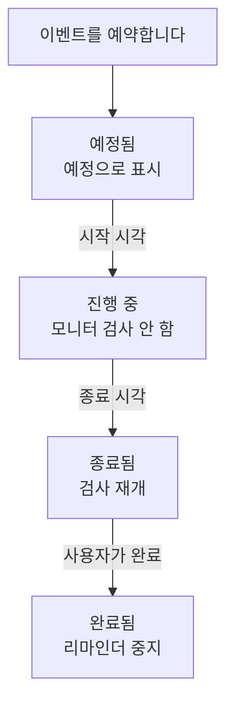

# 예정된 유지 관리 개요

예정된 유지 관리 이벤트는 계획된 작업을 실제로 하기 전에 모두에게 알립니다. 데이터베이스 업그레이드, 네트워크 변경, 새 서버로의 이전 같은 작업입니다. OneUptime은 이벤트를 제시간에 시작하고 종료하며, 작업이 진행되는 동안 영향받는 모니터의 검사를 멈추고, 이벤트를 상태 페이지에 표시하므로 계획된 다운타임이 장애처럼 보이지 않습니다. 이 페이지에서는 이벤트가 진행되는 방식, 대시보드에서 각 기능의 위치, 이벤트가 OneUptime의 나머지 부분에서 바꾸는 것을 설명합니다.

:::cards
- [이벤트가 진행되는 방식](#이벤트가-진행되는-방식): 예정에서 완료까지, 대부분 자동으로 진행됩니다.
- [이벤트가 생기는 곳](#이벤트가-생기는-곳): 만들기 양식, 템플릿, 일정, 양식 기능, 채팅, 코드.
- [이벤트가 영향을 주는 것](#이벤트가-영향을-주는-것): 모니터, 상태 페이지, 구독자, 경고.
- [이벤트의 자체 페이지](#이벤트의-자체-페이지): 개요, 타임라인, 노트, 설정.
:::

## 이벤트가 진행되는 방식

모든 이벤트에는 계획된 기간, 즉 **시작** 과 **종료** 가 있으며, 유지 관리 상태 목록을 따라 아래로 이동합니다. 매분 실행되는 작업이 기간의 양 끝에서 이벤트를 다음 단계로 옮기므로, 작업을 한 번만 예약하면 나머지는 OneUptime이 처리합니다.

새 이벤트는 **예정됨** 에서 시작합니다. **시작** 시각이 되면 **진행 중** 으로 바뀝니다. OneUptime은 이벤트의 모니터 검사를 멈추고, 모니터에 사용할 상태를 선택했다면 그 상태로 표시합니다. **종료** 시각이 되면 **종료됨** 으로 바뀝니다. 검사가 재개되고 각 모니터는 정상 작동 상태로 돌아갑니다. **완료됨** 은 마지막 단계이며, 저절로 넘어가지 않습니다. 사람, 채팅 버튼 또는 API가 작업을 승인된 것으로 표시하며, 이때 소유자에게 가던 리마인더도 멈춥니다.

이벤트를 일찍 시작하거나 종료할 수 있고, 이 네 가지 사이에 직접 만든 상태를 추가할 수도 있습니다. [유지 관리 상태](/docs/scheduled-maintenance/states) 를 참조하세요.

## 유지 관리와 공지

둘 다 상태 페이지 방문자에게 무언가를 알립니다. 시작과 끝이 있는 작업에는 유지 관리 이벤트를, 방문자가 읽어야 할 그 밖의 모든 내용에는 공지를 사용하세요.

|                              | 예정된 유지 관리                                                        | 공지                                           |
| ---------------------------- | ----------------------------------------------------------------------- | ---------------------------------------------- |
| **무엇인가**                 | 기간이 있는 계획된 작업                                                 | 상태 페이지 방문자를 위한 메시지               |
| **모니터**                   | 진행 중에는 검사되지 않고, 선택한 상태로 표시됨                         | 바뀌지 않음                                    |
| **진행 방식**                | 유지 관리 상태를 따라 제시간에                                          | 시작 시각부터 종료 시각까지 표시됨(종료 시각이 있는 경우) |
| **구독자에게 알리는 시점**   | 예약될 때, 시작할 때, 종료될 때, 원하면 시작 전에도                     | 표시되기 시작할 때 한 번                       |
| **새 프로젝트의 번호**       | `SM-42`                                                                 | 없음                                           |

공지는 [구독자 및 공지](/docs/status-pages/subscribers#공지) 에서 설명합니다.

## 이벤트가 생기는 곳

- **만들기 양식.** 이벤트 목록에서, 또는 호스트, 클러스터, 서비스, 네트워크 사이트 같은 리소스의 **예정된 유지 관리** 탭에서 **예정된 유지 관리 이벤트 만들기** 를 클릭합니다. 리소스 탭에서 열면 그 리소스가 미리 선택됩니다. [유지 관리 이벤트 만들기](/docs/scheduled-maintenance/creating-events) 를 참조하세요.
- **템플릿.** **템플릿에서 생성** 은 자주 하는 작업을 위해 저장한 템플릿으로 양식을 채웁니다. [템플릿 및 반복 이벤트](/docs/scheduled-maintenance/templates) 를 참조하세요.
- **일정.** 반복 템플릿은 매주나 매월 같은 일정에 따라, 아무도 양식을 열지 않아도 새 이벤트를 만듭니다.
- **양식 기능.** 제출할 때 유지 관리 이벤트를 만드는 양식은 변경 요청을 이벤트로 바꿉니다. [제출로 만들어지는 항목](/docs/forms/on-submit#제출이-예정된-유지-관리-이벤트가-되는-과정) 을 참조하세요.
- **채팅.** Slack의 `/oneuptime maintenance` 또는 Microsoft Teams에서 OneUptime 봇에 입력한 `maintenance` 는 채팅 도구 안에서 양식을 엽니다. [Slack](/docs/workspace-connections/slack#slack-에서-인시던트와-유지-관리-만들기) 을 참조하세요.
- **코드.** `/api/scheduled-maintenance` 의 API, Terraform 리소스 `oneuptime_scheduled_maintenance_event`, 워크플로우의 **Create One Scheduled Maintenance Event** 단계입니다.

## 대시보드에서 유지 관리의 위치

상단 바의 **제품** 메뉴에서 **예정된 유지 관리** 를 엽니다. 이벤트 목록은 `/dashboard/{projectId}/scheduled-maintenance-events` 에 있으며, 사이드 메뉴에 유지 관리에 관한 모든 것이 있습니다.

| 섹션          | 할 수 있는 일                                                                                                              |
| ------------- | -------------------------------------------------------------------------------------------------------------------------- |
| **개요**      | **모든 이벤트** 와 **진행 중인 이벤트**. 배지에는 지금 진행 중인 이벤트 수가 표시됩니다.                                     |
| **캘린더** | **유지 관리 캘린더**. 모든 이벤트를 월, 주 또는 일 단위로, 추가한 프로젝트 외부 캘린더와 함께 보여 줍니다. |
| **워크스페이스** | 프로젝트에 연결된 쪽의 **Slack** 과 **Microsoft Teams**, 둘 다 없으면 **Slack 또는 Teams 연결**.                         |
| **규칙**      | **소유자 규칙**, **Runbook 규칙**, **레이블 규칙**, **Reminder Rules**.                                                     |
| **설정**      | **이벤트 상태**, **이벤트 템플릿**, **노트 템플릿**, **사용자 정의 필드**, **측정**, **캘린더 설정**, **번호 매기기**.                        |

**개요** 와 **캘린더** 는 열려 있습니다. **워크스페이스**, **규칙**, **설정**, **개발자** 는 접힌 상태로 시작하며, 섹션의 페이지 중 하나에 있으면 그 섹션이 저절로 열립니다. **개발자** 에는 코드로 유지 관리를 관리하기 위한 **Terraform**, **API**, **AI 어시스턴트** 가 있습니다. 유지 관리에 관한 모든 것은 **프로젝트 설정** 이 아니라 여기에 있습니다.

목록에는 **예정된 유지 관리 번호**, **제목**, **현재 상태**, **영향받는 리소스**, **상태 페이지에 표시됨**, **시작**, **기간**, **종료**, **레이블**, **소유자** 가 표시됩니다. 이벤트를 선택하면 여러 개를 한 번에 처리할 수 있습니다. **{{state}}(으)로 표시**, **상태 변경**, **나에게 할당**, **Add Owner**, **Remove Owner**, **Add Labels**, **Remove Labels**, **삭제** 입니다. 각 이벤트 행 끝의 **⋯** 메뉴에서는 그 이벤트 하나에 같은 작업을 할 수 있습니다. 이벤트가 넘어갈 수 있는 동안 **{{state}}(으)로 표시** 단계, 그리고 **상태 변경**, 아직 소유자가 아니면 **나에게 할당**, 그리고 **Add Owner** 입니다.

**캘린더** 섹션의 **유지 관리 캘린더** 는 같은 이벤트를 월, 주, 일 단위로 보여 주며, 프로젝트 외부 캘린더를 함께 표시할 수도 있습니다. [유지 관리 캘린더](/docs/scheduled-maintenance/calendar) 를 참조하세요.

## 이벤트가 영향을 주는 것

이벤트가 진행되는 동안 OneUptime은 이벤트가 계획한 중단을 예상된 것으로 취급합니다.

- **모니터를 검사하지 않습니다.** **모니터** 에 있는 모든 모니터는 검사가 멈추고, 각 모니터의 페이지에 **이 모니터는 비활성화되어 있습니다** 가 표시됩니다. **모니터 상태를 다음으로 변경** 을 선택했다면 모니터는 상태 페이지에서도 그 상태를 표시합니다. 이벤트가 종료되거나 삭제되면 검사가 재개되고 각 모니터는 정상 작동 상태로 돌아갑니다. 단, 진행 중인 다른 이벤트가 아직 그 모니터를 잡고 있으면 예외입니다.
- **다른 리소스도 조용합니다.** 여러 호스트, 클러스터, 데이터베이스 또는 서비스를 각각 하나의 시리즈로 감시하는 텔레메트리 모니터는, 이벤트가 다루는 리소스의 시리즈에 대해서는 인시던트도 경고도 만들지 않고, 나머지 시리즈는 계속 경고합니다.
- **네트워크 사이트와 SLO도 멈춥니다.** 이벤트가 다루는 네트워크 사이트는 계획된 중단을 상위 사이트에 반영하지 않고, SLO의 소진율 규칙은 모니터 중 하나라도 유지 관리 중인 동안에는 아무것도 만들지 않습니다. [네트워크 사이트](/docs/monitor/network-sites#네트워크-사이트의-예정된-유지-관리) 와 [소진율 경고 및 인시던트](/docs/slo/burn-rate-alerts#예약된-유지-관리) 를 참조하세요.
- **상태 페이지에 표시됩니다.** 이벤트는 선택한 상태 페이지에 먼저 예정으로, 다음에 진행 중으로, 마지막에 지난 것으로 표시됩니다. 단, 이벤트의 **설정** 에서 **상태 페이지에 표시** 가 켜져 있는 동안에만 표시됩니다.
- **구독자가 알게 됩니다.** 기본적으로 해당 페이지의 구독자는 이벤트가 예약될 때, 시작할 때, 종료될 때 알림을 받고, 리마인더를 설정했다면 시작 전에도 리마인더를 받습니다. [예정된 유지 관리 이벤트](/docs/status-pages/subscribers#예정된-유지-관리-이벤트) 를 참조하세요.
- **팀이 알게 됩니다.** 소유자는 각자의 [알림 설정](/docs/notifications/notification-settings) 에 따라 알림을 받고, **워크스페이스** 아래의 Slack 및 Microsoft Teams 규칙이 이벤트를 채널에 게시합니다.

## 이벤트의 자체 페이지

목록에서 이벤트를 열면 그 페이지가 표시됩니다. 사이드 메뉴에는 다음이 있습니다.

| 사이드 메뉴 섹션  | 페이지                                                                                        |
| ----------------- | --------------------------------------------------------------------------------------------- |
| **개요** | **개요**, **상태 타임라인**, **설명**, **런북** |
| **팀** | **소유자** |
| **알림**          | **알림 로그** 와 **AI 로그**: 이벤트에 관해 보낸 모든 메시지와 AI가 이벤트를 위해 한 일        |
| **노트**          | **비공개 노트** 와 **공개 노트**                                                               |
| **개발자**        | **Terraform**, **API**, **AI 어시스턴트**: 코드로 관리하는 이벤트                              |
| **고급**          | **사용자 정의 필드**, **설정**, **감사 로그**, **이벤트 삭제**                                 |

**개요**, **팀**, **노트** 는 열려 있고, 나머지 섹션은 클릭할 때까지 접혀 있습니다.

- **개요** — 헤더에는 이벤트의 번호, 제목, 상태, 시작까지 남은 시간 또는 진행된 시간, 그리고 이벤트를 다음 단계로 옮기는 버튼이 표시됩니다. 그 아래의 **시작**, **종료**, **기간** 은 계획된 기간을 사용자의 시간대로 보여 줍니다. **예정된 유지보수 피드** 는 이벤트에 일어난 모든 일을 기록하며, 그 옆에 **Maintenance Details** 와 **영향받는 리소스** 카드, 그리고 프로젝트에 있는 경우 **측정** 과 **사용자 정의 필드** 카드가 있습니다.
- **상태 타임라인** — 이벤트가 거친 모든 상태와 그 시각 및 기간입니다. [유지 관리 상태](/docs/scheduled-maintenance/states#상태-타임라인) 를 참조하세요.
- **공개 노트** — 상태 페이지와 그 구독자를 위한 업데이트입니다. **비공개 노트** 는 팀 전용입니다.
- **설정** — 상태 페이지에서 이벤트를 표시하거나 숨기는 **상태 페이지에 표시** 와, 완료될 때까지 소유자에게 리마인더를 보내는 **리마인더 보내기** 가 있습니다. 각 스위치는 전환하는 즉시 저장됩니다.

## 문제 해결

:::details 이벤트가 시작 시각에 시작되지 않았습니다
이벤트를 시작하는 작업은 매분 실행되므로 1분 정도 기다리세요. 헤더에 **Start overdue** 가 표시되면 이벤트가 시작을 2분 넘게 놓친 것입니다. 작업이 하는 일을 모두 수행하는 헤더의 버튼으로 시작하고, **상태 타임라인** 을 열어 어떤 상태였는지 확인하세요.
:::

:::details 유지 관리 중에도 모니터가 검사되었습니다
검사가 멈추는 것은 이벤트가 **모니터** 에 지정한 모니터뿐이며, 그것도 이벤트가 진행 중일 때뿐입니다. 이벤트가 **기타 영향받는 리소스** 에 지정한 호스트나 서비스의 모니터는 계속 검사됩니다. 모니터를 추가하려면 이벤트의 **영향받는 리소스** 카드를 편집하세요.
:::

:::details 이벤트가 상태 페이지에 표시되지 않습니다
이벤트가 **이 상태 페이지에 이벤트 표시** 에서 해당 페이지를 지정하는지, 이벤트의 **설정** 에서 **상태 페이지에 표시** 가 켜져 있는지 확인하세요. 그런 다음 상태 페이지 자체를 확인하세요. 예정된 유지 관리 이벤트를 표시하도록 설정되어 있어야 하며, 페이지의 기록 기간(변경하지 않았다면 14일)보다 오래전에 시작된 이벤트는 더 이상 표시되지 않습니다.
:::

## 다음 단계

:::cards
- [유지 관리 이벤트 만들기](/docs/scheduled-maintenance/creating-events): 양식의 각 필드와 그 후에 일어나는 일.
- [유지 관리 상태](/docs/scheduled-maintenance/states): 이벤트를 시작하고 종료하는 것, 그리고 직접 만든 상태.
- [템플릿 및 반복 이벤트](/docs/scheduled-maintenance/templates): 이벤트를 재사용하거나 매주 예약합니다.
- [유지 관리 규칙 및 설정](/docs/scheduled-maintenance/settings): 소유자, 레이블, 런북, 리마인더를 자동으로.
:::
