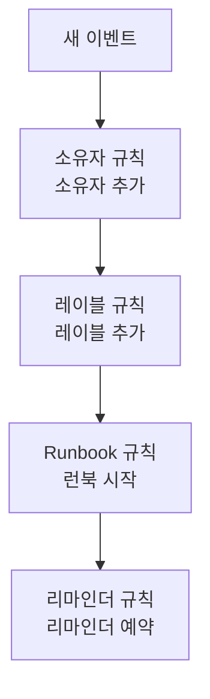

# 유지 관리 규칙 및 설정

유지 관리 구성은 **프로젝트 설정** 이 아니라 **예정된 유지 관리** 안에 있습니다. 모든 새 이벤트에 작용하는 규칙과, 프로젝트의 모든 이벤트를 구성하는 설정입니다. 이 페이지는 각 항목과 그것을 바꿀 수 있는 사람에 대한 참조 문서입니다.

:::cards
- [새 이벤트가 거치는 규칙](#새-이벤트가-거치는-규칙): 순서대로, 그리고 각각이 하는 일.
- [리마인더 규칙](#리마인더-규칙): 이벤트가 완료될 때까지 소유자에게 리마인더를 보냅니다.
- [설정](#설정): 노트 템플릿, 사용자 정의 필드, 측정, 번호 매기기.
- [변경할 수 있는 사람](#변경할-수-있는-사람): 유지 관리 역할과 요금제.
:::

## 유지 관리 설정의 위치

상단 바의 **제품** 메뉴에서 **예정된 유지 관리** 를 엽니다. 사이드 메뉴의 **규칙** 과 **설정** 섹션은 처음에 접혀 있으니 먼저 펼치세요. 여기 있는 모든 페이지는 프로젝트 전체에 적용되며, 주소는 `/dashboard/{projectId}/scheduled-maintenance-events/settings/` 로 시작합니다.

| 규칙 페이지        | 하는 일                                                             |
| ------------------ | ------------------------------------------------------------------- |
| **소유자 규칙**    | 일치하는 이벤트에 소유자를 추가합니다.                              |
| **Runbook 규칙**   | 일치하는 이벤트에 대해 런북을 시작합니다.                           |
| **레이블 규칙**    | 일치하는 이벤트에 레이블을 추가합니다.                              |
| **Reminder Rules** | 이벤트가 완료될 때까지 일정 간격으로 소유자에게 리마인더를 보냅니다. |

**설정** 섹션에는 [유지 관리 상태](/docs/scheduled-maintenance/states) 에서 다루는 **이벤트 상태**, [템플릿 및 반복 이벤트](/docs/scheduled-maintenance/templates) 에서 다루는 **이벤트 템플릿**, 그리고 **노트 템플릿**, **사용자 정의 필드**, **측정**, **캘린더 설정**, **번호 매기기** 가 있습니다. **캘린더 설정** 은 [유지 관리 캘린더](/docs/scheduled-maintenance/calendar#외부-캘린더) 에서, 나머지는 아래에서 다룹니다.

**워크스페이스** 섹션에는 이벤트를 채널에 게시하는 Slack 및 Microsoft Teams 규칙이 있습니다. [Slack](/docs/workspace-connections/slack#알림-규칙) 과 [Microsoft Teams](/docs/workspace-connections/microsoft-teams#알림-규칙) 를 참조하세요.

## 새 이벤트가 거치는 규칙

여러 규칙이 일치할 때 처리하는 방식은 규칙마다 다릅니다.

- **소유자 규칙**, **레이블 규칙**, **Runbook 규칙** 은 일치하면 모두 작용합니다. 여러 규칙이 추가하는 소유자와 레이블은 한 번만 추가됩니다.
- **Reminder Rules** 는 목록의 위에서 아래로 확인되며, 처음 일치한 규칙이 적용됩니다. 규칙을 끌어 순서를 바꿀 수 있으며, 새 규칙은 맨 끝에 추가됩니다.

새 규칙은 활성화된 상태로 시작합니다. 일시 중지하려면 편집 양식에서 **활성화됨** 을 끄세요. 목록에는 각 규칙에 녹색 **활성화됨** 또는 빨간색 **비활성화** 가 표시됩니다. 소유자 규칙, 레이블 규칙, Runbook 규칙은 저장한 뒤에 만들어진 이벤트에 작용합니다. 이미 있는 이벤트에 소유자 규칙이나 레이블 규칙을 적용하려면 **지금 실행** 을 사용하세요. [기존 리소스에 규칙 실행](/docs/configuration/run-rules-now) 을 참조하세요.

## 소유자 규칙과 레이블 규칙

**소유자 규칙** 은 일치하는 새 이벤트에 소유자 사용자와 팀을 추가하고, **레이블 규칙** 은 레이블을 추가합니다. 규칙을 만드는 데는 두 단계가 있습니다. 조건을 정하는 **일치** 와, 규칙이 추가하는 것을 정하는 **소유자** 또는 **레이블** 입니다.

| 조건                                                            | 일치하는 대상                                                              |
| --------------------------------------------------------------- | -------------------------------------------------------------------------- |
| **모니터**, **이벤트 레이블**, **모니터 레이블**                | 선택한 모니터나 레이블 중 하나라도 있는 이벤트.                            |
| **이벤트 제목**, **이벤트 설명**, **모니터 이름**, **모니터 설명** | 대소문자를 구분하지 않는 정규 표현식 패턴.                              |

규칙은 입력한 모든 조건이 충족될 때만 일치합니다. 비어 있는 조건은 건너뜁니다.

- **규칙은 상속할 수 있습니다.** 접혀 있는 **소유자 상속** 또는 **레이블 상속** 아래의 스위치 여섯 개가 이벤트의 모니터, 호스트, Kubernetes 클러스터, Docker 호스트, Podman 호스트, 서비스의 소유자나 레이블을 이어받습니다.
- **새 규칙은 무언가를 추가해야 합니다**. 소유자나 레이블을 하나 이상 선택하거나 스위치를 켜세요.
- 소유자 규칙의 **추가 필드** 아래에 있는 **소유자에게 알림** 은 추가된 사람에게 알릴지를 정합니다.

[레이블 및 소유자 규칙](/docs/configuration/label-and-owner-rules) 에서 모든 종류의 리소스에 대한 양식을 단계별로 설명합니다.

## Runbook 규칙

**Runbook 규칙** 은 새 이벤트가 일치하면 런북을 시작합니다. 예를 들어 데이터베이스 업그레이드마다 실행하는 사전 점검 목록입니다. 일치시키는 대상은 소유자 규칙 및 레이블 규칙과 같습니다. 이벤트에는 심각도가 없으므로 유지 관리 Runbook 규칙은 심각도를 제공하지 않습니다. 실행은 이벤트의 **런북** 페이지에서 이벤트에 연결됩니다. [Runbook 규칙](/docs/runbooks/rules) 을 참조하세요.

## 리마인더 규칙

**예정된 유지 관리 → 규칙 → Reminder Rules** 는 작업이 승인될 때까지 이벤트의 소유자에게 리마인더를 보냅니다. 각 이벤트에는 목록의 위에서부터 처음 일치하는 규칙이 적용됩니다.

:::steps
### 리마인더를 보낼 이벤트 선택하기

**Scheduled Maintenance Reminder Rule 만들기** 를 클릭합니다. 모든 이벤트에 대해 리마인더를 보내려면 **일치** 에서 **모든 예정된 유지보수 이벤트** 를 선택된 그대로 둡니다. **조건과 일치하는 예정된 유지보수 이벤트만** 을 고르면 적용할 **레이블** 을 선택할 수 있습니다.

### 간격 설정하기

**리마인더**에서 소유자에게 리마인더를 보내는 빈도인 **리마인더 간격(분)** 값을 설정하고, **소유자 리마인더**에서 리마인더를 보낼 시점을 고르세요. **이름**은 직접 입력할 때까지 "진행 중에 30분마다 리마인더 보내기"처럼 두 값에 따라 바뀌며, **설명**은 **추가 필드**에 있습니다. 그런 다음 규칙을 만드세요.
:::

| 답 | 소유자에게 리마인더를 보내는 기간 |
| --- | --- |
| **진행 중** | 이벤트가 시작된 때부터 끝날 때까지. 새 규칙은 이 답으로 시작합니다. |
| **시작 전** | 이벤트가 예약된 때부터 시작될 때까지. |
| **시작 전과 진행 중** | 이벤트가 예약된 때부터 끝날 때까지. |

API나 Terraform으로 저장되어 이벤트 시작을 기다렸다가 시작되면 멈추는 규칙은 리마인더를 보내지 않습니다. 목록에는 그 규칙이 **리마인더를 보내지 않음** 으로 표시되고, 양식에서 답을 고르라고 안내합니다.

소유자는 각 리마인더를 **Maintenance reminder** 로 받으며, 이 알림은 모든 새 멤버에게 이메일로 켜져 있습니다. 리마인더 규칙을 저장, 변경 또는 삭제하면 완료되지 않은 모든 이벤트를 다시 일치시킵니다. 한 이벤트의 리마인더를 멈추려면 그 이벤트의 **설정** 페이지에서 **리마인더 보내기** 를 끄세요. 전환하는 즉시 저장됩니다.

이 리마인더는 팀을 위한 것입니다. 상태 페이지 구독자가 이벤트 시작 전에 받는 리마인더는 이벤트 자체의 **이벤트 전 리마인더** 에서 설정합니다.

## 설정

### 노트 템플릿

**예정된 유지 관리 → 설정 → 노트 템플릿** 에는 유지 관리 업데이트용으로 미리 작성한 텍스트가 있습니다. **예정된 유지 관리 이벤트용 공개 또는 비공개 메모 템플릿** 카드에 목록이 있으며, **예정된 유지보수 노트 템플릿 만들기** 는 **템플릿 이름**, **템플릿 설명**, **노트** 를 묻습니다. 템플릿은 누군가 이벤트에 공개 또는 비공개 노트를 작성할 때와 상태를 바꿀 때 제시되며, 게시하기 전에 텍스트를 편집할 수 있습니다. 인시던트 노트 템플릿과 달리 유지 관리 노트 템플릿은 변수를 채우지 않습니다.

### 사용자 정의 필드

**예정된 유지 관리 → 설정 → 사용자 정의 필드** 는 변경 티켓이나 고객 등급 같은 고유한 필드를 모든 이벤트에 추가합니다. 이벤트의 **사용자 정의 필드** 페이지에서 입력하거나 API에서 `customFields` 로 입력합니다. 필드는 직접 입력하는 대신 모니터의 사용자 정의 필드에서 값을 복사할 수도 있습니다. [모니터에서 복사되는 필드](/docs/incidents/settings#모니터에서-복사하는-필드) 를 참조하세요. 이벤트에서도 같은 방식으로 작동합니다.

### 측정

**예정된 유지 관리 → 설정 → 측정** 은 모든 이벤트에서 일에 걸리는 시간을 잽니다. 계획된 시작부터 이벤트 시작까지의 **시작 지연**, 계획된 종료부터 실제 종료까지의 **초과 시간**, 시작부터 종료까지의 **유지 관리 소요 시간** 을 고르거나, **기타** 로 원하는 두 시점을 고릅니다. 각 측정은 이벤트 페이지에 표시되고 `oneuptime.scheduled-maintenance.measurement.<key>` 로 차트에 그려집니다. [측정](/docs/incidents/settings#측정) 을 참조하세요. 이벤트에서도 같은 방식으로 작동합니다.

### 번호 매기기

**예정된 유지 관리 → 설정 → 번호 매기기** 는 이벤트 번호 앞에 붙는 텍스트를 설정합니다. 새 프로젝트에서는 `SM-` 이고, 없으면 `#` 입니다. **업데이트** 는 **예정된 유지 관리 번호 접두사** 를 묻고, 입력하는 동안 번호를 미리 보여 줍니다. 새 접두사는 그 이후에 만들어지는 이벤트에만 붙고, 기존 이벤트는 번호를 유지합니다. 접두사 규칙은 [번호 접두사](/docs/incidents/settings#번호-접두사) 에 있습니다.

그 아래의 **다음 번호** 카드는 다른 도구의 번호를 이어 가도록 다음 이벤트가 받을 번호를 정합니다. **업데이트** 를 누르면 **다음 예정된 유지 관리 번호** 가 열리며, 지금까지 가장 높은 번호보다 커야 합니다. [다음 번호](/docs/incidents/settings#다음-번호) 를 참고하세요.

> [!NOTE]
> OneUptime Cloud에서 사용자 정의 필드에는 **Growth** 이상의 요금제가 필요하며, 유지 관리 상태와 템플릿을 추가하고 변경하는 것도 마찬가지입니다.

## 워크플로우

모든 유지 관리 모델에는 모델 이름을 딴 워크플로우 트리거와 작업이 있습니다. **On Create Scheduled Maintenance Event**, **On Update Scheduled Maintenance Event**, **On Create or Update Scheduled Maintenance Event**, **On Delete Scheduled Maintenance Event**, 그리고 **Scheduled Maintenance State Timeline** 과 나머지 모델의 같은 트리거, **Create One Scheduled Maintenance Event** 와 **Update One Scheduled Maintenance Event** 같은 작업입니다. 예외는 사용자 정의 필드 정의와 측정 값으로, 워크플로우 단계가 없습니다. [워크플로우 개요](/docs/workflows/index) 를 참조하세요.

## 변경할 수 있는 사람

| 역할                              | 할 수 있는 일                                                                                        |
| --------------------------------- | ---------------------------------------------------------------------------------------------------- |
| **예정된 유지 관리 뷰어**  | 이벤트를 읽기만 하고 아무것도 바꾸지 않습니다.                                                       |
| **예정된 유지 관리 구성원**  | 노트, 상태 타임라인, 소유자를 포함한 이벤트와 두 종류의 템플릿을 만들고, 바꾸고, 삭제합니다.         |
| **예정된 유지 관리 관리자**   | 멤버가 하는 모든 일에 더해 유지 관리 상태를 만들고, 바꾸고, 삭제합니다.                              |

규칙, 사용자 정의 필드, 측정에는 **프로젝트 소유자** 또는 **프로젝트 관리자**, 또는 **Create Scheduled Maintenance Owner Rule** 같은 해당 페이지 고유의 권한이 있는 사용자 지정 역할이 필요합니다. Runbook 규칙은 **런북 관리자** 으로도 변경할 수 있습니다. **프로젝트 구성원** 은 **예정된 유지 관리 구성원** 처럼 이벤트와 템플릿을 다룹니다. [사용자, 팀 및 권한](/docs/permissions/index) 을 참조하세요.

## 문제 해결

:::details 소유자 규칙이 새 이벤트에 아무도 추가하지 않았습니다
규칙을 열고 조건을 확인하세요. 입력한 모든 조건이 충족되어야 합니다. 제목 패턴은 정규 표현식이므로 `db upgrade` 는 "DB-Upgrade"와 일치하지 않습니다. `db.upgrade` 로 쓰세요. 또한 규칙은 저장된 뒤에 만들어진 이벤트에만 작용하므로, 이미 있는 이벤트에는 **지금 실행** 을 사용하세요.
:::

:::details 소유자가 리마인더를 받지 못했습니다
리마인더 규칙이 이벤트의 레이블과 일치하는지, 이벤트의 **리마인더 보내기** 가 켜져 있는지, 소유자의 알림 설정에서 **Maintenance reminder** 가 켜져 있는지 확인하세요. **진행 중**으로 설정한 규칙은 이벤트가 시작되기 전에는 아무것도 보내지 않습니다.
:::

## 다음 단계

:::cards
- [유지 관리 상태](/docs/scheduled-maintenance/states): 이벤트 상태 페이지와 각 상태가 하는 일.
- [템플릿 및 반복 이벤트](/docs/scheduled-maintenance/templates): 이벤트 템플릿 페이지를 자세히.
- [레이블 및 소유자 규칙](/docs/configuration/label-and-owner-rules): 규칙 양식을 단계별로.
- [알림 설정](/docs/notifications/notification-settings): 각 소유자가 받을 내용을 고르는 방법.
:::
