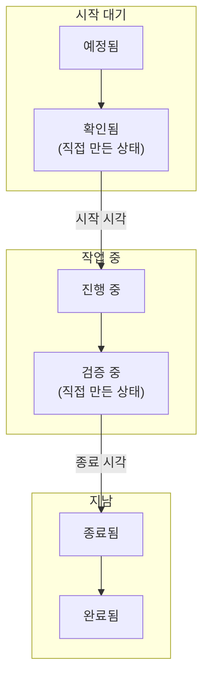

# 유지 관리 상태

모든 예정된 유지 관리 이벤트는 하나의 **상태** 에 있습니다. 작업이 계획에서 승인까지 어디쯤 와 있는지를 나타냅니다. 상태는 OneUptime이 이벤트로 무엇을 할지 결정합니다. 모니터 검사가 언제 멈추는지, 상태 페이지에 무엇이 표시되는지, 리마인더가 언제 멈추는지입니다. 이 페이지에서는 모든 프로젝트가 처음에 가지는 네 가지 상태, 이벤트를 상태 사이에서 옮기는 것, 직접 단계를 추가하는 방법을 설명합니다.

:::cards
- [기본 상태](#기본-상태): 예정됨, 진행 중, 종료됨, 완료됨.
- [이벤트를 옮기는 것](#이벤트를-옮기는-것): 시계, 헤더, 타임라인, 채팅, API.
- [직접 만든 상태](#직접-만든-상태): 작업 시작 전의 단계나 작업 후의 확인.
- [상태 타임라인](#상태-타임라인): 이벤트가 거친 모든 상태와 그 수정 방법.
:::

## 작동 방식

프로젝트의 유지 관리 상태는 하나의 순서 있는 목록이며, 이벤트는 그 목록을 따라 아래로만 이동합니다. 상태가 목록의 어디에 있는지에 따라 그 상태의 이벤트가 무엇으로 간주되는지가 정해집니다. 시작 대기, 진행 중, 지남 중 하나입니다.

`ScheduledMaintenanceState` 모델에는 `name`, `description`, `color`, `order` 와 네 개의 플래그 `isScheduledState`, `isOngoingState`, `isEndedState`, `isResolvedState` 가 있습니다. OneUptime은 이름이 아니라 플래그와 순서를 읽으므로, **완료됨** 의 이름을 "승인됨"으로 바꿔도 아무것도 깨지지 않습니다.

> [!TIP]
> 목록은 **예정된 유지 관리 → 설정 → 이벤트 상태** 에 있습니다. 사이드 메뉴의 **설정** 은 처음에 접혀 있으니 먼저 펼치세요.

## 기본 상태

모든 새 프로젝트는 다음 순서의 유지 관리 상태 네 개로 시작합니다.

| 상태          | `order` | 플래그             | 색상      | 의미                                                           |
| ------------- | ------- | ------------------ | --------- | -------------------------------------------------------------- |
| **예정됨**    | `1`     | `isScheduledState` | `#000000` | 모든 새 이벤트가 여기서 시작하여 시작 시각을 기다립니다.       |
| **진행 중**   | `2`     | `isOngoingState`   | `#ffbf53` | 작업이 진행 중이며, 이벤트의 모니터는 검사되지 않습니다.       |
| **종료됨**    | `3`     | `isEndedState`     | `#4a4a4a` | 기간이 끝나고 검사가 재개됩니다.                               |
| **완료됨**    | `4`     | `isResolvedState`  | `#2ab57d` | 누군가 작업을 승인했으며, 소유자에게 가던 리마인더가 멈춥니다. |

플래그가 있는 네 상태에는 설정 페이지에서 **기본 제공** 태그가 붙습니다. 이름과 색상을 바꾸고 끌어서 옮길 수는 있지만 순서는 유지되며 삭제할 수 없습니다. **삭제** 는 잠긴 상태로 남아 그 이유를 알려 줍니다.

**종료됨** 과 **완료됨** 은 둘 다 지난 상태입니다. 차이는 누가 이벤트를 옮기느냐입니다. OneUptime은 **종료** 시각에 이벤트를 **종료됨** 으로 옮기고, 작업이 확인되면 사람, 채팅 버튼 또는 API가 **완료됨** 으로 옮깁니다.

## 이벤트를 옮기는 것

| 방법             | 위치                                                                                        | 묻는 것                                                                                                         |
| ---------------- | ------------------------------------------------------------------------------------------- | --------------------------------------------------------------------------------------------------------------- |
| **시계**         | 매분 실행되는 작업                                                                          | 없음. **시작** 시각에 대기 중인 이벤트를 **진행 중** 으로, **종료** 시각에 진행 중인 이벤트를 **종료됨** 으로 옮깁니다. |
| **헤더**         | 이벤트의 **개요**: **{{state}}(으)로 표시** 버튼과 **⋯** 메뉴의 **상태 변경**          | 짧은 대화 상자 **예정된 유지 관리를 {{state}}(으)로 표시** 에서 **상태 페이지 구독자에게 알림** 과 **공개 메모 추가** 아래의 선택적 메모를 묻습니다. |
| **타임라인**     | 이벤트 사이드 메뉴의 **상태 타임라인**                                                      | 직접 추가하는 행으로, **예정된 유지 관리 상태** 와 **시작** 을 묻습니다.                                        |
| **일괄 변경**    | 이벤트 목록에서 선택한 항목에 대한 **상태 변경**                                            | 상태, 그리고 모든 이벤트에 추가되는 공개 노트 하나. 이미 그 상태이거나 그 이후인 이벤트는 건너뜁니다.          |
| **채팅**         | Slack 및 Microsoft Teams의 이벤트 메시지에 있는 버튼                                        | 같은 변경을 사용자 이름으로 수행합니다. [Slack](/docs/workspace-connections/slack#slack-에서-인시던트-경고-이벤트-조치하기) 을 참조하세요. |
| **API**          | `/api/scheduled-maintenance-state-timeline` 에서 만든 행                                    | 상태, 그리고 구독자에게 알릴지 여부.                                                                            |

헤더의 버튼은 상태 이름을 따라 이름이 붙습니다. 이벤트가 대기 중일 때는 두 개가 있습니다. 시작하는 버튼은 진행 중 상태의 이름을, 종료하는 버튼은 종료 상태의 이름을 가집니다. 이벤트가 진행 중일 때는 두 번째 버튼만 있습니다. **⋯** 메뉴에는 현재 상태 이후의 다른 모든 상태가 나열됩니다. 역할상 이벤트의 상태를 바꿀 수 없는 사람에게는 버튼이 잠긴 채 표시되고 다른 상태의 메뉴는 없습니다. 버튼을 가리키면 이를 허용하는 권한이 표시됩니다.

## 시작과 종료가 하는 일

이벤트는 대기 상태에서 **진행 중** 으로, 또는 **진행 중** 과 **종료됨** 사이에 둔 직접 만든 상태로 바로 옮겨질 때 시작합니다. 그러면 다음이 일어납니다.

- **모니터 검사가 멈추고**, 이벤트에 **모니터 상태를 다음으로 변경** 이 있으면 그 상태로 바뀝니다. 이벤트가 진행 중일 때 추가한 모니터도 바뀝니다.
- **상태 페이지에 진행 중으로 표시되고**, 구독자가 알림을 받습니다. **이벤트가 시작될 때** 가 켜져 있으면 제시간에, 직접 옮길 때는 대화 상자의 **상태 페이지 구독자에게 알림** 대로 알립니다.
- **소유자가 알림을 받습니다**. 상태 변경 알림을 켜 둔 경우입니다. 그리고 이벤트가 **진행 중인 이벤트** 에 나타납니다.

이벤트는 진행 상태에서 **종료됨**, **완료됨**, 또는 **종료됨** 뒤에 둔 직접 만든 상태로 옮겨질 때 종료됩니다. 그러면 모니터가 다시 검사되고, 진행 중인 다른 이벤트가 아직 잡고 있지 않은 한 정상 작동 상태로 돌아갑니다. 구독자도 같은 방식으로 알림을 받습니다. **이벤트가 종료될 때** 가 켜져 있으면 제시간에, 직접 옮길 때는 대화 상자대로 알립니다.

**진행 중** 에서 "검증 중"으로, 또는 **종료됨** 에서 **완료됨** 으로 넘어가도 다시 시작되거나 종료되는 것은 없습니다. 이벤트는 이미 시작했거나 종료했기 때문입니다.

## 헤더의 시계

시작 전에는 헤더가 시작까지 남은 시간을 셉니다. 진행 중에는 진행된 시간을 세고, 지난 뒤에는 걸린 시간을 알려 줍니다. 이벤트가 경계를 2분 넘게 지나치면 노란색 알림이 이를 알려 줍니다.

- **시작 지연**: 이벤트가 **시작** 시각이 지나도 아직 대기 중입니다.
- **시간 초과**: 이벤트가 **종료** 시각이 지나도 아직 진행 중입니다.

알림에는 계획된 시각과 이벤트가 아직 도달하지 못한 상태가 표시됩니다. 경계 직후에는 이벤트를 옮기는 작업이 아직 실행되지 않았을 수 있으므로, 이후 몇 분 동안 헤더가 스스로 다시 확인하여 새로 고침 없이 새 상태를 보여 줍니다.

## 순서가 강제됩니다

모든 상태 변경은 누가 하든 목록과 대조됩니다. 대시보드, Slack, Microsoft Teams, API, Terraform, 워크플로우, OneUptime 자체 모두 마찬가지입니다.

- **뒤로 이동하는 것은 거부되며**, 두 상태를 모두 밝히는 메시지가 표시됩니다: "Scheduled Maintenance cannot transition to Scheduled state from Ongoing state because Scheduled is before Ongoing in the order of scheduled maintenance states."
- **이미 있는 상태로 이동하는 것은 거부됩니다**: "Scheduled Maintenance state cannot be same as previous state."
- **선택기는 현재 상태 이후의 상태만 제시하므로**, 거부될 이동을 제안받는 사람은 없습니다.

실수로 설정한 상태를 바로잡으려면 이벤트의 **상태 타임라인** 페이지에서 그 행을 삭제합니다. 이벤트는 바로 앞 행의 상태로 돌아갑니다.

## 직접 만든 상태

직접 추가하는 상태는 기본 네 상태에 이름이 없는, 팀이 거치는 단계입니다. 작업 시작 전의 "확인됨", 작업 후의 "검증 중" 같은 것입니다.

:::steps
### 상태 목록 열기

**예정된 유지 관리 → 설정 → 이벤트 상태** 로 이동합니다. **예정된 유지보수 상태** 카드에 상태가 순서대로 나열됩니다. 각 행에는 색상과 이름, 그 상태의 이벤트가 무엇으로 간주되는지(**간주** 열), 설명이 표시됩니다.

### 상태 만들기

**예정된 유지보수 상태 만들기** 를 클릭하고 **이름**, **설명**, **색상** 을 입력합니다. 새 상태는 완료 상태 바로 위에 추가됩니다.

### 끌어서 배치하기

행의 손잡이를 끌어 옮깁니다. 놓는 순간 새 순서가 저장됩니다. **간주** 열은 놓은 위치를 따라 바뀝니다.
:::

추가한 상태에는 플래그가 없으므로, 놓인 위치가 곧 그 의미입니다.

| 놓는 위치                               | 그 상태의 이벤트                                                                                                 |
| --------------------------------------- | ---------------------------------------------------------------------------------------------------------------- |
| **예정됨** 과 **진행 중** 사이          | **예정됨** 처럼 **시작** 시각을 기다리고, 그 시각에 거기서 시작합니다.                                          |
| **진행 중** 과 **종료됨** 사이          | **진행 중** 처럼 진행 중입니다. 모니터는 계속 검사되지 않고, **종료** 시각에 종료됩니다.                         |
| **종료됨** 과 **완료됨** 사이           | 지났지만 아직 완료되지 않았습니다. 완료될 때까지 이어지는 리마인더는 계속됩니다.                                 |
| **완료됨** 아래                         | **완료됨** 처럼 완료된 것입니다.                                                                                 |

직접 만든 상태는 **예정됨** 아래에 두세요. 모든 새 이벤트는 거기서 시작하고, 이벤트는 목록을 다시 위로 올라가지 않으므로 그 위의 상태에는 결코 도달하지 않습니다. 이벤트를 직접 만든 상태로 옮기려면 헤더의 **⋯** 메뉴에서 **상태 변경** 를 사용하세요.

> [!NOTE]
> OneUptime Cloud에서는 유지 관리 상태를 추가하거나 변경하려면 **Growth** 이상의 요금제가 필요합니다. 모든 요금제에서 상태를 읽고, 사용하고, 추가한 상태를 삭제할 수 있습니다.

## 상태 보관

직접 추가한 상태 중 팀에서 더 이상 사용하지 않을 상태는 삭제하는 대신 보관하세요. 보관해도 이벤트는 바뀌지 않습니다. 이 상태의 이벤트는 그대로 유지되고 평소처럼 진행되며, 상태 타임라인에도 계속 표시됩니다.

- **보관**는 행의 **⋯** 메뉴에 있습니다. 먼저 확인을 요청하고, 이 상태를 사용하도록 설정된 측정과 워크플로를 보여 줍니다.
- **아무도 다시 선택할 수 없습니다.** 이벤트 헤더, **상태 변경**, Slack, Microsoft Teams에서 제외되며, API, Terraform, MCP는 거부합니다. 이벤트를 필터링할 때는 계속 사용할 수 있습니다.
- **보관된 상태는 따로 표시됩니다.** 표 아래의 접힌 섹션 **보관된 예정된 유지보수 상태**에 표시됩니다. **보관 취소**로 원래대로 되돌릴 수 있습니다.
- **기본 제공 상태 4개는 보관할 수 없습니다.** OneUptime이 이벤트를 이 상태로 옮기기 때문입니다. 이들의 **보관**는 이유와 함께 잠겨 있습니다.

## 상태 타임라인

이벤트의 **상태 타임라인** 페이지는 이벤트가 거친 모든 상태의 기록입니다. 그 카드인 **상태 타임라인** 은 상태를 타임라인으로 그립니다. 각 상태가 지속된 만큼의 길이를 가진 띠와, 그 아래 최신 항목부터 나열된 모든 변경입니다. 카드 헤더의 **테이블** 은 대신 행으로 나열하며, **예정된 유지 관리 상태**, **시작**, **종료**, **기간**, 구독자에게 알릴 예정이었는지, 알림이 어떻게 되었는지를 보여 줍니다.

대시보드에서는 행을 추가하고 삭제할 수 있지만 편집할 수는 없으며, 이벤트에는 항상 행이 하나 이상 남습니다. API로는 행의 `startsAt` 을 바로잡을 수 있으며, 타임라인에서 계산된 모든 측정이 이를 따릅니다. 최신 행을 삭제하면 이벤트는 그 앞 행의 상태로 돌아갑니다.

> [!WARNING]
> 행을 삭제하면 이벤트의 기록과 그로부터 계산된 모든 측정이 다시 쓰입니다. 실수를 바로잡는 데 쓰고, 정리하는 데는 쓰지 마세요.

## 문제 해결

:::details 헤더에 Start overdue가 표시됩니다
이벤트가 **시작** 시각에서 2분이 넘게 지났는데도 아직 대기 중이므로, 이벤트를 시작하는 작업이 아직 옮기지 않은 것입니다. 헤더의 버튼으로 직접 시작하세요. 직접 시작하면 모니터 처리를 포함해 작업이 하는 일을 모두 수행합니다.
:::

:::details 이벤트를 전에 있던 상태로 되돌릴 수 없습니다
상태는 목록을 아래로만 이동합니다. 이벤트의 **상태 타임라인** 페이지에서 원하는 상태 이후의 행을 최신 행부터 삭제하세요.
:::

:::details 헤더 버튼에 완료 상태가 없습니다
헤더의 버튼은 이벤트를 시작하고 종료합니다. 완료하려면 **⋯** 메뉴의 **상태 변경** 를 사용하세요.
:::

## 다음 단계

:::cards
- [예정된 유지 관리 개요](/docs/scheduled-maintenance/index): 모든 기능의 위치와 이벤트가 영향을 주는 것.
- [유지 관리 이벤트 만들기](/docs/scheduled-maintenance/creating-events): 양식의 각 필드.
- [유지 관리 규칙 및 설정](/docs/scheduled-maintenance/settings): 이벤트가 완료될 때까지 소유자에게 리마인더를 보냅니다.
- [인시던트 상태 및 심각도](/docs/incidents/states-and-severities): 인시던트용으로 같은 순서 있는 목록.
:::
