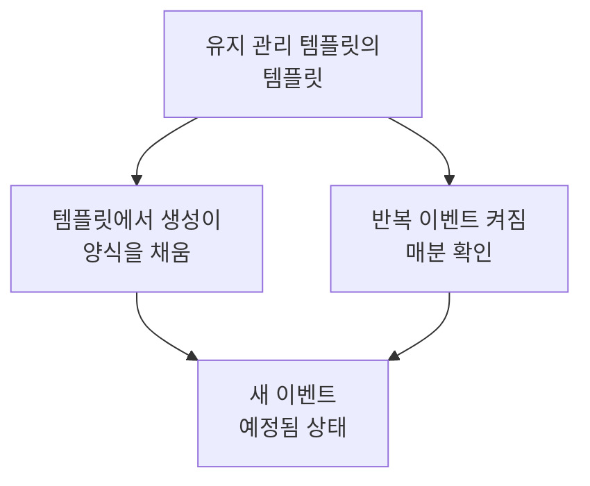

# 템플릿 및 반복 이벤트

예정된 유지 관리 템플릿은 자주 계획하는 이벤트를 저장합니다. 제목과 설명, 일시 중지하는 모니터, 표시되는 상태 페이지, 알림을 받는 사람입니다. 템플릿을 사용하면 클릭 한 번으로 양식을 채울 수 있고, 반복으로 설정하면 OneUptime이 매주, 매월 또는 원하는 간격으로 이벤트를 대신 예약합니다.

:::cards
- [템플릿 만들기](#템플릿-만들기): 앞에는 이름, 끝에는 일정이 있는 양식 단계.
- [템플릿 사용하기](#템플릿-사용하기): 템플릿으로 새 이벤트를 채웁니다.
- [반복 이벤트](#반복-이벤트): OneUptime이 이벤트를 스스로 예약하게 합니다.
- [템플릿 변경 또는 중지하기](#템플릿-변경-또는-중지하기): 편집, 일정 일시 중지, 삭제.
:::

## 작동 방식

템플릿은 출발점입니다. 템플릿으로 만든 이벤트는 고유한 값을 가진 사본이므로, 나중에 템플릿을 바꾸면 그 이후에 만들어지는 이벤트만 바뀝니다.

## 시작하기 전에

- **요금제.** OneUptime Cloud에서 템플릿을 사용하려면 **Growth** 이상의 요금제가 필요합니다.
- **역할.** 템플릿을 만들려면 **프로젝트 소유자**, **프로젝트 관리자**, **프로젝트 구성원**, **예정된 유지 관리 관리자**, **예정된 유지 관리 구성원** 중 하나이거나 예정된 유지 관리 템플릿을 만들 수 있는 사용자 지정 역할이 필요합니다.

## 템플릿 만들기

:::steps
### 템플릿 열기

**예정된 유지 관리 → 설정 → 유지 관리 템플릿** 으로 이동합니다. 사이드 메뉴의 **설정** 은 처음에 접혀 있으니 먼저 펼치세요. **예정된 유지 관리 템플릿 만들기** 를 클릭합니다.

### 템플릿 이름 지정하기

**템플릿 정보** 에서 **템플릿 이름** 과 **템플릿 설명** 을 입력하여 팀이 언제 사용할지 알 수 있게 합니다. 둘 다 필수입니다.

### 이벤트 설명하기

**유지 관리 세부 정보** 에서 템플릿으로 만드는 모든 이벤트가 처음 가질 **제목** 과 **설명** 을 입력합니다. **소유자** 와 **레이블** 은 **추가 필드** 아래에 있습니다.

### 영향을 주는 대상 선택하기

**영향받는 리소스** 에서 **모니터**, 그 모니터의 **모니터 상태를 다음으로 변경**, 필요하면 **기타 영향받는 리소스**, **이 상태 페이지에 이벤트 표시** 의 상태 페이지, **구독자 알림** 을 선택합니다.

### 반복 여부 정하기

**반복** 에서 직접 사용할 템플릿이라면 **반복 이벤트** 를 끈 채로 두고, 반복하려면 켠 다음 반복 주기와 **시간대** 를 고르고, **첫 번째 이벤트** 에서 첫 이벤트의 시각을 정합니다. **다음** 을 클릭하여 검토 화면을 확인한 다음 템플릿을 만듭니다.
:::

템플릿은 모니터를 지정하지 않아도 **모니터 상태를 다음으로 변경** 을 묻습니다. 이 상태는 템플릿으로 이벤트를 예약할 때 추가하는 모니터에도 적용됩니다. **기타 영향받는 리소스** 에서 템플릿이 받는 것은 호스트, Kubernetes 클러스터, Docker 호스트, Podman 호스트, 서비스입니다.

## 템플릿이 채우는 것

| 이벤트의 부분                                     | 템플릿에서 생성                      | 반복 이벤트                     |
| ------------------------------------------------- | ------------------------------------ | ------------------------------- |
| **제목** 과 **설명**                              | 채워지며 변경 가능                   | 복사됨                          |
| **모니터** 와 **모니터 상태를 다음으로 변경**     | 채워짐                               | 복사됨                          |
| **기타 영향받는 리소스**                          | 채워짐                               | 복사됨                          |
| 상태 페이지와 **구독자 알림**                     | 채워짐                               | 복사됨                          |
| **소유자** 와 **레이블**                          | 채워짐                               | 복사됨                          |
| **시작** 과 **종료**                              | 다음 정시부터 한 시간                | 일정에 따라 계산됨              |

## 템플릿 사용하기

:::steps
### 템플릿 선택하기

**예정된 유지 관리 → 모든 유지 관리 이벤트** 에서 **템플릿에서 생성** 을 클릭하고 **예정된 유지 관리 템플릿 선택** 에서 템플릿을 고릅니다.

### 양식 확인하기

**템플릿에서 생성** 을 클릭합니다. 템플릿의 답변이 채워진 상태로 만들기 양식이 열립니다. 기간을 설정하고 이 이벤트에 필요한 것을 바꿉니다.

### 이벤트 만들기

**다음** 으로 단계를 진행한 다음 검토 화면에서 **유지 관리 이벤트 만들기** 를 클릭합니다.
:::

프로젝트에 아직 템플릿이 없으면 **템플릿에서 생성** 이 그렇다고 알려 주고 **유지 관리 템플릿** 으로 연결합니다.

## 반복 이벤트

반복 템플릿은 일정에 따라 이벤트를 만듭니다. 얼마나 자주 반복할지, 어느 시간대를 따를지, 그리고 첫 번째 이벤트가 언제 만들어지고, 언제 시작하고, 언제 끝나는지 설정하면, 이후의 각 이벤트는 첫 번째 이벤트를 그 시간대의 달력에서 주기 단위로 옮긴 것으로, 같은 시각에 진행됩니다.

| 필드                                                     | 의미                                                                                               |
| -------------------------------------------------------- | -------------------------------------------------------------------------------------------------- |
| **반복 이벤트**                                          | 일정을 켭니다.                                                                                     |
| **이 이벤트가 얼마나 자주 반복되기를 원하십니까?**       | 숫자와 단위입니다. 단위는 시간, 일, 주, 월, 년입니다.                                              |
| **시간대**                               | 이벤트가 같은 시각을 유지하는 시간대입니다. 새 템플릿은 여러분의 시간대로 시작합니다.               |
| **첫 번째 이벤트 예약 시각**                             | OneUptime이 첫 번째 이벤트를 만드는 시각이며, 구독자가 예약 소식을 듣는 시각이기도 합니다.          |
| **첫 번째 이벤트 시작 시각**                             | 첫 번째 이벤트가 시작하는 시각입니다.                                                              |
| **첫 번째 이벤트 종료 시각**                             | 첫 번째 이벤트가 종료하는 시각입니다.                                                              |

처음 세 항목은 **반복** 단계에 있습니다. 첫 이벤트의 시각은 **첫 번째 이벤트** 단계에 있으며, 이 단계는 **반복 이벤트** 를 켜면 나타납니다.

예를 들어 첫 번째 이벤트를 월요일에 만들고 그 주 토요일에 진행하는 매주 기간은 다음과 같습니다.

| 이벤트       | 만들어짐           | 시작               | 종료               |
| ------------ | ------------------ | ------------------ | ------------------ |
| 첫 번째      | `2030-06-03 09:00` | `2030-06-08 02:00` | `2030-06-08 04:00` |
| 두 번째      | `2030-06-10 09:00` | `2030-06-15 02:00` | `2030-06-15 04:00` |

각 이벤트는 일광 절약 시간으로 시계가 바뀔 때도 템플릿 시간대에서 첫 번째 이벤트의 시각을 유지합니다. 베를린에서 02:00부터 04:00까지 진행되는 유지 관리는 여름에도 겨울에도 그곳에서 02:00부터 04:00까지입니다. 몇몇 날은 다음과 같이 처리됩니다.

- **그 달에 없는 날.** 29일, 30일 또는 31일의 매월 이벤트는 더 짧은 달에는 그 달의 마지막 날(예: 4월 30일 또는 2월 28일)이 되고, 그 날이 있는 달에는 원래 날로 돌아옵니다. 2월 29일의 매년 이벤트는 다른 해에는 2월 28일이 됩니다.
- **시계가 앞당겨지는 밤.** 그날 밤에 없는 시각(02:00이 03:00으로 건너뛸 때의 02:30 등)은 건너뛴 만큼 뒤로 밀려 03:30이 됩니다. 그 때문에 시작이 끝보다 늦어지는 이벤트는 첫 번째 이벤트의 길이를 유지합니다.
- **시계가 되돌려지는 밤.** 그날 밤에 두 번 있는 시각(뉴욕의 01:30 등)은 둘 중 첫 번째입니다.
- **몇 시간마다.** 시간은 흐른 만큼 세므로, 몇 시간마다 반복하는 템플릿은 시계가 바뀌면 시계상으로 한 시간 이동합니다.
- **일광 절약 시간이 없는 시간대.** 더 이상 시계를 바꾸지 않는 시간대(2026년 11월 이후의 브리티시컬럼비아(America/Vancouver) 등)는 같은 오프셋을 유지하므로 아무것도 이동하지 않습니다.

템플릿에 시간대가 생기기 전에 만든 템플릿에는 **UTC** 가 표시됩니다. 그때까지 이벤트를 계산하던 시간대입니다. 시각을 의도했던 시간대를 고르면, 다음 이벤트부터 각 이벤트가 그곳에서 첫 번째 이벤트의 시각을 유지합니다.

**첫 번째 이벤트 예약 시각** 은 고객이 작업 소식을 듣기를 원하는 만큼 시작보다 앞서 설정하세요. 템플릿을 만들 때 세 시각은 모두 미래여야 하고, 이벤트는 시작과 종료 전에 만들어져야 하며, 종료 전에 시작해야 합니다. 어떤 규칙을 어겼는지는 양식이 알려 줍니다.

작업이 매분 반복 템플릿을 확인합니다. 템플릿의 다음 시각이 되면 이벤트를 만들고, 그 시각을 일정의 다음 이벤트로 옮깁니다. 템플릿 목록은 그 시각을 **반복 이벤트** 열에 표시하고, 반복하지 않는 템플릿에는 **아니오** 를 표시합니다. 일정으로 만들어진 이벤트도 다른 이벤트와 같습니다. 규칙이 실행되고, 소유자가 추가되며, 구독자는 이벤트가 예약되었다는 알림을 받습니다.

## 템플릿 변경 또는 중지하기

목록에서 템플릿을 열면 그 페이지가 표시됩니다.

- **예정된 유지 관리 템플릿 세부 정보** 는 새 이벤트가 무엇으로 시작하는지 보여 줍니다. 그 **편집** 은 **템플릿 정보**, **유지 관리 세부 정보**, **상태 페이지**, **반복** 을 차례로 거치며, 반복하는 템플릿은 이어서 **첫 번째 이벤트** 를 거칩니다.
- **영향받는 리소스** 에는 **모니터**, 그 **모니터 상태를 다음으로 변경**, **기타 영향받는 리소스** 가 있으며, 자체 **편집** 이 있습니다.
- **소유자** 에는 템플릿으로 예약되는 모든 이벤트를 소유하는 사람과 팀이 나열됩니다.

변경 사항은 저장한 뒤에 만들어지는 이벤트에 적용되고, 이미 만들어진 이벤트는 고유한 값을 유지합니다. 일정을 멈추려면 **편집** 에서 **반복 이벤트** 를 끄거나 템플릿을 삭제하세요. 끈 템플릿은 일정을 유지합니다. 다시 켜면 일정의 다음 시각부터 이어지며, 꺼져 있던 동안의 시각은 건너뜁니다. 템플릿을 삭제해도 그 템플릿이 만든 이벤트는 남습니다.

## 문제 해결

:::details 반복 템플릿을 만들 때 시각이 미래여야 한다고 표시됩니다
만들 때 세 개의 첫 시각이 모두 현재보다 뒤여야 합니다. 시각을 앞으로 옮기세요. 그러면 일정은 첫 번째 이벤트부터 이어집니다.
:::

:::details 반복 템플릿이 이벤트를 만들지 않았습니다
**반복 이벤트** 가 아직 켜져 있는지 확인하고, 목록의 **반복 이벤트** 열에 있는 시각을 보세요. 이벤트는 시작 시각이 아니라 그 시각에 만들어집니다. 작업은 매분 실행되므로 1분 정도 기다리세요.
:::

:::details 시계가 바뀐 뒤 반복 템플릿의 이벤트가 한 시간 이르거나 늦습니다
템플릿을 열고 **시간대** 를 확인하세요. 그 이벤트는 그 시간대에서 첫 번째 이벤트의 시각을 유지합니다. 템플릿에 시간대가 생기기 전에 만든 템플릿에는 **UTC** 가 표시됩니다. 시각을 의도했던 시간대를 고르세요. 이미 만들어진 이벤트는 시각이 그대로입니다.
:::

:::details 템플릿으로 만든 이벤트에 선택한 리소스가 없습니다
템플릿의 **기타 영향받는 리소스** 가 받는 것은 호스트, Kubernetes 클러스터, Docker 호스트, Podman 호스트, 서비스입니다. 다른 종류의 리소스는 이벤트의 **영향받는 리소스** 카드에 있는 **편집** 으로 이벤트 자체에 추가하세요.
:::

## 다음 단계

:::cards
- [유지 관리 이벤트 만들기](/docs/scheduled-maintenance/creating-events): 템플릿이 채우는 양식.
- [유지 관리 상태](/docs/scheduled-maintenance/states): 만들어진 뒤 각 이벤트가 어떻게 진행되는지.
- [유지 관리 규칙 및 설정](/docs/scheduled-maintenance/settings): 모든 새 이벤트에 소유자와 레이블을 자동으로 추가합니다.
- [예정된 유지 관리 개요](/docs/scheduled-maintenance/index): 유지 관리 전체에서 템플릿이 차지하는 자리.
:::
